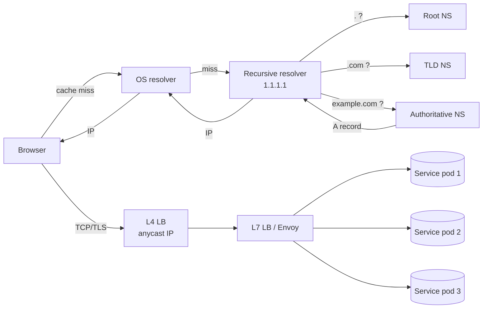

## Definition (interview-ready)

**DNS** is a hierarchical, distributed key-value store mapping names to records (A, AAAA, CNAME, MX, TXT, SRV). **Load balancing** distributes traffic across backends; **L4** decides based on TCP/UDP (IP+port), **L7** decides based on HTTP content (path, headers, cookies). **Consistent hashing** is a placement algorithm that minimizes key remapping when nodes are added or removed: adding one node to N moves only about 1/N of the keys.

**One-liner:** DNS turns a name into an IP address through a cached hierarchy of nameservers; a load balancer then spreads traffic across backends, by IP and port at L4 or by HTTP content at L7; and consistent hashing decides which node owns a key so that resizing the cluster moves only about 1/N of the keys.

## Why it matters

Every request begins with DNS and ends at a load balancer. If you can't explain the path from `api.example.com` to a specific pod, you can't debug latency, blue-green deploys, sticky sessions, or "why is one shard hot." Consistent hashing is the algorithm behind caches, sharded databases, and DHTs.



## Core concepts

### DNS — the journey of a lookup

```
Browser cache → OS cache → /etc/hosts → recursive resolver (ISP / 1.1.1.1)
                                          → root nameservers (.)
                                          → TLD nameservers (.com)
                                          → authoritative nameservers (example.com)
                                          → A record for api.example.com
```

The recursive resolver does the hard work and caches based on **TTL**.

### Key record types

- **A**: name → IPv4
- **AAAA**: name → IPv6
- **CNAME**: alias to another name. Can't coexist with other records at the same name.
- **MX**: mail exchange (with priority)
- **TXT**: arbitrary text (SPF, DKIM, domain ownership proofs)
- **SRV**: service location (host + port + priority + weight). Used in legacy directory systems and some service discovery.
- **NS**: which nameservers are authoritative for the zone.
- **CAA**: which CAs are allowed to issue certs for this domain.

### DNS-based load balancing

- **Round-robin DNS**: return multiple A records, client picks one. Cheap, no LB needed, but no health checks.
- **GeoDNS / weighted**: return different answers based on client location (Route 53, Cloudflare). Used for global multi-region routing.
- **Anycast DNS**: same IP advertised from multiple locations via BGP. Closest one wins. How 1.1.1.1 and 8.8.8.8 work.

### L4 load balancing (transport layer)

- Decides based on **IP + port** at the TCP/UDP layer.
- Packet-forwarding L4 LBs (IPVS, AWS NLB, Google Maglev) don't terminate the connection; proxy-style ones (HAProxy TCP mode) terminate TCP but never parse the payload.
- Fast, cheap, protocol-agnostic.
- Examples: AWS NLB, HAProxy in TCP mode, Linux IPVS, kube-proxy.
- Algorithms: round robin, least-connections, source-IP hash.

### L7 load balancing (application layer)

- Terminates TCP+TLS, parses HTTP, decides based on **path, headers, cookies, method**.
- Can do: path-based routing, A/B testing, sticky sessions via cookie, request mirroring, rate limiting, WAF.
- Examples: AWS ALB, Nginx, Envoy, HAProxy in HTTP mode, Istio gateway.
- Cost: more CPU; needs a TLS cert.

### Consistent hashing

Naive sharding: `node = hash(key) % N`. Add a node → almost every key remaps. Catastrophic for caches.

**Consistent hashing**: place both keys and nodes on a ring (a hash space such as 0 to 2^32 − 1 that wraps around). A key goes to the next node clockwise on the ring.

- Add a node: only ~1/N of keys move (the ones now closer to the new node).
- Remove a node: only its keys move.

**Virtual nodes** (vnodes): each physical node owns many points on the ring. Spreads load evenly even if you have few physical nodes, and lets you reshard without bias.

**Used by**: Memcached clients (ketama), Cassandra, Amazon's Dynamo (the design behind DynamoDB), CDN cache shard selection, Discord's guild routing. Redis Cluster uses a related idea: 16,384 fixed hash slots assigned to nodes, so resharding moves whole slots rather than every key.

### Rendezvous hashing (HRW)

Alternative: for each key, hash `(key, node)` for every node and pick the highest. Same minimal-remapping property, simpler logic, no ring data structure. Used in some CDNs, distributed caches and load balancers.

## How it works (a request's full path)

1. Client resolves `api.example.com` → IP of L7 LB (via DNS).
2. Client opens TCP to LB.
3. LB terminates TLS, reads the request path and headers, picks an upstream pool.
4. LB picks a specific backend (least-connections, round-robin, EWMA).
5. LB opens a separate TCP connection to the backend (or reuses one from its pool).
6. Backend responds → LB streams response back → client.

## Real-world examples

- **AWS**: Route 53 (DNS), NLB (L4), ALB (L7), CloudFront (CDN with edge routing).
- **GCP**: Cloud Load Balancing with global anycast — one IP, lowest-latency region selected automatically.
- **Discord**: uses a consistent hash ring to find which Elixir node owns each guild (server); all events for that guild are handled by the process on that node. Adding capacity moves ~1/N guilds.
- **Memcached clients**: use ketama (consistent hashing) so adding a Memcached node doesn't invalidate the whole cache.

## Common pitfalls

- **DNS TTL**: clients (especially JVMs!) ignore the record TTL — the JDK caches successful lookups for 30 s by default, and *forever* when a security manager is installed (older setups; the security manager is deprecated), unless `networkaddress.cache.ttl` is tuned. Failover can stall long after the DNS change.
- **CNAME at apex**: you can't put a CNAME at the root `example.com` (RFC 1034: a CNAME can't share a name with other records, and the apex must hold SOA and NS). Use `ALIAS` / `ANAME` from the DNS provider, or A records.
- **L4 LB + sticky sessions**: L4 can do source-IP hash, but NATs (corporate networks, mobile carriers) collapse many users to one IP — unbalanced.
- **L7 LB + WebSockets**: most support it, but configuration is finicky (upgrade headers, longer timeouts).
- **Consistent hashing without vnodes**: skew. A 3-node ring with 3 points gives ~25% / 30% / 45% load distribution easily.
- **DNS as service discovery**: DNS clients cache aggressively — a removed pod's IP can linger and you get connection-refused. Use a real service discovery system (Consul, k8s headless services, Eureka) for fast-moving backends.

## Practice questions

<Practice>

<QA q="What's the difference between L4 and L7 load balancing?" level="easy">

L4 routes by IP + port at the transport layer: fast, protocol-agnostic, no payload inspection. L7 terminates the connection (TCP + TLS) and routes by HTTP semantics (path, headers, cookies, method). It costs more CPU but enables path-based routing, A/B tests, cookie-based sticky sessions, rate limiting and WAF.

</QA>

<QA q="What is a CNAME and when can't you use one?" level="easy">

A CNAME is a DNS alias from one name to another, and it can't coexist with other records at the same name. So you **cannot** put a CNAME at the zone apex (`example.com`): it would conflict with the SOA/NS records that must live there. Use A records, or your DNS provider's ALIAS/ANAME.

</QA>

<QA q="What is round-robin DNS and what are its limits?" level="easy">

The authoritative server returns multiple A records and the client picks one, which spreads load with no LB at all. Limits: **no health checks** (a dead IP keeps being handed out until you edit the record), no awareness of backend load, and resolver and client caching mean changes only take effect as TTLs expire.

</QA>

<QA q="How does anycast work, and where is it used?" level="easy">

The **same IP** is advertised from many locations via BGP, and the internet routes each client to the topologically closest one. That's how public resolvers like 1.1.1.1 and 8.8.8.8 work, and how global load balancers (e.g. GCP Cloud Load Balancing) expose one IP that lands users in a nearby region.

</QA>

<QA q="Why use consistent hashing instead of `hash(key) % N`?" level="medium">

With modular hashing, adding or removing a node remaps nearly every key: a mass cold start for a cache, or a massive rebalance for a sharded DB. Consistent hashing puts keys and nodes on a ring, and each key goes to the next node clockwise, so adding a node moves only ~1/N of keys and removing one moves only its own keys.

</QA>

<QA q="What are virtual nodes, and why does consistent hashing need them?" level="medium">

With one ring point per physical node, the arcs between points are uneven, so load is skewed (a 3-node ring can easily split ~25% / 30% / 45%). Virtual nodes give each physical node many points on the ring (typically 100–200), which averages out arc sizes. They also spread a departing node's keys across many neighbours instead of dumping them all on one.

</QA>

<QA q="Walk through what happens from typing `api.example.com` until your TCP SYN reaches a server." level="medium">

Browser cache → OS cache (and `/etc/hosts`) → recursive resolver (possible cache hit) → root nameservers → `.com` TLD nameservers → `example.com` authoritative nameservers → A record returned and cached per TTL → browser opens TCP to that IP, which is usually the load balancer → the LB picks a backend (round robin, least connections, EWMA) and uses its own connection to it.

</QA>

<QA q="How would you do blue-green deploys with DNS?" level="medium">

Run two environments, blue (live) and green (new), and cut over by pointing DNS at green. Risks: long TTLs (and clients that ignore them) make the rollover slow, and rollback is TTL-bound too. Prefer LB-based cutover (instant) when you need fast feedback; DNS is fine for slow, planned migrations.

</QA>

<QA q="Compare consistent hashing with rendezvous (HRW) hashing." level="hard">

Both remap only the minimum number of keys when nodes change. Consistent hashing needs a sorted ring and vnode tuning to balance well, but lookups are a fast binary search. HRW hashes `(key, node)` for every node and picks the highest: O(N) per lookup, but trivial to implement, needs no ring or vnodes, and is naturally balanced. HRW wins for small N; a well-tuned ring wins for very large N.

</QA>

<QA q="Why do JVM services sometimes keep calling an old IP long after a DNS change?" level="hard">

The JVM caches DNS itself and ignores the record's TTL: by default the JDK caches successful lookups for 30 s, and **forever** when a security manager is installed, unless `networkaddress.cache.ttl` is set. Connection pools holding long-lived connections to the old IP make it worse. Tune the cache TTL and recycle pooled connections so failovers actually take effect.

</QA>

<QA q="A cache cluster uses consistent hashing and one node has 3x the load of the others. Why, and what do you do?" level="scenario">

- **Hot keys**: one key gets most of the traffic, and all of it lands on one node. Fix with key splitting (replicate the key under suffixes) or a local in-process cache.
- **Too few vnodes**: uneven arcs. Raise vnodes per node (100–200 is typical).
- **Poor hash function**: a skewed distribution. Use a well-mixed hash.

Check the per-key request distribution first, since hot keys are the most common cause.

</QA>

<QA q="Your L7 LB shows healthy backends but users see 502s. What do you check?" level="scenario">

- **Health check mismatch**: the probe hits a path or protocol that passes (e.g. a trivial endpoint) while real request paths fail.
- **Idle timeout mismatch**: the backend closes a keep-alive connection just as the LB sends a request on it. Make the backend's idle timeout longer than the LB's.
- **Upstream connection pool exhaustion.**
- **TLS problems on the LB → backend leg** (cert, SNI).
- **Slow or stale DNS** inside the LB when resolving the backend pool.
- A stuck stream on an HTTP/2 upstream connection.

</QA>

<QA q="You use DNS for service discovery in a fast-scaling Kubernetes cluster and see connection-refused errors after scale-downs. What's happening, and what should you use instead?" level="scenario">

DNS clients and resolvers cache aggressively, so a removed pod's IP lingers in caches and clients keep dialing it. DNS suits slow-moving endpoints. For fast-moving backends use a real discovery mechanism that pushes updates: Kubernetes endpoints with client-side or mesh load balancing, Consul, or Eureka. Combine it with retries on connection errors and with health checking.

</QA>

</Practice>

## Quiz

<Quiz>

<MCQ q="You need to route /api/* and /static/* to different backend pools. What do you need?" options={["An L4 load balancer with source-IP hashing", "An L7 load balancer", "Round-robin DNS with two A records", "Anycast"]} answer={1}>

Path-based routing requires parsing HTTP, which only an L7 LB does after terminating the connection. L4 sees only IP and port, and DNS and anycast operate before any HTTP request exists.

</MCQ>

<MCQ q="Why can't you put a CNAME at the zone apex, example.com?" options={["CNAMEs only work for subdomains of length 3 or more", "The apex must hold SOA and NS records, and a CNAME cannot coexist with other records at the same name", "Browsers refuse to follow CNAMEs at the apex", "CNAMEs are only valid for mail servers"]} answer={1}>

A CNAME must be the only record at its name, but the apex always has SOA and NS records. Providers work around it with ALIAS/ANAME or plain A records.

</MCQ>

<MCQ q="A cache cluster goes from 10 to 11 nodes. With consistent hashing, roughly what fraction of keys move?" options={["About 1/11", "About 10/11", "About half", "None"]} answer={0}>

Only keys whose next-clockwise node is now the new node move, about 1/N. With hash mod N, nearly all keys (about 10/11) would remap, which is exactly what consistent hashing avoids.

</MCQ>

<MCQ q="A 3-node consistent hash ring shows a 25 / 30 / 45 percent load split with no hot keys. What is the most likely fix?" options={["Switch to hash mod N", "Lower the DNS TTL", "Move to an L4 load balancer", "Give each node many virtual nodes on the ring"]} answer={3}>

With one point per node, the arcs are uneven by chance. Vnodes (100–200 per node) average out arc sizes. Hash mod N reintroduces mass remapping, and DNS and LB layer choices don't affect key placement.

</MCQ>

<MCQ q="Which statement about rendezvous (HRW) hashing is correct?" options={["It needs a sorted ring and virtual nodes to balance load", "It remaps every key when a node is added", "It scores every node for each key and picks the highest, so lookup is O(N)", "It only works with exactly 3 nodes"]} answer={2}>

HRW hashes (key, node) for each node and picks the max. It's naturally balanced without vnodes and remaps minimally, at the cost of O(N) work per lookup.

</MCQ>

<MCQ q="You flip DNS to a new IP for a failover, but a Java service keeps calling the old IP well past the record TTL. Most likely cause?" options={["The authoritative server ignored the change", "The JVM's own DNS cache (networkaddress.cache.ttl) is overriding the record TTL", "TCP congestion control is pinning the old route", "Anycast routed the request to the old region"]} answer={1}>

The JDK caches lookups itself (30 s by default, forever with a security manager) regardless of the record's TTL, and pooled connections stick to the old IP. The other options don't explain a client-side delay.

</MCQ>

<MCQ q="What is a key weakness of round-robin DNS as a load balancer?" options={["It requires TLS termination", "It can only return a single IP", "It inspects HTTP headers, which adds latency", "It has no health checks, so dead backends keep being handed out"]} answer={3}>

Round-robin DNS just returns several A records. It doesn't know whether a backend is alive or loaded, and cached answers persist for the TTL. It doesn't terminate TLS or read HTTP.

</MCQ>

<MCQ q="An L4 LB uses source-IP hashing for stickiness and one backend is overloaded. What is a likely cause?" options={["Many users behind one NAT share the same source IP", "The LB is parsing cookies incorrectly", "The DNS TTL is too short", "HTTP/2 is multiplexing requests"]} answer={0}>

Corporate networks and mobile carriers put many users behind one IP, so source-IP hashing sends them all to one backend. An L4 LB doesn't read cookies, and DNS TTL has nothing to do with the hash distribution.

</MCQ>

</Quiz>

## TL;DR cheat sheet

- DNS = distributed hierarchical lookup with TTL-based caching. Records: A, AAAA, CNAME, MX, TXT, SRV.
- L4 = IP+port, L7 = HTTP semantics. L7 needs TLS termination.
- LB algorithms: round-robin, least-connections, least-response-time, source-IP hash, EWMA.
- Consistent hashing: place nodes on a ring; key → next node clockwise. Adding a node remaps ~1/N keys.
- Use **virtual nodes** for even distribution; expect 100–200 vnodes per physical node.
- Rendezvous hashing: simpler alternative, O(N) per lookup, naturally balanced.

## Go deeper

- **System Design Primer** [load balancing](https://github.com/donnemartin/system-design-primer#load-balancer), [DNS](https://github.com/donnemartin/system-design-primer#domain-name-system).
- **ByteByteGo** YouTube: load balancing algorithms, DNS deep dives.
- **Discord engineering**: ["How Discord Scaled Elixir to 5,000,000 Concurrent Users"](https://discord.com/blog/how-discord-scaled-elixir-to-5-000-000-concurrent-users) — covers the consistent hash ring used for routing.
- **Original paper**: Karger et al, [*Consistent Hashing and Random Trees*](https://cs.brown.edu/courses/csci2950-u/f09/papers/chash97stoc.pdf) (STOC 1997, MIT — the basis of Akamai).
- **Cloudflare**: [How DNS works](https://www.cloudflare.com/learning/dns/what-is-dns/), [Anycast](https://www.cloudflare.com/learning/cdn/glossary/anycast-network/).
