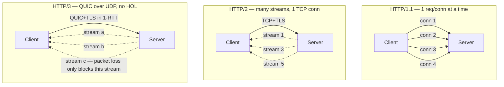

## Definition (interview-ready)

**HTTP/1.1** is text-based, one request per connection at a time (or pipelined poorly). **HTTP/2** is binary, multiplexes many streams over a single TCP connection, and adds header compression. **HTTP/3** keeps HTTP/2's semantics but runs on **QUIC** (UDP-based), eliminating TCP head-of-line blocking and combining the transport + TLS handshake into one round trip.

## Why it matters

A backend dev needs to understand:
- Why connection pooling and keep-alive exist
- Why HTTP/2 didn't really fix the latency problem under loss
- Why HTTP/3 / QUIC is showing up in load balancers, CDNs, and gRPC
- Why gRPC requires HTTP/2 and what that means for proxies


- When SSE / long-polling / WebSockets break under HTTP/2 multiplexing

## Core concepts

### HTTP/1.1 (1997)

- **Text protocol**: `GET /foo HTTP/1.1\r\n...`. Easy to debug with `curl` and `telnet`.
- **One request in flight per connection.** Browsers open ~6 parallel connections per origin to parallelize.
- **Keep-alive** reuses the TCP connection across requests (default on since 1.1).
- **Pipelining** (send next request before response arrives) exists in the spec but is broken in practice — disabled in all major browsers.
- **Head-of-line blocking** at the application layer: slow response holds up next request on the same connection.

### HTTP/2 (2015, RFC 7540; now RFC 9113)

- **Binary framing**: frames (`HEADERS`, `DATA`, `SETTINGS`, ...) over a single TCP connection.
- **Streams**: independent bidirectional sequences of frames. Many streams per connection — true multiplexing.
- **HPACK header compression** — huge win when clients send the same headers (cookies, auth) repeatedly.
- **Server push**: server can send resources before the client asks. Largely deprecated — Chrome removed it; replaced by 103 Early Hints.
- **Stream prioritization**: clients hint which streams matter more (rarely used well in practice — RFC 9113 deprecated the original scheme in favor of RFC 9218's simpler `priority` header).
- **TCP HOL blocking remains**: if one packet is lost, *all* streams on the connection stall waiting for retransmit, even though HTTP/2 fixed the application-level HOL.

### HTTP/3 (2022, RFC 9114) — HTTP over QUIC

- **QUIC** = UDP-based reliable transport with built-in TLS 1.3.
- Each QUIC stream has independent reliability — packet loss on stream A doesn't stall stream B.
- **0-RTT** handshake on resumption: cached connection, no round trip before first byte.
- **Connection migration**: connection survives client IP change (Wi-Fi → LTE). Identified by connection ID, not 4-tuple.
- Encryption is **mandatory** — there is no plaintext HTTP/3.

### What didn't change

The HTTP **semantics** (methods, headers, status codes) are the same across all three versions. What changed is the wire format and transport.

## How it works (the key mental model)

```
HTTP/1.1:  [TCP] [TLS] [HTTP text]                  — one req per conn at a time
HTTP/2:    [TCP] [TLS] [HTTP/2 binary frames]       — N streams per conn (TCP HOL)
HTTP/3:    [UDP] [QUIC (includes TLS 1.3)] [HTTP]   — N independent streams (no TCP HOL)
```

## Real-world examples

- **Browsers**: prefer h3 → h2 → h1 via ALPN negotiation in TLS or `Alt-Svc` headers.
- **gRPC**: requires HTTP/2. gRPC-web exists because browser APIs (fetch/XHR) don't expose the HTTP/2 features gRPC relies on (trailers, full-duplex streaming).
- **CDNs**: Cloudflare, Fastly, Akamai all serve HTTP/3 at the edge to mobile clients (where lossy networks make QUIC's per-stream reliability shine).
- **YouTube, Facebook, Google Search**: heavy QUIC users; Google built QUIC before it was standardized.

## Common pitfalls

- **Load balancer terminates HTTP/2 → upstream HTTP/1.1**: you lose stream multiplexing and may see degraded throughput. Check upstream protocol if performance regresses after enabling h2 at the edge.
- **HTTP/2 with one connection breaks LB algorithms** that assume `connection = request`. A single client can monopolize a backend. Use stream-aware proxies.
- **Long-lived h2 connection + flaky network** = catastrophic HOL stall. h3 fixes this.
- **Server push abuse**: pushing CSS/JS the client already cached just wastes bandwidth. Use 103 Early Hints instead.
- **gRPC + HTTP/1.1 proxy**: silent failure. Always verify the entire path supports h2.

## Practice questions

<Practice>

<QA q="Why is HTTP/2 faster than HTTP/1.1?" level="easy">

Three reasons: (a) multiplexing many streams over one connection removes application-level head-of-line blocking and the need for ~6 parallel TCP connections, (b) HPACK header compression shrinks requests dramatically for cookie-heavy traffic, (c) binary framing is cheaper to parse than text.

</QA>

<QA q="What's the difference between HTTP/2 and HTTP/3?" level="easy">

HTTP/3 keeps the same HTTP semantics but runs on QUIC (over UDP) instead of TCP. That removes TCP-level head-of-line blocking (each QUIC stream is independently reliable), merges the transport and TLS 1.3 handshakes into one round trip (0-RTT on resumption), and supports connection migration across network changes. Encryption is mandatory.

</QA>

<QA q="What are keep-alive and pipelining in HTTP/1.1, and which one actually works?" level="easy">

**Keep-alive** reuses one TCP connection for successive requests (on by default since 1.1), which saves handshakes. It works everywhere. **Pipelining** sends the next request before the previous response arrives. It's in the spec but broken in practice (responses must come back in order, so a slow one blocks the rest), and all major browsers disable it. So HTTP/1.1 still has one request in flight per connection.

</QA>

<QA q="What changed between HTTP/1.1, HTTP/2 and HTTP/3, and what stayed the same?" level="easy">

The **semantics** stayed the same: methods, headers, status codes. What changed is the wire format and transport: text over TCP (1.1), binary frames over TCP (2), and binary frames over QUIC/UDP (3). That's why applications usually need no code changes to move between versions; the difference lives in clients, proxies and servers.

</QA>

<QA q="HTTP/2 multiplexes, so why do browsers still open multiple connections?" level="medium">

Per origin, they mostly don't: an h2 browser uses one connection per origin. Extra connections come from different origins that can't be coalesced, and from separate pools for credentialed vs. anonymous (CORS) requests. Some non-browser clients and proxies open several h2 connections deliberately, to spread **TCP HOL blocking** (one lost packet stalls every stream on a connection) and per-connection stream limits. HTTP/3 removes the HOL reason.

</QA>

<QA q="What is ALPN and why does it matter?" level="medium">

**Application-Layer Protocol Negotiation** is a TLS extension through which client and server agree on the application protocol (`h2`, `http/1.1`) *during* the TLS handshake. It saves the round trip an Upgrade-style negotiation would need, and it's how browsers pick h2 over h1. (HTTP/3 is usually discovered through the `Alt-Svc` header, since it runs over a different transport.)

</QA>

<QA q="Why does gRPC require HTTP/2?" level="medium">

gRPC needs bidirectional streaming, many concurrent RPCs multiplexed over one connection, and HTTP **trailers** (which carry the gRPC status code at the end of the stream). HTTP/1.1 doesn't support these cleanly. That's also why gRPC-web exists: browser fetch/XHR APIs don't expose trailers or full-duplex streaming.

</QA>

<QA q="What is QUIC connection migration and why does it matter for mobile?" level="medium">

A TCP connection is identified by its 4-tuple (source IP/port, destination IP/port), so when a phone switches from Wi-Fi to LTE its IP changes and every connection dies, costing new handshakes. QUIC identifies connections by a **connection ID**, so the connection survives the IP change and in-flight streams continue. Combined with per-stream loss recovery, that's why CDNs push HTTP/3 to mobile clients.

</QA>

<QA q="Why is 0-RTT in HTTP/3 dangerous, and how do servers handle it safely?" level="hard">

0-RTT data is sent before the handshake completes, so an attacker who captured it can **replay** it. Servers should accept 0-RTT only for idempotent requests (GET, HEAD, OPTIONS) and ideally keep a short-lived dedupe cache of accepted 0-RTT requests so the same payload can't be replayed.

</QA>

<QA q="Explain HPACK and a known security issue with it." level="hard">

HPACK compresses headers with a static table plus a dynamic table that both sides maintain, so repeated headers become small indexes. It was designed to resist **CRIME** (which broke SPDY's DEFLATE header compression), but a residual guessing attack remains: if an attacker can inject headers on a shared connection, the encoded size reveals whether a guess matched a value already in the dynamic table. Mitigation: mark sensitive headers (cookies, auth) as never-indexed literals (RFC 7541 §7).

</QA>

<QA q="Your service uses HTTP/2 between an Nginx LB and Go backends, and latency spikes at high request rates. What could be wrong?" level="scenario">

1. The per-connection concurrent stream limit is hit, so new requests queue.
2. A few long-running requests hog a connection's capacity and starve other streams on it.
3. Few long-lived connections mean one client or LB instance pins most traffic on one backend.
4. Packet loss on a busy connection stalls every stream (TCP HOL).

Mitigations: tune stream limits, use multiple upstream connections per LB instance, use stream-aware balancing, and consider HTTP/3 at the edge for lossy client networks.

</QA>

<QA q="After moving clients to gRPC, one backend pod is pegged while the others idle behind an L4 load balancer. Why?" level="scenario">

HTTP/2 (and so gRPC) keeps **one long-lived connection** and multiplexes every request over it. An L4 LB balances **connections**, not requests, so once a client connects, all its RPCs go to the same pod. Fix with request-level (stream-aware) balancing: an L7 proxy such as Envoy, a service mesh, or client-side load balancing across pods. Periodically recycling connections helps too.

</QA>

<QA q="You enabled HTTP/2 at the edge and gRPC calls through a legacy proxy now fail mysteriously. What do you check?" level="scenario">

Verify **every hop** supports h2 end to end. A proxy that downgrades the upstream leg to HTTP/1.1 breaks gRPC (no trailers, no full-duplex streaming), often without a clear error, and for normal HTTP traffic it silently loses multiplexing. Check the proxy's upstream protocol setting, ALPN on each TLS leg, and whether it forwards trailers. Use gRPC-web or a translating gateway only where a hop truly can't do h2.

</QA>

</Practice>

## Quiz

<Quiz>

<MCQ q="HTTP/2 multiplexes streams over one TCP connection. What happens when a single TCP packet is lost?" options={["Only the stream that owned the packet waits", "All streams on that connection stall until the retransmission arrives", "The connection silently switches to HTTP/3", "The lost frame is skipped and the stream continues"]} answer={1}>

TCP delivers bytes strictly in order, so a missing packet blocks everything behind it, including frames of unrelated streams. That's TCP head-of-line blocking, which QUIC fixes with per-stream reliability.

</MCQ>

<MCQ q="Why does HTTP/3 run over UDP instead of TCP?" options={["UDP is encrypted by default", "UDP guarantees ordered delivery", "UDP is faster because it skips congestion control entirely", "QUIC implements its own reliable streams on top of UDP, avoiding TCP head-of-line blocking"]} answer={3}>

QUIC builds reliability, congestion control and TLS 1.3 itself, with independent streams. UDP is just a substrate that middleboxes already pass. UDP itself has no encryption or ordering, and QUIC still does congestion control.

</MCQ>

<MCQ q="How does a browser decide to use HTTP/2 with a server during connection setup?" options={["ALPN negotiation inside the TLS handshake", "A DNS TXT record", "An HTTP/1.1 Upgrade header on every request", "The server sends a PUSH_PROMISE"]} answer={0}>

ALPN lets client and server agree on h2 during the TLS handshake with no extra round trip. HTTP/3 is typically advertised through Alt-Svc. Server push is a feature of an established h2 connection, not a negotiation step.

</MCQ>

<MCQ q="Which gRPC requirement does HTTP/1.1 fail to support cleanly?" options={["Status codes in the 200 range", "Trailers and full-duplex streaming of many concurrent calls", "JSON request bodies", "Persistent connections"]} answer={1}>

gRPC sends its final status in HTTP trailers and needs bidirectional streams multiplexed on one connection. HTTP/1.1 has keep-alive and status codes, and gRPC uses Protobuf, not JSON.

</MCQ>

<MCQ q="A user walks from Wi-Fi to cellular mid-download. Which protocol can keep the same connection alive?" options={["HTTP/1.1 with keep-alive", "HTTP/2 over TLS 1.3", "HTTP/3, because QUIC identifies connections by connection ID", "Any version, as long as TLS session tickets are used"]} answer={2}>

TCP connections are bound to the IP/port 4-tuple, so an IP change kills them. QUIC connections carry a connection ID and can migrate. Session tickets speed up a new handshake but don't preserve the old connection.

</MCQ>

<MCQ q="Which requests should a server accept as 0-RTT early data?" options={["Only idempotent requests such as GET, because early data can be replayed", "Only POST requests, since they carry bodies", "Any request, since 0-RTT data is encrypted", "None, because 0-RTT disables encryption"]} answer={0}>

0-RTT data is encrypted but replayable, so a captured payment POST could be resent. Restricting it to idempotent requests (plus a dedupe cache) makes replay harmless.

</MCQ>

<MCQ q="gRPC clients connect through an L4 load balancer and one backend gets nearly all the load. Why?" options={["gRPC uses UDP, which the LB cannot hash", "HPACK compression confuses the LB", "The LB is applying stream prioritization", "The LB balances connections, and each client multiplexes all its RPCs over one long-lived HTTP/2 connection"]} answer={3}>

With h2, one connection carries many requests, so connection-level balancing pins a client's traffic to one backend. Request-aware L7 or client-side balancing fixes it. gRPC runs over TCP, and HPACK and priorities don't affect LB placement.

</MCQ>

<MCQ q="What is the residual risk in HPACK, and how is it mitigated?" options={["Header tables overflow memory; mitigated by disabling compression", "An attacker who injects headers can infer secrets from compressed sizes; mitigated by never-indexing sensitive headers", "Headers are sent in plaintext; mitigated by TLS", "HPACK breaks caching; mitigated by Vary headers"]} answer={1}>

HPACK resists CRIME, but size-based guessing against the dynamic table remains. RFC 7541 lets senders mark cookies and auth headers as never-indexed literals so they never enter the table.

</MCQ>

</Quiz>

## TL;DR cheat sheet

| | HTTP/1.1 | HTTP/2 | HTTP/3 |
|---|---|---|---|
| Transport | TCP | TCP | UDP (QUIC) |
| Wire format | Text | Binary | Binary |
| Multiplexing | No (6 conns) | Yes | Yes |
| HOL blocking | App + TCP | TCP only | None |
| Header compression | None (or gzip body) | HPACK | QPACK |
| Handshake to first byte | TCP + TLS = 2 RTT | TCP + TLS = 2 RTT | 1 RTT (or 0-RTT) |
| Required encryption | No | De facto yes | Yes |

## Go deeper

- **RFCs**: [9114 HTTP/3](https://www.rfc-editor.org/rfc/rfc9114), [9000 QUIC](https://www.rfc-editor.org/rfc/rfc9000), [7540 HTTP/2](https://www.rfc-editor.org/rfc/rfc7540) (with 9113 update).
- **Hussein Nasser**: ["HTTP/2 vs HTTP/3"](https://www.youtube.com/results?search_query=hussein+nasser+http+2+http+3), entire HTTP playlist.
- **Cloudflare blog**: [HTTP/3](https://blog.cloudflare.com/http3-the-past-present-and-future/), [QUIC explainer series](https://blog.cloudflare.com/the-road-to-quic/).
- **Ilya Grigorik, *High Performance Browser Networking***: [HTTP/2 chapter](https://hpbn.co/http2/). **Daniel Stenberg**: [HTTP/3 explained](https://http3-explained.haxx.se/).
- **Robin Marx**: long-form QUIC/HTTP/3 [blog posts on Smashing Magazine](https://www.smashingmagazine.com/2021/08/http3-core-concepts-part1/).
