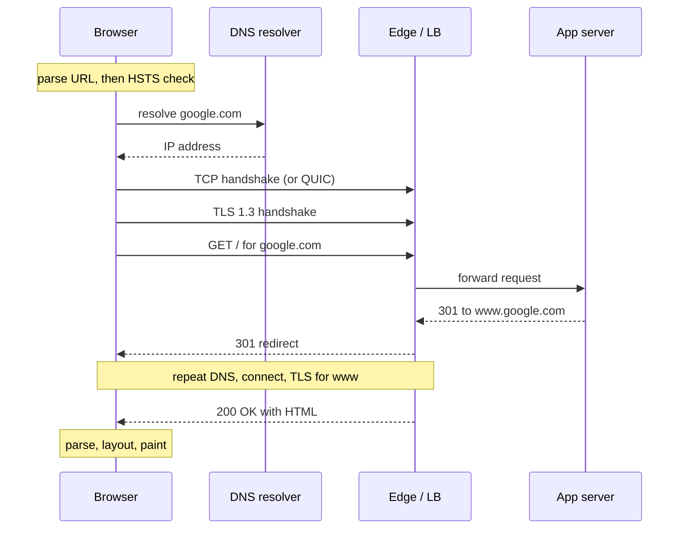
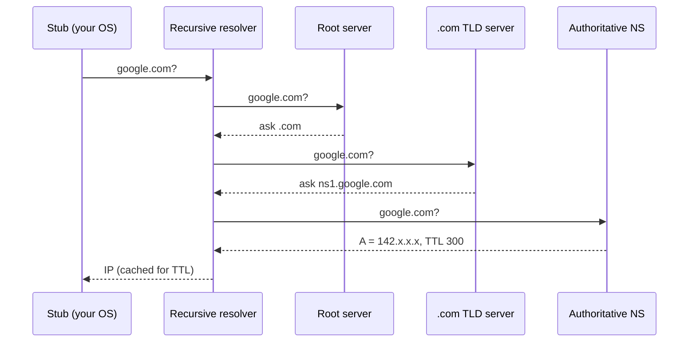
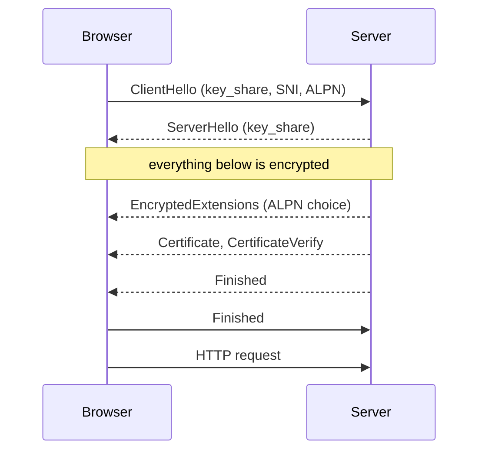

## Definition (interview-ready)

A **layer model** splits networking into stacked jobs. Each layer uses the one below it and serves the one above it. The **OSI model** has 7 layers and is mainly a teaching and vocabulary tool. The **TCP/IP model** (described in RFC 1122) has 4 layers — Link, Internet, Transport, Application — and matches how the internet is actually built.

"What happens when you type google.com" is the classic question that tests whether you can walk through the whole stack in order: **parse the URL → check HSTS → resolve DNS → open a transport connection (TCP, or QUIC for HTTP/3) → TLS handshake → send the HTTP request → pass through CDN / load balancer / reverse proxy → app server → response → browser renders the page.**

**One-liner:** The OSI model gives us layer vocabulary (L4, L7) while the internet runs on the 4-layer TCP/IP model; typing google.com walks down that stack: URL parse, HSTS, DNS, TCP or QUIC, TLS, the HTTP request through the edge to the app, then rendering the response.

## Why it matters

- It's one of the most common opening questions in backend and SRE interviews. The interviewer then drills into whichever step you sound least sure about.
- Every production latency problem lives in one of these steps: slow DNS, a cold TLS handshake, a misbehaving load balancer, a render-blocking script.
- Words like "L4 load balancer", "L7 routing", "TLS termination" and "reverse proxy" only make sense once you know what the layers are.

This note is the **map**. The deep dives live in other notes and are linked at each step:
[TCP, UDP, TLS](/learn/notes/networking-tcp-udp-tls/) · [DNS and load balancing](/learn/notes/dns-load-balancing/) · [HTTP/1.1 vs 2 vs 3](/learn/notes/http-versions/) · [CDN basics](/learn/notes/cdn-basics/) · [API gateways and BFF](/learn/notes/api-gateway-bff/).

## Core concepts

### The OSI model (7 layers)

Analogy: sending a letter. You write the message (application), put it in an envelope with an address (network), the postal service picks a truck and road (data link and physical). Each step only cares about its own job.

| # | OSI layer | Job | Unit of data | Examples |
|---|---|---|---|---|
| 7 | Application | What the app means | message | HTTP, DNS, SMTP, gRPC |
| 6 | Presentation | Encoding, compression, encryption | — | character sets, TLS is often placed here (loosely) |
| 5 | Session | Opening and managing conversations | — | rarely a separate thing in practice |
| 4 | Transport | Process-to-process delivery, ports, reliability | segment (TCP) / datagram (UDP) | TCP, UDP, QUIC (sort of) |
| 3 | Network | Host-to-host delivery across networks, routing | packet | IPv4, IPv6, ICMP |
| 2 | Data link | Delivery to the next hop on the same local network | frame | Ethernet, Wi-Fi (802.11), ARP (sits between 2 and 3) |
| 1 | Physical | Bits on a wire or radio | bits | copper, fibre, radio |

A common memory trick (top to bottom): **All People Seem To Need Data Processing**.

### The TCP/IP model (4 layers)

RFC 1122 describes the internet in four layers:

| TCP/IP layer | Covers OSI layers | What lives here |
|---|---|---|
| Application | 5, 6, 7 | HTTP, DNS, TLS (in practice), SSH, SMTP |
| Transport | 4 | TCP (RFC 9293), UDP, QUIC on top of UDP |
| Internet | 3 | IP (RFC 791 for IPv4), ICMP |
| Link | 1, 2 | Ethernet, Wi-Fi, ARP |

RFC 1122 itself says the internet's application layer "essentially combines the functions of the top two layers — Presentation and Application — of the OSI reference model". (Where the session layer goes is left vague; most tables, like this one, fold it into Application.) That is the key point.

### Why OSI is a teaching model

- The OSI protocol suite itself (the actual OSI protocols from the 1980s) lost to TCP/IP. What survived is the **vocabulary**.
- Layers 5 and 6 don't map cleanly to anything real. TLS, for example, does encryption (a "presentation" job), manages sessions (a "session" job), and runs on top of TCP — people call it L5, L6 or "between 4 and 7" depending on who you ask.
- QUIC breaks the neat picture too: it runs on UDP, but provides reliability, streams *and* built-in TLS 1.3 — so it does transport-layer work from inside user space.
- We still use OSI numbers every day: **"L4 load balancer"** = decides on IP and port; **"L7 load balancer"** = reads HTTP. **"L2 network"** = same Ethernet broadcast domain.

**How to say it in an interview:** "OSI gives us the vocabulary — L3, L4, L7. The internet actually runs on the 4-layer TCP/IP model, where everything above transport is just 'application'."

### Encapsulation

Each layer wraps the data from the layer above with its own header, like nested envelopes. On the receiving side, each layer strips its header and passes the rest up.

```
Application   [ HTTP request: GET / ... ]
Transport     [ TCP hdr | HTTP request ]                       ← src/dst port, seq numbers
Internet      [ IP hdr | TCP hdr | HTTP request ]              ← src/dst IP, TTL
Link          [ Eth hdr | IP hdr | TCP hdr | HTTP | Eth trailer ] ← src/dst MAC, checksum (FCS)
Physical      0101101001...
```

Things worth remembering:

- **MAC addresses change at every hop** (each router rewrites the Ethernet header). **IP addresses stay the same end to end** — unless NAT rewrites them.
- The IPv4 header has a **TTL** field (RFC 791). Each router decrements it, and the packet is dropped at zero. `traceroute` uses this to find each hop.
- **MTU** (maximum transmission unit) is the largest payload a link carries — 1500 bytes on standard Ethernet. TCP's **MSS** (maximum segment size) is chosen so segments fit inside the MTU after IP and TCP headers.
- **ARP** maps an IPv4 address on the local network to a MAC address. Your laptop uses it to find the MAC of its default gateway (the router).

### Forward proxy vs reverse proxy vs load balancer vs API gateway

These overlap a lot. The difference is **whose side they are on** and **what they decide**.

| Thing | Sits in front of | Works for | Typical jobs | Examples |
|---|---|---|---|---|
| **Forward proxy** | clients | the client / organization | hide client IPs, filter or log outbound traffic, cache | corporate proxy, Squid |
| **Reverse proxy** | servers | the server owner | TLS termination, caching, compression, hide backends, route by host or path | Nginx, Envoy, HAProxy, a CDN edge |
| **Load balancer** | a pool of identical servers | the server owner | spread traffic, health checks, remove dead backends | AWS NLB (L4), AWS ALB (L7), IPVS |
| **API gateway** | many different services (APIs) | the API owner | auth, rate limiting, quotas, API keys, request transforms, routing to services | Kong, AWS API Gateway, Apigee, Envoy-based gateways |

How they relate:

- A **reverse proxy** is the general pattern: "clients talk to me, I talk to the real servers".
- An **L7 load balancer** is a reverse proxy whose main job is spreading load across copies of the same service. (An L4 load balancer may not be a proxy at all — some just forward packets without terminating the connection.)
- An **API gateway** is a reverse proxy specialized for APIs: it adds cross-cutting API concerns (authentication, rate limits, per-client quotas) and routes to *different* services.
- One piece of software can play all three roles. Nginx and Envoy are used as reverse proxy, load balancer and gateway.

**How to say it in an interview:** "A forward proxy acts for the client, a reverse proxy acts for the server. A load balancer is a reverse proxy focused on spreading load. An API gateway is a reverse proxy focused on API policies like auth and rate limits."

Deeper: [DNS + Load Balancing](/learn/notes/dns-load-balancing/), [API Gateways + BFF](/learn/notes/api-gateway-bff/), [Rate limiting](/learn/notes/rate-limiting/).

## How it works: typing google.com and pressing Enter

The big picture:

```
 Browser                                                        Google
 ───────                                                        ──────
 1. parse input → https://google.com/
 2. HSTS check (force https)
 3. DNS: cache? → OS → recursive resolver → root → .com → google.com NS
 4. connect: TCP 3-way handshake        (or QUIC over UDP for HTTP/3)
 5. TLS 1.3 handshake (SNI, ALPN, cert check)
 6. HTTP request  GET / Host: google.com ─────────▶ edge / CDN / LB / reverse proxy
                                                       │
                                                       ▼
                                                    app servers (+ caches, DBs)
 7. response  ◀──────────── 301 → https://www.google.com/  → repeat 3–6 for www
 8. parse HTML → DOM, CSS → CSSOM, run JS → style → layout → paint → composite
```

The same journey as a timeline of messages between the browser, DNS, the edge and the app:



### Step 1: Parse what you typed

- The browser first decides: **is this a URL or a search query?** `google.com` looks like a hostname, so it's treated as a URL. Something like `how tall is everest` goes to the default search engine.
- A URL has parts: `scheme://host:port/path?query#fragment`. Missing parts are filled in — the scheme (modern browsers prefer `https`), port 443 for https or 80 for http, and path `/`.
- Non-ASCII hostnames are converted to **Punycode** (the ASCII form DNS can carry).
- The browser may already have started work while you were typing — predicting the URL, pre-resolving DNS or even pre-connecting.

### Step 2: HSTS check

**HSTS** (HTTP Strict Transport Security, RFC 6797) — a site tells the browser "only ever talk to me over HTTPS" by sending a header like:

```
Strict-Transport-Security: max-age=63072000; includeSubDomains; preload
```

- Before loading an `http://` URL, the browser checks its HSTS list. If the host is on it, the browser rewrites the URL to `https://` itself — no insecure request ever leaves the machine.
- Browsers **ignore the header if it arrives over plain HTTP**, so an attacker can't inject or shorten it.
- Weakness: the very first visit is unprotected (trust on first use). The fix is the **HSTS preload list**, a list built into browsers. Preloading requires `max-age` of at least one year, `includeSubDomains`, the `preload` directive, and a site that serves HTTPS and redirects HTTP to HTTPS.

### Step 3: DNS resolution

Goal: turn `google.com` into an IP address. Check the fastest caches first:

1. **Browser DNS cache.**
2. **OS resolver cache** (and the `hosts` file, e.g. `/etc/hosts`).
3. **Recursive resolver** — usually your ISP's, your company's, or a public one like 1.1.1.1 or 8.8.8.8. It does the legwork and caches answers for their **TTL**.
4. On a cache miss, the recursive resolver walks the hierarchy (DNS is defined in RFC 1034 and RFC 1035):
   - asks a **root server** → "I don't know google.com, but here are the `.com` TLD servers",
   - asks a **`.com` TLD server** → "here are the authoritative name servers for google.com",
   - asks **google.com's authoritative server** → "google.com A 142.x.x.x" (and AAAA for IPv6).

The recursive resolver's walk on a cache miss:



Facts interviewers like:

- There are **13 root server identities** (`a` to `m.root-servers.net`) run by 12 operators, but well over a thousand physical instances worldwide — the same addresses are announced from many places (anycast).
- DNS mainly uses **UDP port 53**. If a response is too big and comes back truncated, the client retries over **TCP**. Encrypted variants exist: DNS over HTTPS (DoH) and DNS over TLS (DoT).
- The browser may also ask for an **HTTPS record** (RFC 9460). It can tell the browser up front that the site supports HTTP/3 (`alpn="h3"`), which saves a round trip.
- For big sites, the authoritative answer is often **location-aware** (GeoDNS) or an **anycast** IP, so you reach a nearby edge. See [DNS + Load Balancing](/learn/notes/dns-load-balancing/).

### Step 4: Open a connection — TCP, or QUIC for HTTP/3

**TCP** (RFC 9293): the 3-way handshake.

```
client ── SYN ─────────▶ server
client ◀─ SYN-ACK ────── server
client ── ACK ─────────▶ server      1 round trip (RTT) before data
```

The OS picks a random **ephemeral source port**. The connection is identified by the 4-tuple (src IP, src port, dst IP, dst port).

**QUIC** (RFC 9000) is the transport for **HTTP/3** (RFC 9114). It runs over **UDP** and combines the transport handshake and the TLS 1.3 handshake into one, so a fresh connection is ready after about 1 RTT instead of 2. It can also do 0-RTT on resumption and survive a network change (Wi-Fi to mobile) using **connection IDs**.

How does the browser know it can use HTTP/3? Either from an `Alt-Svc: h3=...` response header on an earlier HTTP/1.1 or HTTP/2 connection, or from the DNS HTTPS record. The first visit often uses TCP, and later ones switch to QUIC.

Deeper: [TCP, UDP, TLS](/learn/notes/networking-tcp-udp-tls/), [HTTP versions](/learn/notes/http-versions/).

### Step 5: TLS 1.3 handshake

TLS (RFC 8446) gives **confidentiality** (nobody can read it), **integrity** (nobody can change it), and **authentication** (you're really talking to google.com).

```
ClientHello  (supported versions, cipher suites, key_share, SNI = google.com, ALPN = h2,http/1.1)
                              ─────────▶
             ◀─────────  ServerHello (key_share)
                         {EncryptedExtensions}  ← ALPN choice, e.g. h2
                         {Certificate}           ← google.com's cert chain
                         {CertificateVerify}     ← proof it owns the private key
                         {Finished}
{Finished}   ─────────▶
[HTTP request, encrypted]   ─────────▶
```

The same handshake as a sequence. Data can flow after one round trip:



- Both sides send a **key share** (Diffie-Hellman) in the first flight, so they can derive the session key after one round trip. TLS 1.2 needed two.
- Everything after `ServerHello` is encrypted — **including the server certificate** (in TLS 1.2 it was sent in the clear).
- **SNI** (Server Name Indication) tells a shared server which site's certificate to present. It's normally visible on the wire; **Encrypted Client Hello (ECH, RFC 9849)** hides it.
- **ALPN** (Application-Layer Protocol Negotiation) picks the HTTP version (`h2` or `http/1.1`) inside the handshake, for free.
- The browser validates the certificate: the chain leads to a trusted root CA, the name matches `google.com`, it hasn't expired, and it isn't revoked.
- **0-RTT** (on resumption) lets the client send data in its first flight, but that data can be **replayed** — only safe for idempotent requests.

Deeper: [TCP, UDP, TLS](/learn/notes/networking-tcp-udp-tls/), [mTLS + certificates](/learn/notes/mtls-certificates/).

### Step 6: Send the HTTP request

```
GET / HTTP/2  (on the wire, h2 sends these as binary HEADERS frames)
:authority: google.com
:method: GET
:path: /
user-agent: Mozilla/5.0 ...
accept: text/html,...
accept-encoding: gzip, br
cookie: ...
```

- HTTP semantics (methods, headers, status codes) are the same in HTTP/1.1, 2 and 3. Only the wire format changes.
- The browser reuses this connection for later requests to the same origin (keep-alive in HTTP/1.1, multiplexed streams in HTTP/2 and 3).

### Step 7: Through the edge — CDN, load balancer, reverse proxy

The IP you connected to is almost never "the server". For a big site it's an **edge**:

```
client ─▶ anycast edge / CDN PoP ─▶ L4 LB ─▶ L7 LB / reverse proxy ─▶ app servers
           (TLS often terminates here)        (route by host/path,     (business logic,
                                               auth, rate limits)       caches, databases)
```

- **CDN / edge** — serves cached static content from a nearby location and can terminate TLS close to the user. See [CDN Basics](/learn/notes/cdn-basics/).
- **L4 load balancer** — spreads TCP/UDP connections by IP and port.
- **L7 load balancer / reverse proxy / API gateway** — reads HTTP, routes by host and path, adds headers like `X-Forwarded-For` (the original client IP), applies auth and rate limits.
- Inside a cluster: Ingress → Service → Pod. See [Kubernetes](/learn/notes/kubernetes/).
- TLS can be **terminated at the edge** and re-encrypted to the backend (often with mTLS), or passed through.

### Step 8: The app server responds

The app server handles the request — reads cookies, checks a cache, maybe calls other services and databases — and returns a response:

```
HTTP/2 301
location: https://www.google.com/
```

At the time of writing, `https://google.com` answers with a **301 redirect** to `https://www.google.com/`. The browser follows it, which means another DNS lookup and a new connection for `www.google.com` (unless connection reuse rules allow sharing), then a `200 OK` with HTML. Useful response headers:

- `content-type`, `content-encoding` (gzip / br compression),
- `cache-control`, `etag` (caching — see [Cache patterns](/learn/notes/cache-patterns/)),
- `set-cookie`,
- `strict-transport-security` (HSTS for next time),
- `alt-svc` (advertises HTTP/3 for next time).

### Step 9: Rendering basics

The browser turns bytes into pixels (MDN describes the same pipeline):

1. **Parse HTML → DOM** (Document Object Model, a tree of elements). A **preload scanner** looks ahead and starts downloading CSS, JS and images early.
2. **Parse CSS → CSSOM** (the tree of style rules). The browser won't paint until the CSS it needs has loaded, to avoid a flash of unstyled content.
3. **JavaScript**: a plain `script` tag (without `async` or `defer`) **pauses HTML parsing** until it's downloaded and run. `defer` runs it after parsing, in order; `async` runs it as soon as it arrives.
4. **Style**: combine DOM and CSSOM into a **render tree** (only visible elements — `display: none` is left out).
5. **Layout** (also called reflow): compute each box's size and position.
6. **Paint**: fill in pixels — text, colours, borders, images.
7. **Composite**: draw layers in the right order, often on the GPU.

Each extra resource (CSS, JS, fonts, images) may trigger more DNS lookups, connections and requests — which is why HTTP/2 multiplexing, CDNs and connection reuse matter.

### Latency budget of a cold visit

```
DNS (cache miss)        ~1 RTT to resolver, more if it walks the hierarchy
TCP handshake            1 RTT
TLS 1.3                  1 RTT        (TLS 1.2: 2 RTT)
HTTP request/response    1 RTT + server time
---------------------------------------------------------
≈ 3–4 RTTs before the first byte of HTML; QUIC saves one; 0-RTT resumption saves more
```

## Real-world examples

- **google.com → www.google.com**: you can see the 301 redirect yourself with `curl -sI https://google.com`.
- **HSTS preload list**: browsers ship a built-in list of HTTPS-only domains; sites submit themselves via hstspreload.org.
- **Public resolvers** 1.1.1.1 (Cloudflare) and 8.8.8.8 (Google) are anycast — the same IP is served from many locations.
- **HTTP/3** is advertised with `Alt-Svc` and DNS HTTPS records, and browsers fall back to HTTP/2 over TCP if UDP is blocked.

## Common pitfalls

- **Calling the OSI model "how the internet works".** It's a vocabulary. The internet runs on TCP/IP.
- **Saying DNS is only UDP.** Large or truncated responses fall back to TCP; zone transfers use TCP; DoH and DoT exist.
- **Forgetting HSTS and the redirect.** A real walkthrough includes `http → https` (HSTS or a 301) and often a host redirect.
- **Mixing up proxy types.** Forward proxy = client side. Reverse proxy = server side.
- **Assuming the IP you connect to is the app server.** It's usually a CDN edge or load balancer.
- **Ignoring TLS 1.3 vs 1.2 differences.** 1 RTT vs 2, and the certificate is encrypted in 1.3.
- **Thinking `X-Forwarded-For` is trustworthy.** Any client can set it. Trust only the value appended by your own proxies.
- **Long DNS TTLs during migrations.** Clients and resolvers keep the old IP until the TTL expires.

## Practice questions

<Practice>

<QA q="Name the 7 OSI layers and the 4 TCP/IP layers, and map one protocol to each." level="easy">

**OSI (top to bottom):** Application (HTTP), Presentation (encoding, compression — TLS is often placed here loosely), Session (session management), Transport (TCP, UDP), Network (IP, ICMP), Data link (Ethernet, Wi-Fi), Physical (cables, radio).

**TCP/IP (RFC 1122):** Application (HTTP, DNS, TLS in practice), Transport (TCP, UDP), Internet (IP), Link (Ethernet, ARP).

The TCP/IP application layer covers OSI layers 5–7.

</QA>

<QA q="Why do people call OSI a teaching model?" level="easy">

The OSI protocols themselves lost to TCP/IP; only the layer vocabulary survived. Layers 5 and 6 don't map to real separate protocols, and modern protocols cross layers — TLS does encryption and session work on top of TCP, and QUIC builds reliable streams plus TLS on top of UDP. We still use OSI numbers as shorthand (L4 vs L7 load balancer), but the internet is built on the 4-layer TCP/IP model.

</QA>

<QA q="What is encapsulation? Which addresses change hop by hop?" level="easy">

Each layer wraps the data from above with its own header: HTTP inside a TCP segment (ports), inside an IP packet (IP addresses, TTL), inside an Ethernet frame (MAC addresses). The receiver strips headers layer by layer.

**MAC addresses change at every hop**, because each router builds a new frame for the next link. **IP addresses stay the same end to end**, unless NAT rewrites them. The IP TTL is decremented at each router.

</QA>

<QA q="Forward proxy vs reverse proxy — what is the difference?" level="easy">

A **forward proxy** sits in front of clients and acts for them: it hides client IPs, filters or logs outbound traffic (a corporate proxy). A **reverse proxy** sits in front of servers and acts for the server owner: clients think it's the server, and it terminates TLS, caches, compresses and routes to hidden backends (Nginx, Envoy, a CDN edge).

</QA>

<QA q="How do a load balancer and an API gateway differ from a plain reverse proxy?" level="medium">

All three can be the same software. The difference is the main job:

- **Reverse proxy**: the general pattern — accept client connections and forward them to backends.
- **Load balancer**: spread traffic across **identical** instances, with health checks. L4 ones work on IP and port (and may just forward packets); L7 ones read HTTP.
- **API gateway**: a reverse proxy for **APIs**, routing to **different** services and adding API concerns — authentication, API keys, rate limits, quotas, request transforms, analytics.

</QA>

<QA q="What does HSTS do and what is its weakness?" level="medium">

HSTS (`Strict-Transport-Security` header) tells the browser to use HTTPS only for this host for `max-age` seconds (optionally including subdomains). After that, the browser rewrites `http://` to `https://` locally before sending anything, and doesn't let users click through certificate errors. The header is ignored over plain HTTP.

**Weakness:** trust on first use — the very first request, before the browser has seen the header, can be attacked (SSL stripping). The **preload list** built into browsers fixes this; it requires `max-age` of at least a year, `includeSubDomains`, and `preload`.

</QA>

<QA q="Walk through a DNS lookup for google.com on a cold cache." level="medium">

1. Browser cache → OS cache and hosts file → miss.
2. The OS stub resolver asks the configured **recursive resolver** (ISP, company, 1.1.1.1).
3. The resolver asks a **root server**, which refers it to the **.com TLD servers**.
4. A .com server refers it to **google.com's authoritative name servers**.
5. The authoritative server returns the A (and AAAA) records with a TTL.
6. The resolver caches the answer for the TTL and returns it.

Mostly over UDP port 53, falling back to TCP for truncated responses. There are 13 root server identities but well over a thousand anycast instances.

</QA>

<QA q="What does a TLS 1.3 handshake accomplish, and why is it faster than TLS 1.2?" level="medium">

It agrees on keys, proves the server's identity (certificate + `CertificateVerify` signature), and confirms nothing was tampered with (`Finished`). The client sends its Diffie-Hellman **key share in the ClientHello**, guessing the group the server will pick, so keys are ready after **one round trip** — TLS 1.2 needed two. TLS 1.3 also encrypts everything after `ServerHello`, including the certificate, removes old insecure algorithms, and always uses forward-secret key exchange.

</QA>

<QA q="What are SNI and ALPN, and why do they matter?" level="medium">

Both are extensions in the ClientHello.

- **SNI** (Server Name Indication) carries the hostname so one IP can host many HTTPS sites and present the right certificate. It's normally visible on the wire; **ECH** (Encrypted Client Hello, RFC 9849) encrypts it.
- **ALPN** lets the client list protocols (`h2`, `http/1.1`) and the server pick one during the handshake, so HTTP/2 is negotiated with no extra round trip. HTTP/3 uses the ALPN token `h3` inside QUIC.

</QA>

<QA q="How does the browser end up using HTTP/3 instead of HTTP/2?" level="medium">

HTTP/3 runs on QUIC over UDP, so the browser needs to know the server supports it before trying. Two ways: an `Alt-Svc: h3=...` header returned on an earlier HTTP/1.1 or HTTP/2 response, or a DNS **HTTPS record** (RFC 9460) with `alpn="h3"`. QUIC combines the transport and TLS handshake, so a new connection takes about 1 RTT. If UDP is blocked, the browser falls back to HTTP/2 over TCP.

</QA>

<QA q="Walk through what happens when you type google.com and press Enter." level="hard">

1. **Parse**: URL vs search query; fill in `https://`, port 443, path `/`.
2. **HSTS**: if the host is known HTTPS-only, upgrade locally.
3. **DNS**: browser cache → OS → recursive resolver → root → .com → google.com authoritative → IP (possibly a nearby edge via GeoDNS or anycast).
4. **Connect**: TCP 3-way handshake (1 RTT), or QUIC if HTTP/3 is known to be supported.
5. **TLS 1.3**: ClientHello with SNI, ALPN and key share; server cert, verify, finished; 1 RTT.
6. **HTTP request**: `GET /` with headers and cookies.
7. **Edge**: CDN / L4 LB / L7 reverse proxy terminates TLS, routes to app servers.
8. **Response**: google.com returns a 301 to www.google.com, so steps 3–6 repeat for www; then 200 with HTML.
9. **Render**: HTML → DOM, CSS → CSSOM, JS (blocking unless async/defer), render tree → layout → paint → composite. Sub-resources trigger more requests over the same connection.

</QA>

<QA q="How many round trips before the first byte of HTML on a cold HTTPS visit, and how do you cut them?" level="hard">

Cold, with TCP + TLS 1.3: DNS (1 or more) + TCP (1) + TLS (1) + request/response (1) ≈ **3–4 RTTs** plus server time. TLS 1.2 adds one more.

Cuts: DNS caching and prefetching; **connection reuse** (keep-alive, HTTP/2 multiplexing); **QUIC/HTTP/3**, which merges transport and TLS handshakes; **TLS session resumption** and 0-RTT for idempotent requests; **CDN edges** close to users so each RTT is short; `preconnect` hints for third-party origins; avoiding redirect chains.

</QA>

<QA q="Your load balancer forwards to app servers. How does the app learn the real client IP, and what can go wrong?" level="hard">

At L7 the proxy adds `X-Forwarded-For` (or the standard `Forwarded` header) with the client IP, appending to any existing value. At L4, the client IP may be preserved by packet forwarding or passed using the PROXY protocol.

Pitfalls: clients can send a fake `X-Forwarded-For`, so trust only the entries appended by **your own** proxies (count hops from the right). Rate limiting or geo-blocking on a spoofed header is a security bug. If TLS terminates at the edge, the backend also needs `X-Forwarded-Proto` to know the original scheme.

</QA>

<QA q="Users in one country report your site is slow, but only on the first visit each day. Where do you look?" level="scenario">

First-visit-only slowness points at **cold-path** steps: DNS (short TTLs + a slow or far-away recursive resolver; the authoritative answer may send them to a distant region because of how GeoDNS sees the resolver's IP), TCP + TLS handshakes to a far-away edge (no nearby PoP), no TLS resumption, HTTP/3 not available so an extra RTT, and redirect chains (`http` → `https` → `www`). Measure with browser timing data (DNS, connect, TLS, TTFB), check which edge they hit, add HSTS preload to drop the http hop, and check whether the resolver supports EDNS Client Subnet for better location mapping.

</QA>

<QA q="After a migration to a new load balancer IP, some users still hit the old one for hours. Why, and how should you have done it?" level="scenario">

DNS caching: recursive resolvers, OSes, browsers and some runtimes (the JVM caches lookups) keep the old answer until its **TTL** expires, and some ignore TTLs. Plan ahead: lower the TTL (for example to 60 s) at least one old-TTL period before the change, keep the old LB running and forwarding until traffic drains, then raise the TTL again. Prefer anycast or a stable LB IP so backends can change without touching DNS.

</QA>

</Practice>

## Quiz

<Quiz>

<MCQ q="According to RFC 1122, how many layers does the Internet (TCP/IP) model have?" options={["7", "5", "4", "3"]} answer={2}>

RFC 1122 describes Application, Transport, Internet and Link. Seven is OSI; five is a common textbook hybrid that splits Link into data link and physical.

</MCQ>

<MCQ q="Which address normally changes at every router hop?" options={["Destination IP address", "Source MAC and destination MAC addresses", "TCP destination port", "Source IP address (without NAT)"]} answer={1}>

Each router builds a new link-layer frame for the next hop, so MAC addresses change. IP addresses and ports stay the same end to end unless NAT rewrites them.

</MCQ>

<MCQ q="A browser receives a Strict-Transport-Security header over plain HTTP. What happens?" options={["The browser stores it for max-age seconds", "The browser ignores it", "The browser stores it only for the current tab", "The browser adds the site to the global preload list"]} answer={1}>

Browsers ignore HSTS sent over HTTP so a network attacker cannot add or shorten it. The preload list is built into browsers and is submitted to separately.

</MCQ>

<MCQ q="In a cold DNS lookup, which server returns the actual A record for google.com?" options={["The root server", "The .com TLD server", "The recursive resolver from its own zone data", "google.com's authoritative name server"]} answer={3}>

Root servers refer to TLD servers, TLD servers refer to the domain's authoritative servers, and the authoritative server holds the records. The recursive resolver only caches and forwards answers.

</MCQ>

<MCQ q="Why does a full TLS 1.3 handshake need only 1 RTT?" options={["It skips certificate validation", "The client sends a Diffie-Hellman key share in its first message", "It reuses the TCP sequence numbers as keys", "It always uses 0-RTT"]} answer={1}>

Sending the key share in ClientHello lets both sides derive keys after one exchange. Certificates are still validated, TCP has nothing to do with key derivation, and 0-RTT is only for resumption.

</MCQ>

<MCQ q="Which statement about QUIC is correct?" options={["It runs over TCP port 443", "It combines the transport and TLS handshakes and runs over UDP", "It does not use encryption", "It is the transport for HTTP/2"]} answer={1}>

RFC 9000 describes a combined cryptographic and transport handshake over UDP, and encryption is mandatory. QUIC is the transport for HTTP/3; HTTP/2 runs over TCP.

</MCQ>

<MCQ q="What does the API gateway add that a basic L7 load balancer usually does not?" options={["TLS termination", "Health checks", "API concerns like authentication, API keys, quotas and per-client rate limits", "Path-based routing"]} answer={2}>

TLS termination, health checks and path routing are standard L7 load balancer features. Gateways focus on API policies across many services.

</MCQ>

<MCQ q="A plain script tag without async or defer is in the page head. What does it do while it downloads and runs?" options={["Nothing, scripts never block", "It pauses HTML parsing", "It blocks DNS lookups for other hosts", "It only blocks image decoding"]} answer={1}>

Classic scripts are parser-blocking because they might modify the document. defer runs after parsing; async runs as soon as it arrives without waiting for parsing to finish.

</MCQ>

<MCQ q="Which mechanism lets a browser learn from DNS that a site supports HTTP/3?" options={["An MX record", "A CNAME pointing to h3", "An HTTPS resource record with alpn h3", "A TXT record with the HSTS policy"]} answer={2}>

RFC 9460 defines SVCB and HTTPS records that can carry ALPN values such as h3. The other record types do not advertise protocol support to browsers.

</MCQ>

</Quiz>

## TL;DR cheat sheet

- **OSI** = 7-layer vocabulary (L3 IP, L4 TCP/UDP, L7 HTTP). **TCP/IP** = 4 real layers: Link, Internet, Transport, Application.
- **Encapsulation**: HTTP → TCP segment → IP packet → Ethernet frame. MACs change per hop, IPs don't (without NAT).
- **Forward proxy** = for clients. **Reverse proxy** = for servers. **LB** = reverse proxy that spreads load. **API gateway** = reverse proxy with API policies.
- **Journey**: parse → HSTS → DNS (browser → OS → recursive → root → TLD → authoritative) → TCP (or QUIC) → TLS 1.3 (SNI, ALPN, cert) → HTTP → CDN/LB/proxy → app → response → DOM/CSSOM → layout → paint → composite.
- **Cold visit ≈ 3–4 RTTs** before the first byte; QUIC, reuse, resumption and CDNs cut that.
- TLS 1.3: 1 RTT, encrypted certificate; 0-RTT is replayable.
- DNS: UDP 53, TCP fallback; 13 root identities, many anycast instances; TTLs drive migration pain.

## Go deeper

- **RFCs**: [RFC 1122 (host requirements, layers)](https://www.rfc-editor.org/rfc/rfc1122), [RFC 791 (IPv4)](https://www.rfc-editor.org/rfc/rfc791), [RFC 9293 (TCP)](https://www.rfc-editor.org/rfc/rfc9293), [RFC 1034](https://www.rfc-editor.org/rfc/rfc1034) and [RFC 1035 (DNS)](https://www.rfc-editor.org/rfc/rfc1035), [RFC 8446 (TLS 1.3)](https://www.rfc-editor.org/rfc/rfc8446), [RFC 9000 (QUIC)](https://www.rfc-editor.org/rfc/rfc9000), [RFC 9114 (HTTP/3)](https://www.rfc-editor.org/rfc/rfc9114), [RFC 9460 (HTTPS DNS records)](https://www.rfc-editor.org/rfc/rfc9460).
- **MDN**: [How browsers work](https://developer.mozilla.org/en-US/docs/Web/Performance/Guides/How_browsers_work), [Strict-Transport-Security](https://developer.mozilla.org/en-US/docs/Web/HTTP/Reference/Headers/Strict-Transport-Security).
- **Cloudflare Learning Center**: [What is DNS?](https://www.cloudflare.com/learning/dns/what-is-dns/), [What is a reverse proxy?](https://www.cloudflare.com/learning/cdn/glossary/reverse-proxy/), [What happens in a TLS handshake?](https://www.cloudflare.com/learning/ssl/what-happens-in-a-tls-handshake/), [What is the OSI model?](https://www.cloudflare.com/learning/ddos/glossary/open-systems-interconnection-model-osi/).
- **IANA**: [Root servers](https://www.iana.org/domains/root/servers).
- **Book**: Kurose & Ross, *Computer Networking: A Top-Down Approach*; Ilya Grigorik, [*High Performance Browser Networking*](https://hpbn.co/).
- **Classic repo**: [alex/what-happens-when](https://github.com/alex/what-happens-when).
