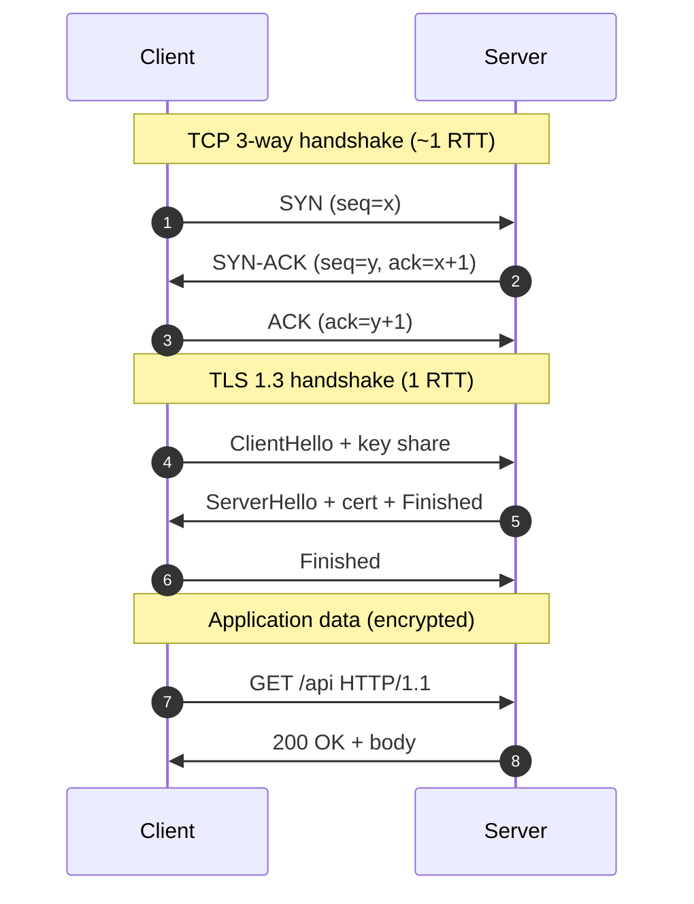

## Definition (interview-ready)

**TCP** is a connection-oriented, reliable, ordered, byte-stream transport protocol. **UDP** is a connectionless, unreliable, datagram protocol. **TLS** is a security layer that runs on top of TCP (or QUIC for HTTP/3) and provides encryption, integrity, and authentication via an asymmetric handshake that sets up a symmetric session key.

**One-liner:** TCP gives you a reliable, ordered byte stream after a 1-RTT handshake, UDP gives you fast fire-and-forget datagrams with no guarantees, and TLS adds encryption, integrity and server authentication on top, using a handshake (1 RTT in TLS 1.3) to agree on a fast symmetric key.

## Why it matters

Almost every backend conversation — load balancing, gRPC, Kafka, WebSockets, HTTP/3, mTLS — pulls on these four primitives: 3-way handshake, congestion control, TLS handshake, datagrams. If you can't explain what happens between `connect()` and the first byte of payload, you can't reason about p99 latency, head-of-line blocking, or connection pooling.



## Core concepts

### TCP — what guarantees you get

- **Reliable**: lost packets are retransmitted.
- **Ordered**: bytes arrive in the order sent.
- **Byte-stream** (not message-oriented): the application sees a stream of bytes; TCP does not preserve "message" boundaries — your application must frame.
- **Flow control**: receiver advertises a window so a fast sender doesn't drown a slow receiver.
- **Congestion control** (AIMD, CUBIC, BBR): sender backs off when the *network* (not the receiver) is saturated.

### UDP — what you give up

- No connection, no retransmission, no order, no flow/congestion control.
- Each `sendto()` is one datagram (a message), preserved end-to-end (or dropped).
- Wins: lower latency, no head-of-line blocking, multicast support, smaller header (8 bytes vs at least 20 for TCP).
- Used by: DNS, NTP, QUIC (which builds reliability on top of UDP itself), video/voice (where late packets are useless), gaming.

### TCP 3-way handshake

```
Client                            Server
  | ---- SYN (seq=x) -----------> |
  | <--- SYN-ACK (seq=y, ack=x+1) |
  | ---- ACK (ack=y+1) ---------> |
  [connection established]
```

One full round-trip (1 RTT) before any data flows. This is why connection reuse matters — every cold connection costs you ~50–100ms on the public internet.

### TCP 4-way teardown

`FIN` → `ACK` → `FIN` → `ACK`. The connection enters `TIME_WAIT` for ~2×MSL on the closing side to absorb late packets. Too many `TIME_WAIT` sockets exhaust ephemeral ports — a classic production issue.

### TLS 1.2 handshake (2 RTTs)

1. `ClientHello` (cipher suites, random, SNI)
2. `ServerHello` + certificate + key exchange + `ServerHelloDone`
3. Client verifies cert, sends `ClientKeyExchange`, `ChangeCipherSpec`, `Finished`
4. Server `ChangeCipherSpec`, `Finished`
5. Encrypted application data

### TLS 1.3 handshake (1 RTT, 0-RTT for resumption)

Eliminates the second round-trip by sending key shares in `ClientHello`. With session resumption, the client can send encrypted data in the *very first packet* (0-RTT) — but 0-RTT data is replayable, so it's only safe for idempotent requests.

### What TLS actually gives you

- **Confidentiality**: encryption with the session key (AES-GCM, ChaCha20-Poly1305).
- **Integrity**: MAC/AEAD ensures packets weren't tampered with.
- **Authentication**: server proves identity via X.509 cert chain to a trusted CA. Optionally, client too (mTLS).

## How it works (the trace)

A typical HTTPS request to a fresh host:

```
DNS lookup        ~20ms  (UDP)
TCP handshake     1 RTT  ~30ms
TLS handshake     1 RTT  ~30ms  (TLS 1.3)
HTTP request      0.5 RTT ~15ms
Server processing ?
Response          0.5 RTT ~15ms
                  -----------------
~95ms before the server even starts working; ~110ms + server time to the first byte of the response
```

This is why HTTP/2 multiplexing, connection pooling, and edge termination matter.

## Real-world examples

- **Kafka**: TCP. Long-lived connections per broker — pooled and reused.
- **gRPC**: HTTP/2 over TLS — multiplexes many streams over one TCP connection.
- **DNS**: UDP by default (classic limit 512 bytes; larger with EDNS0, commonly 1232 bytes today); falls back to TCP when a response is truncated (TC bit), and uses TCP for zone transfers.
- **QUIC / HTTP/3**: UDP + reliability + TLS 1.3 built into the protocol — no separate handshake.
- **Redis**: TCP with optional TLS. Pipelining batches commands to amortize RTT.

## Common pitfalls

- **TCP is not message-oriented**: a single `send()` can be split or merged on the wire. Frame your messages (length-prefix or delimiter).
- **`TIME_WAIT` exhaustion**: many short-lived connections on the client side burn through ephemeral ports. Fix with connection pooling, a wider `ip_local_port_range`, or `net.ipv4.tcp_tw_reuse` on Linux (`SO_REUSEADDR` mainly helps a server rebind its listening port).
- **Nagle + Delayed ACK**: small writes can stall up to 200ms. Set `TCP_NODELAY` for low-latency interactive protocols.
- **TLS cert chain**: missing intermediates work in browsers (which fetch them) but break for many clients. Always serve the full chain.
- **SNI**: server uses the hostname in `ClientHello` to pick the cert. Without SNI, one IP and port can present only one certificate, so hosting many HTTPS sites there needs one cert that lists every name.
- **HOL blocking in TCP**: one lost packet stalls *all* streams on the same connection. HTTP/2 didn't fix this. HTTP/3 (QUIC) does, because each stream has independent reliability.

## Practice questions

<Practice>

<QA q="When would you use UDP over TCP?" level="easy">

When latency matters more than reliability, or when you build reliability yourself: DNS, NTP, real-time voice/video (late packets are useless), gaming, telemetry, and QUIC. Also when you need multicast. UDP has no handshake, no head-of-line blocking and an 8-byte header (vs 20 bytes for TCP).

</QA>

<QA q="How many round trips does HTTPS to a brand-new server take?" level="easy">

DNS (1) + TCP handshake (1) + TLS 1.3 (1) = ~3 RTTs before the first HTTP byte; with TLS 1.2 it's 4 RTTs. With QUIC + 0-RTT resumption and cached DNS, the first byte can go out in essentially 0 RTTs. That's why pooling and reusing connections matters so much.

</QA>

<QA q="TCP is a byte stream. What does that mean for an application protocol?" level="easy">

TCP doesn't preserve message boundaries: one `send()` can arrive split across several reads, or several sends can arrive merged in one read. The application must **frame** its messages, with a length prefix or a delimiter, and keep reading until a full message has arrived. UDP, by contrast, delivers each datagram whole or not at all.

</QA>

<QA q="What does TLS actually give you?" level="easy">

- **Confidentiality**: bulk data is encrypted with a symmetric session key (AES-GCM, ChaCha20-Poly1305).
- **Integrity**: AEAD/MAC detects tampering.
- **Authentication**: the server proves its identity with an X.509 certificate chain to a trusted CA, and optionally the client does too (mTLS).

</QA>

<QA q="Explain TCP congestion control in one paragraph." level="medium">

The sender keeps a congestion window (`cwnd`) that grows on ACKs and shrinks on loss. **Slow start** doubles `cwnd` every RTT up to a threshold, then **congestion avoidance** grows it additively. On loss, loss-based algorithms like CUBIC (the Linux default) cut the window multiplicatively and recover. BBR (widely used at Google) instead paces sending from the measured bottleneck bandwidth and RTT rather than reacting mainly to loss. The goal is to fill the pipe without causing bufferbloat or unfairness.

</QA>

<QA q="Why does TLS use both asymmetric and symmetric crypto?" level="medium">

Asymmetric crypto (RSA/ECDHE) is slow but lets two strangers agree on a secret over a public channel. Symmetric crypto (AES) is fast. TLS uses asymmetric crypto in the handshake to agree on a symmetric session key, then uses that key for the bulk data. Modern handshakes use ECDHE for **forward secrecy**: even if the server's private key leaks later, past sessions stay safe.

</QA>

<QA q="What is mTLS and when do you use it?" level="medium">

In **mutual TLS** both client and server present certificates. It's used server-to-server inside a service mesh (Istio, Linkerd), for B2B APIs, and for IoT device auth. It replaces shared secrets with verifiable identities and gives you encryption and authentication in one step.

</QA>

<QA q="What is TIME_WAIT and how can it hurt a client that opens many short connections?" level="medium">

After the 4-way teardown (FIN, ACK, FIN, ACK), the side that closed first holds the socket in `TIME_WAIT` for ~2×MSL to absorb late packets. A client that opens and closes many short connections to the same destination piles up `TIME_WAIT` sockets and can exhaust its **ephemeral ports**, so new connects fail. Fix with connection pooling, a wider `ip_local_port_range`, or `net.ipv4.tcp_tw_reuse` on Linux. `SO_REUSEADDR` mainly helps a server rebind its listening port.

</QA>

<QA q="What's the difference between flow control and congestion control?" level="medium">

Flow control protects the **receiver**: the receiver advertises a window (`rwnd`) of how much it can buffer. Congestion control protects the **network**: the sender sets `cwnd` from loss/RTT signals. The effective send rate is `min(rwnd, cwnd)`.

</QA>

<QA q="Why is 0-RTT in TLS 1.3 dangerous, and how do you mitigate it?" level="hard">

0-RTT data is sent with the first packet using keys from a previous session, so an attacker who captures it can **replay** it. TLS doesn't protect early data against replay the way it protects the rest of the session. Mitigation: allow 0-RTT only for idempotent, side-effect-free requests (typically GETs), and have the server track and reject duplicates within a freshness window.

</QA>

<QA q="An interactive protocol doing small writes sees ~200 ms stalls. What's the likely cause and fix?" level="hard">

**Nagle's algorithm** holds back small writes until outstanding data is ACKed, while the peer's **delayed ACK** waits (up to ~200 ms) hoping to piggyback the ACK on a response. Together they deadlock briefly on every small write. Set `TCP_NODELAY` to disable Nagle for latency-sensitive protocols, or batch writes so you don't send tiny segments.

</QA>

<QA q="A client sees high p99 on a service hop. Walk through the network-level causes you'd investigate." level="scenario">

- Cold connections (no pool) and a TLS handshake on every call.
- DNS resolution delay.
- TCP retransmits (loss + retransmission timeouts).
- Head-of-line blocking on a shared HTTP/2 connection.
- Nagle / delayed-ACK interaction on small writes.
- Ephemeral port exhaustion on the client.
- MTU mismatch causing fragmentation or black-holed packets.
- Server-side causes that look like network issues: GC pauses, accept-queue saturation.

</QA>

<QA q="A new Java client fails TLS with 'unable to find valid certification path', but the same URL works fine in Chrome. What's wrong?" level="scenario">

The server is most likely **not serving the full certificate chain** (missing intermediates). Browsers often fetch missing intermediates themselves, so they work, but many non-browser clients don't. Configure the server to send leaf + intermediates. The other common cause is a **truststore gap**: the cert is issued by a private or corporate CA (or a TLS-inspecting proxy) that the OS store Chrome uses trusts but the JVM's `cacerts` doesn't, or the JDK is old and lacks a newer root. Fix by importing the CA into the truststore the JVM actually uses, or updating the JDK. `openssl s_client -showcerts` shows what the server sends. Also check **SNI**: if the client doesn't send the hostname, a server hosting several sites on one IP may return the wrong certificate.

</QA>

</Practice>

## Quiz

<Quiz>

<MCQ q="A sender writes two 100-byte messages with two send() calls over TCP. What can the receiver observe?" options={["Always exactly two reads of 100 bytes each", "One 200-byte read, or the bytes split across reads in any way, but in order", "The two messages possibly out of order", "Only the first message, unless it ACKs explicitly"]} answer={1}>

TCP is an ordered byte stream with no message boundaries, so reads can merge or split the bytes but never reorder them. That's why applications must frame their messages.

</MCQ>

<MCQ q="What is the main change that cuts the TLS 1.3 full handshake to one round trip?" options={["It drops certificate validation", "It switches to UDP", "The client sends its key share in the ClientHello", "It reuses the TCP SYN to carry the certificate"]} answer={2}>

By guessing the key exchange group and sending a key share up front, the client lets the server derive keys after one exchange. Certificates are still validated, and TLS 1.3 still runs over TCP (QUIC is what uses UDP).

</MCQ>

<MCQ q="Which statement about flow control and congestion control is correct?" options={["Flow control protects the receiver; congestion control protects the network; the send rate is limited by the smaller window", "Both are set by the receiver", "Congestion control is only used by UDP", "Flow control reacts to packet loss on the path"]} answer={0}>

The receiver advertises rwnd for its buffer, the sender computes cwnd from network signals, and the effective rate is min(rwnd, cwnd). UDP has neither mechanism, and reacting to loss is congestion control's job.

</MCQ>

<MCQ q="A service making many short outbound connections starts failing connects. ss shows tens of thousands of sockets in TIME_WAIT. Best fix?" options={["Increase the server's listen backlog", "Switch to UDP", "Disable TLS", "Reuse connections through a pool, so ports aren't burned per request"]} answer={3}>

TIME_WAIT on the closing side ties up ephemeral ports, and pooling removes the churn at its source. Tuning ip_local_port_range or tcp_tw_reuse can help too. The listen backlog is a server-side accept queue and doesn't help the client's port exhaustion.

</MCQ>

<MCQ q="Why does TLS use asymmetric crypto only during the handshake?" options={["Asymmetric crypto cannot encrypt data", "Asymmetric crypto is slow, so it's used to agree on a fast symmetric session key for bulk data", "Symmetric keys provide authentication on their own", "Browsers forbid asymmetric crypto after the handshake"]} answer={1}>

Key agreement (ECDHE) solves the problem of sharing a secret with a stranger, and symmetric ciphers like AES-GCM then encrypt efficiently. Authentication comes from certificates, not from the symmetric key.

</MCQ>

<MCQ q="A chatty RPC protocol shows periodic stalls of about 200 ms on small requests. Which setting is the usual fix?" options={["Increase the congestion window", "Enable TCP keep-alive", "Set TCP_NODELAY to disable Nagle's algorithm", "Lower the TIME_WAIT duration"]} answer={2}>

Nagle's algorithm buffering small writes, combined with the peer's delayed ACK, produces these stalls, and TCP_NODELAY removes the Nagle side. Keep-alive and TIME_WAIT don't affect per-write latency.

</MCQ>

<MCQ q="Why is TLS 1.3 0-RTT early data restricted to idempotent requests?" options={["Early data can be replayed by an attacker who captured it", "Early data is sent unencrypted", "Early data skips certificate checks on the server", "Early data is limited to 512 bytes"]} answer={0}>

0-RTT data is encrypted, but nothing stops a captured copy from being resent, so a non-idempotent request could execute twice. Servers also add replay detection within a freshness window.

</MCQ>

<MCQ q="Several HTTPS sites share one IP address. How does the server know which certificate to present?" options={["From the HTTP Host header", "From the DNS A record", "From the TCP destination port", "From the SNI hostname in the ClientHello"]} answer={3}>

The certificate is chosen before any HTTP is sent, so the Host header is too late. SNI carries the hostname in the ClientHello for exactly this purpose. All the sites share the same IP and port.

</MCQ>

</Quiz>

## TL;DR cheat sheet

- TCP = reliable, ordered byte stream. UDP = fire-and-forget datagrams.
- 3-way handshake = SYN, SYN-ACK, ACK. 1 RTT before data.
- TLS 1.3 = 1 RTT handshake, 0-RTT on resumption (replayable — idempotent only).
- TLS gives **C**onfidentiality, **I**ntegrity, **A**uthentication.
- HTTP/2 multiplexes streams over one TCP connection but still has TCP-level HOL blocking. HTTP/3 fixes that by running on QUIC (UDP).
- Always pool/reuse TCP+TLS connections — the handshake is the expensive part.

## Go deeper

- **Book**: Kurose & Ross, *Computer Networking: A Top-Down Approach*, Ch. 3 (transport layer).
- **YouTube**: [Hussein Nasser channel](https://www.youtube.com/@hnasr) — exceptionally good network deep dives.
- **Hussein Nasser**: ["TCP Slow Start"](https://www.youtube.com/results?search_query=hussein+nasser+tcp+slow+start), ["TLS 1.3 explained"](https://www.youtube.com/results?search_query=hussein+nasser+tls+1.3).
- **Cloudflare blog**: [TLS 1.3 explainer](https://blog.cloudflare.com/rfc-8446-aka-tls-1-3/), [QUIC](https://blog.cloudflare.com/the-road-to-quic/).
- **RFC 9000** (QUIC), **RFC 8446** (TLS 1.3) — short and readable.
- **Tool**: `tcpdump -i any -nn 'port 443'` then `wireshark` to actually *see* the handshake.
