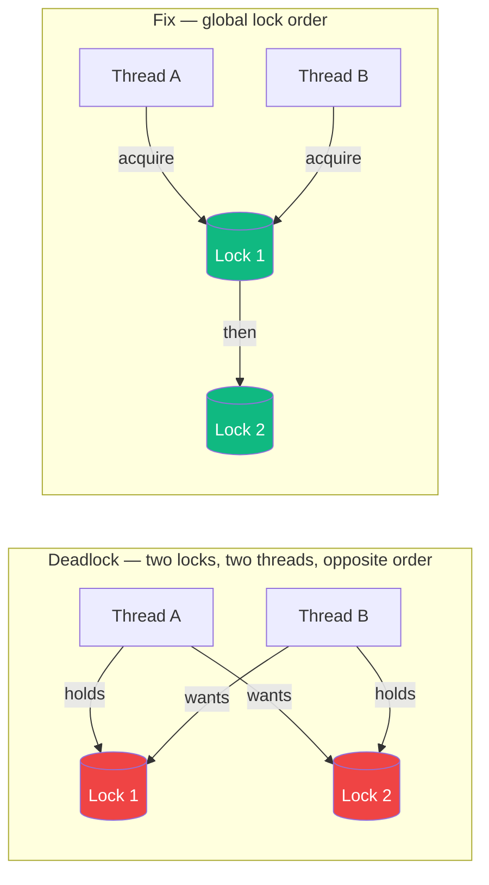

## Definition (interview-ready)

**Concurrency** is structuring a program as independent units of work that can be interleaved. A **thread** is a unit of execution sharing memory with its peers within a process. A **race condition** is when correctness depends on uncontrolled ordering. A **mutex** is a primitive that ensures only one thread enters a critical section. A **deadlock** is two or more threads waiting in a cycle, each holding a resource that the next one needs, so none can proceed.

**One-liner:** Concurrency means many threads making progress on shared state; when their timing can change the result you have a race condition, which you fix with a mutex or an atomic, and you avoid deadlock by always taking locks in one fixed global order.

## Why it matters

Every backend that handles more than one request at a time deals with concurrency: thread pools, connection pools, async I/O, locks, atomics, queues. Bugs here are non-deterministic, expensive in production, and brutal to debug. Interviews use locks/deadlock/race-condition questions as proxies for "have you actually written a multi-threaded service."



## Core concepts

### Process vs thread

- **Process**: isolated address space, own heap, own file descriptors. Context switches cost more than between threads (address-space/TLB switch); `fork()` is cheap thanks to copy-on-write. Crash isolation.
- **Thread**: shares heap with peers, has its own stack + program counter + registers. Cheap to create, fast to communicate (shared memory).
- **Goroutine / fiber / virtual thread**: language-level lightweight thread, multiplexed onto OS threads. Cheap (few KB stack each).

### Race condition

Two threads access shared state, at least one writes, and the result depends on timing.

```go
counter := 0
// Thread A: counter++  (read, +1, write)
// Thread B: counter++  (read, +1, write)
// Final value can be 1 instead of 2 if reads interleave.
```

Fix: make the operation atomic (`atomic.AddInt64`) or protect with a mutex.

### Mutex (mutual exclusion)

Lock before entering critical section, unlock after. Blocks other threads.

```go
var mu sync.Mutex
mu.Lock()
counter++
mu.Unlock()
```

Variants:
- **Spinlock**: busy-waits. Good for very short critical sections on multi-core.
- **Reentrant mutex**: same thread can lock twice without deadlocking.
- **RW mutex / `sync.RWMutex`**: many readers OR one writer.
- **Semaphore**: counter-based, allows up to N holders.
- **Condition variable**: thread waits on a predicate; another thread signals it.

### Deadlock

Four conditions (Coffman, all required):
1. **Mutual exclusion** — resource held by one at a time.
2. **Hold and wait** — thread holds one resource while waiting for another.
3. **No preemption** — can't forcibly take a resource away.
4. **Circular wait** — A→B→C→A.

Break any one to prevent deadlock. Most common fix: **lock ordering** — always acquire locks in a fixed global order.

### Livelock and starvation

- **Livelock**: threads keep changing state in response to each other, no progress. (Two people stepping aside in a hallway repeatedly.)
- **Starvation**: a thread never gets the lock because others always do. Fix with fair locks (FIFO queue).

### Memory model & visibility

In multi-core CPUs, each core has caches. Without synchronization, thread A's write may not be visible to thread B for arbitrary time. Languages define a **memory model** (Java JMM, Go memory model, C++ memory order) that specifies what reordering compilers and CPUs can do.

- **Atomic operations** give you guaranteed visibility for one variable.
- **Mutexes** establish "happens-before" relationships — anything done before unlock is visible after a subsequent lock.
- **Volatile** in Java prevents reordering but doesn't make compound ops atomic.

### Concurrency vs parallelism

- **Concurrency**: dealing with many things at once (structure).
- **Parallelism**: doing many things at once (execution).
- You can have concurrency without parallelism (single-core event loop).

### Common synchronization patterns

- **Producer-consumer**: bounded queue with condition variables.
- **Worker pool**: N threads pulling from a shared queue.
- **Read-write lock**: cache or config.
- **Once / lazy init**: `sync.Once`, double-checked locking.
- **Fork-join**: split work, wait for all (Go's `WaitGroup`, Java `Fork/Join`).

## How it works (a deadlock walkthrough)

```
Thread 1: lock(A); ...; lock(B); ...; unlock(B); unlock(A);
Thread 2: lock(B); ...; lock(A); ...; unlock(A); unlock(B);
```

Thread 1 holds A and waits on B. Thread 2 holds B and waits on A. Neither releases. **Fix**: both acquire in the same order (A then B).

## Real-world examples

- **Java `synchronized` keyword**: implicit object-level mutex.
- **Redis is single-threaded** for command execution → no locks needed at the data structure level. (Trade-off: parallelism comes from the cluster, not the single instance.)
- **Postgres MVCC**: uses concurrency control without writer-vs-reader locks for most operations.
- **Go's race detector** (`go test -race`): instruments memory accesses, reports races at runtime.
- **JVM**: java.util.concurrent has `ConcurrentHashMap` (lock-free reads; CAS + per-bin locking on writes), atomic counters, work-stealing pools.
- **Linux kernel**: RCU (Read-Copy-Update) lets readers proceed without locks while writers swap pointers.

## Common pitfalls

- **Forgetting to unlock** on every return path — use RAII (`defer mu.Unlock()`, `try-with-resources`).
- **Double-checked locking without proper memory barriers** — broken in older Java; fixed since JDK 5 with `volatile`.
- **Holding a lock across I/O** — never call out to network/disk while holding a hot lock.
- **Lock granularity**: too coarse → contention bottleneck. Too fine → deadlock and complexity.
- **Recursive lock acquisition** in non-reentrant mutex → deadlock against yourself.
- **Concurrent map access in Go without `sync.Map` or a mutex** → fatal runtime error (`concurrent map writes`) that `recover()` can't catch.
- **Thread leaks**: spawned goroutines that never exit because their channel never closes.

## Practice questions

<Practice>

<QA q="What is a race condition?" level="easy">

A bug where correctness depends on the timing or interleaving of concurrent operations on shared state, with at least one of them writing. Classic example: two threads run `counter++` (read, +1, write) without synchronization, and the final value can be 1 instead of 2.

</QA>

<QA q="How does a mutex prevent a race condition?" level="easy">

A mutex ensures only one thread is inside the critical section at a time. Lock/unlock also creates a happens-before edge in the memory model, so one thread's writes are visible to the next thread that takes the lock.

</QA>

<QA q="What's the difference between a process and a thread?" level="easy">

A **process** has its own address space, heap and file descriptors. It's isolated (a crash doesn't take down others), and switching between processes costs more because the address space changes. **Threads** share the heap of their process and each have their own stack, program counter and registers, so they're cheap to create and communicate through shared memory, but one bad write can corrupt everyone. Goroutines, fibers and virtual threads are lighter still: language-level threads multiplexed onto OS threads.

</QA>

<QA q="What's the difference between concurrency and parallelism?" level="easy">

Concurrency is dealing with many things over time (structure). Parallelism is doing many things at the same instant (execution). A single-core event loop is concurrent but not parallel.

</QA>

<QA q="Explain deadlock and how to prevent it." level="medium">

Deadlock is two or more threads waiting in a cycle for resources the others hold. All four **Coffman conditions** are required: mutual exclusion, hold-and-wait, no preemption, circular wait. Break any one. The most practical fix is **lock ordering**: define a global order and always acquire locks in it, which removes circular wait. Alternatively, try-lock with a timeout and back off on failure.

</QA>

<QA q="What's the difference between a mutex and a semaphore?" level="medium">

A mutex allows exactly one holder; a (counting) semaphore allows up to N. A mutex is usually tied to ownership (only the holder may unlock); a semaphore isn't, so any thread can release a permit. Semaphores fit "at most N concurrent DB calls"; mutexes fit protecting a data structure.

</QA>

<QA q="How do livelock and starvation differ from deadlock?" level="medium">

In a **deadlock**, threads are blocked and do nothing. In a **livelock**, threads stay busy reacting to each other but make no progress, like two people repeatedly stepping aside in a hallway (often caused by symmetric retries; random backoff fixes it). In **starvation**, the system makes progress but one thread never gets the resource because others always win. Fair (FIFO) locks fix starvation.

</QA>

<QA q="In Java, why isn't `volatile` enough to make `count++` thread-safe?" level="medium">

`volatile` guarantees visibility and prevents reordering around that variable, but `count++` is a compound read-modify-write. Two threads can both read 5 and both write 6. Use an atomic (`AtomicLong.incrementAndGet`, Go's `atomic.AddInt64`) or a mutex. Use `volatile` for flags and safe publication, not for compound updates.

</QA>

<QA q="Implement a thread-safe LRU cache. What primitives do you use?" level="hard">

A hash map plus a doubly-linked list. The simplest version puts one mutex around every operation. An RW lock doesn't help much, because a read must move the entry to the head, which is a write. Better: **shard** it into N independent LRUs (each with its own map, list and mutex) and hash keys to shards, which cuts contention roughly N-fold at the cost of only approximate global LRU order. Lock-free LRUs exist but are much harder to get right.

</QA>

<QA q="Why is double-checked locking famously broken?" level="hard">

```java
if (instance == null) {            // (1) check without lock
    synchronized (lock) {
        if (instance == null) {    // (2) check with lock
            instance = new Singleton();
        }
    }
}
```

Without `volatile`, the assignment to `instance` can be reordered with the constructor's writes, so another thread can see `instance != null` while the object is still half-initialized. Fix in Java (since JDK 5): declare `instance` `volatile`. In C++, use `std::atomic` with proper memory order, or `std::call_once`.

</QA>

<QA q="The time a thread holds a lock spikes from 1 ms to 200 ms in production. How do you debug it?" level="scenario">

Profile what runs inside the critical section. The usual cause is I/O that crept under the lock (e.g. a logger flushing synchronously, a network call). Other causes: a GC pause inside the section, a lock convoy (many threads piling up behind the holder), or priority inversion (a high-priority thread waiting on a low-priority holder). Use flame graphs, lock contention metrics and GC logs. Fix by moving I/O out of the lock and narrowing the critical section.

</QA>

<QA q="A Go service occasionally crashes with 'fatal error: concurrent map writes', and a recover() in the handler doesn't catch it. What's going on, and how do you fix and prevent it?" level="scenario">

Go maps aren't safe for concurrent writes. The runtime detects the race and aborts the whole process with a fatal error, which `recover()` can't catch. Fix: guard the map with a `sync.Mutex`/`sync.RWMutex`, use `sync.Map` for its niche cases (keys written once and read many times, or goroutines working on disjoint key sets), or give the map a single owner goroutine that others talk to over a channel. Prevent it by running tests with `go test -race`.

</QA>

</Practice>

## Quiz

<Quiz>

<MCQ q="Two threads each run counter++ 1,000 times on a shared int with no synchronization. What can the final value be?" options={["Always exactly 2000", "Anything from as low as 2 up to 2000, because read-modify-write steps can interleave and lose updates", "Always 1000", "More than 2000, due to cache duplication"]} answer={1}>

counter++ is read, add, write, so interleaved threads can overwrite each other's updates and lose increments. The count can never exceed the 2,000 increments performed, and with a pathological interleaving it can drop as low as 2. Always 2000 or always 1000 are both wrong.

</MCQ>

<MCQ q="Which change prevents deadlock by breaking the circular-wait condition?" options={["Using a reentrant mutex", "Adding more threads to the pool", "Always acquiring locks in one fixed global order", "Replacing the mutex with a spinlock"]} answer={2}>

A global lock order makes a cycle of waiting threads impossible. Reentrancy only lets one thread re-lock its own mutex, and spinlocks still wait, just busily.

</MCQ>

<MCQ q="You need to allow at most 10 concurrent calls to a downstream service. Which primitive fits best?" options={["A counting semaphore with 10 permits", "A mutex", "A condition variable alone", "A volatile boolean"]} answer={0}>

A semaphore admits up to N holders. A mutex admits only one, a condition variable needs a predicate and a lock around it, and a volatile flag provides no mutual exclusion.

</MCQ>

<MCQ q="Two threads keep detecting a conflict, both back off, both retry at the same moment, and conflict again forever. What is this?" options={["Deadlock", "Starvation", "Priority inversion", "Livelock"]} answer={3}>

The threads are active but make no progress, which is livelock, typically fixed with randomized backoff. In a deadlock threads are blocked. In starvation others make progress while one thread loses.

</MCQ>

<MCQ q="A single-core Node.js process interleaves thousands of in-flight requests. This is an example of..." options={["Parallelism without concurrency", "Concurrency without parallelism", "Both concurrency and parallelism", "Neither"]} answer={1}>

The event loop structures many tasks to make progress over time (concurrency) but executes only one at a time on one core (no parallelism).

</MCQ>

<MCQ q="Why does classic double-checked locking in Java need the instance field to be volatile?" options={["To make the synchronized block faster", "Because volatile makes the constructor atomic", "To allow two instances to be created safely", "Without it, another thread may see a non-null reference to a partially constructed object"]} answer={3}>

Writes inside the constructor can be reordered after publishing the reference. volatile (since JDK 5) forbids this, giving safe publication. It doesn't make the constructor atomic, and the pattern's goal is exactly one instance.

</MCQ>

<MCQ q="A heavily used lock's hold time jumps from 1 ms to 200 ms after a release. What is the most likely culprit to check first?" options={["Blocking I/O, such as synchronous logging or a network call, now runs inside the critical section", "The mutex implementation changed to FIFO", "The process has too few threads", "The CPU cache line size changed"]} answer={0}>

Hold time is the work done under the lock, and I/O is orders of magnitude slower than in-memory work. Too few threads would reduce contention, not lengthen a single hold.

</MCQ>

<MCQ q="What does acquiring and releasing a mutex guarantee besides mutual exclusion?" options={["That the thread will never be preempted", "That all memory is flushed to disk", "A happens-before relationship, so writes before an unlock are visible after a later lock", "That the critical section runs in constant time"]} answer={2}>

Memory models define unlock-then-lock as a synchronization edge that guarantees visibility across cores. It says nothing about preemption, disk persistence or timing.

</MCQ>

</Quiz>

## TL;DR cheat sheet

- **Race condition**: timing-dependent bug on shared state. Fix with mutex or atomic.
- **Mutex**: one holder; **semaphore**: N holders; **RWMutex**: many readers OR one writer.
- **Deadlock**: 4 Coffman conditions, break any one. Prefer global lock ordering.
- **Livelock**: progress-free flapping. **Starvation**: unfair scheduling.
- **Memory model**: lock/unlock = happens-before barrier. Without it, writes may be invisible cross-core.
- **Concurrency ≠ parallelism**.
- Never hold a lock across I/O. Use RAII for unlocking.

## Go deeper

- **OSTEP** (free): Operating Systems: Three Easy Pieces, [pages.cs.wisc.edu/~remzi/OSTEP/](https://pages.cs.wisc.edu/~remzi/OSTEP/), Chapters 26–32.
- **Java Concurrency in Practice** (Brian Goetz) — still the gold standard.
- **The Go Memory Model**: [go.dev/ref/mem](https://go.dev/ref/mem).
- **The C++ memory order reference**: [en.cppreference.com/w/cpp/atomic/memory_order](https://en.cppreference.com/w/cpp/atomic/memory_order).
- **Jeff Preshing's blog**: [preshing.com](https://preshing.com/) — accessible deep dives on memory models, lock-free programming.
- **Talk**: ["Concurrency Is Not Parallelism"](https://www.youtube.com/watch?v=oV9rvDllKEg) by Rob Pike.
