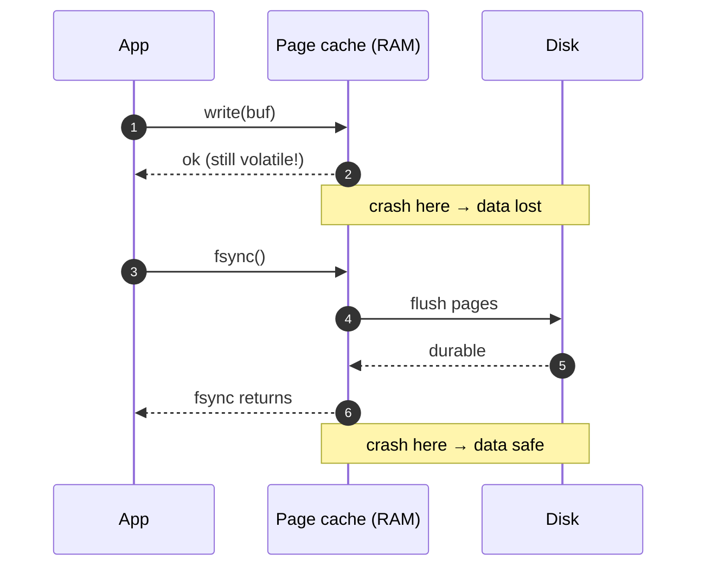

## Definition (interview-ready)

**HDD** (hard disk) stores data on rotating platters — slow random access (~10 ms seek), fast sequential. **SSD** (solid-state drive) stores data in flash cells — fast random access (~150 μs), faster sequential, finite write endurance. The **page cache** is the kernel's in-memory copy of disk pages, transparently caching reads and buffering writes. **fsync** forces a file's buffered writes from the page cache to durable storage and waits until the device confirms them.

**One-liner:** A successful `write()` only puts data in the kernel's page cache, which a crash can wipe; `fsync` makes it durable but costs milliseconds, so databases append to a sequential write-ahead log and batch fsyncs, because sequential I/O is far cheaper than random I/O on both HDDs and SSDs.

## Why it matters

Every database, message queue, and log system is designed around storage hierarchy: how it lays out data on disk, when it flushes, how it leverages OS caches. Choices like "B+ tree vs LSM tree" trace back to whether you optimize for HDD sequential, SSD random, or random/sequential mix. Knowing the page cache and fsync lets you reason about durability, performance, and crash recovery — the difference between "data lost" and "data safe."




## Core concepts

### HDD vs SSD vs NVMe

| | HDD | SATA SSD | NVMe SSD |
|---|---|---|---|
| Random read latency | ~10 ms (seek + rotation) | ~100–150 μs | ~50–100 μs |
| Sequential read | 100-200 MB/s | 500 MB/s | 3-7 GB/s |
| Random IOPS | ~100 | ~50–100K | ~500K+ |
| $/GB | very low | low | moderate |
| Endurance | high (mechanical) | finite (DWPD) | finite (DWPD) |

- **HDD** still wins on $/GB for cold storage. Random access is brutally slow.
- **SSD** loves random reads; writes more complex (program/erase cycles, wear leveling).
- **NVMe** is SSD over PCIe — eliminates SATA bottleneck, parallelism via deep queues.

### Why disk layout still matters on SSD

- SSDs erase in **erase blocks** (hundreds of KB to several MB) but write in **pages** (typically 4–16KB).
- Flash can't overwrite in place: the controller (FTL) writes the new version to a fresh page and marks the old one stale; before erasing a block, garbage collection must copy its still-valid pages elsewhere — **write amplification**.
- The drive's controller does garbage collection and wear leveling to manage this.
- **Sequential writes** are far cheaper than random for the same total bytes — same lesson as HDD, smaller magnitude.

### Block layer, file system, page cache

```
Application
   ↓ read/write
File System (ext4, xfs, zfs, apfs)
   ↓
Page Cache (kernel RAM, 4KB pages keyed by file+offset)
   ↓ flush
Block Layer (I/O scheduler, request queue)
   ↓
Device (SSD/HDD)
```

- **Page cache**: kernel uses free RAM to cache file data. Reads check the cache first; writes go to cache and return immediately (buffered).
- **Writeback**: a background flusher (historically `pdflush`; per-device `bdi` writeback workers since Linux 2.6.32) periodically writes dirty pages to disk.
- **Buffer cache** (historically separate; now unified with page cache on Linux).

### Read paths

- **Cold read**: cache miss → block layer → device → kernel copies into page cache → user buffer.
- **Warm read**: page cache hit → memcpy into user buffer (microseconds).
- **`mmap`**: maps a file into virtual memory; page faults pull pages on demand. Useful for read-mostly large datasets.

### Write paths and durability

- **Default write**: data lands in page cache; `write()` returns immediately. If the machine crashes before the kernel flushes, data is **lost**.
- **`fsync(fd)`**: blocks until all dirty pages for that file (data + metadata) hit durable storage.
- **`fdatasync(fd)`**: data only, skips metadata if not strictly required.
- **O_DIRECT**: bypasses the page cache. Application does its own caching. Used by databases (MySQL/InnoDB with `innodb_flush_method=O_DIRECT`, Oracle, ScyllaDB) — Postgres, notably, uses buffered I/O.
- **O_SYNC**: every `write` implies an `fsync`. Slow.

### Why fsync is slow

It traverses the entire storage stack down to the device — and waits for the device to confirm. On a consumer SSD, that's ~1–10 ms. On HDD, ~30 ms. This is **the durability tax** — and the reason all serious databases batch commits.

### Write-Ahead Log (WAL)

To make durability cheap and crash recovery sane:
1. Append the change to a **log file**, fsync it.
2. Apply the change to in-memory structures.
3. Periodically flush in-memory structures (checkpoint).
4. On crash: replay log from last checkpoint.

Used by: Postgres (WAL), MySQL InnoDB (redo log), Kafka (commit log), SQLite (WAL mode), every modern database and most message queues.

### Sequential vs random — why log-structured storage wins

- Random writes on HDD: seek + rotational latency ≈ ~10 ms each (~100 IOPS).
- Sequential writes: limited by media bandwidth.
- LSM trees (Cassandra, RocksDB, Scylla) only append + later compact. Cheap to write, slower to read (compaction merges + bloom filters help).

### B+ tree vs LSM tree at a glance

- **B+ tree** (Postgres, MySQL InnoDB): in-place updates. Good read locality, predictable read cost. Slower writes (random I/O).
- **LSM tree**: writes go to in-memory memtable → sorted runs on disk → background compaction. Fast writes, more read amplification (multiple sorted runs to check) — mitigated by bloom filters.

## How it works (a durable write end-to-end)

```
1. App calls write(fd, data) → returns instantly. Data in page cache, dirty.
2. App calls fsync(fd).
3. Kernel writes dirty pages from page cache to block layer.
4. Block layer queues them, possibly merging and reordering.
5. Device firmware acknowledges write (and may itself have a volatile cache —
   look for "write barrier" support).
6. fsync returns.
7. If you skip step 2, a crash before the kernel's background writeback reaches the device = lost data.
```

## Real-world examples

- **Postgres**: uses page cache aggressively (recommends `shared_buffers` ~25% RAM, leaves rest for page cache). Forces WAL flush on commit unless `synchronous_commit=off`.
- **Kafka**: appends to a per-partition log file. Doesn't fsync every write — relies on replication + page cache + periodic flush. Fast precisely because it leans on the OS.
- **Redis**: in-memory; **AOF** (append-only file) for durability with configurable fsync policy (every command, every second, OS).
- **SQLite WAL mode**: readers don't block writers; writers append to WAL, periodic checkpoints fold WAL back into the main DB.
- **RocksDB / Cassandra**: LSM with memtable + SSTables + compaction.

## Common pitfalls

- **Assuming write returned = data durable**: it didn't. Always `fsync` if durability matters.
- **fsync over network filesystems**: NFS, EFS — fsync may not mean what you think. Test.
- **Drive's volatile cache**: enterprise drives have battery-backed cache or honor SCSI flush properly; consumer drives may lie. Check.
- **`O_DIRECT` without alignment**: usually requires buffers, offsets and lengths aligned to the device's logical block size (often 512 B or 4 KB). The exact rules vary by filesystem and kernel, and misaligned I/O may fail with `EINVAL` or silently fall back to buffered I/O.
- **fsync after every write**: kills throughput. Batch commits.
- **Filling the page cache with cold data**: kicks out hot data. Use `posix_fadvise(POSIX_FADV_DONTNEED)` for streamed scans.
- **Forgetting metadata sync**: `fsync` on the file syncs the file's data; you may also need to fsync the **directory** to persist a new filename.

## Practice questions

<Practice>

<QA q="What is the page cache?" level="easy">

A kernel-managed in-memory cache of disk pages, keyed by file and offset, that uses free RAM transparently. Reads check it first (a warm read is just a memcpy). Writes land there as dirty pages and are flushed to the device later by background writeback.

</QA>

<QA q="Why is fsync slow?" level="easy">

It forces dirty pages all the way through the storage stack to the physical device and waits for confirmation, including the device's own cache flush. That's ~1–10 ms on a consumer SSD and ~30 ms on an HDD, versus microseconds for a buffered `write()`. It's the durability tax, which is why serious databases batch commits.

</QA>

<QA q="What's the difference between `fsync`, `fdatasync` and `O_SYNC`?" level="easy">

- `fsync(fd)`: blocks until the file's dirty data **and metadata** are durable.
- `fdatasync(fd)`: flushes data, and skips metadata (such as modification time) unless it's needed to read the data back (e.g. a changed file size). Slightly cheaper.
- `O_SYNC`: an open flag that makes every `write()` behave as if it were followed by a sync. Simple, but slow.

</QA>

<QA q="How does a write-ahead log improve durability and performance?" level="medium">

**Durability**: each change is appended to the log and the log is fsynced on commit, so after a crash you replay from the last checkpoint. **Performance**: the log is **sequential**, which is cheap, and the scattered data pages can be flushed lazily at checkpoints. Without a WAL, every commit would have to fsync scattered data pages, which is far more expensive.

</QA>

<QA q="Postgres recommends giving about 25% of RAM to `shared_buffers`. Where does the rest go?" level="medium">

To the OS page cache. Postgres uses buffered I/O, so it relies heavily on the page cache for blocks not in `shared_buffers` (some pages end up cached twice). Setting `shared_buffers` too high starves the page cache and hurts performance.

</QA>

<QA q="Why do some databases use `O_DIRECT`?" level="medium">

To bypass the OS page cache. Their own buffer pool understands transactions, MVCC and access patterns better than the kernel does, and bypassing avoids caching the same page twice. MySQL/InnoDB optionally does this (`innodb_flush_method=O_DIRECT`), as do Oracle and ScyllaDB; Postgres famously doesn't. Caveat: buffers, offsets and lengths usually must be aligned to the device's logical block size. Depending on filesystem and kernel, misaligned I/O either fails with `EINVAL` or quietly falls back to buffered I/O (per `open(2)`).

</QA>

<QA q="What is write amplification on an SSD, and why do sequential writes still help?" level="medium">

Flash writes in **pages** (~4–16 KB) but erases only whole **erase blocks** (hundreds of KB to several MB), and it can't overwrite in place. The controller (FTL) writes new versions to fresh pages and marks old ones stale. Before erasing a block, garbage collection must copy its still-valid pages elsewhere, so the device physically writes more than you asked. Random small writes scatter stale pages across many blocks and make this worse. Sequential writes fill and invalidate whole blocks together, which is cheaper and better for endurance.

</QA>

<QA q="You create a new file, write to it, fsync it, and the machine crashes. After reboot the file is missing. Why?" level="hard">

`fsync` on the file persists its data and inode, but the **directory entry** that names the file lives in the parent directory. Unless you also fsync the **directory**, the new name may not be durable. The safe pattern for atomic file replacement: write a temp file → fsync it → `rename` over the target → fsync the directory.

</QA>

<QA q="Compare B+ tree and LSM tree storage on SSD." level="hard">

**B+ tree**: in-place updates mean random writes and write amplification (especially for small updates), but predictable reads (log N levels) that benefit from fast SSD random reads. **LSM**: writes go to a memtable and are flushed as sorted runs, so writes are sequential and cheap. Reads may check several runs (read amplification, cut down by bloom filters), and compaction does heavy background I/O. Write-heavy workloads (telemetry, time series, KV) → LSM. Balanced OLTP → B+ tree.

</QA>

<QA q="A service writes 100K small records/sec, each 200 bytes, with strict durability. How do you avoid an fsync bottleneck?" level="scenario">

- **Batch**: buffer writes and fsync once per group (every few ms or every ~1 MB).
- **Group commit**: coalesce concurrent writers' commits so one fsync covers many transactions.
- **Replicate**: with 3 replicas you can ack once a majority has the write and lean on cluster redundancy instead of a per-node fsync for every record.
- **Front with a replicated log** such as Kafka.

Realistic answer: combine batching, group commit and replication. One fsync per record caps you at around 1K writes/sec at best (100–1,000 at 1–10 ms per fsync).

</QA>

<QA q="After a power loss, your DB file shows corruption even though you fsynced. What could have happened?" level="scenario">

- The drive lied about the flush (a volatile write cache without power-loss protection).
- A **torn write**: power failed partway through a multi-page update. Fix with WAL + checksums so partial pages are detected and repaired from the log.
- A misconfigured filesystem journal mode (e.g. ext4 `data=writeback` doesn't order file data before the metadata that points to it).
- A new file was fsynced but its parent directory wasn't, so the metadata pointing to the data was lost.

</QA>

<QA q="A nightly job streams through a 500 GB file and every morning the API's read latency is terrible for an hour. What's happening and how do you fix it?" level="scenario">

The scan pulls cold pages through the **page cache** and evicts the hot pages the API depends on, so the API takes disk reads until its working set is re-warmed. Fixes: have the job call `posix_fadvise(POSIX_FADV_DONTNEED)` on ranges it has finished (or use `O_DIRECT` for the scan), run it on a replica or another host, or rate-limit it.

</QA>

</Practice>

## Quiz

<Quiz>

<MCQ q="An application calls write() and gets success back, then the machine loses power before any other call. What is the state of the data?" options={["Durable, because write() succeeded", "Durable only on SSDs", "Possibly lost, because it may still be dirty in the page cache", "Durable if the file was opened read-write"]} answer={2}>

Buffered write() returns once the data is in the page cache. Only fsync, fdatasync, O_SYNC or a completed background flush makes it durable. The storage medium and the open mode don't change that.

</MCQ>

<MCQ q="Why does a write-ahead log make commits cheaper than flushing data pages directly?" options={["Commits only need a sequential append plus fsync of the log, while scattered page writes happen lazily at checkpoints", "The log is kept only in RAM", "WAL skips fsync entirely", "WAL compresses data pages"]} answer={0}>

Sequential log appends are cheap, and the random page flushes are deferred and batched. The log is fsynced, not kept in RAM, and compression isn't the mechanism.

</MCQ>

<MCQ q="Which workload most favors an LSM tree over a B+ tree?" options={["Read-heavy point lookups with rare updates", "Small tables that fit entirely in memory", "Range scans over a mostly static dataset", "High-volume writes such as telemetry or time-series ingestion"]} answer={3}>

LSM turns writes into sequential appends and background compaction, which is ideal for write-heavy ingestion. Read-heavy and mostly static workloads benefit from a B+ tree's predictable read path.

</MCQ>

<MCQ q="Why does an SSD suffer write amplification on random small writes?" options={["The platter must rotate to each location", "Flash erases whole blocks, so garbage collection must relocate still-valid pages before erasing", "SSDs store each write three times for safety", "The page cache doubles every write"]} answer={1}>

Flash can't overwrite in place, and it erases in large blocks, so the FTL's garbage collection copies valid pages, physically writing extra data. Platters are an HDD concept, and the page cache doesn't multiply device writes.

</MCQ>

<MCQ q="A program writes a new file, fsyncs it, and crashes. After reboot the file is gone. What was missed?" options={["fsync of the parent directory to persist the new directory entry", "A second fsync of the file", "Calling fdatasync instead of fsync", "Opening the file with O_DIRECT"]} answer={0}>

The file's name lives in the directory, which needs its own fsync. A second fsync of the file or fdatasync doesn't cover the directory entry, and O_DIRECT only bypasses the cache for data.

</MCQ>

<MCQ q="A service must durably store 100K small records per second. Which approach is realistic?" options={["fsync after every record", "Rely on write() return values", "Disable the drive's write cache and fsync per record", "Batch records and use group commit so one fsync covers many writes"]} answer={3}>

At 1 to 10 ms per fsync, per-record fsync caps you around 1K writes/sec. Group commit amortizes the cost. Relying on write() gives up durability entirely.

</MCQ>

<MCQ q="Which statement about O_DIRECT is correct?" options={["It guarantees durability without fsync", "Postgres uses it by default", "It bypasses the page cache, and typically imposes alignment rules on buffers, offsets and lengths", "It makes every write synchronous like O_SYNC"]} answer={2}>

O_DIRECT skips the kernel cache so the database can manage its own buffer pool. Alignment rules vary by filesystem and kernel, and misaligned I/O may fail with EINVAL or fall back to buffered I/O. It doesn't by itself guarantee durability (you still need fsync for that, e.g. for metadata and device caches), and Postgres uses buffered I/O.

</MCQ>

<MCQ q="Why does Postgres advise against giving almost all RAM to shared_buffers?" options={["shared_buffers cannot exceed 4 GB", "Postgres uses buffered I/O and relies on the OS page cache for the rest of its caching", "Large shared_buffers disables the WAL", "The kernel refuses to allocate shared memory above 25 percent"]} answer={1}>

Postgres reads through the page cache, so starving the OS cache hurts performance. The 25% figure is guidance, not a hard limit, and it has nothing to do with the WAL.

</MCQ>

</Quiz>

## TL;DR cheat sheet

- HDD: 10 ms seek, sequential strongly preferred. SSD: 150 μs random, still prefers sequential. NVMe: GB/s sequential, 500K+ IOPS.
- Page cache = kernel's RAM-based disk cache. Reads return from RAM if warm.
- `write()` returns when in page cache — **not durable**. Call `fsync()` (or use O_SYNC / WAL).
- fsync costs ~1–30 ms; batch and use WAL to amortize.
- WAL = sequential log + checkpoints. Backbone of every serious DB and message queue.
- B+ tree: balanced reads/writes, in-place. LSM tree: write-optimized, append+compact.
- O_DIRECT bypasses page cache — databases use it to manage their own buffers.

## Go deeper

- **Book**: DDIA (Kleppmann), Chapter 3 ("Storage and Retrieval") — the canonical chapter.
- **Hussein Nasser**: [Database Engineering playlist](https://www.youtube.com/playlist?list=PLQnljOFTspQXjD0HOzN7P2tgzu7scWpl2) — fsync, WAL, page cache deep dives.
- **OSTEP** (free book), Chapters 36–45 on persistence — file systems, journaling, crash consistency.
- **Postgres docs**: [Reliability and the Write-Ahead Log](https://www.postgresql.org/docs/current/wal-intro.html).
- **Linux Kernel doc**: [VM sysctls — dirty page writeback tunables](https://www.kernel.org/doc/html/latest/admin-guide/sysctl/vm.html).
- **Essay**: ["Files are hard"](https://danluu.com/file-consistency/) by Dan Luu — a humbling read on what fsync does and doesn't promise across filesystems.
- **RocksDB wiki**: best practical write-up of LSM internals.
