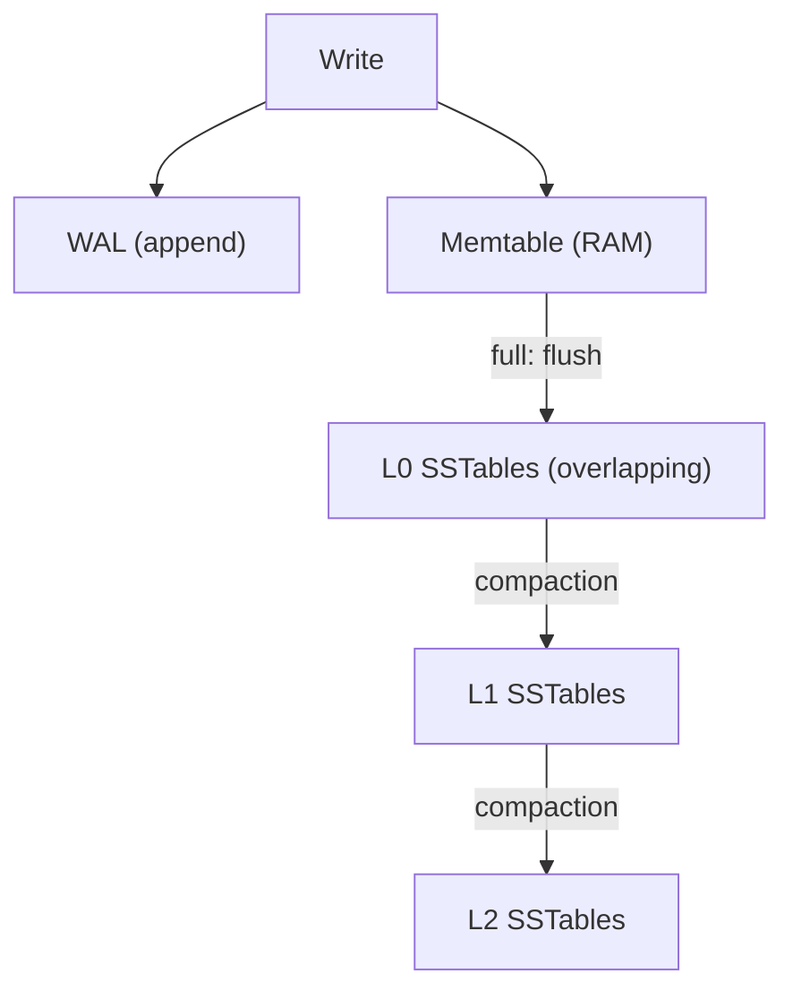
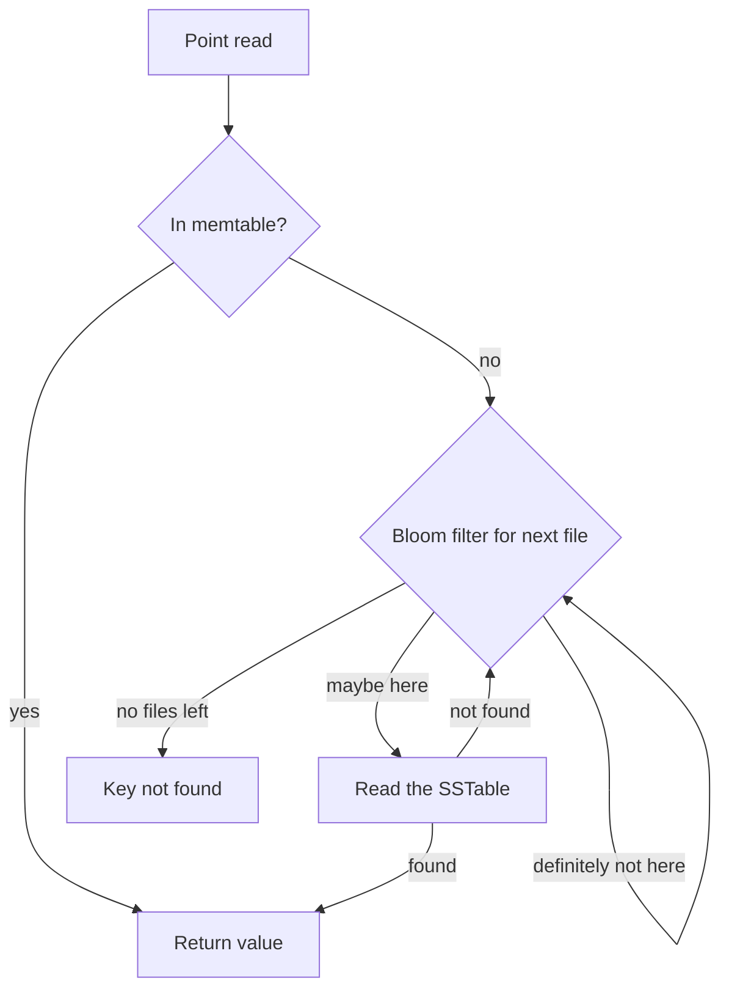
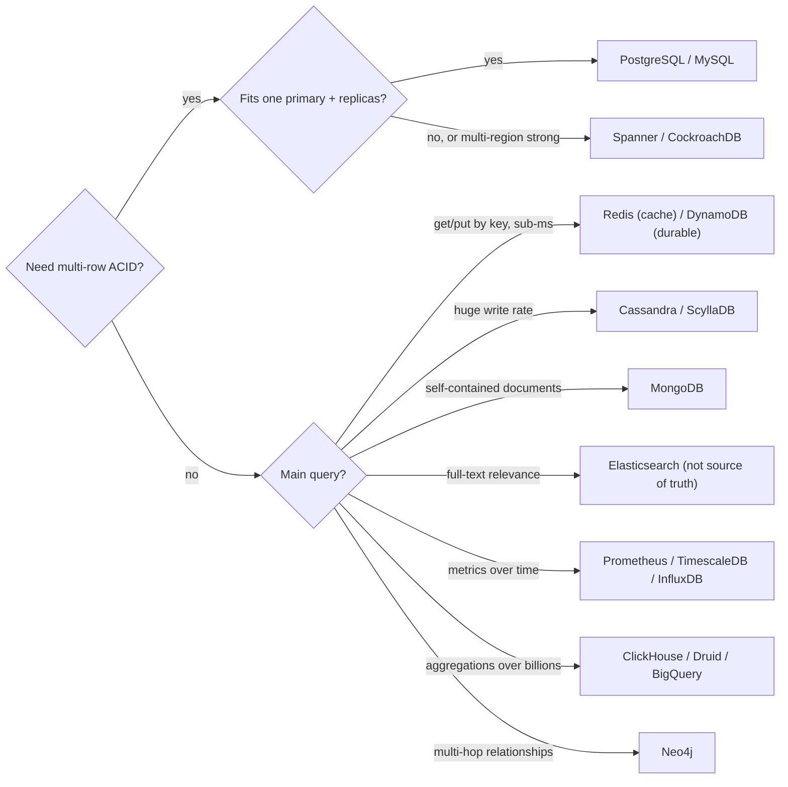

## Definition (interview-ready)

Choosing a database means matching a **workload** — its access patterns, consistency needs, scale and shape of data — to a **data model** (relational, document, wide-column, key-value, search, time-series, columnar, graph) and a **storage engine** underneath it. Most engines are either **B-tree** based (update pages in place; great reads, predictable latency) or **LSM-tree** based (append to a log, merge files later; great writes, more background work). Every engine trades off three costs: **read amplification** (how many disk reads per query), **write amplification** (how many bytes hit disk per byte you write) and **space amplification** (how much disk you use per byte of real data). You can't minimize all three, so the right database is the one whose trade-offs fit *your* dominant queries.

**One-liner:** I pick a database by stating the access patterns, consistency needs and scale first, then matching them to a data model and engine: PostgreSQL by default for transactional business data, an LSM store like Cassandra for huge key-based write volumes, and specialized stores for search, analytics, time series or graphs.

## Why it matters

- **Every design round asks it.** "Which database would you use here, and why?" is in nearly every HLD interview. A name alone scores nothing; the reasoning is the answer.
- **Wrong choices are expensive to undo.** Migrating a live system's primary store takes months: dual writes, backfills, verification. Choosing well up front is cheap by comparison.
- **"Postgres for everything" is often right — but not always.** Strong candidates know the default *and* the specific signals that justify something else (write rate beyond one primary, full-text relevance, huge analytical scans, graph traversals).
- **Interviewers probe trade-offs, not features.** "Why not Cassandra?" or "What happens when you need a new query pattern?" is where the score is decided.

## Core concepts

### B-tree vs LSM-tree in one picture

```
B+ tree (InnoDB, PostgreSQL indexes)          LSM tree (RocksDB, Cassandra, ScyllaDB)
──────────────────────────────────            ───────────────────────────────────────
              [root]                           write → WAL (append) + memtable (RAM)
           /     |     \                                    │ full
       [inner] [inner] [inner]                              ▼ flush (sequential)
       /  |  \                                 L0: [sst] [sst] [sst]   ← overlapping
   [leaf][leaf][leaf]  ← sorted keys,                       │ compaction
                          fixed-size pages     L1: [sst][sst][sst][sst]
                                               L2: [sst][sst][sst][sst][sst]...
update: find leaf page → modify → write page   update: write a new version; old one is
(plus WAL record)                              dropped later by compaction
```

The LSM write path, from one write down to the compacted levels:



And an LSM point read: memtable first, then files, with bloom filters skipping most of them:



- **B-tree**: data lives in fixed-size pages (16 KB by default in InnoDB, 8 KB in PostgreSQL). A lookup walks root → leaf, usually 3–4 levels even for very large tables, and upper levels sit in memory. An update rewrites the page that holds the row (and logs it in the WAL first). Full details: [MySQL/Postgres Internals](/learn/notes/mysql-postgres-internals/).
- **LSM tree** (log-structured merge tree): writes go to a write-ahead log and an in-memory sorted table (**memtable**). When it fills, it's flushed to an immutable sorted file (**SSTable**). Background **compaction** merges files and discards overwritten or deleted values. Reads check the memtable and then possibly several files, using **bloom filters** (a compact structure that says "definitely not here" or "maybe here") to skip most of them. See [Cassandra / ScyllaDB](/learn/notes/cassandra-scylla/) and [Storage Fundamentals](/learn/notes/storage-fundamentals/).

**Analogy:** a B-tree is a perfectly organized filing cabinet — every update goes into the right folder immediately, so finding things is fast, but every update means opening a drawer. An LSM tree is an inbox tray — you drop papers on top instantly and file them in batches later, so writing is cheap but finding something might mean checking the tray and a few piles.

### The three amplifications

RocksDB's tuning guide defines them precisely:

- **Write amplification** = bytes written to storage ÷ bytes written to the database.
- **Read amplification** = disk reads per query.
- **Space amplification** = size of database files on disk ÷ size of the actual data.

| | B-tree | LSM (leveled compaction) | LSM (size-tiered / universal) |
|---|---|---|---|
| Point read | ~1 page read at the leaf (inner pages are cached) | Memtable + every L0 file + at most one file per deeper level (bloom filters skip most) | More files to check |
| Range scan | Excellent — leaves are sorted and linked | Good, but must merge across levels | Worse |
| Write amplification | Whole page rewritten for a small change, plus WAL (InnoDB also writes a doublewrite buffer) | Data rewritten once per level it moves through; RocksDB's worked example estimates about 33x with a level multiplier of 10 | Lower than leveled |
| Write pattern | Random page writes | Sequential appends and large sequential merges | Sequential |
| Space amplification | Pages partly empty after splits; fragmentation | Low — RocksDB aims to keep about 90% of data in the last level, so the overhead from older versions stays small | High — can temporarily double during compaction |
| Latency profile | Predictable | Background compaction can cause latency spikes | Spikier |

Key takeaway: **LSM wins on write throughput and compression; B-tree wins on read latency, range scans and predictability.** The "RUM conjecture" (Athanassoulis et al., EDBT 2016) states the general rule: optimizing for **R**eads, **U**pdates and **M**emory/space — pick two, the third gets worse.

**Compaction** is the LSM's hidden bill. It consumes disk bandwidth and CPU continuously. If writes outpace compaction, files pile up, reads slow down, and engines throttle writes ("write stalls"). Deletes don't free space immediately — they write **tombstones** that are removed only when compaction reaches them.

**How to say it in an interview:** "B-trees update in place, so reads are cheap and predictable but each write rewrites a page. LSM trees append and compact later, so writes are cheap and sequential but reads may touch several files and compaction costs background I/O. Write-heavy, key-based access points to LSM; read-heavy with range queries and transactions points to a B-tree."

### Which engines use what

| B-tree family | LSM family | Other |
|---|---|---|
| MySQL InnoDB, PostgreSQL (heap + B-tree indexes), SQL Server, Oracle, MongoDB WiredTiger (default), SQLite | Cassandra, ScyllaDB, RocksDB (and MyRocks), LevelDB, HBase, Bigtable, CockroachDB (Pebble), TiKV | ClickHouse MergeTree (columnar parts merged in background — LSM-like), Elasticsearch/Lucene (immutable segments + merging), Redis (in-memory) |

### The decision questions (ask these first)

Before naming any database, answer:

1. **Access pattern**: point lookups by key? Range scans? Ad-hoc filters and joins? Full-text search? Aggregations over billions of rows? Multi-hop relationships?
2. **Consistency**: do you need multi-row ACID transactions (money, inventory)? Is read-your-writes enough? Can you tolerate eventual consistency? See [CAP, PACELC & Consistency](/learn/notes/cap-pacelc-consistency/) and [Transactions + Isolation](/learn/notes/transactions-isolation/).
3. **Scale**: writes per second, total data size, growth rate. Does it fit on one primary (with replicas)? Most systems do for longer than people expect.
4. **Read/write ratio** and **latency target** (p99).
5. **Data shape**: fixed schema with relationships? Nested and variable documents? Time-stamped measurements? Graph?
6. **Operations**: managed service available? Team expertise? Multi-region needs? Cost?

### The decision matrix

| Category | Examples | Pick it when the workload is… | Why it fits | When NOT to use it |
|---|---|---|---|---|
| **Relational (OLTP)** | PostgreSQL, MySQL | Structured data with relationships; multi-row transactions; ad-hoc queries; strong consistency (orders, payments, users, inventory) | ACID, joins, secondary indexes, mature tooling, constraints catch bad data; B-tree reads are predictable | Write volume beyond one primary and you can't shard easily; massive analytical scans; truly schemaless data; full-text relevance ranking |
| **Document** | MongoDB | Self-contained aggregates read and written together (product catalog, user profile, CMS content); evolving fields | Store the object the way the app uses it; flexible schema; built-in sharding and replica sets; multi-document transactions exist but are best kept rare | Many-to-many relationships and cross-document joins; heavy multi-entity transactions; unbounded arrays inside a document. See [MongoDB](/learn/notes/mongodb/) |
| **Wide-column** | Cassandra, ScyllaDB, Bigtable, HBase | Very high write throughput; known query patterns by partition key; time-ordered data per key (messages, activity feeds, IoT); multi-datacenter active-active | LSM writes, linear horizontal scaling, leaderless replication with tunable consistency, no single point of failure | Ad-hoc queries; joins; transactions across partitions (LWTs are slow); frequent deletes (tombstones); small datasets. See [Cassandra / ScyllaDB](/learn/notes/cassandra-scylla/) |
| **Key-value (in-memory)** | Redis, Memcached | Caching, sessions, rate limits, leaderboards, counters, locks — sub-millisecond access by key | Data in RAM, rich data structures (Redis), very low latency | Primary store for data you can't lose (persistence is a trade-off); data bigger than RAM; queries by anything other than key. See [Redis](/learn/notes/redis-deep/) |
| **Key-value (durable, managed)** | DynamoDB | Known access patterns by partition key (+ sort key) at any scale; serverless; predictable single-digit-ms latency | Fully managed, automatic partitioning, on-demand capacity; single-table design covers many patterns | Ad-hoc queries or analytics; items over 400 KB; frequently changing access patterns; hot partition keys |
| **Search** | Elasticsearch, OpenSearch | Full-text search with relevance ranking, fuzzy matching, faceting; log search | Inverted index, BM25 scoring, analyzers, aggregations, horizontal sharding | Source of truth (keep the primary copy elsewhere and sync via [CDC](/learn/notes/change-data-capture/)); transactions; strong read-after-write (refresh is near-real-time, 1 s by default). See [Elasticsearch](/learn/notes/elasticsearch/) |
| **Time-series** | Prometheus, InfluxDB, TimescaleDB | Metrics, monitoring, sensor and IoT data: append-only, time-ordered, recent-heavy, retention and downsampling | Time partitioning, delta-of-delta and XOR compression, cheap retention | Business entities with updates; high-cardinality labels (IDs) in Prometheus-style stores. See [Time-Series Databases](/learn/notes/time-series-databases/) |
| **OLAP / columnar** | ClickHouse, Druid, Pinot, BigQuery, Snowflake | Aggregations over billions of rows: analytics dashboards, event analytics, ad-click reporting, log analytics | Reads only needed columns, heavy compression, vectorized execution, parallel scans | OLTP: point updates, single-row transactions, high-concurrency small lookups by primary key. See [Trino/Presto](/learn/notes/trino-presto/) |
| **Graph** | Neo4j, Amazon Neptune | Multi-hop relationship queries: fraud rings, recommendations ("friends of friends who bought X"), knowledge graphs, access-control graphs | Relationships are stored as direct references between nodes ("index-free adjacency" in Neo4j), so each hop is a pointer follow rather than an index lookup; Cypher makes path queries natural | Simple one-hop lookups (a relational join is fine); bulk aggregations; very high write throughput across a huge graph |
| **NewSQL / distributed SQL** | Google Spanner, CockroachDB, YugabyteDB, TiDB | Relational + ACID transactions **and** horizontal scale or multi-region strong consistency (global ledgers, inventory across regions) | SQL with automatic sharding, consensus-replicated ranges (Paxos/Raft), serializable transactions (CockroachDB's default); Spanner uses TrueTime for externally consistent commits | Single-region workloads that fit one Postgres primary (you pay latency and cost for consensus); write-heavy hot rows; latency-critical paths that can't afford cross-region round trips |

### Shortcuts that usually hold

- **Default to PostgreSQL** (or MySQL if the team runs it) for business data until a specific requirement rules it out. Add read replicas, caching and partitioning before switching engines.
- **Polyglot persistence is normal**: Postgres as source of truth, Redis for cache, Elasticsearch for search, ClickHouse for analytics, Kafka + CDC connecting them. Each store answers one kind of query well.
- **The source of truth should be the store with the strongest guarantees.** Derived stores (search, cache, analytics) can be rebuilt from it.
- **Design for queries, not entities, in NoSQL.** Cassandra and DynamoDB need the access patterns up front; adding a new query later can mean a new table and a backfill.
- **Scale numbers matter.** A single modern Postgres primary handles a lot of writes per second on good hardware; measure or estimate before assuming you need a distributed store. See [Back-of-Envelope Math](/learn/notes/back-of-envelope-math/).

## How it works

### Interview walkthrough: justifying a database choice

Use a short, repeatable script. Say it out loud in the design round.

**Step 1 — State the access patterns.** List the top 3–5 queries with rough rates.

> "We have three main queries: get a user's orders by `user_id` sorted by time, look up an order by `order_id`, and an admin search by status and date range. Writes are about 2k orders/s at peak, reads about 20k/s."

**Step 2 — State the non-negotiables.**

> "Order placement must be atomic with the inventory decrement and payment record, so I need multi-row transactions. Reads can be slightly stale for order history."

**Step 3 — Pick, and tie each property to a requirement.**

> "I'll use PostgreSQL as the source of truth. ACID transactions cover the order + inventory write. A B-tree index on `(user_id, created_at DESC)` serves order history as a range scan, and the primary key serves lookups. 2k writes/s fits on one primary, and read replicas absorb the 20k reads/s."

**Step 4 — Name the trade-off and the plan when it breaks.**

> "The risk is write growth beyond one primary. Then I'd shard by `user_id` — most queries are per user, so they stay on one shard. Admin search across shards goes to Elasticsearch, fed by CDC from the WAL, so it never becomes the source of truth."

**Step 5 — Mention the rejected alternative and why.**

> "I didn't pick Cassandra: we need transactions across order and inventory rows, and the admin query is ad hoc. I'd reconsider for a write-heavy, key-only workload like an activity feed."

This script hits what interviewers grade: requirements-driven reasoning, trade-offs, an evolution path and awareness of alternatives.

### Worked mini-examples

| System | Primary store | Supporting stores | One-line justification |
|---|---|---|---|
| URL shortener | DynamoDB or Cassandra (or Postgres at modest scale) | Redis cache | Key lookup by short code, read-heavy, simple model, huge scale potential |
| Chat messages | Cassandra / ScyllaDB | Redis for presence | Write-heavy, partition by `channel_id`, cluster by message time, range reads of recent messages |
| E-commerce orders & payments | PostgreSQL / MySQL | Redis cache, Elasticsearch for search | ACID across order, payment and inventory rows |
| Product search | Elasticsearch | Postgres or MongoDB as source of truth | Relevance ranking, fuzzy matching, facets |
| Metrics & monitoring | Prometheus + Thanos/Mimir | — | Time-series compression, PromQL, retention |
| Ad-click analytics | ClickHouse / Druid / Pinot | Kafka for ingest | Aggregations over billions of events, low-latency dashboards |
| Fraud ring detection | Neo4j | Relational store for accounts | Multi-hop relationship traversal |
| Global bank ledger | Spanner / CockroachDB | — | Serializable transactions across regions |

### A quick decision flow

The decision tree, starting from the transaction question:



## Real-world examples

- **Discord** has written publicly about moving message storage from MongoDB to Cassandra, and later from Cassandra to ScyllaDB — a write-heavy, partition-by-channel workload that fits wide-column stores. See the [Cassandra / ScyllaDB](/learn/notes/cassandra-scylla/) note.
- **Google Spanner** (OSDI 2012 paper) was built because Google needed SQL-style transactions at global scale; it pairs Paxos replication with TrueTime clock bounds and waits out the clock uncertainty before making a commit visible ("commit wait"). See [Clocks](/learn/notes/clocks-vector-lamport-hlc/).
- **Facebook's MyRocks** replaced InnoDB with RocksDB (an LSM engine) under MySQL for parts of its fleet to cut storage space and write amplification on flash — the B-tree vs LSM trade-off in practice.
- **Prometheus, ClickHouse and Elasticsearch** each exist because general-purpose OLTP databases were a poor fit for metrics, analytics and full-text search respectively.

## Common pitfalls

- **Naming a database before stating the access patterns.** Interviewers mark this down immediately.
- **Choosing NoSQL "for scale"** without numbers, then losing transactions and joins the system actually needed.
- **Using Elasticsearch, Redis or a cache as the source of truth.** They're derived stores; keep the primary copy where durability and consistency are strongest.
- **Modeling Cassandra or DynamoDB like a relational database** — normalizing tables and expecting ad-hoc queries. Model one table per query pattern.
- **Running OLAP queries on the OLTP primary.** Big scans evict hot pages and hurt user-facing latency. Use a replica or a columnar store fed by CDC.
- **Ignoring compaction and tombstones** on LSM stores: disk usage spikes, write stalls and slow reads after mass deletes.
- **Picking distributed SQL for a single-region app** that would fit on one Postgres primary — higher latency and cost for no benefit.
- **Hot partitions**: a bad partition key (like `country` or today's date) concentrates load on one node regardless of the database. See [Sharding Strategies](/learn/notes/sharding-strategies/).
- **Forgetting operations**: backups, schema migrations, monitoring and team expertise matter as much as benchmarks.

## Practice questions

<Practice>

<QA q="What is the main difference between a B-tree and an LSM-tree storage engine?" level="easy">

A **B-tree** keeps data in sorted fixed-size pages and updates them in place (after logging to a WAL). Reads are fast and predictable; writes cause random page writes. An **LSM tree** buffers writes in a memtable, flushes them as immutable sorted files, and merges those files in the background (compaction). Writes are sequential and cheap; reads may check several files (bloom filters help) and compaction adds background I/O.

</QA>

<QA q="Define read, write and space amplification." level="easy">

- **Read amplification**: disk reads needed per query.
- **Write amplification**: bytes physically written to storage per byte the application writes.
- **Space amplification**: disk space used per byte of live data.

Storage engines trade these off: B-trees have low read amplification but high write amplification for small updates; leveled LSM has low space but notable write amplification; size-tiered LSM lowers write amplification but raises space and read amplification.

</QA>

<QA q="Why is PostgreSQL a reasonable default for most new services?" level="easy">

It gives ACID transactions, joins, secondary indexes, constraints, rich SQL, JSON support for semi-structured fields and mature tooling and managed offerings. Most services' data fits on one primary with read replicas for a long time. You switch only when a concrete requirement — write volume beyond one node, full-text relevance, massive analytical scans, multi-hop graph queries — rules it out.

</QA>

<QA q="When would you choose Cassandra over PostgreSQL?" level="medium">

When writes are very high (beyond what one primary can take), access is by a known partition key (for example messages by `channel_id` sorted by time), you need linear horizontal scaling or multi-datacenter active-active writes, and you can live without joins or multi-partition transactions. You give up ad-hoc queries, strong transactional guarantees and easy deletes (tombstones).

</QA>

<QA q="Why shouldn't Elasticsearch be your source of truth?" level="medium">

It's optimized for search, not durability guarantees or transactions. Writes become visible only after a refresh (1 s by default), there are no multi-document ACID transactions, and mapping changes often require a full reindex. Keep the primary data in a transactional store and sync Elasticsearch through CDC or an outbox, so it can be rebuilt at any time.

</QA>

<QA q="What is compaction in an LSM tree, and what problems can it cause?" level="medium">

Compaction merges SSTables, keeping the newest version of each key and dropping overwritten values and expired tombstones. It reduces read and space amplification but costs CPU and disk bandwidth. Problems: write amplification, latency spikes while it runs, temporary extra disk space (especially with size-tiered/universal compaction), and write stalls when writes outpace compaction. Mass deletes create tombstones that slow reads until compacted.

</QA>

<QA q="When does a document database like MongoDB beat a relational database?" level="medium">

When the data is naturally a self-contained aggregate that's read and written as a unit (a product with variable attributes, a user profile, a CMS page), when fields vary across records, and when you rarely need joins across aggregates. Embedding avoids joins and keeps related data in one read. It loses when relationships are many-to-many or when you need frequent multi-document transactions.

</QA>

<QA q="When is a graph database worth it?" level="medium">

When the core queries traverse many hops of relationships with variable depth: friends-of-friends recommendations, fraud rings sharing devices or cards, permission inheritance, knowledge graphs. Neo4j stores relationships as direct references between nodes, so each hop is a pointer follow instead of an index lookup, and Cypher expresses path patterns naturally. For one or two fixed hops, relational joins are fine and simpler to operate.

</QA>

<QA q="What does NewSQL like Spanner or CockroachDB give you, and what does it cost?" level="hard">

It gives SQL and ACID transactions with automatic horizontal sharding and consensus replication (Paxos in Spanner, Raft in CockroachDB), so you can survive node or region failures with strong consistency. CockroachDB defaults to SERIALIZABLE; Spanner provides external consistency using TrueTime. The cost: every write needs a consensus round trip, which is slow across regions; higher operational cost; and contention on hot rows still hurts. If the workload fits a single Postgres primary in one region, NewSQL adds latency without benefit.

</QA>

<QA q="Why do LSM engines use bloom filters, and what can't bloom filters help with?" level="hard">

A point read might otherwise have to check every SSTable that could contain the key. A bloom filter per file answers 'definitely not here' with no false negatives, so most files are skipped without disk reads. Bloom filters don't help range scans (they test exact keys), and they don't help when the key is present in many files (frequently updated keys) — that's what compaction fixes.

</QA>

<QA q="Your team wants DynamoDB for a new service. What do you need to know before agreeing?" level="hard">

- **Access patterns**: every query must map to a partition key (and sort key) or a secondary index. Ad-hoc queries and analytics need another store (export to S3/warehouse).
- **Item size**: max 400 KB including attribute names; large blobs go to S3.
- **Key distribution**: hot partition keys throttle; choose high-cardinality keys.
- **Transactions**: supported but limited and more expensive; heavy relational workflows are awkward.
- **Cost model**: on-demand vs provisioned capacity, GSI write costs.

If patterns are stable and key-based at large scale, it's a great fit; if they're evolving and relational, Postgres is safer.

</QA>

<QA q="How would you justify the database for an e-commerce order system in an interview?" level="hard">

State the access patterns (get orders by user sorted by time, get order by ID, admin search), then the non-negotiable (order, inventory and payment records must commit atomically). Pick PostgreSQL: ACID transactions, B-tree index on `(user_id, created_at)` for history, primary key lookups, replicas for read load. Name the risk (write growth) and the plan (shard by `user_id`, Elasticsearch via CDC for cross-shard admin search, Redis for hot reads). Mention the rejected alternative (Cassandra lacks the needed transactions) to show trade-off thinking.

</QA>

<QA q="A product team runs nightly revenue reports directly on the MySQL primary and checkout latency spikes every night. What do you recommend?" level="scenario">

The reports do large scans that compete for CPU and I/O and evict hot pages from the buffer pool. Short term: run them on a read replica. Better: stream changes via CDC (Debezium) into a columnar store (ClickHouse, BigQuery, Snowflake) and run analytics there — columnar storage reads only the needed columns and compresses well, so the reports get faster too. Keep the primary for OLTP only.

</QA>

<QA q="A chat app on PostgreSQL stores all messages in one table; writes are now 200k per second and growing. What are your options?" level="scenario">

1. **Stay relational, scale out**: partition by time, then shard by `channel_id` (application-level or Citus); keep transactions for metadata.
2. **Move messages to a wide-column store**: Cassandra/ScyllaDB with partition key `(channel_id, time bucket)` and clustering by message ID/time — LSM writes, linear scaling, efficient range reads of recent messages. Keep users, channels and memberships in Postgres.
3. Plan the migration: dual writes or CDC, backfill, read comparison, then cutover.

The deciding factors: messages are append-heavy, read by channel and time, rarely updated, and don't need cross-channel transactions — a textbook wide-column fit.

</QA>

<QA q="Logs search in your company runs on Elasticsearch and costs keep climbing; most queries are aggregations over recent days, not text relevance. What would you consider?" level="scenario">

Text relevance is Elasticsearch's strength, but aggregations over structured log fields are a columnar OLAP workload. Consider ClickHouse (or a similar columnar store) with time partitioning, TTL retention, per-column compression and `LowCardinality` strings — usually much cheaper per GB for this pattern. Keep a smaller Elasticsearch cluster (or tiered/frozen indices) only for workloads that need full-text relevance. Validate with a side-by-side load test on real queries before migrating.

</QA>

</Practice>

## Quiz

<Quiz>

<MCQ q="Which statement best describes an LSM tree?" options={["Updates pages in place and keeps them sorted", "Buffers writes in memory, flushes immutable sorted files and merges them later", "Stores every key in a hash table on disk", "Keeps all data in RAM and never writes to disk"]} answer={1}>

LSM trees use a memtable, immutable SSTables and background compaction. In-place sorted pages describe a B-tree; the other two describe different structures entirely.

</MCQ>

<MCQ q="Write amplification is defined as:" options={["Disk reads per query", "Disk space used per byte of live data", "Bytes written to storage per byte written by the application", "Number of replicas per write"]} answer={2}>

That is RocksDB's definition. The first option is read amplification, the second is space amplification, and replication factor is a separate concept.

</MCQ>

<MCQ q="A workload is 95% writes, accessed only by a known key, and must scale across many nodes. Which engine family fits best?" options={["LSM-based wide-column store", "Single-node B-tree relational database", "Graph database", "In-memory cache"]} answer={0}>

LSM engines turn writes into sequential appends and wide-column stores scale horizontally by partition key. A single B-tree primary limits write scale, a graph database targets traversals, and a cache is not a durable primary store.

</MCQ>

<MCQ q="Why do LSM reads stay reasonably fast despite many files?" options={["Files are never more than one", "Bloom filters let reads skip files that cannot contain the key", "Reads always go to a cache", "Compaction is disabled during reads"]} answer={1}>

Per-file bloom filters rule out most SSTables without disk I/O. There are many files between compactions, caches help but are not guaranteed, and compaction runs concurrently with reads.

</MCQ>

<MCQ q="Which is the strongest reason NOT to use Elasticsearch as the source of truth?" options={["It cannot store JSON", "It has no horizontal scaling", "It cannot do aggregations", "It lacks transactional guarantees and writes are visible only after refresh, so it should be a rebuildable derived store"]} answer={3}>

Elasticsearch stores JSON, scales by shards and supports aggregations; its weakness as a primary is the lack of ACID transactions and near-real-time visibility, so keep it derived from a transactional store.

</MCQ>

<MCQ q="What is the default transaction isolation level in CockroachDB?" options={["READ UNCOMMITTED", "READ COMMITTED", "SERIALIZABLE", "SNAPSHOT"]} answer={2}>

CockroachDB runs transactions at SERIALIZABLE by default. READ COMMITTED can be chosen per session or transaction (gated by the `sql.txn.read_committed_isolation.enabled` cluster setting, which is on by default in current versions), but it is opt-in, not the default.

</MCQ>

<MCQ q="A dashboard must aggregate 5 billion click events by campaign and hour with sub-second latency. Best fit?" options={["MongoDB", "Redis", "ClickHouse", "Neo4j"]} answer={2}>

Columnar OLAP stores read only the needed columns, compress heavily and scan in parallel. MongoDB and Redis are not built for scans of this size, and a graph database targets traversals.

</MCQ>

<MCQ q="What is DynamoDB's maximum item size?" options={["64 KB", "400 KB", "16 MB", "1 MB"]} answer={1}>

DynamoDB items are capped at 400 KB including attribute names. 16 MB is MongoDB's BSON document limit; the others are not DynamoDB limits.

</MCQ>

<MCQ q="In a design interview, what should come before naming a database?" options={["The vendor's benchmark numbers", "The cloud provider", "The access patterns, consistency needs and scale estimates", "The programming language"]} answer={2}>

Requirements drive the choice. Benchmarks, cloud and language matter later, but naming a database without stating access patterns and consistency needs is the classic mistake.

</MCQ>

</Quiz>

## TL;DR cheat sheet

- **B-tree**: sorted pages updated in place; predictable reads and range scans; random writes. **LSM**: memtable → SSTables → compaction; cheap sequential writes; reads use bloom filters; compaction is the hidden cost.
- **Read / write / space amplification** — you can't minimize all three (RUM conjecture).
- **Ask first**: access patterns, consistency, scale, read/write ratio, latency, data shape, operations.
- **Relational** = default for business data and transactions. **Document** = self-contained aggregates. **Wide-column** = massive writes by partition key. **KV** = Redis for sub-ms cache, DynamoDB for managed key access. **Search** = Elasticsearch, never the source of truth. **Time-series** = metrics with retention. **OLAP** = aggregations over billions. **Graph** = multi-hop traversals. **NewSQL** = SQL + ACID + horizontal or multi-region scale, at a latency cost.
- **Polyglot persistence** with CDC is normal; keep one strongly consistent source of truth.
- **Interview script**: access patterns → non-negotiables → pick and tie properties to requirements → trade-off and evolution path → rejected alternative.

## Go deeper

- **Book**: *Designing Data-Intensive Applications* (Kleppmann), Chapters 2 (data models) and 3 (storage engines).
- **Book**: *Database Internals* (Alex Petrov) — B-trees, LSM trees and compaction in depth.
- **RocksDB wiki**: [Tuning Guide](https://github.com/facebook/rocksdb/wiki/RocksDB-Tuning-Guide) — the amplification definitions and compaction trade-offs.
- **Google Cloud docs**: [Spanner: TrueTime and external consistency](https://docs.cloud.google.com/spanner/docs/true-time-external-consistency).
- **CockroachDB docs**: [Transactions](https://docs.cockroachlabs.com/docs/stable/transactions).
- **AWS docs**: [DynamoDB cheat sheet](https://docs.aws.amazon.com/amazondynamodb/latest/developerguide/CheatSheet.html).
- Related notes: [MySQL/Postgres Internals](/learn/notes/mysql-postgres-internals/), [Replication + Sharding](/learn/notes/replication-sharding/), [Time-Series Databases](/learn/notes/time-series-databases/).
