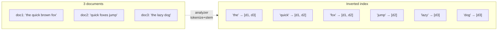
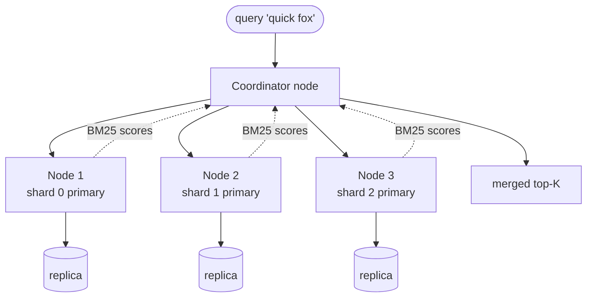

## Definition (interview-ready)

**Elasticsearch** is a distributed search and analytics engine built on **Apache Lucene**. Documents are JSON, indexed into **inverted indexes** that map terms → document IDs, scored with **BM25** (or vector similarity for embeddings). Data is partitioned into **shards**, replicated, and queried via a JSON DSL.

## Why it matters

Whenever the question is "fast text search," "log search," "faceted product search," "autocomplete," or "log/metric aggregation," Elasticsearch (or its fork OpenSearch) is almost always in the answer. It's also a misused tool: people put primary data in it, then learn the hard way that it isn't an ACID database.





## Core concepts

### Document, index, mapping

- **Document**: JSON. Belongs to an index.
- **Index**: like a "table" — a logical grouping of documents (e.g., `products`).
- **Mapping**: schema definition for the index — field types (`text`, `keyword`, `integer`, `date`, `dense_vector`, etc.), analyzers, settings.

### `text` vs `keyword`

The most consequential mapping distinction:
- **`text`**: tokenized, lowercased, stemmed → goes into inverted index. Use for full-text search.
- **`keyword`**: stored exactly as-is. Use for IDs, enums, filters, exact match, sort, aggregation.

Often you map a field as **both**: `name` (text) and `name.keyword` (keyword) — for search AND aggregation.

### Inverted index

A map from term → list of document IDs containing it.

```
"redis": [doc1, doc4, doc9]
"cluster": [doc1, doc2, doc4]
```

For "redis cluster" query, intersect the two lists. Brilliantly fast and at the heart of every search engine.

### Analyzer pipeline

When text is indexed:
1. **Character filters** (strip HTML, etc.).
2. **Tokenizer** (whitespace, standard, edge n-gram for autocomplete).
3. **Token filters** (lowercase, stop-word removal, stemming, synonyms).

Result: a stream of normalized tokens that go into the inverted index. Query analyzer **must match** index analyzer (or you'll get no hits).

### Relevance scoring: BM25

Default scoring since ES 5.0. Rewards rare terms (IDF), penalizes long documents (length norm), saturates term frequency. For each matching document:

```
score = Σ (IDF * TF / (TF + k1 * (1 - b + b * docLen/avgDocLen)))
```

You don't memorize the formula — just know:
- Common terms contribute less (good).
- TF saturation prevents keyword stuffing (good).
- You can tune k1 and b per index.

### Shards & replicas

- An index is split into **primary shards** (set at index creation; changing it means `_split`/`_shrink` into a new index or a full reindex; data streams + ILM let you roll over to new indices instead).
- Each primary has N **replica shards** (configurable any time).
- A shard is a self-contained Lucene index.
- Queries fan out to shards in parallel, results merged by the coordinating node.

### Distribution & cluster

- **Master-eligible** node: coordinates cluster state. Usually 3 in production for quorum.
- **Data nodes**: hold shards, serve queries.
- **Ingest** / **ML** / **Coordinating** roles for specialization.
- **Cluster state** broadcast through master node — node membership, shard allocation, index mappings.

### Refresh & near-real-time

Indexed documents aren't immediately searchable. Every `refresh_interval` (default 1s) Elasticsearch flushes the in-memory buffer to a Lucene segment — this makes new docs visible. Hence "near-real-time."

For high-throughput logging, set `refresh_interval` to 30s+ to reduce overhead.

### Segments & merging

Each shard is many Lucene **segments** (immutable). Background merges combine small segments into larger ones. Search reads from all segments and merges results. Force-merge is sometimes useful on cold indices (read-only logs) but expensive.

### Aggregations

Beyond search, Elasticsearch supports rich aggregations:
- **Metric**: avg, sum, percentile, cardinality (HyperLogLog).
- **Bucket**: terms (group-by), date histogram, range.
- **Pipeline**: derivative, moving function (`moving_fn`; the old `moving_avg` was removed in 8.0) over bucket outputs.

Used for analytics dashboards and log/metric exploration.

### Vector search

`dense_vector` field type + HNSW index for k-NN search. Used for semantic search, RAG embeddings. Big growth area.

## How it works (a search query)

```
Client → Coordinating Node
   Parse query, identify target indices
   Forward to one shard copy (primary or replica) per shard, in parallel
   Each shard runs query → returns top K + scores
   Coordinator merges → top K overall
   Optionally fetch source docs (second round trip)
   Return to client
```

## Real-world examples

- **Wikipedia**: full-text search powered by Elasticsearch.
- **GitHub**: code search (currently their own engine, but powered Elasticsearch for years).
- **Uber, Netflix, eBay**: log search (ELK / EFK pipelines).
- **Stack Overflow**: search.
- **Algolia**: not Elasticsearch but solves the same problem — useful comparison.

## Common pitfalls

- **Using as a source of truth**: it's eventually consistent, near-real-time, and not ACID. Lose data and you can't recover unless you reindex from primary store.
- **Wrong analyzer**: index with `standard`, query with `keyword` → no hits. Be explicit.
- **Mapping explosion**: 10K+ unique field names (dynamic mapping in user-generated JSON) → cluster state blow-up. Use **strict mapping** or **dynamic templates**.
- **Too many small shards**: each shard has overhead (a few MB of heap, file handles). Aim for shards 10–50 GB each.
- **Hot threading on aggregations**: large `terms` agg on high-cardinality field → OOM. Use composite aggregations or query a different store.
- **Mixing old and new data in one big index**: rotate via **data streams** + **ILM** (Index Lifecycle Management): hot → warm → cold → frozen → delete.
- **Heavy nested fields**: each nested object creates hidden docs. Don't go crazy.
- **Master overload**: dynamic mapping or rapid index creation can pin the master node.

## Practice questions

<Practice>

<QA q="What's an inverted index?" level="easy">

A map from each term (token) to the list of documents that contain it, the reverse of a forward index (doc → its words). A query for 'redis cluster' looks up both posting lists and intersects them, so full-text search costs roughly a lookup per term plus the intersection, not a scan of every document.

</QA>

<QA q="What's the difference between `text` and `keyword`?" level="easy">

`text` is analyzed (tokenized, lowercased, stemmed) into the inverted index and used for full-text search. `keyword` is stored as-is and used for exact match, filters, sorting and aggregations. Map a field as both (`name` plus `name.keyword`) when you need both behaviours.

</QA>

<QA q="Can you change an index's number of primary shards after creating it?" level="easy">

Not in place. The primary shard count is fixed at creation. Changing it means `_split`/`_shrink` into a new index or a full reindex. Replica count, by contrast, can be changed any time. For growing data such as logs, data streams + ILM roll over to new indices, so each new index can get a different shard count.

</QA>

<QA q="What does the analyzer pipeline do, and why must index and query analysis match?" level="easy">

At index time, text passes through **character filters** (e.g. strip HTML) → a **tokenizer** (standard, whitespace, edge n-gram) → **token filters** (lowercase, stop words, stemming, synonyms), and the resulting tokens go into the inverted index. A query only matches if its terms are normalized the same way. Index with `standard` (which lowercases) and query an un-analyzed 'Redis', and you get no hits.

</QA>

<QA q="How does BM25 differ from TF-IDF?" level="medium">

BM25 adds **term-frequency saturation** (extra occurrences contribute less and less, which blunts keyword stuffing) and **document length normalization** (a match in a short field counts for more than one in a long document), tunable through `k1` and `b`. Rare terms still matter more (IDF). It's been Elasticsearch's default similarity since 5.0.

</QA>

<QA q="How does Elasticsearch scale horizontally?" level="medium">

Indices are split into **primary shards** (the unit of parallelism), and each primary has **replicas** (for HA and read scaling). The cluster spreads shards across data nodes and rebalances when you add nodes. A query fans out to one copy of each shard in parallel; each shard returns its top K, and the coordinating node merges them (then optionally fetches the source documents).

</QA>

<QA q="Why is Elasticsearch only near-real-time?" level="medium">

Indexed documents sit in an in-memory buffer and become searchable only when a **refresh** writes them into a new Lucene segment (every `refresh_interval`, default 1 s). Until then a document is written but not visible to search. Log-ingestion clusters often raise `refresh_interval` to 30 s or more to cut the overhead.

</QA>

<QA q="Why is having too many small shards a problem, and what size should you aim for?" level="medium">

Each shard is a full Lucene index with its own overhead: heap, file handles, segment metadata, cluster-state entries. Thousands of tiny shards waste memory, slow down cluster-state updates and add per-shard query fan-out cost. Aim for shards of roughly 10–50 GB, and use rollover and ILM rather than one index per small slice of data.

</QA>

<QA q="A `terms` aggregation on a high-cardinality field makes nodes run out of memory. Why, and what do you do?" level="hard">

A `terms` aggregation builds buckets in memory for the distinct values on each shard, and the coordinating node merges them. Millions of unique values (user IDs, URLs) means huge bucket sets and heap blowups. Options: a **composite** aggregation to page through buckets, `cardinality` (HyperLogLog) if you only need a distinct count, filtering to a smaller scope first, or computing it in an analytics store.

</QA>

<QA q="A log cluster ingests 1 TB/day. How would you size and operate it?" level="scenario">

- **ILM**: hot on SSD, warm on cheaper nodes after ~7 days, cold/frozen after ~30, delete after ~90.
- **Data streams / rollover** targeting ~50 GB shards (1 TB/day ≈ 20 primaries' worth per day).
- **Strict mappings + dynamic templates** to prevent mapping explosion.
- `refresh_interval` of 30 s or more on hot indices; **bulk indexing** in ~5–15 MB batches.
- Replicas = 1 on hot, 0 on cold, with **snapshots to S3** as backup.
- Monitor pending tasks, heap/GC, thread-pool queue rejections and ingest latency.

</QA>

<QA q="An e-commerce search never matches misspellings. How would you improve recall?" level="scenario">

- **Fuzzy queries** (`fuzziness: AUTO`), with care, since they're slower.
- A **synonyms** filter for common misspellings and variants.
- An **n-gram subfield** for partial matches, plus normalization (`lowercase`, `asciifolding`).
- **Vector search**: embed queries and products (`dense_vector` + HNSW k-NN) to capture semantic similarity, then combine with BM25 for ranking.

</QA>

<QA q="A team used Elasticsearch as the source of truth for product data and lost the cluster. What went wrong?" level="scenario">

- Elasticsearch isn't an ACID database: it's near-real-time, has no multi-document transactions, and has historically lost acknowledged writes under network partitions (Jepsen).
- Snapshots are point-in-time and not coordinated with your writes, so they aren't a transactional backup.
- Right architecture: a primary store (Postgres, Mongo, or a Kafka log) → CDC or dual-write → Elasticsearch as a derived, queryable index. On loss, reindex from the primary.

</QA>

<QA q="Users index arbitrary JSON into a shared index with dynamic mapping, and the master node is now overloaded and the cluster state is enormous. What happened and how do you fix it?" level="scenario">

**Mapping explosion**: every new key in user JSON becomes a new field, so you end up with thousands of fields. The mapping lives in cluster state, which the master must update and publish to every node. Fix: make the mapping **strict** (or `dynamic: false` for unknown keys), use **dynamic templates** to control how allowed fields are mapped, or store arbitrary user attributes as key/value pairs (e.g. a `flattened` or nested key-value structure). Then reindex the bloated index.

</QA>

</Practice>

## Quiz

<Quiz>

<MCQ q="You need to filter products by an exact SKU and aggregate counts per brand. How should sku and brand be mapped?" options={["As text, so they are analyzed", "As keyword", "As dense_vector", "As nested objects"]} answer={1}>

Exact match, sorting and aggregations need un-analyzed values, which is keyword. text would tokenize and lowercase the values, so an exact match or a per-value bucket would no longer work as intended.

</MCQ>

<MCQ q="A document was indexed successfully, but a search run 200 ms later doesn't find it. What is the most likely reason?" options={["The document was rejected by the mapping", "The replica is out of sync permanently", "The index needs a force-merge", "The next refresh hasn't happened yet, so the document isn't in a searchable segment"]} answer={3}>

Search is near-real-time: documents become visible after a refresh, every 1 s by default. A mapping rejection would fail the index request, and force-merge has nothing to do with visibility.

</MCQ>

<MCQ q="What does BM25 add on top of classic TF-IDF?" options={["Term-frequency saturation and document-length normalization", "Vector embeddings", "Exact phrase matching", "A requirement that every term appears in the document"]} answer={0}>

BM25 caps the benefit of repeated terms and normalizes by field length (tunable via k1 and b). Embeddings belong to vector search, and phrase matching is a query type, not a scoring formula.

</MCQ>

<MCQ q="An index was created with 5 primary shards and now needs 20. What are your options?" options={["Update number_of_shards in the index settings", "Add more replicas", "Use the split API into a new index or reindex, or roll over to new indices", "Restart the cluster with a new default"]} answer={2}>

Primary count is fixed at creation, so you need split/reindex or rollover. Replicas add copies of existing shards, not more primaries, and restarting changes nothing for an existing index.

</MCQ>

<MCQ q="Text is indexed with the standard analyzer, but queries for Redis against the field hit nothing because the query side skips analysis. Why?" options={["BM25 penalizes capitalized words", "The indexed tokens were lowercased, but the query term was not, so they don't match", "The inverted index only stores stop words", "Replicas haven't been refreshed"]} answer={1}>

The standard analyzer lowercases at index time, so the index holds redis. An un-analyzed query for Redis looks up a term that doesn't exist. Index-time and query-time analysis must match.

</MCQ>

<MCQ q="A cluster has 40,000 shards averaging 200 MB each, and heap and master load are high. What is the best remedy?" options={["Add more replicas per shard", "Lower refresh_interval to 100 ms", "Switch every field to keyword", "Consolidate into fewer, larger shards of roughly 10 to 50 GB using rollover, shrink or reindex"]} answer={3}>

Every shard costs heap and cluster-state overhead, so tiny shards waste resources. More replicas multiply the shard count, and a faster refresh adds load.

</MCQ>

<MCQ q="Why is Elasticsearch a poor choice as the only copy of critical product data?" options={["It is near-real-time, lacks multi-document transactions, and has lost acknowledged writes under partitions", "It cannot store JSON", "It cannot replicate shards", "It only supports keyword fields"]} answer={0}>

The right pattern is a primary database plus CDC into Elasticsearch, so you can reindex after a loss. It stores JSON, supports replicas, and supports text fields.

</MCQ>

<MCQ q="Users want product search that finds sneakers when they type running shoes. Which approach targets that best?" options={["fuzziness AUTO", "Semantic search with dense_vector embeddings, or a synonyms filter", "A keyword field with exact match", "Raising refresh_interval"]} answer={1}>

Fuzzy matching handles typos, not different words with similar meaning. Synonyms or embeddings capture the semantic relationship. Exact keyword matching and refresh settings don't help recall here.

</MCQ>

</Quiz>

## TL;DR cheat sheet

- JSON docs → analyzers → inverted index in Lucene segments inside shards.
- `text` for search, `keyword` for exact + aggregations.
- Scoring: BM25 (TF saturation + length norm).
- Shards: primary (set at create) + replicas (HA + read scaling).
- Queries fan out to one copy per shard, results merged by coordinator.
- Near-real-time: refresh every 1s (tunable).
- Not a primary store. Use it as a search/analytics layer on top of one.
- ILM for log retention. Aim ~50 GB per shard.
- For semantic search, use `dense_vector` + HNSW (k-NN).

## Go deeper

- **Elastic official docs**: [elastic.co/guide](https://www.elastic.co/guide/en/elasticsearch/reference/current/index.html) — surprisingly readable.
- **Elastic blog**: ["BM25 explained"](https://www.elastic.co/blog/practical-bm25-part-1-how-shards-affect-relevance-scoring-in-elasticsearch), ["Mapping explosion"](https://www.elastic.co/blog/found-beginner-troubleshooting), [vector search](https://www.elastic.co/docs/solutions/search/vector).
- **Book**: *Elasticsearch: The Definitive Guide* (older, free, still good fundamentals).
- **Lucene documentation** — for when you really want to know what's under the hood.
- **OpenSearch docs**: fork of ES 7.10 started by AWS (now governed by the Linux Foundation's OpenSearch Software Foundation), mostly compatible — useful if you're on AWS.
- **YouTube**: ElasticON sessions, Elastic's own conference talks.
