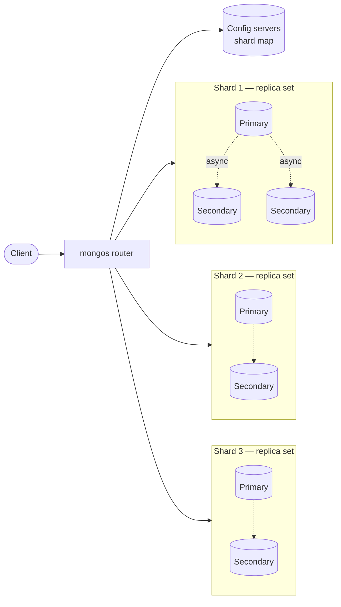

## Definition (interview-ready)

**MongoDB** is a document-oriented NoSQL database. Data is stored as BSON documents in collections; schemas are flexible. It scales reads with **replica sets** (one primary, N secondaries) and scales writes with **sharded clusters**. Complex queries use the **aggregation pipeline**.

**One-liner:** MongoDB stores flexible JSON-like documents, so you model data the way the app reads it (embedding what is read together); it gets high availability from replica sets with majority write concern, and scales writes by sharding on a well-chosen shard key.

## Why it matters

MongoDB shows up everywhere — early-stage products, content platforms, mobile backends. Knowing when to pick it (flexible schemas, hierarchical data, fast iteration) and when not to (multi-document transactions across collections, heavy joins, strict relational integrity) is a baseline backend skill.



## Core concepts

### Documents and collections

- **Document**: JSON-like (stored as BSON — Binary JSON). Up to 16 MB per document.
- **Collection**: group of documents (analogous to a table). No enforced schema by default; you can enable JSON Schema validation.
- **_id**: every document has a unique `_id`; default is ObjectId (12 bytes — 4-byte timestamp + 5-byte per-process random value + 3-byte counter).

### Why "flexible schema" is a double-edged sword

Pros: easy iteration, version data side by side, fewer migrations.
Cons: no enforcement of structure → easy to ship bad data, slow drift makes refactoring painful. Use schema validation in production.

### Storage engine

WiredTiger (default since 3.2). MVCC, document-level locking, snapshot isolation. B-tree based (third-party engines like MongoRocks are discontinued). Compression enabled by default.

### Indexes

- **Single-field**, **compound**, **multikey** (auto-created when indexing array fields).
- **Text** (full-text search), **geospatial** (2dsphere), **hashed** (for sharding), **TTL** (auto-expire), **partial**, **wildcard**, **unique**.
- Same lookup rules as relational: leftmost prefix on compound indexes, equality before range.

### Compound indexes and the ESR rule

A **compound index** is one index over several fields, for example `{ customer_id: 1, status: 1, created_at: -1 }`. Think of it like a phone book sorted by last name, then first name. The entries are sorted by the first field, then by the second field inside each group of the first, and so on.

That ordering gives you two rules:

- **Prefix rule.** The index can serve queries on any *prefix* of its fields. `{ a: 1, b: 1, c: 1 }` helps queries on `a`, on `a + b`, and on `a + b + c`. It does not help a query on `b` alone, just like a phone book sorted by last name can't help you find everyone named "Priya".
- **Sort rule.** The index can return results already sorted (so no extra sort step) if the sort fields come right after fields you matched with equality. Example: index `{ directors: 1, year: 1 }` serves `find({ directors: "David Lynch" }).sort({ year: 1 })` straight from the index.

**ESR (Equality, Sort, Range)** is MongoDB's official rule of thumb for ordering fields in a compound index:

1. **E — Equality fields first.** Exact matches like `status: "OPEN"`. They narrow the scan to one tight slice of the index, and inside that slice the next field is still in order.
2. **S — Sort fields next.** Fields in `.sort()`. Putting them here means the index already hands back rows in the right order, so MongoDB skips the in-memory sort.
3. **R — Range fields last.** Things like `$gt`, `$lt`, `$gte`, `$lte`. A range covers many index values, so anything after it in the index is no longer in one sorted run.

Worked example (from the shape of the MongoDB manual's own example):

```js
// Query: Lynch films shorter than 130 minutes, ordered by year
db.movies.find(
  { directors: "David Lynch", runtime: { $lt: 130 } }
).sort({ year: 1 })

// E = directors, S = year, R = runtime
db.movies.createIndex({ directors: 1, year: 1, runtime: 1 })   // ESR - good

db.movies.createIndex({ directors: 1, runtime: 1, year: 1 })   // ERS
// Works, but year is no longer in order across different runtimes,
// so MongoDB must sort the matches in memory.
```

**Operator gotchas** (from the MongoDB manual):

- `$ne`, `$nin` and `$regex` count as **range**, not equality.
- `$in` on its own behaves like a set of equality matches. With a `.sort()`, MongoDB treats a small `$in` list like equality (it merges the lists in index order using a `SORT_MERGE` stage). Past a threshold (201 elements in current versions, and the manual says this may change) it behaves like a range.
- **ERS exception:** if the range filter is very selective (it keeps only a handful of documents), putting it before the sort field can be faster: you sort a tiny result in memory instead of walking a big ordered slice.

**Sort direction matters for multi-field sorts.** Index `{ a: 1, b: -1 }` can serve `sort({ a: 1, b: -1 })` and its exact reverse `sort({ a: -1, b: 1 })`, but not `sort({ a: 1, b: 1 })`. For a single-field index, direction doesn't matter because MongoDB can walk the index either way.

### Reading `explain()` output

Run your query with `.explain("executionStats")`. The output is a tree of **stages**; each stage feeds its parent.

```js
db.orders.find({ customer_id: 42, status: "OPEN" })
         .sort({ created_at: -1 })
         .explain("executionStats")
```

What to look at, in order:

| Field / stage | What it tells you | Good sign | Bad sign |
|---|---|---|---|
| `winningPlan` leaf stage | How data was read | `IXSCAN` (index scan) | `COLLSCAN` (reads every document) |
| `FETCH` above `IXSCAN` | Documents were loaded after the index lookup | Normal | Missing `FETCH` is even better: a **covered query** answered from the index alone |
| `SORT` stage | An **in-memory sort** happened (index didn't supply the order) | Absent | Present on a big result: fix field order (ESR) |
| `nReturned` | Documents returned | | |
| `totalKeysExamined` | Index entries scanned | Close to `nReturned` | Much bigger than `nReturned`: index is not selective, or a range sits too early |
| `totalDocsExamined` | Documents loaded | Close to `nReturned` (0 for covered) | Much bigger: filtering happens after fetching, add the filtered field to the index |
| `executionTimeMillis` | Plan selection + run time | | |
| `rejectedPlans` | Other plans the planner tried | | |

A trimmed example of a healthy plan:

```js
winningPlan: {
  stage: "FETCH",
  inputStage: {
    stage: "IXSCAN",
    keyPattern: { customer_id: 1, status: 1, created_at: -1 },
    indexBounds: { customer_id: ["[42, 42]"], status: ["[\"OPEN\", \"OPEN\"]"], ... }
  }
}
executionStats: { nReturned: 50, totalKeysExamined: 50, totalDocsExamined: 50 }
```

**How to say it in an interview:** "I order compound index fields Equality, Sort, Range, then confirm with `explain('executionStats')`: I want an `IXSCAN`, no `SORT` stage, and keys examined and docs examined close to documents returned."

### Query semantics

```js
db.orders.find({ customer_id: 42, status: "OPEN" })
         .sort({ created_at: -1 })
         .limit(50)
```
- Supports rich predicates, projections, sort, limit.
- `explain("executionStats")` is the equivalent of EXPLAIN ANALYZE.

### Aggregation pipeline

Composable stages, each transforming a stream of documents:
```js
db.orders.aggregate([
  { $match: { created_at: { $gte: ISODate("2026-01-01") } } },
  { $group: { _id: "$merchant_id", total: { $sum: "$amount" } } },
  { $sort: { total: -1 } },
  { $limit: 10 }
])
```
- Stages: `$match`, `$project`, `$group`, `$sort`, `$lookup` (left outer join), `$unwind`, `$facet`, `$bucket`, `$addFields`, `$replaceRoot`, `$merge` (writes results).
- Use `$match` early to leverage indexes.
- `$lookup` exists, but performance is worse than relational joins. Often a sign you should denormalize.

### Embedded vs referenced documents

- **Embedded**: `order.items[]` inside the order doc. Locality + atomic update of the whole order. Limit: 16 MB; arrays that grow unbounded → pathological.
- **Referenced**: store `customer_id` and look up the customer doc separately. Like a foreign key without FK enforcement.

Heuristic: 1:1 → embed. 1:many bounded → embed. 1:many unbounded → reference. Many:many → reference.

### Replica sets

- 1 primary, N secondaries (usually 2). Optionally an **arbiter** (votes but holds no data; MongoDB advises against more than one).
- All writes go to primary; replicated to secondaries via the **oplog** (a capped collection).
- Reads default to primary; can route to secondaries with read preference (consistency tradeoff).
- Failover: secondaries elect a new primary on heartbeat loss (Raft-like).

### Write concern & read concern

- **Write concern** `w`: how many nodes must acknowledge. `w: 1` (primary only), `w: "majority"` (recommended; the implicit default since 5.0 for most topologies), `w: 0` (fire-and-forget).
- **Journal** `j`: wait for write to hit the on-disk journal before ack.
- **Read concern**: `local` (default — possibly stale), `majority` (only data committed to majority), `linearizable` (real-time guarantee, slow), `snapshot` (for transactions).

### Sharding

- Horizontal split across multiple replica sets called **shards**.
- **mongos** routes queries.
- **Config servers** (a small replica set) store metadata.
- **Shard key** chosen when you shard the collection; cannot be changed easily (4.4+ can refine it by adding suffix fields; 5.0+ can fully reshard, but it's a heavy operation).
- Strategies: ranged, hashed, zoned (geo).

### Transactions

- Multi-document ACID transactions since 4.0 (replica sets) and 4.2 (sharded).
- Use sparingly — performance penalty, lock contention, transaction time limits.
- Most modeling should aim to keep operations within a single document where possible.

## How it works (a write at `w: "majority"`)

```
Client → mongos → primary shard
   Primary appends to oplog
   Primary writes to journal (depending on j)
   Secondaries replicate from oplog
   Once majority of voting members have applied → write acked
```

## Real-world examples

- **Disney**: long-time MongoDB user for semi-structured content data (Disney Direct-to-Consumer has presented on syncing MongoDB clusters with change streams).
- **Toyota Connected**: telematics platform (Safety Connect) on MongoDB Atlas.
- **eBay**: search suggestions, semi-structured product data.
- **EA**: game services (e.g., FIFA Online 3) historically.

## Common pitfalls

- **Unbounded arrays**: a doc with `events: []` that grows forever → 16 MB cap hit, then queries become slow well before that.
- **Schema drift**: 5 versions of "user" in the same collection. Painful refactors. Use validators.
- **`$lookup` for relational joins**: works but slow; sign you should reshape your data.
- **Read from secondaries → stale reads**: explicit read preference required.
- **Bad shard key**: hard to fix later. Time as shard key → hot shard.
- **Misusing transactions**: people reach for them when they should embed instead. Each transaction has a 60-second default limit; long-running ops fail.
- **`w: 1`** (the default before 5.0, and still the implicit default in some primary-secondary-arbiter setups): a primary crash mid-replication loses writes. Use `w: "majority"`.
- **Indexes use lots of RAM**: WiredTiger best when working set + indexes fit in RAM.

## Practice questions

<Practice>

<QA q="When would you pick MongoDB over Postgres?" level="easy">

Pick MongoDB for flexible schemas (CMS, product catalog with variable attributes), hierarchical data that fits in one document, fast iteration on data shape, and when horizontal sharding is a primary concern. Avoid it when you need rich relational joins, strict referential integrity, or complex multi-table transactions.

</QA>

<QA q="What is the difference between embedded and referenced documents?" level="easy">

**Embedded:** data nested inside the parent document. Fast reads and atomic updates of the whole tree, but watch the 16 MB cap and growing arrays. **Referenced:** store an ID that points to another collection, like a foreign key without enforcement. You need a second query or `$lookup` to join.

</QA>

<QA q="What does the prefix rule mean for a compound index on a, b, c?" level="easy">

The index is sorted by `a`, then `b` inside each `a`, then `c`. So it can serve queries on `a`, on `a + b`, and on `a + b + c`. A query on `b` alone or `c` alone can't use the sorted order and won't benefit (the planner will likely pick another index or a collection scan).

</QA>

<QA q="Explain how the aggregation pipeline works." level="medium">

A pipeline is a list of stages. Each stage takes a stream of documents and outputs a transformed stream. Common stages: `$match` (filter), `$group` (aggregate), `$lookup` (left outer join), `$sort`, `$project`. Order matters: put `$match` and `$sort` early so they can use indexes. Output goes to the client, or into a collection via `$merge`.

</QA>

<QA q="What is the ESR rule and why does it work?" level="medium">

ESR orders compound index fields as **Equality, Sort, Range**. Equality fields first pin the scan to one tight slice, and inside that slice the next field stays sorted. Sort fields next mean the index returns documents already in order, so there's no in-memory `SORT` stage. Range fields last, because a range spans many values and breaks the sorted order of anything after it.

</QA>

<QA q="How does failover work in a replica set?" level="medium">

Secondaries watch the primary with heartbeats. If it goes silent, eligible members hold an election (Raft-like): a candidate wins only with votes from a majority, and members refuse to vote for a candidate whose oplog is behind their own, so the winner always has every majority-committed write. Member priority influences who stands first. Drivers discover the new primary automatically. When the old primary rejoins, it rolls back any writes that never reached a majority.

</QA>

<QA q="What is write concern `w: majority` and why use it?" level="medium">

The primary waits until a majority of voting members have the write before it acknowledges. That prevents losing acknowledged writes on failover: any majority-committed write is on at least one member of whatever majority elects the next primary.

</QA>

<QA q="In `explain('executionStats')`, what do `totalKeysExamined`, `totalDocsExamined` and `nReturned` tell you?" level="medium">

- `nReturned`: documents the query returned.
- `totalKeysExamined`: index entries scanned.
- `totalDocsExamined`: documents loaded from storage.

In a well-indexed query the three are close. Keys much higher than returned means the index isn't selective enough or a range field sits too early. Docs much higher than returned means MongoDB is filtering after fetching, so a filtered field is missing from the index. Docs examined of 0 means a **covered query** (answered from the index alone).

</QA>

<QA q="Your query has an index but explain shows a SORT stage. Why, and how do you fix it?" level="hard">

A `SORT` stage means MongoDB sorted the results in memory because the index couldn't supply the order. Common causes: a range field sits before the sort field in the index (ERS instead of ESR), the sort field isn't right after the equality prefix, or the sort directions don't match the index (index `{ a: 1, b: -1 }` can't serve `sort a asc, b asc`). Fix by reordering to Equality, Sort, Range with matching directions. Exception: if the range is very selective, the in-memory sort of a few documents may actually be cheaper.

</QA>

<QA q="A collection's `_id` is a monotonic ObjectId. You shard on hashed `_id`. Benefits and problems?" level="hard">

A hashed shard key spreads writes evenly, so there is no hot shard from always-increasing IDs. The cost: range queries on `_id` become scatter-gather across all shards. For time-ordered scans, pick a different shard key (for example a compound key with a tenant ID) or accept the cross-shard read cost.

</QA>

<QA q="When should you use multi-document transactions in MongoDB?" level="hard">

Sparingly. Use them when an invariant spans several documents and you can't redesign to embed. Costs: a 60-second default time limit, performance overhead and lock contention. Always retry on transient errors. Prefer modeling so one document carries the invariant, because single-document writes are atomic by default.

</QA>

<QA q="A team stores a doc per user with an ever-growing `events` array. After 6 months, queries are slow and some docs are 12 MB. What do you do?" level="scenario">

Move events to their own collection keyed by `user_id` (referenced model), optionally bucketed (one doc per user per month). Add an index on `user_id` + `timestamp` and a TTL index to expire old events. Switch writers to append to the new collection, backfill, then cut reads over to a separate query path instead of `$lookup` everywhere.

</QA>

<QA q="Orders are queried by `merchant_id` equal to X, `created_at` in the last 7 days, sorted by `amount` descending. Which index would you build?" level="scenario">

Apply ESR: equality `merchant_id`, sort `amount`, range `created_at`, so `{ merchant_id: 1, amount: -1, created_at: 1 }`. This returns rows already sorted by amount and avoids an in-memory sort. Then check `explain('executionStats')`: if 7 days is a tiny slice of a merchant's orders, `totalKeysExamined` may be far above `nReturned`. In that case try the ERS index `{ merchant_id: 1, created_at: 1, amount: -1 }`, which scans fewer keys and sorts a small set in memory. Pick whichever the numbers favor.

</QA>

</Practice>

## Quiz

<Quiz>

<MCQ q="Query: status equals OPEN, price less than 100, sort by rating. Which index follows ESR?" options={["status, price, rating", "price, rating, status", "status, rating, price", "rating, status, price"]} answer={2}>

Equality (`status`) first, Sort (`rating`) next, Range (`price`) last. Putting `price` before `rating` would force an in-memory sort.

</MCQ>

<MCQ q="Under the ESR guideline, how does MongoDB classify `$ne`?" options={["Equality", "Range", "Sort", "It cannot use an index at all"]} answer={1}>

The MongoDB manual lists `$ne`, `$nin` and `$regex` as range operators, so they belong at the end of the index.

</MCQ>

<MCQ q="In explain output, what does a SORT stage mean?" options={["The index supplied the order", "Results were sorted in memory", "A shard merge happened", "The query was covered"]} answer={1}>

A `SORT` stage means the index couldn't provide the order, so MongoDB sorted documents itself. No `SORT` stage means the index did the work.

</MCQ>

<MCQ q="A query shows nReturned 20, totalKeysExamined 20, totalDocsExamined 0. What is this?" options={["A collection scan", "A broken index", "A covered query", "A multikey scan"]} answer={2}>

Zero documents examined means everything came from index keys: a covered query.

</MCQ>

<MCQ q="An index on a ascending, b descending can serve which sort without an in-memory sort?" options={["a asc, b asc", "a desc, b asc", "b desc only", "a desc, b desc"]} answer={1}>

An index can be walked forward or backward, so it serves its exact order or the full reverse (`a desc, b asc`). Mixed changes like `a asc, b asc` don't match either direction.

</MCQ>

<MCQ q="Which write concern prevents losing acknowledged writes when the primary fails?" options={["w: 0", "w: 1", "w: majority", "j: false"]} answer={2}>

Majority-acknowledged writes exist on at least one member of any future majority, so they survive an election.

</MCQ>

<MCQ q="What is the maximum BSON document size?" options={["4 MB", "16 MB", "64 MB", "No limit"]} answer={1}>

16 MB. Unbounded arrays are the usual way teams hit it.

</MCQ>

<MCQ q="Why can a hashed shard key hurt range queries?" options={["Hashing breaks uniqueness", "Adjacent values land on different shards, so ranges scatter", "Hashed keys cannot be indexed", "Hashing disables the oplog"]} answer={1}>

Hashing spreads neighbouring values across shards. Great for even writes, bad for range scans, which must hit every shard.

</MCQ>

<MCQ q="A range filter is very selective and leaves only a few documents. Where can it go in the index?" options={["Always last, per ESR", "Before the sort field (ERS) can be faster", "In a separate single-field index only", "In the shard key"]} answer={1}>

The manual notes that a very selective range can go before the sort field: you scan few keys and sort a tiny set in memory.

</MCQ>

</Quiz>

## TL;DR cheat sheet

- BSON documents in collections, no enforced schema (use validators).
- 16 MB per document. Watch unbounded arrays.
- WiredTiger: MVCC, document-level locking, compression.
- Compound index field order: **Equality, Sort, Range** (ESR). `$ne`/`$nin`/`$regex` count as range.
- `explain("executionStats")`: want `IXSCAN`, no `SORT` stage, keys and docs examined close to `nReturned`.
- Aggregation pipeline: `$match` early, `$lookup` sparingly.
- Embed for 1:1 and bounded 1:many; reference for unbounded or many-to-many.
- Replica set: 1 primary, N secondaries. Failover via election.
- Write concern `majority` is the production baseline.
- Sharding via shard key; **hashed shard key for even distribution, ranged for locality**.
- Multi-doc transactions exist but are expensive — design to avoid.

## Go deeper

- **MongoDB University**: [learn.mongodb.com](https://learn.mongodb.com/) — free courses and learning paths on basics, performance, and data modeling (the old M001/M201/M320 codes are retired).
- **MongoDB docs**: [Data modeling](https://www.mongodb.com/docs/manual/data-modeling/), [Aggregation](https://www.mongodb.com/docs/manual/aggregation/), [Sharding](https://www.mongodb.com/docs/manual/sharding/), [The ESR guideline](https://www.mongodb.com/docs/manual/tutorial/equality-sort-range-guideline/), [Explain results](https://www.mongodb.com/docs/manual/reference/explain-results/).
- **Practical MongoDB Aggregations** book (Paul Done) — free online.
- **DDIA Chapters 2, 5** for context.
- **Hussein Nasser**: MongoDB internals videos on YouTube.
