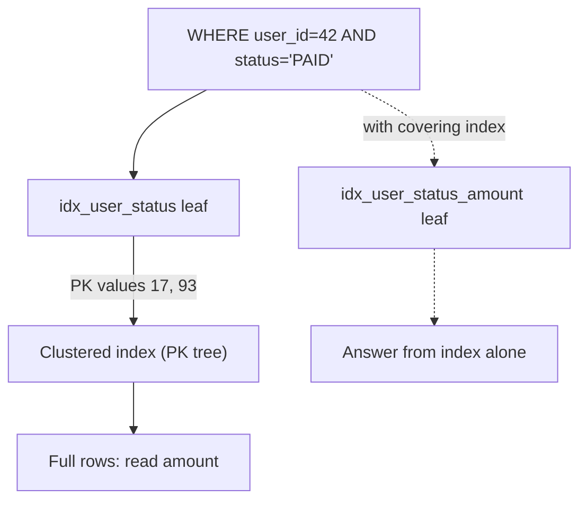
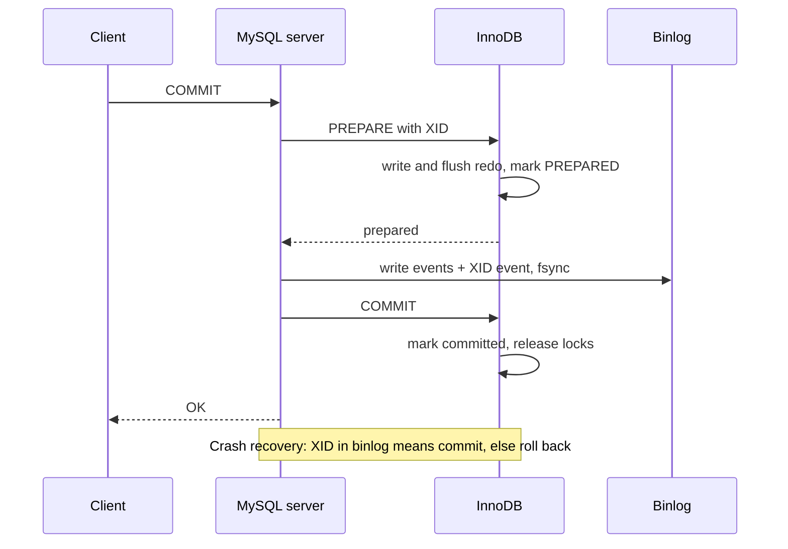
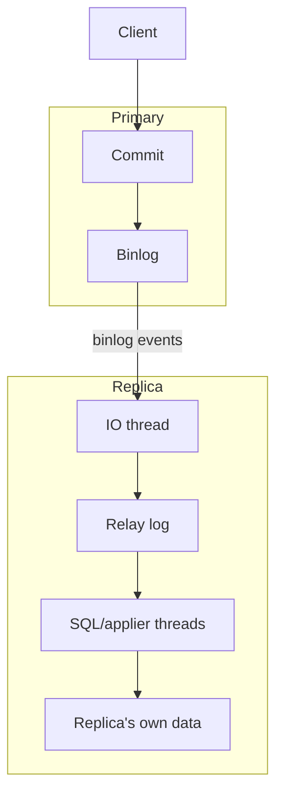

## Definition (interview-ready)

**InnoDB** is MySQL's default storage engine. It stores every table **inside its primary key B+ tree** (a *clustered index*), so the primary key lookup lands directly on the row. Every other index is a *secondary index* whose leaf entries hold the **primary key value**, not a row address. InnoDB gives you transactions through **MVCC** (multi-version concurrency control — old row versions are rebuilt from **undo logs** so readers never wait for writers), **row-level locks** (record, gap and next-key locks), a **redo log** for crash recovery, and it cooperates with the server-level **binary log (binlog)** through an internal two-phase commit so that what replicas see always matches what the primary committed.

**One-liner:** InnoDB stores each table as a B+ tree clustered on the primary key, with secondary indexes pointing to PK values; it uses undo-log MVCC so plain reads never block, next-key locks to stop phantoms in REPEATABLE READ, and a redo log plus binlog kept in sync by internal two-phase commit for crash safety and replication.

## Why it matters

The generic B+ tree and EXPLAIN story is covered in [MySQL/Postgres Internals](/learn/notes/mysql-postgres-internals/), and the isolation anomalies in [Transactions + Isolation Levels](/learn/notes/transactions-isolation/). This note goes one level deeper into what is **specific to InnoDB**, because that is where real incidents come from:

- A "simple" `UPDATE ... WHERE status = 'X'` with no index locks far more rows than you expect and deadlocks with an insert.
- A secondary index query is slow because every match does a second lookup into the primary key tree.
- A replica is minutes behind because one giant transaction is being replayed.
- A crash loses committed orders because someone set `innodb_flush_log_at_trx_commit=2` to "make it faster".

Interviewers at product companies love these because they separate people who have *read about* MySQL from people who have *operated* it.

## Core concepts

### The clustered index: the primary key IS the table

Think of a phone book sorted by surname. The book itself is the "table", and its sort order is the clustered index. There is exactly one such order.

InnoDB picks the clustered index like this:

1. The `PRIMARY KEY`, if you defined one.
2. Otherwise, the first `UNIQUE` index whose columns are all `NOT NULL`.
3. Otherwise, a hidden index called `GEN_CLUST_INDEX` on a hidden 6-byte, ever-increasing row ID.

```
Clustered index (PRIMARY KEY id)            leaf pages hold FULL rows
                 [ 1000 | 2000 ]
                /       |       \
     [1..999 rows] [1000..1999 rows] [2000.. rows]   ← leaves linked for range scans
```

Consequences you should be able to say out loud:

- **PK range scans are cheap**: rows with nearby PKs sit on the same pages.
- **Random PKs (like UUIDv4) hurt inserts**: each insert lands on a random leaf page, causing page splits, half-empty pages and poor cache locality. A monotonic `BIGINT AUTO_INCREMENT` (or a time-ordered ID) appends to the right edge of the tree.
- **A wide PK makes every secondary index wider**, because every secondary entry carries a copy of the PK.

### Secondary indexes and the double lookup

A secondary index leaf stores **(indexed columns, primary key columns)**. To fetch the rest of the row, InnoDB takes the PK from the leaf and walks the clustered index again.

```sql
CREATE TABLE orders (
  id          BIGINT PRIMARY KEY AUTO_INCREMENT,
  user_id     BIGINT NOT NULL,
  status      VARCHAR(16) NOT NULL,
  amount      DECIMAL(10,2) NOT NULL,
  created_at  DATETIME NOT NULL,
  KEY idx_user_status (user_id, status)
);

SELECT amount FROM orders WHERE user_id = 42 AND status = 'PAID';
```

```
idx_user_status leaf: (42,'PAID', id=17) (42,'PAID', id=93) ...
                                  │                │
                                  ▼                ▼
clustered index:            row id=17         row id=93     ← second B+ tree walk per match
```

The same query as two tree walks, and how a covering index skips the second one:



If 5,000 rows match, that is 5,000 extra tree walks, often on random pages. This is why the optimizer sometimes ignores a secondary index and scans the whole table instead.

### Covering indexes

A **covering index** contains every column the query needs, so InnoDB never visits the clustered index. EXPLAIN shows `Using index` in the `Extra` column.

```sql
ALTER TABLE orders ADD KEY idx_user_status_amount (user_id, status, amount);
-- Now the query above is answered from the index alone.
```

A free trick: because the PK is already inside every secondary entry, `SELECT id FROM orders WHERE user_id = 42` is covered by `idx_user_status` without adding `id` to it.

### The leftmost-prefix rule

A composite index on `(a, b, c)` is sorted by `a`, then `b` within each `a`, then `c` within each `(a, b)`. Like a phone book sorted by (surname, first name): you can find "all Sharmas" or "Sharma, Priya", but not "everyone named Priya".

| Query predicate | Uses `(a, b, c)`? | Why |
|---|---|---|
| `a = 1` | Yes | Leftmost column |
| `a = 1 AND b = 2` | Yes | Prefix (a, b) |
| `a = 1 AND b = 2 AND c = 3` | Yes | Full key |
| `b = 2 AND a = 1` | Yes | Order in WHERE doesn't matter; the optimizer reorders |
| `b = 2` | No (normally) | Skips the leading column |
| `a = 1 AND c = 3` | Partly | Seeks on `a`; `c` can only be filtered, not seeked |
| `a = 1 AND b > 2 AND c = 3` | Partly | Range on `b` stops seeking; `c` is filtered after |
| `a = 1 ORDER BY b` | Yes, no filesort | Rows for `a = 1` are already sorted by `b` |
| `a > 1 ORDER BY b` | Filesort likely | After a range on `a`, `b` is no longer globally sorted |

Rule of thumb: **equality columns first, then the one range or sort column**. Anything after the first range column is only used for filtering.

**Skip scan (MySQL 8.0.13+)**: for queries like `WHERE b > 40` on an index `(a, b)`, the optimizer can sometimes jump through each distinct value of `a` and do a range scan on `b` inside it. It only applies under narrow conditions (single table, no `GROUP BY`/`DISTINCT`, the index covers the query) and is shown as `Using index for skip scan`. It works well only when `a` has few distinct values. Don't design around it.

### Reading MySQL EXPLAIN

```sql
EXPLAIN SELECT amount FROM orders WHERE user_id = 42 ORDER BY created_at DESC LIMIT 20;
```

| Column | What to read from it |
|---|---|
| `type` | The access method — the single most important column |
| `possible_keys` / `key` | Indexes considered vs the one actually chosen |
| `key_len` | Bytes of the index used — tells you how many columns of a composite index were used |
| `rows` | Estimated rows examined (an estimate for InnoDB) |
| `filtered` | Estimated percentage of those rows that survive the WHERE |
| `Extra` | Hints about extra work |

`type`, from best to worst (the common ones):

| type | Meaning |
|---|---|
| `const` / `system` | At most one row, found via PK or unique index on constants |
| `eq_ref` | In a join, exactly one row per outer row via PK/unique `NOT NULL` index |
| `ref` | Equality lookup on a non-unique index or a leftmost prefix |
| `range` | Index range: `BETWEEN`, `>`, `IN (...)` |
| `index` | Full scan of an index tree (better than ALL only if covering) |
| `ALL` | Full table scan |

`Extra` values worth memorising:

- **`Using index`** — covering index, no clustered-index lookups. Good.
- **`Using where`** — rows are filtered after being read. Fine on its own; bad with `type = ALL` on a big table.
- **`Using index condition`** — *Index Condition Pushdown* (ICP): conditions on index columns are checked inside the index before fetching full rows, saving lookups.
- **`Using filesort`** — an extra sort step because no index gave the needed order. Not necessarily on disk; it means "sort", and it hurts on large result sets.
- **`Using temporary`** — an internal temporary table, typical for `GROUP BY`/`DISTINCT`/`ORDER BY` on different columns. Watch out at scale.

`EXPLAIN ANALYZE` (MySQL 8.0.18+) actually runs the query and prints real row counts and timings per step, which is how you catch bad estimates.

For the example query above, a good fix is `KEY (user_id, created_at)`: `ref` on `user_id`, rows already sorted by `created_at`, so no filesort and the `LIMIT 20` stops early.

### MVCC: undo logs and read views

Every clustered index record has hidden fields:

- `DB_TRX_ID` (6 bytes) — the ID of the last transaction that inserted or updated the row.
- `DB_ROLL_PTR` (7 bytes) — a pointer into the **undo log** to the record that can rebuild the previous version.

InnoDB **updates the row in place** and writes the old values to undo. Older versions form a chain:

```
clustered row (current)  trx=120  balance=70
        │ roll_ptr
        ▼
undo record              trx=110  balance=90
        │ roll_ptr
        ▼
undo record              trx=95   balance=100
```

A **read view** is a snapshot of "which transactions were committed when I looked". A plain `SELECT` (a *consistent read*) walks the chain back until it finds a version created by a transaction visible to its read view. No locks are taken.

When is the read view created?

- **REPEATABLE READ** (InnoDB's default): at the **first consistent read** in the transaction, not at `BEGIN`. All later plain `SELECT`s reuse it. Use `START TRANSACTION WITH CONSISTENT SNAPSHOT` to take it immediately.
- **READ COMMITTED**: a fresh read view for **every statement**.

Two subtleties that come up in interviews:

1. **Writes don't use the snapshot.** `UPDATE`, `DELETE` and locking reads (`SELECT ... FOR UPDATE` / `FOR SHARE`) operate on the **latest committed** version. So in REPEATABLE READ, a `SELECT` can return 0 rows, the following `UPDATE` with the same `WHERE` can change 10 rows committed by someone else, and then your `SELECT` sees those 10 rows (because now you wrote them).
2. **Long transactions cause undo growth.** Undo records needed by any open read view cannot be purged. One forgotten transaction (even read-only) makes the *history list length* grow, undo tablespaces swell, and every consistent read has to walk longer chains.

Secondary index entries carry no `DB_TRX_ID`. An update **delete-marks** the old secondary entry and inserts a new one; the **purge** thread removes delete-marked entries later. If a secondary page was modified by a recent transaction, InnoDB may need to check the clustered record to decide visibility, so even "covering" reads can touch the clustered index under heavy writes.

### Isolation levels in InnoDB

| Level | Plain SELECT | Locking reads / writes | Gap locks |
|---|---|---|---|
| READ UNCOMMITTED | Latest version, even uncommitted | Latest version | Like READ COMMITTED |
| READ COMMITTED | New snapshot per statement | Lock only matching rows | Off (except FK and duplicate-key checks) |
| **REPEATABLE READ (default)** | One snapshot per transaction | Next-key locks on scanned ranges | **On** |
| SERIALIZABLE | Plain SELECTs become `FOR SHARE` (when autocommit is off) | Next-key locks | On |

InnoDB's REPEATABLE READ prevents phantoms in two ways: plain reads use a fixed snapshot, and locking reads use next-key locks. It still allows **lost updates** and **write skew** if you read with a plain `SELECT` and then write based on what you read — use `SELECT ... FOR UPDATE` or an atomic `UPDATE ... SET x = x - 1 WHERE x >= 1`.

### Record, gap and next-key locks

Locks are taken **on index records**, not on rows in the abstract. If your `WHERE` can't use an index, InnoDB scans (and in REPEATABLE READ, locks) the whole clustered index.

Suppose an index on `age` holds the values 10, 20, 30.

- **Record lock** — locks one index entry, e.g. 20.
- **Gap lock** — locks the space *between* entries, e.g. the open interval (10, 20). It only blocks **inserts** into that gap. Gap locks don't conflict with each other: two transactions can hold the same gap.
- **Next-key lock** — record lock + gap before it, e.g. (10, 20]. This is InnoDB's default lock for index scans under REPEATABLE READ.
- **Insert intention lock** — a special gap lock taken by `INSERT`. Two inserts into the same gap at different positions don't block each other, but both wait for someone holding a gap lock there.

```sql
-- Txn A (REPEATABLE READ)
SELECT * FROM people WHERE age BETWEEN 15 AND 25 FOR UPDATE;
-- Locks next-key ranges covering (10, 20] and (20, 30]

-- Txn B
INSERT INTO people (age) VALUES (18);   -- blocks: gap (10,20) is locked → no phantom for A
INSERT INTO people (age) VALUES (27);   -- also blocks: (20,30] is locked
INSERT INTO people (age) VALUES (35);   -- succeeds
```

Exception: an equality lookup on a **unique** index that finds the row (`WHERE id = 100`) takes only a record lock — no gap is needed because no other row can have that value.

How to say it in an interview: *"InnoDB prevents phantoms in REPEATABLE READ with next-key locks — a record lock plus a lock on the gap before it — so nobody can insert a new matching row into a range I've locked. The cost is extra blocking and gap-lock deadlocks, which is why many teams switch to READ COMMITTED, where gap locks are off."*

A classic deadlock: two transactions each `SELECT ... FOR UPDATE` a non-existent key in the same gap (both get the gap lock, since gap locks don't conflict), then both `INSERT` into that gap — each insert waits for the other's gap lock. InnoDB detects the cycle and rolls one back. Fix: `INSERT ... ON DUPLICATE KEY UPDATE`, or READ COMMITTED, or retry on deadlock (error 1213).

### Redo log vs binlog

These are two different logs, owned by two different layers.

| | Redo log | Binary log (binlog) |
|---|---|---|
| Owner | InnoDB (storage engine) | MySQL server layer (any engine) |
| Content | Physical page changes ("on page X, at offset Y, write these bytes") | Logical changes: statements or row images |
| Purpose | Crash recovery — replay committed changes not yet in data files | Replication and point-in-time recovery |
| Lifetime | Circular; space reused after a checkpoint flushes dirty pages | Append-only files, rotated and purged by retention |
| Size config | `innodb_redo_log_capacity` (MySQL 8.0.30+) | `max_binlog_size`, `binlog_expire_logs_seconds` |

The redo log is InnoDB's **write-ahead log**: a change is durable once its redo record is on disk, even though the modified 16 KB page may still be dirty in the buffer pool. Background flushing and checkpoints write dirty pages later.

### Two-phase commit between redo and binlog

Problem: a transaction must be in **both** logs or **neither**. If it's in redo but not binlog, the primary has data the replicas will never get. If it's in binlog but not redo, replicas have data the primary lost.

MySQL solves this with an internal XA (two-phase commit) where the binlog acts as coordinator:

```
1. PREPARE   InnoDB writes redo for the txn, marks it PREPARED with an XID, flushes redo.
2. BINLOG    Server writes the txn's events (ending with an XID event) to the binlog, fsyncs it.
3. COMMIT    InnoDB marks the txn committed and releases its locks.

Crash recovery:
  PREPARED txn whose XID is in the binlog   → commit it
  PREPARED txn whose XID is NOT in binlog   → roll it back
```

The commit path as a sequence, with the binlog as coordinator:



**Binlog group commit** batches many transactions into one fsync, which is why `sync_binlog=1` is affordable on busy servers.

### The two durability knobs

| Setting | Value | Behaviour | Can lose on crash |
|---|---|---|---|
| `innodb_flush_log_at_trx_commit` | **1 (default)** | Write and flush redo at every commit | Nothing committed |
| | 2 | Write to OS cache at commit, flush about once per second | About 1s of commits on OS crash / power loss (not on mysqld crash alone) |
| | 0 | Write and flush about once per second | About 1s of commits even on mysqld crash |
| `sync_binlog` | **1 (default)** | Sync binlog before commit completes | Nothing |
| | 0 | Let the OS decide when to flush | Unknown amount of binlog |
| | N | Sync after N commit groups | Up to N groups of binlog |

**"Double 1"** (`innodb_flush_log_at_trx_commit=1` + `sync_binlog=1`) is the setting for anything involving money. Relaxed values are sometimes used on replicas you can rebuild, or for bulk loads.

### Replication: binlog formats

| Format | What's logged | Pros | Cons |
|---|---|---|---|
| `STATEMENT` | The SQL text | Small binlog for bulk changes; readable | Non-deterministic statements (`UUID()`, `RAND()`, `UPDATE ... LIMIT` without `ORDER BY`) can make replicas diverge |
| **`ROW` (default)** | Before/after images of each changed row | Safest; replicas apply exact values; required by CDC tools like Debezium | Bigger binlog for mass updates (`binlog_row_image=minimal` helps) |
| `MIXED` | Statement by default, row when the statement is unsafe | Compromise | Harder to reason about |

`binlog_format` itself is deprecated in recent versions (8.0.34+), signalling that ROW is the future.

### Async, semi-sync and GTID

How a committed change travels from the primary to a replica:



- **Asynchronous (default)**: the primary commits and replies without waiting for any replica. Fast, but if the primary dies, the last few transactions may exist only on it. Failover to a replica can lose them.
- **Semi-synchronous** (a plugin: `rpl_semi_sync_source` / `rpl_semi_sync_replica`, names from 8.0.26): the primary waits until at least one replica (configurable) confirms it has **received and written the events to its relay log** — not applied them. With the default wait point **`AFTER_SYNC`**, the primary waits *before* committing in InnoDB, so no client ever sees a commit that no replica has received ("lossless" semi-sync). If no replica acknowledges within `rpl_semi_sync_source_timeout` (default 10 s), the primary **silently falls back to async** — alert on this.
- **Group Replication / InnoDB Cluster**: Paxos-based, true consensus. Beyond the scope here; see [Consensus](/learn/notes/consensus-raft-paxos/).

**GTID** (global transaction identifier) = `source_uuid:sequence_number`, e.g. `3E11FA47-...:23`. Every transaction gets one on the server where it was first committed and keeps it everywhere.

Why it matters:

- **Failover is easy**: a replica says "I have executed GTIDs 1–5000 from server X" (`gtid_executed`), and the new primary sends everything after that. No more hunting for binlog file names and byte positions (`SOURCE_AUTO_POSITION=1`).
- **Idempotent apply**: a server never applies the same GTID twice.
- **Consistency checks**: `GTID_SUBSET()` / `GTID_SUBTRACT()` tell you exactly which transactions a server is missing.

### Replication lag: causes and fixes

Replication lag = how far behind the replica's applied state is from the primary.

| Cause | Why it lags | Fix |
|---|---|---|
| Single-threaded or low-parallelism apply | Primary commits on many threads, replica applies fewer | Multi-threaded replica: `replica_parallel_workers` (default 4 in 8.0.27+), writeset-based dependency tracking, `replica_preserve_commit_order=ON` |
| Huge transactions | A 10-million-row `DELETE` replays as one unit; nothing behind it can commit | Chunk batch jobs (e.g. 1,000–10,000 rows per transaction, with pauses) |
| Tables without a primary key in ROW format | Each row event may require a table scan on the replica | Always define a PK |
| Long DDL | `ALTER TABLE` replays serially and blocks later events | Online schema change tools (gh-ost, pt-online-schema-change) or `ALGORITHM=INSTANT` where supported |
| Underpowered replica / heavy reads on it | Applier competes with analytics queries | Right-size replicas; dedicate replicas for analytics |
| Network / cross-region | Events arrive late | Expect it; measure it |

**Measure** with `SHOW REPLICA STATUS` (`Seconds_Behind_Source`, which can be misleading — it is based on event timestamps and can show 0 while the IO thread itself is behind) or better, a **heartbeat table** (pt-heartbeat writes a timestamp on the primary every second; the replica compares it to its clock).

**Read-your-writes** in the app layer: route a user's reads to the primary for a few seconds after they write, or wait until the replica has applied a known GTID (`WAIT_FOR_EXECUTED_GTID_SET`). More patterns in [Replication + Sharding](/learn/notes/replication-sharding/).

## How it works (one UPDATE, end to end)

```sql
BEGIN;
UPDATE accounts SET balance = balance - 30 WHERE id = 7;
COMMIT;
```

```
1. Parse/optimize: PK lookup → type=const.
2. Buffer pool: load the leaf page holding id=7 (16 KB page) if not cached.
3. Lock: exclusive record lock on id=7 (unique equality → no gap lock).
4. Undo: copy old balance (100) into an undo record; row's DB_ROLL_PTR → that record,
   DB_TRX_ID → this txn.
5. Modify the row in the buffer pool page (page is now "dirty").
6. Redo: append redo records describing the page change to the log buffer.
7. COMMIT:
     a. InnoDB PREPARE  → flush redo (innodb_flush_log_at_trx_commit=1)
     b. Binlog write    → row event + XID event, fsync (sync_binlog=1, group commit)
     c. InnoDB COMMIT   → mark committed, release locks
8. Replica IO thread pulls the events → relay log → applier replays them.
9. Later: page cleaner flushes the dirty page (via the doublewrite buffer, which protects
   against torn 16 KB writes); a checkpoint lets redo space be reused; purge discards the
   undo record once no read view needs balance=100.
```

## Real-world examples

- **GitHub's gh-ost** performs online schema migrations by copying rows into a shadow table and tailing the **row-based binlog** to apply ongoing changes, instead of using triggers.
- **Debezium's MySQL connector** reads the binlog (it requires `binlog_format=ROW`) to stream row changes into Kafka. See [Change Data Capture](/learn/notes/change-data-capture/).
- **Uber's 2016 engineering post** on moving from Postgres to MySQL cited, among other things, InnoDB's secondary indexes pointing to primary keys (so updates that don't touch indexed columns don't rewrite every index) and logical (binlog) replication. Postgres has since added built-in logical replication (PostgreSQL 10); read the post as a trade-off case study, not a verdict.

## Common pitfalls

- **UUIDv4 primary keys** on high-insert tables: random inserts into the clustered index, page splits, bloated secondary indexes. Use `BIGINT` or a time-ordered ID.
- **Locking a whole table by accident**: `UPDATE ... WHERE unindexed_col = ?` under REPEATABLE READ next-key-locks every scanned row.
- **Read-then-write without a lock**: `SELECT stock`, compute in app, `UPDATE stock = ?` — lost updates even under REPEATABLE READ.
- **Forgotten open transactions** (an idle connection that ran `BEGIN`): history list grows, undo bloats, queries slow down.
- **`innodb_flush_log_at_trx_commit=2` or `sync_binlog=0` on the primary** for "performance", then a power loss.
- **Trusting `Seconds_Behind_Source`** as the only lag metric.
- **Semi-sync silently degrading to async** after a timeout, with nobody alerted.
- **Giant batch `DELETE`s** that stall replication for minutes.
- **Too many indexes**: every secondary index is updated on every insert and on any update of its columns.

## Practice questions

<Practice>

<QA q="What is a clustered index in InnoDB and how does InnoDB choose it?" level="easy">

The clustered index is the B+ tree whose leaf pages hold the full rows — in InnoDB the table *is* this tree. InnoDB uses the `PRIMARY KEY`; if there is none, the first `UNIQUE` index whose columns are all `NOT NULL`; otherwise it creates a hidden `GEN_CLUST_INDEX` on a 6-byte auto-incrementing row ID.

</QA>

<QA q="Why is a lookup via a secondary index often slower than a lookup via the primary key?" level="easy">

A secondary index leaf stores the indexed columns plus the **primary key**, not the row. After finding matching entries, InnoDB must walk the clustered index once per match to get the remaining columns. That second, often random, lookup per row is the extra cost. A covering index avoids it.

</QA>

<QA q="Given an index on `(country, city, age)`, which of these can use it: `WHERE city = 'Pune'`, `WHERE country = 'IN' AND age = 30`, `WHERE country = 'IN' AND city LIKE 'Pu%'`?" level="easy">

- `city = 'Pune'` — no, it skips the leading column (skip scan might apply only in narrow cases).
- `country = 'IN' AND age = 30` — partly: seeks on `country`, then filters `age` (ICP can do this inside the index).
- `country = 'IN' AND city LIKE 'Pu%'` — yes: equality on `country`, then a range on `city` because the prefix is a constant.

</QA>

<QA q="In EXPLAIN, what do `Using index`, `Using filesort` and `Using temporary` mean?" level="easy">

- `Using index`: the query is answered from the index alone (covering); no clustered-index lookups.
- `Using filesort`: MySQL must sort rows itself because no index provides the order. It may be in memory; it is still extra work proportional to the rows sorted.
- `Using temporary`: MySQL builds an internal temporary table, typically for `GROUP BY`/`DISTINCT` or when grouping and ordering use different columns.

</QA>

<QA q="How does InnoDB implement MVCC?" level="medium">

Each clustered record has `DB_TRX_ID` (last writer) and `DB_ROLL_PTR` (pointer to undo). Updates happen in place; the old values go to undo records, forming a version chain. A consistent read uses a **read view** (which transaction IDs are visible) and follows the chain until it finds a visible version. Undo records are purged once no read view can need them.

</QA>

<QA q="In REPEATABLE READ, when is the snapshot taken, and how does READ COMMITTED differ?" level="medium">

In REPEATABLE READ, the read view is created at the **first consistent read** in the transaction (not at `BEGIN`), and reused for all later plain `SELECT`s. `START TRANSACTION WITH CONSISTENT SNAPSHOT` creates it immediately. In READ COMMITTED, each statement gets a new read view, so it sees whatever was committed before that statement started.

</QA>

<QA q="Explain record locks, gap locks and next-key locks. How do they prevent phantoms?" level="medium">

A record lock locks one index entry. A gap lock locks the space between two entries and only blocks inserts. A next-key lock is a record lock plus the gap before it. Under REPEATABLE READ, locking reads and writes lock every scanned index entry with next-key locks, so another transaction cannot insert a new row into the scanned range — therefore a re-run of the same locking query cannot see a new (phantom) row. Unique-index equality hits take only a record lock.

</QA>

<QA q="What is the difference between the redo log and the binlog? Why does MySQL need both?" level="medium">

The redo log belongs to InnoDB and records physical page changes for crash recovery; it is circular and reused after checkpoints. The binlog belongs to the server layer, records logical changes (statements or row images) in append-only files, and is used for replication and point-in-time recovery. Historically MySQL supported many engines, so replication needed an engine-independent log; InnoDB needed its own physical WAL for fast recovery.

</QA>

<QA q="Walk through the two-phase commit between InnoDB and the binlog, including crash recovery." level="hard">

1. InnoDB **prepares** the transaction: redo written and flushed, state PREPARED with an XID.
2. The server writes the transaction's events plus an XID event to the **binlog** and fsyncs it (grouped with other commits).
3. InnoDB **commits**.

On restart, InnoDB finds PREPARED transactions. If the XID appears in the binlog, it commits them (replicas will get them); if not, it rolls them back (replicas never saw them). This keeps the primary and the binlog — and therefore replicas — consistent.

</QA>

<QA q="What do `innodb_flush_log_at_trx_commit` values 0, 1 and 2 mean? When would you change the default?" level="medium">

- 1 (default): write and flush redo on every commit — fully durable.
- 2: write to the OS on commit, flush about once per second — a mysqld crash loses nothing, an OS crash or power loss can lose about a second.
- 0: write and flush about once per second — even a mysqld crash can lose about a second.

Keep 1 on primaries holding important data (together with `sync_binlog=1`). Relaxing it can be acceptable for a rebuildable replica or a one-off bulk load.

</QA>

<QA q="Compare STATEMENT, ROW and MIXED binlog formats." level="medium">

STATEMENT logs SQL text: compact, but non-deterministic statements (`UUID()`, `RAND()`, `UPDATE ... LIMIT` without `ORDER BY`) can produce different results on replicas. ROW (the default) logs before/after row images: safe and needed by CDC tools, but large for mass updates (`binlog_row_image=minimal` reduces it). MIXED uses statements and switches to rows for unsafe statements.

</QA>

<QA q="What is semi-synchronous replication, and what exactly does the primary wait for?" level="hard">

The primary waits until a configured number of replicas (default 1) acknowledge that they **received and wrote** the transaction's events to their relay log — not that they applied them. With the default `AFTER_SYNC` wait point, the wait happens after the binlog sync but before the InnoDB commit, so no client sees a commit that isn't on at least one replica. If no ack arrives within `rpl_semi_sync_source_timeout`, the primary falls back to async until a replica catches up, so you must monitor for that.

</QA>

<QA q="What is a GTID and how does it simplify failover?" level="medium">

A GTID is `source_uuid:sequence_number`, assigned once when a transaction first commits and carried unchanged through replication. Each server tracks the set of GTIDs it has executed. On failover, a replica connects to the new primary with auto-positioning and simply asks for every GTID it is missing — no binlog file/offset arithmetic, and a GTID is never applied twice.

</QA>

<QA q="Two concurrent requests run `SELECT ... FOR UPDATE WHERE email = ?` for an email that doesn't exist yet, then each INSERTs it. One fails with a deadlock. Explain." level="scenario">

Under REPEATABLE READ, the locking read on a missing value takes a **gap lock** on the gap where that email would go. Gap locks don't conflict, so both transactions get it. Each `INSERT` then needs an insert intention lock in that gap, which waits for the *other* transaction's gap lock — a cycle. InnoDB rolls one back with error 1213. Fixes: rely on the unique constraint and `INSERT ... ON DUPLICATE KEY UPDATE` (or catch the duplicate-key error), use READ COMMITTED (gap locks off except for duplicate checks), and always retry deadlocked transactions.

</QA>

<QA q="A replica is 20 minutes behind every night at 2 AM. How do you investigate and fix it?" level="scenario">

Check what runs at 2 AM: usually a batch job doing a huge `DELETE`/`UPDATE` in one transaction, or a DDL. Confirm with the binlog (`mysqlbinlog` for large transactions) and replica applier status (`performance_schema` replication tables). Fixes: chunk the job into small transactions with pauses; ensure all tables have primary keys (ROW events on keyless tables scan); enable/raise multi-threaded apply with writeset dependency tracking; use gh-ost or instant DDL for schema changes; measure lag with a heartbeat table instead of only `Seconds_Behind_Source`; route latency-sensitive reads to the primary during the window.

</QA>

<QA q="Your `orders` query `WHERE merchant_id = ? AND status = ? ORDER BY created_at DESC LIMIT 50` shows `type=ref`, `rows=200000`, `Using where; Using filesort`. Design the fix." level="scenario">

The current index probably covers only `merchant_id`, so InnoDB fetches all 200k rows, filters `status`, and sorts. Create `KEY (merchant_id, status, created_at)`: both equality columns first, then the sort column. Now the rows for one `(merchant, status)` are already ordered by `created_at`, so no filesort, and the `LIMIT 50` stops after 50 entries (InnoDB can read the index backwards for `DESC`). If the select list is small, append those columns to make it covering. Verify with `EXPLAIN ANALYZE`.

</QA>

</Practice>

## Quiz

<Quiz>

<MCQ q="A table has no PRIMARY KEY but has a UNIQUE NOT NULL column `email`. What is the clustered index?" options={["A hidden GEN_CLUST_INDEX on a row ID", "The unique index on email", "There is no clustered index", "The first secondary index created"]} answer={1}>

Without a PK, InnoDB uses the first UNIQUE index whose columns are all NOT NULL. The hidden GEN_CLUST_INDEX is only used when neither exists. Every InnoDB table has exactly one clustered index.

</MCQ>

<MCQ q="What does an InnoDB secondary index leaf entry contain?" options={["The indexed columns and a physical row address", "The full row", "The indexed columns and the primary key columns", "Only the indexed columns"]} answer={2}>

Secondary entries store the PK so InnoDB can find the row in the clustered index. That is why wide PKs bloat every secondary index and why secondary lookups need a second tree walk.

</MCQ>

<MCQ q="With an index on (a, b, c), which query can seek on all three columns?" options={["WHERE a = 1 AND b > 5 AND c = 3", "WHERE b = 2 AND c = 3", "WHERE c = 3 AND b = 2 AND a = 1", "WHERE a = 1 AND c = 3"]} answer={2}>

Order inside WHERE doesn't matter; all three are equalities on a full leftmost prefix. A range on b stops seeking at b, skipping a breaks the prefix, and a gap at b means c can only be filtered.

</MCQ>

<MCQ q="EXPLAIN shows type=ALL and Extra=Using where on a 50-million-row table. What does it mean?" options={["Full table scan, then filtering rows", "Covering index scan", "A primary key lookup", "Index condition pushdown"]} answer={0}>

ALL is a full table scan, and Using where means rows are filtered after being read. On a big table with a selective predicate this usually signals a missing or unusable index.

</MCQ>

<MCQ q="In InnoDB REPEATABLE READ, when is a transaction's read view created by default?" options={["At BEGIN", "At the first consistent read in the transaction", "At COMMIT", "At every statement"]} answer={1}>

The snapshot is taken at the first consistent (non-locking) read, unless you use START TRANSACTION WITH CONSISTENT SNAPSHOT. A new view per statement is READ COMMITTED behaviour.

</MCQ>

<MCQ q="Under the default isolation level, Txn A runs SELECT ... WHERE age BETWEEN 15 AND 25 FOR UPDATE on an index with values 10, 20, 30. Which insert by Txn B succeeds immediately?" options={["age = 18", "age = 27", "age = 12", "age = 35"]} answer={3}>

Next-key locks cover (10, 20] and (20, 30], so inserts of 12, 18 and 27 fall into locked gaps. 35 is outside the locked ranges.

</MCQ>

<MCQ q="Which pair of settings gives full durability for committed transactions on a MySQL primary?" options={["innodb_flush_log_at_trx_commit=2, sync_binlog=0", "innodb_flush_log_at_trx_commit=1, sync_binlog=1", "innodb_flush_log_at_trx_commit=0, sync_binlog=1", "innodb_flush_log_at_trx_commit=1, sync_binlog=0"]} answer={1}>

Both logs must be flushed at commit. Setting either one lower lets a crash lose redo or binlog data, breaking durability or primary-replica consistency.

</MCQ>

<MCQ q="After a crash, InnoDB finds a PREPARED transaction whose XID is NOT in the binlog. What happens?" options={["It is committed", "It is rolled back", "It stays prepared until an admin decides", "It is re-sent to replicas"]} answer={1}>

The binlog is the coordinator. No XID in the binlog means replicas never got it, so InnoDB rolls it back to keep both logs consistent.

</MCQ>

<MCQ q="In lossless semi-sync replication (AFTER_SYNC), what does the primary wait for before committing?" options={["All replicas to apply the transaction", "One replica to apply the transaction", "The configured number of replicas to receive and write the events to their relay log", "Nothing; it is asynchronous"]} answer={2}>

Semi-sync waits for receipt and write to the relay log, not for apply. Waiting for all replicas or for apply is not what semi-sync does.

</MCQ>

<MCQ q="Which is the most likely cause of a sudden replica lag spike right after a nightly job starts?" options={["Too many secondary indexes on the replica", "A single huge transaction that the replica must replay as one unit", "GTID being enabled", "Using ROW binlog format with primary keys on every table"]} answer={1}>

A big transaction replays as one unit and blocks transactions behind it. GTID doesn't cause lag, and ROW format with PKs is the recommended setup.

</MCQ>

</Quiz>

## TL;DR cheat sheet

- **Table = PK B+ tree.** Secondary leaf = (index cols, PK) → double lookup. Small monotonic PKs.
- **Covering index** → `Using index`, no clustered lookups. The PK is in every secondary for free.
- **Leftmost prefix**: equality columns first, then one range/sort column; columns after a range only filter.
- **EXPLAIN**: `type` const › eq_ref › ref › range › index › ALL. Watch `rows`, `Using filesort`, `Using temporary`. Use `EXPLAIN ANALYZE` (8.0.18+).
- **MVCC**: in-place update + undo chain via `DB_ROLL_PTR`; read view at first read (RR) or per statement (RC). Long transactions block purge.
- **Writes and `FOR UPDATE` read the latest committed version**, not your snapshot.
- **Locks**: record, gap (blocks inserts only), next-key = record + gap before. RR uses next-key locks → no phantoms; RC turns gap locks off.
- **Redo** = InnoDB physical WAL for crash recovery. **Binlog** = server logical log for replication/PITR. Kept consistent by **internal 2PC** (prepare → binlog fsync → commit).
- **Durability** = `innodb_flush_log_at_trx_commit=1` + `sync_binlog=1`.
- **Replication**: ROW format (default); async by default; semi-sync = at least one replica received it (falls back to async on timeout); **GTID** = easy failover.
- **Lag**: big transactions, low apply parallelism, keyless tables, DDL. Fix with chunking, parallel workers, PKs, gh-ost; measure with heartbeat.

## Go deeper

- **MySQL 8.4 manual**: [Clustered and Secondary Indexes](https://dev.mysql.com/doc/refman/8.4/en/innodb-index-types.html), [InnoDB Locking](https://dev.mysql.com/doc/refman/8.4/en/innodb-locking.html), [InnoDB Multi-Versioning](https://dev.mysql.com/doc/refman/8.4/en/innodb-multi-versioning.html), [Consistent Nonlocking Reads](https://dev.mysql.com/doc/refman/8.4/en/innodb-consistent-read.html).
- **MySQL 8.4 manual**: [EXPLAIN Output Format](https://dev.mysql.com/doc/refman/8.4/en/explain-output.html), [Range Optimization (incl. skip scan)](https://dev.mysql.com/doc/refman/8.4/en/range-optimization.html).
- **MySQL 8.4 manual**: [Semisynchronous Replication](https://dev.mysql.com/doc/refman/8.4/en/replication-semisync.html), [GTID Concepts](https://dev.mysql.com/doc/refman/8.4/en/replication-gtids-concepts.html), [SBR vs RBR](https://dev.mysql.com/doc/refman/8.4/en/replication-sbr-rbr.html).
- **Book**: *High Performance MySQL*, 4th ed. (Botros, Tinley) — indexing, replication and InnoDB tuning.
- **Use The Index, Luke**: [use-the-index-luke.com](https://use-the-index-luke.com/) — composite indexes and the leftmost-prefix rule explained beautifully.
- **gh-ost**: [github.com/github/gh-ost](https://github.com/github/gh-ost) — how binlog-driven online migrations work.
