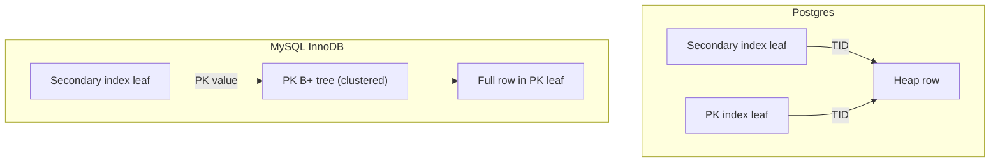
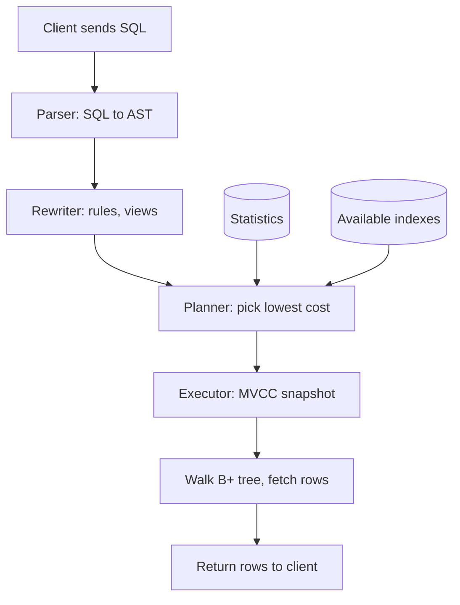

## Definition (interview-ready)

Relational databases like MySQL (InnoDB) and Postgres organize their indexes as **B+ trees** on disk (InnoDB also stores the table itself inside the primary-key B+ tree, while Postgres keeps rows in a separate heap), use a **query planner** to convert SQL into an execution plan based on table statistics, and expose that plan via **EXPLAIN**. Performance work means understanding how the planner picks plans and tuning indexes to give it good options.

**One-liner:** Relational databases find rows through shallow, high-fanout B+ tree indexes and use a cost-based planner that relies on table statistics to choose between scans and joins; EXPLAIN ANALYZE shows the chosen plan, so you can spot missing indexes and bad estimates.

## Why it matters

Most production performance issues in OLTP systems trace back to a missing index, a stale stats table, or a planner choosing a sequential scan when a seek would be 100× faster. If you can read an `EXPLAIN ANALYZE`, you can fix 80% of slow queries on day one of any new team.

<Anim id="lsm-btree" />

## Core concepts

### B+ tree storage

- **B+ tree** = balanced, ordered tree where:
  - **Internal nodes** hold keys + pointers (no row data).
  - **Leaf nodes** hold all keys plus what they point to: in Postgres, a pointer to the heap row; in InnoDB, the full row (primary-key index) or the PK value (secondary indexes).
  - Leaves form a **linked list** for fast range scans.
- High fanout (hundreds of keys per node) → very shallow (3–4 levels deep, even for billions of rows).
- Most reads = 3–4 page accesses → ~30–40 ms on HDD if nothing is cached (upper levels usually are), μs with cache hits.

### Heap vs clustered storage

- **Postgres**: rows live in the **heap** (unordered file). Every index has pointers (TIDs) into the heap.
- **MySQL InnoDB**: rows live **inside the primary key's B+ tree** (clustered index). Secondary indexes store the PK value, not a row pointer.

Consequence:
- Postgres: every index, including the PK, points straight at the heap, so a secondary lookup is one index walk plus a heap fetch. The flip side: an update that can't be done as a HOT (heap-only tuple) update writes a new row version, and every index needs a new entry for it.
- InnoDB: secondary index lookup = 2 B+ tree traversals (secondary → PK → row). Big PK = bloated secondary indexes. Choose a **small monotonic PK** (typically `BIGINT`).

How a secondary-index lookup reaches the row in each engine:



### Index types

- **B-tree** (default): equality, range, sort.
- **Hash**: equality only. Postgres supports but B-tree is usually as good.
- **GiST / GIN / SP-GiST / BRIN** (Postgres): full-text, JSON, geo, etc.
- **Bitmap**: not a stored type in OLTP, but the planner can build bitmaps on the fly to combine indexes.
- **Covering index**: includes all columns the query reads — no heap fetch needed. Postgres `INCLUDE (...)`, MySQL just put them in the index.
- **Partial index** (Postgres): index only rows matching `WHERE` predicate. Smaller, faster.

### Query planner

The planner uses **statistics** (sampled histograms, distinct counts) to estimate cardinality for each step and a **cost model** to choose between plans. Three phases:
1. **Parsing**: SQL → AST.
2. **Rewriting**: rules, view expansion.
3. **Planning/optimizing**: predicate push-down, enumerate alternatives, pick lowest cost.

Cost-based optimizers (CBO) — the choice depends on stats. **Bad stats = bad plans.** Run `ANALYZE` regularly (Postgres autovacuum does this).

### Join algorithms

- **Nested loop**: outer × inner. Great when outer is tiny or inner has an index.
- **Hash join**: build hash on smaller side, probe with larger. Great for equi-joins on big tables, no useful index.
- **Merge join**: both sides sorted on the join key. Great when input is naturally sorted or both sides have indexes.

### Sequential scan vs index scan

- **Seq scan**: read the whole table. Faster than index when you'll fetch >10–20% of rows (random I/O cost exceeds full read).
- **Index scan**: traverse B+ tree, fetch matching rows.
- **Index-only scan**: read only the index (all needed cols in it). No heap fetch.
- **Bitmap scan**: index produces bitmap of matching pages, then a single sequential pass over those pages (combines locality with selectivity).

### EXPLAIN basics

```
EXPLAIN ANALYZE SELECT * FROM orders WHERE user_id = 42 AND status = 'OPEN';
```

The output is a tree: the top node returns the final result, and execution starts at the most-indented nodes and flows upward.
```
Index Scan using idx_user_status on orders  (cost=0.43..8.45 rows=2 width=...)
                                            (actual time=0.012..0.014 rows=2 loops=1)
  Index Cond: (user_id = 42 AND status = 'OPEN')
```

Key things to look for:
- **`Seq Scan`** on a big table with a selective predicate → missing index.
- **`Rows Removed by Filter`** = work done, then thrown away. Index doesn't cover the predicate.
- **Big gap between estimated and actual rows** → stale stats, run `ANALYZE`.
- **`Nested Loop` with high `loops=N`** = the inner side ran N times. With a large outer side, a hash join is often better.

### MVCC (preview — full coverage in [Transactions & Isolation](/learn/notes/transactions-isolation/))

Both Postgres and MySQL use MVCC: each row has multiple versions. Readers see a consistent snapshot without locking writers. Postgres marks rows as dead and relies on `VACUUM`; MySQL keeps old versions in an **undo log**.

## How it works (a query lifecycle)

```
1. Client sends SQL.
2. Parser → AST. Planner consults stats and indexes.
3. Planner picks Plan = Index Scan on idx_user_id, then Filter status='OPEN'.
4. Executor opens snapshot (MVCC), walks B+ tree to user_id=42, fetches matching rows.
5. Server returns rows over the wire.
```

The same lifecycle as a flow, with the planner's inputs on the side:



## Real-world examples

- **Postgres at scale**: vacuum tuning is famously hard; long-running transactions block VACUUM and grow table bloat.
- **MySQL InnoDB at Shopify**: PK choice is critical — they moved hot tables to composite PKs like `(shop_id, order_id)` so each shop's rows are clustered on the same pages, instead of interleaved by a global auto-increment `id`.
- **Multi-column index ordering**: `(user_id, status)` supports `WHERE user_id = ?` and `WHERE user_id = ? AND status = ?` — but **NOT** `WHERE status = ?` alone. Leftmost-prefix rule.

## Common pitfalls

- **Index on a low-cardinality column** (e.g., a boolean) — planner often ignores it. Use partial indexes instead.
- **Leading column rule**: composite index `(a, b)` doesn't help `WHERE b = ?`.
- **Functions / casts on the indexed column** → can't use index. `WHERE LOWER(email) = ?` needs an **expression index** on `LOWER(email)`.
- **`SELECT *`**: forces heap fetches and breaks index-only scans.
- **OR predicates** sometimes block index use → bitmap OR / UNION ALL of two queries can be faster.
- **N+1 in ORM**: lazy-loading an association issues one query per row; eager-load (e.g., Rails `.includes`) or write one join — often 100× faster.
- **Big text/JSON columns in the row**: bloats the heap, slows scans. Move to a side table if you don't always read them (Postgres TOASTs large values out-of-line automatically, but only above ~2 KB).
- **Postgres table bloat**: long transactions + many updates → dead tuples pile up → VACUUM can't reclaim. Causes slow scans.

## Practice questions

<Practice>

<QA q="Why is a B+ tree faster than a sorted array for lookups that come with frequent inserts?" level="easy">

A sorted array gives O(log n) lookups but O(n) inserts, because elements have to shift. A B+ tree gives O(log n) for both, efficient range scans through its linked leaf level, and page-sized nodes with high fanout. So even billions of rows sit only 3–4 levels deep, which is friendly to disk reads.

</QA>

<QA q="What's the difference between a clustered and a non-clustered index?" level="easy">

A **clustered index** *is* the table data, ordered by the index key. InnoDB's primary key is clustered: rows live in the PK's B+ tree leaves. A **non-clustered (secondary)** index stores the key plus a pointer (a heap TID in Postgres, the PK value in InnoDB), so the row lives elsewhere and a lookup needs a second hop. Range scans on the clustered key read rows that sit next to each other.

</QA>

<QA q="A composite index on `(user_id, status)` exists. Which queries can use it?" level="easy">

By the **leftmost-prefix rule**: `WHERE user_id = ?` and `WHERE user_id = ? AND status = ?` can, but `WHERE status = ?` alone can't use it efficiently, because the index is sorted by `user_id` first. If you need status-only queries, add a separate index (or a partial index if only a few statuses are hot).

</QA>

<QA q="How do Postgres and InnoDB store rows differently, and what does that mean for secondary indexes?" level="medium">

**Postgres** keeps rows in an unordered **heap**, and every index (including the PK) points into the heap with a TID, so a secondary lookup is one index walk plus a heap fetch. **InnoDB** stores rows inside the **primary key B+ tree**, and secondary indexes store the PK value. A secondary lookup is therefore two traversals (secondary → PK → row), and a wide PK bloats every secondary index. Choose a small, monotonic PK (typically `BIGINT`).

</QA>

<QA q="When would a sequential scan be faster than an index scan?" level="medium">

When the predicate is unselective, matching more than ~10–20% of rows: index traversal plus random heap fetches costs more than one sequential pass. The planner decides from statistics. A **bitmap scan** sits in between: it uses the index to collect matching pages, then reads them in physical order.

</QA>

<QA q="Walk through `EXPLAIN ANALYZE` output and what you'd look for." level="medium">

Identify each operator (Seq Scan, Index Scan, Index Only Scan, Bitmap Heap Scan, Nested Loop, Hash Join, Merge Join), reading the indented tree from the innermost nodes outward. Then check:

- **Estimated vs actual rows**: a big gap means stale or insufficient stats.
- **Rows Removed by Filter**: work done and thrown away, so the index doesn't cover the predicate.
- **High `loops`** on a nested-loop inner side: a hash join may be better.
- **Buffers** (with the BUFFERS option): cache hits vs disk reads.

</QA>

<QA q="How do you design a composite index?" level="medium">

Put **equality** columns first, then range or sort columns, matching the most common query pattern. Add trailing columns (or Postgres `INCLUDE`) so hot queries become index-only scans. Remember the cost: every write updates every index, so don't add indexes you won't use.

</QA>

<QA q="When does the planner choose a nested loop, a hash join, or a merge join?" level="medium">

- **Nested loop**: the outer side is tiny, or the inner side has an index on the join key.
- **Hash join**: equi-joins between large inputs with no useful index. Build a hash table on the smaller side and probe it with the larger.
- **Merge join**: both inputs are already sorted on the join key (e.g. from indexes), or sorting them is cheap.

A nested loop with a large outer side and no inner index is a classic slow plan.

</QA>

<QA q="Why can't `WHERE LOWER(email) = ?` use an index on `email`, and how do you fix it?" level="medium">

The index stores raw `email` values. Applying a function or cast to the column means the stored keys no longer match what's being compared, so the planner can't seek. Fix with an **expression index** on `LOWER(email)` (or store a normalized column). The same applies to implicit casts, e.g. comparing a string column with a number.

</QA>

<QA q="An EXPLAIN shows estimated rows = 10 but actual rows = 1,000,000. What happened and what do you do?" level="hard">

The planner's statistics are wrong. Either (1) `ANALYZE`/autovacuum hasn't run since a big load, (2) the histogram is too coarse for a skewed column, or (3) correlated columns are treated as independent, so the combined selectivity is underestimated. Fix: `ANALYZE` the table, raise the column's statistics target (`ALTER TABLE ... ALTER COLUMN ... SET STATISTICS`, or `default_statistics_target` globally), or add extended statistics (`CREATE STATISTICS`) for correlated columns.

</QA>

<QA q="A query that used to be fast is now slow with no schema or query changes. How do you investigate?" level="scenario">

- Compare the current EXPLAIN plan with the old one. Did it flip from an index scan to a seq scan?
- **Stats drift**: run `ANALYZE` and re-check.
- **Table bloat**: `pg_stat_user_tables` for dead tuples.
- **Lock contention**: `pg_locks` / `pg_stat_activity`. For example, a DDL waiting for `AccessExclusiveLock` behind a long transaction queues every later query on the table.
- **Storage**: a degraded disk, or a full disk stalling log flushes.
- **Plan parameterization**: a cached generic plan for a prepared statement that's bad for some parameter values.

</QA>

<QA q="Design indexes for an `orders` table queried by `(user_id, status)`, by `(created_at DESC)`, and by `(merchant_id, created_at)`, with millions of rows and mostly recent reads." level="scenario">

- `(user_id, status)`: equality on both.
- `(created_at DESC)` for the global recent feed. Consider a **partial index** with a fixed cutoff (`WHERE created_at > '2026-01-01'`), rebuilt periodically. `now()` isn't allowed in index predicates because it isn't immutable.
- `(merchant_id, created_at DESC)` for merchant dashboards.
- Watch the write amplification (3 secondary indexes on every insert), and confirm they're used via `pg_stat_user_indexes`.

</QA>

<QA q="A Postgres table's scans keep getting slower and its size on disk keeps growing, even though the row count is stable. What's going on?" level="scenario">

**Table bloat**. Postgres MVCC leaves old row versions as dead tuples on update and delete, and `VACUUM` reclaims them. But it can't remove versions that a long-running (or idle-in-transaction) session might still see. Dead tuples pile up and scans read ever more pages. Find the oldest transactions in `pg_stat_activity` and end them, check dead tuples in `pg_stat_user_tables`, tune autovacuum for hot tables, and reclaim existing bloat with a rewrite (e.g. `VACUUM FULL` during a window, or an online tool such as pg_repack).

</QA>

</Practice>

## Quiz

<Quiz>

<MCQ q="An index exists on (a, b). Which query cannot use it efficiently?" options={["WHERE a = 1", "WHERE a = 1 AND b = 2", "WHERE a = 1 ORDER BY b", "WHERE b = 2"]} answer={3}>

The index is sorted by a first, so a predicate on b alone has no leftmost prefix to seek on. The first three queries all constrain the leading column.

</MCQ>

<MCQ q="In InnoDB, why does a large random UUID primary key hurt secondary indexes?" options={["Every secondary index stores the PK value, so a wide PK bloats them all", "Secondary indexes cannot reference UUIDs", "InnoDB stores rows in an unordered heap", "UUIDs disable the query planner"]} answer={0}>

InnoDB secondary indexes point to rows by PK value, so PK width is paid in every index (and random keys also fragment the clustered index). The unordered heap describes Postgres, not InnoDB.

</MCQ>

<MCQ q="A query matches 40 percent of a large table. The planner chooses a sequential scan despite an index. Why?" options={["The index must be corrupt", "Fetching that many rows through the index means more random I/O than one sequential pass", "Postgres never uses indexes for SELECT star", "Sequential scans always win on SSDs"]} answer={1}>

For unselective predicates, a full sequential read is cheaper than index traversal plus scattered heap fetches. Indexes are still used for selective queries, on any kind of storage.

</MCQ>

<MCQ q="EXPLAIN ANALYZE shows rows=10 estimated but 1,000,000 actual on a filter over two correlated columns. Which fix targets the root cause?" options={["Add more RAM", "Rewrite the query with a subquery", "Create extended statistics on the two columns and run ANALYZE", "Switch to a hash index"]} answer={2}>

The planner assumes the columns are independent, so it underestimates the combined selectivity. Extended statistics capture the correlation. More RAM or a different index type doesn't fix a bad cardinality estimate.

</MCQ>

<MCQ q="Which join algorithm is usually best for an equi-join of two large unsorted tables with no useful index?" options={["Nested loop", "Merge join", "Index-only scan", "Hash join"]} answer={3}>

A hash join builds a hash table on the smaller input and probes it with the larger, in linear time. A nested loop without an index is quadratic, a merge join needs sorted inputs, and an index-only scan is a scan type, not a join.

</MCQ>

<MCQ q="A query filters WHERE LOWER(email) = ... and does a sequential scan despite an index on email. What is the fix?" options={["Create an expression index on LOWER(email)", "Run VACUUM FULL", "Raise the statistics target on email", "Add email to a covering INCLUDE list"]} answer={0}>

The index stores raw email values, so a function on the column prevents seeking, and an expression index stores the lowered values. Vacuum and statistics don't change which expressions an index can serve.

</MCQ>

<MCQ q="A Postgres table keeps growing on disk with a stable row count, and autovacuum runs but reclaims little. What is the most likely blocker?" options={["Too many indexes", "The undo log is full", "A long-running or idle-in-transaction session holding back the oldest visible snapshot", "The B+ tree depth exceeded 4"]} answer={2}>

VACUUM can't remove dead tuples that an open transaction might still need to see. The undo log is InnoDB's mechanism, not Postgres's, and tree depth doesn't stop reclamation.

</MCQ>

<MCQ q="What makes an index-only scan possible?" options={["The table has no primary key", "The index contains every column the query reads, so the heap can be skipped (in Postgres, for pages the visibility map marks all-visible)", "The query uses SELECT star", "The planner statistics are disabled"]} answer={1}>

If the index covers all needed columns, the executor can answer from the index. Postgres keeps visibility info only in the heap, so it checks the visibility map: all-visible pages need no heap visit, while other pages still do (which is why a recently updated table gains little). SELECT star usually prevents covering.

</MCQ>

</Quiz>

## TL;DR cheat sheet

- B+ tree = high-fanout, leaf-linked. 3–4 levels for billions of rows.
- InnoDB clusters rows in the PK B+ tree. Postgres uses a separate heap.
- Cost-based planner picks plans from **stats** — keep them fresh (`ANALYZE`).
- Joins: nested loop (tiny outer + indexed inner), hash (big equi-join), merge (sorted inputs).
- `EXPLAIN ANALYZE` is a tree (top node = final result, most-indented nodes run first); look for Seq Scan on big tables, big estimate-vs-actual gaps, `Rows Removed by Filter`.
- Composite index: equality columns first.
- Index-only scan = covering all needed columns in the index. Fastest path.
- Functions on indexed columns kill index use unless you have expression indexes.

## Go deeper

- **Use The Index, Luke**: [use-the-index-luke.com](https://use-the-index-luke.com/) — short, free, exceptional.
- **DDIA Chapter 3** — storage internals.
- **Postgres docs**: [Performance Tips](https://www.postgresql.org/docs/current/performance-tips.html), [Indexes](https://www.postgresql.org/docs/current/indexes.html).
- **Hussein Nasser**: Database Engineering playlist (B-trees, MVCC, query lifecycle).
- **High Performance MySQL** (Schwartz, Zaitsev) — bible for InnoDB tuning.
- **pganalyze blog** — best Postgres performance content on the internet.
- **Tool**: [explain.depesz.com](https://explain.depesz.com/) and [explain.dalibo.com](https://explain.dalibo.com/) for visualizing plans.
