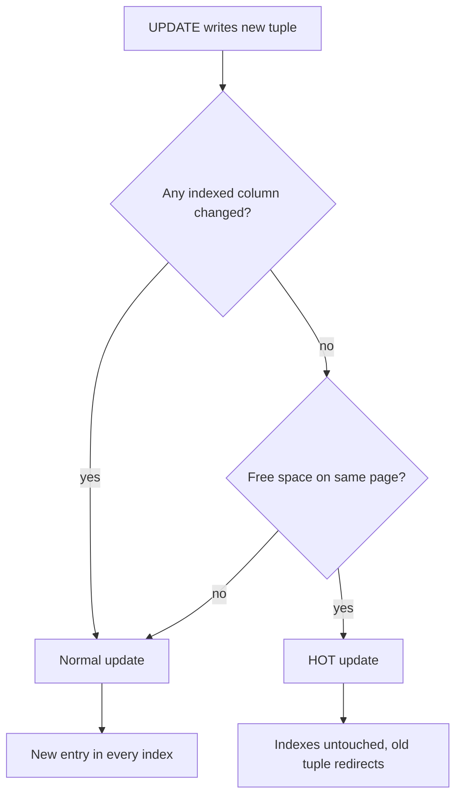
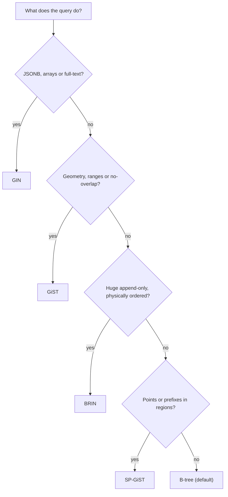
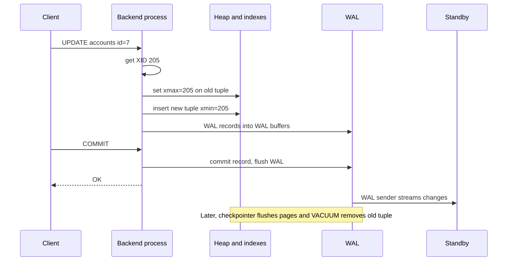

## Definition (interview-ready)

**PostgreSQL** stores each table as a **heap** — an unordered set of 8 KB pages — and every index points into it. It implements MVCC (multi-version concurrency control — keeping several versions of a row so readers don't block writers) by **never updating a row in place**: an `UPDATE` writes a brand-new row version (a *tuple*) and marks the old one as expired using hidden transaction-ID fields `xmin` and `xmax`. Expired tuples that nobody can see anymore are **dead tuples**, and **VACUUM** (usually run by the **autovacuum** daemon) reclaims them and also "freezes" old rows to prevent **transaction ID wraparound**. Durability and replication come from the **WAL** (write-ahead log). Each client connection is a separate OS **process**, which is why production Postgres almost always sits behind a pooler like **PgBouncer**.

**One-liner:** Postgres does MVCC by writing a new row version on every UPDATE and stamping the old one with `xmax`, so VACUUM must clean up dead versions and freeze old ones to avoid XID wraparound; the WAL gives durability and replication, and its process-per-connection model needs a pooler like PgBouncer.

## Why it matters

The basics (heap vs clustered storage, the planner, EXPLAIN) are in [MySQL/Postgres Internals](/learn/notes/mysql-postgres-internals/). This note covers what bites teams running Postgres at scale:

- A table that should be 10 GB is 80 GB because of **bloat**, and queries slow down.
- A single forgotten transaction or an abandoned replication slot stops VACUUM from cleaning anything.
- A database **refuses all writes** because it is close to transaction ID wraparound.
- The app opens 2,000 connections and Postgres runs out of memory.
- Someone picks a GIN index for a timestamp column, or a B-tree for a JSONB containment query.

If you understand **"UPDATE = INSERT + mark old dead"**, almost every Postgres operational question becomes answerable from first principles.

## Core concepts

### Heap tables and tuple versioning (xmin / xmax)

Every tuple has a header with, among other fields:

- `xmin` — the ID of the transaction that **created** this version.
- `xmax` — the ID of the transaction that **deleted or replaced** it (0 if still live).
- `ctid` — the tuple's physical address `(page, item)`. An updated tuple's `ctid` points to its newer version.

You can see them:

```sql
SELECT xmin, xmax, ctid, * FROM accounts WHERE id = 7;
```

A snapshot is basically "which transaction IDs had committed when I started". A tuple is visible to you if its `xmin` committed before your snapshot and its `xmax` is either empty, aborted, or not yet committed in your snapshot.

### Why UPDATE creates a new tuple

```
Before:   page 3, item 1: (xmin=100, xmax=0)   id=7 balance=100

UPDATE accounts SET balance = 70 WHERE id = 7;   -- by txn 205

After:    page 3, item 1: (xmin=100, xmax=205) id=7 balance=100   ← old version, now "expired"
          page 3, item 4: (xmin=205, xmax=0)   id=7 balance=70    ← new version
```

Intuition: Postgres treats the table like an append-mostly ledger. An `UPDATE` is "insert the new version + stamp the old one with my transaction ID". A `DELETE` is just "stamp `xmax`".

Compare with InnoDB ([MySQL InnoDB Deep Dive](/learn/notes/mysql-innodb-internals/)), which updates in place and keeps the old version in a separate undo log. Postgres keeps old versions **in the table itself**, which makes rollback instant (nothing to undo) but means someone must clean up later.

### Dead tuples and bloat

Once no running transaction could ever see the old version, it becomes a **dead tuple**. Dead tuples still take space in pages and in index entries. When they pile up faster than they're cleaned, the table and its indexes grow far beyond the live data — **bloat**. Effects: more pages to scan, worse cache hit rate, bigger backups.

Check it:

```sql
SELECT relname, n_live_tup, n_dead_tup, last_autovacuum
FROM pg_stat_user_tables ORDER BY n_dead_tup DESC LIMIT 10;
```

### VACUUM and autovacuum

Plain **`VACUUM`**:

- Finds dead tuples, removes their index entries, and marks the space **reusable** within the table (it is recorded in the *free space map*).
- Updates the **visibility map** — a per-page bit saying "every tuple here is visible to everyone". Index-only scans use it to skip heap visits, and later VACUUMs skip those pages.
- **Freezes** old tuples (see wraparound below).
- Runs alongside normal reads and writes. It usually does **not** return space to the operating system (only empty pages at the very end of the file).

**`VACUUM FULL`** rewrites the whole table into a new file, so it does give space back — but it takes an `ACCESS EXCLUSIVE` lock (blocks even reads) and needs extra disk for the copy. Online alternatives like the `pg_repack` extension exist.

**Autovacuum** is a background launcher plus worker processes (`autovacuum_max_workers`, default 3). A table is vacuumed when:

```
dead tuples  >  autovacuum_vacuum_threshold (50)
              + autovacuum_vacuum_scale_factor (0.2) × reltuples
```

So by default a 100-million-row table waits for about **20 million** dead tuples. That's why large, hot tables usually get per-table settings:

```sql
ALTER TABLE orders SET (autovacuum_vacuum_scale_factor = 0.01,
                        autovacuum_vacuum_threshold = 10000);
```

(PostgreSQL 18 adds `autovacuum_vacuum_max_threshold`, default 100 million, as a cap.) Analyze runs on a similar formula with a 0.1 scale factor, and insert-only tables are vacuumed based on inserts too (PostgreSQL 13+).

**What blocks VACUUM** from removing dead tuples: anything that holds an old snapshot —

- long-running or **idle-in-transaction** sessions,
- abandoned **replication slots** (a physical slot whose standby used `hot_standby_feedback` holds back cleanup on every table; a logical slot holds back cleanup of system-catalog rows and keeps WAL),
- old **prepared transactions** (two-phase commit),
- standbys with `hot_standby_feedback = on` running long queries.

VACUUM can only remove tuples older than the oldest snapshot in the whole cluster. One stuck session can make every table bloat.

### Transaction ID wraparound

Transaction IDs (XIDs) are **32-bit** counters. Comparisons are circular: from any XID, about 2 billion are "in the past" and about 2 billion "in the future". If an old tuple's `xmin` drifts more than 2 billion transactions back, it would suddenly look like it's from the future — and **vanish**.

The fix is **freezing**: VACUUM marks sufficiently old tuples as *frozen*, meaning "visible to everyone forever", so their XID no longer matters.

Guard rails (from the PostgreSQL docs):

| Event | When |
|---|---|
| Forced anti-wraparound autovacuum | Table's oldest unfrozen XID is older than `autovacuum_freeze_max_age` (default **200 million**) — runs even if autovacuum is disabled |
| Warnings in logs ("must be vacuumed within N transactions") | About 40 million XIDs before wraparound |
| **Refuses to assign new XIDs** (writes fail, reads still work) | Fewer than 3 million XIDs left |

Recovery: end long transactions, drop stale replication slots and old prepared transactions, then run a plain database-wide `VACUUM`. Monitor with:

```sql
SELECT datname, age(datfrozenxid) FROM pg_database ORDER BY 2 DESC;
```

Alert well before `age` approaches the 2-billion limit.

### HOT updates (heap-only tuples)

Without help, every UPDATE that creates a new tuple at a new `ctid` must also insert **new entries in every index** of the table — even indexes on columns that didn't change. That's write amplification.

A **HOT update** avoids it. It happens when **both**:

1. the update changes **no indexed column** (columns used only by BRIN, a "summarizing" index, don't count — PostgreSQL 16+), and
2. the **same page has free space** for the new version.

The decision Postgres makes on every UPDATE:



Then the new tuple lives on the same page, the old one points to it, and the indexes keep pointing at the old entry, which redirects. HOT chains can also be pruned during normal page access, without waiting for VACUUM.

How to get more HOT updates:

- **Don't index frequently updated columns** you don't search on (`last_seen_at`, counters).
- **Lower `fillfactor`** on update-heavy tables to leave room on each page: `ALTER TABLE sessions SET (fillfactor = 80);`.
- Watch `n_tup_hot_upd` vs `n_tup_upd` in `pg_stat_user_tables`.

### Index types and when to use them

Postgres ships six index access methods. B-tree is the default and right most of the time.

| Type | How it works (one line) | Supports | Use for | Avoid when |
|---|---|---|---|---|
| **B-tree** | Sorted, balanced tree | `=`, `<`, `>`, ranges, `ORDER BY`, prefix `LIKE 'abc%'` (C collation or `text_pattern_ops`), `IS NULL` | Almost everything: IDs, timestamps, emails, composite keys | Containment in arrays/JSON, full-text |
| **Hash** | Stores a 32-bit hash of the value | `=` only | Equality on long values where a smaller index helps | You need ranges, sorting, or uniqueness constraints |
| **GIN** (generalized inverted index) | One entry per *element* (word, array item, JSON key/value) → list of rows | `@>`, `<@`, `&&`, `?`, full-text `@@` | JSONB, arrays, full-text search, trigram `LIKE '%x%'` (`pg_trgm`) | Write-heavy tables with tiny lookups (inserts are expensive) |
| **GiST** (generalized search tree) | Balanced tree of bounding "summaries"; often lossy | Overlap, containment, nearest-neighbour `ORDER BY ... <->` | Geometry/PostGIS, range types, exclusion constraints (no overlapping bookings) | Plain scalar equality |
| **SP-GiST** (space-partitioned GiST) | Non-balanced partitioning: quadtrees, k-d trees, radix tries | Points, ranges, text prefixes | Data that splits naturally into non-overlapping regions (e.g. IP or phone prefixes, points) | General-purpose use |
| **BRIN** (block range index) | Stores min/max per range of table blocks (128 pages by default) | `=`, `<`, `>` on linear-sortable types | Huge append-only tables where the column follows physical order (event time, log ID) | Columns with random order on disk; small tables |

A quick way to pick one, following the table:



Examples:

```sql
-- No overlapping room bookings, enforced by GiST (needs btree_gist for the = part)
CREATE EXTENSION btree_gist;
ALTER TABLE bookings ADD CONSTRAINT no_overlap
  EXCLUDE USING gist (room_id WITH =, during WITH &&);

-- A 2 TB events table ordered by time: BRIN is kilobytes, a B-tree would be many GB
CREATE INDEX events_ts_brin ON events USING brin (created_at);

-- Partial + covering B-tree: only open orders, and the query never touches the heap
CREATE INDEX orders_open ON orders (user_id) INCLUDE (total) WHERE status = 'OPEN';
```

Other B-tree features worth knowing: `INCLUDE` columns for covering indexes (PostgreSQL 11+), deduplication of repeated keys (PostgreSQL 13+), expression indexes (`ON users (lower(email))`), and `CREATE INDEX CONCURRENTLY` to build without blocking writes.

### JSONB vs JSON

| | `json` | `jsonb` |
|---|---|---|
| Storage | Exact text copy | Parsed binary format |
| Whitespace and key order | Preserved | Not preserved (keys are reordered) |
| Duplicate keys | Kept | Last value wins |
| Write cost | Slightly cheaper | Slightly more expensive (parsing on input) |
| Read/processing | Re-parsed every time | Much faster |
| Indexing (GIN) and containment operators | No | Yes |

Use `jsonb` unless you must keep the exact original text (e.g. for signature verification).

Key operators:

```sql
SELECT doc -> 'user'            -- object field as jsonb
     , doc ->> 'status'         -- field as text
     , doc #> '{items,0,sku}'   -- by path, as jsonb
     , doc #>> '{items,0,sku}'  -- by path, as text
FROM orders
WHERE doc @> '{"status": "PAID"}'           -- containment
  AND doc ? 'coupon'                        -- top-level key exists
  AND doc @? '$.items[*] ? (@.qty > 5)';    -- SQL/JSON path match
```

Also `?|` (any key exists), `?&` (all keys exist), `||` (merge), `-` / `#-` (delete key / path), and since PostgreSQL 14 subscripting: `doc['user']['name']`.

### GIN: jsonb_ops vs jsonb_path_ops

```sql
CREATE INDEX ON orders USING gin (doc);                  -- jsonb_ops (default)
CREATE INDEX ON orders USING gin (doc jsonb_path_ops);   -- jsonb_path_ops
```

| | `jsonb_ops` (default) | `jsonb_path_ops` |
|---|---|---|
| What it indexes | Each key and each value separately | A hash of each value **together with its path** |
| Key-exists operators (`?` and its any/all forms) | Yes | **No** |
| Containment `@>` and jsonpath `@?`, `@@` | Yes | Yes |
| Size | Larger | Usually much smaller |
| `@>` speed | Good | Usually faster (more specific entries) |
| Gotchas | — | No entries for empty structures like `{"a": {}}`, so such searches scan the whole index |

Rule: if your queries are containment (`@>`) only, pick `jsonb_path_ops`. If you need key-existence checks, use the default. If you always filter on one field, a plain **B-tree expression index** is often best: `CREATE INDEX ON orders ((doc ->> 'status'));`.

### WAL and checkpoints

The **WAL** is an append-only log of every change, written **before** the data pages are changed. At commit, Postgres only needs to flush the WAL (sequential I/O); modified data pages stay in shared buffers and are written later.

A **checkpoint** is a point where all dirty pages have been written to disk, so crash recovery only has to replay WAL from the last checkpoint onward.

| Setting | Default | Meaning |
|---|---|---|
| `checkpoint_timeout` | 5 min | Max time between checkpoints |
| `max_wal_size` | 1 GB | Checkpoint is triggered earlier if WAL grows past this |
| `checkpoint_completion_target` | 0.9 | Spread checkpoint writes over 90% of the interval to smooth I/O |
| `full_page_writes` | on | First change to a page after a checkpoint logs the whole page, protecting against torn (partial) page writes |

Trade-off: frequent checkpoints = faster recovery but more WAL (more full-page images) and more I/O. Busy systems often raise `max_wal_size` so checkpoints are driven by time, not volume. If logs say "checkpoints are occurring too frequently", that's the hint.

`synchronous_commit = off` (per transaction if you like) lets a commit return before its WAL is flushed — you can lose the last few commits on a crash, but never get corruption. Useful for things like analytics events.

### Streaming (physical) vs logical replication

| | Streaming / physical | Logical |
|---|---|---|
| What is shipped | WAL bytes — exact page-level changes | Decoded row changes (`INSERT`/`UPDATE`/`DELETE`) per table |
| Replica | Byte-identical copy of the whole cluster; read-only "hot standby" | Independent, writable database; can have extra tables and indexes |
| Granularity | Entire cluster | Per table, via `PUBLICATION` / `SUBSCRIPTION` (PostgreSQL 10+) |
| Major version | Must match | Can differ → used for near-zero-downtime upgrades |
| DDL | Replicated (it's all WAL) | **Not** replicated; apply schema changes yourself |
| Sequences | Replicated | Ongoing changes not replicated; sync them before cutover (PostgreSQL 19 adds a one-off `ALTER SUBSCRIPTION ... REFRESH SEQUENCES`) |
| Typical use | HA failover, read replicas | Upgrades, migrations, partial replication, CDC (Debezium uses logical decoding) |

Both are **asynchronous by default**. For synchronous replication set `synchronous_standby_names` and choose `synchronous_commit`:

- `remote_write` — standby has received the WAL and written it to its OS,
- `on` — standby has flushed it to disk,
- `remote_apply` — standby has replayed it, so reads on the standby see it.

**Replication slots** make the primary keep WAL until a consumer has received it. Great for not losing data — dangerous when a consumer disappears: WAL accumulates until the disk fills. Slots also pin an XID horizon: a logical slot stops VACUUM from cleaning system-catalog rows, and a physical slot used with `hot_standby_feedback` stops it cleaning any table. Either can eventually push the database towards wraparound. Cap it with `max_slot_wal_keep_size` (PostgreSQL 13+) and alert on slot lag.

On a hot standby, a long query can be **cancelled** when replay must remove rows it still needs. `hot_standby_feedback = on` prevents that by telling the primary to keep those rows — at the cost of bloat on the primary.

### Connection-per-process and PgBouncer

Postgres forks one **backend process per connection** (the *postmaster* listens and spawns them). Each process has its own memory for sorting, hashing and caches, and context switching between thousands of them is expensive. `max_connections` defaults to **100**. Modern microservices with many pods × pool size can easily ask for thousands.

**PgBouncer** is a lightweight proxy that lets many client connections share a small set of server connections.

| Mode | A server connection is assigned to a client... | Pros | Cons |
|---|---|---|---|
| **Session** (default) | for the whole client connection | Everything works | Little multiplexing; mostly helps with connection setup cost |
| **Transaction** | only for the duration of one transaction | Huge multiplexing: thousands of clients on tens of backends | Session state does not survive between transactions |
| **Statement** | only for one statement; multi-statement transactions are rejected | Most aggressive | Breaks normal transactions; niche |

Transaction-mode caveats (they bite every team once):

- **`SET` / `RESET`** of session settings (e.g. `SET search_path`, `SET statement_timeout`) — the next transaction may run on another backend. Use `SET LOCAL` inside the transaction, or set defaults per role/database.
- **Session-level advisory locks** (`pg_advisory_lock`) — use the transaction-level ones (`pg_advisory_xact_lock`).
- **`LISTEN`** doesn't work.
- **SQL-level `PREPARE`/`DEALLOCATE`**, `WITH HOLD` cursors, and temp tables that outlive a transaction don't work.
- **Protocol-level prepared statements** (what most drivers use) work only since PgBouncer **1.21**, when `max_prepared_statements` is non-zero (it defaults to 200 since 1.24; earlier versions default to 0, meaning off). On older versions, disable server-side prepares in the driver (e.g. JDBC `prepareThreshold=0`).

Sizing intuition: the database needs only roughly as many active connections as it can actually execute in parallel (a small multiple of CPU cores), not one per client.

### MySQL vs Postgres: when to pick which

| Need | Lean towards | Why |
|---|---|---|
| Very write/update-heavy rows with many secondary indexes | MySQL (InnoDB) | In-place updates + undo; secondary indexes point to the PK, so non-key updates don't touch them. Postgres needs HOT to avoid index writes |
| Rich SQL: CTEs, window functions, partial/expression indexes, exclusion constraints | Postgres | Broader SQL and index feature set |
| JSON documents with indexed containment queries | Postgres | `jsonb` + GIN |
| Geospatial | Postgres | PostGIS on GiST/SP-GiST |
| Huge append-only time-series in a relational DB | Postgres | BRIN, partitioning, extensions |
| Many connections from many services | Either, with a pooler | MySQL uses a thread per connection (cheaper); Postgres needs PgBouncer or similar |
| Default isolation | — | MySQL: REPEATABLE READ with gap locks. Postgres: READ COMMITTED; its REPEATABLE READ is snapshot isolation, and SERIALIZABLE uses SSI |
| Operational chores | MySQL is lighter on vacuuming; Postgres needs autovacuum tuning and wraparound monitoring | MVCC design difference |
| Team / ecosystem familiarity | Whatever you can operate well | Operational skill beats small feature differences |

How to say it in an interview: *"Both are excellent OLTP databases. I'd default to Postgres for feature richness — JSONB, GIN/GiST/BRIN, extensions — and lean MySQL for very update-heavy workloads with many indexes or where the team's tooling is MySQL-based. The real decision is usually operational familiarity."*

## How it works (an UPDATE's life in Postgres)

```sql
BEGIN;
UPDATE accounts SET balance = 70 WHERE id = 7;
COMMIT;
```

```
1. Backend process (one per connection, maybe via PgBouncer) gets an XID, say 205.
2. Index scan finds id=7 → heap tuple at (3,1). Row lock: write 205 into its xmax.
3. Insert new tuple (xmin=205) — same page if space and no indexed column changed (HOT),
   else elsewhere + new entries in every index.
4. Write WAL records for both changes into WAL buffers.
5. COMMIT: write a commit record and flush WAL (synchronous_commit=on). Return OK.
6. WAL sender streams the WAL to standbys; logical decoding turns it into row changes.
7. Later, checkpointer / background writer flush the dirty heap and index pages.
8. Later still, once no snapshot needs balance=100, (auto)vacuum or page pruning removes
   the old tuple and marks the space reusable. Eventually VACUUM freezes the new tuple.
```

The same steps as a sequence:



## Real-world examples

- **Sentry (July 2015)** was down for most of a working day after hitting transaction ID wraparound; autovacuum had been tuned too conservatively to keep up. Their write-up recommends running autovacuum aggressively enough for the write load.
- **Mailchimp's Mandrill (February 2019)** had a shard enter wraparound protection; hotter-than-usual writes on that shard left autovacuum behind.
- **Uber (2016)** published why it moved a large workload from Postgres to MySQL, citing write amplification from index updates and physical replication behaviour — a useful case study of the trade-offs in the decision table above.
- **Debezium's Postgres connector** streams changes through logical decoding (`pgoutput`) and a replication slot — see [Change Data Capture](/learn/notes/change-data-capture/).

## Common pitfalls

- **Idle-in-transaction sessions** holding snapshots for hours → cluster-wide bloat. Set `idle_in_transaction_session_timeout`.
- **Default autovacuum settings on huge tables** → vacuum runs rarely, then takes forever.
- **Abandoned replication slots** → `pg_wal` fills the disk.
- **Indexing hot-updated columns** → no HOT updates, heavy index churn.
- **Running `VACUUM FULL` in production** to "fix bloat" → table locked against reads and writes.
- **Not monitoring `age(datfrozenxid)`** until the database refuses writes.
- **Hundreds of direct connections per service** without a pooler → memory pressure and slow everything.
- **Transaction-mode PgBouncer + `SET`/session advisory locks/old drivers with prepared statements** → strange, intermittent bugs.
- **`json` instead of `jsonb`**, or `jsonb_path_ops` when you need `?` key checks.
- **BRIN on a column that isn't correlated with physical order** → it matches almost every block range and is useless.
- **`CREATE INDEX` without `CONCURRENTLY`** on a live table → writes blocked for the whole build.

## Practice questions

<Practice>

<QA q="What are `xmin` and `xmax` on a Postgres tuple?" level="easy">

`xmin` is the ID of the transaction that created that row version; `xmax` is the ID of the transaction that deleted it or replaced it with a newer version (0 if none). Together with the reader's snapshot they decide whether that version is visible.

</QA>

<QA q="Why does an UPDATE in Postgres create a new tuple instead of modifying the row in place?" level="easy">

Because Postgres keeps old versions in the heap for MVCC. Readers with older snapshots must still see the old values, so the update writes a new version and stamps the old one with its `xmax`. Rollback is trivial (the new version is simply never visible), but the old version must be cleaned up later by VACUUM.

</QA>

<QA q="What is the difference between `VACUUM` and `VACUUM FULL`?" level="easy">

Plain `VACUUM` removes dead tuples, makes their space reusable inside the table, updates the visibility map and freezes old tuples; it runs concurrently with normal traffic and rarely shrinks the file. `VACUUM FULL` rewrites the whole table into a compact new file and returns space to the OS, but holds an `ACCESS EXCLUSIVE` lock (no reads or writes) and needs extra disk space during the rewrite.

</QA>

<QA q="When does autovacuum vacuum a table, and why is the default bad for huge tables?" level="medium">

When dead tuples exceed `autovacuum_vacuum_threshold` (50) + `autovacuum_vacuum_scale_factor` (0.2) × table rows. For a 500-million-row table that's about 100 million dead tuples before anything happens, and then the run is very long. Set per-table values (e.g. scale factor 0.01 or a fixed threshold), and consider more workers or less cost-based throttling.

</QA>

<QA q="What is transaction ID wraparound and how does Postgres prevent it?" level="medium">

XIDs are 32-bit and compared circularly, so a tuple whose `xmin` is more than about 2 billion transactions old would appear to be in the future and become invisible. VACUUM **freezes** old tuples so their XID no longer matters. Autovacuum forces an anti-wraparound vacuum once a table's oldest unfrozen XID exceeds `autovacuum_freeze_max_age` (200 million). If freezing still falls behind, Postgres warns about 40 million XIDs out and stops assigning new XIDs (rejects writes) with fewer than 3 million left.

</QA>

<QA q="What is a HOT update and how do you get more of them?" level="medium">

A heap-only tuple update stores the new version on the same page and adds no new index entries; indexes reach it through a redirect from the old version. It needs (1) no indexed column changed (BRIN-only columns are exempt in PG 16+) and (2) free space on the page. Get more by not indexing frequently updated columns and lowering the table's `fillfactor`. Track `n_tup_hot_upd` vs `n_tup_upd`.

</QA>

<QA q="Which index type would you use for: a timestamp on a 3 TB append-only log table, an array of tags, nearest-store-to-a-point, and an email lookup?" level="medium">

- Timestamp on append-only log: **BRIN** — tiny and effective because time correlates with physical order (B-tree if you need precise point lookups).
- Tags array: **GIN** for `@>` / `&&`.
- Nearest store: **GiST** (PostGIS) with `ORDER BY location <-> point LIMIT k`.
- Email lookup: **B-tree**, often on `lower(email)` with a unique constraint.

</QA>

<QA q="JSON vs JSONB — which would you use and why?" level="easy">

`jsonb` in almost all cases: it is stored parsed, so reads and operators are much faster, and it supports GIN indexing and containment operators. It drops whitespace, reorders keys and keeps only the last duplicate key. Use `json` only when you need the exact original text.

</QA>

<QA q="Explain `jsonb_ops` vs `jsonb_path_ops` GIN operator classes." level="medium">

`jsonb_ops` (default) indexes every key and every value separately, so it supports key-existence (`?`, `?|`, `?&`), containment (`@>`) and jsonpath (`@?`, `@@`). `jsonb_path_ops` indexes a hash of each value plus its path: smaller and usually faster for `@>`, but it cannot answer key-existence queries and has no entries for empty objects/arrays. Choose path_ops for containment-only workloads.

</QA>

<QA q="What is a checkpoint and what do `max_wal_size` and `full_page_writes` have to do with it?" level="medium">

A checkpoint writes all dirty buffers to disk so crash recovery can start replaying WAL from there. It happens every `checkpoint_timeout` (5 min) or sooner if WAL grows past `max_wal_size` (1 GB). With `full_page_writes` on, the first change to each page after a checkpoint logs the entire page to guard against torn writes — so more frequent checkpoints mean more WAL. Tuning usually means raising `max_wal_size` so checkpoints are time-driven and spread out.

</QA>

<QA q="Compare streaming (physical) and logical replication in Postgres." level="medium">

Physical streaming ships WAL bytes and produces a byte-identical, read-only copy of the entire cluster with the same major version; DDL replicates automatically. Logical replication decodes row changes per table into a publication/subscription, so the target is writable, can be a different major version and can hold a subset of tables — but DDL and sequence values are not replicated. Physical for HA and read replicas; logical for upgrades, migrations and CDC.

</QA>

<QA q="Why does Postgres need a connection pooler, and what are PgBouncer's pooling modes?" level="medium">

Each connection is a separate OS process with its own memory, so thousands of connections waste RAM and CPU on context switches (`max_connections` defaults to 100). PgBouncer multiplexes clients onto few server connections. **Session** mode assigns a server connection for the client's lifetime, **transaction** mode only for one transaction (the usual choice), and **statement** mode for one statement, disallowing multi-statement transactions.

</QA>

<QA q="What breaks when you move an app to PgBouncer transaction pooling?" level="hard">

Anything that relies on session state: `SET` of session variables (use `SET LOCAL` or role defaults), session-level advisory locks (use `pg_advisory_xact_lock`), `LISTEN`, SQL `PREPARE`, `WITH HOLD` cursors, and temp tables that outlive a transaction. Protocol-level prepared statements need PgBouncer 1.21+ with `max_prepared_statements` greater than 0 (the default is 200 since 1.24); otherwise disable server-side prepares in the driver.

</QA>

<QA q="A table's size grew from 20 GB to 140 GB in a month though row count is flat. Debug it." level="scenario">

It's bloat. Check `n_dead_tup` and `last_autovacuum` in `pg_stat_user_tables`. Find what blocks cleanup: `pg_stat_activity` for long or `idle in transaction` sessions (`backend_xmin` age), `pg_replication_slots` for inactive slots, `pg_prepared_xacts` for stale 2PC, and standbys with `hot_standby_feedback`. Fix the blocker, then tune autovacuum for the table (lower scale factor, less throttling). To reclaim disk now, use `pg_repack` online rather than `VACUUM FULL`. Long-term: lower `fillfactor` and avoid indexes on hot-updated columns to get HOT updates.

</QA>

<QA q="Production Postgres starts logging 'database is not accepting commands that assign new transaction IDs'. What happened and what do you do?" level="scenario">

The database hit wraparound protection: fewer than 3 million XIDs remain because old tuples weren't frozen. Reads still work; writes fail. Steps: find and end long-running transactions, drop stale replication slots, resolve old prepared transactions, then run a plain `VACUUM` on the oldest databases/tables (check `age(datfrozenxid)` and `age(relfrozenxid)`). Avoid `VACUUM FULL`. Afterwards, alert on XID age, tune autovacuum to keep up and fix whatever blocked it.

</QA>

<QA q="You need to upgrade Postgres 13 to 17 with under a minute of downtime. Approach?" level="scenario">

Use logical replication: build a 17 cluster, copy the schema (`pg_dump --schema-only`), create a publication on 13 and a subscription on 17, let the initial copy and catch-up finish. Freeze DDL during the migration. At cutover: stop writes, wait until the subscriber has caught up, **sync sequence values** (they aren't replicated), switch the application's connection target (PgBouncer makes this easy), and keep the old cluster for rollback. Verify row counts and checksums on key tables.

</QA>

</Practice>

## Quiz

<Quiz>

<MCQ q="What does a Postgres UPDATE do at the storage level (ignoring HOT)?" options={["Overwrites the row and writes the old value to an undo log", "Writes a new tuple, sets xmax on the old one, and adds entries to every index", "Deletes the row and re-inserts it in a new table file", "Updates only the indexes"]} answer={1}>

Postgres keeps versions in the heap: new tuple, old tuple stamped with xmax, and without HOT every index gets a new entry. The undo-log design is InnoDB's.

</MCQ>

<MCQ q="Which of these does NOT prevent VACUUM from removing dead tuples?" options={["A session idle in transaction for hours", "An abandoned replication slot", "A high fillfactor setting", "An old prepared transaction"]} answer={2}>

Fillfactor affects free space per page and HOT, not snapshot horizons. The others pin an old XID horizon that VACUUM must respect (a logical slot pins it for system-catalog rows; a physical slot with hot_standby_feedback pins it for all tables).

</MCQ>

<MCQ q="What is the default autovacuum_freeze_max_age?" options={["2 billion", "200 million", "20 million", "3 million"]} answer={1}>

200 million transactions. About 2 billion is the wraparound horizon, and 3 million remaining is when Postgres stops assigning XIDs.

</MCQ>

<MCQ q="Which condition is required for a HOT update?" options={["The table has no indexes at all", "The update changes no indexed column and the page has room for the new tuple", "The transaction is read-only", "autovacuum is disabled"]} answer={1}>

HOT needs no change to indexed columns (BRIN-only columns are exempt in 16+) and free space on the same page. Tables with indexes get HOT updates all the time.

</MCQ>

<MCQ q="You have a 5 TB append-only events table and query by time range. Which index is smallest while still useful?" options={["Hash", "GIN", "BRIN", "SP-GiST"]} answer={2}>

BRIN stores min/max per block range and works because event time correlates with physical order. Hash supports only equality; GIN and SP-GiST don't fit scalar time ranges.

</MCQ>

<MCQ q="Your queries use doc ? 'coupon' (key exists). Which GIN operator class must you use?" options={["jsonb_path_ops", "jsonb_ops", "Either works equally", "Neither; use a hash index"]} answer={1}>

Only the default jsonb_ops supports ?, ?| and ?&. jsonb_path_ops covers @>, @? and @@ and cannot test key existence.

</MCQ>

<MCQ q="Which is true about logical replication in Postgres?" options={["It replicates DDL automatically", "It requires the same major version on both sides", "It does not continuously replicate sequence changes", "It produces a read-only byte-identical standby"]} answer={2}>

Ongoing sequence changes and DDL are not replicated (PostgreSQL 19 only adds an on-demand sequence refresh); versions can differ; the subscriber is a normal writable database. Byte-identical read-only standbys are physical replication.

</MCQ>

<MCQ q="In PgBouncer transaction pooling, which works safely?" options={["SET search_path once per connection", "pg_advisory_lock held across transactions", "SET LOCAL statement_timeout inside a transaction", "LISTEN on a channel"]} answer={2}>

SET LOCAL lasts only for the current transaction, which runs on one server connection. Session SETs, session advisory locks and LISTEN rely on session state that transaction pooling doesn't preserve.

</MCQ>

<MCQ q="Which setting makes a Postgres commit wait until a synchronous standby has replayed the change so it is visible to reads there?" options={["synchronous_commit = remote_write", "synchronous_commit = on", "synchronous_commit = remote_apply", "synchronous_commit = local"]} answer={2}>

remote_apply waits for replay. on waits for the standby's disk flush, remote_write for the standby OS write, and local only for the primary's own flush.

</MCQ>

<MCQ q="Why is full_page_writes on by default?" options={["To make checkpoints faster", "To protect against torn pages after a crash by logging the full page on its first change after a checkpoint", "To enable logical replication", "To compress WAL"]} answer={1}>

A crash during a page write can leave a half-written page; the full image in WAL lets recovery restore it. It actually increases WAL volume, more so with frequent checkpoints.

</MCQ>

</Quiz>

## TL;DR cheat sheet

- **Heap + versions**: tuple header `xmin`/`xmax`/`ctid`. UPDATE = new tuple + old marked dead. DELETE = set `xmax`.
- **Dead tuples → bloat.** VACUUM makes space reusable (no lock); VACUUM FULL rewrites (exclusive lock). Use `pg_repack` online.
- **Autovacuum** triggers at 50 + 20% of rows dead — tune per table for big tables.
- **Snapshot holders block cleanup**: idle-in-transaction, stale slots, prepared xacts, standby feedback.
- **Wraparound**: 32-bit XIDs; VACUUM freezes; forced at 200M age; writes refused with under 3M left. Monitor `age(datfrozenxid)`.
- **HOT**: no indexed column changed + room on page → no index writes. Lower `fillfactor`, don't index hot columns.
- **Indexes**: B-tree default; Hash equality; GIN for JSONB/arrays/full-text; GiST for geo/ranges/exclusion; SP-GiST for partitionable data; BRIN for huge naturally ordered tables.
- **JSONB** over JSON. `jsonb_ops` for `?` checks; `jsonb_path_ops` for smaller, faster `@>`.
- **WAL**: flush log at commit, pages later; checkpoints every 5 min or 1 GB WAL; `full_page_writes` against torn pages.
- **Replication**: physical = whole cluster, read-only, same version; logical = per table, writable, cross-version, no DDL/sequences. Slots can fill disks.
- **Process per connection** → PgBouncer **transaction** mode; avoid session state; prepared statements need 1.21+.

## Go deeper

- **PostgreSQL docs**: [Routine Vacuuming (incl. wraparound)](https://www.postgresql.org/docs/current/routine-vacuuming.html), [Heap-Only Tuples](https://www.postgresql.org/docs/current/storage-hot.html), [Concurrency Control (MVCC)](https://www.postgresql.org/docs/current/mvcc.html).
- **PostgreSQL docs**: [Index Types](https://www.postgresql.org/docs/current/indexes-types.html), [BRIN Indexes](https://www.postgresql.org/docs/current/brin.html), [JSON Types and GIN opclasses](https://www.postgresql.org/docs/current/datatype-json.html).
- **PostgreSQL docs**: [WAL Introduction](https://www.postgresql.org/docs/current/wal-intro.html), [Log-Shipping Standby Servers](https://www.postgresql.org/docs/current/warm-standby.html), [Logical Replication](https://www.postgresql.org/docs/current/logical-replication.html).
- **PgBouncer**: [Features and pooling-mode compatibility](https://www.pgbouncer.org/features.html).
- **The Internals of PostgreSQL** (Hironobu Suzuki): [interdb.jp/pg](https://www.interdb.jp/pg/) — free, diagram-heavy book on heap, MVCC, VACUUM and WAL.
- **Incident write-ups**: [Sentry on XID wraparound](https://blog.sentry.io/transaction-id-wraparound-in-postgres/), [Mailchimp on the Mandrill outage](https://mailchimp.com/what-we-learned-from-the-recent-mandrill-outage/).
