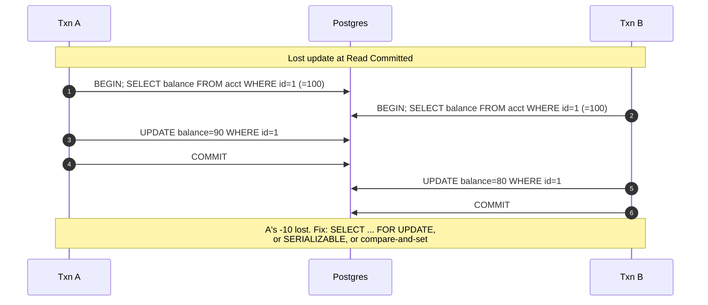

## Definition (interview-ready)

A **transaction** is a unit of work that is **A**tomic, **C**onsistent, **I**solated, **D**urable (ACID). **Isolation levels** are tunable contracts that trade strictness for performance, defining which concurrent anomalies (dirty reads, non-repeatable reads, phantoms, write skew) a transaction can observe. **MVCC** (multi-version concurrency control) implements isolation by keeping multiple row versions, so readers and writers don't block each other. **WAL** (write-ahead log) makes atomicity + durability cheap.

**One-liner:** A transaction is an all-or-nothing unit of work with ACID guarantees; the isolation level decides which concurrency anomalies (dirty reads, non-repeatable reads, phantoms, lost updates, write skew) can still happen, and databases implement it with MVCC snapshots and locks, using a write-ahead log for durability.

## Why it matters

Subtle bugs from isolation level choices have caused real outages (lost updates in inventory systems, double-spend in payments). If you can name the anomaly each level prevents and what's still possible, you can read existing code defensively and reason about new transactional logic.



✓ = prevented, ✗ = can happen, ~ = depends on the implementation.

| Level | Dirty read | Non-repeatable | Phantom | Write skew |
|---|---|---|---|---|
| Read Uncommitted | ✗ | ✗ | ✗ | ✗ |
| Read Committed | ✓ | ✗ | ✗ | ✗ |
| Repeatable Read | ✓ | ✓ | ~ (snapshot) | ✗ |
| Snapshot (MVCC) | ✓ | ✓ | ✓ | ✗ |
| Serializable | ✓ | ✓ | ✓ | ✓ |

## Core concepts

### ACID

- **Atomic**: all-or-nothing — either all writes commit, or none. Implemented via the WAL plus a way to undo or hide uncommitted changes (InnoDB's undo log; in Postgres, aborted row versions are simply never visible).
- **Consistent**: transitions one valid DB state to another (constraints satisfied). The application's job too.
- **Isolated**: concurrent transactions appear sequential (to varying degrees).
- **Durable**: committed writes survive crash. Implemented via fsync of the WAL on commit.

### Anomalies (what isolation prevents)

- **Dirty read**: read a value another (uncommitted) transaction wrote. If that transaction rolls back, you saw data that never existed.
- **Non-repeatable read**: same row read twice in one transaction returns different values (committed write between).
- **Phantom read**: same range query in one transaction returns different *set* of rows.
- **Lost update**: T1 reads X=10, T2 reads X=10, both write X=11. One increment lost.
- **Write skew**: two transactions read overlapping data, each makes a decision based on it, and both commit a write that — taken together — violates an invariant. Famous example: two doctors going off-call simultaneously because each sees the *other* is on call.

### Standard isolation levels (ANSI SQL)

| Level | Dirty read | Non-repeatable | Phantom | Lost update | Write skew |
|---|---|---|---|---|---|
| Read uncommitted | ✘ allowed | ✘ | ✘ | ✘ | ✘ |
| Read committed | ✓ prevented | ✘ | ✘ | ✘ | ✘ |
| Repeatable read | ✓ | ✓ | ✘ (ANSI) / ✓ (PG snapshot, MySQL gap locks) | ✓ in PG (aborts the second writer) / ✘ in MySQL plain reads | ✘ |
| Serializable | ✓ | ✓ | ✓ | ✓ | ✓ |

**Real-world defaults**:
- Postgres: **read committed** by default.
- MySQL InnoDB: **repeatable read** by default (with gap locks → blocks phantoms).
- Most ORMs and drivers simply inherit the database default.

### Snapshot isolation (Postgres "repeatable read")

The transaction sees a snapshot of the DB as of its first statement. Other commits are invisible. Implemented via MVCC. Stronger than ANSI repeatable read (no non-repeatable reads, no phantoms in the way most people mean) — but still allows **write skew**.

### Serializable (SSI in Postgres)

Postgres "Serializable Snapshot Isolation" tracks read/write dependencies between concurrent transactions and, when it spots a dangerous pattern, aborts one of them (at a statement or at commit) (with a serialization failure — application must retry). The toughest guarantee — equivalent to running transactions one at a time — without the cost of strict 2-phase locking.

### MVCC

- Each row has hidden columns `xmin` (creating txn ID) and `xmax` (deleting/updating txn ID).
- A read sees a row version only if `xmin` committed before my snapshot, and `xmax` is unset, aborted, or not yet committed as of my snapshot.
- **Updates create new versions**, don't overwrite. Old versions become dead tuples — cleaned up by VACUUM (Postgres) or pruned from the undo log (MySQL).
- Readers never block writers; writers never block readers. Conflicts only at the write level — and there too they often resolve via row-level locks.

### Locks

Even with MVCC, writes still take row locks (`SELECT ... FOR UPDATE`). Types:
- **Shared lock (S)**: many readers.
- **Exclusive lock (X)**: one holder, no other locks on that row (with MVCC, plain non-locking reads still proceed).
- **Predicate lock**: locks a condition or range — needed to prevent phantoms. InnoDB approximates it with gap / next-key locks on index ranges; Postgres SSI uses non-blocking predicate locks to detect conflicts.
- **Intent locks** (table-level coarse, on top of row-level fine).

### Two-phase locking (2PL)

Classic serializability: each transaction acquires all locks before releasing any. Strict 2PL holds write locks until commit; strong strict (rigorous) 2PL holds all locks until commit. Strong but blocks readers and writers heavily. Most modern DBs prefer MVCC + selective locking.

### WAL (write-ahead log)

1. Change recorded in WAL, fsynced on commit.
2. Buffer cache updated.
3. Periodic checkpoint flushes dirty pages.
4. Crash → replay WAL from last checkpoint.

WAL also supports point-in-time recovery (PITR) and physical replication (Postgres' streaming replication ships WAL bytes to a replica).

## How it works (transaction lifecycle)

```
BEGIN;
   ↓
take MVCC snapshot (Postgres assigns a txn ID lazily, at the first write)
   ↓
SELECT ...  → read consistent snapshot, no locks
UPDATE ...  → write new row version, take row-level X lock
INSERT ...  → append row with xmin = txn ID
   ↓
COMMIT;
   ↓
WAL flushed (fsync)
locks released
visible to new snapshots
```

## Real-world examples

- **Postgres SSI in practice**: the Postgres docs require apps using `SERIALIZABLE` to retry on serialization failures (SQLSTATE `40001`) — teams that adopt it wire retry-on-conflict into their data layer.
- **MySQL repeatable read in practice**: most apps stay at the InnoDB default; for inventory checks where write skew matters, upgrade to serializable or use explicit `SELECT FOR UPDATE`.
- **Spanner**: globally distributed, externally consistent (strictly serializable) transactions using TrueTime — GPS and atomic clocks that give each timestamp a bounded uncertainty window.

## Common pitfalls

- **Read-modify-write at read committed**: classic lost update. Use `SELECT FOR UPDATE`, or compare-and-swap (`UPDATE ... WHERE version = ?`).
- **Long transactions**: hold MVCC snapshots or an old transaction ID, prevent VACUUM, bloat tables. A session left *idle in transaction* also keeps every lock it took, so a later `ALTER TABLE` waits on it — and every query queued behind that `ALTER` waits too.
- **Misunderstanding "repeatable read"**: ANSI repeatable read still allows phantoms. Postgres' RR (snapshot isolation) does not — but allows write skew.
- **DDL inside transactions**: MySQL implicitly commits on DDL (8.0 made each DDL statement atomic, but it still can't be rolled back with the transaction); Postgres treats most DDL as transactional. Know your DB.
- **Distributed transactions**: 2PC is slow and fragile. Prefer sagas + idempotency.
- **Retry without idempotency**: a serialization failure is retried but the side effect (email, payment) happened twice. Make handlers idempotent.

## Practice questions

<Practice>

<QA q="Name the four ACID properties." level="easy">

**Atomicity** (all or nothing), **Consistency** (one valid state to another, constraints hold), **Isolation** (concurrent transactions appear sequential, to a configurable degree), **Durability** (committed writes survive a crash).

</QA>

<QA q="What is a dirty read?" level="easy">

Reading a value written by an uncommitted transaction. If that transaction later rolls back, you've seen data that never existed. Prevented by Read Committed and above.

</QA>

<QA q="What's the difference between a non-repeatable read and a phantom read?" level="easy">

A **non-repeatable read** is the same **row** read twice in one transaction returning different values, because another transaction committed an update in between. A **phantom read** is the same **range query** run twice returning a different **set of rows**, because another transaction inserted or deleted matching rows.

</QA>

<QA q="What are the default isolation levels in Postgres and MySQL InnoDB?" level="medium">

Postgres defaults to **Read Committed**. MySQL InnoDB defaults to **Repeatable Read**, and uses gap locks to block phantoms in locking reads. Most ORMs simply inherit the database default — so the classic read-then-write lost-update pattern is possible by default in most stacks.

</QA>

<QA q="Explain MVCC in one paragraph." level="medium">

Multi-Version Concurrency Control: writes create new versions of rows instead of overwriting; each version is tagged with the transaction ID that created it and (optionally) the one that deleted it — `xmin`/`xmax` in Postgres. Readers see only versions visible to their snapshot. Result: readers never block writers and writers never block readers. Postgres cleans up dead versions with VACUUM; MySQL keeps old versions in undo logs.

</QA>

<QA q="What's the difference between Repeatable Read and Serializable?" level="medium">

Repeatable Read prevents non-repeatable reads and, in Postgres' snapshot isolation, phantoms — but still allows **write skew** (two transactions each read and write different rows in a way that together violates an invariant). Serializable additionally prevents write skew, behaving as if transactions ran one at a time.

</QA>

<QA q="What is write skew? Give an example." level="medium">

Two transactions read overlapping data and write **non-overlapping** rows in a way that, combined, violates a constraint. Example: at least one doctor must be on call. Each of two doctors reads 'the other is on call' and sets **themselves** off-call. Both commit → no one is on call. No row was written twice, so snapshot isolation doesn't catch it.

</QA>

<QA q="Why are long-running transactions harmful in an MVCC database?" level="medium">

A long transaction holds an old snapshot (or an old transaction ID if it has written), so the database can't remove row versions that it might still need. In Postgres, VACUUM can't reclaim those dead tuples and tables bloat; any locks it took are held too. A connection that wrote something and then sits *idle in transaction* can cause this for hours. Keep transactions short and kill idle-in-transaction sessions.

</QA>

<QA q="How does WAL enable both durability and performance?" level="hard">

**Performance**: instead of fsyncing many random data pages, only the **sequential** WAL is fsynced on commit; data pages in memory are flushed lazily by background checkpoints. **Durability**: on a crash, replay the WAL from the last checkpoint — committed transactions are guaranteed to be restored because they reached the WAL before commit returned. The same log also powers point-in-time recovery and physical (streaming) replication.

</QA>

<QA q="Implement a counter increment that's safe at Read Committed." level="hard">

1. `UPDATE counters SET n = n + 1 WHERE id = ?` — atomic at the row, safe.
2. `SELECT ... FOR UPDATE`, then update — exclusive row lock until commit.
3. Optimistic CAS: `UPDATE counters SET n = ?, version = version + 1 WHERE id = ? AND version = ?` — retry if no row matched.

Avoid `SELECT n` followed by `UPDATE n + 1` at Read Committed — that's the lost-update pattern.

</QA>

<QA q="Compare 2PL with MVCC-based serializability." level="hard">

**2PL** acquires shared/exclusive locks before any access; in strict 2PL write locks are held until commit (strong strict 2PL holds all locks until commit). Strong, but readers block writers and vice versa — bad for read-heavy workloads. **MVCC + SSI** (Postgres) lets readers proceed without locks against a consistent snapshot, then detects dangerous read/write patterns and aborts one transaction, which must retry. Higher throughput under read-heavy load, at the cost of application-visible retry handling.

</QA>

<QA q="You switch a payments service to SERIALIZABLE. What must the application change?" level="scenario">

Serializable in Postgres aborts conflicting transactions with a serialization failure (SQLSTATE `40001`), so the data layer must **catch it and retry the whole transaction**. Side effects must be safe to repeat: don't send emails or call payment providers inside the retried block, or make those calls **idempotent** (idempotency keys) — otherwise a retry charges or notifies twice. Also keep transactions short so conflicts (and retries) stay rare.

</QA>

<QA q="An inventory check reads stock, then inserts an order if stock is available. At Repeatable Read, two orders oversell the last unit. Why, and how do you fix it?" level="scenario">

Each transaction reads the same snapshot (stock = 1), decides independently, and inserts its own order row. No row is written by both, so this is **write skew**, which snapshot isolation doesn't detect. Fixes: lock the stock row with `SELECT ... FOR UPDATE` before deciding; do the check and decrement atomically (`UPDATE stock SET qty = qty - 1 WHERE id = ? AND qty > 0` and check the affected row count); or run at Serializable and retry on conflict.

</QA>

</Practice>

## Quiz

<Quiz>

<MCQ q="Two transactions at Read Committed each read balance 100, then write 90 and 80 respectively. What anomaly is this?" options={["Dirty read", "Phantom read", "Lost update", "Non-repeatable read"]} answer={2}>

Both read the same value and wrote based on it, so one write silently overwrote the other. No uncommitted data was read (not dirty), and no range query changed (not phantom).

</MCQ>

<MCQ q="Which isolation level does Postgres use by default?" options={["Read Committed", "Repeatable Read", "Serializable", "Read Uncommitted"]} answer={0}>

Postgres defaults to Read Committed. MySQL InnoDB is the one that defaults to Repeatable Read.

</MCQ>

<MCQ q="Postgres Repeatable Read (snapshot isolation) still allows which anomaly?" options={["Dirty reads", "Write skew", "Non-repeatable reads", "Reading uncommitted deletes"]} answer={1}>

Snapshot isolation prevents dirty reads, non-repeatable reads, and phantoms, but two transactions writing different rows based on the same snapshot can still violate an invariant — write skew.

</MCQ>

<MCQ q="In MVCC, what happens when a row is updated?" options={["The row is overwritten in place and readers wait", "The whole table is locked until commit", "The update is queued until all readers finish", "A new row version is written and old versions stay for older snapshots"]} answer={3}>

MVCC writes a new version; old versions remain visible to snapshots that need them until VACUUM (Postgres) or undo-log purge (MySQL) cleans them up. That's why readers and writers don't block each other.

</MCQ>

<MCQ q="Why does a commit only need to fsync the WAL, not the modified data pages?" options={["Data pages are never written to disk", "The WAL is replayed from the last checkpoint after a crash to restore committed changes", "Replicas hold the durable copy", "fsync is skipped entirely for performance"]} answer={1}>

Once a commit's WAL record is durable, crash recovery can rebuild the change by replaying the log, so data pages can be flushed lazily at checkpoints. That turns many random writes into one sequential fsync.

</MCQ>

<MCQ q="Which counter update is NOT safe against lost updates at Read Committed?" options={["UPDATE counters SET n = n + 1 WHERE id = ?", "SELECT ... FOR UPDATE, then UPDATE", "SELECT n, then UPDATE counters SET n = the read value plus 1", "UPDATE ... WHERE id = ? AND version = ? with retry on miss"]} answer={2}>

Reading in one statement and writing a computed value in another lets a concurrent transaction slip in between. The atomic in-place update, the row lock, and the optimistic version check all prevent that.

</MCQ>

<MCQ q="An app runs at SERIALIZABLE in Postgres. What must it handle?" options={["Retrying transactions that fail with serialization errors", "Manually acquiring gap locks", "Disabling MVCC for the session", "Dirty reads from other sessions"]} answer={0}>

Postgres SSI detects dangerous patterns and aborts a transaction with SQLSTATE 40001; the app must retry. It doesn't expose dirty reads or require manual locking.

</MCQ>

<MCQ q="A connection runs BEGIN, updates one row, then sits idle in transaction for hours. What is the main risk in Postgres?" options={["The WAL is deleted", "All other sessions see dirty reads", "The database switches to 2PL", "VACUUM cannot clean dead row versions, so tables bloat"]} answer={3}>

The open transaction's ID is still running, which holds back the cleanup horizon for the whole database, so dead tuples newer than it can't be reclaimed. It also holds any locks it took. It does not change isolation for others.

</MCQ>

<MCQ q="Compared with strict 2PL, what does MVCC with SSI trade away to let readers avoid locks?" options={["Durability of committed writes", "Atomicity of multi-row updates", "Some transactions get aborted and must retry", "Support for secondary indexes"]} answer={2}>

SSI keeps full serializability but detects conflicts and aborts one transaction instead of blocking up front, so the application must retry. ACID durability and atomicity are unchanged.

</MCQ>

</Quiz>

## TL;DR cheat sheet

- ACID: Atomic, Consistent, Isolated, Durable.
- Anomalies, roughly in the order stronger levels prevent them: dirty read → non-repeatable → phantom → lost update → write skew.
- Read Committed (PG default) prevents dirty reads only. Repeatable Read in PG = snapshot isolation (prevents phantoms, allows write skew). Serializable prevents all (with retry on conflict).
- MVCC: row versions, no read locks. Postgres `xmin/xmax`. MySQL undo log.
- WAL: sequential log, fsync on commit, lazy flush of data. Enables PITR + replication.
- For read-modify-write: `UPDATE ... WHERE` atomic, or `SELECT FOR UPDATE`, or optimistic CAS.
- Long transactions = MVCC snapshot held = no VACUUM = bloat.

## Go deeper

- **DDIA Chapter 7** — the gold standard chapter on transactions and isolation.
- **Jepsen consistency models**: [jepsen.io/consistency](https://jepsen.io/consistency) — visual hierarchy.
- **"A Critique of ANSI SQL Isolation Levels"** by Berenson et al — original paper showing ANSI levels are under-specified.
- **Postgres docs**: [Transaction Isolation](https://www.postgresql.org/docs/current/transaction-iso.html).
- **MySQL docs**: [InnoDB Transaction Model](https://dev.mysql.com/doc/refman/8.4/en/innodb-transaction-model.html).
- **Martin Kleppmann talks** on YouTube — accessible deep dives.
- **Postgres SSI paper** (Ports & Grittner) — short, readable.
