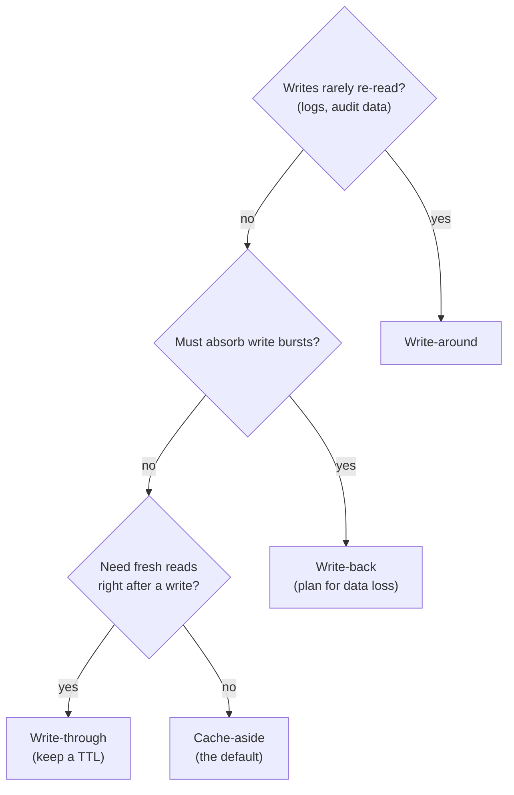
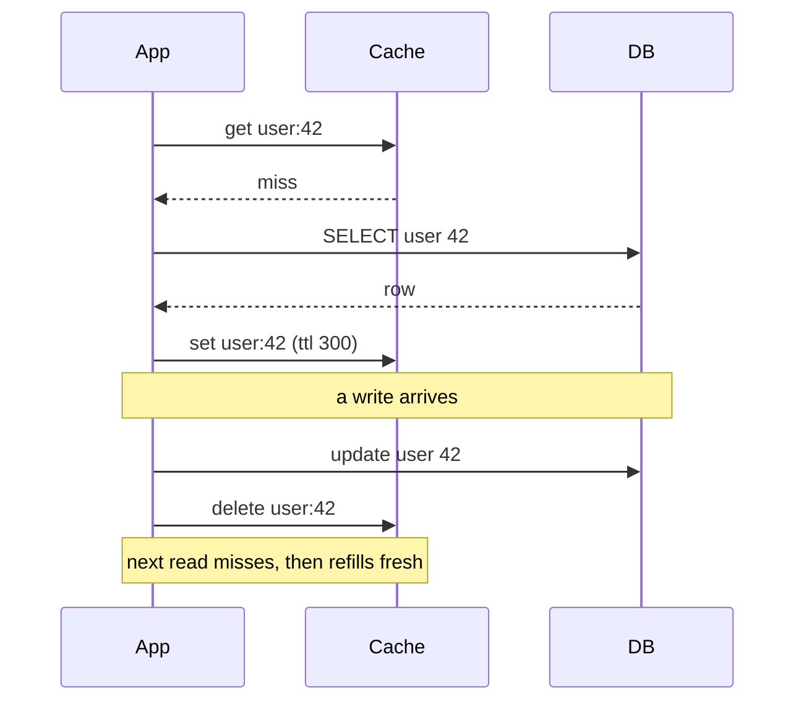
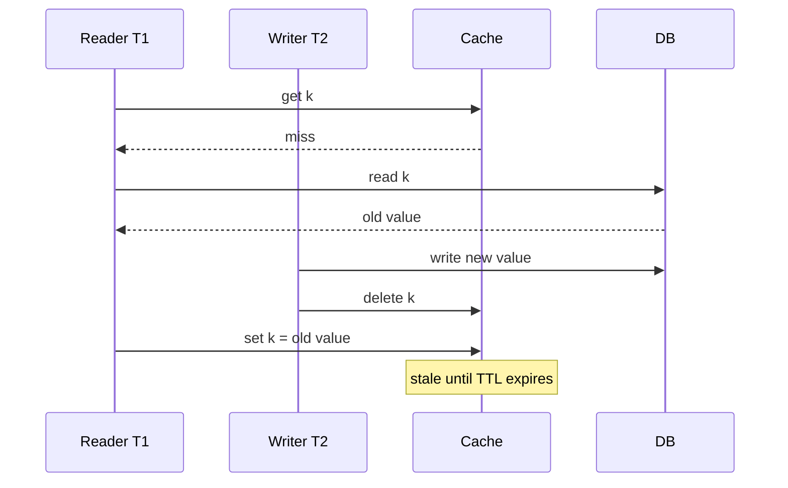

## Definition (interview-ready)

A **cache** is a fast read store kept in front of a slow store of truth. **Cache patterns** describe *who* talks to the cache and DB, and *when*: **cache-aside** (app fills cache on miss), **read-through** (cache lib fetches on miss), **write-through** (write to cache and DB together), **write-back** (write to cache, async flush to DB), **write-around** (write skips cache).

**One-liner:** Cache patterns decide who fills the cache and when writes reach the database: cache-aside and read-through fill on a miss, write-through updates cache and DB together, write-back writes the cache first and flushes later, and write-around skips the cache on writes.

## Why it matters

Cache bugs cause more outages than people admit: stale data, inconsistent invalidation, thundering herds. Picking the right pattern up front (and knowing the failure modes of each) is the first lever for both performance and correctness in any system with a meaningful read load.

<Anim id="cache-patterns" />

## Core concepts

### Cache-aside (lazy loading)

The default and most common pattern.

```
read:  app → cache.get(k)
              if hit: return
              if miss: db.get(k); cache.set(k, val, ttl); return
write: app → db.write(k, val); cache.delete(k)   (or update)
```

Pros: simple; only cached data is what's actually requested; cache failure doesn't break writes.
Cons: cold start is slow (every miss is a DB hit); race condition between read and invalidation can re-poison stale values.

### Read-through

Same logic as cache-aside, but the *cache library* (not the app) does the fetch.

```
read: app → cache.get(k) // library transparently fills from DB on miss
```

Used by some Hibernate caches, AWS DAX. Pros: app code is simpler. Cons: library must understand your DB; harder to debug.

### Write-through

On write, update cache **and** DB synchronously.

```
write: app → cache.set(k, val); db.write(k, val)
```

Pros: on the normal path the cache is updated on every write, so reads right after a write are fresh.
Cons: the two writes are not atomic — if one fails, or two writers interleave, cache and DB can still diverge, so keep a TTL as a safety net. Every write pays cache+DB latency; cache holds data that may never be read (waste).

### Write-behind / write-back

On write, update cache; flush to DB asynchronously (batched).

```
write: app → cache.set(k, val); enqueue(k)
flusher: batch-flush enqueued keys to DB periodically
```

Pros: dramatic write absorption (think bursts).
Cons: complex; data loss window if cache crashes before flush; ordering and idempotency get hard. Only used with explicit durability planning.

### Write-around

On write, write to DB; **don't** populate cache. Cache fills only on subsequent reads (cache-aside read path).

```
write: app → db.write(k, val)
read:  cache-aside as usual
```

Pros: avoids polluting cache with one-off writes (logs, audit data).
Cons: read-after-write always misses; not great for read-your-writes workloads.

### Refresh-ahead

Proactively refresh cache before TTL expires (predict next access). Reduces tail latency but adds complexity; rarely the first tool you reach for.

## Comparison: when each fits

| Pattern | Read-heavy | Write-heavy | Read-after-write |
|---|---|---|---|
| Cache-aside | ✓ | OK | OK (with invalidation) |
| Read-through | ✓ | OK | OK |
| Write-through | ✓ | poor (latency) | good (cache updated on write) |
| Write-back | ✓ | ✓ (absorbs bursts) | strong if same cache |
| Write-around | ✓ for stable data | ✓ for cold writes | stale on first read |

A quick way to pick a write pattern, using the pros and cons above:



## Cache invalidation (the hard part)

Phil Karlton: *"There are only two hard things in Computer Science: cache invalidation and naming things."*

Strategies in order of complexity:

1. **TTL only**: simplest. Tolerate staleness up to TTL. Good for hit-counters, leaderboards, prices that change slowly.
2. **TTL + write-time invalidation**: write path deletes (or updates) the affected keys. Most production caches.
3. **Versioned keys**: include a version in the key (`user:42:v3`). Bump the version on write. Old key just expires.
4. **Pub-sub invalidation**: write publishes "key X changed"; cache nodes/clients listen and evict. Used in multi-region or multi-tier caches.
5. **CDC-driven**: change-data-capture from the DB (Debezium) drives cache invalidation. Eventual but rarely stale.

### Delete vs update on write

- **Delete** is safer — next reader pulls fresh from DB.
- **Update** is faster — no DB roundtrip for the next reader — but introduces races (two updaters can interleave and leave a stale value).

Default to **delete**; only update on writes when contention is high and you have a tight CAS-style pattern.

## How it works (cache-aside trace)

```
read /user/42:
  cache.get("user:42") -> miss
  db.select("SELECT * FROM users WHERE id=42") -> row
  cache.set("user:42", row, ttl=300)
  return row

write /user/42:
  db.update(...)
  cache.delete("user:42")

next read /user/42:
  cache.get("user:42") -> miss (just deleted)
  db -> fresh row
  cache.set with TTL
```

The same trace as a sequence of calls:



## Real-world examples

- **Facebook memcache** (NSDI 2013): a look-aside (cache-aside) cache with delete-on-write, plus **leases** to stop stale fills and thundering herds.
- **Facebook TAO**: the later, graph-aware cache for the social graph — read-through and write-through in front of MySQL, geographically replicated.
- **Instagram**: Memcached (cache-aside) in front of Postgres for feed assembly.
- **DAX (AWS)**: write-through + read-through on top of DynamoDB.
- **Hibernate 2nd-level cache**: read-through; tons of subtle gotchas.

## Common pitfalls

- **Race between read-miss and write**: T1 reads (miss), starts DB lookup; T2 writes new value and invalidates; T1 finishes its old read and stores the **stale value** in cache. Mitigations: re-check version after fetch, use a single-flight lock, set short TTL.
- **Forgetting to invalidate on every write path** — direct DB writes, batch jobs, admin tools — they all need to invalidate, or you get stale forever.
- **Write-through latency blow-up**: every write to slow DB blocks the user.
- **Write-back data loss**: cache crash before flush.
- **Cache as truth**: somebody reads from cache, writes back to it. After invalidation, the new write is gone. Cache is never the source of truth.
- **Different TTLs for the same key in different services**: causes flapping; centralize TTL policy.
- **Cache the wrong thing**: derived/aggregated data is fine; per-user permissions data has correctness implications and usually deserves either no cache or aggressive invalidation.

The read-miss race from the first pitfall, step by step:



## Practice questions

<Practice>

<QA q="Difference between cache-aside and read-through?" level="easy">

In **cache-aside**, the **application** checks the cache, fetches from the DB on a miss, and fills the cache. In **read-through**, the **cache library** does that transparently — the app just asks the cache and the library handles the fallback (e.g., AWS DAX, some Hibernate caches).

</QA>

<QA q="Why is 'delete on write' safer than 'update on write'?" level="easy">

Update-on-write has races: two concurrent updates can write to the cache in a different order than they hit the DB, leaving a stale value visible. Delete-on-write forces the next reader to refresh from the DB, eliminating that class of bugs.

</QA>

<QA q="What are the tradeoffs of write-through caching?" level="easy">

On every write, the cache and DB are updated synchronously. **Pro**: cache and DB stay in sync — no staleness. **Cons**: every write pays both cache and DB latency, and the cache fills with data that may never be read, wasting memory.

</QA>

<QA q="What is refresh-ahead and when is it worth it?" level="easy">

The cache proactively refreshes an entry **before** its TTL expires, predicting it will be read again, so hot keys never take a miss. It cuts tail latency but adds complexity (and refreshes keys that may not be needed), so it's rarely the first tool you reach for.

</QA>

<QA q="When would you use write-around?" level="medium">

When written data isn't read again soon — logs, audit records, low-value writes. Populating the cache with one-shot writes wastes memory and evicts useful data. Combined with cache-aside on reads, write-around fits 'cold writes, occasional reads'. The cost: the first read after a write always misses.

</QA>

<QA q="How would you implement read-after-write consistency with cache-aside?" level="medium">

- **Write-through**, so the cache is updated synchronously.
- After writing the DB, **write the new value** to the cache (not just delete) — the next read hits, but this reintroduces the concurrent-update ordering race, so pair it with a version check.
- Route the user's next read to the **leader DB** for a short window after their write.
- **Versioned key** — the write bumps the version, so reads go straight to the new key.

</QA>

<QA q="List cache invalidation strategies from simplest to most complex." level="medium">

1. **TTL only** — tolerate staleness up to the TTL.
2. **TTL + write-time invalidation** — the write path deletes or updates affected keys (most production caches).
3. **Versioned keys** — `user:42:v3`; bump the version on write and let the old key expire.
4. **Pub-sub invalidation** — the writer publishes 'key X changed'; cache nodes or clients evict. Used for multi-region or multi-tier caches.
5. **CDC-driven** — change-data-capture from the DB (e.g., Debezium) drives invalidation; eventual, but rarely stale and catches every write path.

</QA>

<QA q="What is write-back caching and what is its main risk?" level="medium">

Writes go only to the cache and are flushed to the DB asynchronously in batches. It absorbs write bursts dramatically, but if the cache crashes before a flush, those writes are **lost**; ordering and idempotency of flushes also get hard. Use it only with explicit durability planning.

</QA>

<QA q="Walk through a race condition in cache-aside and how to fix it." level="hard">

T1 reads, misses, and queries the DB → gets `v1` (slow query). T2 writes `v2` and invalidates the cache. T1 finishes and sets the cache to `v1` — stale until the TTL expires.

Fixes: store `(value, version)` and only fill on a miss if no newer version exists; use a **lease** or lock shared by fills and invalidations, so a fill that started before the invalidation is rejected (memcache leases work this way); or accept a short TTL as the safety net.

</QA>

<QA q="Compare write-through and write-back for a session cache." level="hard">

**Write-through**: every session update goes to cache and DB. Safe — durability matches the DB — but the DB takes write load proportional to user activity. **Write-back**: writes only hit the cache, with periodic flushes. Big throughput win, but sessions can be lost on a cache crash — maybe acceptable for 'user lost their cart', not for 'lost a payment'.

</QA>

<QA q="A stale entry sometimes stays in the cache for hours despite TTL = 5 min. How?" level="scenario">

- Misses are refilled from stale data — a lagging read replica, or a slow read racing a write — so each refill re-caches the old value and restarts the TTL.
- Some write path doesn't invalidate (batch job, scheduled task, admin tool).
- The cache is multi-region and the invalidation message is lost.
- The TTL is set to a different value somewhere (defaults, another service).
- Refresh-ahead is misconfigured and keeps refreshing with stale data.

</QA>

<QA q="Design caching for a price-sensitive product page (~1B reads/day, prices change every few minutes)." level="scenario">

- **Tiered cache**: CDN (about 5 s TTL) + Redis (about 60 s TTL) + DB.
- **Invalidation on price change**: publish an event to Kafka → invalidate Redis and purge the CDN.
- **Stampede protection**: single-flight on miss (one loader, others wait), or a `SET NX EX` lock in Redis.
- **Graceful staleness**: serve the last-known value if the DB is slow, within a max-stale budget (say 10 minutes).
- **Cache key**: include locale, currency, A/B variant — but watch for key explosion.

</QA>

<QA q="An admin tool and a nightly batch job write directly to the DB, and users report stale data. What's wrong and how do you fix it?" level="scenario">

Only the main API invalidates the cache; the other write paths don't, so their changes never evict the cached values. Fix by making **every** write path invalidate — ideally centrally, via CDC from the DB or a shared data-access layer — so invalidation can't be forgotten. Keep a TTL as a safety net, and never treat the cache as the source of truth.

</QA>

</Practice>

## Quiz

<Quiz>

<MCQ q="In cache-aside, who loads data from the database on a cache miss?" options={["The cache library", "The application", "The database pushes it", "A background refresher"]} answer={1}>

In cache-aside the application checks the cache, queries the DB on a miss, and fills the cache. When the cache library does it transparently, that's read-through.

</MCQ>

<MCQ q="Which pattern risks losing acknowledged writes if the cache node crashes?" options={["Write-through", "Write-around", "Cache-aside", "Write-back"]} answer={3}>

Write-back acks once the cache has the write and flushes later, so a crash before the flush loses data. The other patterns write to the DB synchronously.

</MCQ>

<MCQ q="A service writes millions of audit records that are rarely read. Which write pattern fits best?" options={["Write-around", "Write-through", "Write-back", "Refresh-ahead"]} answer={0}>

Write-around skips the cache on write, so one-off records don't evict useful data. Write-through would fill the cache with data nobody reads.

</MCQ>

<MCQ q="Why is deleting the cache key on write preferred over updating it?" options={["Deletes are always faster than sets", "Updates are not supported by Redis", "Concurrent updates can land in the cache out of DB order and leave a stale value", "Deleting extends the TTL"]} answer={2}>

Two writers can interleave so the older value is written to the cache last. Deleting forces the next reader to load the current value from the DB.

</MCQ>

<MCQ q="T1 misses and starts a slow DB read. T2 updates the DB and deletes the key. T1 then fills the cache. What is the result?" options={["The cache holds T2's new value", "The cache holds T1's stale value until TTL expires", "The cache stays empty", "The DB rolls back T2"]} answer={1}>

T1 read the old value before T2's write and fills the cache after T2's delete, so the stale value persists until the TTL. Version checks, or leases that reject a fill issued before the invalidation, prevent this.

</MCQ>

<MCQ q="What does including a version in the key, such as user:42:v3, achieve?" options={["Compresses cached values", "Prevents cache stampedes", "Makes the cache the source of truth", "Bumping the version on write sends reads to a new key, and the old key just expires"]} answer={3}>

Versioned keys sidestep invalidation: after a write, readers use the new version's key, so the old entry is never read again and ages out by TTL.

</MCQ>

<MCQ q="Which invalidation approach catches writes from batch jobs and admin tools without changing their code?" options={["CDC-driven invalidation from the database log", "TTL-only with a longer TTL", "Write-through in the API service", "Refresh-ahead"]} answer={0}>

CDC reads every change from the DB log regardless of which client made it, so no write path is missed. The API-level options only cover writes that go through the API.

</MCQ>

<MCQ q="What is the main cost of write-through caching?" options={["Data loss on cache crash", "Stale reads after every write", "Every write pays cache and DB latency, and unread data fills the cache", "The first read after a write always misses"]} answer={2}>

Write-through updates both synchronously, so writes get slower and the cache holds data that may never be read. Data loss is write-back's risk; first-read misses are write-around's.

</MCQ>

<MCQ q="A hot key expires and thousands of requests hit the DB at once. Which mitigation targets this directly?" options={["Write-around", "Single-flight so only one request reloads the key", "Deleting on write instead of updating", "Larger cache values"]} answer={1}>

This is a cache stampede. Single-flight (or a lock such as SET NX in Redis) lets one request reload while others wait or get the old value.

</MCQ>

</Quiz>

## TL;DR cheat sheet

| Pattern | Read | Write | Notes |
|---|---|---|---|
| Cache-aside | app fills on miss | invalidate or update | most common |
| Read-through | lib fills on miss | (no opinion) | hides DB |
| Write-through | (no opinion) | cache + DB synchronously | sync, slow writes |
| Write-back | (no opinion) | cache, async to DB | fast writes, risky |
| Write-around | (no opinion) | DB only, no cache fill | cold-write workloads |

- Prefer **cache-aside + delete on write + short TTL** as default.
- **Cache invalidation** is the #1 source of cache bugs.
- Don't cache the wrong thing: derived data ≫ permissions/auth.
- Single-flight or distributed locks to prevent races on miss.

## Go deeper

- **AWS Whitepaper**: ["Caching Best Practices"](https://aws.amazon.com/caching/best-practices/).
- **ByteByteGo**: ["A Guide to Top Caching Strategies"](https://blog.bytebytego.com/p/a-guide-to-top-caching-strategies).
- **Facebook memcache paper**: ["Scaling Memcache at Facebook"](https://www.usenix.org/system/files/conference/nsdi13/nsdi13-final170_update.pdf) — leases, look-aside caching, invalidation.
- **Facebook TAO paper**: ["TAO: Facebook's Distributed Data Store for the Social Graph"](https://www.usenix.org/system/files/conference/atc13/atc13-bronson.pdf).
- **Memcached Wiki** and Brad Fitzpatrick's original posts.
- **Caching at Netflix** engineering blog (EVCache).
- **DDIA Chapter 5** (Replication) — the same staleness and read-your-writes problems apply to caches.
