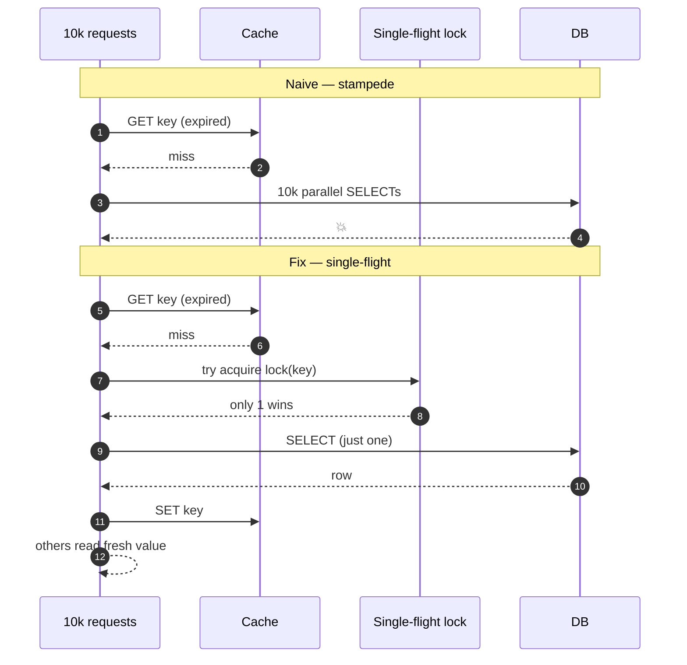

## Definition (interview-ready)

A **cache stampede** (a.k.a. **thundering herd**) is when many concurrent requests for the same expired or missing cache key all fall through to the origin (database / API), overwhelming it. The fix is to serialize the regeneration with **single-flight** locks, return slightly stale values during refresh, or smear TTLs with jitter and probabilistic early refresh.

**One-liner:** A cache stampede is many concurrent misses on the same hot key all hitting the database at once; you stop it by letting only one caller rebuild the key (single-flight), serving stale data while it refreshes, and spreading or pre-empting expiries with TTL jitter and early refresh.

## Why it matters

Stampedes are a top cause of cache-fronted service outages. The DB is sized assuming the cache absorbs 99% of reads — when a key expires and 10K requests miss simultaneously, the DB sees a 10K-instant spike and falls over. Real production incident class; every senior engineer should know the fixes.



## Core concepts

### What triggers a stampede

- A **hot key** TTLs (millions QPS into one row).
- A **deployment** invalidates many keys at once.
- A **cache failure** (Redis restart, network partition) wipes warm data; all callers refill simultaneously.
- A **bot** or unusual traffic burst hits a cold key.
- A **TTL alignment** issue: 1000 keys all expire at the same second (because writes happened around the same time).

### Three categories of fix

1. **Serialize the refill** (don't let everyone hit origin).
2. **Avoid hard expiration** (don't synchronously TTL — refresh ahead).
3. **Tolerate staleness** (serve stale-while-revalidate).

### 1. Single-flight / mutex / lock

Only one process refills; others wait or serve stale.

Pattern (using Redis):
```
val = redis.get(key)
if val:
    return val
token = random_id()
ok = redis.set("lock:" + key, token, NX=True, EX=10)
if ok:
    val = redis.get(key)          # re-check: another caller may have just filled it
    if not val:
        val = db.fetch(...)
        redis.set(key, val, EX=ttl)
    delete "lock:" + key only if its value is still token   # Lua check-and-delete
    return val
else:
    sleep(50ms); retry
```

Library-level: Go's `singleflight` package collapses concurrent calls per key into one upstream request. golang.org/x/sync/singleflight.

### 2. Jitter on TTL

Don't set `EX 300` for everyone. Set `EX 300 + random(0, 60)`. Spreads expirations.

```
ttl = base_ttl + random_jitter(0, base_ttl * 0.1)
```

Especially important after bulk loads (everything written at once expires at once).

### 3. Probabilistic early expiration (XFetch)

As TTL approaches, randomly refresh the cache. The probability of refresh rises near expiration.

```
expiry = cache.expiry(key)
now = time.now()
delta = compute_time_estimate(key)
if random() < e^(-(expiry - now) / delta):
    refresh()
return cache_value  # serve current value
```

Reference: ["Optimal Probabilistic Cache Stampede Prevention"](https://www.vldb.org/pvldb/vol8/p886-vattani.pdf) (Vattani et al, VLDB '15).

Effect: hot keys are usually refreshed before they expire, typically by a single caller (it's probabilistic, so occasionally two callers refresh). Cold keys behave normally.

### 4. Stale-while-revalidate (SWR)

Standard HTTP cache pattern (`Cache-Control: stale-while-revalidate=N`). Within the staleness budget, the cache serves the old value AND triggers async refresh. Used by browsers, CDNs (Fastly, Cloudflare), and many in-process caches.

Result: within the staleness budget users don't wait on a miss, and with request collapsing the origin sees about one refresh per key per interval.

### 5. Negative caching (cache the "not found")

A common stampede variant: someone queries a key that doesn't exist (404). Without negative caching, every miss hits DB. Cache the "nothing here" result with a short TTL.

Watch for cache poisoning if someone can spam non-existent keys (set an LFU cap or use bloom filter to test existence).

### 6. Bloom filter front-door

For "does this key exist?" lookups (e.g., username availability), put a Bloom filter in front. A Bloom filter never gives false negatives, so a "definitely not present" answer can skip the origin entirely; its occasional false positives just fall through to a normal lookup. Good for sparse keyspaces.

### The four classic cache failures (name them precisely)

Interviewers often ask these as a set, and they love checking whether you mix them up. All four end the same way (the database gets hammered), but the **cause** differs, so the **fix** differs.

#### Cache stampede (dogpile / thundering herd)

- **What:** one popular key expires (or is missing), and many requests miss at the same moment and all rebuild it from the DB.
- **Key word:** *one key, many concurrent rebuilds.*
- **Fixes:** single-flight lock per key, stale-while-revalidate, probabilistic early refresh (all covered above).

#### Cache penetration

- **What:** requests for keys that **don't exist anywhere** (not in cache, not in DB). Since there is nothing to cache, every request goes to the DB. Often caused by bugs or by attackers looping over random IDs like `user:-1`, `user:99999999`.
- **Key word:** *non-existent keys bypass the cache forever.*
- **Fixes:**
  - **Negative caching:** cache the "not found" answer (for example a `NULL` marker) with a short TTL, such as 30–60 s, so a later real insert shows up soon.
  - **Bloom filter:** a compact bit-array that answers "definitely not present" or "maybe present". Load every valid ID into it; if the filter says "definitely not", reject without touching cache or DB. It never gives false negatives, but can give false positives, which just fall through to the normal path.
  - **Input validation + rate limiting:** reject malformed IDs at the edge and throttle clients that miss a lot.
  - Watch out: negative caching of random keys can fill the cache with junk. Cap it with a separate small cache or a short TTL.

#### Cache avalanche

- **What:** a **large number of keys** become unavailable at once, so the miss rate jumps for the whole cache, not one key. Two causes:
  1. **Mass expiry:** many keys were written together (bulk load, warm-up job) with the same TTL, so they all expire in the same second.
  2. **Cache layer down:** the Redis cluster crashes or restarts empty, and 100% of traffic falls on the DB.
- **Key word:** *many keys at once.*
- **Fixes:**
  - **TTL jitter:** `ttl = base + random(0, base * 0.1)` so expiries spread out.
  - **Warm-up:** pre-load hot keys before taking traffic (and throttle the warmer).
  - **High availability:** Redis replicas + Sentinel or Redis Cluster, so one node dying doesn't empty the cache.
  - **Multi-level cache:** an in-process cache (L1, e.g. Caffeine, Guava) in front of Redis (L2). If Redis is down, L1 still absorbs the hottest reads.
  - **Circuit breaker + rate limiting at the DB:** when the miss rate spikes, shed load or serve a degraded response instead of letting the DB fall over.

#### Hot key

- **What:** one key gets so much traffic that the **single Redis node (or shard) holding it** maxes out on CPU or network, even though the key never expires. Example: a celebrity's profile, a flash-sale product. Adding more shards doesn't help, because a key lives on exactly one shard.
- **Key word:** *one key, too much traffic for one node.*
- **Fixes:**
  - **Local (in-process) cache:** keep the hot value in app memory for a few seconds. Most reads never leave the app server.
  - **Redis client-side caching (Redis 6+):** the server-assisted version of a local cache. The client runs `CLIENT TRACKING ON`; Redis remembers which keys the client read and sends an **invalidation message** when one changes, so the local copy is dropped instead of going stale. There's also a **broadcasting mode** (`BCAST` with key `PREFIX`es) where Redis stores nothing per client and notifies everyone subscribed to a prefix. Invalidations arrive on the same connection with RESP3, or on a separate redirected connection with RESP2.
  - **Key replication / splitting:** store copies as `product:42#0` … `product:42#9` (spread across shards), and have readers pick a random suffix. Writes must update all copies. For big hash or set values, split the value itself into several keys.
  - **Read replicas:** route reads of the hot key to replicas (accepting slight staleness).
  - **Detect it first:** `redis-cli --hotkeys` (needs an LFU `maxmemory-policy`), client-side metrics, or proxy stats.

#### Comparison table

| Problem | Trigger | How many keys | Does the key exist in DB? | Main fixes |
|---|---|---|---|---|
| **Stampede** (dogpile) | A hot key expires or is missing | One | Yes | Single-flight lock, stale-while-revalidate, early refresh |
| **Penetration** | Requests for keys that don't exist | Many random ones | **No** | Negative caching, Bloom filter, validation, rate limit |
| **Avalanche** | Mass expiry or cache cluster down | **Many at once** | Yes | TTL jitter, warm-up, HA Redis, multi-level cache, circuit breaker |
| **Hot key** | One key gets extreme traffic | One | Yes (and cached) | Local cache, Redis client-side caching, key replication, read replicas |

**How to say it in an interview:** "Stampede is one key expiring under load; penetration is keys that don't exist so the cache never helps; avalanche is lots of keys going away at once; hot key is one key overloading the node that holds it. Each needs a different fix."

## How it works (single-flight in detail)

```
T0: 1000 requests for key=foo arrive simultaneously.
T0: First request takes the lock, calls db.fetch (300ms).
T1..T0+300: 999 requests find lock held → loop with backoff or return stale.
T0+300: First request stores value in cache, releases lock.
T0+301: 999 retries hit cache → all return.
```

vs without single-flight:
```
T0: 1000 requests, all miss → 1000 db.fetch calls.
T0+300ms: DB has burned 1000× the work, possibly fell over.
```

## Real-world examples

- **Instagram**: wrote about caching the *promise* of an in-flight fetch ("Thundering Herds & Promises"), so concurrent requests for the same key share one backend call — single-flight at the application layer.
- **Cloudflare / Fastly**: support `stale-while-revalidate` at the edge, so a popular object is refreshed in the background instead of every edge request waiting on origin.
- **CDN-level**: Akamai/Fastly/Varnish all support request collapsing — multiple in-flight requests for the same URL get collapsed to one origin fetch.
- **CDN purge storms**: a global cache purge that doesn't ramp gradually = stampede. Some CDNs (e.g. Fastly) offer "soft purge": mark content stale instead of deleting it, so it can still be served while it refreshes.

## Common pitfalls

- **No jitter on bulk-loaded data** — everything expires at once.
- **Locking without TTL on the lock** — lock owner dies, no one ever refills. Always TTL the lock.
- **Lock granularity too coarse** — one lock for all keys → serialization bottleneck. Lock per key (`lock:userid`).
- **Forgetting negative cache** — every non-existent username bombs the DB.
- **Cold cache after restart**: build warmup or shadow-route writes.
- **Async refresh that fails silently** — old data stays forever. Always retry and alert on stale-refresh failures.
- **Reaching origin on miss with no rate limit**: a stampede plus no rate limit = compounded blast. Always have origin-side admission control.

## Practice questions

<Practice>

<QA q="What is a cache stampede?" level="easy">

A burst of concurrent misses for the same expired or missing key, all falling through to the database at once and overloading it. Also called dogpile or thundering herd.

</QA>

<QA q="How does TTL jitter help?" level="easy">

Keys written at the same time with the same TTL expire in the same second and hit the DB together. Adding a small random amount to each TTL spreads the expiries over a window, which smooths the load.

</QA>

<QA q="What is the difference between cache penetration and a cache stampede?" level="easy">

A stampede is about a key that **exists** in the DB: it expires and many requests rebuild it at once. Penetration is about keys that **don't exist** anywhere: there is nothing to cache, so every request reaches the DB. Stampede is fixed with locking or stale serving; penetration with negative caching and Bloom filters.

</QA>

<QA q="Implement single-flight in Redis." level="medium">

```
val = GET key
if val: return val
got = SET lock:key <token> NX EX 10
if got:
    val = GET key            (re-check: someone may have just filled it)
    if not val: val = db.fetch(); SET key val EX ttl
    release lock only if it still holds <token>  (Lua check-and-delete)
    return val
else:
    wait briefly and retry, or return stale if available
```

For correctness: always TTL the lock, release it with a token check so you don't delete someone else's lock, and lock per key.

</QA>

<QA q="What is stale-while-revalidate and when do you use it?" level="medium">

Serve the stale cached value while refreshing it in the background. Users never see a miss and the origin sees about one refresh per key per interval. It's built into HTTP caching (RFC 5861) and used by CDNs, browsers and in-process caches. Use it when slightly stale data is fine.

</QA>

<QA q="What is a cache avalanche and how do you prevent it?" level="medium">

Many keys disappear at once, either because they share an expiry time or because the cache cluster went down, so the DB suddenly takes most of the traffic. Prevent it with TTL jitter, warm-up before taking traffic, a highly available Redis setup (replicas, Sentinel or Cluster), a local L1 cache in front of Redis, and a circuit breaker or rate limit protecting the DB.

</QA>

<QA q="How does Redis client-side caching help with hot keys?" level="medium">

Since Redis 6, a client can enable `CLIENT TRACKING`. The app keeps hot values in its own memory, and Redis sends an invalidation message when a tracked key changes, so the local copy is dropped instead of going stale. Most reads of the hot key never reach Redis, which takes load off the one node holding it. Broadcasting mode (`BCAST` + `PREFIX`) avoids server memory per client but sends more invalidations.

</QA>

<QA q="How would you prevent a stampede after a deploy that invalidates everything?" level="medium">

- Invalidate gradually, not all at once.
- Pre-warm the cache before the cutover (throttled).
- Single-flight plus admission control at the origin so concurrent misses serialize.
- Consider a two-phase rollout: new cache, dual reads, then cut over.

</QA>

<QA q="Compare locking vs probabilistic early expiration." level="hard">

Locking gives one refill per key (as long as the lock TTL outlasts the rebuild) but adds complexity (lock TTLs, tokens, retries, and waiting for the losers). Probabilistic early expiration is lock-free: a small random fraction of reads near expiry refresh the value early, so hot keys are usually refreshed by one caller before they expire, and cold keys behave normally. No waiting, but no hard guarantee either. A common combination is early expiration for hot keys plus a lock as a safety net.

</QA>

<QA q="One product key gets 500K reads per second and its Redis shard is at 100 percent CPU. Adding shards did not help. Why, and what do you do?" level="hard">

A key lives on exactly one shard, so adding shards doesn't spread its traffic. This is a hot key. Fixes: cache it in-process for a few seconds (or use Redis client-side caching for invalidation), replicate it as several suffixed keys like `product:42#0..9` on different shards and read a random copy, or route its reads to replicas. Detect hot keys with `redis-cli --hotkeys` (needs an LFU eviction policy) or client metrics.

</QA>

<QA q="A misbehaving bot hits a non-existent username at 100K QPS. How do you handle it?" level="scenario">

This is cache penetration.
- Negative-cache the not-found result with a short TTL.
- Put a Bloom filter of existing usernames in front: definite no means reject without touching cache or DB.
- Rate limit the offender at the API gateway.
- Protect the origin with admission control and a circuit breaker.

</QA>

<QA q="A pre-deploy cache warmer floods the DB and brings down production. What went wrong?" level="scenario">

- The warmer fetched keys faster than the DB could serve, so it created its own stampede.
- It may have used wide queries that locked or scanned tables.
- It likely had high concurrency and no backpressure.

Fix: throttle the warmer (token bucket), use index-friendly queries, run it against a replica or during low traffic, and back off when DB load rises.

</QA>

<QA q="Redis cluster restarts and comes back empty at peak traffic. Walk through what happens and your defenses." level="scenario">

This is an avalanche: the hit rate drops to near zero and the DB suddenly takes all reads. Defenses in layers: an in-process L1 cache keeps the hottest keys served; single-flight collapses duplicate misses per key; a circuit breaker and rate limit on the DB shed excess load (serve degraded or cached-default responses); a throttled warm-up job refills the hottest keys first; and TTL jitter on the refilled keys stops them all expiring together later. Long term, run Redis with replicas and automatic failover so a single failure doesn't empty the cache.

</QA>

</Practice>

## Quiz

<Quiz>

<MCQ q="Attackers request random user IDs that do not exist. Which problem is this?" options={["Cache stampede", "Cache avalanche", "Cache penetration", "Hot key"]} answer={2}>

Penetration is about keys missing from both cache and DB, so nothing ever gets cached. Fix with negative caching and Bloom filters.

</MCQ>

<MCQ q="A Bloom filter says a key is not present. What can you conclude?" options={["The key may still exist", "The key definitely does not exist", "The key exists in cache", "The filter must be rebuilt"]} answer={1}>

Bloom filters have no false negatives. They can have false positives, so a maybe-present answer still needs a real lookup.

</MCQ>

<MCQ q="10,000 keys bulk-loaded with the same TTL all expire together. What is this and the main fix?" options={["Penetration, Bloom filter", "Avalanche, TTL jitter", "Hot key, key replication", "Stampede, negative caching"]} answer={1}>

Many keys expiring at once is an avalanche. Random jitter on TTL spreads the expiries.

</MCQ>

<MCQ q="Why doesn't adding more Redis shards fix a hot key?" options={["Shards share one CPU", "A key lives on exactly one shard", "Redis Cluster disables replicas", "Hot keys cannot expire"]} answer={1}>

Keys hash to one slot on one shard. More shards spread other keys, not this one.

</MCQ>

<MCQ q="What does Redis client-side caching (CLIENT TRACKING) add over a plain local cache?" options={["Persistence to disk", "Server-sent invalidation messages when keys change", "Automatic sharding", "Lua scripting"]} answer={1}>

Redis remembers what the client read (or which prefixes it subscribed to in BCAST mode) and pushes invalidations, so local copies don't go stale silently.

</MCQ>

<MCQ q="In the single-flight lock pattern, why must the lock have a TTL?" options={["To make reads faster", "So the lock is freed if its holder crashes", "To enable replication", "Redis requires it for NX"]} answer={1}>

Without a TTL, a crashed holder leaves the lock forever and nobody refills the key.

</MCQ>

<MCQ q="Which fix is lock-free and refreshes hot keys before they expire?" options={["Negative caching", "Probabilistic early expiration", "Key replication", "Circuit breaker"]} answer={1}>

Probabilistic early expiration (XFetch) randomly refreshes as expiry approaches, with rising probability.

</MCQ>

<MCQ q="What is the main risk of negative caching with a long TTL?" options={["The cache gets too fast", "A newly created record looks missing until the TTL ends", "The Bloom filter breaks", "Locks never release"]} answer={1}>

If you cache not-found for long, a real insert stays invisible. Keep negative TTLs short.

</MCQ>

<MCQ q="Why add an in-process L1 cache in front of Redis for avalanche protection?" options={["It replaces the database", "It keeps serving the hottest keys if Redis is down or empty", "It makes TTLs exact", "It removes the need for jitter"]} answer={1}>

A local cache absorbs the hottest reads even when the shared cache layer fails, so the DB doesn't take the full blast.

</MCQ>

</Quiz>

## TL;DR cheat sheet

- **Stampede** = many concurrent misses bomb origin.
- Fixes (combine):
  1. **Single-flight** (per-key lock, TTLed lock, token-based release).
  2. **TTL jitter** to desynchronize expirations.
  3. **Probabilistic early expiration** (XFetch) for hot keys.
  4. **Stale-while-revalidate** — serve stale, refresh async.
  5. **Negative cache** for "not found."
  6. **Bloom filter** for sparse existence checks.
  7. **Origin admission control** as the last line of defense.
- Always **lock per key**, **TTL the lock**, **release with token CAS**.
- Pre-warm caches before cutovers.
- Name the failure: **stampede** (one key expires, many rebuild), **penetration** (keys that don't exist; negative cache + Bloom filter), **avalanche** (many keys at once or cache down; jitter, warm-up, HA, L1 cache, circuit breaker), **hot key** (one key overloads one node; local/client-side cache, key replication).

## Go deeper

- **Vattani et al, VLDB 2015**: ["Optimal Probabilistic Cache Stampede Prevention"](https://www.vldb.org/pvldb/vol8/p886-vattani.pdf) — short, readable.
- **Instagram engineering**: stampede protection writeups (search "instagram cache stampede").
- **Fastly blog**: stale-while-revalidate at the edge.
- **Go**: [`golang.org/x/sync/singleflight`](https://pkg.go.dev/golang.org/x/sync/singleflight) for in-process collapse.
- **HTTP spec**: [RFC 5861 stale-while-revalidate](https://datatracker.ietf.org/doc/html/rfc5861).
- **Redis docs**: [Client-side caching reference](https://redis.io/docs/latest/develop/reference/client-side-caching/) — tracking, broadcasting mode, invalidation messages.
