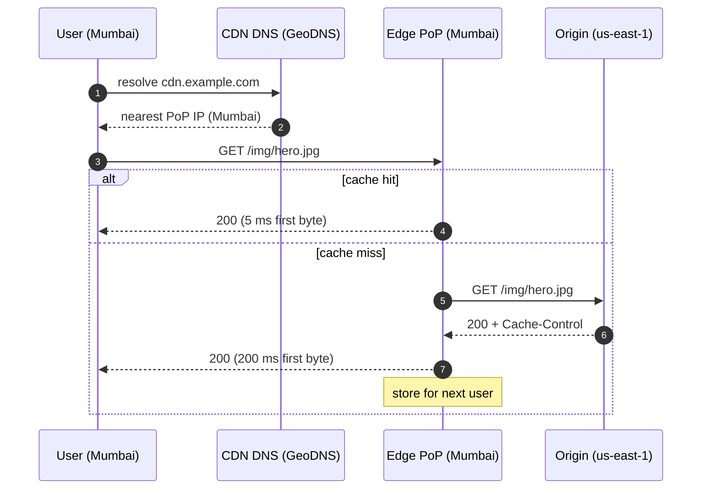

## Definition (interview-ready)

A **CDN** (Content Delivery Network) is a globally distributed cache of edge servers (PoPs — Points of Presence) that sit close to users, serving static content (and increasingly dynamic content) on behalf of an origin server. Users reach a nearby PoP through **anycast** routing (one IP announced from many places via **BGP**) or **GeoDNS** (DNS answers that depend on location); cached copies are refreshed by **TTL** expiry and removed early by **purge**.

**One-liner:** A CDN is a network of edge caches near users that serves content on the origin's behalf — anycast or GeoDNS sends each user to a nearby PoP, `Cache-Control` headers and purges control freshness, and the result is lower latency, less origin load and DDoS absorption.

## Why it matters

Once your app has users in more than one country, the speed of light becomes the bottleneck. A CDN drops first-byte latency from 200ms to 20ms, absorbs traffic spikes (the origin sees a tiny fraction of requests), and absorbs DDoS. Every modern app — web, mobile API, video — uses a CDN.



## Core concepts

### Why a CDN

- **Latency**: cross-continent round trip is ~150ms. PoPs in 50+ cities cut this to ~10–30ms.
- **Throughput**: aggregate edge bandwidth dwarfs origin's. Big video, big releases, big sales.
- **Offload**: origin serves only cache misses (perhaps 1% of total).
- **DDoS absorption**: edges fronted by huge networks soak up attacks (Cloudflare, Akamai pride themselves on this).
- **TLS termination + HTTP/3** at the edge — fast handshake near the user.

### How traffic reaches the right PoP

- **Anycast**: same IP advertised from many locations via BGP. Internet routing chooses the closest.
- **DNS-based**: `cname.cdn.com` resolves to different IPs based on the resolver's location (GeoDNS).
- **Hybrid**: some CDNs combine both. Cloudflare is mostly anycast; Akamai has historically relied mostly on DNS-based mapping.

### What gets cached

- **Static assets**: images, CSS, JS, video chunks, fonts. Trivially cacheable, immutable filenames recommended.
- **HTML pages**: cacheable if not personalized.
- **API responses**: cacheable for GET endpoints with stable keys.
- **Video streaming**: HLS / DASH manifest + chunks. CDNs are the only way to scale this.
- **Dynamic**: edge compute (Cloudflare Workers, Lambda@Edge, Fastly Compute) generates responses at the edge.

### Cache key

Default: full URL. You can include / exclude query params and headers per route. Common knobs:
- `Vary: Accept-Encoding, Cookie` — separate cache entries per varying header.
- Strip tracking query params (`?utm_*`) so duplicate URLs share one cache entry.

### Cache control headers

- `Cache-Control: public, max-age=86400` — cacheable for 1 day.
- `Cache-Control: private, no-store` — never cache (sensitive data).
- `Cache-Control: s-maxage=600, max-age=60` — CDN gets 10min, browser 1min.
- `Cache-Control: stale-while-revalidate=300` — serve stale up to 5min while refreshing.
- `ETag: "abc"` and `Last-Modified` — conditional revalidation (`If-None-Match`, `If-Modified-Since`).
- `Surrogate-Control` — header for CDN only (origin can hide from browser).

### Invalidation (purge)

- **Purge by URL**: invalidate a specific path. Usually takes effect within seconds (some CDNs, like CloudFront, can take longer).
- **Purge by tag / surrogate key**: tag responses on origin (`Surrogate-Key: product-42`). Purge by tag to wipe all related responses (product page, listings showing it, search results).
- **Wipe all**: nuclear option; expect a brief origin storm — use soft purge if possible.
- **Soft purge**: mark stale; next request triggers async refresh while serving stale.

### Edge compute

- **Cloudflare Workers**: V8 isolates, serverless functions in Cloudflare's 300+ edge cities.
- **Lambda@Edge / CloudFront Functions**: AWS equivalent.
- **Fastly Compute** (formerly Compute@Edge): WebAssembly-based, very fast startup.
- Use cases: A/B routing, header rewriting, auth checks, response personalization, light JSON shaping.

### Origin shield

- An extra cache layer between PoPs and origin. PoPs that miss go to the shield, which may have the data. Reduces origin load from N PoPs to 1 shield.
- AWS CloudFront, Akamai, Fastly all support this.

### Image / video optimization at the edge

- Resize, reformat (AVIF/WebP), compress on the fly based on `Accept` header.
- Adaptive bitrate streaming: the CDN caches every HLS/DASH rendition, and the client player switches between them based on its measured bandwidth.
- Saves origin storage + bandwidth.

## How it works (a CDN request)

```
1. Client resolves DNS for static.example.com → anycast IP of CDN.
2. Client opens TCP+TLS to nearest PoP (~20ms RTT).
3. PoP checks local cache:
   - Hit: respond.
   - Miss: ask the regional shield (or origin) → fill cache → respond.
4. Future requests within TTL → served from PoP directly.
```

## Real-world examples

- **Netflix**: huge CDN strategy. Built **Open Connect Appliances** — Netflix-owned CDN boxes inside ISPs. Saves transit cost, gets closest to users.
- **YouTube / Google**: own private CDN backbone.
- **Cloudflare**: anycast everywhere; powers a huge chunk of the public web.
- **Fastly**: popular with news sites for fast purge. In June 2021 one customer's valid config change triggered a latent bug, and many major sites (Amazon, Reddit, gov.uk, news outlets) were down for about an hour.
- **Akamai**: original CDN, heavy enterprise / financial / video presence.

## Common pitfalls

- **Caching personalized pages**: leaking one user's data to another. Always `Cache-Control: private` (or vary by auth) for authenticated responses.
- **Vary explosion**: `Vary: User-Agent` → thousands of cache entries per URL → near-zero hit rate. Strip variation you don't need.
- **Query string variations**: `?utm_*` doubles cache entries pointlessly. Strip them at the edge.
- **Long TTL on something you'll need to change**: prefer cache-busting filenames (`app.abc123.js`) for static; short TTL or tag-purge for dynamic.
- **Origin hiding behind CDN by IP**: attackers find your origin via historical DNS / SSL transparency logs. Use origin auth (CF Tunnel, AWS WAF + signed requests) to refuse non-CDN traffic.
- **Purge floods**: aggressive purges trigger origin stampedes — use soft purge or staggered.
- **HTTPS misconfiguration**: CDN ↔ origin TLS can be weaker than client ↔ CDN. Encrypt CDN-to-origin traffic and validate the origin certificate (Cloudflare calls this "Full (strict)" mode).

## Practice questions

<Practice>

<QA q="What problems does a CDN solve?" level="easy">

**Latency** (PoPs near users), **throughput** (massive aggregate bandwidth), **origin offload** (the CDN absorbs the vast majority of static traffic), **DDoS protection** (edges have huge capacity), and **TLS termination** near the user.

</QA>

<QA q="What's the difference between `max-age` and `s-maxage`?" level="easy">

`max-age` applies to all caches, including browsers. `s-maxage` applies only to **shared caches** (CDNs, proxies) — useful when you want a different TTL at the edge than in the browser, e.g. `s-maxage=600, max-age=60`.

</QA>

<QA q="How do you ship static assets with very long TTLs and still deploy changes instantly?" level="easy">

Use **cache-busting filenames** — put a content hash in the name (`app.abc123.js`) and give it a long `max-age`. A deploy references new filenames, so nothing needs purging; old files simply stop being requested. Reserve short TTLs or tag purges for content whose URL can't change, like HTML pages.

</QA>

<QA q="How does cache invalidation work in a CDN?" level="medium">

- **TTL-based**: content expires automatically; the next request revalidates with the origin.
- **Purge**: explicit eviction by URL, by tag/surrogate key, or everything.

Modern setups combine a long TTL with targeted purges on content changes. **Soft purge** marks content stale and serves it while revalidating asynchronously, avoiding an origin spike.

</QA>

<QA q="How does Anycast work for a CDN?" level="medium">

Many data centers advertise the **same IP address** via BGP, and internet routing sends each user to the topologically closest one. So one anycast IP reaches different physical machines for users in different places — no per-user logic needed. If a PoP goes down it stops advertising the route and traffic shifts to the next closest, giving fast failover.

</QA>

<QA q="What does `stale-while-revalidate` do?" level="medium">

It lets a cache keep serving an expired response for a grace period (e.g., `stale-while-revalidate=300` for 5 minutes) while it refreshes from the origin in the background. Users get fast responses, and the origin sees one refresh instead of a burst of synchronous misses when the TTL expires.

</QA>

<QA q="What is an origin shield?" level="medium">

An extra cache layer between the PoPs and the origin. A PoP that misses asks the shield first, which may already have the object. Instead of N PoPs each fetching from the origin, origin load drops to roughly one shield. CloudFront, Akamai, and Fastly all support it.

</QA>

<QA q="When can or can't you cache an API response in a CDN?" level="medium">

**Can**: GET requests with stable keys and public, non-personalized data (product catalog, public profiles, public posts). **Can't (without care)**: personalized data, authenticated endpoints, anything with side effects. **Sometimes**: cache the public part of a page and fill in the personalized part client-side or via edge compute.

</QA>

<QA q="Why is `Vary: User-Agent` dangerous for a CDN?" level="hard">

`Vary` makes the cache store a separate entry per value of that header. User-Agent strings have thousands of variants, so one URL fragments into thousands of entries and the hit rate collapses toward zero. Only vary on headers that really change the response (e.g., `Accept-Encoding`), and normalize anything else at the edge.

</QA>

<QA q="What is edge compute used for, and why does it help caching?" level="hard">

Edge compute (Cloudflare Workers on V8 isolates, Lambda@Edge / CloudFront Functions, Fastly Compute on WebAssembly) runs code at the PoP. Uses: A/B routing, header rewriting, auth checks, response personalization, light JSON shaping. It helps caching because the main response can stay public and cacheable while the small personalized piece is added at the edge.

</QA>

<QA q="Design caching for a news site's article pages — millions of pageviews per article, occasional edits." level="scenario">

- **Origin** renders the full article HTML.
- **Cache**: long TTL at the CDN (`s-maxage=3600`), shorter in the browser.
- **Surrogate-Key** = article ID plus tags.
- **Edit flow**: the CMS purges by surrogate key → invalidates the article and every page tagged with it (category, search). Use soft purge to avoid an origin spike.
- **Edge compute** for personalized panels, so the article body stays cacheable.
- **A/B variants** get separate cache keys (distinct paths or a deliberate `Vary`).

</QA>

<QA q="Your CDN hit rate is 70% but you expect 99%. Investigate." level="scenario">

- `Cache-Control` headers missing or short-lived (audit a sample).
- `Vary` header fragmenting the cache (`Vary: User-Agent` is a classic killer).
- Query-string variations not coalesced (`utm_*` tracking params).
- Cookies on requests preventing caching.
- PoP-level evictions — small or cold PoPs evicting under memory pressure.
- The origin accidentally sending `no-store` / `private` — the CDN obeys.
- Inconsistent URLs for the same asset (versioned vs unversioned).

</QA>

<QA q="How do you protect an origin behind a CDN from being hit directly?" level="scenario">

- **IP allowlist** at the firewall — only CDN IP ranges.
- **Signed headers or mTLS** between CDN and origin — the origin rejects requests without them.
- **Cloudflare Tunnel / AWS PrivateLink** — no public origin at all.
- **WAF rules** for bot signatures.

Watch for historical DNS records and certificate transparency logs leaking the origin IP; if it leaks, move the origin to a new IP and lock it down.

</QA>

</Practice>

## Quiz

<Quiz>

<MCQ q="An origin sends Cache-Control: s-maxage=600, max-age=60. What happens?" options={["Browsers cache for 600 s, the CDN for 60 s", "Both cache for 600 s", "The CDN caches for 600 s, browsers for 60 s", "Nothing is cached because the values conflict"]} answer={2}>

s-maxage applies only to shared caches like CDNs and overrides max-age there; browsers use max-age. That's how you give the edge a longer TTL than the browser.

</MCQ>

<MCQ q="How does Anycast send a user to a nearby PoP?" options={["Many locations advertise the same IP via BGP, and routing picks the closest", "The CDN looks up the user's account location", "The origin redirects with HTTP 302 to the nearest PoP", "The browser pings every PoP and picks the fastest"]} answer={0}>

Anycast relies on BGP: the same IP is announced from many PoPs and internet routing delivers packets to the topologically nearest one. No per-user lookup or redirect is involved.

</MCQ>

<MCQ q="A product's price changes and it appears on its own page, listing pages, and search results. Which purge fits best?" options={["Purge by the product page URL only", "Wipe the whole cache", "Wait for the TTL to expire", "Purge by a surrogate key such as product-42 tagged on all those responses"]} answer={3}>

Tagging every response that includes the product lets one purge clear them all. A URL purge misses the listings, and a full wipe causes an origin storm.

</MCQ>

<MCQ q="What does a soft purge do differently from a hard purge?" options={["It deletes content from the origin", "It marks content stale and serves it while refreshing in the background", "It only purges the browser cache", "It purges only half the PoPs"]} answer={1}>

Soft purge keeps the stale copy available while one async revalidation fetches the new version, avoiding a burst of origin requests.

</MCQ>

<MCQ q="An authenticated user's dashboard response is cached at the CDN and shown to other users. Which header should it have sent?" options={["Cache-Control: public, max-age=86400", "Cache-Control: s-maxage=600", "Cache-Control: private, no-store", "Vary: Accept-Encoding"]} answer={2}>

private, no-store tells shared caches not to store the response, preventing one user's data leaking to another. The other headers allow or don't stop shared caching.

</MCQ>

<MCQ q="Your hit rate collapsed after a change that added Vary: User-Agent. Why?" options={["Each distinct User-Agent string gets its own cache entry, fragmenting the cache", "CDNs refuse to cache responses with Vary", "User-Agent forces TLS renegotiation", "It disables the origin shield"]} answer={0}>

Vary splits entries by header value, and User-Agent has thousands of variants, so most requests miss.

</MCQ>

<MCQ q="What does an origin shield reduce?" options={["Browser cache size", "TLS handshake time for users", "The number of PoPs needed", "Origin load, by having missing PoPs fetch from one shared cache layer"]} answer={3}>

PoP misses go to the shield first, so the origin sees roughly one fetch per object instead of one per PoP. It doesn't change user-side handshakes or PoP count.

</MCQ>

<MCQ q="Why name static files like app.abc123.js with a long max-age?" options={["Hashes make files smaller", "A new deploy uses new filenames, so no purge is needed and old files are never stale", "CDNs only cache hashed files", "It prevents DDoS attacks"]} answer={1}>

The content hash changes when the file changes, so the long TTL is safe: updated content gets a new URL. File size and DDoS protection are unaffected.

</MCQ>

<MCQ q="Attackers bypass your CDN and hit the origin IP directly. Which fix stops this most robustly?" options={["Lower the CDN TTL", "Add more PoPs", "Only accept origin traffic carrying CDN-signed headers or mTLS, or use a private tunnel", "Enable stale-while-revalidate"]} answer={2}>

Origin authentication (or no public origin at all) rejects anything that didn't come through the CDN. TTLs, PoPs, and stale serving don't affect direct-to-origin traffic.

</MCQ>

</Quiz>

## TL;DR cheat sheet

- CDN = global cache + DDoS shield + TLS terminator near users.
- Anycast (BGP) or GeoDNS routes users to nearest PoP.
- Cache key = URL + selected headers. Watch `Vary` carefully.
- `Cache-Control`, `s-maxage`, `stale-while-revalidate`, `ETag` are your levers.
- Invalidate via TTL (default) and purge (URL or surrogate key).
- Edge compute (Workers, Lambda@Edge) for personalization without losing cache hits.
- Origin shield + tag purge for big sites.
- Lock origin so it can only be reached via CDN.

## Go deeper

- **Cloudflare Learning**: [what is a CDN](https://www.cloudflare.com/learning/cdn/what-is-a-cdn/), [Anycast](https://www.cloudflare.com/learning/cdn/glossary/anycast-network/), [HTTP caching](https://www.cloudflare.com/learning/cdn/what-is-caching/).
- **Fastly blog**: surrogate keys, stale-while-revalidate, varnish-derived terminology.
- **MDN**: [HTTP caching](https://developer.mozilla.org/en-US/docs/Web/HTTP/Caching) — the canonical reference for headers.
- **Netflix Open Connect** docs and blog posts.
- **RFC 9111** (HTTP Caching, which replaced RFC 7234 in 2022) — short and worth reading once.
- **Cloudflare YouTube**: "How Cloudflare works" series.
