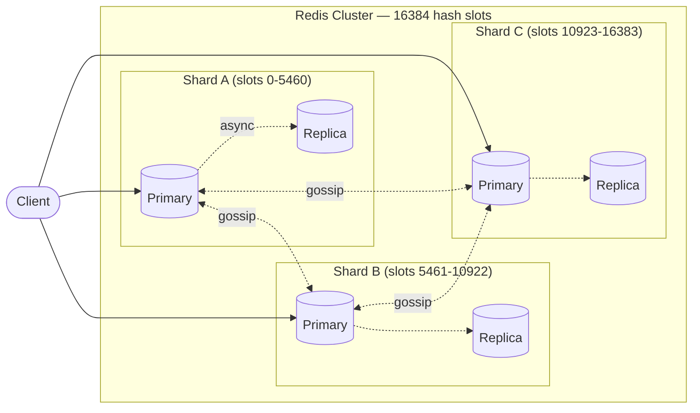
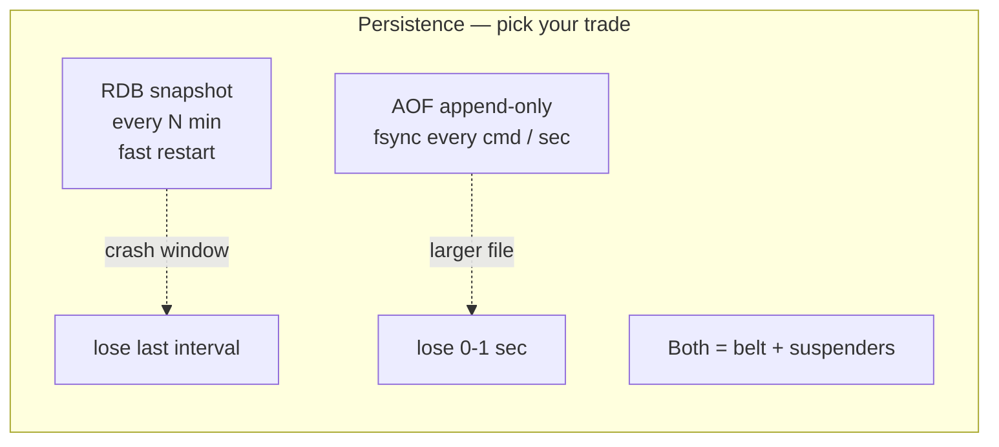

## Definition (interview-ready)

**Redis** is an in-memory **data-structure server**. Clients talk to it over TCP using a simple text protocol (RESP), and every key maps to a typed value: a string, list, hash, set, sorted set, stream, or one of the specialised types built on them (bitmaps, HyperLogLog, geospatial). The whole dataset lives in RAM, and a **single main thread executes every command one at a time**, so each command is atomic and latency is predictable. Persistence (RDB snapshots and/or an AOF log) is optional and happens in the background. **Replication** gives you read copies and failover, and **Redis Cluster** shards keys across nodes using 16,384 hash slots.

**One-liner:** Redis is an in-memory data-structure server whose single main thread runs each command atomically, giving sub-millisecond reads and writes; persistence (RDB/AOF), replication and Cluster sharding are optional layers on top.

## Why it matters

Redis is the default choice for a cache, rate limiter, leaderboard, distributed lock, session store, lightweight queue, and pub/sub bus. Almost every backend system design ends up with a Redis box somewhere. Interviewers use it to check two things: whether you understand the **model** (memory-bound, single-threaded execution, atomic commands, TTLs) and whether you know the **operational levers** (persistence, eviction, clustering) well enough to avoid outages. Getting the basics wrong is a common cause of real incidents: `KEYS *` freezing the server, caches that never expire, `noeviction` turning a full cache into write errors, or counters that lose their TTL.





## Core concepts

### What Redis is (and what it isn't)

- **A server, not a library.** Every operation is a network round trip, so latency is usually dominated by the network (often 100s of microseconds) rather than by Redis itself (often a few microseconds per command).
- **Typed values with server-side operations.** You don't fetch a list, change it, and write it back. You send `LPUSH` and the server changes it in place. This is what makes Redis more than a key-value cache like memcached: you push the computation to the data, and every command is atomic.
- **Memory first, durability optional.** RAM is the source of truth while the process runs. Disk is only for recovery.
- **Not a relational database.** There are no joins, no secondary indexes unless you build them (or use the Query Engine), and no multi-key ACID transactions with rollback. See [Redis Data Structures](/learn/notes/redis-data-structures/) for modelling and [Transactions and Scripting](/learn/notes/redis-transactions-scripting/) for atomicity tools.
- **Licensing, briefly.** Redis was BSD-licensed until 2024. Starting with Redis 7.4 it moved to a dual RSALv2 / SSPLv1 licence, and the Linux Foundation forked the last BSD release (7.2.4) as **Valkey**. Redis 8.0 (May 2025) added **AGPLv3** as a third licence option and folded the former modules (Query Engine, JSON, time series, probabilistic types) into Redis Open Source.

### The in-memory model

- The keyspace is one big hash table per logical database: key → value object. A lookup is O(1) on average.
- Values are stored in **compact encodings** when they're small (for example a small hash is a flat `listpack` byte array) and switch to general-purpose structures when they grow. You never see this through the API, but it explains why many small hashes use far less memory than many separate keys. Details are in [Redis Data Structures](/learn/notes/redis-data-structures/).
- **Limits**: a key or a string value can be up to 512 MB. Lists, sets, and hashes can hold up to 2^32 − 1 elements. In practice memory runs out long before that.
- **Size the box for peak memory.** Redis allocates through jemalloc by default, and freed memory isn't always returned to the OS. After deleting 2 GB from a 5 GB dataset, RSS may still read about 5 GB, which is why `mem_fragmentation_ratio` can look alarming after a big delete.
- Without `maxmemory`, Redis keeps allocating until the OS kills it or it starts swapping. Swapping destroys latency. Always set a limit (see Eviction below).

### Event loop, single-threaded execution, and I/O threads

```
            ┌──────────────── main thread ────────────────┐
 sockets ──►│ epoll/kqueue: which clients are readable?    │
            │ read + parse ► execute command ► queue reply │──► sockets
            │ timers (serverCron at hz=10): expiry, stats  │
            └──────────────────────────────────────────────┘
   background threads: lazy free (UNLINK), fsync/close, I/O threads (optional)
   child process: BGSAVE / AOF rewrite (fork + copy-on-write)
```

- Redis uses an **event loop** on top of epoll (Linux) or kqueue (BSD/macOS). One thread multiplexes thousands of connections without a thread per client.
- **Commands execute one at a time on the main thread.** No locks are needed, so every individual command is atomic: two `INCR`s can never interleave.
- **Why that's fast enough:** the work per command is tiny (memory access, no disk), there's no lock contention or context switching, and the real bottleneck is usually the network. Pipelining raises throughput a lot because it cuts round trips and syscalls.
- **The cost:** one slow command stalls everyone. `KEYS *`, `HGETALL` on a huge hash, `SMEMBERS` on a 10M-member set, a long Lua script, or `DEL` of a giant key all block every other client for their duration.
- **I/O threads (Redis 6.0+, `io-threads`)**: optional threads that read sockets, parse requests, and write replies. Command execution stays single-threaded. It's off by default. The config file suggests enabling it only on machines with at least 4 cores and leaving one spare core (for example 3 I/O threads on a 4-core box). Redis 8.0 shipped a new, event-driven I/O threading implementation that scales better.
- **Other background work**: `UNLINK` and lazy-free options release memory on a background thread, and `BGSAVE` / AOF rewrite run in a **forked child process**.
- **Scaling CPU**: to use more cores for command execution you run more Redis processes, usually as Redis Cluster shards.

### Keys: naming and design

Redis has no tables or schemas. Your **key naming convention is the schema**.

| Guideline | Why |
|---|---|
| Use `object-type:id[:field]`, e.g. `user:1000`, `user:1000:followers` | Readable and greppable. Tools like RedisInsight group by `:`. |
| Prefix by service or tenant, e.g. `checkout:cart:42` | Avoids collisions when several apps share a cluster, and makes ACL key patterns (`~checkout:*`) possible. |
| Keep keys short but meaningful | Every key is stored in RAM, and long keys (hundreds of bytes) waste memory and make lookups compare more bytes. Hash a long natural key (e.g. SHA-1 of a URL) instead. `u1000flw` is too terse: the bytes you save are tiny next to the value. |
| Don't put unbounded data in one key | A 10M-member set or a 500 MB string is a **big key**: slow to read, slow to delete, impossible to split across shards, and it causes replication and migration spikes. Shard by suffix, e.g. `followers:42:0` to `followers:42:15`. |
| Use **hash tags** only when you need co-location | In Cluster, only the part inside braces is hashed, e.g. `cart:{user42}` and `profile:{user42}` land in the same slot so multi-key commands work. Overusing a tag creates a hot slot. |
| Version the key format | `user:v2:1000` lets you change serialisation without a flag day. Old keys simply expire. |
| Group small related values in a hash | `HSET user:1000 name ... email ...` uses far less memory than three top-level keys, thanks to the compact encoding. |

Keys are **binary-safe** (any byte sequence, even the empty string), but stick to printable ASCII so humans can debug them.

To find keys, use `SCAN` (cursor-based, a few keys per call) and never `KEYS` in production. `KEYS` walks the entire keyspace in one blocking call.

```bash
redis-cli --scan --pattern 'session:*' --count 1000 | head
```

### SET and GET semantics

`SET key value` stores a string and **overwrites whatever was there, regardless of type, and discards any existing TTL**. `GET key` returns the string, or nil if the key doesn't exist, and returns a `WRONGTYPE` error if the key holds a list, hash, etc. Both are O(1).

`SET` options (they replace the old `SETNX`, `SETEX`, `PSETEX`, and `GETSET` commands):

| Option | Meaning | Since |
|---|---|---|
| `EX seconds` / `PX ms` | Set a relative TTL | 2.6.12 |
| `EXAT unix-s` / `PXAT unix-ms` | Set an absolute expiry time | 6.2 |
| `KEEPTTL` | Keep the existing TTL instead of clearing it | 6.0 |
| `NX` | Only set if the key does **not** exist (locks, idempotency) | 2.6.12 |
| `XX` | Only set if the key **does** exist (update-only) | 2.6.12 |
| `GET` | Return the old value (replaces `GETSET`) | 6.2 |
| `IFEQ v` / `IFNE v` | Compare-and-set on the current value | 8.4 |

```bash
127.0.0.1:6379> SET session:abc '{"uid":42}' EX 1800        # cache with a 30-min TTL
OK
127.0.0.1:6379> SET lock:order:9 token-7f3a NX PX 30000     # acquire a lock
OK
127.0.0.1:6379> SET lock:order:9 token-other NX PX 30000    # second caller loses
(nil)
127.0.0.1:6379> SET user:42:name Aman KEEPTTL               # update value, keep TTL
OK
127.0.0.1:6379> SET counter 0 GET                           # swap and return old value
"17"
127.0.0.1:6379> MGET user:1 user:2 user:3                   # one round trip, O(N)
```

Related string commands: `GETEX` (read and change TTL) and `GETDEL` (read and delete) arrived in 6.2. `MSET`/`MGET` work on many keys at once and are atomic, but in Cluster all keys must be in the same slot.

### Counters: INCR, INCRBY, INCRBYFLOAT

There's no integer type. A string that looks like a base-10 64-bit signed integer can be incremented in place, and Redis stores it internally as an integer (the `int` encoding), so there's no parsing overhead.

```bash
127.0.0.1:6379> INCR pageviews:2026-10-21           # missing key starts at 0
(integer) 1
127.0.0.1:6379> INCRBY stock:sku:991 -3             # decrement by 3 (or DECRBY)
(integer) 97
127.0.0.1:6379> INCRBYFLOAT wallet:42 10.50
"10.5"
127.0.0.1:6379> SET name aman
127.0.0.1:6379> INCR name
(error) ERR value is not an integer or out of range
```

- **Atomic** because they run on the single command thread: 1,000 concurrent clients each doing `INCR` yield exactly +1,000. That's what read-modify-write in the app (`GET`, add 1, `SET`) cannot give you.
- Range is 64-bit signed. Going past the range is an error, not a wrap-around.
- `INCRBYFLOAT` uses double precision. It is replicated and written to the AOF **as a `SET` of the result**, so replicas never diverge because of floating-point differences. Don't use floats for money. Store integer minor units (paise/cents) with `INCRBY`.
- **TTL is preserved**: `INCR` alters the value but doesn't replace the key, so an existing TTL stays.
- **Fixed-window counter with expiry**: the classic bug is `INCR` succeeding and the `EXPIRE` never running (client crash), leaving an immortal key. Make it atomic:

```bash
# Option 1: MULTI/EXEC (both commands always run together)
MULTI
INCR rl:ip:1.2.3.4:1729500000
EXPIRE rl:ip:1.2.3.4:1729500000 10
EXEC

# Option 2: Lua, only set the TTL on first increment
EVAL "local c = redis.call('INCR', KEYS[1]) if c == 1 then redis.call('EXPIRE', KEYS[1], ARGV[1]) end return c" 1 rl:ip:1.2.3.4 1
```

For hash fields use `HINCRBY` / `HINCRBYFLOAT`, and for sorted-set scores use `ZINCRBY`.

### Expiration: TTLs, lazy and active expiry

Any key can have a **TTL**. A key with a TTL is called *volatile*.

```bash
EXPIRE  key 60            # relative, seconds        PEXPIRE  key 60000   # ms
EXPIREAT key 1729500000   # absolute unix seconds    PEXPIREAT key ...    # ms
TTL key   → remaining seconds, -1 = no TTL, -2 = key does not exist
PTTL key  → same in ms
PERSIST key               # remove TTL, key lives forever
EXPIRETIME key            # absolute expiry as unix time (7.0+)
EXPIRE key 60 NX | XX | GT | LT   # conditional (7.0+): only if no TTL / has TTL / longer / shorter
SET key v EX 60           # set value + TTL atomically (preferred over SET then EXPIRE)
```

**What changes a TTL** (common interview trap):

| Operation | Effect on TTL |
|---|---|
| `SET`, `GETSET`, `DEL`, any `*STORE` command (overwrite) | Cleared / key replaced |
| `SET ... KEEPTTL` | Kept |
| `INCR`, `LPUSH`, `HSET`, `SADD`, `APPEND` (alter in place) | Kept |
| `RENAME a b` | `b` inherits `a`'s TTL |
| `PERSIST` | Removed |
| `EXPIRE` with 0 or a negative value, or `EXPIREAT` in the past | Key is **deleted** immediately (emits a `del` event, not `expired`) |

**How keys actually disappear.** Redis uses two mechanisms together:

1. **Lazy (passive) expiry**: when a command touches a key, Redis first checks its expiry time. If it's past, the key is deleted and the command sees "no such key". Expired keys are therefore never returned to clients.
2. **Active expiry**: lazy expiry alone would leak memory for keys nobody reads again. So a background cycle, driven by `serverCron` (`hz 10` by default, so 10 times per second), **samples random keys that have a TTL** and deletes the expired ones. If a large fraction of the sample was expired, it immediately samples again, within a CPU-time budget. With the default `active-expire-effort 1`, Redis tries to keep already-expired-but-unreclaimed keys to about 10% of volatile keys. Raising the effort (up to 10) spends more CPU to reclaim faster.

Consequences:

- Expiry precision is 0–1 ms (since 2.6), but **memory reclamation is probabilistic**. `DBSIZE` and `INFO keyspace` can include keys that have logically expired.
- Expiry times are stored as **absolute Unix timestamps**, so time keeps passing while the server is down, and a big clock jump on the host can expire keys en masse.
- **Replicas don't expire keys on their own.** The primary synthesises a `DEL` into the replication stream and the AOF when a key expires, keeping everyone consistent.
- **Mass expiry**: if a million keys get the same TTL at the same moment, the active cycle has a lot of work at once, and your database gets the stampede of misses. Add **jitter** (`TTL = base + random(0, 10%)`). See [Cache Stampede & TTL](/learn/notes/cache-stampede-ttl/).
- Since 7.4, individual **hash fields** can have their own TTL (`HEXPIRE`), covered in [Redis Data Structures](/learn/notes/redis-data-structures/).

### Logical databases (SELECT 0–15)

A standalone Redis server has numbered **logical databases**: `databases 16` by default, indexed 0 to 15. Each new connection starts in DB 0, and `SELECT n` switches the connection.

```bash
127.0.0.1:6379> SELECT 3
OK
127.0.0.1:6379[3]> SET k v      # a different 'k' from DB 0
```

They're just separate keyspaces (namespaces) inside **one process**: same thread, same `maxmemory`, same eviction pool, same RDB/AOF file, same replication stream. That's why they're discouraged for anything beyond small scoping needs:

- **No isolation.** A slow command in DB 5 blocks DB 0. One noisy tenant can evict everyone else's keys.
- **Not supported in Redis Cluster**, which only has DB 0. `SELECT` with a non-zero index fails there, so code that relies on it can't scale out.
- **Footguns.** `FLUSHALL` wipes every DB. The selected DB is per-connection state, so pooled clients must re-`SELECT` after reconnecting, and getting that wrong writes data to the wrong DB.
- Redis's own docs recommend not using them to host multiple unrelated applications on one instance. Managed services such as Redis Cloud and Redis Software don't support them at all.

Use **key prefixes** (`svc:`) for namespacing, and **separate instances** when you need real isolation.

"Types of Redis databases" in interviews can also mean **deployment shapes**: standalone, primary + replicas with **Sentinel** for failover, **Redis Cluster** for sharding, and managed services (ElastiCache/MemoryDB, Redis Cloud). Mention both meanings.

### Data structures at a glance

| Type | One-line use | Typical commands |
|---|---|---|
| String | Cache blobs, counters, flags, locks | `SET`, `GET`, `INCR`, `MGET` |
| List | Queues, recent-N feeds | `LPUSH`, `RPOP`, `BLMOVE`, `LTRIM` |
| Hash | Objects / records with fields | `HSET`, `HGET`, `HINCRBY` |
| Set | Unique members, tags, membership | `SADD`, `SISMEMBER`, `SINTER` |
| Sorted set | Leaderboards, time-ordered indexes, sliding windows | `ZADD`, `ZRANGE`, `ZRANK` |
| Stream | Durable append-only log with consumer groups | `XADD`, `XREADGROUP`, `XACK` |
| Bitmap / bitfield | 1 bit (or a few bits) per numeric id | `SETBIT`, `BITCOUNT`, `BITFIELD` |
| HyperLogLog | Approximate distinct counts in at most 12 KB | `PFADD`, `PFCOUNT` |
| Geo | Nearby search (a sorted set underneath) | `GEOADD`, `GEOSEARCH` |

Internals, encodings, Big-O for every command, and modelling patterns are covered in **[Redis Data Structures: Strings to Streams](/learn/notes/redis-data-structures/)**.

### Persistence

- **RDB**: a point-in-time binary snapshot written by a forked child (`BGSAVE`). Restarts are fast and the files make good backups, but you lose everything since the last snapshot. Default save points are 1 hour if at least 1 change, 5 minutes if at least 100, and 60 seconds if at least 10,000.
- **AOF**: an append-only log of write commands (off by default, `appendonly no`). The `appendfsync` policy decides how often it's flushed to disk: `always` (safest, slowest), `everysec` (default, lose up to about 1 second), or `no` (let the OS decide). Restarts replay the log. A background rewrite compacts it, and since 7.0 the AOF is stored as multiple files.
- **Both**: AOF for durability plus RDB for fast restarts and backups. This is common for anything you can't afford to lose.
- **Neither**: a pure cache. Fastest, and a restart means a cold cache.

Deep dive: [Redis Persistence](/learn/notes/redis-persistence/).

### Eviction policies

Set `maxmemory` and choose a `maxmemory-policy`:

- `noeviction`: writes that need memory fail with an OOM error once the limit is hit. This is the **default**, and it's wrong for a cache.
- `allkeys-lru`: evict the least recently used key, among all keys. The usual choice for a cache.
- `allkeys-lfu`: evict the least frequently used key. Better when popularity is stable and skewed.
- `volatile-lru` / `volatile-lfu` / `volatile-ttl` / `volatile-random`: only consider keys that have a TTL. Use these when cache and must-keep data share an instance.
- `allkeys-random`: evict a random key.

LRU and LFU are **sampled approximations**: Redis looks at `maxmemory-samples` keys (default 5) and evicts the best candidate. That's close to true LRU at a fraction of the memory. Details: [Redis Operations](/learn/notes/redis-operations/).

### Pipelining & transactions

- **Pipelining**: send N commands without waiting for each reply, then read all replies. This saves N−1 round trips and many syscalls, and Redis's own benchmarks show several-fold throughput gains. It isn't atomic: other clients' commands can interleave.
- **MULTI/EXEC**: queue commands and run them back-to-back with nothing interleaved. There's **no rollback**: if one command fails at runtime, the others still apply. `WATCH` adds optimistic concurrency (check-and-set).
- **Lua scripts / Functions** (`EVAL`, `FCALL`): run logic server-side atomically. A script blocks the whole server while it runs, so keep it to microseconds or a few milliseconds. After `busy-reply-threshold` (default 5 seconds) Redis starts replying `BUSY` to other clients, and you can only stop it with `SCRIPT KILL` (if it hasn't written yet) or `SHUTDOWN NOSAVE`.

Deep dive: [Transactions, Lua & Functions](/learn/notes/redis-transactions-scripting/).

### Pub/Sub & Streams

- **Pub/Sub**: fire-and-forget fan-out. If nobody is subscribed, or a subscriber is disconnected, the message is gone. Not durable.
- **Streams**: a durable log with consumer groups, acknowledgements, and a pending-entries list. Use them when you need replay or at-least-once delivery.

### Redis Cluster

- 16,384 hash slots. Slot = `CRC16(key) mod 16384`, computed over the hash tag if the key contains a non-empty `{...}` section.
- Each primary owns a range of slots, and replicas copy their primary. The number of replicas per primary is your choice (for example `redis-cli --cluster create ... --cluster-replicas 1`).
- **Multi-key operations need all keys in one slot.** Use hash tags (`{user42}:profile`, `{user42}:cart`) when you genuinely need co-location.
- Failover is automatic: nodes gossip over the cluster bus, and when a majority of primaries agree a primary is down, one of its replicas is promoted.
- Clients must be cluster-aware. They cache the slot map and follow `MOVED` (slot permanently moved) and `ASK` (slot mid-migration) redirects.
- Only DB 0 exists in Cluster.

Deep dive: [Replication & Cluster](/learn/notes/redis-replication-cluster/).

### Redis Sentinel (alternative HA)

- Sentinel processes monitor one primary and its replicas. When a quorum agrees the primary is down, they promote a replica and tell clients the new address.
- Simpler than Cluster, but there's no sharding: the dataset must fit on one node.
- Good for HA when data and throughput fit a single primary.

### Common patterns

- **Distributed lock**: `SET lock:x <token> NX PX 30000`, then release with a Lua compare-and-delete on the token so you never delete someone else's lock. Redlock (multi-node) is still debated, so read Kleppmann's critique before using it for correctness.
- **Rate limiter**: a fixed window with `INCR` + `EXPIRE`, a sliding window with a sorted set, or a token bucket in Lua. See [Rate Limiting](/learn/notes/rate-limiting/).
- **Idempotency key**: `SET idem:<request-id> 1 NX EX 86400`. If it returns `OK`, this is the first time you've seen the request.
- **Leaderboard**: sorted set with `ZADD` / `ZINCRBY` / `ZRANGE ... REV`.
- **Counter**: `INCR` / `INCRBY`, with an atomic TTL.
- **Session store**: a hash per session with a TTL, refreshed on activity.

More: [Redis Patterns & Use Cases](/learn/notes/redis-patterns-use-cases/).

## How it works (a typical cache hit/miss)

```
GET user:42
  Cluster client → CRC16("user:42") mod 16384 → slot owned by node N1
  N1 main thread: lookup in keyspace dict
     key found but expired?  → delete it now (lazy expiry) → return nil
     key found               → return value (hit)
     key missing             → return nil (miss)

On miss, the app reads from the DB, then:
  SET user:42 <serialized json> EX 300      # value + TTL in one atomic command
```

## Real-world examples

- **Stack Overflow** has written publicly about using Redis as a shared cache layer in front of SQL Server.
- **GitHub** created **Resque**, a Redis-backed background job queue, and it became a widely used Ruby library.
- **Twitter** built home timelines on Redis lists held in memory, and engineers described it in talks.
- **Reddit's r/place** (2017) stored the shared canvas with Redis `BITFIELD`, as the Redis docs note.

## Common pitfalls

- **`KEYS *` in production**: blocks the single thread for the whole scan. Use `SCAN`.
- **Big keys**: reading a huge hash with `HGETALL` or deleting a 10M-member set blocks for a long time. Split the data. Delete with `UNLINK`, which frees memory in the background. Find big keys with `redis-cli --bigkeys` / `--memkeys`.
- **Not knowing Big-O**: `SMEMBERS`, `LRANGE 0 -1`, `HGETALL`, and `ZRANGE 0 -1` are O(N). Fine on 100 elements, an outage on 10 million.
- **Default `noeviction` on a cache**: the cache fills up, writes start failing, and the service breaks. Set `maxmemory` and `allkeys-lru` or `allkeys-lfu`.
- **Losing the TTL by accident**: a plain `SET` on an existing key clears its TTL, and the key now lives forever. Use `SET ... KEEPTTL` or pass `EX` again.
- **Non-atomic INCR + EXPIRE**: if the client dies between them, you're left with an immortal counter. Use `MULTI` or Lua.
- **TTL on write only**: reads don't extend a TTL. For sliding sessions, refresh with `EXPIRE` or `GETEX ... EX` on access.
- **Synchronized expiry**: everything written in a batch with the same TTL expires together, causing a stampede. Add jitter.
- **Using `SELECT` for multi-tenancy**: no isolation, and it doesn't work in Cluster. Use prefixes or separate instances.
- **Fork stalls**: `BGSAVE` and AOF rewrite fork the process. On a large, write-heavy instance, copy-on-write can nearly double memory and the fork itself takes time. Disable transparent huge pages and leave memory headroom.
- **Cluster cross-slot errors**: multi-key commands fail across slots. Design keys with hash tags up front.
- **Treating pub/sub as durable**: it isn't. Use Streams or Kafka.
- **Naive Redlock**: read Kleppmann's critique before relying on it for safety-critical locking.

## Practice questions

<Practice>

<QA q="What is Redis and what do you typically use it for?" level="easy">

Redis is an in-memory data-structure server. Keys map to typed values (strings, lists, hashes, sets, sorted sets, streams, plus bitmaps, HyperLogLog, and geo on top). A single main thread executes commands, so each command is atomic. Persistence and replication are optional add-ons.

Typical uses:

- **Cache** in front of a database (cache-aside with TTLs).
- **Session store** (a hash per session with a TTL).
- **Counters and rate limiters** (`INCR` + `EXPIRE`, sorted-set sliding windows).
- **Leaderboards and rankings** (sorted sets).
- **Distributed locks and idempotency keys** (`SET NX PX`).
- **Queues and event logs** (lists for simple queues, Streams for consumer groups).
- **Pub/sub fan-out** and real-time features such as presence and counters.

Say what it is *not*: it's not a relational database, so no joins, no rollback transactions, and the dataset is bounded by RAM.

</QA>

<QA q="Why is Redis fast despite being single-threaded?" level="easy">

- **Everything is in RAM**, so there's no disk I/O on the request path.
- **One thread executes commands**, so there are no locks, no contention, and no context switches between workers.
- An **event loop (epoll/kqueue)** serves thousands of connections from that one thread.
- **Efficient C data structures** with compact encodings for small values are cache-friendly.
- **A simple protocol (RESP)** is cheap to parse.
- **Pipelining** amortises round trips, and since 6.0 optional **I/O threads** offload socket reads, writes, and parsing.

The bottleneck is usually the network, not the CPU. The flip side is that one slow O(N) command blocks everyone.

</QA>

<QA q="How does Redis store data, in memory and on disk?" level="easy">

**In memory**: each logical database is a hash table from key to a value object. The object records the type (string, list, ...) and an **encoding**. Small values use compact encodings (`int` or `embstr` for strings, `listpack` for small hashes, sets, sorted sets, and lists, `intset` for small integer sets). Larger values switch to general structures (`hashtable`, `skiplist` + hash table, `quicklist`). A separate table holds expiry timestamps for volatile keys.

**On disk (optional)**: RDB snapshots (a compact binary dump written by a forked child) and/or an AOF (a log of write commands, fsynced per `appendfsync`). On restart Redis loads the RDB or replays the AOF to rebuild memory. The disk is never read on the query path.

</QA>

<QA q="When would you pick a sorted set over a list?" level="easy">

When you need **ordering by a score**, not by insertion order: leaderboards, priority or delayed queues (score = run-at time), sliding-window rate limits (score = timestamp), and time-ordered indexes. Sorted sets give O(log N) insert, remove, and rank lookup anywhere, and range queries by score or rank.

Lists are better for plain FIFO/LIFO queues and capped "latest N" feeds: O(1) push and pop at both ends. But inserting in the middle or finding a value is O(N), and lists can contain duplicates.

</QA>

<QA q="What do `SET` and `GET` do, and what options does `SET` support?" level="easy">

`SET key value` stores a string value, **overwriting any existing value of any type and clearing its TTL**. `GET key` returns the string, nil if the key is missing, or a `WRONGTYPE` error if the key holds a non-string. Both are O(1).

`SET` options:

- `EX` / `PX` (relative TTL), `EXAT` / `PXAT` (absolute, 6.2+), `KEEPTTL` (6.0+).
- `NX` (only if absent: locks, idempotency) and `XX` (only if present).
- `GET` (return the old value, 6.2+, replacing `GETSET`).
- `IFEQ` / `IFNE` compare-and-set (8.4+).

Because these options exist, `SETNX`, `SETEX`, and `GETSET` are legacy. Prefer one `SET key v NX EX 30` over `SETNX` followed by `EXPIRE`, which isn't atomic.

</QA>

<QA q="How do you set an expiration on a key, and what can silently remove it?" level="medium">

Set it:

- Atomically with the write: `SET k v EX 60` (or `PX`, `EXAT`, `PXAT`).
- On an existing key: `EXPIRE k 60`, `PEXPIRE k 60000`, `EXPIREAT k <unix>`. Since 7.0 there are `NX`/`XX`/`GT`/`LT` conditions, e.g. `EXPIRE k 60 GT` only extends a TTL.

Inspect it with `TTL` / `PTTL` (−1 means no TTL, −2 means no such key) or `EXPIRETIME`. Remove it with `PERSIST`.

What clears it: any command that **replaces** the value, such as `SET` without `KEEPTTL`, `GETSET`, or a `*STORE` command writing to that key. Commands that **alter in place** (`INCR`, `LPUSH`, `HSET`, `SADD`) keep it. `RENAME` carries the TTL to the new name. `EXPIRE` with 0 or a negative value deletes the key.

How it fires: lazy expiry on access, plus an active background cycle (10 times per second by default) that samples volatile keys and deletes expired ones. Memory reclamation is approximate, but clients never read an expired key.

</QA>

<QA q="What is a Redis key and how should you structure keys for performance and operability?" level="medium">

A key is a binary-safe string (up to 512 MB, but keep it small) that names one value in the keyspace. Since there are no tables, the naming convention *is* your schema.

- Use the `type:id[:sub]` convention: `user:1000`, `user:1000:followers`, `order:9:items`.
- Add a service or tenant prefix (`checkout:`) to avoid collisions and enable ACL key patterns.
- Keep keys short but readable. Hash very long natural keys.
- **Bound the value size.** Avoid big keys by splitting unbounded collections into buckets (`followers:42:0` to `followers:42:15`).
- Group small related fields in one hash. The compact encoding saves a lot of memory compared with separate keys.
- In Cluster, use **hash tags** (`cart:{u42}`, `profile:{u42}`) only for keys that must be operated on together, because overusing one tag creates a hot slot.
- Put a version in the format (`user:v2:...`) so you can change serialisation safely.
- Find keys with `SCAN MATCH`, never `KEYS`.

</QA>

<QA q="How would you implement a simple counter in Redis, and how do you make it expire correctly?" level="medium">

```bash
INCR page:home:views            # +1, creates the key at 0 if missing, returns new value
INCRBY cart:42:items 3          # +N (negative to decrement, or DECRBY)
INCRBYFLOAT temp:sensor:7 0.25  # floating point
GET page:home:views
```

It's atomic because commands run on one thread, so concurrent increments never lose updates. Values are 64-bit signed integers, and Redis stores them in an integer encoding.

For **windowed counters** (per minute, per day), put the window in the key and give it a TTL. Make increment + expire atomic so a crash can't leave an immortal key:

```bash
MULTI
INCR views:home:2026-10-21
EXPIRE views:home:2026-10-21 172800
EXEC
```

or a Lua script that calls `EXPIRE` only when `INCR` returns 1. Many counters for one entity fit nicely in a hash with `HINCRBY`. For money, use integer minor units, not floats.

</QA>

<QA q="What are the different types of Redis databases?" level="medium">

Two readings, so cover both:

1. **Logical databases inside one server**: numbered 0 to 15 by default (`databases 16`), switched per connection with `SELECT n`, and each new connection starts in DB 0. They're separate keyspaces but share the same thread, memory limit, eviction, persistence files, and replication. They're discouraged: there's no isolation, `FLUSHALL` wipes them all, pooled clients must re-select after reconnecting, and **Redis Cluster only supports DB 0**. Use key prefixes or separate instances instead.
2. **Deployment topologies**: standalone; primary + replicas (read scaling, manual failover); **Sentinel** (automatic failover, no sharding); **Redis Cluster** (sharding over 16,384 slots plus failover); and managed services (AWS ElastiCache/MemoryDB, Redis Cloud). Persistence mode (none / RDB / AOF / both) is a further axis.

</QA>

<QA q="Explain RDB vs AOF." level="medium">

**RDB** is a periodic binary snapshot written by a forked child (by default after 1 hour and at least 1 change, 5 minutes and at least 100, or 60 seconds and at least 10,000). Restarts are fast and the files are compact backups, but you lose up to one snapshot interval.

**AOF** logs every write command and is fsynced per `appendfsync`: `always`, `everysec` (default, up to about 1 second of loss), or `no`. Files are bigger and restarts replay the log, which takes longer, but data loss is much smaller. Background rewrite keeps the file compact.

Production setups that care about data usually enable both. Pure caches often disable both.

</QA>

<QA q="Why is `KEYS *` dangerous in production?" level="medium">

`KEYS` walks the entire keyspace in a single command on the single execution thread. With millions of keys, every other client is blocked for the whole scan, which can take hundreds of milliseconds to seconds. Timeouts and failovers follow. Use `SCAN` with a cursor and `COUNT`, which returns a few keys per call and lets other commands run in between. It may return duplicates, and the app must handle that. Many teams rename or disable `KEYS` via ACLs.

</QA>

<QA q="How does Redis Cluster partition data?" level="medium">

`slot = CRC16(key) mod 16384`. Each primary owns a subset of the 16,384 slots, and replicas mirror their primary. If the key contains a non-empty hash tag in braces, only the tag is hashed. That lets related keys such as `{user42}:cart` and `{user42}:profile` share a slot, so multi-key commands, transactions, and scripts can touch them together. Clients cache the slot map and follow `MOVED`/`ASK` redirects. Resharding moves slots between nodes online.

</QA>

<QA q="Design a sliding-window rate limiter in Redis." level="hard">

Use a sorted set per client, where each request is a member scored by its timestamp. Do it in one Lua script so the check and insert are atomic:

```lua
-- KEYS[1] = rl:user:42   ARGV: now_ms, window_ms, limit, unique_request_id
local key, now, win, limit = KEYS[1], tonumber(ARGV[1]), tonumber(ARGV[2]), tonumber(ARGV[3])
redis.call('ZREMRANGEBYSCORE', key, 0, now - win)       -- drop entries outside window
if redis.call('ZCARD', key) >= limit then return 0 end   -- reject
redis.call('ZADD', key, now, ARGV[4])                    -- record this request
redis.call('PEXPIRE', key, win)                          -- PEXPIRE: window is in ms
return 1
```

Details that catch people out:

- The member must be **unique** (a request id). With `ZADD key now now`, two requests in the same millisecond collapse into one member.
- Use `PEXPIRE` for millisecond windows. `EXPIRE` takes seconds.
- Memory is O(limit) per user. For very high limits, a fixed-window counter or token bucket (O(1) memory) is cheaper.

</QA>

<QA q="Implement a distributed lock with Redis correctly." level="hard">

```
Acquire: SET lock:x <random-token> NX PX 30000
Release (Lua, atomic compare-and-delete):
   if redis.call('GET', KEYS[1]) == ARGV[1] then
     return redis.call('DEL', KEYS[1])
   end
   return 0
```

The random token stops you from releasing someone else's lock after yours expired and they acquired it. The TTL guarantees the lock is eventually released if the holder dies. For long jobs, extend the lock with a token-checked `PEXPIRE` script.

Limits: a GC pause or network delay can outlive the TTL, so two holders can believe they hold the lock. Fencing tokens checked by the protected resource fix that. Redlock (a majority across N independent masters) improves availability, but Kleppmann's critique shows it's unsafe without fencing. For correctness-critical mutual exclusion, use a consensus system (ZooKeeper, etcd).

</QA>

<QA q="Your Redis hit ratio is 90%, but p99 latency jumps from 1 ms to 50 ms periodically. What do you check?" level="scenario">

- **Slow commands**: `SLOWLOG GET`. Look for O(N) commands on big keys (`HGETALL`, `SMEMBERS`, `LRANGE 0 -1`), `KEYS`, or a big `DEL`. Fix with `SCAN` / `UNLINK` / splitting keys.
- **Fork stalls**: does the spike line up with `BGSAVE` or an AOF rewrite? Check `latest_fork_usec` in `INFO persistence`. Disable THP and leave memory headroom.
- **Mass expiry**: lots of keys with the same TTL expiring together. Add jitter.
- **Eviction pressure**: `evicted_keys` climbing near `maxmemory`.
- **Long Lua scripts or `MULTI` blocks.**
- **Client side**: connection-pool exhaustion, GC pauses, a noisy neighbour, or network issues. Check with `redis-cli --latency` from the app host.
- Tools: `LATENCY DOCTOR`, `INFO commandstats`, `MEMORY USAGE`, `redis-cli --bigkeys`.

</QA>

<QA q="A teammate proposes putting each microservice in its own Redis DB number on one shared instance. What do you say?" level="scenario">

Push back. Logical DBs share one thread, one `maxmemory`, one eviction pool, and one persistence and replication stream. A slow command or memory spike from one service hurts all of them, and `FLUSHALL` or a bad `FLUSHDB` is a shared blast radius. It also locks you out of Redis Cluster (DB 0 only) and many managed offerings. Instead, give each service a key prefix plus ACL users restricted to `~svc:*` if you can tolerate shared fate, or **separate instances or clusters** if you need isolation of latency, memory, and failover.

</QA>

</Practice>

## Quiz

<Quiz>

<MCQ q="A key has a 60-second TTL. Which command leaves the TTL intact?" options={["`SET key newvalue`", "`INCR key`", "`GETSET key newvalue`", "`SET key newvalue EX 0`"]} answer={1}>

`INCR` alters the value in place, and in-place modifications (`INCR`, `LPUSH`, `HSET`, ...) keep the TTL. A plain `SET` and `GETSET` replace the value and discard the TTL. `EX 0` is invalid, because the expire time must be positive.

</MCQ>

<MCQ q="Why is it safe for 1,000 clients to call `INCR views` concurrently without locks?" options={["Redis uses optimistic locking internally", "Each client gets its own copy of the key", "Commands execute one at a time on the main thread, so each INCR is atomic", "INCR is only eventually consistent"]} answer={2}>

Command execution is single-threaded, so increments can never interleave. I/O threads (if enabled) only read, parse, and write sockets. They never execute commands.

</MCQ>

<MCQ q="Which statement about Redis key expiry is correct?" options={["Expired keys are deleted exactly at their TTL by a dedicated timer per key", "Expired keys can be returned by GET until the active cycle removes them", "Replicas independently delete expired keys and then notify the primary", "Redis checks expiry on access and also samples volatile keys in the background"]} answer={3}>

Redis combines lazy expiry (checked on access, so expired keys are never returned) with an active cycle that samples keys with TTLs. There are no per-key timers. Replicas wait for the `DEL` that the primary propagates.

</MCQ>

<MCQ q="You run `SELECT 2` in an application that later migrates to Redis Cluster. What happens?" options={["Cluster only supports DB 0, so selecting another DB fails", "Cluster maps DB 2 to shard 2", "It works, but cross-DB commands are slower", "Cluster creates 16 DBs per shard automatically"]} answer={0}>

Redis Cluster supports only database 0. Code that relies on numbered databases has to switch to key prefixes before it can scale out.

</MCQ>

<MCQ q="What is the default `maxmemory-policy`, and why does it matter for caches?" options={["`noeviction`: writes fail with OOM once full, so caches must change it", "`allkeys-lru`: no change is needed", "`volatile-lru`: only keys with TTLs are evicted", "`allkeys-random`: eviction is random"]} answer={0}>

The default is `noeviction`. A cache that fills up starts returning errors on writes. Set `maxmemory` and use `allkeys-lru` or `allkeys-lfu` for cache workloads.

</MCQ>

<MCQ q="Which is the best way to acquire a 30-second lock?" options={["`SETNX lock 1` then `EXPIRE lock 30`", "`SET lock token NX EX 30`", "`INCR lock` then `EXPIRE lock 30`", "`SET lock token XX EX 30`"]} answer={1}>

A single `SET ... NX EX` is atomic. Two separate commands can leave a lock with no TTL if the client crashes between them. `XX` would only set the key if it already exists, which is the opposite of acquiring.

</MCQ>

<MCQ q="What do I/O threads (io-threads) in Redis 6+ actually parallelise?" options={["Command execution across keys", "Lua script execution", "RDB snapshot creation", "Socket reads, protocol parsing, and reply writes"]} answer={3}>

I/O threads handle network I/O and parsing. Commands still execute on the main thread, which keeps per-command atomicity. RDB snapshots are written by a forked child process, not by I/O threads.

</MCQ>

<MCQ q="Which key design is most likely to cause trouble at scale?" options={["`user:1000:profile` as a small hash", "`session:9f8e` with a 30-minute TTL", "`followers:42` as a single set with 30 million members", "`rl:ip:1.2.3.4:1729500000` with a 10-second TTL"]} answer={2}>

An unbounded big key is slow to read and delete, can't be split across shards, and causes latency spikes during replication and migration. Split it into buckets.

</MCQ>

<MCQ q="`INCRBYFLOAT` is replicated to replicas and the AOF as what?" options={["The same INCRBYFLOAT command", "A SET of the resulting value", "A Lua script", "It isn't replicated"]} answer={1}>

Redis propagates the result as a `SET`, so differences in floating-point arithmetic between machines can never make a replica diverge.

</MCQ>

<MCQ q="You set the same 1-hour TTL on 5 million cache keys in one batch job. What is the main risk?" options={["Redis rejects TTLs on more than 1M keys", "TTLs get rounded to the nearest minute", "The keys will never expire under allkeys-lru", "They expire together, causing a burst of misses and expiry work"]} answer={3}>

Synchronised expiry produces a stampede of misses on the backing database plus a burst of expiry work. Add random jitter to the TTL.

</MCQ>

</Quiz>

## TL;DR cheat sheet

- Redis is an in-memory data-structure server: a single main thread runs commands (atomic and predictable), optional I/O threads (6.0+, reworked in 8.0) handle the network, and forked children do persistence.
- Keys follow `type:id:sub`. Keep values bounded (no big keys), use `SCAN` not `KEYS`, and use hash tags only for keys that must share a slot.
- `SET` overwrites any type and clears the TTL. Options: `EX/PX/EXAT/PXAT/KEEPTTL/NX/XX/GET`. Prefer one atomic `SET ... NX EX` over two commands.
- Counters: `INCR`/`INCRBY` are 64-bit and atomic. `INCRBYFLOAT` replicates as `SET`. Make `INCR` + `EXPIRE` atomic with `MULTI` or Lua.
- TTL: `EXPIRE/PEXPIRE/EXPIREAT`, `TTL` (−1 no TTL, −2 missing), `PERSIST`. Expiry is lazy on access plus active sampling (`hz 10`). Add jitter.
- Logical DBs: 16 by default, `SELECT` per connection, no isolation, DB 0 only in Cluster. Use prefixes or separate instances.
- Persistence: RDB snapshots plus AOF (`everysec` default). Use both for durability, neither for a pure cache.
- Eviction: the default `noeviction` is wrong for caches. Use `allkeys-lru` or `allkeys-lfu`.
- Cluster: 16,384 slots via CRC16, hash tags for co-location, `MOVED`/`ASK` redirects.
- Pub/sub isn't durable. Streams are. Locks: `SET NX PX` + token-checked release, and use fencing for correctness.

## Go deeper

- **Redis docs**: [Keys and values (naming, expiration, SCAN)](https://redis.io/docs/latest/develop/using-commands/keyspace/), [SET](https://redis.io/docs/latest/commands/set/), [EXPIRE (including how expiry works)](https://redis.io/docs/latest/commands/expire/), [INCR patterns](https://redis.io/docs/latest/commands/incr/), [SELECT](https://redis.io/docs/latest/commands/select/), [Memory optimization](https://redis.io/docs/latest/operate/oss_and_stack/management/optimization/memory-optimization/), [Benchmarks and pipelining](https://redis.io/docs/latest/operate/oss_and_stack/management/optimization/benchmarks/), [Redis 8.0 release notes](https://redis.io/docs/latest/operate/oss_and_stack/stack-with-enterprise/release-notes/redisce/redisos-8.0-release-notes/).
- **Valkey**: [History of the fork](https://valkey.io/topics/history/).
- **Salvatore Sanfilippo (antirez)**, Redis's creator: [antirez.com](http://antirez.com).
- **Martin Kleppmann**: ["How to do distributed locking"](https://martin.kleppmann.com/2016/02/08/how-to-do-distributed-locking.html), the Redlock critique.
- **Book**: *Redis in Action* (Josiah Carlson). Old, but the data-modelling intuition holds up.
- **Tools**: `redis-cli --latency`, `--bigkeys`, `--memkeys`, `SLOWLOG`, `LATENCY DOCTOR`, `MEMORY USAGE`.
- Next: [Redis Data Structures](/learn/notes/redis-data-structures/) · [Persistence](/learn/notes/redis-persistence/) · [Replication & Cluster](/learn/notes/redis-replication-cluster/).
