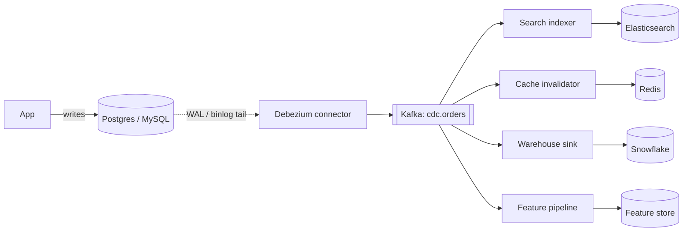

## Definition (interview-ready)

**Change Data Capture (CDC)** is the practice of streaming every row-level change in a database (INSERT, UPDATE, DELETE) as an event to a downstream system, typically by tailing the database's replication log (binlog / WAL). Tools like **Debezium** (Kafka Connect) and **Maxwell** read the log directly so the source app doesn't need to know it's emitting events.

## Why it matters

CDC is how modern systems propagate the source of truth (a database) to caches, search indexes, data warehouses, ML feature stores, downstream services, and audit logs — without dual writes (which would be race-prone) and without rewriting the app. It powers the "event-driven architecture" most teams talk about.



## Core concepts

### Why not just dual-write?

Naive: app writes to DB AND emits an event to Kafka. Problems:
- One can succeed and the other fail → divergence.
- Network blip between the two → ordering issues.
- "Reads from cache after write" inconsistency until the second write propagates.

**Dual writes are an antipattern** because there's no atomic operation across DB + Kafka. Solutions:
1. **CDC** — derive events from the DB log (this topic).
2. **Outbox pattern** — write to DB + outbox row in same transaction; CDC reads outbox.
3. **Distributed transactions (2PC)** — slow, fragile.

### How CDC works

Modern DBs already maintain a replication log:
- Postgres: **WAL** (Write-Ahead Log) + logical decoding.
- MySQL: **binlog** (row-based).
- SQL Server: transaction log.
- MongoDB: **oplog**.

CDC tools subscribe to that log as if they were a replica:
1. Take a **snapshot** of current state (consistent at a single log position).
2. Tail the log forward in order.
3. Translate each row-level change into an event (JSON/Avro/Protobuf) with **before** and **after** images + metadata (op, ts, txn id).
4. Publish to Kafka (or Kinesis, Pulsar).

### Event shape (Debezium-style)

```json
{
  "before": { "id": 42, "name": "Aman", "balance": 100 },
  "after":  { "id": 42, "name": "Aman", "balance": 150 },
  "source": { "table": "users", "ts_ms": 1716985200000, "lsn": "..." },
  "op": "u",   // c=create, u=update, d=delete, r=snapshot read
  "ts_ms": 1716985200000
}
```

### Debezium

- Built on Kafka Connect (so it benefits from connect's cluster/restart semantics).
- Connectors for Postgres, MySQL, MongoDB, SQL Server, Oracle, Cassandra, etc.
- Topic naming: one Kafka topic per source table.
- Schema registry integration (Avro/Protobuf).
- Snapshot mode + incremental.

### Maxwell

- MySQL-only (reads the MySQL binlog).
- Simpler than Debezium; reads binlog, emits JSON.
- Lighter weight; used by smaller setups.

### Use cases

1. **DB → Search**: keep Elasticsearch in sync with Postgres without app changes.
2. **DB → Cache invalidation**: precise key-level invalidation via CDC events.
3. **DB → Warehouse**: stream into Snowflake/BigQuery/S3 (modern ELT).
4. **DB → Microservices**: other services consume events instead of querying the DB.
5. **Audit log**: every change captured with metadata.
6. **DB migration / replatform**: dual-write transitional period.

### Outbox pattern (CDC's best friend)

For when you want **app-emitted** events (not just raw row changes), but still atomically with the DB write:
1. In the same DB transaction: write business data + insert into `outbox` table.
2. CDC tails the `outbox` table.
3. Downstream consumes nicely typed business events; failure-free because DB commit is the boundary.

This is the standard pattern in microservices that need to emit events on writes.

### Ordering and partitioning

- A CDC stream from a single DB is naturally ordered.
- When publishing to Kafka, key by **primary key** of the row → events for the same row land in the same Kafka partition → preserved order at the row level.
- Across rows / transactions, order is preserved within a partition only.

### Compacted topics for CDC

Use Kafka **log compaction** on CDC topics: Kafka retains only the latest event per key. Result: a "table state" topic where the topic represents current state per row. Used by Kafka Streams for state, by other services that want to consume "current state" rather than "stream of changes."

### Snapshot challenges

The initial snapshot of a big table can take hours or days. Debezium 1.6 added **incremental snapshots** (based on Netflix's DBLog watermarking) — slice the snapshot into chunks, alternated with log tailing. Less disruptive.

## How it works (Postgres CDC end-to-end)

```
Postgres:
  Configure logical replication: wal_level=logical, max_replication_slots=N
  CREATE PUBLICATION pub_orders FOR TABLE orders;

Debezium connector:
  Creates replication slot, starts replication stream
  Reads decoded WAL: row-by-row changes
  Snapshot existing rows (consistent at LSN start)
  Publishes to topic "dbserver1.public.orders" partitioned by PK

Consumer:
  Reads topic, applies to Elasticsearch / cache / warehouse
  At-least-once delivery; idempotent on PK
```

## Real-world examples

- **Airbnb**: SpinalTap, an in-house CDC service that streams MySQL (and other source) mutations to Kafka, avoiding dual writes.
- **Shopify**: Debezium + Kafka Connect capturing changes from its sharded MySQL monolith for downstream consumers.
- **Netflix**: DBLog, a watermark-based CDC framework for MySQL and PostgreSQL (the idea behind Debezium's incremental snapshots).
- **LinkedIn**: Databus, and later Brooklin (their own CDC + replication systems).

## Common pitfalls

- **Replication slot retention** (Postgres): an unconsumed slot keeps WAL files forever → disk fills. Monitor lag and slot age.
- **Schema changes**: ALTER TABLE during snapshot or active streaming can break the connector. Use connector's schema-history handling; coordinate DDL.
- **DELETE handling**: CDC emits a "delete" event; downstream must process it (else stale rows linger). Some configs add a **tombstone** event for compaction.
- **Capturing too much**: every column change creates events. Filter columns/tables you actually need (`column.exclude.list`).
- **Long transactions**: Postgres WAL can't be truncated past oldest active txn → unbounded WAL growth. Keep transactions short.
- **Reordering on partition boundaries**: partition by primary key, never round-robin.
- **CDC as a queue**: don't use CDC for transient events — use a dedicated topic + producer for those.
- **Snapshot impact**: snapshotting a hot table can hammer the DB. Use read replica or incremental snapshot.
- **PII**: CDC dumps full row before/after. Mask sensitive columns at the connector level.

## Practice questions

<Practice>

<QA q="What is CDC?" level="easy">

Change Data Capture means streaming every committed change in a database (insert, update, delete) as an event. It works by reading the database's replication log, so the application that writes the data doesn't change at all.

</QA>

<QA q="Why is CDC better than dual-write?" level="easy">

With dual-write, the app writes to the DB and also emits an event. There's no atomic boundary across the two systems, so one can succeed while the other fails, or the process can crash in between. CDC derives events from the DB's own commit log. An event therefore exists **if and only if** the transaction committed, and events can't diverge from the DB state.

</QA>

<QA q="How does Debezium actually capture changes? Why is it better than polling the table?" level="medium">

Debezium is a set of **Kafka Connect source connectors**. Each one attaches to the database's replication stream as if it were a replica:

| Database | Log it reads | Mechanism |
|---|---|---|
| MySQL | binlog (must be `binlog_format=ROW`) | Registers as a replica |
| Postgres | WAL | Logical decoding (`pgoutput`) through a replication slot |
| MongoDB | oplog / change streams | Tails the replica set's change stream |

Why it beats polling with `SELECT … WHERE updated_at > ?`:
- **No missed changes.** Polling can't see deletes, and it misses intermediate updates that happen between two polls. Log tailing sees every committed row change.
- **No query load on the DB.** It reads a log the DB already writes for replication.
- **Low latency.** Events arrive within milliseconds of the commit rather than once per poll interval.
- **Rich events.** Each event carries **before and after images**, the operation type, and source metadata (LSN or binlog position, transaction ID).
- **Commit order.** Changes come out in the order they committed, and keying by primary key preserves per-row order in Kafka.

</QA>

<QA q="How does the outbox pattern work, and what is Debezium's outbox event router?" level="medium">

In the **same DB transaction** as the business change, the app inserts a row into an `outbox` table. The row holds the aggregate type, the aggregate ID, the event type and the payload. CDC tails only the outbox table and publishes those rows.

The **outbox event router** is a Debezium SMT (Single Message Transform). It turns each raw outbox row into a clean business event:
- It routes the event to a topic based on the aggregate type, e.g. `order.events`.
- It uses the aggregate ID as the Kafka key, which gives per-entity ordering.
- It puts the payload in the message value and the event ID in a header.

You get atomicity from the DB transaction and typed domain events instead of raw row diffs. Delivery is still at-least-once, so consumers dedupe on the event ID. The outbox table can be cleaned up right away, because the log has already captured the insert.

</QA>

<QA q="How does Debezium handle the initial snapshot?" level="medium">

On first start, Debezium takes a consistent snapshot of the selected tables:
1. It records a log position.
2. It reads the existing rows and emits each one as an `op: r` (read) event.
3. It switches to streaming the log from the recorded position, so no change between the snapshot and the stream is lost.

For very large tables, **incremental snapshots** (driven by a signal table, using a watermarking technique) read the table in chunks interleaved with live streaming. You don't need a long global lock, and you can resume after a restart.

</QA>

<QA q="How do you preserve row-level ordering in CDC events sent to Kafka?" level="medium">

Key the Kafka records by the row's **primary key**, which is Debezium's default. Every change to a row goes to the same partition, and Kafka keeps strict order within a partition. Don't round-robin, and don't change the partition count of a keyed CDC topic later, because that remaps keys to different partitions.

</QA>

<QA q="How does CDC enable a strangler-pattern migration off a monolith database?" level="hard">

1. Put Debezium on the monolith DB, so every change to the tables you're carving out becomes an event.
2. Build the new service with its own datastore and **populate it from the CDC stream**, using the snapshot plus live changes. The monolith keeps working, unaware.
3. Shift reads to the new service and verify parity with reconciliation jobs.
4. Move writes to the new service. If the monolith still needs the data, flip the direction and have the new service publish events (via an outbox) that the monolith consumes.
5. Retire the old tables.

CDC lets the migration run incrementally with no big-bang cutover and no changes to the legacy code during the transition.

</QA>

<QA q="A Debezium-based pipeline starts dropping events after a deployment. What do you check?" level="hard">

- **Replication slot (Postgres).** Is it still attached, or was it dropped or recreated? A new slot starts from the current position, so everything in between is lost.
- **Log retention.** Was the WAL or binlog purged past the connector's stored offset while it was down? Debezium then has to re-snapshot, or it fails.
- **Schema changes.** Did a DDL change break the schema history topic or the converter?
- **Connector and task state** in Kafka Connect (`/connectors/<name>/status`). Look for failed tasks and exhausted restart limits.
- **Table include list and topic creation.** A new table may not be captured, or its topic may not exist.
- **Connector DLQ / `errors.tolerance=all`.** Bad records may be getting skipped silently.

</QA>

<QA q="How would you use CDC to sync Postgres to Elasticsearch for search?" level="hard">

- Run the Debezium Postgres connector with one topic per table, keyed by primary key.
- Consume with the Elasticsearch sink connector or a custom consumer:
  - `c` / `u` / `r` → **upsert** with document `_id` = primary key. This is idempotent, so redelivery is harmless.
  - `d` → delete the document. Tombstones let compacted topics drop the key.
- Use an SMT such as `ExtractNewRecordState` to flatten the before/after envelope into the document shape.
- Join data across tables with a stream processor, or denormalize in the consumer.
- Backfill from the initial snapshot. Handle schema changes with index templates.

</QA>

<QA q="A team runs `UPDATE huge_table SET col = ?` as one migration on a CDC-captured DB. What happens?" level="scenario">

- One transaction produces **millions of CDC events** at once, so topic lag spikes and every downstream consumer backs up.
- On Postgres, the slot can't advance until the transaction finishes. WAL piles up and disk can fill.
- Downstream systems such as search and caches show a half-applied state while they catch up.
- **Fix:** run migrations as throttled batches (e.g. 1,000 rows per transaction, with pauses), schedule them off-peak, and warn consumer owners first. Or exclude the column from capture if downstream systems don't need it.

</QA>

</Practice>

## Quiz

<Quiz>

<MCQ q="Why is CDC safer than having the app write to the DB and then publish to Kafka?" options={["CDC uses two-phase commit between the DB and Kafka", "Events are derived from the DB's commit log, so an event exists only if the transaction committed", "CDC guarantees exactly-once delivery to every consumer", "CDC batches writes so failures are less likely"]} answer={1}>

Dual writes have no atomic boundary, so one write can succeed while the other fails. CDC reads the database's own log, so events cannot diverge from committed state. Delivery to consumers is still at-least-once, not exactly-once, and no 2PC is involved.

</MCQ>

<MCQ q="Which change does polling with `SELECT ... WHERE updated_at` miss but log-based CDC captures?" options={["Inserts of new rows", "Updates to indexed columns", "Deletes and intermediate updates between two polls", "Changes to tables with a primary key"]} answer={2}>

A deleted row simply disappears from query results, and a row updated twice between polls shows only its final state. Tailing the binlog or WAL sees every committed row change, including deletes, with before and after images.

</MCQ>

<MCQ q="How should CDC events be keyed in Kafka to keep per-row ordering?" options={["By the row's primary key, so all changes to a row land in one partition", "Round-robin, to spread load evenly", "By transaction ID, to keep transactions together", "By table name, so each table maps to one partition"]} answer={0}>

Kafka orders records only within a partition. Keying by primary key (Debezium's default) sends every change to a row to the same partition. Round-robin or other keys can reorder changes to the same row.

</MCQ>

<MCQ q="A Postgres Debezium connector has been down for a week and the primary's disk is filling. What is the likely cause?" options={["The Kafka topic has no retention limit", "Debezium's snapshot is still running on the primary", "The publication includes too many tables", "The unconsumed replication slot is retaining WAL"]} answer={3}>

A logical replication slot holds WAL until its consumer confirms it. An abandoned or lagging slot keeps WAL forever, so disk grows. Monitor slot lag and age, and drop slots that are no longer used.

</MCQ>

<MCQ q="What does the `op` field `r` mean in a Debezium change event?" options={["A row was replaced by an update", "The row was emitted during a snapshot read", "The event is a retry of a failed delivery", "The row was restored after a delete"]} answer={1}>

Debezium uses `c` for create, `u` for update, `d` for delete and `r` for read, which marks rows emitted during the initial or incremental snapshot.

</MCQ>

<MCQ q="What advantage do Debezium incremental snapshots (added in 1.6) have over the classic initial snapshot?" options={["They skip rows that have not changed since the last snapshot", "They avoid the need for a replication slot", "They read the table in chunks interleaved with live streaming and can resume after a restart", "They run only on read replicas"]} answer={2}>

Incremental snapshots, based on Netflix's DBLog watermarking, read the table in chunks while log streaming continues, avoid a long global lock, and resume where they left off. They are triggered through a signal table.

</MCQ>

<MCQ q="In the outbox pattern with Debezium's outbox event router, what becomes the Kafka record key?" options={["The aggregate ID, which gives per-entity ordering", "The outbox row's auto-increment ID", "The event type, so similar events group together", "A random UUID, to balance partitions"]} answer={0}>

The router takes the aggregate ID as the key and routes by aggregate type to a topic. Keying by aggregate ID keeps all events for one entity in order. The event ID goes in a header, which consumers use for dedup.

</MCQ>

<MCQ q="A team runs `UPDATE huge_table SET col = 1` in one transaction on a CDC-captured Postgres database. What is the best mitigation?" options={["Raise Kafka's `message.max.bytes`", "Switch the connector to polling mode for the migration", "Pause all consumers until the update finishes", "Run the migration in small throttled batches, or exclude the column from capture"]} answer={3}>

One huge transaction emits millions of events at once, spikes lag everywhere, and pins the slot until it finishes, so WAL piles up. Small batches with pauses, off-peak timing, warning consumer owners, or excluding the column all reduce the blast radius.

</MCQ>

</Quiz>

## TL;DR cheat sheet

- CDC = stream row-level changes by tailing the DB replication log (binlog/WAL).
- Replaces fragile dual-writes.
- Debezium (multi-DB, Kafka Connect) and Maxwell (MySQL, simpler) are the common tools.
- Event shape: before/after/op/ts/source. Partition Kafka topic by primary key.
- Use **outbox pattern** for app-emitted business events.
- Use **compacted topics** when you want "current state per key."
- Watch replication slot retention, WAL growth, schema changes, PII in row dumps.
- Initial snapshot can be heavy — use incremental in modern Debezium.

## Go deeper

- **Debezium docs**: [debezium.io/documentation](https://debezium.io/documentation/) — examples per DB.
- **Debezium blog**: ["Reliable Microservices Data Exchange With the Outbox Pattern"](https://debezium.io/blog/2019/02/19/reliable-microservices-data-exchange-with-the-outbox-pattern/).
- **Martin Kleppmann**: ["Turning the Database Inside Out"](https://www.youtube.com/watch?v=fU9hR3kiOK0) — the philosophy behind CDC.
- **Microservices.io**: [Outbox pattern](https://microservices.io/patterns/data/transactional-outbox.html).
- **DDIA Chapter 11** — change streams.
- **Gunnar Morling's blog** ([morling.dev](https://www.morling.dev/), former Debezium lead): superb writeups.
