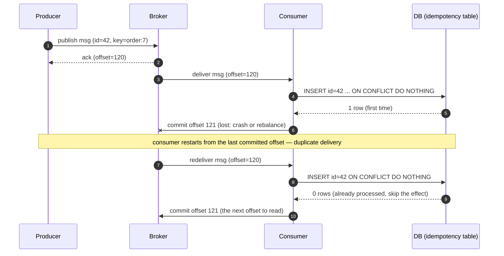

## Definition (interview-ready)

**Delivery semantics** describe what guarantees a messaging system gives between producer, broker, and consumer:
- **At-most-once**: message may be lost, never duplicated.
- **At-least-once**: message never lost, may be duplicated.
- **Exactly-once**: each message's effect is applied exactly once (only possible under specific constraints, such as a transactional boundary or an idempotent consumer).

**Idempotency** is the property that processing the same message multiple times yields the same result — the practical fix that makes at-least-once delivery safe. A **dead-letter queue (DLQ)** holds messages that can't be processed after retries.

**One-liner:** At-most-once can lose messages, at-least-once can duplicate them, and exactly-once only holds inside a transactional boundary such as Kafka-to-Kafka, so most real systems use at-least-once delivery with idempotent consumers and a DLQ for poison messages.

## Why it matters

Distributed systems lose, duplicate, or reorder messages. Pretending otherwise is the #1 source of duplicate charges, double-shipped orders, lost notifications. The right answer in 95% of production designs: **at-least-once delivery + idempotent consumers + DLQs for poison messages.**



## Core concepts

### The three semantics

| Semantic | Loss | Duplicate | When to use |
|---|---|---|---|
| At-most-once | possible | never | telemetry, metrics, fire-and-forget |
| At-least-once | never | possible | almost everything (with idempotency) |
| Exactly-once | never | never | financial systems within a closed boundary |

### Why exactly-once is hard

The classic two-generals problem: any protocol between two unreliable parties has a finite chance of one party not knowing whether the other received the message. Without help from the application, you can't have both "no loss" and "no duplicates" through arbitrary failures.

**Exactly-once is achievable only when**:
- All side effects are within a transactional boundary (e.g., Kafka transactions writing to Kafka).
- Or the consumer is **idempotent** end-to-end (which is functionally equivalent to exactly-once from the user's perspective).

### Kafka exactly-once (EOS)

Since Kafka 0.11+:
- **Idempotent producer**: producer ID + sequence number per partition; broker dedupes retries.
- **Transactions**: atomic write to multiple partitions/topics + atomic commit of consumer offsets. Either all writes + offset commit succeed, or none. Within Kafka, this is "exactly-once."
- **Outside Kafka** (writes to a DB, calling an external API): you still need application-level idempotency.

The mechanics — coordinator, commit markers, zombie fencing, `read_committed` — are in [Kafka Transactions & EOS](/learn/notes/kafka-transactions-eos/).

### Idempotency in practice

A handler is idempotent if `handle(msg)` produces the same outcome whether called once or 100 times.

Patterns:
- **Idempotency key**: the message has a unique ID; consumer tracks seen IDs in a store (`Redis SET NX EX` or DB unique index).
- **Conditional updates**: `UPDATE ... WHERE version = X` — second call no-ops.
- **Idempotent, order-insensitive operations**: set adds, "keep the max" updates, CRDT merges — order and duplication don't matter. Careful: a plain counter increment is commutative but **not** idempotent, because a duplicate counts twice.
- **Upsert with natural key**: `INSERT ... ON CONFLICT DO NOTHING` (or `DO UPDATE`).

### Consumer offset commit timing

- **Commit before processing** = at-most-once (loss on crash before processing).
- **Commit after processing** = at-least-once (duplicate on crash after processing, before commit).
- **Auto-commit** in Kafka is time-based: during `poll()`, every `auto.commit.interval.ms` (default 5 s), it commits the offsets returned by earlier polls — it doesn't know whether processing finished. Prefer **manual commit after processing**.
- **Offsets in your DB**: store the consumed offset in the same local transaction as the business change and `seek()` to it on startup — offset and effect become atomic. See [Consumers & rebalancing](/learn/notes/kafka-consumer-rebalancing/) for commit APIs, retries and rebalance-induced duplicates.

### Producer reliability

- `acks=0`: at-most-once. Producer doesn't wait. Fast, lossy.
- `acks=1`: leader-only. Loss possible on leader failure before replication.
- `acks=all` + `enable.idempotence=true` (the producer defaults since Kafka 3.0): at-least-once with broker-side dedupe of retries (effectively exactly-once into the broker, per partition, for one producer session).

See [Producer deep dive](/learn/notes/kafka-producer/) for batching, retries, `delivery.timeout.ms` and ordering under retries.

### Dead-letter queue (DLQ)

A separate topic/queue for messages the consumer couldn't process after retries. Lets the main pipeline keep moving while you investigate poison messages.

Patterns:
- **Retry topic** with backoff: failed message → `topic.retry.1` (1min delay) → `topic.retry.5` → `topic.dlq`.
- **DLQ as halt**: critical processes stop on DLQ entry; alert and human review.
- **DLQ as triage**: non-critical, investigate later.

### Out-of-order messages

Even within a partition, application-level "reorder" can happen if you reset offsets or replay. Cross-partition order is never guaranteed. Design handlers to be **commutative** where possible, or use sequence numbers to detect skew.

## How it works (a sample at-least-once + idempotency design)

```
Producer side:
  acks=all, enable.idempotence=true, retries=max
  Send (orderId="o123", event="created", ...)

Broker:
  Stores message, replicates, dedupes by (producerId, seq)

Consumer side:
  Receive message
  Begin DB transaction:
    INSERT INTO processed_events (order_id, type) VALUES ('o123','created')
       ON CONFLICT DO NOTHING       -- idempotency check
    If 0 rows were inserted: skip (already processed)
    Else: apply business effect
  Commit DB
  Commit Kafka offset
  Loop
```

On duplicate delivery: the `INSERT` inserts 0 rows because of the conflict, the business effect is skipped, and the offset is committed normally.

## Real-world examples

- **Stripe**: idempotency keys on every API mutation. Payments would otherwise duplicate-charge cards. Their public doc on idempotency is a classic.
- **Square**: similar — payment-creating endpoints such as CreatePayment require a client-generated idempotency key.
- **Kafka Streams**: built on Kafka transactions; `processing.guarantee=exactly_once_v2` provides exactly-once processing semantics inside the Kafka world.

## Common pitfalls

- **Assuming exactly-once exists for free**: no, it requires application work or strict boundary (Kafka-to-Kafka transactional).
- **Idempotency only at the API layer, not internally**: a retry deep in the system bypasses the API layer's dedupe. Pass the idempotency key through.
- **Idempotency store with TTL too short**: client retries after TTL → duplicate processed. TTLs should exceed all retry windows.
- **Side effects in non-idempotent external systems** (emails, webhooks, payment providers): you can't put the external call in your DB transaction. Pass an idempotency key if the provider accepts one, and record a sent-flag in your DB right after the call. A crash between the call and the flag can still cause one duplicate.
- **DLQ as black hole**: nobody reviews. Set up alerting and a runbook.
- **Auto-commit + processing in worker thread**: race condition — offset committed before work done, work fails, message lost.
- **Mistaken "kafka exactly-once = no app work"**: only Kafka-to-Kafka. If you write to a DB or call an external service, you still need idempotency.

## Practice questions

<Practice>

<QA q="Name the three delivery guarantees and how you get each one with Kafka." level="easy">

- **At-most-once:** may lose, never duplicates. Use `acks=0` or fire-and-forget on the producer, or commit offsets *before* processing. Fine for metrics and telemetry.
- **At-least-once:** never loses, may duplicate. Use `acks=all` with retries on the producer, and commit *after* processing on the consumer. This is the practical default, and it needs idempotent consumers.
- **Exactly-once:** each message affects state once. Inside Kafka you get it with the idempotent producer plus transactions. Across external systems you approximate it with at-least-once plus idempotency.

</QA>

<QA q="What does at-least-once delivery mean?" level="easy">

The system guarantees no message is lost, but the same message may be delivered (and processed) more than once. The consumer must be idempotent for that to be safe.

</QA>

<QA q="Why is exactly-once hard?" level="easy">

Any acknowledgment between sender and receiver can be lost. Then the sender doesn't know whether to retry: if it retries, the receiver may get a duplicate, and if it doesn't, the message may be lost. Solving this without help from the application needs a transactional boundary.

</QA>

<QA q="How would you make a payment-charging consumer idempotent?" level="medium">

Use the payment intent ID (or a client-provided idempotency key) as a unique key. In one DB transaction:

1. Try to insert the key into a `processed` table that has a unique constraint.
2. If it conflicts, the message was already processed, so do nothing.
3. Otherwise perform the charge and commit.

If the charge calls an external API, pass the same idempotency key to the provider. The full design is in [Transactions & EOS](/learn/notes/kafka-transactions-eos/).

</QA>

<QA q="When should you commit Kafka offsets — before or after processing?" level="medium">

**After** processing. Committing before means a crash mid-processing loses the message. Committing after means a crash before the commit may redeliver it, which is safe with an idempotent consumer. Details are in [Consumers & rebalancing](/learn/notes/kafka-consumer-rebalancing/).

</QA>

<QA q="What is a DLQ and when do you send a message there?" level="medium">

A dead-letter queue holds messages the consumer couldn't process after some number of retries. Send a message there when it can't be deserialized (a poison pill), when it fails validation every time, or when it has used up its retry budget.

The main pipeline keeps moving, and DLQ items are reviewed manually or by a separate process. Alert on DLQ depth and have replay tooling.

</QA>

<QA q="Kafka claims exactly-once. Why isn't that enough for your application?" level="hard">

Kafka's exactly-once only covers what happens **inside Kafka**: an atomic produce plus offset commit, with idempotent producers. If your consumer writes to an external system (Postgres, an HTTP API), that write isn't part of the Kafka transaction, and an aborted or retried transaction runs it again. You still need application-level idempotency on the external side.

</QA>

<QA q="Design retry + DLQ topology for a payment-event consumer." level="hard">

- Main topic: `payment.events`.
- On a transient failure (DB timeout, 5xx from the provider), publish to `payment.events.retry.1` (30 s delay).
- When a tier runs out of retries, escalate to `payment.events.retry.5` (5 min delay), then `.retry.15`.
- When all retries fail, publish to `payment.events.dlq` and alert.
- Each retry topic has its own consumer that waits until the delay has passed.
- The DLQ is monitored, and entries need human review with a runbook.
- The main consumer is idempotent, so retries are safe.

Caveat: retry topics break per-key ordering. If payment events for one ID must apply in order, use bounded blocking retries, or park the whole key.

</QA>

<QA q="A bug causes the producer to publish duplicates and the consumer is not idempotent. How do you recover?" level="hard">

**Short term:** stop the service that's producing duplicates. Assess the damage by querying the downstream system for duplicate records (for example, orders with the same external ID). Correct the affected rows by hand, and pause any replays.

**Long term:** fix the producer, which is likely missing idempotence config or has a retry bug. Make the consumer idempotent using a natural unique key (order ID + event type) and a `processed_events` table with a unique index. Alert on the DLQ.

</QA>

</Practice>

## Quiz

<Quiz>

<MCQ q="A consumer commits its offset and then processes the record. It crashes mid-processing. What guarantee does this give?" options={["At-least-once", "At-most-once: the record is skipped after restart", "Exactly-once", "No guarantee; the record is processed twice"]} answer={1}>

Committing before processing means the restarted consumer resumes after the record, so it is lost but never duplicated. Process-then-commit gives at-least-once.

</MCQ>

<MCQ q="How does Kafka's auto-commit decide when to commit offsets?" options={["After every N records", "After each record is processed successfully", "Only on consumer shutdown", "Time-based: during poll(), every auto.commit.interval.ms (default 5 s)"]} answer={3}>

Auto-commit runs inside poll() on a timer and commits offsets returned by earlier polls without knowing whether processing finished. There is no record-count trigger.

</MCQ>

<MCQ q="Kafka transactions give exactly-once for which scope?" options={["Read-process-write flows that stay inside Kafka: produced records and consumed offsets commit atomically", "Any database write made by the consumer", "HTTP calls made by the consumer", "Emails sent by the consumer"]} answer={0}>

Kafka EOS covers records and offsets within Kafka. Side effects in external systems are outside the transaction and still need idempotency.

</MCQ>

<MCQ q="Which mechanism dedupes producer retries on the broker?" options={["Consumer group offsets", "Log compaction", "Producer ID plus per-partition sequence numbers from the idempotent producer", "The DLQ"]} answer={2}>

The idempotent producer stamps batches with a PID and sequence numbers so the broker can ack duplicates without rewriting them. Compaction keeps the latest value per key and is unrelated to retries.

</MCQ>

<MCQ q="An idempotency store keeps processed IDs with a 1-hour TTL, but clients may retry for up to 24 hours. What goes wrong?" options={["Nothing, TTLs do not affect dedup", "Retries arriving after the TTL are processed again as duplicates", "The store rejects all retries", "Messages go to the DLQ"]} answer={1}>

Once the ID expires, a late retry looks new. The dedup window must exceed every retry window in the system.

</MCQ>

<MCQ q="Why is exactly-once hard in general between two unreliable parties?" options={["Disks are too slow", "Brokers cannot store message IDs", "TCP does not support acknowledgements", "A lost acknowledgement leaves the sender unable to tell whether to retry, risking either a duplicate or a loss"]} answer={3}>

This is the two-generals problem: without a transactional boundary or idempotent receiver, the sender must choose between possible duplicates and possible loss.

</MCQ>

<MCQ q="What is the main risk of auto-commit when records are processed on a separate worker thread?" options={["Offsets can be committed before the worker finishes, so a crash loses those records", "Records are processed twice in every case", "The consumer cannot join a group", "Auto-commit is disabled for worker threads"]} answer={0}>

poll() keeps committing on its timer regardless of worker progress, so a crash can skip unfinished records. That is why manual commit after processing is preferred.

</MCQ>

<MCQ q="For most production designs, what is the recommended default combination?" options={["At-most-once with no retries", "Exactly-once transactions for every external side effect", "At-least-once delivery with idempotent consumers and a monitored DLQ", "Auto-commit with acks=0"]} answer={2}>

At-least-once never loses data, idempotency makes duplicates harmless, and a DLQ isolates poison messages. Kafka transactions do not cover external side effects, and the other options lose data.

</MCQ>

</Quiz>

## TL;DR cheat sheet

- **At-most-once**: lose. **At-least-once**: duplicate. **Exactly-once**: hard, needs transactional boundary.
- Default: **at-least-once + idempotent consumer**.
- Kafka producer: `acks=all`, `enable.idempotence=true`, max retries.
- Consumer: manual offset commit **after** processing.
- Idempotency = unique key + dedupe store (DB unique index or Redis NX) + same transaction as business effect.
- Pass idempotency key through all layers, including downstream APIs.
- DLQ for poison messages; alert and have a runbook.
- Kafka EOS is within Kafka only — external writes still need idempotency.

## Go deeper

- **Confluent**: ["Exactly-Once Semantics Are Possible: Here's How Kafka Does It"](https://www.confluent.io/blog/exactly-once-semantics-are-possible-heres-how-apache-kafka-does-it/).
- **Stripe**: ["Designing robust and predictable APIs with idempotency"](https://stripe.com/blog/idempotency) — the canonical post.
- **Martin Kleppmann et al.**: ["Online Event Processing"](https://martin.kleppmann.com/2019/05/01/olep-cacm.html) (CACM, 2019) — consistency via event logs instead of distributed transactions.
- **DDIA Chapter 11** — Stream Processing.
- **Confluent docs**: [Kafka Streams processing guarantees](https://docs.confluent.io/platform/current/streams/concepts.html#processing-guarantees).
- **AWS**: [SQS retry/DLQ patterns](https://docs.aws.amazon.com/AWSSimpleQueueService/latest/SQSDeveloperGuide/sqs-dead-letter-queues.html).
