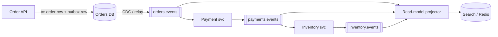

## Definition (interview-ready)

Kafka is rarely "the architecture" — it is the **durable, ordered, replayable spine** that event-driven patterns hang off. A **saga** coordinates a multi-service business transaction through events or commands on topics, undoing work with compensations instead of rollbacks. **Event sourcing** treats an append-only sequence of events as the source of truth. **CQRS** splits the write model from one or more read models, each built by a consumer group projecting a topic. The **outbox** makes "change the DB and publish the event" atomic. Knowing these patterns means knowing which Kafka guarantee each one leans on — per-key ordering, replay, consumer-group independence, at-least-once delivery — and where Kafka's guarantees stop.

## Why it matters

Senior interviews almost never ask "what is a partition?" in isolation. They ask "design order checkout across five services" and watch whether you can turn a whiteboard of boxes into topics, keys, idempotent consumers and failure paths. These patterns are the vocabulary for that conversation. They also come with sharp edges — sagas that silently half-complete, projections that are minutes stale, event stores that can't load one aggregate efficiently — and interviewers probe exactly those edges.

The generic theory of sagas, 2PC and TCC lives in [Distributed Transactions](/learn/notes/distributed-transactions/); event notification vs state transfer and EDA trade-offs live in [Sync vs Async vs Event-Driven](/learn/notes/sync-async-event-driven/). This note is about the **Kafka-specific mechanics**.



## Core concepts

### Building block: the outbox (why every pattern starts here)

Every pattern below assumes "the service changed its state **and** an event was published". Doing those as two independent writes (DB commit, then `producer.send`) is the **dual-write problem**: a crash or a failed send between them leaves the DB and the event stream disagreeing forever, and there is no distributed transaction spanning Postgres and Kafka to save you.

The **transactional outbox** fixes it by making the event part of the DB transaction:

```sql
BEGIN;
  UPDATE orders SET status = 'PLACED' WHERE id = 42;
  INSERT INTO outbox (id, aggregate_id, type, payload)
       VALUES ('evt-9f1', '42', 'OrderPlaced', '...json...');
COMMIT;
```

A separate publisher moves outbox rows to Kafka — either a **polling relay** (`SELECT ... WHERE published = false ORDER BY id FOR UPDATE SKIP LOCKED`, send, mark published) or **CDC** (Debezium tails the WAL/binlog and its outbox event router turns each row into a record keyed by `aggregate_id`). Publishing is at-least-once (crash after send, before mark), so consumers dedupe on the outbox event ID. Full CDC mechanics: [Change Data Capture](/learn/notes/change-data-capture/).

### Saga over Kafka: choreography

Each service owns a local transaction and reacts to events from others. Nobody is in charge.

```
OrderSvc      ──OrderCreated──▶  orders.events
PaymentSvc    consumes orders.events      ──PaymentCaptured / PaymentFailed──▶ payments.events
InventorySvc  consumes payments.events    ──StockReserved / OutOfStock──▶     inventory.events
PaymentSvc    consumes inventory.events   on OutOfStock → RefundPayment (compensation)
OrderSvc      consumes all three          → status = CONFIRMED / CANCELLED
```

Kafka mechanics that make it work:

- **Key every event by the saga's business ID** (`orderId`). All events for one order land on one partition per topic, so each participant sees that order's events in order.
- **One topic per domain/aggregate** (`payments.events`), with an event-type header — not one topic per event type. Fewer topics, and ordering between `PaymentCaptured` and `PaymentRefunded` for the same order is preserved because they share a partition.
- **Each participant is its own consumer group**, so adding a new reactor (fraud scoring, analytics) is just a new `group.id` — no producer change.

Choreography is cheap to start and maximally decoupled. It degrades as steps grow: the flow exists only implicitly across N codebases, cyclic event dependencies creep in, and "why is order 42 stuck?" requires stitching logs from every service.

### Saga over Kafka: orchestration

A dedicated orchestrator (an `OrderSaga` service, or a workflow engine like Temporal/Camunda) owns an explicit state machine. It sends **commands** to participants on request topics and consumes their **replies**.

```
Orchestrator ──ChargePayment(orderId)──▶ payments.commands
PaymentSvc   ──PaymentCharged(orderId)──▶ saga.replies
Orchestrator  state: PAYMENT_DONE → send ReserveStock
              timeout 30s with no reply → send CancelPayment, state: COMPENSATING
```

- Commands go to a topic **owned by the receiving service** (single consumer group); replies go to a topic the orchestrator owns. Correlate on `sagaId` carried in headers.
- The orchestrator must persist its saga state (DB row per saga, or a compacted topic / Kafka Streams state store keyed by `sagaId`) and drive **timeouts** — Kafka has no native delayed delivery, so timeouts come from a scheduler, a DB poll, or punctuators in Kafka Streams.

| | Choreography | Orchestration |
|---|---|---|
| Control flow | Implicit, distributed | Explicit state machine |
| Coupling | Services know only events | Orchestrator knows every participant |
| Visibility | Hard (need tracing) | One place to query saga status |
| Timeouts / compensation | Each service invents its own | Centralised |
| Good for | 2–4 steps, stable flows | Many steps, branching, SLAs |

Both require **idempotent participants** (redelivery is normal), **compensations that are themselves idempotent and retryable**, and correlation IDs end-to-end.

### Event sourcing — and where Kafka falls short as the store

In event sourcing the event log *is* the state. An account isn't a row with `balance = 70`; it's `Opened, Deposited(100), Withdrew(30)`, and the balance is a fold over those events. Snapshots shortcut long folds. You gain a perfect audit trail, time travel ("state as of last Tuesday"), and the ability to build brand-new read models by replay.

Kafka looks perfect: durable, ordered, replayable, and compacted topics can hold snapshots. But an event **store** needs two things Kafka doesn't do well:

1. **Load one aggregate's history cheaply.** To rebuild account 42 you need just its events. In Kafka they are interleaved with millions of other accounts in the same partition — you'd scan the partition. A topic-per-aggregate or partition-per-aggregate design doesn't scale to millions of aggregates.
2. **Optimistic concurrency on append.** Two concurrent commands on the same aggregate must not both succeed against stale state. Event stores support "append only if the current version is N". Kafka's produce API has no conditional append — the idempotent producer dedupes retries, it doesn't reject conflicting writers.

The pragmatic architecture: keep the **write-side source of truth** in something with per-aggregate reads and conditional writes (a purpose-built event store like EventStoreDB, or simply an `events` table with a unique `(aggregate_id, version)` constraint), and use Kafka (via outbox/CDC) as the **distribution backbone** feeding projections and other services.

### CQRS with Kafka as the spine

CQRS separates the model that accepts **commands** (normalised, enforces invariants) from models that serve **queries** (denormalised, shaped per screen or use case). Kafka is what connects them:

```
write side ──outbox/CDC──▶ orders.events ──▶ group: search-projector  ──▶ Elasticsearch
                                         ──▶ group: cache-projector   ──▶ Redis
                                         ──▶ group: analytics-sink    ──▶ warehouse
```

- **Each read model is its own consumer group**, with its own offsets, lag and failure isolation. A broken Elasticsearch projector falls behind without affecting Redis.
- **Rebuilding a projection** = create a new group (or reset offsets) and replay from earliest into a fresh index, then swap traffic. This only works if retention (or a compacted topic, or an archive in S3) still holds the full history — decide that up front.
- **Projections must be idempotent and order-aware**: upsert by entity ID and ignore events whose version is not newer than what's stored (`WHERE version < :incoming`).

The cost you must name in interviews is **eventual consistency between write and read sides**. Strategies for the "I just saved it and it's not there" problem:

| Strategy | How |
|---|---|
| Read-your-writes from the write model | For the user who just wrote, read the entity from the write DB for a short window |
| Version-checked read | Write returns `version=7`; the client polls/blocks the read model until it reports `version >= 7` |
| Optimistic UI | Client renders the expected state immediately; reconciles when the projection catches up |
| Lag SLO | Alert when projector lag in seconds exceeds the product's tolerance |

### Notification system on Kafka

A compact, Kafka-centric version of [Design a Notification System](/learn/notes/hld-notification-system/):

1. **Ingest**: any service publishes `NotificationRequested` (channel-agnostic: user, template, params) to `notifications.requests`, keyed by `userId` so one user's notifications stay ordered and rate-limitable in one place.
2. **Route**: a router group applies preferences, opt-outs, quiet hours and templating, then fans out to `notifications.email`, `notifications.sms`, `notifications.push`. Separate topics let each channel scale, throttle and fail independently.
3. **Priority isolation**: transactional (OTP, password reset) and marketing traffic get **separate topics and consumer groups**. A 50M-message campaign must never sit in front of an OTP — a single topic can't prioritise because consumers read partitions strictly in order.
4. **Deliver**: per-channel workers call the provider (SES, Twilio, FCM) with bounded exponential backoff, respecting provider rate limits by pacing consumption; permanent failures go to a per-channel DLQ.
5. **Idempotency**: a `notificationId` dedupe table checked before sending — redelivery after a rebalance must not send the OTP twice.
6. **Status**: provider webhooks publish `DeliveryStatus` events; a projector builds per-user history and delivery-rate dashboards.

### Migrating a synchronous REST flow to Kafka without downtime

Big-bang rewrites fail. Use a **strangler** sequence:

1. **Publish alongside the call.** Keep the REST call; additionally emit the event via the outbox (never a raw dual-write).
2. **Shadow consumers.** The downstream service builds its async handler against real production events but runs it in shadow mode (writes to a side table, or no-op), while the sync path still drives behaviour. Compare outcomes with reconciliation jobs.
3. **Cut over per consumer behind a flag.** Once parity is proven, the downstream stops being called synchronously and acts on events. The flag gives instant rollback.
4. **Fix the caller's contract.** Callers used to get a synchronous answer. Either return `202 Accepted` with a status URL / webhook / push, or keep the *validation* synchronous (stock check, fraud pre-check) and move only the side effects async.
5. **Schema discipline from day one** — Schema Registry with BACKWARD compatibility (see [Schema Evolution](/learn/notes/schema-evolution/)).
6. **Retire the REST path** after a bake period. Replay becomes the onboarding story for the next consumer.

### When NOT to use Kafka

| Need | Better fit | Why |
|---|---|---|
| Simple job queue, modest volume | SQS, RabbitMQ, or a Postgres table with `SKIP LOCKED` | Per-message ack, retry and visibility timeout built in; far less to operate (Kafka's share groups, KIP-932, production-ready in 4.2, add per-record acks but not delays or priorities) |
| Request/response | HTTP / gRPC | Async request-reply adds correlation, reply topics and timeouts for nothing |
| Delayed or scheduled delivery, per-message TTL | RabbitMQ (delayed exchange, TTL), SQS delay queues, a scheduler | Kafka has no native delay; you'd build tiered retry topics |
| Strict global ordering | A single-writer DB log | Total order means one partition → zero parallelism |
| Large blobs (files, video) | Object storage + claim check | Kafka is tuned for KB-sized records; ~1 MB default cap |
| Content-based routing per message | RabbitMQ topic/header exchanges | Kafka consumers read whole partitions and filter client-side |
| Tiny team, low volume | Managed queue or DB table | Cluster operations or a managed bill outweigh the benefits |

## How it works (an order saga end-to-end, choreographed)

```
1. POST /orders → OrderSvc: tx { insert order(PENDING), insert outbox(OrderCreated, key=orderId) } → 202 Accepted
2. Debezium → orders.events [partition = hash(orderId)]
3. PaymentSvc (group payment): dedupe on eventId → charge with idempotency key = orderId
      → outbox(PaymentCaptured) → payments.events
4. InventorySvc (group inventory): consumes PaymentCaptured → reserve stock
      ├─ ok   → StockReserved
      └─ none → OutOfStock
5. PaymentSvc consumes OutOfStock → refund (compensation, idempotent on orderId) → PaymentRefunded
6. OrderSvc consumes terminal events → CONFIRMED or CANCELLED
7. Status projector (own group) folds all three topics → order-status read model for the UI
Failures at any consumer: bounded retries → DLQ → alert; offsets committed only after local tx commits
```

## Real-world examples

- **Debezium's outbox event router** is a widely used, documented implementation of outbox-via-CDC.
- **Uber Cadence → Temporal** popularised durable orchestration engines that teams pair with Kafka for long-running sagas.
- **The Confluent and microservices.io pattern catalogues** describe saga, outbox, CQRS and event sourcing with Kafka as the transport — these are the canonical references interviewers have read.

## Common pitfalls

- **Dual-writing instead of using an outbox** — the most common real bug in event-driven systems.
- **Keying saga events by something other than the saga ID** — events for one order spread across partitions and arrive out of order.
- **Non-idempotent compensations** — a redelivered `RefundPayment` refunds twice.
- **No timeouts in sagas** — a participant that never replies leaves the saga stuck forever in `PENDING`.
- **Using Kafka as the event store** for aggregates that need per-entity reads and conditional appends.
- **Projections that assume exactly-once, in-order arrival** — upsert with version checks instead.
- **Short retention on topics that projections rebuild from** — the replay you'll need in six months is already deleted.
- **One topic for all notification priorities** — OTPs queue behind marketing blasts.
- **Choreography sprawl** — a 9-step flow nobody can draw; switch to orchestration once flows branch.

## Practice questions

<Practice>

<QA q="What is the dual-write problem, and how does the transactional outbox solve it?" level="easy">

A service needs to update its database **and** publish an event, but there's no atomic transaction spanning both systems. If the process crashes or the send fails between the two writes, one happens without the other: downstream never hears about a real order, or hears about one that was rolled back.

Outbox: write the business change **and** an `outbox` row in the **same local DB transaction**. A relay (polling with `SKIP LOCKED`, or CDC like Debezium) publishes outbox rows to Kafka afterwards. Result: an event is published *if and only if* the transaction committed. Delivery is at-least-once, so consumers dedupe on the outbox event ID.

</QA>

<QA q="Explain the saga pattern. How do choreography and orchestration differ when built on Kafka?" level="medium">

A saga runs a cross-service business transaction as a sequence of **local transactions**; if a later step fails, earlier steps are undone with **compensating actions** (refund, release stock) rather than a rollback.

- **Choreography**: services react to each other's events on domain topics (`orders.events` → payment → `payments.events` → inventory...). No central brain, very decoupled, cheap for 2–4 steps — but the flow is implicit, hard to debug, and prone to cyclic dependencies as it grows.
- **Orchestration**: an orchestrator holds an explicit state machine, sends **commands** to participant-owned topics and consumes **replies**, handling timeouts and compensation centrally. Better visibility and control; costs an extra service that becomes a design hotspot.

Either way: key by `sagaId`/`orderId` for ordering, make every participant and compensation idempotent, propagate correlation IDs, and implement timeouts (Kafka has no native delay — use a scheduler, DB poll, or Kafka Streams punctuators).

</QA>

<QA q="Why should saga events be keyed by the business ID (e.g. orderId)?" level="easy">

Kafka only orders records **within a partition**, and the partition is chosen by hashing the key. Keying by `orderId` puts every event for one order on the same partition of each topic, so `PaymentCaptured` can't be processed after `PaymentRefunded` for the same order. Different orders still spread across partitions for parallelism.

</QA>

<QA q="What is event sourcing, and why is Kafka a poor choice as the primary event store?" level="medium">

Event sourcing stores every state change as an immutable event; current state is a replay (fold) of those events, optionally from a snapshot. Benefits: full audit, temporal queries, rebuildable projections, natural CQRS fit.

Kafka is great for **distributing** events but weak as the **store**:

1. **No efficient per-aggregate load** — one entity's events are interleaved with millions of others in a partition; rebuilding it means scanning.
2. **No optimistic concurrency** — there's no "append only if version = N", so two concurrent commands can both append against stale state.

Common answer: keep the write-side truth in an event store or an `events` table with a unique `(aggregate_id, version)` constraint, and publish to Kafka via outbox/CDC for projections and other services.

</QA>

<QA q="Explain CQRS and how Kafka enables it. What trade-offs must you call out?" level="medium">

CQRS splits the **write model** (commands, invariants, normalised) from **read models** (denormalised per query). The write side publishes events (outbox/CDC); each read model is built by its **own consumer group** — Elasticsearch for search, Redis for hot lookups, a warehouse for analytics. Each is independently scalable, isolated in failure, and **rebuildable by replaying** the topic.

Trade-offs:
- **Eventual consistency** between write and read: handle with read-your-writes from the write model, version-checked reads, or optimistic UI.
- **Duplicated storage** and more moving parts.
- **Projection versioning/rebuilds** when schemas change — and retention must keep enough history to rebuild.

</QA>

<QA q="How do you build idempotent, order-tolerant projections?" level="medium">

- **Upsert by entity ID**, never blind insert.
- Carry a **version** (or source LSN/offset) in each event and apply only if newer: `UPDATE ... WHERE id = ? AND version < ?`.
- Dedupe non-idempotent side effects with a processed-event table updated in the same local transaction.
- Commit offsets **after** the projection write; on crash, reprocessing is harmless.

</QA>

<QA q="Design a notification system (email, SMS, push) using Kafka." level="hard">

1. **Ingest**: services publish channel-agnostic `NotificationRequested` to `notifications.requests`, keyed by `userId`.
2. **Router** consumer group: preferences, opt-outs, quiet hours, templating; fans out to `notifications.email` / `.sms` / `.push` so channels scale and fail independently.
3. **Priority isolation**: separate topics and groups for transactional (OTP) vs marketing — consumers read partitions in order, so a single topic can't prioritise.
4. **Channel workers**: call SES/Twilio/FCM with bounded exponential backoff + jitter; pace consumption to provider rate limits; permanent failures to a per-channel DLQ with replay tooling.
5. **Idempotency**: `notificationId` dedupe table so rebalances/redeliveries don't double-send.
6. **Status**: provider webhooks → `DeliveryStatus` events → projector for user history and delivery dashboards; alert on DLQ depth and lag.

See [Design a Notification System](/learn/notes/hld-notification-system/) for the full HLD.

</QA>

<QA q="How would you migrate a synchronous REST call chain to Kafka without downtime?" level="hard">

1. **Publish alongside** the existing call, via outbox (not dual-write).
2. **Shadow-run** the new async consumers on real traffic; reconcile their results against the sync path.
3. **Cut over per consumer** behind a feature flag once parity holds; keep instant rollback.
4. **Change the caller contract**: return `202 Accepted` + status endpoint/webhook, or keep validation synchronous and move only side effects async.
5. **Schema Registry** with BACKWARD compatibility from the first event.
6. **Retire** the REST path after a bake period; replay becomes how new consumers onboard.

</QA>

<QA q="When should you NOT use Kafka?" level="medium">

- **Simple task queues** at modest scale → SQS / RabbitMQ / Postgres `SKIP LOCKED` (native per-message ack, retry, visibility timeout).
- **Request/response RPC** → HTTP/gRPC is simpler and faster.
- **Delayed/scheduled messages or per-message TTL** → not native in Kafka; RabbitMQ and SQS have them.
- **Strict global ordering** → forces one partition, no parallelism.
- **Large binary payloads** → object storage + claim check.
- **Content-based routing** → RabbitMQ exchanges; Kafka consumers read whole partitions.
- **Small team, low volume** → operational cost outweighs the benefits.

</QA>

<QA q="A choreographed saga occasionally leaves orders stuck in PENDING forever. What's missing and how do you fix it?" level="hard">

Almost always a **missing timeout / dead-path**: a participant failed permanently (event went to its DLQ, or it never produced a reply), and nothing in a choreography owns "this saga hasn't progressed".

Fixes:
- Add a **saga deadline**: store `deadline_at` on the order; a sweeper (or Kafka Streams punctuator) emits `OrderTimedOut` → compensations.
- Make DLQ'd events in saga topics **raise alerts and emit failure events**, not just park silently.
- If the flow keeps growing, move to **orchestration** so one component owns state and timeouts.
- Add a status projection and dashboard of sagas by age/state so stuck ones are visible.

</QA>

<QA q="Your orchestrator crashes mid-saga. How do you make sure the saga resumes correctly?" level="hard">

- **Persist saga state** before sending each command (DB row per saga or state store keyed by `sagaId`), ideally sending commands via an **outbox** in the same transaction as the state transition.
- On restart, reload in-flight sagas and **re-send the pending command** — safe because participants are idempotent on `(sagaId, step)`.
- Replies are consumed at-least-once; the state machine ignores replies that don't match the current state (already processed).
- Timeouts are re-armed from persisted deadlines, not in-memory timers.

</QA>

<QA q="CQRS read model is 5–10 seconds behind and users complain their edits 'disappear'. What do you do?" level="scenario">

Two tracks:

1. **Reduce lag**: check projector lag per partition, batch/bulk upserts into the read store, tune `max.poll.records`/fetch sizes, scale the group up to the partition count, and make sure no blocking calls sit in the poll loop.
2. **Hide the remaining lag**: the write API returns the new `version`; the UI either reads its own writes from the write model for that entity, waits until the read model reports `version >= n`, or renders optimistically. Add an SLO and alert on projector lag in **seconds**, not just records.

</QA>

</Practice>

## Quiz

<Quiz>

<MCQ q="What does the transactional outbox guarantee?" options={["Each event is delivered to consumers exactly once", "An event is published if and only if the business transaction committed", "Events are published before the DB commit, for lower latency", "Consumers never need to dedupe"]} answer={1}>

The event row is written in the same local DB transaction as the business change, so the two cannot diverge. Publishing from the outbox is still at-least-once (crash after send, before mark), so consumers dedupe on the event ID.

</MCQ>

<MCQ q="Why key saga events by `orderId`?" options={["Kafka requires a key for transactional producers", "It spreads one order's events across all partitions for speed", "All events for one order land on the same partition, so they are processed in order", "It lets the broker filter events by order"]} answer={2}>

Kafka only orders records within a partition, and the key decides the partition. Keying by the saga's business ID keeps one order's events in sequence while different orders still spread out for parallelism.

</MCQ>

<MCQ q="Why is Kafka a weak choice as the primary event store for event-sourced aggregates?" options={["It cannot load one aggregate's events cheaply and has no conditional append on version", "It cannot retain data for more than 7 days", "It does not preserve order within a partition", "It cannot replay from the beginning of a topic"]} answer={0}>

One aggregate's events are interleaved with millions of others, so rebuilding it means scanning. And the produce API has no 'append only if version is N', so concurrent commands can both write against stale state. Keep truth in an event store or an events table, and distribute via Kafka.

</MCQ>

<MCQ q="In a CQRS setup on Kafka, how do you rebuild a broken Elasticsearch read model?" options={["Restore Elasticsearch from the Redis read model", "Ask producers to resend all events", "Use `kafka-transactions.sh` to abort the projector", "Start a new consumer group or reset offsets, replay from earliest into a fresh index, then swap"]} answer={3}>

Each read model is its own consumer group, so it can replay the topic independently. This only works if retention, a compacted topic or an archive still holds the full history, which you must plan up front.

</MCQ>

<MCQ q="An orchestrated saga needs a 30-second timeout on a participant's reply. How is that usually implemented with Kafka?" options={["Set `delivery.timeout.ms` to 30 seconds on the command producer", "With a scheduler, DB poll or Kafka Streams punctuator driven by persisted deadlines", "With Kafka's native delayed delivery", "With the participant's `max.poll.interval.ms`"]} answer={1}>

Kafka has no native delayed delivery, so timeouts come from persisted saga state plus something that fires on schedule. Persisted deadlines also survive an orchestrator crash, unlike in-memory timers.

</MCQ>

<MCQ q="Why should OTP notifications and marketing blasts use separate topics and consumer groups?" options={["Kafka limits each topic to one message type", "Marketing messages need compaction and OTPs don't", "Consumers read each partition strictly in order, so a shared topic can't prioritise OTPs over a backlog", "Separate topics are needed for different message sizes"]} answer={2}>

A 50M-message campaign in the same partitions would sit in front of time-critical OTPs. Kafka has no per-message priority, so isolation by topic and consumer group is how you prioritise.

</MCQ>

<MCQ q="How should a projection handle an event that arrives after a newer version of the same entity was already applied?" options={["Upsert by entity ID only when the incoming version is newer than the stored one", "Insert it as a new row", "Overwrite the stored row, since the last event processed wins", "Fail the consumer so the event can be retried later"]} answer={0}>

Redelivery and reordering are normal, so projections upsert by entity ID with a version check, for example `UPDATE ... WHERE id = ? AND version < ?` with the incoming version. Stale events then become no-ops.

</MCQ>

<MCQ q="Which requirement is the strongest reason not to use Kafka?" options={["Several independent teams need to read the same events", "Events must be replayable for six months", "Per-key ordering at high throughput", "Per-message delayed delivery and priorities for a modest job queue"]} answer={3}>

Kafka has no native delay, priority or per-message TTL, so a modest job queue is a better fit for SQS, RabbitMQ or a Postgres `SKIP LOCKED` table. The other three are things Kafka does well.

</MCQ>

</Quiz>

## TL;DR cheat sheet

- **Outbox first**: business change + event row in one DB tx; relay/CDC publishes; consumers dedupe on event ID.
- **Saga**: local txs + compensations. Choreography for short flows, orchestration for long/branching ones. Key by saga ID. Everything idempotent. Always have timeouts.
- **Commands** → topic owned by the receiver; **events** → domain topic owned by the emitter; one topic per aggregate, event type in a header.
- **Event sourcing**: Kafka distributes events well but can't load one aggregate cheaply or do conditional appends — keep truth in an event store/DB.
- **CQRS**: one consumer group per read model; rebuild by replay; plan retention; handle stale reads explicitly.
- **Notifications**: route per channel, isolate priorities by topic, dedupe by notification ID.
- **Migration**: publish alongside → shadow → flag cutover → 202 Accepted → retire.
- **Don't use Kafka** for small task queues, RPC, delays/TTL, global order, blobs, or content routing.

## Go deeper

- **microservices.io**: [Saga](https://microservices.io/patterns/data/saga.html), [Transactional outbox](https://microservices.io/patterns/data/transactional-outbox.html), [Event sourcing](https://microservices.io/patterns/data/event-sourcing.html), [CQRS](https://microservices.io/patterns/data/cqrs.html).
- **Debezium docs**: [Outbox Event Router](https://debezium.io/documentation/reference/stable/transformations/outbox-event-router.html).
- **Martin Fowler**: ["What do you mean by Event-Driven?"](https://martinfowler.com/articles/201701-event-driven.html) and [CQRS](https://martinfowler.com/bliki/CQRS.html).
- **DDIA** (Kleppmann), Chapters 11–12 — streams, event logs and derived data.
- **Kafka: The Definitive Guide** (2nd ed.) — chapters on reliable data delivery and exactly-once.
- Sibling notes: [Distributed Transactions](/learn/notes/distributed-transactions/), [Sync vs Async vs Event-Driven](/learn/notes/sync-async-event-driven/), [Change Data Capture](/learn/notes/change-data-capture/).
