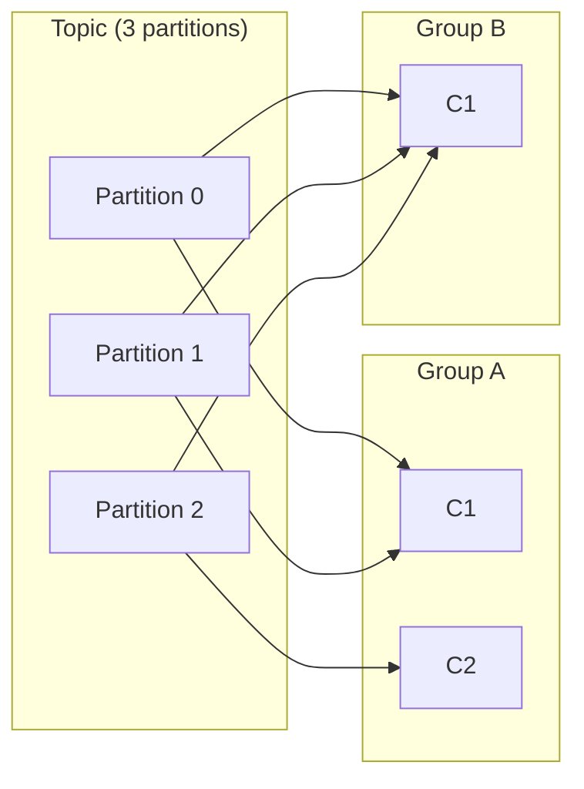
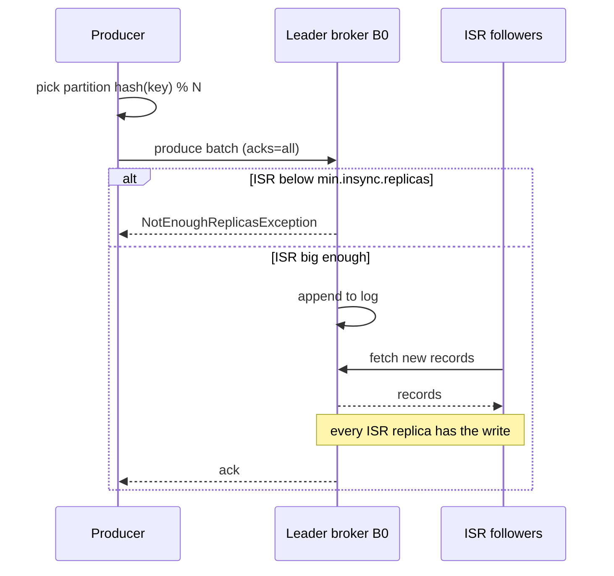

## Definition (interview-ready)

**Apache Kafka** is a distributed, append-only commit log treated as a durable publish-subscribe system. Producers write to **topics** which are split into ordered **partitions** stored across brokers and replicated for HA. Consumers belong to **consumer groups** which load-balance partitions and track per-partition offsets. The **In-Sync Replica (ISR)** set is the subset of replicas caught up to the leader — Kafka acks writes against this set.

**One-liner:** Kafka is a distributed, replicated, append-only log: topics are split into ordered partitions spread across brokers, consumer groups split those partitions among their members and track progress with offsets, and an `acks=all` write is confirmed once every in-sync replica has it.

## Why it matters

Kafka is the de facto event backbone for most modern data systems — a stream of business events that powers analytics, CDC, ML feature pipelines, eventual-consistency between microservices. Understanding partitions, ordering, ISR, and consumer offsets is the difference between "we have Kafka" and "we know what Kafka guarantees."

<Anim id="kafka" />

## Core concepts

### What Kafka is used for

Kafka is a **distributed, partitioned, replicated commit log**. That one abstraction covers a surprising range of jobs:

| Use case | What Kafka provides | Example |
|---|---|---|
| Service decoupling / messaging | Durable buffer between producers and many consumer groups | `OrderPlaced` consumed by billing, email, search |
| Activity tracking | Very high write throughput, cheap fan-out | Clickstream, page views (LinkedIn's original use) |
| Log & metrics aggregation | Central pipe from thousands of hosts to storage/search | App logs → Kafka → Elasticsearch / S3 |
| Stream processing | Ordered, replayable input + output for stateful jobs | Fraud scoring with Kafka Streams / Flink |
| CDC & event sourcing | Ordered per-key change history, compacted topics | Debezium streaming Postgres changes |
| Data integration backbone | One hub instead of N×M point-to-point pipelines | OLTP → cache, search index, warehouse via Connect |

The common thread: data that many systems need, possibly at different times and speeds, and that you may want to **re-read**.

### Topic, partition, offset

- **Topic**: a named stream (e.g., `orders.created`).
- **Partition**: an ordered, immutable sequence of records inside a topic. Number of partitions = unit of parallelism. Set at topic creation; it can be increased later but never decreased.
- **Offset**: monotonic integer per partition identifying a record. Consumers commit offsets to remember where they left off.

```
Topic: orders.created  (3 partitions)

Partition 0: [m0][m1][m2][m3]...
Partition 1: [m0][m1][m2]...
Partition 2: [m0][m1][m2][m3][m4]...
```

**Ordering** is per partition only — never across the whole topic. So **partition key** matters: choose it to keep related events together (e.g., `order_id`).

### Anatomy of a record

Every Kafka record has four parts (plus the offset the broker assigns):

| Field | Purpose | Notes |
|---|---|---|
| **Key** (optional bytes) | Chooses the partition; identity for compaction | Same key → same partition → per-key order |
| **Value** (bytes) | The payload — JSON, Avro, Protobuf… | `null` value + key = **tombstone** (delete marker in compacted topics) |
| **Headers** (list of key → bytes) | Metadata: correlation/trace IDs, event type, schema hints, source | Read without deserializing the value — useful for routing/filtering |
| **Timestamp** | Event time for retention, time-based lookup, windowing | `CreateTime` (set by producer, default) or `LogAppendTime` (set by broker) via `message.timestamp.type` |

```
ProducerRecord(
  topic   = "orders.events",
  key     = "order-42",
  value   = {"type":"OrderPlaced","total":1299},
  headers = [correlation-id: c-91, event-type: OrderPlaced],
  timestamp = 1729500000000          // CreateTime
)
```

Use `CreateTime` when the event's real-world time matters (stream windows, "what happened at 10:02"). Use `LogAppendTime` when you can't trust producer clocks and only need "when did Kafka receive it".

### Brokers

- A broker is one Kafka server. A cluster has many.
- Each partition has one **leader** and N-1 **followers** (replicas). All writes, and by default all reads, go through the leader (since Kafka 2.4, KIP-392 lets consumers fetch from a nearby follower instead).
- Followers continuously fetch from the leader. The set caught up within `replica.lag.time.max.ms` = **In-Sync Replicas (ISR)**.

### Producer

- Fetches cluster metadata, then sends each batch **directly to the leader broker** of the target partition (brokers don't forward produce requests).
- Partition selection:
  - Explicit `key` → `hash(key) % numPartitions`.
  - No key → round-robin / sticky partitioner (avoids tiny batches).
- Acks: `acks=0` (fire-and-forget), `acks=1` (leader only), `acks=all` (all ISR — strongest, recommended).
- **Idempotent producer** (`enable.idempotence=true`): producer dedupes retries within a session via producer ID + sequence number.

### How the producer picks a partition

In priority order:

1. **Explicit partition** set on the record → used as-is.
2. **Key present** → `murmur2(keyBytes) % numPartitions`. Deterministic, so a key always maps to the same partition…
3. **No key** → the **sticky partitioner** (default since Kafka 2.4): keep filling one partition's batch until it is sent, then switch. Compared with the old per-record round-robin it produces fuller batches, fewer requests, and lower latency.
4. **Custom `Partitioner`** → your own routing, e.g., pin a VIP tenant to dedicated partitions, or spread a known hot key.

**Why adding partitions breaks key ordering:** the formula depends on `numPartitions`. Going from 6 to 8 partitions changes the target for most keys. Old events for `order-42` sit in partition 2, new ones land in partition 5, and two different consumers may process them out of order across the boundary. Treat partition count on keyed topics as close to immutable — size it generously up front. (Recovery strategies: [Kafka Scenarios](/learn/notes/kafka-scenarios/).)

### Serializers & deserializers

Brokers store and move **bytes only**; they never look inside your payload. Clients convert:

- Producer: `key.serializer`, `value.serializer` (e.g., `StringSerializer`, `ByteArraySerializer`, `KafkaAvroSerializer`).
- Consumer: matching `key.deserializer`, `value.deserializer`.

Schema-registry-aware serializers (Avro, Protobuf, JSON Schema) prefix each value with a small schema ID so consumers can fetch the exact writer schema — see [Kafka Ecosystem](/learn/notes/kafka-ecosystem/).

**The serde poison pill:** if a record can't be deserialized (producer switched formats, corrupt bytes), the exception is thrown inside `poll()` *before* your code sees the record. A naive loop retries the same offset forever and the partition stalls. Defences:

- Spring Kafka's `ErrorHandlingDeserializer` wraps the real deserializer and hands you the failure as data.
- Or consume as `byte[]` and deserialize yourself inside try/catch.
- Either way, route the bad record to a **dead-letter topic** and move on.

### Consumer & consumer groups

- A consumer group is a set of consumers sharing the work of consuming a topic.
- Each partition is assigned to **exactly one** consumer within the group (others are idle for that partition).
- Adding consumers ≤ partitions scales throughput; beyond that, they sit idle.
- Each consumer commits offsets per partition; group state stored in the internal `__consumer_offsets` topic.

```
Topic with 3 partitions:
  Group A (2 consumers): C1 gets partitions 0,1; C2 gets partition 2.
  Group A (4 consumers): C1=0, C2=1, C3=2, C4=idle.
  Group B (1 consumer):  consumes all 3 partitions independently of A.
```

The first and last cases as a picture: inside a group each partition has one owner, and each group reads the whole topic:



### Offsets and commits

A consumer tracks, per partition, the offset of the **next** record it will read. To survive restarts it **commits** that position to the internal compacted topic `__consumer_offsets`, keyed by `(group.id, topic, partition)`.

| Mode | How | Risk |
|---|---|---|
| Auto-commit (`enable.auto.commit=true`) | Committed during `poll()` every `auto.commit.interval.ms` (default 5 s) | Commit can run ahead of processing (loss if work is async) or behind it (duplicates after crash) |
| `commitSync()` | Blocks, retries until success or fatal error | Safest; adds latency per commit |
| `commitAsync(callback)` | Non-blocking, **no retries** (a retry could overwrite a newer commit) | Use for the hot path; finish with a `commitSync()` on shutdown/revoke |
| Commit specific offsets | `commitSync(Map<TopicPartition, OffsetAndMetadata>)` | Fine-grained control, e.g., mid-batch |

Standard at-least-once loop: `poll()` → process the batch → `commitSync()`. A crash before the commit means the batch is redelivered — so the processing must be idempotent. More in [Consumer Deep Dive](/learn/notes/kafka-consumer-rebalancing/).

Note: committed offsets are themselves subject to retention (`offsets.retention.minutes`, default 7 days for empty groups). A group that's been gone longer restarts according to `auto.offset.reset` (`earliest` / `latest` / `none`).

### Consumer lag

**Lag = log end offset − committed offset**, per partition. It's the number of records the group still has to process — the single most important consumer health signal.

- **Measure:** `kafka-consumer-groups.sh --bootstrap-server … --describe --group billing`, Burrow, a Prometheus exporter (`kafka_consumergroup_lag`), or vendor consoles. Prefer **time lag** ("47 s behind") for alerting — record counts mean different things on different topics.
- **Read the shape:** lag on *all* partitions → capacity problem. Lag on *one* partition → hot key, poison pill, or one slow instance.
- **Fix:** add consumers (up to partition count), make processing faster (batch DB writes, remove blocking calls from the poll loop), tune fetch sizes, move heavy work to a worker pool/second topic, or fix the downstream bottleneck. Walkthrough in [Operations & Tuning](/learn/notes/kafka-operations-tuning/).

### Pull, not push

Kafka consumers **pull** (`poll()`) from brokers; brokers never push.

- **Natural backpressure** — a consumer only receives what it asks for; a push broker has to guess each consumer's capacity.
- **Big efficient batches** — a consumer can ask for megabytes of contiguous log in one fetch.
- **Consumer-owned position** — rewind, skip, or replay is just changing an offset.
- **Cheap for the broker** — no per-consumer delivery state, so adding a consumer group costs almost nothing.

The classic downside of pull — busy-polling an empty topic — is solved by **long polling**: the broker holds a fetch until `fetch.min.bytes` (default 1 byte) is available or `fetch.max.wait.ms` (default 500 ms) elapses.

### Replication & ISR

- `replication.factor=3` → each partition replicated on 3 brokers.
- **ISR** = leader + followers caught up. Min ISR (`min.insync.replicas=2` typical) sets the durability floor.
- Producer with `acks=all` waits until every replica currently in the ISR has the write; `min.insync.replicas` is the floor — if the ISR drops below it, the producer gets `NotEnoughReplicasException` → retry or give up (depending on retries / `delivery.timeout.ms`).
- On leader failure, a new leader is elected from the ISR.
- **Unclean leader election** (off by default): if no ISR left, allow an out-of-sync replica to become leader → potential data loss. Off in production.

### Retention, deletion & compaction

Kafka keeps records **independently of whether anyone has read them** — that's what makes replay possible. Each topic chooses a `cleanup.policy`:

**`delete` (default)** — remove whole old **segments**:
- `retention.ms` (default 7 days) — segments whose newest record is older than this are deleted.
- `retention.bytes` (default unlimited) — per partition; oldest segments deleted once exceeded.
- Deletion happens per segment (`segment.bytes`, default 1 GB; `segment.ms`), so data can live somewhat longer than the limit.

**`compact`** — keep **at least the latest value for every key**:

```
Before compaction:  k1=A  k2=B  k1=C  k3=D  k2=null  k1=E
After compaction:   k3=D  k2=null  k1=E        (k2's tombstone kept for a while)
Later:              k3=D  k1=E                 (tombstone removed after delete.retention.ms)
```

- Ideal for changelog/state topics: latest account balance, latest config, CDC table snapshots, Kafka Streams state stores.
- A **tombstone** (key + `null` value) deletes the key; it survives `delete.retention.ms` (default 24 h) so slow consumers still see the delete.
- The active segment is never compacted; `min.cleanable.dirty.ratio` and `min.compaction.lag.ms` control how eagerly the cleaner runs.

**`compact,delete`** — compact, *and* drop anything older than the retention period. Good for "latest value per key, but forget keys untouched for 30 days".

Retention is why a new service can bootstrap by reading from `earliest`, and why a lagging consumer must catch up before retention deletes unread data.

### Why Kafka is fast

- Append-only sequential writes to disk → SSDs love this.
- Zero-copy `sendfile` from disk to socket — no userspace copy.
- Page cache for reads (OS-managed). Consumers reading recent data hit RAM.
- Batched producers, batched compression.
- No per-message broker work (no fanout to N consumers — each consumer pulls).

### Kafka without ZooKeeper: KRaft

- Historically, Kafka used ZooKeeper for metadata.
- **KRaft** (Kafka Raft) mode — Kafka manages its own metadata via internal Raft consensus. Production-ready since 3.3, ZooKeeper mode deprecated in 3.5, and **ZooKeeper support removed entirely in Kafka 4.0** (KRaft is the only mode).

## How it works (a write/read)

```
Write:
  Producer P → calls send(topic, key, value)
  P picks partition: hash(key) % N
  P sends to leader broker B0
  B0 appends to log file, replicates to ISR
  When acks=all and min.insync.replicas met → ack to producer

Read (consumer group G):
  G's coordinator assigns partitions to G's consumers
  Each consumer fetches from its partition's leader, in offset order
  Consumer processes records, periodically commits offset
  On rebalance (consumer joins/leaves), partitions re-assigned
```

The write with `acks=all`, step by step:



## Real-world examples

- **LinkedIn**: birthplace of Kafka; activity events, change capture, metrics.
- **Uber**: one of the largest deployments — trillions of messages and multiple petabytes per day; trip events, pricing, ETA.
- **Netflix**: keystone pipeline — events ingested via Kafka, fed to S3 / data warehouses.
- **Robinhood, Pinterest, Shopify**: core event bus.
- **Confluent**: company started by Kafka creators; offers managed Kafka.

## Common pitfalls

- **Wrong partition key**: causes hotspots (one partition gets all writes for the celebrity user).
- **Too few partitions**: caps consumer parallelism. Increase upfront if growth expected.
- **Too many partitions**: per-partition overhead (file handles, fetcher threads, slower failover). A long-standing guideline (ZooKeeper era) is ≤ ~4,000 per broker; KRaft raises cluster-wide limits but per-broker cost remains.
- **`acks=1` + leader failover** = data loss. Use `acks=all`.
- **Min.insync.replicas=1**: defeats `acks=all` durability. Use ≥ 2.
- **Long-running consumer callbacks**: blocks the poll loop; consumer kicked out of group. Decouple work from poll.
- **Auto-commit with async processing**: if records are handed to other threads, auto-commit can commit offsets before the work finishes → message loss on crash. Use manual commit after processing.
- **No DLQ for poison messages**: a single un-deserializable message stalls the consumer forever.
- **Ordering relied upon across the topic**: only within a partition. If you need global order, you need 1 partition (no scaling).
- **Adding partitions to a keyed topic**: remaps keys and breaks per-key ordering across the change.
- **Serde mismatch with no error handling**: one undeserializable record stalls the partition forever.
- **Retention shorter than worst-case lag**: a slow consumer silently loses data when segments are deleted before it reads them.
- **Producer not idempotent + retries**: duplicate records on transient errors. Always enable idempotence (default in newer clients).

## Practice questions

<Practice>

<QA q="What is Apache Kafka, and what are its core use cases?" level="easy">

Kafka is a **distributed, partitioned, replicated commit log** used as an event streaming platform: producers append records to topics, consumers read them at their own pace by offset, and records are retained for a configured period regardless of consumption.

Core use cases: service decoupling / messaging, activity tracking (clickstreams), log and metrics aggregation, stream processing (Kafka Streams, Flink), CDC and event sourcing (Debezium), and acting as the data-integration hub between databases, caches, search indexes, and warehouses.

</QA>

<QA q="Explain Kafka's core building blocks: topic, partition, offset, broker, producer, consumer." level="easy">

- **Topic** — named logical stream (`orders`).
- **Partition** — an ordered, append-only, immutable log; a topic is split into several. Unit of parallelism, distribution, and replication.
- **Offset** — monotonically increasing position of a record within a partition; consumers track progress by offset.
- **Broker** — a Kafka server storing partitions and serving produce/fetch requests; a cluster is many brokers.
- **Producer** — client that appends records, choosing the partition (key hash, sticky, explicit, or custom).
- **Consumer** — client that pulls records, usually as a member of a consumer group.

</QA>

<QA q="Why do Kafka topics have partitions? What do partitions enable?" level="easy">

- **Scalability** — a topic's data and load spread across brokers and disks.
- **Parallelism** — each partition goes to one consumer per group, so partition count caps consumer parallelism; producers also write to partitions in parallel.
- **Ordering** — guaranteed *within* a partition; same key → same partition gives per-key order.
- **Replication unit** — each partition is replicated independently.

Trade-off: more partitions → more file handles, replication traffic, client memory, and slower leader elections/failover.

</QA>

<QA q="What is ISR?" level="easy">

**In-Sync Replicas** — the leader plus followers that are caught up with it within `replica.lag.time.max.ms` (default 30 s). Producers with `acks=all` wait until all current ISR members have the write, and `min.insync.replicas` sets how small the ISR may get before such writes are refused. New leaders are elected from the ISR, so ISR is the durability boundary.

</QA>

<QA q="What is a consumer group, and how are partitions assigned to its members?" level="easy">

A consumer group is a set of consumers sharing a `group.id` that cooperatively read a topic: each partition is assigned to **exactly one** member. Adding members (up to the partition count) scales throughput; different groups read the full stream independently.

Assignment: one broker is the **group coordinator**; one member is elected **group leader** and computes the assignment using the configured strategy (Range, RoundRobin, Sticky, **CooperativeSticky** — the recommended choice). With the newer KIP-848 protocol (`group.protocol=consumer`, GA in Kafka 4.0) the broker-side coordinator computes the assignment instead. Joins, leaves, and missed heartbeats trigger a **rebalance**. Details: [Consumer Deep Dive](/learn/notes/kafka-consumer-rebalancing/).

</QA>

<QA q="What's the difference between a consumer group and a regular subscriber?" level="easy">

A consumer group is **one logical subscriber made of many processes** sharing the work — each partition is consumed by exactly one process in the group. Different groups each see every message independently. Rule of thumb: one group per application; different applications use different groups.

</QA>

<QA q="What happens if a consumer group has more consumers than the topic has partitions?" level="easy">

The extras sit **idle** — a partition can be owned by only one member of a group. With 4 partitions and 6 consumers, 2 get nothing. They're not useless: they act as **hot standbys** and pick up partitions in the next rebalance if an active member dies.

Implication: "just add consumers" stops working at the partition count. Beyond that you must add partitions (careful on keyed topics) or make each consumer faster.

</QA>

<QA q="How does Kafka guarantee ordering?" level="medium">

Records are strictly ordered **within a partition** by offset; there is **no order across partitions**. To keep related records in order, give them the **same key** so they land in the same partition, keep idempotence on so retries can't reorder, and on the consumer side don't process one key's records in parallel. Global order requires a single partition — which means no parallelism.

</QA>

<QA q="How does a consumer track its position? Explain offset commits." level="medium">

- The consumer tracks the offset of the **next** record to read per partition and **commits** it to the compacted internal topic `__consumer_offsets`, keyed by (group, topic, partition).
- **Auto-commit** (`enable.auto.commit=true`, every 5 s by default during `poll()`): convenient but loose — a crash can lose records (committed but not processed) or duplicate them (processed but not committed).
- **Manual commit**: `commitSync()` blocks and retries — safest; `commitAsync()` is non-blocking and does not retry (use with a callback, then `commitSync()` on shutdown); or commit explicit per-partition offsets.
- Standard at-least-once: process the batch, **then** commit — and make processing idempotent.

</QA>

<QA q="What is consumer lag? How do you monitor it, and how do you reduce it?" level="medium">

**Lag = log end offset − committed offset**, per partition.

- **Monitor:** `kafka-consumer-groups.sh --describe`, Burrow, Prometheus exporters (`kafka_consumergroup_lag`), Grafana dashboards; alert on **time lag** where possible.
- **Diagnose by shape:** all partitions lagging → capacity; one partition → hot key, poison pill, or one slow instance.
- **Fix:** scale consumers up to the partition count (then add partitions), speed up processing (bulk DB writes, async I/O, no blocking calls in the poll loop), tune `max.poll.records` / `fetch.min.bytes`, offload heavy work to a worker pool or a second topic, DLQ poison pills, and fix slow downstream sinks.

</QA>

<QA q="Describe the structure of a Kafka record: key, value, headers, timestamp." level="medium">

- **Key** (optional) — drives partitioning (`murmur2(key) % partitions`) and is the identity for log compaction.
- **Value** — the payload (JSON/Avro/Protobuf). A `null` value with a key is a **tombstone** that deletes the key in a compacted topic.
- **Headers** — key/bytes metadata: correlation and trace IDs, event type, schema info — readable without deserializing the value.
- **Timestamp** — `CreateTime` (producer-set, default) or `LogAppendTime` (broker-set); used for retention, `offsetsForTimes` lookups, and stream windowing.

</QA>

<QA q="Explain Kafka retention: time-based vs size-based vs log compaction." level="medium">

Records are kept regardless of consumption, per topic:

1. **Time** — `retention.ms` (default 7 days): segments older than that are deleted.
2. **Size** — `retention.bytes` per partition: oldest segments deleted once exceeded.
3. **Compaction** — `cleanup.policy=compact`: keep at least the **latest value per key**; older values for the same key are cleaned. Tombstones remove a key entirely after `delete.retention.ms`. Perfect for changelog/state topics.

Policies can be combined (`compact,delete`). Deletion is per **segment**, so data may outlive the limit until its segment rolls. Retention is what enables replay and bootstrapping new consumers from `earliest`.

</QA>

<QA q="How does a producer decide which partition a record goes to?" level="medium">

1. **Explicit partition** on the record → used directly.
2. **Key present** → `murmur2(keyBytes) % numPartitions` — deterministic per key (until the partition count changes).
3. **No key** → **sticky partitioner**: fill a batch for one partition, then move on — better batching and latency than per-record round-robin.
4. **Custom `Partitioner`** → special routing, e.g., dedicated partitions for a large tenant.

</QA>

<QA q="What are serializers and deserializers in Kafka, and how can they cause a poison pill?" level="medium">

Brokers store bytes; clients convert objects ↔ bytes via `key/value.serializer` on the producer and matching deserializers on the consumer (String, ByteArray, JSON, schema-registry-aware Avro/Protobuf).

If a consumer **can't deserialize** a record (format change, corrupt data, wrong deserializer), the exception fires inside `poll()`; a naive loop retries the same offset forever and the partition stalls — a **poison pill**. Fix with Spring's `ErrorHandlingDeserializer`, or read raw bytes and parse in try/catch, then send the bad record to a **DLQ** and advance. Prevent it with a schema registry and compatibility rules.

</QA>

<QA q="Kafka consumers pull instead of being pushed to. Why did Kafka choose pull?" level="medium">

1. **Natural backpressure** — consumers only fetch what they can process; a push broker can overwhelm slow consumers.
2. **Efficient batching** — consumers pull large contiguous chunks in one request.
3. **Position control** — consumers own their offset, so replay/rewind/skip is trivial.
4. **Cheap broker** — no per-consumer delivery state to track.

The busy-polling downside is solved by **long polling**: the broker holds a fetch until `fetch.min.bytes` arrive or `fetch.max.wait.ms` passes.

</QA>

<QA q="How does Kafka achieve high throughput?" level="medium">

Sequential append-only disk writes; reads served from the OS **page cache**; **zero-copy** (`sendfile`) from page cache to socket; **batching** at producer, broker, and consumer; whole-batch **compression** stored as-is; partitioned parallelism across brokers; and pull-based consumers so the broker does no per-message delivery bookkeeping. Deep dive: [Kafka Internals](/learn/notes/kafka-internals/).

</QA>

<QA q="You add partitions to a keyed topic in production. What breaks?" level="hard">

The key → partition mapping is `hash(key) % N`, so changing N moves most keys. Older events for a key stay in their old partition while newer ones go to a new partition, and different consumers can process them **out of order** across the boundary. Compacted topics can also temporarily hold two "latest" values for a key in different partitions.

Mitigate by over-provisioning partitions at creation, draining producers/consumers before the change, or migrating to a new topic with the target count. See [Kafka Scenarios](/learn/notes/kafka-scenarios/).

</QA>

<QA q="Producer is configured `acks=all`, `min.insync.replicas=2`, `replication.factor=3`. A broker dies. What happens to a write?" level="hard">

- If the dead broker was a **follower** and the ISR is still ≥ 2 → writes keep succeeding.
- If it was the **leader** → the controller elects a new leader from the ISR; the producer gets a retriable error, refreshes metadata, retries, and the write is acked once the new leader and at least one other ISR member have it.
- If the ISR drops to **1** (below `min.insync.replicas`) → producers get `NotEnoughReplicasException`: Kafka chooses consistency over availability.
- With the idempotent producer, those retries can't create duplicates.

</QA>

<QA q="A consumer is slow and falls behind. How would you debug and fix it?" level="hard">

- Check **consumer lag** per partition (`kafka-consumer-groups.sh --describe`): all partitions or one?
- Measure processing time per record — is a downstream DB/API the bottleneck?
- Look for rebalance churn (`max.poll.interval.ms` exceeded) and poison pills.
- Increase parallelism: more consumers (up to partitions), a keyed worker pool inside the consumer, or more partitions.
- Keep the poll loop free of blocking work.
- If the bottleneck is downstream, fix downstream — more consumers won't help.

</QA>

<QA q="Design a Kafka topic for clickstream events at 1M events/sec, kept for 7 days." level="hard">

- **Partitions:** ~100–200 → roughly 5–10K msgs/s each, comfortable per consumer, with headroom.
- **Key:** `user_id` — per-user order while spreading load; watch for hot users.
- **Replication:** RF=3, `min.insync.replicas=2`, `acks=all`, idempotent producer.
- **Retention:** 7 days, `cleanup.policy=delete`.
- **Compression:** zstd or lz4 — clickstream compresses well.
- **Storage:** 1M × ~500 B × 86,400 × 7 ≈ 300 TB raw (before compression), ≈ 900 TB with RF=3 → plan disks or use **tiered storage**.
- **Producers:** larger `batch.size`, `linger.ms` 5–20.
- **Watch:** skew from hot users → sub-keying or sampling.

</QA>

</Practice>

## Quiz

<Quiz>

<MCQ q="Kafka guarantees record ordering at which level?" options={["Across the whole topic", "Across all topics in a cluster", "Within a single partition", "Within a consumer group only"]} answer={2}>

Offsets order records within one partition only. There is no ordering across partitions, so related records must share a key (and hence a partition) to stay ordered.

</MCQ>

<MCQ q="A topic has 4 partitions and a consumer group has 6 consumers. What happens?" options={["Two consumers sit idle as hot standbys", "Each partition is shared by 1.5 consumers", "Kafka automatically adds 2 partitions", "The group refuses to start"]} answer={0}>

Each partition is owned by exactly one member of a group, so the 2 extra consumers get nothing until a rebalance needs them. Kafka never splits a partition between group members or adds partitions automatically.

</MCQ>

<MCQ q="Why does adding partitions to a keyed topic break per-key ordering?" options={["Kafka rewrites old records into new partitions", "Keys are hashed modulo the partition count, so new records for a key can land in a different partition than its older records", "Consumers reset to earliest", "The sticky partitioner ignores keys"]} answer={1}>

The default mapping is murmur2(key) % numPartitions; changing N moves most keys while old data stays where it was, so different consumers can process a key's events out of order across the change. Kafka does not move existing records, and keyed records do not use the sticky partitioner.

</MCQ>

<MCQ q="With acks=all, which replicas must have a write before the leader acks it?" options={["Exactly min.insync.replicas replicas", "All replicas in the replication factor, even offline ones", "Only the leader", "Every replica currently in the ISR, provided the ISR size is at least min.insync.replicas"]} answer={3}>

acks=all waits for the current ISR; min.insync.replicas is only the floor below which writes are rejected with NotEnoughReplicasException. Offline replicas are not in the ISR, and leader-only is acks=1.

</MCQ>

<MCQ q="What does a tombstone mean in a compacted topic?" options={["A record whose key has a null value, marking that key for deletion", "A record that failed deserialization", "A segment scheduled for deletion", "A consumer that left its group"]} answer={0}>

A key with a null value deletes that key during compaction; the tombstone itself survives for delete.retention.ms (default 24 h) so slow consumers can see the delete. The other options describe unrelated concepts.

</MCQ>

<MCQ q="How does Kafka avoid busy-polling an empty topic despite using a pull model?" options={["The broker pushes a notification on new data", "Consumers sleep for max.poll.interval.ms", "Long polling: the broker holds the fetch until fetch.min.bytes is available or fetch.max.wait.ms passes", "ZooKeeper watches notify consumers"]} answer={2}>

Long polling lets the broker park the fetch (defaults: 1 byte, 500 ms). Kafka never pushes, max.poll.interval.ms is a liveness limit rather than a sleep, and consumers never used ZooKeeper watches for data.

</MCQ>

<MCQ q="A consumer group has been empty for longer than offsets.retention.minutes (default 7 days). What happens when it restarts?" options={["It resumes from its last committed offset", "Its committed offsets are gone, so it starts according to auto.offset.reset", "Kafka refuses the group.id", "It always starts from the earliest offset"]} answer={1}>

Committed offsets of empty groups expire after the retention window, and then auto.offset.reset (earliest, latest or none) decides the start position. It is not always earliest, and the group.id is still valid.

</MCQ>

<MCQ q="What is the current status of ZooKeeper in Apache Kafka?" options={["Still required for all clusters", "Optional but default in 4.0", "Deprecated in 2.0 and removed in 3.0", "KRaft was production-ready in 3.3 and ZooKeeper support was removed in 4.0"]} answer={3}>

KRaft (KIP-500) became production-ready in 3.3, ZooKeeper mode was deprecated in 3.5, and Kafka 4.0 removed it, so KRaft is the only mode.

</MCQ>

<MCQ q="With a key-less record and default settings in modern clients, how is the partition chosen?" options={["Strict per-record round-robin", "Always partition 0", "The sticky partitioner fills a batch for one partition and then switches", "A random partition per record"]} answer={2}>

Since KIP-480 (Kafka 2.4) key-less records stick to one partition until its batch is sent, giving fuller batches and lower latency than per-record round-robin. Kafka does not pin key-less data to partition 0.

</MCQ>

</Quiz>

## TL;DR cheat sheet

- Topic = ordered, immutable log split into partitions across brokers.
- Ordering only within a partition. Same key → same partition.
- Producer: choose `acks=all`, idempotence on, sensible batch size.
- Consumer group: each partition consumed by one consumer in the group. Add consumers ≤ partitions to scale.
- ISR: caught-up replicas. `min.insync.replicas` is your durability floor.
- Replication factor 3, `acks=all`, `min.insync.replicas=2` = standard production setting.
- Retention by time or size; compacted topics keep latest per key.
- Speed: sequential I/O, zero-copy, OS page cache, batching, compression.
- KRaft replaces ZooKeeper: production-ready in 3.3, ZooKeeper removed in 4.0.
- Record = key + value + headers + timestamp; null value = tombstone.
- Partitioner: explicit → `murmur2(key) % N` → sticky (no key). Changing N remaps keys.
- Offsets live in `__consumer_offsets`; commit **after** processing.
- Lag = log end offset − committed offset; alert on time lag.
- Consumers **pull** with long polling (`fetch.min.bytes`, `fetch.max.wait.ms`).

## Go deeper

- **ByteByteGo**: ["Why is Kafka fast?"](https://www.youtube.com/watch?v=UNUz1-msbOM), ["Kafka 101"](https://blog.bytebytego.com/p/ep126-the-ultimate-kafka-101-you).
- **Confluent**: [docs.confluent.io](https://docs.confluent.io/) — the canonical reference.
- **Hussein Nasser**: Kafka internals on YouTube.
- **Book**: *Kafka: The Definitive Guide* (Narkhede, Shapira, Palino) — by Confluent founders.
- **Jay Kreps**: ["The Log: What every software engineer should know about real-time data's unifying abstraction"](https://web.archive.org/web/20260612105408/https://engineering.linkedin.com/distributed-systems/log-what-every-software-engineer-should-know-about-real-time-datas-unifying) (archived copy) — foundational.
- **Martin Kleppmann**: ["Turning the database inside-out"](https://www.youtube.com/watch?v=fU9hR3kiOK0) (Strange Loop).
