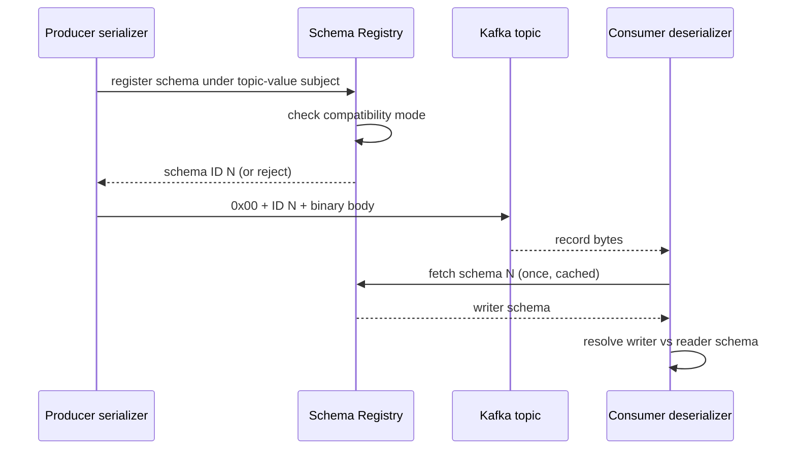
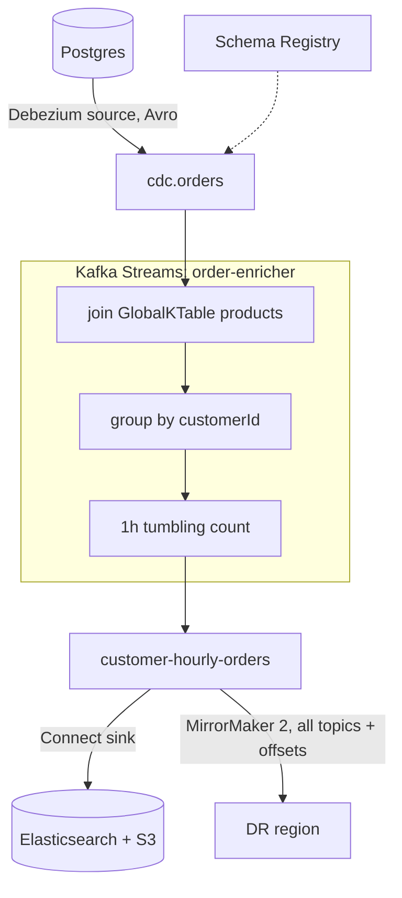

## Definition (interview-ready)

The **Kafka ecosystem** is the set of components built on top of the core broker log:

- **Kafka Streams.** A Java *library* for stateful stream processing (filter, join, aggregate, window) that runs inside your own service. It keeps fault-tolerant local state backed by Kafka topics.
- **Kafka Connect.** A framework and runtime that moves data between Kafka and external systems (databases, S3, Elasticsearch, warehouses) using configurable **connectors** instead of hand-written producers and consumers.
- **Schema Registry.** A service that stores versioned schemas (Avro, Protobuf, JSON Schema) for topics and **enforces compatibility rules**, so a producer deploy can't silently break consumers.
- **MirrorMaker 2.** A Connect-based tool that **replicates topics, configs and consumer offsets between clusters**, for disaster recovery, migration and geo-aggregation.

**One-liner:** Around the broker, Kafka Streams handles stateful processing inside your app, Connect moves data in and out through config-driven connectors, Schema Registry enforces payload contracts, and MirrorMaker 2 replicates topics and offsets between clusters.

## Why it matters

The broker on its own is just a durable log of bytes. Real systems also need to:

1. **Compute over the stream**, e.g. running totals per user, fraud scores, enriched events.
2. **Get data in and out** of dozens of systems without writing and operating a custom service for each.
3. **Agree on the shape of the bytes** across teams that deploy independently.
4. **Survive losing a region**, or move to a new cluster.

Interviewers use this area to separate people who have *used* Kafka from people who have *built platforms* on it. Typical prompts are "why not just write a consumer?", "what's a KTable?", "what does BACKWARD compatibility let you do?" and "how do consumers fail over to the DR cluster?"

## Core concepts

### Kafka Streams vs a plain consumer

A plain consumer gives you records and offsets. Everything else is your problem: state, recovery, windowing, joins and exactly-once. Kafka Streams packages those as a library:

| Concern | Plain consumer | Kafka Streams |
|---|---|---|
| Deployment | Your app | Your app (just a jar, **no cluster**) |
| State | You pick a DB/cache and handle recovery | **Local state stores** (RocksDB by default), each backed by a compacted **changelog topic** |
| Failure recovery | You rebuild state somehow | The new owner replays the changelog into its local store. **Standby replicas** keep warm copies so failover takes seconds |
| Scaling | Consumer group, up to the partition count | **Tasks**: one per input partition (per sub-topology), spread across instances and threads |
| Time | Wall clock, unless you build event-time logic | Event-time processing, timestamp extractors, windows with **grace periods** for late data |
| Joins | DIY | Stream-stream (windowed), stream-table, table-table, foreign-key table joins |
| Exactly-once | DIY transactions | `processing.guarantee=exactly_once_v2` (see [transactions & EOS](/learn/notes/kafka-transactions-eos/)) |

**How work is split up.** The topology is cut into sub-topologies. Each input partition of a sub-topology becomes a **task**. A task owns a slice of state, e.g. the counts for keys hashed to partition 3. Tasks, not threads or instances, are the unit that moves when you scale. With 12 input partitions you can run at most 12 useful threads across all instances.

**Repartitioning.** If you `groupBy` a new key, Streams writes the records to an internal **repartition topic** keyed by the new key, then reads them back. Data for one key then always lands in one task. This is a hidden cost in network and storage, so a good topology minimizes key changes.

**Windows.**

| Window | Shape | Example |
|---|---|---|
| Tumbling | Fixed size, no overlap | Orders per 1-minute bucket |
| Hopping | Fixed size, advances by a smaller step (overlaps) | 5-minute window every 1 minute |
| Sliding | Defined by the max time difference between two records | Join a click to an impression within 10s |
| Session | Gap-based, per key | User activity sessions with a 30-minute inactivity gap |

**Grace period.** How long a window stays open for out-of-order records after it ends. Late records past the grace period are dropped, and that should be counted in a metric.

### KStream vs KTable vs GlobalKTable

- **KStream.** An unbounded sequence of independent **facts**. `OrderPlaced(o1, ₹500)` followed by `OrderPlaced(o1, ₹300)` means two orders. Aggregations see every record.
- **KTable.** A **changelog**: each record is an *upsert* for its key, and only the latest value per key counts. `OrderStatus(o1, PAID)` then `OrderStatus(o1, SHIPPED)` means o1 is SHIPPED now. It's usually backed by a compacted topic and partitioned like its source.
- **GlobalKTable.** A KTable where **every instance holds the full table**, reading all partitions. It's good for small reference data such as a product catalog, currency rates or feature flags.

**Stream–table duality.** Fold a stream by key (latest value wins) and you get a table. Record every update to a table and you get a stream: its changelog. Kafka Streams is built on this idea, and so is CDC.

**Co-partitioning.** A `KStream ⋈ KTable` join runs locally inside a task, so both inputs must have the **same number of partitions and the same key and partitioner**. Order 42's events and order 42's row then sit in partition N of both topics, in the same task. When that isn't true, either repartition one side or use a **GlobalKTable**. A GlobalKTable needs no co-partitioning and can join on a field that isn't the key, e.g. `order.productId → product`. The costs: a full copy per instance, a slow bootstrap, and no time-synchronized joins.

```
orders (KStream, key=productId)  ⋈  products (GlobalKTable, key=productId)
     → enriched-orders
No repartition needed even if orders has 24 partitions and products has 3.
```

### Kafka Connect

```
            ┌──────────── Connect cluster (distributed mode) ────────────┐
 MySQL ──▶  │ worker 1: [debezium-mysql task 0]   [s3-sink task 0, 1]    │ ──▶ S3
            │ worker 2: [jdbc-source task 0]      [s3-sink task 2, 3]    │
            └──── config/offsets/status stored in internal Kafka topics ─┘
```

- **Connector.** A config plus a plugin that decides how to split the work into **tasks**.
- **Task.** Does the actual copying. Tasks are spread across **workers**, and if a worker dies its tasks rebalance to the others.
- **Source connectors** pull from external systems into Kafka, e.g. Debezium CDC, JDBC source, MQTT. **Sink connectors** push from Kafka out, e.g. S3, Elasticsearch, JDBC, Snowflake, BigQuery.
- **Distributed mode** stores connector configs, source offsets and status in three internal compacted topics. You manage connectors with a REST API (`POST /connectors` with a JSON config). No code to deploy.
- **Converters** turn Connect's internal data into bytes and back, e.g. `AvroConverter` with Schema Registry, or `JsonConverter`. They're separate from the connector logic.
- **SMTs (Single Message Transforms)** are small per-record changes: rename a field, mask PII, route to a different topic, extract the Debezium "after" image. Keep them light. Joins and aggregations don't belong in SMTs.
- **Error handling.** With `errors.tolerance=all` plus `errors.deadletterqueue.topic.name`, a sink connector sends bad records to a DLQ instead of dying.

**When to use Connect, and when to write code.** Use Connect for **plumbing**: moving data between Kafka and standard systems with little logic. You get fault tolerance, offset tracking, scaling and a large connector catalog for free. Write a custom consumer or producer when the work is **business logic**: calling domain services, multi-step workflows, complex validation. A common smell is a "sink" consumer that reimplements batching, retries and offset handling for S3 that the S3 sink connector already does.

CDC with Debezium is the flagship source-connector use case, covered in [Change Data Capture](/learn/notes/change-data-capture/).

### Schema Registry

Brokers never look inside messages. Without a contract, one producer deploy that renames a field can break every consumer. Schema Registry fixes this at **serialization time**:

```
Wire format of a registry-serialized record value:
 ┌────────┬───────────────┬──────────────────────────┐
 │ 0x00   │ schema ID (4B)│ Avro/Protobuf binary body │
 └────────┴───────────────┴──────────────────────────┘
  magic    big-endian int  (no field names, very compact)
```

(Protobuf adds a short list of message indexes between the schema ID and the body, to say which message type in the `.proto` file was used.)

1. When a producer serializes a record, the serializer registers or looks up the schema under a **subject**, by default `<topic>-value`, and gets an ID. IDs are cached, so this isn't a network call per message.
2. The registry checks the new schema against the subject's **compatibility mode**. If it's incompatible, registration fails and the producer can't publish. The bad deploy fails fast.
3. The consumer reads the 5-byte header, fetches schema ID `N` once and caches it, then decodes the body. Avro also resolves the **writer schema** against the consumer's **reader schema**.

The same three steps as a sequence:



**Compatibility modes.**

| Mode | Guarantee | Safe changes | Upgrade order |
|---|---|---|---|
| `BACKWARD` (default) | New schema can read data written with the previous one | Delete fields; add **optional** fields (with defaults) | **Consumers first**, then producers |
| `FORWARD` | Previous schema can read data written with the new one | Add fields; delete **optional** fields | **Producers first**, then consumers |
| `FULL` | Both | Add or delete optional fields only | Any order |
| `*_TRANSITIVE` | Same rule, checked against **all** earlier versions, not just the latest | — | — |
| `NONE` | No checks | Anything (dangerous) | — |

Why TRANSITIVE matters: v1→v2 and v2→v3 can each be compatible while v3 can't read v1 data. That's a problem for a topic with 30 days of retention or for a replay from earliest. Long-retention and event-sourced topics should use `BACKWARD_TRANSITIVE` or `FULL_TRANSITIVE`.

**Evolution rules of thumb.**
- Never rename a field. Add the new one and deprecate the old one.
- Never change a field's type. Add a new field instead.
- Always give new fields a **default**.
- In Protobuf, never reuse a field number. Mark removed numbers as `reserved`.
- Review schema changes like API changes, and add a CI check against the registry before merging.

More on versioning strategy in [Schema evolution](/learn/notes/schema-evolution/).

### Avro vs Protobuf vs JSON

| | JSON | Avro | Protobuf |
|---|---|---|---|
| Encoding | Text, field names repeated in every message | Compact binary, no field names | Compact binary, field numbers |
| Size and speed | Largest, slowest to parse | Small, fast | Small, fastest in many runtimes |
| Schema | Optional (JSON Schema), usually not enforced | Required; writer schema resolved against reader schema | Required `.proto`; codegen |
| Evolution | By convention only | Rich rules (defaults, unions); fits registry modes well | Field-number based; unknown fields preserved |
| Ecosystem fit | Everywhere, human-readable | **Data and CDC ecosystem default** (Connect, Debezium, lakehouse) | **Polyglot microservices**, especially gRPC shops |
| Pick when | Low volume, prototypes, external webhooks | Data pipelines, CDC, analytics | Service-to-service events in a proto-first org |

At scale, either binary format beats JSON on size (often 3–10x smaller), CPU and above all **safety**. Columnar formats for the lake side are covered in [file formats](/learn/notes/file-formats-parquet-orc-avro/).

### MirrorMaker 2 (cross-cluster replication)

MirrorMaker 2 (MM2) is a set of Connect connectors:

- **MirrorSourceConnector** copies topic data and configs (and ACLs).
- **MirrorCheckpointConnector** emits **checkpoints** that translate consumer group offsets from source to target. Offset 1,000,000 on the source is not offset 1,000,000 on the target, because the two logs differ in compaction and starting points. Translated offsets let a consumer fail over and resume close to where it stopped.
- **MirrorHeartbeatConnector** emits heartbeats so you can measure replication lag.

**Topic naming.** With the default replication policy, `orders` from cluster `us` shows up as `us.orders` on the target. Prefixing is what makes **active-active** possible without infinite loops: MM2 never copies `us.orders` back to `us`. Consumers that want everything subscribe to `orders` plus `*.orders`.

**Use cases.**
1. **DR (active-passive).** Mirror the primary region to a standby. On failover, point clients at the standby and start consumers from translated offsets.
2. **Aggregation.** Regional clusters feed a central analytics cluster.
3. **Migration.** Mirror old to new, move consumers, then move producers, then decommission.

**Limits to state in an interview.** Replication is **asynchronous**, so failover loses whatever hadn't been mirrored: **RPO > 0**. Offset translation is approximate, so expect some reprocessing and design consumers to be idempotent. Exactly-once does not hold end to end across a failover. Since Kafka 3.5 MM2 can copy records into the target exactly once, but consumer positions are still translated approximately.

**Alternatives.** **Confluent Cluster Linking** replicates at the broker level and keeps offsets identical, so there's no translation and no Connect cluster. **Stretched clusters** spread one cluster across 3 AZs (or nearby regions) with synchronous replication and `min.insync.replicas`, giving RPO = 0 at the cost of cross-zone latency on every write.

### Kafka Streams vs Flink vs Spark (in one line)

Use Kafka Streams for logic embedded in a microservice, with Kafka in and Kafka out. Use Flink for a dedicated streaming platform with very large state and complex event time. Use Spark Structured Streaming if you're already a Spark shop doing analytics and ETL. The full comparison is in [Stream processing: Flink & Kafka Streams](/learn/notes/stream-processing-flink-kstreams/).

## How it works (one pipeline using all four)

```
Postgres ──Debezium (Connect source, Avro + Schema Registry)──▶ cdc.orders
                                                                    │
            Kafka Streams app "order-enricher" (exactly_once_v2)    │
              KStream(cdc.orders)                                   │
                ⋈ GlobalKTable(products)  ── enrich                 ▼
                → groupByKey(customerId)  ── repartition topic
                → windowedBy(1h tumbling) → count  ── RocksDB + changelog
                → to(customer-hourly-orders)
                                                                    │
            Connect sink: Elasticsearch + S3 (DLQ for bad records) ◀┘
            MirrorMaker 2: replicate all topics + group offsets to DR region
```

The same pipeline as a flow, showing which component owns each hop:



Each box is configuration, or a small Streams topology. None of it is a custom service that needs its own retry, offset and state-recovery logic.

## Real-world examples

- **Debezium + Connect** is the standard way teams stream OLTP databases into Kafka for search, caches and warehouses.
- **Confluent Schema Registry** (or a compatible one, e.g. Apicurio, Karapace) is effectively required wherever Avro or Protobuf is used on Kafka.
- **Kafka Streams** often powers features like per-user aggregates, real-time counters and enrichment services embedded in ordinary Java microservices.
- **MirrorMaker 2** is the open-source default for Kafka DR and cluster migrations, including moves into managed services like MSK.

## Common pitfalls

- **Joining topics that aren't co-partitioned.** The join silently produces wrong or missing results, or the topology fails at startup. Check partition counts and keys, or use a GlobalKTable.
- **Unbounded state.** Aggregating with no window, or never-expiring keys, grows RocksDB forever. Use windows, retention on stores, or tombstones.
- **No standby replicas.** Failover means replaying a multi-GB changelog, which takes minutes of downtime per task. Set `num.standby.replicas=1` for stateful apps.
- **Ignoring late data.** A window built with no grace (`ofSizeWithNoGrace`) or a too-small grace makes late events vanish. Size the grace period to how out of order your data really is, and watch the dropped-records metric.
- **Heavy logic in SMTs.** SMTs aren't a processing engine. Complex transforms belong in Streams or Flink.
- **`errors.tolerance=all` without a DLQ.** Bad records are dropped silently.
- **Schema Registry compatibility set to `NONE`** "temporarily". That's how a rename takes down ten consumers.
- **Renaming fields or changing types** in Avro or Protobuf, even when the registry allows it under some mode.
- **Using non-transitive compatibility on long-retention topics.** Replays from earliest break.
- **Treating MM2 failover as lossless.** Asynchronous replication means some data loss and some duplicates. Write the DR runbook with that in mind.

## Practice questions

<Practice>

<QA q="What is Kafka Streams, and how is it different from a plain Kafka consumer?" level="easy">

Kafka Streams is a **Java library**, not a cluster, for stateful stream processing on Kafka topics. It runs inside your service. Beyond what a consumer gives you, it adds:
- **Local state stores** (RocksDB) backed by compacted **changelog topics**, so state survives crashes and can move between instances.
- **Event-time windowing** (tumbling, hopping, sliding, session) with grace periods for late data.
- **Joins**: stream-stream, stream-table, table-table and foreign-key.
- **Exactly-once** with `exactly_once_v2`.
- **Elastic scaling.** Tasks, one per input partition, rebalance across instances, and standby replicas give fast failover.

With a plain consumer you'd build all of this yourself.

</QA>

<QA q="What is Kafka Connect, and when would you use it instead of writing a custom producer or consumer?" level="easy">

Connect is a framework and runtime for moving data between Kafka and external systems using ready-made **source** connectors (DB/CDC → Kafka) and **sink** connectors (Kafka → S3, Elasticsearch, JDBC, warehouses).

Why use it: connectors are declared as JSON config instead of code; distributed workers handle fault tolerance and task rebalancing; offset tracking is built in; SMTs handle light per-record changes; DLQs are supported; and there are hundreds of existing connectors.

Write a custom client when the logic is genuinely **business-specific**: calling domain services, orchestrating workflows. Use Connect for plumbing.

</QA>

<QA q="Explain KStream vs KTable vs GlobalKTable." level="medium">

- **KStream**: every record is an independent fact or event. Two records with the same key mean two events.
- **KTable**: a changelog view where each record **upserts** its key and only the latest value matters. It's partitioned like its source topic, so each instance holds only its share.
- **GlobalKTable**: a KTable fully replicated to **every** instance. It allows joins without co-partitioning and on non-key fields, which is ideal for small reference data. The costs are memory and disk per instance and the time to bootstrap.

**Duality**: a table is the latest-value fold of a stream, and a stream is a table's changelog.

</QA>

<QA q="What is co-partitioning, and why does a KStream-KTable join need it?" level="medium">

Joins in Kafka Streams run **locally inside a task**, and a task reads partition N of each input. For key K to meet its matching record, both topics must put K in the **same partition number**. That requires the same partition count, the same key and the same partitioner.

If the partition counts differ, Streams fails at startup. If the keys or partitioners differ, matches are silently missed. The fixes:
- Repartition one side with `selectKey` or `repartition()`, which creates an internal topic.
- Or use a **GlobalKTable** for the table side. It has every partition locally, so co-partitioning doesn't matter.

</QA>

<QA q="How does Kafka Streams recover state when an instance dies?" level="medium">

Every state store write is also written to a compacted **changelog topic**. When a task moves to another instance, the new owner **restores** its local RocksDB store by replaying that changelog, then resumes processing.

Replaying a large changelog can take minutes. **Standby replicas** (`num.standby.replicas`) keep continuously updated shadow copies on other instances, so failover only needs to replay a small tail. Newer versions also do **warm-up** task assignment, so state is caught up before a task moves.

</QA>

<QA q="Why do you need a Schema Registry? What is in the bytes of a registry-serialized message?" level="medium">

Brokers store opaque bytes and never validate payloads, so nothing stops one producer from publishing data that breaks every consumer. The registry stores versioned schemas per subject and **rejects incompatible schemas at registration time**. A bad producer deploy fails before it writes anything.

On the wire, each message carries a **magic byte (0) and a 4-byte schema ID** followed by the binary body, not the whole schema. Consumers look up and cache the schema by ID to decode the message.

</QA>

<QA q="Explain BACKWARD, FORWARD and FULL compatibility. Who upgrades first in each?" level="medium">

- **BACKWARD** (default): the new schema can read old data. You may delete fields and add **optional** (defaulted) fields. **Consumers upgrade first.**
- **FORWARD**: the old schema can read new data. You may add fields and delete optional fields. **Producers upgrade first.**
- **FULL**: both directions. Only add or remove fields that have defaults. Any upgrade order works.
- **`_TRANSITIVE`** variants check against **all** earlier versions, not just the latest. Use them for long-retention or replayable topics, where a consumer may meet data from many versions back.

Rules: never rename a field, never change a type, always give new fields defaults.

</QA>

<QA q="Avro vs Protobuf vs JSON for Kafka payloads: how do you choose?" level="medium">

- **JSON**: readable and needs no tooling, but it's large, slow to parse and has no enforced schema, so drift shows up as runtime errors. Fine for low-volume or prototype topics.
- **Avro**: compact binary with rich evolution semantics (writer/reader schema resolution, defaults) and first-class support in Schema Registry, Connect and Debezium. The **data and CDC ecosystem default**.
- **Protobuf**: compact and fast, with strong typing and codegen in many languages. Evolution is field-number based. The natural choice for **polyglot microservices**, especially gRPC shops.

At scale, either binary format beats JSON on size, speed and safety.

</QA>

<QA q="What is MirrorMaker 2 used for, and what are its limitations?" level="medium">

MM2 is built on Connect. It replicates **topics, configs, ACLs and consumer group offsets** (with offset translation through checkpoints) between clusters.

Uses: **DR** (active-passive across regions), **aggregation** (regional → central analytics) and **migrations** between clusters or providers.

Limitations: replication is **asynchronous**, so failover has RPO > 0. Offset translation is approximate, so consumers reprocess some records and must be idempotent. There's no end-to-end exactly-once across a failover (Kafka 3.5+ can copy records exactly once, but offsets are still translated approximately). Remote topics are prefixed (`us.orders`), which prevents cycles in active-active but means consumers must subscribe to the prefixed names.

Alternatives are Confluent Cluster Linking (offset-preserving, broker-level) or a stretched multi-AZ cluster for synchronous RPO = 0.

</QA>

<QA q="What are SMTs in Kafka Connect, and what should NOT go in them?" level="medium">

**Single Message Transforms** apply light per-record changes inside a connector, before the record is written to Kafka (source) or to the target system (sink). Examples: insert or rename fields, mask PII, route to a topic based on a field, extract the Debezium `after` image, cast types.

Keep out of SMTs: anything stateful or multi-record (joins, aggregations, dedup over time), external lookups, and heavy computation. Those belong in Kafka Streams, Flink or an app. SMTs run per record on the hot path, and they're hard to test and version.

</QA>

<QA q="How does Debezium relate to Kafka Connect, and what does CDC give you?" level="medium">

Debezium is a family of **Connect source connectors**. They tail the database transaction log (MySQL binlog, Postgres WAL through logical replication, MongoDB oplog) instead of polling. You get low-latency events for every committed change, including deletes, with before and after images, an initial snapshot, and per-key commit order, all with no query load on the DB.

Typical uses: outbox publishing, cache and search sync, OLTP → analytics, and strangler migrations. Details are in [CDC](/learn/notes/change-data-capture/).

</QA>

<QA q="A Kafka Streams app does `groupBy(customerId).count()` on an orders topic keyed by orderId. What happens under the hood, and what does it cost?" level="hard">

Changing the grouping key means records for one customer currently sit in many partitions. Streams inserts a **repartition**: it writes each record to an internal `…-repartition` topic keyed by `customerId`, then a second sub-topology consumes that topic and counts in a **state store** backed by a changelog topic.

Costs: an extra produce and consume hop (latency and broker I/O), two extra internal topics (disk and replication), and the counts stay correct only if the repartition topic keeps its partitioning. To reduce it, key the source topic by the grouping key if most consumers need that, or pre-aggregate before the repartition.

</QA>

<QA q="You need to delete a field from an Avro schema used by 6 consumer teams on a topic with 30-day retention. Walk through it safely." level="hard">

1. Check the subject's mode. Prefer `BACKWARD_TRANSITIVE` or `FULL_TRANSITIVE` because of the 30-day replay window.
2. If the field has no default, first ship a version that **adds a default** to it (compatible under FULL), and make sure every consumer is on a reader schema that tolerates the field being missing.
3. Consumers stop reading the field. Track this through code search or registry usage.
4. Register the new schema without the field. The registry validates it against all earlier versions.
5. Upgrade producers. Old records still carry the field, and readers ignore it.
6. Treat the field name as retired. Don't reuse it with a different meaning later. In Protobuf, mark the field number `reserved`.

</QA>

<QA q="Your primary region dies. Consumers fail over to the MirrorMaker 2 replica cluster. What do you expect, and how do you prepare?" level="scenario">

Expect:
- **Some data loss.** Anything produced but not yet mirrored is missing (RPO = replication lag).
- **Some duplicates.** Translated offsets are approximate (checkpoints are periodic), so consumers re-read a window.
- **Different topic names** (`primary.orders`) unless you use an identity replication policy.

Prepare:
- Make every consumer **idempotent**.
- Run MM2 checkpoints with **offset sync to the target group** enabled, so groups start from translated positions.
- Monitor replication lag through heartbeats and alert on it.
- Write a runbook covering client bootstrap switch, subscription patterns, and the failback plan.
- **Rehearse failover regularly.** If the business needs RPO = 0, use a stretched cluster with synchronous replication instead.

</QA>

</Practice>

## Quiz

<Quiz>

<MCQ q="A Kafka Streams app reads a 12-partition input topic in a single sub-topology. How many stream threads can do useful work across all instances?" options={["Unlimited; threads share partitions", "12, because there is one task per input partition", "One per instance, regardless of partitions", "24, because each task gets a standby"]} answer={1}>

Tasks are the unit of parallelism and there is one task per input partition per sub-topology. With 12 tasks, at most 12 threads across all instances have work. Standby replicas keep warm state copies but do not process records.

</MCQ>

<MCQ q="Two records arrive with the same key: `OrderStatus(o1, PAID)` then `OrderStatus(o1, SHIPPED)`. Read as a KTable, what is the state?" options={["Two orders, one PAID and one SHIPPED", "PAID, because the first value wins", "SHIPPED, because each record upserts the key", "An error, because KTable keys must be unique"]} answer={2}>

A KTable is a changelog: each record is an upsert for its key and only the latest value counts. A KStream would treat the same two records as two independent facts.

</MCQ>

<MCQ q="Why can a KStream join a GlobalKTable without co-partitioning?" options={["Every instance holds the full table, reading all its partitions", "GlobalKTables are stored in the broker, not locally", "Streams automatically repartitions the stream side", "GlobalKTable joins only work when both topics have one partition"]} answer={0}>

A GlobalKTable is fully replicated to every instance, so any stream record can find its match locally. That also allows joining on a non-key field. The cost is a full copy per instance and a slower bootstrap.

</MCQ>

<MCQ q="A subject uses `BACKWARD` compatibility. Which change is allowed, and who should upgrade first?" options={["Rename a field; producers first", "Add a required field with no default; consumers first", "Change a field's type; any order", "Add an optional field with a default; consumers first"]} answer={3}>

BACKWARD means the new schema can read data written with the previous one, so you may delete fields or add optional fields with defaults. Consumers upgrade first so they can read both old and new data. Renames and type changes are never safe.

</MCQ>

<MCQ q="v1 to v2 and v2 to v3 each passed BACKWARD checks, yet consumers on v3 fail when replaying 30-day-old data. What prevents this?" options={["Switching to `NONE` compatibility", "Using a `_TRANSITIVE` mode that checks against all earlier versions", "Raising the topic's retention", "Moving from Avro to JSON"]} answer={1}>

Non-transitive modes check only against the latest version, so v3 may be unable to read v1. `BACKWARD_TRANSITIVE` or `FULL_TRANSITIVE` checks every earlier version, which is what long-retention and replayable topics need.

</MCQ>

<MCQ q="What does a Confluent Schema Registry serialized record value start with?" options={["The full schema as JSON", "A 16-byte schema fingerprint", "A magic byte 0 followed by a 4-byte schema ID", "The subject name and version number"]} answer={2}>

The wire format is a magic byte (0), a 4-byte big-endian schema ID, then the binary body. Consumers look up the schema by ID once and cache it, so messages stay compact.

</MCQ>

<MCQ q="With MirrorMaker 2's default replication policy, how does topic `orders` from cluster `us` appear on the target, and why?" options={["As `us.orders`, so active-active setups don't loop records back", "As `orders`, because offsets are preserved", "As `orders-mirror`, to mark it read-only", "As `orders.us`, so consumers can use the same prefix pattern"]} answer={0}>

The default policy prefixes remote topics with the source cluster alias. MM2 never copies `us.orders` back to `us`, which prevents infinite loops in active-active. Offsets are not preserved; MM2 translates them via checkpoints.

</MCQ>

<MCQ q="A sink connector sets `errors.tolerance=all` but no `errors.deadletterqueue.topic.name`. What happens to bad records?" options={["The connector task fails and stops", "They are retried forever", "They are written to the source topic again", "They are skipped silently"]} answer={3}>

`errors.tolerance=all` tells Connect to keep going past bad records. Without a DLQ topic configured, those records are dropped with no copy, which is why the two settings should go together.

</MCQ>

<MCQ q="What is the main limitation to state when proposing MirrorMaker 2 for disaster recovery?" options={["It cannot replicate consumer group offsets", "Replication is asynchronous, so RPO is greater than zero and consumers will see some duplicates", "It requires a stretched cluster across regions", "It only works between clusters on the same Kafka version"]} answer={1}>

MM2 copies data asynchronously, so anything not yet mirrored is lost on failover, and approximate offset translation means some reprocessing. It does translate group offsets via checkpoints. If RPO must be zero, a stretched cluster with synchronous replication is the alternative.

</MCQ>

</Quiz>

## TL;DR cheat sheet

- **Kafka Streams** = a library, not a cluster. State in RocksDB plus changelog topics; one task per input partition; standby replicas for fast failover; windows with grace; `exactly_once_v2`.
- **KStream** = facts; **KTable** = latest value per key; **GlobalKTable** = full copy on every instance (no co-partitioning needed). Stream ↔ table duality.
- **Joins need co-partitioning** (same partition count, key and partitioner). Otherwise repartition or use a GlobalKTable.
- **Connect** = config-driven source/sink connectors, workers and tasks, SMTs for light per-record changes, DLQ through `errors.*`. Use it for plumbing, code for business logic.
- **Schema Registry** = magic byte + 4-byte schema ID on the wire; compatibility enforced at registration. BACKWARD → consumers upgrade first; FORWARD → producers first; FULL → either. Use `_TRANSITIVE` for long retention.
- Never rename fields or change types; always add defaults.
- **Avro** for data/CDC, **Protobuf** for polyglot services, **JSON** only at low volume.
- **MirrorMaker 2** = async cross-cluster replication with offset translation and prefixed topics. RPO > 0, consumers must be idempotent. Cluster Linking or stretch clusters are the alternatives.

## Go deeper

- **Apache Kafka docs**: [Kafka Streams](https://kafka.apache.org/documentation/streams/) and [Kafka Connect](https://kafka.apache.org/documentation/#connect).
- **Confluent docs**: [Schema Registry & schema evolution](https://docs.confluent.io/platform/current/schema-registry/fundamentals/schema-evolution.html).
- **KIP-382**: [MirrorMaker 2.0](https://cwiki.apache.org/confluence/display/KAFKA/KIP-382%3A+MirrorMaker+2.0).
- **KIP-447**: [Producer scalability for exactly-once semantics](https://cwiki.apache.org/confluence/display/KAFKA/KIP-447%3A+Producer+scalability+for+exactly+once+semantics) (the basis of `exactly_once_v2`).
- **Book**: *Kafka: The Definitive Guide*, 2nd ed. (Shapira, Palino, Sivaram, Petty), chapters on Connect, cross-cluster mirroring and stream processing.
- **DDIA Chapter 11**: stream processing, stream–table duality, and joins.
