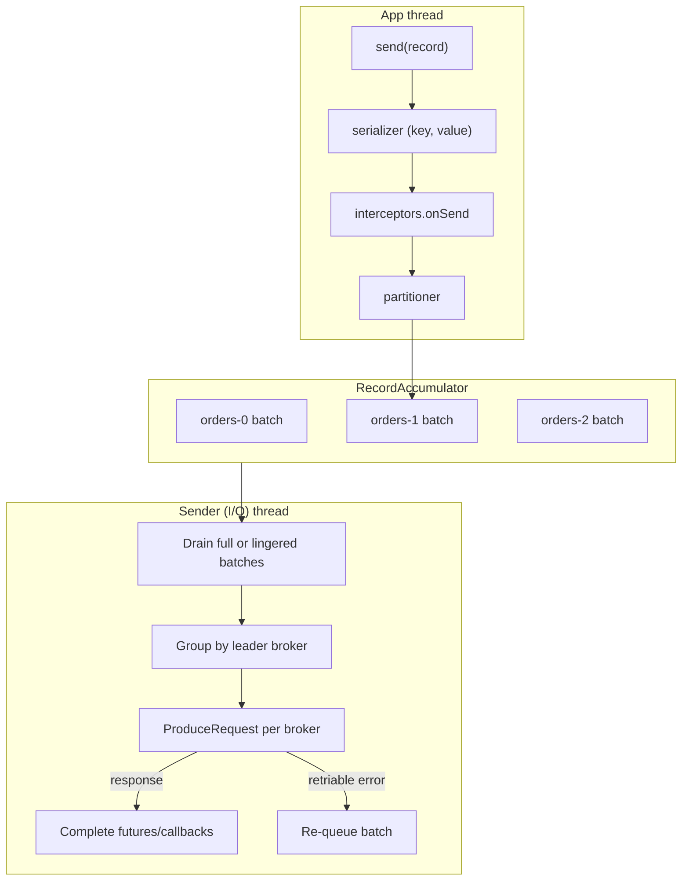
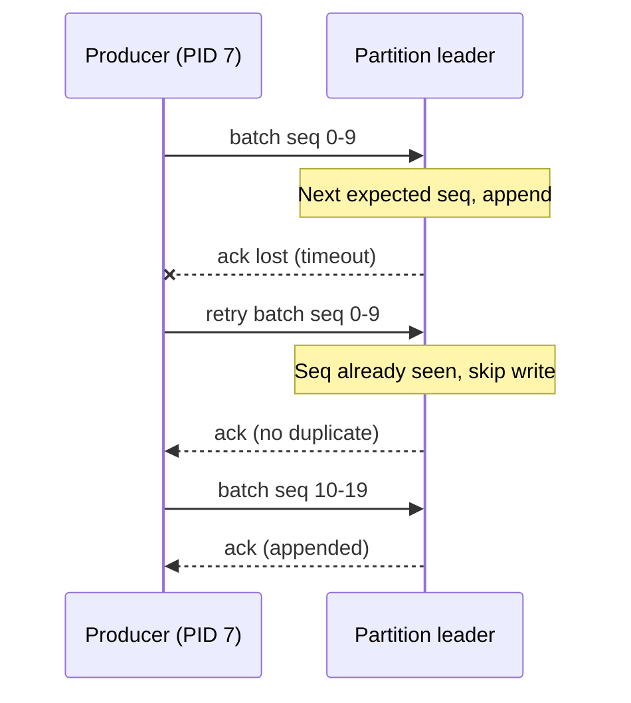
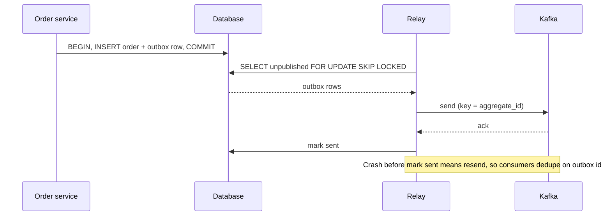

## Definition (interview-ready)

The Kafka producer is a **client library with its own batching engine**. `send()` doesn't send anything over the network. It serializes the record, picks a partition, and adds it to an in-memory batch for that partition. A background **sender thread** ships batches to partition leaders when they fill up or a timer (`linger.ms`) expires. Durability is controlled by `acks`. Retries happen automatically within a time budget (`delivery.timeout.ms`). The **idempotent producer** (on by default since Kafka 3.0) attaches a producer ID and per-partition sequence numbers, so retries can't create duplicates or reorder records.

**One-liner:** The Kafka producer batches records per partition in memory and a background thread ships them to partition leaders; `acks=all` plus the default idempotent producer means retries can't lose, duplicate or reorder records within a session, and the outbox pattern covers the gap between your database and Kafka.

## Why it matters

Most "Kafka lost my data" and "Kafka duplicated my data" incidents are really producer misconfigurations:

- fire-and-forget sends whose errors nobody checks,
- `acks=1` combined with a leader failover,
- retries without idempotence, which reorder records,
- a process that exits without calling `flush()`,
- writing to a database and to Kafka without the outbox pattern.

Producer tuning is also where you trade **latency against throughput**. Changing `linger.ms` from 0 to 10 can increase throughput several times over.

## Core concepts

### The producer pipeline

The app thread only fills per-partition batches. The sender thread does all the network work:



`send()` returns a `Future<RecordMetadata>` right away. You learn the outcome from that future or from a callback, **never** from the fact that `send()` returned.

### Batching: batch.size, linger.ms, buffer.memory

| Config | Default | Meaning |
|---|---|---|
| `batch.size` | 16 KB | Maximum bytes per partition batch. A full batch is sent right away. |
| `linger.ms` | 0 in old clients; **5 in Kafka 4.0+** | How long to wait for a batch to fill before sending it anyway. |
| `buffer.memory` | 32 MB | Total memory for all batches that haven't been sent yet. |
| `max.block.ms` | 60 s | How long `send()` blocks when the buffer is full (or metadata is unavailable) before throwing. |

A batch is sent when it's **full OR its linger time has expired**, whichever happens first.

- Under **heavy load**, batches fill almost instantly, so `linger.ms` barely matters.
- Under **light load**, `linger.ms` is the only thing that creates batching. With `linger.ms=0`, each record goes out alone, which means small requests, more requests, and worse compression.
- `linger.ms=5–20` adds a few milliseconds of latency and can multiply throughput and compression ratio.

When the broker slows down, batches back up in `buffer.memory`. Once that's full, `send()` **blocks the calling thread** for up to `max.block.ms`. In a request-serving thread this turns a Kafka slowdown into an API outage. Decide ahead of time whether to block, shed load, or fall back.

### Partitioning

1. A partition set explicitly on the `ProducerRecord` → use it.
2. A key → `murmur2(keyBytes) % numPartitions`. Deterministic, so the same key always goes to the same partition, which gives per-key ordering.
3. No key → the **sticky partitioner** (KIP-480): fill one partition's batch, then switch to another. This gives bigger batches than per-record round-robin.
4. A custom `Partitioner` for special routing, such as sending a large tenant to dedicated partitions.

### The idempotent producer

With `enable.idempotence=true` (the default since 3.0, provided the configs are compatible):

- On startup the producer gets a **Producer ID (PID)** and an **epoch** from the broker.
- Each batch carries `(PID, epoch, partition, base sequence number)`, and sequence numbers rise by one per record, per partition.
- For each `(PID, partition)`, the broker remembers the sequence numbers of the **last 5 batches**:
  - a sequence it has **already seen** → it acks the batch without writing it again, so a retry doesn't duplicate,
  - the **next expected** sequence → it appends the batch,
  - a **gap** (a sequence that's too far ahead) → `OutOfOrderSequenceException`, and the batch isn't accepted out of order.

Why a retry after a lost ack doesn't write the batch twice:



Idempotence requires `acks=all`, `retries > 0`, and `max.in.flight.requests.per.connection ≤ 5`. The "5" comes from the broker's dedupe window.

**What it does NOT cover:**

- **A producer restart.** A new process gets a new PID, so if it re-sends something the old process had already written, that's a new record. To keep a stable identity across restarts you need a `transactional.id` (see [Kafka Transactions & EOS](/learn/notes/kafka-transactions-eos/)).
- **Sends repeated by your application.** If your code calls `send()` twice with the same payload, Kafka sees two records.
- **Duplicates across partitions or topics**, or in other systems.

So idempotence fixes duplicates caused by **network retries**. Duplicates at the business level still need consumer-side idempotency ([Delivery Semantics](/learn/notes/delivery-semantics/)).

### Retries vs ordering

Without idempotence, `max.in.flight > 1` together with retries **can reorder** records:

```
in flight:  batch A (seq 0-9)   batch B (seq 10-19)    same partition
A fails (timeout) ─┐  B succeeds → log: [B]
                   └─ retry A succeeds  → log: [B][A]   ← reordered!
```

The old workaround, `max.in.flight.requests.per.connection=1`, keeps order but allows only one request at a time per broker, which hurts throughput.

**With idempotence**, the broker won't accept B's sequence numbers until A's have been written, so pipelining up to 5 requests in flight still preserves order. That's the main reason idempotence became the default: you no longer have to choose between ordering and throughput.

### Compression

Set `compression.type` on the producer. Compression is applied **per batch**, so bigger batches (from a higher `linger.ms` or `batch.size`) compress better. The broker stores compressed batches as is (as long as the topic's `compression.type` is `producer` or the same codec), so compression saves network bandwidth, disk space, *and* replication traffic.

| Codec | Ratio | CPU / speed | When to use |
|---|---|---|---|
| `none` | 1× | free | Payloads that are already compressed (images, encrypted data) |
| `gzip` | best | slowest, CPU-heavy | Cross-region links where bandwidth is expensive and CPU is cheap |
| `snappy` | moderate | fast | The long-time "balanced" default |
| `lz4` | good | fastest decompression | High-throughput, latency-sensitive pipelines |
| `zstd` | close to gzip | close to lz4 | **The modern default choice** for most workloads (Kafka 2.1+) |

JSON and log-like payloads often compress 4–10×.

### Timeouts: delivery.timeout.ms vs request.timeout.ms vs retries

| Config | Default | Scope |
|---|---|---|
| `request.timeout.ms` | 30 s | How long to wait for **one** ProduceRequest response before treating that attempt as failed. |
| `delivery.timeout.ms` | 120 s | The **total** budget from `send()` to final success or failure: time waiting in a batch + time in flight + every retry. |
| `retries` | `Integer.MAX_VALUE` | In practice unlimited. The time budget is what actually stops retrying. |
| `retry.backoff.ms` | 100 ms | Pause between retries (with exponential backoff up to `retry.backoff.max.ms` in newer clients). |

The client requires `delivery.timeout.ms ≥ linger.ms + request.timeout.ms`. Think in terms of time, not retry counts. Set `delivery.timeout.ms` to the answer to "how long can my app afford not to know whether this event was written?", and when the callback finally reports failure, **do something**: write to a fallback store, alert, or fail the original operation.

### Producer config cheat table

| Setting | Latency-optimized | Throughput-optimized | Durability-optimized |
|---|---|---|---|
| `acks` | `all` (`1` saves a little latency but turns idempotence off and risks loss) | `all` | `all` |
| `enable.idempotence` | true (requires `acks=all`) | true | **true** |
| `linger.ms` | 0–1 | 10–50 | 5–10 |
| `batch.size` | 16 KB | 128–512 KB | 64 KB |
| `compression.type` | `lz4` / none | `zstd` / `lz4` | `zstd` |
| `max.in.flight.requests.per.connection` | 5 | 5 | ≤ 5 (idempotent) |
| `buffer.memory` | default | 64–256 MB | sized for the longest broker outage you want to buffer through |
| `delivery.timeout.ms` | low (fail fast, e.g. 10–30 s) | default 120 s | high, plus a fallback on failure |
| Topic side | — | more partitions | RF=3, `min.insync.replicas=2`, unclean election off |

### Handling failure in critical flows (e.g., order events)

1. **Durable settings**: `acks=all`, idempotence on, RF=3, `min.insync.replicas=2`.
2. **Always check the result.** Use a callback or the future, never fire-and-forget. A failure after all retries means: persist to a fallback (a DB table or local disk spool) and alert, **or** fail the business operation so the caller retries.
3. **Shut down gracefully.** Call `producer.flush()` and `close()` on SIGTERM, or everything still sitting in the buffer is lost.
4. **Watch `max.block.ms`.** When brokers are unreachable, `send()` blocks. Decide whether request threads may block.
5. **Monitor** `record-error-rate`, `record-retry-rate`, `buffer-available-bytes`, `request-latency-avg`, and `batch-size-avg`.
6. **Best: avoid the dual write entirely** with a transactional outbox (below).

### The dual-write problem and the transactional outbox

A service that has to **update its database and publish an event** is doing two writes to two systems, and there's no shared transaction between them:

```
BEGIN; INSERT order …; COMMIT;   ✅
producer.send(OrderCreated)      💥 crash / broker down → event never published
```

Reversing the order is just as bad: the event is published, then the DB rolls back, and downstream services act on an order that doesn't exist.

**Transactional outbox:**

```
BEGIN;
  INSERT INTO orders (...)                       -- business change
  INSERT INTO outbox (id, aggregate_id, type, payload, created_at)
COMMIT;                                          -- atomic: both or neither

relay ──reads outbox──▶ Kafka (key = aggregate_id)
  • polling relay: SELECT unpublished … FOR UPDATE SKIP LOCKED → send → mark sent
  • or CDC: Debezium tails the WAL/binlog, outbox event router → topic
```

The outbox flow with a polling relay, step by step:



- An event exists **if and only if** the transaction committed.
- The relay delivers at least once (it can crash after sending but before marking the row as sent), so consumers must dedupe on the outbox `id`.
- CDC avoids the delay and database load of polling. See [Change Data Capture](/learn/notes/change-data-capture/) and [Distributed Transactions](/learn/notes/distributed-transactions/).

### Interceptors

`ProducerInterceptor.onSend()` runs before serialization and partitioning and may modify the record. `onAcknowledgement()` sees every result (success or error). Typical uses: adding tracing headers (OpenTelemetry instrumentation works this way), audit logs, per-tenant tagging, metrics, and simple redaction. Rules: keep them **fast and free of side effects**, because they run on every send, and exceptions thrown in them are logged and swallowed rather than failing the send.

### Strict per-entity ordering at high throughput

1. **Key by the entity** (`orderId`, `accountId`). Each entity's events stay in order within one partition, and different entities spread across all partitions.
2. **Keep idempotence on**, so retries can't reorder.
3. **On the consumer**, if you process a batch in parallel, assign work to threads by key (hash(key) → worker) so one entity's events are never handled concurrently.
4. **Don't add partitions to a keyed topic** casually. `hash % N` changes, so new events for a key land on a different partition than its old events. Provision partitions generously up front.
5. **Hot keys**: one huge entity can saturate a single partition. If you don't truly need strict order across that entity's whole stream, sub-key it (`entityId + '#' + bucket`) and restore order downstream with per-entity sequence numbers.

## How it works (a durable send, annotated)

```java
Properties p = new Properties();
p.put("bootstrap.servers", "b1:9092,b2:9092,b3:9092");
p.put("acks", "all");
p.put("enable.idempotence", "true");
p.put("linger.ms", "10");
p.put("batch.size", String.valueOf(64 * 1024));
p.put("compression.type", "zstd");
p.put("delivery.timeout.ms", "120000");
KafkaProducer<String, String> producer =
    new KafkaProducer<>(p, new StringSerializer(), new StringSerializer());

producer.send(new ProducerRecord<>("orders.events", orderId, payload), (md, ex) -> {
  if (ex != null) {
    // retries exhausted within delivery.timeout.ms — don't swallow this
    fallbackStore.save(orderId, payload);
    metrics.increment("order_event_publish_failed");
  }
});

// on shutdown
producer.flush();
producer.close(Duration.ofSeconds(30));
```

## Real-world examples

- **Kafka 3.0** made `acks=all` and `enable.idempotence=true` the producer defaults, because so many deployments were losing or duplicating data with the old ones.
- **Debezium's outbox event router** is the standard building block for outbox-based publishing on Postgres and MySQL.
- **OpenTelemetry's Kafka instrumentation** propagates trace context through record headers, using the interceptor/wrapper mechanism.

## Common pitfalls

- **Fire-and-forget `send()`** for important data. Errors vanish silently.
- **No `flush()`/`close()` on shutdown.** Every deploy drops whatever was buffered.
- **`linger.ms=0` in high-volume services**: tiny batches, poor compression, a high request rate.
- **Blocking request threads** on `send()` when `buffer.memory` fills up.
- **Writing to the DB and Kafka in sequence** and calling it reliable. Use an outbox.
- **Assuming idempotence survives restarts.** It doesn't; the PID changes.
- **Turning idempotence off** (for example by setting `acks=1` explicitly) and then wondering about duplicates or reordering after retries.
- **Adding partitions to a keyed topic** and breaking per-key ordering.
- **Slow interceptors** that add latency to every single send.

## Practice questions

<Practice>

<QA q="What do `batch.size` and `linger.ms` control?" level="easy">

The producer batches records per partition. `batch.size` (16 KB default) is the maximum size of a batch, and a full batch is sent right away. `linger.ms` is how long to wait for a batch to fill before sending it anyway. A batch goes out when it's **full or has waited long enough**, whichever comes first. Under heavy load batches fill instantly; under light load `linger.ms` is what creates batching. A small value like 5–20 ms trades a little latency for much better throughput and compression.

</QA>

<QA q="What happens when the producer's `buffer.memory` fills up?" level="easy">

All unsent batches share `buffer.memory` (32 MB by default). When it's full, usually because brokers are slow or unreachable, `send()` **blocks** the calling thread for up to `max.block.ms` (60 s) and then throws. In a service that handles requests, this turns a broker problem into stuck API threads. Size the buffer for the bursts you expect, and decide whether to block, shed load, or fall back.

</QA>

<QA q="How does the producer pick a partition?" level="easy">

1. An explicit partition on the record → used as is.
2. A key → `murmur2(key) % numPartitions`, so the same key always goes to the same partition (until the partition count changes).
3. No key → the sticky partitioner fills one partition's batch, then switches, which gives better batches than round-robin per record.
4. A custom `Partitioner` for special routing.

</QA>

<QA q="What is the idempotent producer and how does it work internally?" level="medium">

With `enable.idempotence=true` (the default since 3.0), the producer gets a **Producer ID** and epoch, and stamps each batch with a sequence number that rises per partition. The broker remembers the last 5 batch sequence numbers for each `(PID, partition)`. A repeated sequence (a retry of a batch already written) is acked but not written again. A gap raises `OutOfOrderSequenceException`. It requires `acks=all`, retries, and `max.in.flight ≤ 5`.

Scope: one producer session and one partition. It does **not** dedupe after a restart (new PID) or sends repeated by your application. Those need transactions or idempotent consumers.

</QA>

<QA q="Can `retries` together with `max.in.flight.requests.per.connection` greater than 1 break ordering?" level="medium">

**Without idempotence, yes.** If batch A fails and batch B (sent after A to the same partition) succeeds, A's retry is written after B. The old fix was `max.in.flight=1`, which keeps order but kills pipelining. **With idempotence**, the broker refuses to accept B's sequence numbers before A's are written, so order is preserved with up to 5 requests in flight. That's why idempotence is now the default.

</QA>

<QA q="Compare the gzip, snappy, lz4 and zstd codecs." level="medium">

Compression is applied per batch on the producer, stored on the broker as is, and decompressed by consumers, so it saves network, disk, and replication traffic.

- **gzip**: best ratio, most CPU. Good for cross-region links where bandwidth is precious.
- **snappy**: fast with a moderate ratio. The classic balanced choice.
- **lz4**: very fast, especially to decompress, with a good ratio. Good for high throughput at low latency.
- **zstd**: nearly gzip's ratio at nearly lz4's speed. The usual modern default.

Bigger batches compress better, which is one more reason to raise `linger.ms`.

</QA>

<QA q="How are `delivery.timeout.ms`, `request.timeout.ms` and `retries` related?" level="medium">

- `request.timeout.ms` (30 s): how long to wait for **one** request's response before treating that attempt as failed.
- `delivery.timeout.ms` (120 s): the **total** time from `send()` to the final outcome, covering time in a batch, time in flight, and all retries. When it runs out, the callback gets the error.
- `retries` is effectively unlimited, so in practice the time budget is what stops retrying.

The client requires `delivery.timeout.ms ≥ linger.ms + request.timeout.ms`. Choose it as "how long can I afford not to know whether this was written", and handle the final failure explicitly.

</QA>

<QA q="What is the dual-write problem? Explain the transactional outbox pattern." level="medium">

**Dual write**: a service updates its DB and publishes to Kafka as two separate operations. No transaction covers both, so a crash or failure between them leaves them out of sync: the DB was committed but no event was published, or an event was published for a change that was rolled back.

**Outbox**: in the same local DB transaction as the business change, insert the event into an `outbox` table. ACID makes the two writes atomic. A relay then publishes outbox rows to Kafka, either by polling (`SELECT … FOR UPDATE SKIP LOCKED` → send → mark as sent) or by CDC (Debezium reading the WAL). An event is published **if and only if** the transaction committed. The relay delivers at least once, so consumers dedupe on the event ID.

</QA>

<QA q="How do you handle producer failures in a critical flow such as order events?" level="hard">

1. Durable settings: `acks=all`, idempotence on, RF=3, `min.insync.replicas=2`.
2. Never fire-and-forget. In the callback, a final failure means persisting to a fallback store (DB table or disk spool) and alerting, or failing the original operation.
3. `flush()`/`close()` on shutdown so buffered records aren't lost.
4. Decide what happens when `send()` blocks (`max.block.ms`) because the buffer is full.
5. Monitor `record-error-rate`, `record-retry-rate`, `buffer-available-bytes`, and request latency.
6. The strongest option: a **transactional outbox**, so the DB commit is the source of truth and publishing becomes a retryable background job.

</QA>

<QA q="What are producer interceptors and when would you use them?" level="medium">

Hooks in the client pipeline. `onSend()` runs before serialization and can inspect or modify each record. `onAcknowledgement()` sees each result. Uses: injecting trace and correlation headers (this is how OpenTelemetry's Kafka instrumentation works), audit logging, metrics, tenant tagging, and light PII redaction. They run on **every** send, so keep them fast and free of side effects. Exceptions thrown in them are logged and swallowed rather than failing the send.

</QA>

<QA q="How do you guarantee strict ordering for each entity while keeping throughput high?" level="hard">

1. **Key by entity ID** so each entity's events go to one partition in order, while different entities spread across partitions.
2. **Keep idempotence on** so retries can't reorder.
3. **On the consumer**, if processing in parallel, assign work to workers by hash(key) so one entity's events are never handled concurrently.
4. **Don't add partitions later** to keyed topics. Provision generously or plan a migration to a new topic.
5. **Hot keys**: sub-key (`entityId#bucket`) only if strict ordering across the whole entity isn't really required, and use sequence numbers to restore order downstream.

</QA>

<QA q="Does `enable.idempotence=true` give you exactly-once delivery end to end?" level="hard">

No. It only stops **duplicates caused by retries, within one partition, during one producer session**. A restarted producer gets a new PID. If your app re-sends a record it had already published (for example, it crashed before saving that the send succeeded), Kafka stores it twice. Anything the consumer does afterwards (DB writes, emails) is outside its scope. For Kafka-to-Kafka atomicity use transactions with a stable `transactional.id`. For external effects use idempotent consumers keyed on a business or event ID.

</QA>

<QA q="A service's p99 latency spikes whenever Kafka has a broker issue. Why, and how do you fix it?" level="scenario">

During the broker issue, produce requests slow down or fail and get retried, unsent batches fill `buffer.memory`, and then `send()` **blocks** for up to `max.block.ms` on the request-handling threads. Fixes: keep `send()` off the request's critical path (an outbox, or a bounded in-memory queue with a separate publisher), set `max.block.ms` low and fall back to a store if it's exceeded, size `buffer.memory` for the outages you expect, and alert on `buffer-available-bytes` and `record-retry-rate`. If the event is critical, an outbox makes the API's success depend only on the DB commit.

</QA>

<QA q="After a deploy, producer throughput dropped and the broker request rate tripled. What changed?" level="scenario">

Most likely batching broke down. Common causes:

- `linger.ms` was reset to 0 or `batch.size` was shrunk.
- A new partitioner or keying scheme spreads records across many more partitions, so each batch gets fewer records.
- Compression was turned off.

Check the producer metrics `batch-size-avg`, `records-per-request-avg`, `compression-rate-avg`, and `request-rate`. Restore `linger.ms` (5–20 ms) and a sensible `batch.size`, and look at whether the new keys spread load too thinly or created a hot key.

</QA>

</Practice>

## Quiz

<Quiz>

<MCQ q="What is the default linger.ms in Apache Kafka 4.0 and later?" options={["0 ms", "100 ms", "5 ms", "1000 ms"]} answer={2}>

Kafka 4.0 (KIP-1030) changed the default from 0 to 5 ms because larger batches usually give similar or lower latency. 0 is the old default; 100 ms and 1000 ms are not defaults.

</MCQ>

<MCQ q="The producer's buffer.memory is full because brokers are slow. What does send() do?" options={["Blocks the calling thread for up to max.block.ms, then throws", "Drops the oldest batch", "Returns immediately and discards the record", "Switches to acks=0"]} answer={0}>

send() blocks until space frees up or max.block.ms (default 60 s) expires, which can stall request threads. The producer never silently drops data or changes acks.

</MCQ>

<MCQ q="Why does enable.idempotence require max.in.flight.requests.per.connection to be 5 or less?" options={["Brokers only accept 5 connections", "The broker tracks sequence numbers for only the last 5 batches per producer ID and partition", "Compression needs at most 5 batches", "It keeps transactions under 5 partitions"]} answer={1}>

Deduplication and ordering rely on the broker's cached window of the last 5 batch sequences per (PID, partition). The limit has nothing to do with connection counts, compression or transactions.

</MCQ>

<MCQ q="Which duplicate is NOT prevented by the idempotent producer?" options={["A retry after a lost ProduceResponse", "A batch resent after a request timeout", "A retried batch arriving after a later batch", "A record re-sent by a restarted process that gets a new producer ID"]} answer={3}>

Idempotence is scoped to one producer session. A restart gets a new PID, so re-sent data is new to the broker; that needs transactions with a stable transactional.id or consumer-side dedup. The first three are exactly what sequence numbers handle.

</MCQ>

<MCQ q="How do delivery.timeout.ms and request.timeout.ms relate?" options={["request.timeout.ms is the total budget and delivery.timeout.ms is per attempt", "delivery.timeout.ms is the total budget from send() to outcome and must be at least linger.ms plus request.timeout.ms", "They must be equal", "delivery.timeout.ms only applies when retries is 0"]} answer={1}>

request.timeout.ms (default 30 s) bounds one request; delivery.timeout.ms (default 120 s) covers batching, in-flight time and all retries, and the client enforces delivery.timeout.ms ≥ linger.ms + request.timeout.ms.

</MCQ>

<MCQ q="Without idempotence, retries are on and max.in.flight is 5. Batch A fails and batch B to the same partition succeeds. What happens when A is retried?" options={["A is written after B, so the partition is reordered", "The broker rejects B", "A is discarded", "Kafka rewrites B after A"]} answer={0}>

Without sequence numbers the broker appends A's retry after B. With idempotence the broker refuses out-of-sequence batches, preserving order with up to 5 in-flight requests.

</MCQ>

<MCQ q="What does the transactional outbox pattern guarantee?" options={["Exactly-once delivery to consumers without dedup", "The DB write and the Kafka publish happen in one Kafka transaction", "An event is published if and only if the business DB transaction committed", "Events are never delayed"]} answer={2}>

The event row commits atomically with the business change; a relay or CDC publishes it later, at least once, so consumers still dedupe on the event ID. Kafka transactions do not span the database.

</MCQ>

<MCQ q="Why do larger batches improve compression?" options={["Brokers recompress large batches with gzip", "Compression is applied per batch, so more similar records per batch give a better ratio", "Large batches skip CRC checks", "Compression only activates above 1 MB"]} answer={1}>

The producer compresses each batch as a unit and the broker usually stores it as is, so bigger batches expose more redundancy. Brokers do not recompress when the codec matches, CRC checks still run, and there is no size threshold.

</MCQ>

<MCQ q="An exception is thrown inside a ProducerInterceptor's onSend(). What happens?" options={["The send fails with that exception", "The producer shuts down", "The record is routed to a DLQ", "The exception is logged and swallowed, and the send proceeds"]} answer={3}>

The client catches and logs interceptor exceptions rather than failing the send, which is why interceptors must be fast and side-effect free. There is no built-in producer DLQ.

</MCQ>

</Quiz>

## TL;DR cheat sheet

- `send()` = serialize → partition → add to batch. A background thread does the network I/O. Always check the callback.
- A batch is sent when **full (`batch.size`) or lingered (`linger.ms`)**. Use `linger.ms` 5–20 for throughput.
- Buffer full → `send()` blocks up to `max.block.ms`.
- **Idempotent producer** (default): PID plus per-partition sequence numbers → no duplicates or reordering from retries, with up to 5 requests in flight. It doesn't survive restarts.
- **Time budget**: `delivery.timeout.ms` (total) ≥ `linger.ms` + `request.timeout.ms` (per attempt).
- Compression per batch, stored as is; **zstd** or **lz4** by default.
- Durable producer: `acks=all` + idempotence + RF=3 + `min.insync.replicas=2` + callback handling + flush on shutdown.
- DB plus event → **transactional outbox** (polling or CDC), and consumers dedupe on the event ID.
- Per-entity ordering = key by entity + idempotence + per-key ordering in the consumer + never resize keyed topics.

## Go deeper

- **Apache Kafka docs**: [Producer configs](https://kafka.apache.org/documentation/#producerconfigs).
- **KIP-98**: [Exactly Once Delivery and Transactional Messaging](https://cwiki.apache.org/confluence/display/KAFKA/KIP-98+-+Exactly+Once+Delivery+and+Transactional+Messaging) (idempotent producer design).
- **KIP-480**: [Sticky Partitioner](https://cwiki.apache.org/confluence/display/KAFKA/KIP-480%3A+Sticky+Partitioner).
- **Confluent docs**: [Kafka producer design and configuration](https://docs.confluent.io/platform/current/clients/producer.html).
- **Book**: *Kafka: The Definitive Guide*, 2nd ed., Chapter 3 (Producers).
- **Debezium**: [Outbox Event Router](https://debezium.io/documentation/reference/stable/transformations/outbox-event-router.html).
