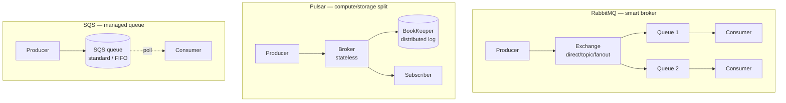

## Definition (interview-ready)

**RabbitMQ** is a traditional message broker with rich routing (exchanges/queues, fanout, topic, headers) over AMQP — flexible but per-message overhead. **Apache Pulsar** is a Kafka-like streaming platform that separates compute (brokers) from storage (BookKeeper), supports both queueing and streaming semantics, and has built-in geo-replication and multi-tenancy. **Amazon SQS** is a fully managed AWS queue (Standard = at-least-once, FIFO = ordered + exactly-once at the queue boundary), with no broker to operate. **Kafka** is the reference point — a replayable, partitioned log — and **Redis Streams** is the lightweight in-memory log you reach for when Redis is already there.

**One-liner:** Pick Kafka for a high-throughput, replayable event log; RabbitMQ for task queues that need rich routing, per-message retries, priorities and delays; SQS for a zero-ops queue on AWS; Pulsar when you need streaming and queueing together with multi-tenancy and geo-replication; and Redis Streams for small, fast pipelines when Redis is already running.

## Why it matters

Picking the right messaging system is a long-term commitment — operationally, architecturally, and culturally. Knowing the trade-offs avoids spending six months later migrating off the wrong choice.

| | RabbitMQ | Kafka | Pulsar | SQS |
|---|---|---|---|---|
| Model | smart broker | log | broker + log | managed queue |
| Order | per-queue | per-partition | per-partition | FIFO mode only |
| Retention | drain | configurable | tiered | 14 d max |
| Throughput | 10s K/s | 1M+/s | 1M+/s | unlimited (managed) |
| Ops cost | medium | high | high | none (AWS-managed) |

## Core concepts

### RabbitMQ

- **Protocol**: AMQP 0-9-1 (mature, expressive); AMQP 1.0 is also a core protocol since RabbitMQ 4.0.
- **Routing model**: producers publish to **exchanges**, exchanges route to **queues** based on bindings (direct, topic, fanout, headers).
- **Consumer pattern**: queue-based — once consumed and acked, the message is gone.
- **Per-message state**: each message has acks, redeliveries, dead-lettering.
- **Strengths**: rich routing (request/reply, RPC), per-message TTL, priority queues, delayed delivery (TTL + DLX retry queues, quorum-queue delayed retries since 4.3 and native delayed messages since 4.4; the old delayed-message-exchange plugin is archived and unmaintained).
- **Weaknesses**: limited throughput (~50–100K msgs/sec/broker), bookkeeping overhead per message, harder to scale horizontally for high-volume streaming.
- **HA**: classic mirrored queues (removed in RabbitMQ 4.0) → **Quorum Queues** (Raft, recommended) → **Streams** (newer, Kafka-style append-only log).
- **Use cases**: task queues, RPC, asynchronous workflows, microservices with diverse routing needs.

### Apache Pulsar

- **Architecture**: brokers (stateless) + BookKeeper (storage). Compute and storage scale independently.
- **Topics**: like Kafka topics, partitioned and replicated.
- **Subscription modes** (the killer feature):
  - **Exclusive** — one consumer.
  - **Failover** — backup consumer takes over if primary dies.
  - **Shared** — round-robin across consumers (queue-style).
  - **Key_Shared** — consistent-hash by key (preserves per-key order across consumers).
- **Tiered storage**: cold data automatically offloaded to S3/GCS.
- **Geo-replication**: built-in cross-cluster replication.
- **Multi-tenancy**: namespaces, tenants, RBAC.
- **Strengths**: combines streaming (Kafka-style) and queueing (RabbitMQ-style) in one system; better separation of storage and compute; built-in tiered storage and geo-replication.
- **Weaknesses**: smaller ecosystem than Kafka; BookKeeper adds operational complexity; fewer managed offerings (StreamNative, DataStax Astra, Confluent does not).
- **Use cases**: when you want Kafka + queue semantics + multi-tenancy + tiered storage and you have the ops bandwidth.

### Amazon SQS

- **Standard queue**: at-least-once, best-effort ordering, very high throughput (essentially unlimited), 1 MiB max message (raised from 256 KB in 2025).
- **FIFO queue**: exactly-once processing + ordered within a **message group ID**. Without high-throughput mode: 300 TPS per API action, i.e. 3,000 msgs/sec with batches of 10. High-throughput mode raises this per region (up to 70,000 TPS / 700,000 msgs/sec batched in the largest regions). Messages within one group are processed sequentially.
- **Visibility timeout**: message hidden after consumer reads, until ack or timeout (default 30s).
- **DLQ**: built-in.
- **Long polling**: up to 20s for a message.
- **Strengths**: zero ops, integrated with AWS (Lambda triggers, SNS fanout, EventBridge).
- **Weaknesses**: no replay (messages deleted after ack); 1 MiB max payload (larger via S3 extended client); FIFO throughput limits; vendor lock-in.
- **Use cases**: simple AWS-native queue between Lambdas / ECS / EC2, fanning out via SNS+SQS, decoupling slow consumers.

### Kafka (for comparison)

- **Streaming-first**: append-only log; consumers track offsets; replay supported.
- **High throughput**: millions of msgs/sec.
- **Ordering**: per partition.
- **Storage**: tied to brokers (tiered storage, GA in Kafka 3.9, offloads cold segments).
- **Use case**: event sourcing, analytics, CDC, high-throughput pipelines.

### Redis Pub/Sub and Redis Streams

Redis ships two very different messaging features, and confusing them is a classic interview trap.

- **Redis Pub/Sub** — pure fire-and-forget broadcast. `PUBLISH` delivers to whoever is subscribed *at that instant*; nothing is stored. A subscriber that disconnects for one second misses everything published in that second, permanently. Fine for ephemeral signals: cache-invalidation pings, "user is typing", live presence. Never for anything you can't afford to lose.
- **Redis Streams** — a persistent, append-only log inside Redis (`XADD`), with IDs that are time-ordered, **consumer groups** (`XREADGROUP`), explicit acknowledgement (`XACK`), a **pending entries list** of delivered-but-unacked messages, and `XAUTOCLAIM` to steal stuck messages from dead consumers. That makes it genuinely queue-like with at-least-once semantics, and very fast because it's in memory.
- **Limits of Streams**: data lives in RAM (capped with `MAXLEN`/`MINID` trimming), a stream is a single key on a single shard (no partitioned scale-out of one stream across a cluster), replication is asynchronous, and there's no Connect/Streams-style ecosystem.

**Pick Redis Streams** when Redis is already in your stack, volume and retention fit comfortably in memory, and you want sub-millisecond latency for an internal pipeline. **Pick Kafka** when data outgrows memory economics, you need days-to-months of retention and replay, partitioned horizontal scale, stronger replication guarantees (`acks=all` + ISR), or the ecosystem. See [Redis Deep Dive](/learn/notes/redis-deep/) for the internals.

### Kafka vs RabbitMQ — the decision version

Interviewers want a decision, not a feature dump. The one-liner: **RabbitMQ moves tasks; Kafka records facts.**

| Dimension | Kafka | RabbitMQ |
|---|---|---|
| Core abstraction | Replayable, partitioned log | Smart broker routing messages into queues |
| Consumption | Consumers **pull** and own their offset | Broker **pushes** (with prefetch), per-message ack |
| After consumption | Stays until retention expires | Deleted once acked (Streams aside) |
| Many independent readers | Free — another consumer group | Another queue bound to the exchange (copies the message) |
| Ordering | Per partition, stable under scale | Per queue, but redeliveries and competing consumers reorder |
| Per-message features | Weak: no native delay, priority or per-message TTL | Strong: priorities, TTL, delayed retry/delivery, DLX, per-message retry |
| Routing | Topic + key; filter client-side | Direct / topic / fanout / headers exchanges |
| Throughput sweet spot | Hundreds of MB/s to GB/s | Tens of thousands of msgs/s per queue |

**Choose Kafka** for event streaming, multiple consumer groups over the same data, replay/audit, CDC and stream processing, per-key ordering at high throughput. **Choose RabbitMQ** for work queues with per-message retry/priority/delay, rich routing, request/reply conveniences, and a smaller operational footprint at moderate scale.

### Kafka vs SQS / SNS / EventBridge

- **SQS** is a managed queue: per-message **visibility timeout**, built-in DLQ (redrive policy), delay queues (up to 15 minutes), 1 MiB messages, up to 14 days retention, and messages deleted on consume — **no rewind**. **FIFO** queues add ordering and deduplication per message group, at capped throughput.
- **SNS** is managed pub/sub fan-out; **SNS → many SQS queues** gives each subscriber its own durable queue.
- **EventBridge** is a managed event bus with **content-based routing rules**, schema discovery and SaaS integrations — great for routing AWS/SaaS events, not for high-throughput streaming.
- **Kafka's advantages**: replay and long retention, many consumer groups over the same data, strict per-key ordering at very high throughput, the Streams/Connect/Flink ecosystem, and lower per-message cost at sustained massive volume.

Rule of thumb: AWS-native app that needs decoupled task processing → SQS/SNS (EventBridge for routing). A data/event platform, replayable source of truth, or streaming analytics → Kafka, run as MSK or Confluent Cloud if you want it managed.

### Kafka vs Pulsar — the architectural difference

The difference worth explaining is **where data lives**:

- **Kafka**: a broker *owns* its partitions' data on local disk. Adding a broker means physically moving partition data to it (reassignment), which is slow for large partitions. KRaft and tiered storage have narrowed the gap — with most data in object storage, local data is small and rebalancing is faster.
- **Pulsar**: brokers are **stateless serving layers**; data is written to **BookKeeper** "bookies" as segments spread across many nodes. A new broker can take ownership of a topic instantly with no data copy, and storage scales separately from serving.

Pulsar extras: subscription modes (exclusive, failover, shared, **key_shared**) that give queue semantics and streaming in one system, first-class multi-tenancy, and built-in geo-replication. Kafka extras: a much larger ecosystem (Connect, Streams, ksqlDB, tooling), a simpler footprint, and far more people who know how to run it. **Default to Kafka** unless a Pulsar-specific strength (heavy multi-tenancy, geo-replication, mixed queue+stream on one platform) drives the choice.

### Stream processors: Kafka Streams vs Flink vs Spark Structured Streaming

Often asked right after the broker comparison. Short version (details in [Stream Processing](/learn/notes/stream-processing-flink-kstreams/)):

| | Kafka Streams | Flink | Spark Structured Streaming |
|---|---|---|---|
| Deployment | Library inside your service — no cluster | Dedicated cluster (JobManager/TaskManagers) | Spark cluster |
| Model | Record-at-a-time | True streaming, event-time first | Micro-batch (continuous mode is limited) |
| Sources/sinks | Kafka in, Kafka out | Many connectors | Many connectors, lake-friendly |
| State | RocksDB + changelog topics, moderate size | Very large keyed state, savepoints | Checkpointed state |
| Exactly-once | `exactly_once_v2` (Kafka to Kafka) | Checkpoints + transactional sinks | Checkpoints + idempotent sinks |
| Pick when | Kafka-to-Kafka transformations inside microservices | Large, complex, low-latency pipelines (CEP, huge joins) | Team already runs Spark; unified batch + stream ETL |

## Comparison table

| | RabbitMQ | Pulsar | SQS | Kafka | Redis Streams |
|---|---|---|---|---|---|
| Model | Queue (rich routing) | Queue + Streaming | Queue | Streaming log | In-memory log + consumer groups |
| Throughput | 50–100K/s/broker | Millions/s | Standard: near-unlimited; FIFO: 3K/s batched, far higher in high-throughput mode | Millions/s | Very high, bounded by one shard per stream |
| Ordering | Per queue | Per partition or key (Key_Shared) | FIFO per group | Per partition | Per stream |
| Replay | Limited (Streams) | Yes | No | Yes | Yes, within what memory retains |
| Delivery semantics | At-most/least-once, exactly-once with care | At-least/most/exactly-once | At-least-once (Standard); exactly-once at queue boundary (FIFO) | At-least-once + EOS in Kafka boundary | At-least-once (XACK + pending list) |
| Multi-tenancy | Per vhost | First-class (tenants/namespaces) | AWS account | Limited (ACLs) | Minimal |
| Geo-replication | Federation/shovel | Built-in | None built in (fan out cross-region via SNS / EventBridge) | MirrorMaker / Cluster Linking | Redis replication (async) |
| Storage tiering | None | Built-in | N/A (managed) | Tiered storage (recent) | None — RAM, trimmed by MAXLEN |
| Ops burden | Medium | High (without managed) | None | High (without managed) | Low if Redis already runs |
| Best for | Task queues, RPC, microservice routing | Streaming + queueing in one, multi-tenant | Simple AWS queueing | High-throughput streaming | Small, fast internal pipelines |

## When to pick which

- **You're building a task queue with retries and delays** → RabbitMQ (or SQS if AWS-native).
- **You're building an event bus for microservices** → Kafka or Pulsar.
- **You need both queue (per-message work) and stream (replay) semantics** → Pulsar (it does both natively).
- **You're entirely on AWS and want zero ops** → SQS, with SNS for fanout.
- **You need geo-replicated multi-tenant streaming** → Pulsar.
- **You have a Kafka-heavy team already** → stay Kafka unless you have a specific Pulsar need.
- **You need RPC patterns (request/reply)** → RabbitMQ has reply queues; many use gRPC instead.
- **Redis is already in the stack and the pipeline is small and latency-critical** → Redis Streams (never plain Pub/Sub for anything you can't lose).
- **You need content-based routing of AWS / SaaS events** → EventBridge.

## Common pitfalls

- **Choosing RabbitMQ for streaming workloads** — you'll hit throughput walls and ops pain.
- **Choosing Kafka for task queues** — works, but you'll write your own delay, priority, retry — RabbitMQ does it natively.
- **SQS FIFO throughput surprises**: without high-throughput mode a FIFO queue caps at 300 TPS per API action (3,000 msgs/sec batched), and each **message group ID** is processed strictly one-at-a-time. Enable high-throughput mode and choose group IDs to spread load.
- **Pulsar BookKeeper operations**: separate storage layer = more to monitor. Many teams underestimate.
- **Mixing semantics**: trying to use one queue for replay + work distribution → frustration. Use the system suited to each.

## Practice questions

<Practice>

<QA q="When would you pick RabbitMQ over Kafka?" level="easy">

For task/worker queues that need per-message ack, retries, delays, priorities and complex routing (topic/header exchanges) at moderate throughput. Kafka can do work distribution, but you'd have to build delay, priority and per-message retry yourself — RabbitMQ has them natively.

</QA>

<QA q="What's the difference between SQS Standard and FIFO?" level="easy">

**Standard**: at-least-once, best-effort ordering, nearly unlimited throughput. **FIFO**: strict ordering and deduplication **within a message group ID**, with capped throughput (on the order of 300 msg/s per API action, 3,000 with batching; higher in high-throughput mode). Choose the group ID to spread load — one hot group ID is a serial bottleneck.

</QA>

<QA q="What is the difference between Redis Pub/Sub and Redis Streams? When would you use either instead of Kafka?" level="easy">

- **Pub/Sub**: no persistence, no replay — a disconnected subscriber loses messages forever. Only for ephemeral signals (cache invalidation pings, presence).
- **Streams**: persistent in-memory log with consumer groups, `XACK`, a pending-entries list and `XAUTOCLAIM` — real at-least-once queue semantics.

Use Redis Streams over Kafka when Redis is already deployed and volume and retention fit in memory, and you value simplicity and sub-ms latency. Use Kafka when data exceeds memory economics, you need long retention and replay, partitioned scale-out and stronger replication, or the Connect/Streams ecosystem.

</QA>

<QA q="Give a decision-oriented comparison of Kafka vs RabbitMQ." level="medium">

- **Model**: Kafka = replayable partitioned log, consumers pull and track offsets. RabbitMQ = smart broker routing via exchanges/bindings into queues, push with per-message acks, deleted after ack.
- **Kafka for**: high-throughput event streaming, many independent consumer groups, replay/audit, CDC and stream processing, per-key ordering at scale.
- **RabbitMQ for**: work queues with per-message retry/priority/TTL/delay, complex routing, RPC conveniences, smaller ops footprint at modest scale.
- **Ordering**: Kafka per partition; RabbitMQ per queue but broken by redeliveries and competing consumers.
- **Retention**: Kafka by time/size regardless of consumption; RabbitMQ by consumption.

One-liner: *RabbitMQ moves tasks; Kafka records facts.*

</QA>

<QA q="Kafka vs AWS SQS/SNS — when is each appropriate?" level="medium">

**SQS/SNS**: fully managed, near-zero ops, pay-per-use, elastic. SQS gives visibility timeouts, redrive to DLQ, delay queues; FIFO gives per-group ordering and dedupe at capped throughput. SNS fans out to many SQS queues. EventBridge adds content-based routing.

**Kafka**: replay and retention (SQS deletes on consume, no rewind), many consumer groups over the same data, per-key ordering at high throughput, Streams/Connect/Flink ecosystem, no 1 MiB SQS payload cap (Kafka's default is ~1 MB but configurable), cheaper per message at sustained huge volume.

Rule: AWS-native decoupled task processing → SQS/SNS. Event platform, replayable source of truth, streaming analytics → Kafka (MSK/Confluent Cloud to keep it managed).

</QA>

<QA q="Why is SNS + SQS a common pattern on AWS?" level="medium">

SNS does pub/sub (one event, many subscribers); SQS gives each subscriber a durable queue. Producer publishes once to SNS, several SQS queues subscribe → fan-out where every consumer has its own backlog, retries, DLQ and pace. One slow subscriber doesn't affect the others. It is the AWS-native equivalent of Kafka's "one consumer group per application".

</QA>

<QA q="How is Pulsar's architecture different from Kafka's?" level="medium">

Pulsar separates **compute** (stateless brokers) from **storage** (BookKeeper bookies holding segments). A broker can take over a topic instantly with no data movement; storage scales independently; tiered storage, geo-replication and multi-tenancy are built in; subscription modes (exclusive/failover/shared/key_shared) cover queueing and streaming.

Kafka brokers own their partitions' data, so scaling means moving data (eased by tiered storage and KRaft). Kafka wins on ecosystem, community, simpler architecture and hiring. Default to Kafka unless a Pulsar-specific strength drives the decision.

</QA>

<QA q="Pulsar offers a Key_Shared subscription. What is it and when is it useful?" level="medium">

Multiple consumers read the **same partition**, but all messages with the same key always go to the same consumer. You scale consumption beyond one consumer per partition while keeping per-key ordering. In Kafka, one partition maps to one consumer within a group; to get the same effect you'd use something like the Confluent Parallel Consumer or key-sharded worker pools.

</QA>

<QA q="Compare Kafka Streams, Flink and Spark Structured Streaming." level="medium">

- **Kafka Streams**: a library inside your app, no cluster; scales with app instances; `exactly_once_v2` for Kafka-to-Kafka; moderate state in RocksDB. Best for microservice-style Kafka-to-Kafka processing.
- **Flink**: dedicated cluster; true event-time streaming; huge keyed state, savepoints, CEP, many connectors. Best for large, complex, low-latency pipelines; higher ops cost.
- **Spark Structured Streaming**: micro-batch (higher latency); best when the team already runs Spark and wants unified batch + streaming ETL into a lake.

Heuristic: embedded transformations → Kafka Streams; demanding streaming platform → Flink; Spark shop doing analytics → Spark.

</QA>

<QA q="A team uses RabbitMQ as a log: late subscribers want to replay old messages and several consumer groups read the same data. What's wrong?" level="hard">

Classic RabbitMQ queues are consume-and-delete — there's nothing to replay, and late joiners see only new messages. Simulating consumer groups means one queue per group bound to the exchange, each holding its own copy. The team is forcing a queue into a log's shape. Move to Kafka or Pulsar, or use RabbitMQ **Streams**, which is an append-only log designed for exactly this.

</QA>

<QA q="Design a multi-region event bus for 10 microservices across 3 regions, with strict per-key ordering and replay of cold data." level="hard">

- **Pulsar** fits naturally: built-in geo-replication, key-routed partitions, tiered storage to S3, tenants/namespaces per team.
- **Kafka alternative**: a cluster per region, MirrorMaker 2 or Cluster Linking for replication, tiered storage for cold replay.
- Key by entity ID for per-entity order. Decide **which region owns writes for a key** — active-active writes to the same key in two regions break ordering.
- Consumers read their local cluster. Cross-region replication is async, so RPO > 0; plan offset translation for failover.
- Shared or replicated Schema Registry.

</QA>

<QA q="Compare RabbitMQ quorum queues with Kafka partitions for durability." level="hard">

**Quorum queues** replicate with **Raft**: a write is confirmed once a majority persists it; strong consistency with per-message ack and redelivery semantics, at tens of thousands of msgs/s per queue.

**Kafka partitions** use a leader plus followers with an **ISR**: with `acks=all` and `min.insync.replicas=2`, a write is acked once all current in-sync replicas have it. That's not a majority vote — the ISR shrinks and grows dynamically — but with RF=3 and min ISR 2 it tolerates one broker failure without losing acked data. Kafka is usually much faster per partition thanks to sequential batched logs. (Cluster metadata uses Raft in KRaft mode; the data path does not.)

</QA>

</Practice>

## Quiz

<Quiz>

<MCQ q="A FIFO SQS queue is not in high-throughput mode. What is its throughput limit?" options={["Unlimited, like Standard queues", "300 TPS per API action, or 3,000 messages per second with batches of 10", "3,000 messages per second per message group ID", "30,000 messages per second per queue"]} answer={1}>

Without high-throughput mode, FIFO queues allow 300 API calls per second per action; batching 10 messages per call gives 3,000 messages per second. High-throughput mode raises the limit per region, and messages within one group ID are always processed sequentially.

</MCQ>

<MCQ q="What is the current maximum SQS message size?" options={["64 KB", "256 KB", "1 MiB, with larger payloads via the S3 extended client library", "10 MB"]} answer={2}>

AWS raised the SQS maximum from 256 KB to 1 MiB in 2025. For larger payloads, the extended client library stores the body in S3 and sends a reference.

</MCQ>

<MCQ q="What does Pulsar's Key_Shared subscription provide?" options={["Several consumers on one partition, with all messages for a key going to the same consumer", "One exclusive consumer per topic with a hot standby", "Round-robin delivery that ignores keys", "Replication of each key to every region"]} answer={0}>

Key_Shared lets you scale consumers beyond one per partition while keeping per-key order. Exclusive and Failover allow a single active consumer, and Shared is round-robin without key affinity.

</MCQ>

<MCQ q="What is the key architectural difference between Pulsar and Kafka?" options={["Pulsar has no partitions", "Kafka stores data in BookKeeper", "Pulsar uses push consumers only", "Pulsar brokers are stateless and data lives in BookKeeper, so a broker can take over a topic without copying data"]} answer={3}>

Kafka brokers own their partitions' data on local disk, so scaling means moving data (eased by tiered storage). Pulsar separates serving from storage, so ownership can move instantly and storage scales independently.

</MCQ>

<MCQ q="Which statement about Redis Pub/Sub is correct?" options={["It keeps messages until every subscriber acks them", "It is fire-and-forget: a subscriber that is disconnected misses those messages permanently", "It supports consumer groups with `XACK`", "It replays history to late subscribers"]} answer={1}>

Pub/Sub stores nothing, so it suits only ephemeral signals. Redis Streams is the persistent log with consumer groups, `XACK`, a pending entries list and `XAUTOCLAIM`.

</MCQ>

<MCQ q="RabbitMQ quorum queues replicate using which mechanism?" options={["Classic queue mirroring", "An ISR set like Kafka", "Raft, confirming a write once a majority has persisted it", "Asynchronous federation between nodes"]} answer={2}>

Quorum queues are Raft-based and are the recommended replicated queue type. Classic mirrored queues were removed in RabbitMQ 4.0. Kafka's data path uses ISR, not majority voting.

</MCQ>

<MCQ q="An AWS-native team wants one event to reach three services, each with its own backlog, retries and DLQ. What is the standard pattern?" options={["SNS topic fanning out to one SQS queue per service", "One SQS FIFO queue with three message group IDs", "One Standard SQS queue read by all three services", "EventBridge with a single SQS target"]} answer={0}>

SNS does the pub/sub fan-out and each subscribing SQS queue gives that service its own durable backlog. It is the AWS-native equivalent of one Kafka consumer group per application. A single shared queue would split messages between services instead of copying them.

</MCQ>

<MCQ q="A team uses classic RabbitMQ queues but wants late subscribers to replay old messages. What is the core problem?" options={["Their prefetch count is too low", "They should switch exchanges from direct to fanout", "Quorum queues would add replay", "Classic queues delete messages once acked, so there is nothing to replay; they need a log such as RabbitMQ Streams or Kafka"]} answer={3}>

Classic queues are consume-and-delete, so late joiners only see new messages. Replay needs an append-only log: RabbitMQ Streams, Kafka or Pulsar.

</MCQ>

</Quiz>

## TL;DR cheat sheet

- **RabbitMQ**: queue with rich routing; great for task queues + RPC. Throughput limited.
- **Pulsar**: streaming + queueing in one. Separate compute (broker) + storage (BookKeeper). Multi-tenant, geo-replicated, tiered storage. More ops.
- **SQS**: zero-ops AWS queue. Standard = high throughput, best-effort order; FIFO = ordered + dedupe with throughput caps.
- **Kafka**: streaming log; replay, high throughput; per-partition order. *RabbitMQ moves tasks; Kafka records facts.*
- **Redis Pub/Sub**: no persistence — ephemeral signals only. **Redis Streams**: in-memory log with consumer groups + XACK; great if it fits in RAM.
- **EventBridge**: managed content-based routing for AWS/SaaS events, not high-throughput streaming.
- **Stream processors**: Kafka Streams (library, Kafka-to-Kafka) · Flink (cluster, richest semantics) · Spark (micro-batch, Spark shops).
- Pick based on patterns: task queue → RabbitMQ/SQS; event log → Kafka/Pulsar; multi-tenant streaming → Pulsar; AWS-native, simple → SQS.

## Go deeper

- **ByteByteGo**: ["RabbitMQ vs Kafka vs Pulsar"](https://blog.bytebytego.com/p/ep203-rabbitmq-vs-kafka-vs-pulsar).
- **Pulsar docs**: [pulsar.apache.org](https://pulsar.apache.org/docs/).
- **RabbitMQ docs**: [rabbitmq.com](https://www.rabbitmq.com/docs) — specifically the [Streams](https://www.rabbitmq.com/docs/streams) and [Quorum Queues](https://www.rabbitmq.com/docs/quorum-queues) sections.
- **AWS SQS docs**: [docs.aws.amazon.com/AWSSimpleQueueService](https://docs.aws.amazon.com/AWSSimpleQueueService/latest/SQSDeveloperGuide/welcome.html).
- **StreamNative blog**: deep Pulsar content (founders' company).
- **Book**: *Mastering Apache Pulsar* by Jowanza Joseph (O'Reilly).
