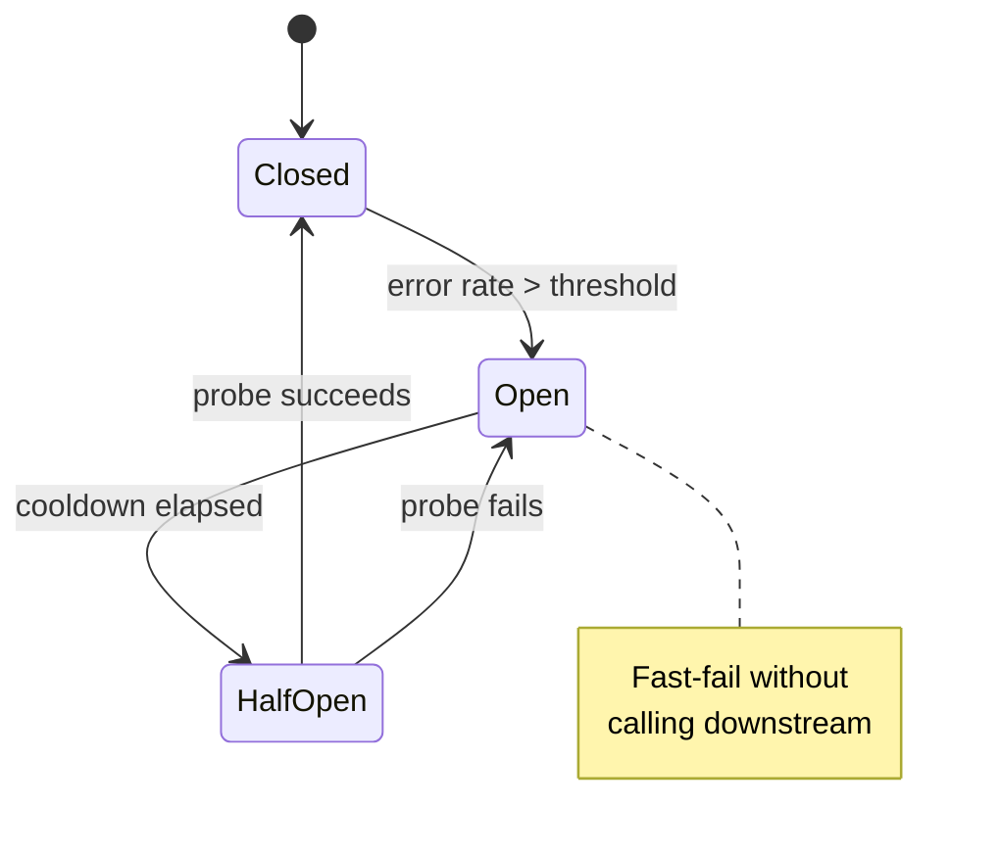

## Definition (interview-ready)

**Circuit breaker**: a state machine wrapping a remote call that **opens** (fast-fails) when failures exceed a threshold, **half-opens** to test recovery, and **closes** when healthy. **Bulkhead**: isolating resources (threads, connections) per dependency so a slow downstream can't drain shared pools. **Retry with backoff**: re-attempt failed calls with **exponential delay + jitter** to avoid synchronized retry storms. Together with **timeouts** on every call, these patterns stop one slow or failing dependency from cascading into a full outage.

**One-liner:** Timeouts bound the wait, bulkheads cap how much of my capacity one dependency can hold, retries with jittered backoff absorb transient blips, and a circuit breaker fast-fails calls to a dependency that is clearly sick.

## Why it matters

Cascading failures — one slow downstream taking down the whole system — are the most common production outage pattern. Circuit breakers, bulkheads, and disciplined retries are the resilience pattern stack every senior engineer needs to apply by default.



## Core concepts

### Circuit breaker states

```
            failure threshold crossed
   CLOSED  -------------------------->  OPEN
     ^                                  |   ^
     | probe(s) succeed                 |   | probe fails
     |                     cooldown     v   |
     +-------------------  HALF-OPEN  <-+---+
```

- **Closed**: requests flow through normally. Count failures.
- **Open**: fast-fail (return error / fallback immediately, no remote call).
- **Half-open**: after cooldown, allow one or a few probe requests (resilience4j lets 10 through by default). Success → close; failure → open again for another cooldown.

### Triggering rules

Example thresholds (the first one matches Hystrix's old defaults):

- **Error rate**: >50% errors over a 10s window, once at least 20 requests have been seen.
- **Error count**: 5 consecutive failures.
- **Latency**: p99 > 5s for 10s.

Pick a rule that matches the symptom you fear. Latency-based is often best — slow downstream is the bigger threat than total failure.

### Fallbacks

When circuit is open, what do you return?
- **Cached value** (last known good).
- **Default value** (empty list, "service unavailable").
- **Deferred** (queue the work for later, tell the user "try again").
- **Best-effort partial result** (e.g., feed without recommendations).

### Bulkheads

Pattern: isolate resources per dependency so one slow downstream can't drain shared pools.

Concretely:
- Separate **thread pools** per downstream service.
- Separate **connection pools** per DB / API.
- Separate **CPU/memory budgets** in containers.

Why: ship of compartments — flood one, others remain afloat. Without bulkheads, a Slack outage that holds your thread pool open for 30s drains all threads → entire app hangs.

Often implemented via **semaphores** instead of thread pools (cheaper):
```
sem = Semaphore(20)  // max 20 concurrent calls to service X
sem.acquire(timeout=100ms)
   call(...)
sem.release()
```

### Retries

Retry transient errors (network blip, 5xx, lock conflict). DON'T retry:
- 4xx errors (client problem, won't fix itself).
- Idempotency-sensitive calls without idempotency keys.
- Long-running internal failures (retry makes it worse).

#### Exponential backoff

```
delay = min(cap, base * 2^attempt)
```
Each retry doubles the delay. Caps prevent absurd waits.

#### Jitter

Without jitter, all clients retry at the same moments → **thundering herd**. Add randomness:
- **Full jitter**: `delay = random(0, min(cap, base * 2^attempt))`. Simplest, very effective.
- **Equal jitter**: `delay = base * 2^attempt / 2 + random(0, base * 2^attempt / 2)`.
- **Decorrelated jitter** (from the AWS Architecture Blog): `delay = min(cap, random(base, prev * 3))`.

Use **full jitter** unless you have a specific reason otherwise.

#### Retry budgets

Cap total retries — a calling service should never spend more than X% of its time retrying. Otherwise: retry storm amplifies the downstream's problem.

#### Idempotency requirement

Retries assume the call is idempotent (or has an idempotency key). Otherwise: duplicate charges, duplicate emails, duplicate orders. See [Delivery Semantics](/learn/notes/delivery-semantics/).

### Timeouts

The forgotten cousin. Every remote call needs a **timeout** — otherwise you wait forever for an answer that may never come, holding resources hostage.

Rule of thumb: a service's timeout for a downstream call should be **less than** the time budget its own caller gives it (the caller's timeout), minus its own processing time. Otherwise the caller gives up while you are still waiting on the downstream.

### Health checks

- **Liveness**: is the process alive? (Restart if not.)
- **Readiness**: is the process ready to serve traffic? (Pull from LB if not.)
- **Deep health**: do critical downstreams respond? (Use cautiously — propagates outages.)

### Combining these

A well-protected client looks like:
```
timeout(2s,
  retry(3, expBackoff with jitter,
    bulkhead(maxConcurrent=20,
      circuitBreaker(errorThreshold=50%,
        call(downstream)
      )
    )
  )
)
```

Used by Netflix Hystrix (in maintenance mode since 2018, but popularized the pattern), resilience4j, Polly (.NET), Envoy filters.

## How it works (cascading failure walkthrough)

```
Without protection:
  Downstream service slow (5s p99).
  All upstream threads block on it.
  Upstream queue grows.
  Upstream itself can't accept new requests → unhealthy.
  Load balancer marks it down → traffic to others.
  Other instances overwhelmed → entire region down.
  Customer-facing.

With protection:
  Same downstream slow.
  Timeout fires at 2s — request errors out cleanly.
  Circuit breaker opens after 50% errors.
  Subsequent calls fast-fail via fallback.
  Upstream threads return immediately.
  Capacity preserved; degraded feature only.
```

## Real-world examples

- **Netflix Hystrix**: popularized the circuit breaker pattern in microservices (the pattern itself comes from Nygard's *Release It!*). In maintenance mode since 2018; its README points users to resilience4j, and Netflix moved toward adaptive concurrency limits.
- **Envoy / Istio**: declarative outlier detection (ejects failing hosts from the pool, breaker-like), "circuit breaking" limits on connections and pending requests (bulkhead-style), retry policies, timeouts.
- **AWS SDKs**: built-in exponential backoff with **full jitter** in the "standard" retry mode, plus a token-bucket retry quota (a retry budget).
- **Spring Cloud**: Resilience4j integration.
- **Kubernetes liveness/readiness probes**: control restarts and traffic eligibility.

## Common pitfalls

- **Retrying without idempotency** → duplicate effects.
- **No jitter** → synchronized retry storms.
- **No timeout** → resource exhaustion.
- **Cascading deep health checks**: service A's readiness depends on B's health; B depends on C → C blips → all unhealthy.
- **One shared breaker when failures are key-specific**: requests for one bad key (say, one user whose calls always fail) push the shared error rate over the threshold and open the circuit for everyone.
- **Bulkhead per route, not per dependency**: one slow third-party API depletes all routes' pools.
- **Endless retries** without budget → amplify outages.
- **Fail-open vs fail-closed**: when CB opens, you must decide if your service still works degraded. If not, opening just hides the problem.

## Practice questions

<Practice>

<QA q="What is a circuit breaker?" level="easy">

A state machine wrapping a remote call. **Closed** (normal, counting failures) → **Open** (fast-fail once failures cross a threshold, no remote call) → **Half-open** (after a cooldown, let a probe through) → back to Closed if the probe succeeds, or Open if it fails. It prevents cascading failures by short-circuiting calls to a sick downstream.

</QA>

<QA q="Why do you add jitter to retry backoff?" level="easy">

Without jitter, all clients that failed together retry at the same moments, creating a synchronized **thundering herd** that hits the recovering downstream at once and keeps it from recovering. Random jitter spreads retries across time.

</QA>

<QA q="When a circuit is open, what can you return instead of calling the downstream?" level="easy">

- A **cached** last-known-good value.
- A **default** (empty list, 'service unavailable').
- A **deferred** response — queue the work for later, 'try again'.
- A **best-effort partial** result (e.g., a feed without recommendations).

Decide the fallback explicitly per call — it defines how the feature degrades.

</QA>

<QA q="What's a bulkhead and what does it protect against?" level="medium">

Resource isolation per dependency — separate thread pools, connection pools, or semaphores for each downstream. It stops a slow downstream from monopolizing shared resources and dragging down unrelated parts of the service. Semaphores (e.g., max 20 concurrent calls to service X) are a cheaper way to implement it than thread pools.

</QA>

<QA q="What is full jitter, and how does it compare with plain exponential backoff?" level="medium">

Plain exponential backoff: `delay = min(cap, base * 2^attempt)` — every client waits exactly the same time. **Full jitter**: `delay = random(0, base * 2^attempt)` (capped) — each client picks a random point in the window, so retries spread out. It's the simplest effective variant and the default recommendation; AWS SDKs use it in their standard retry mode.

</QA>

<QA q="Why is a latency-based trip rule often better than an error-count rule?" level="medium">

A slow downstream is usually more dangerous than a dead one: a fast failure returns the thread immediately, but a slow call holds threads and connections until the timeout fires, draining pools. Tripping on latency (e.g., p99 over 5 s for 10 s) catches that degradation before it turns into errors and exhaustion.

</QA>

<QA q="Liveness vs readiness checks — and why are deep health checks risky?" level="medium">

**Liveness**: is the process alive? If not, restart it. **Readiness**: can it serve traffic right now? If not, remove it from the load balancer. **Deep health** checks whether downstreams respond — risky because outages propagate: if A's readiness depends on B and B's on C, a blip in C marks everything unhealthy and pulls healthy instances out of rotation.

</QA>

<QA q="Walk through a cascading failure and how each pattern helps." level="medium">

Downstream slows → upstream threads block → queue grows → service-wide latency → LB removes instances → load shifts → other instances overwhelmed → outage.

Defenses:
- **Timeout** — the request fails fast and the thread returns.
- **Bulkhead** — only N threads can block on that downstream; the rest serve other work.
- **Circuit breaker** — after enough failures, stop trying entirely.
- **Fallback** — return cached or default data so upstream still responds.
- **Retry budget + backoff + jitter** — don't amplify the downstream's pain.

</QA>

<QA q="When should you NOT retry?" level="medium">

On **4xx** errors (a client problem won't fix itself). On **non-idempotent** calls without idempotency keys. When the error reflects a persistent problem (a downstream bug). When the **retry budget** is exhausted. When the **circuit breaker** is open.

</QA>

<QA q="A circuit breaker is shared across all users of a downstream. What can go wrong?" level="hard">

One bad key — a user whose requests are slow or always fail — can push the shared error rate over the threshold and open the circuit for **everyone**, turning one user's problem into a full outage of that dependency. Where failures are key-specific, scope breakers (or bulkheads) more finely, or exclude errors caused by bad input from the failure count.

</QA>

<QA q="In an A → B → C chain with a 2 s user budget, what timeout should each layer set?" level="hard">

- A's call to B: about 1.5 s (leaving about 500 ms for A's own work and slack).
- B's call to C: about 1 s (leaving about 500 ms for B's work).
- C's internal calls: under 500 ms.

Each timeout must be **strictly less** than its caller's, minus local processing. Otherwise a slow C eats A's whole budget, A times out anyway, and B and C keep burning resources on a response nobody will read.

</QA>

<QA q="Your circuit breaker opens, but the service can't do anything useful without that dependency. What should you decide?" level="hard">

Decide **fail-open vs fail-closed** explicitly. If the feature can degrade (serve cached or partial data), the breaker preserves capacity while users get a reduced experience. If it can't (e.g., an auth or payment check), opening just turns slow failures into fast errors — still valuable for protecting threads, but you must return a clear error and alert, not pretend it's degraded gracefully.

</QA>

<QA q="Design a robust HTTP client for a microservice." level="scenario">

- **Timeout** on every call: about 1–3 s default, longer only for known-slow calls.
- **Retry**: at most 3 attempts, full-jitter exponential backoff (base 100 ms, cap 5 s), only on transient errors (network, 5xx, 429 honoring `Retry-After`).
- **Bulkhead**: semaphore of about 20 concurrent calls per downstream.
- **Circuit breaker**: open at 50% errors over 20 requests in 10 s; 30 s cooldown.
- **Fallback**: cached, default, or partial.
- **Idempotency keys** on all writes.
- **Metrics** per downstream: success rate, latency histogram, breaker state, retries; propagate trace IDs.

</QA>

<QA q="A team enabled retries and now their downstream is overloaded even under normal load. Why?" level="scenario">

**Retry amplification.** With 3 retries, 1% failures add at most about 3% extra load — but under stress, 30% failures can add up to about 90% extra (when retries keep failing too), pushing the downstream deeper into trouble. Fixes:
- **Retry budget** — cap retries at, say, 10% of calls.
- **Backoff + jitter** — spread retries over time.
- **Circuit breaker** — stop retrying when the downstream is clearly degraded.
- **Fewer attempts** — often one retry is enough.

</QA>

</Practice>

## Quiz

<Quiz>

<MCQ q="A circuit breaker is in the half-open state and its probe request fails. What happens next?" options={["It closes and resumes normal traffic", "It returns to open and waits for another cooldown", "It stays half-open and sends all traffic", "It retries the probe immediately in a loop"]} answer={1}>

Half-open exists to test recovery; a failed probe sends the breaker back to open for another cooldown. Only a successful probe closes it.

</MCQ>

<MCQ q="Which formula describes full jitter?" options={["delay = base * 2^attempt", "delay = min(cap, random(base, prev * 3))", "delay = half the backoff plus a random half", "delay = random(0, base * 2^attempt), capped"]} answer={3}>

Full jitter picks uniformly between zero and the exponential window. The others are plain backoff, decorrelated jitter, and equal jitter.

</MCQ>

<MCQ q="A slow third-party API holds all of a service's shared worker threads, so unrelated endpoints hang. Which pattern prevents this?" options={["Bulkhead", "Exponential backoff", "Deep health checks", "Idempotency keys"]} answer={0}>

A bulkhead caps how many threads or connections one dependency can use, so the rest stay available. Backoff and idempotency don't limit concurrency, and deep health checks can make things worse.

</MCQ>

<MCQ q="Which failure should generally NOT be retried?" options={["A connection reset", "A 503 from the downstream", "A 400 Bad Request", "A 429 with a Retry-After header"]} answer={2}>

A 400 is a client error that will fail the same way again. Network blips, 5xx, and 429 (after the indicated wait) are transient and can be retried.

</MCQ>

<MCQ q="Under stress 30% of calls fail and each client retries up to 3 times. Roughly how much extra load can retries add?" options={["About 3%", "About 30%", "None, because retries are spread out", "About 90%"]} answer={3}>

In the worst case, when retries keep failing, 0.3 failures times 3 retries is about 0.9 extra calls per original call. That amplification is why retry budgets and circuit breakers matter.

</MCQ>

<MCQ q="Service A has a 2 s budget and calls B, which calls C. Which timeout setup is correct?" options={["A to B 1.5 s, B to C 1 s", "A to B 2 s, B to C 2 s", "A to B 1 s, B to C 1.5 s", "No timeouts; rely on the circuit breaker"]} answer={0}>

Each layer's timeout must be less than its caller's, leaving time for local work. Equal or inverted timeouts mean callers give up while callees keep working.

</MCQ>

<MCQ q="Service A's readiness probe checks B, whose readiness checks C. C has a brief blip. What happens?" options={["Only C is restarted", "A and B are pulled from rotation too, cascading the outage", "Liveness probes absorb the failure", "Nothing, readiness ignores downstreams"]} answer={1}>

Chained deep health checks propagate a downstream blip upward, removing healthy instances. Keep readiness about the instance itself.

</MCQ>

<MCQ q="Why must retried write calls carry idempotency keys?" options={["To make backoff exponential", "To reduce latency", "So a retry after a lost response doesn't create a duplicate charge or order", "So the circuit breaker can count failures"]} answer={2}>

If the first attempt succeeded but its response was lost, a retry repeats the side effect unless the server can recognize and dedupe it via the key.

</MCQ>

<MCQ q="What is the main reason latency-based tripping is often preferred?" options={["Slow calls tie up threads and connections, which is often worse than fast failures", "Latency is easier to measure than errors", "Error counts can't be tracked per downstream", "It removes the need for timeouts"]} answer={0}>

A slow downstream drains pools while calls wait, causing cascades. Fast errors release resources quickly. Timeouts are still needed.

</MCQ>

</Quiz>

## TL;DR cheat sheet

- **Timeout**: always. Your downstream timeout < the budget your own caller gives you.
- **Retry**: exponential backoff + **full jitter**. Cap attempts and total budget. Only on transient + idempotent.
- **Circuit breaker**: closed → open (fast-fail) → half-open (probe) → closed. Threshold on error rate or latency.
- **Bulkhead**: isolate threads/connections per dependency (or semaphores). Stops one slow downstream from draining shared pools.
- **Fallback**: cached, default, partial. Decide explicitly per call.
- **Health checks**: liveness vs readiness. Be careful with deep health (cascading false negatives).
- Combine: timeout → retry → bulkhead → circuit breaker → fallback.

## Go deeper

- **Martin Fowler**: ["Circuit Breaker"](https://martinfowler.com/bliki/CircuitBreaker.html).
- **AWS Architecture Blog**: ["Exponential Backoff and Jitter"](https://aws.amazon.com/blogs/architecture/exponential-backoff-and-jitter/).
- **AWS Builders Library**: [Timeouts, retries, and backoff with jitter](https://aws.amazon.com/builders-library/timeouts-retries-and-backoff-with-jitter/).
- **Netflix tech blog**: legacy Hystrix posts + post-Hystrix patterns.
- **resilience4j docs**: [resilience4j.readme.io](https://resilience4j.readme.io/) — modern reference impl.
- **Envoy docs**: outlier detection (circuit breaker), retry policies.
- **Book**: *Release It!* (Michael Nygard) — the source of "bulkhead" and circuit breaker in software.
- **Google SRE Book**: chapter on overload and graceful degradation.
