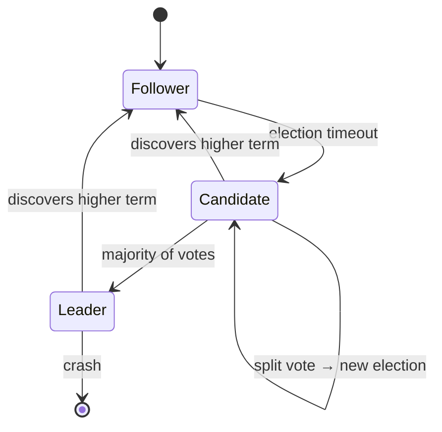

## Definition (interview-ready)

**Consensus** is the problem of getting multiple distributed processes to agree on a single value (or sequence of values) despite failures and network partitions. **Paxos** (Lamport; written 1989, published 1998) is the original algorithm — correct but notoriously hard to understand. **Raft** (Ongaro & Ousterhout, 2014) is a more understandable redesign with the same safety guarantees, used by etcd, Consul, CockroachDB, TiDB, and Kafka KRaft (a pull-based Raft variant); MongoDB replica sets use a Raft-inspired protocol.

## Why it matters

Every system that needs leader election, distributed locks, atomic config updates, or replicated state machines uses consensus under the hood. Knowing what consensus guarantees (and the cost of providing it) lets you decide when to lean on Raft/Paxos vs softer designs (gossip, CRDTs, last-write-wins).

<Anim id="raft" />



## Core concepts

### What consensus solves

Given N processes that can crash, restart, or be partitioned:
- **Agreement**: all non-faulty nodes decide on the same value.
- **Validity**: the decided value was proposed by some node.
- **Termination**: all non-faulty nodes eventually decide.

The FLP impossibility (Fischer-Lynch-Paterson, 1985) proves that in fully asynchronous networks, no deterministic consensus algorithm guarantees termination with even one faulty node. Real systems sidestep with **timeouts** + **randomization**.

### Majority quorums

Consensus requires a **majority** (`floor(N/2) + 1`) to agree. With N=3, you need 2; with N=5, you need 3.

- 3 nodes → tolerates 1 failure.
- 5 nodes → tolerates 2 failures.
- 7 nodes → tolerates 3 failures.

Why **odd N**? Even N (e.g., 4) tolerates the same number of failures as N-1 (3), but needs more nodes for the same majority. Diminishing return; odd is convention.

### Raft

The whole algorithm is built around **a strong leader**. Time is divided into **terms** — each term has at most one leader.

#### Raft has three subproblems

1. **Leader election** — pick a single leader per term.
2. **Log replication** — leader sends log entries to followers.
3. **Safety** — committed entries are never lost.

#### States

Each node is one of: **Follower**, **Candidate**, **Leader**.

#### Leader election

- Followers run a randomized election timeout (150–300ms).
- If no heartbeat, they become **Candidate**, increment term, vote for themselves, request votes from peers.
- A node grants a vote if (a) it hasn't voted this term, (b) the candidate's log is at least as up-to-date as its own.
- Candidate with majority becomes Leader; if split vote, randomized backoff and retry.

#### Log replication

- Leader appends client commands to its log.
- Sends `AppendEntries` to followers.
- Followers append and acknowledge.
- Once a majority has acknowledged, the entry is **committed** and applied to the state machine. (A leader only counts replicas this way for entries from its *current* term; older entries commit indirectly.)
- Leader sends commit index in next AppendEntries.

#### Safety invariants

- **Log matching**: if two logs have the same `(term, index)`, all preceding entries match.
- **Leader completeness**: a committed entry is in the log of every future leader's term ≥ that term.
- **State machine safety**: if a server has applied an entry at index i, no other server applies a different entry at i.

#### Snapshotting

Logs grow unboundedly. Periodically take a snapshot of state and discard log entries before the snapshot index. New followers receive snapshot + log tail to catch up.

#### Cluster membership changes

The Raft paper does this in two steps via **joint consensus** to avoid two majority cliques: old config + new config briefly both active until the transition commits. Ongaro's dissertation adds a simpler **single-server change** (add/remove one node at a time), which most implementations (e.g., etcd) use.

### Paxos (overview)

- **Proposers, Acceptors, Learners** roles.
- Two phases: **Prepare** (numbered proposal, gather promises) and **Accept** (with majority).
- Original Paxos proves a single value; **Multi-Paxos** extends to a log of values by amortizing prepare via a stable leader.
- Hard to implement correctly; many subtle variants (Fast Paxos, Cheap Paxos, Egalitarian Paxos).

Paxos is **algorithmically equivalent in safety/availability to Raft** but harder to understand and implement. Hence Raft's popularity.

### Variants and alternatives

- **Multi-Paxos**: Paxos for a log of decisions.
- **Egalitarian Paxos (EPaxos)**: lets any node serve as leader for non-conflicting operations.
- **Zab** (ZooKeeper): a Paxos-like atomic broadcast protocol (its authors stress it is distinct from Paxos).
- **Viewstamped Replication**: an academic ancestor to Raft/Paxos.
- **PBFT / Tendermint / HotStuff**: Byzantine fault tolerant — handle malicious nodes (blockchain).

### Liveness vs safety

- **Safety**: nothing bad happens (no two leaders, no committed-then-lost entry). Always preserved by Raft/Paxos.
- **Liveness**: progress eventually. Depends on timely networks; can stall during long partitions or split votes.

## How it works (Raft log replication)

```
1. Client sends command to Leader L.
2. L appends (term, index, command) to its log.
3. L sends AppendEntries(prevTerm, prevIndex, [command], commitIndex) to all followers.
4. Followers verify prevTerm/prevIndex matches → append → ack.
5. When L sees majority ack, sets commitIndex = index.
6. L applies command to state machine, responds to client.
7. In next heartbeat, L tells followers new commitIndex; they apply too.
```

## Real-world examples

- **etcd**: Raft-based KV store; backbone of Kubernetes.
- **Consul**: service discovery + KV; Raft underneath.
- **CockroachDB**: Raft per range (a shard), thousands of Raft groups per cluster.
- **TiKV / TiDB**: same pattern.
- **MongoDB replica sets**: Raft-like.
- **Kafka KRaft**: Raft variant replacing ZooKeeper for metadata (ZooKeeper mode removed in Kafka 4.0).
- **Google Chubby**: Paxos-based lock service — foundational paper.
- **Apache ZooKeeper**: Zab, used for coordination by HBase, Hadoop, Solr.

## Common pitfalls

- **Even number of voters**: split votes more likely; choose odd.
- **Single-node "consensus"**: not consensus, no fault tolerance.
- **Network partitions and minority side**: minority can't make progress (correct — it must give up availability to preserve consistency).
- **Long election timeouts**: slow failover. Too short: false elections. Tune to network RTTs.
- **Disk fsync per log append**: critical for safety but slow → group commit.
- **Snapshot blocking**: take asynchronously or you stall the cluster.
- **Joint consensus implementation bugs**: many Raft bugs in cluster reconfiguration; use a battle-tested library.
- **Believing consensus is cheap**: every committed entry is one RTT to a majority. Cross-DC = expensive. Place voters in same region.

## Practice questions

<Practice>

<QA q="Why does Raft use an odd number of nodes?" level="easy">

Consensus needs a majority quorum (`floor(N/2) + 1`). An even N gives the same fault tolerance as N − 1 — 4 nodes tolerate 1 failure, same as 3 — but needs more nodes for the majority. Odd N is the efficient choice: 3 tolerate 1, 5 tolerate 2, 7 tolerate 3.

</QA>

<QA q="What does it mean for a Raft entry to be 'committed'?" level="easy">

The leader has replicated it to a **majority** of nodes (including itself). Committed entries survive leader changes and will eventually be applied to the state machine on every node. (A leader only counts replicas this way for entries from its current term; older entries commit indirectly.)

</QA>

<QA q="What's the difference between safety and liveness in consensus?" level="easy">

**Safety**: nothing bad happens — no two leaders in a term, no committed entry lost. Raft and Paxos always preserve it. **Liveness**: progress eventually happens — it depends on a reasonably timely network and can stall during long partitions or repeated split votes.

</QA>

<QA q="Walk through Raft leader election." level="medium">

On a randomized election timeout (e.g., 150–300 ms) with no heartbeat, a follower becomes a **candidate**, increments its term, votes for itself, and sends `RequestVote` to all peers. A node grants its vote if it hasn't voted this term **and** the candidate's log is at least as up-to-date as its own. A candidate with a majority becomes leader. Randomized timeouts make repeated split votes unlikely.

</QA>

<QA q="How does Raft handle a network partition?" level="medium">

The side with a majority can elect a leader and keep committing; the minority side can't — candidates there never get enough votes. When the partition heals, a stale leader on the minority side sees a higher term and steps down, and its uncommitted entries are discarded in favor of the new leader's log.

</QA>

<QA q="Why are Paxos and Raft considered equivalent?" level="medium">

Both solve consensus with the same safety properties, tolerate f failures with 2f + 1 nodes, and rely on majority quorums. Paxos is more general but harder to implement correctly; Raft is opinionated (a strong leader) and easier to understand and verify.

</QA>

<QA q="Describe the two phases of Paxos." level="medium">

1. **Prepare**: a proposer picks a proposal number and asks acceptors to promise not to accept lower-numbered proposals; it needs promises from a majority. Acceptors also report any value they've already accepted, and the proposer must then propose the highest-numbered such value instead of its own.
2. **Accept**: the proposer asks acceptors to accept a value under that number; once a majority accepts, the value is chosen and learners are told.

Basic Paxos decides a single value. **Multi-Paxos** extends it to a log by keeping a stable leader, so the prepare phase is amortized across many entries.

</QA>

<QA q="Why does Raft need snapshotting?" level="medium">

The log grows without bound. Periodically each node snapshots its state machine and discards log entries up to the snapshot index. A new or far-behind follower receives the snapshot plus the log tail to catch up. Take snapshots asynchronously — a blocking snapshot stalls the cluster.

</QA>

<QA q="What does the FLP result say, and how do real consensus systems live with it?" level="hard">

FLP (Fischer, Lynch, Paterson, 1985) proves that in a fully asynchronous network, no deterministic consensus algorithm can guarantee termination if even one node may fail. Real systems keep safety unconditional and get liveness in practice with **timeouts** and **randomization** — e.g., Raft's randomized election timeouts.

</QA>

<QA q="How does Raft change cluster membership safely?" level="hard">

A naive switch from the old to the new configuration could let two disjoint majorities exist at once. The Raft paper uses **joint consensus** — both old and new configurations must agree during the transition until it commits. Ongaro's dissertation adds a simpler **single-server change** (add or remove one node at a time), which most implementations such as etcd use. Reconfiguration is a common source of Raft bugs, so use a battle-tested library.

</QA>

<QA q="A 5-node Raft cluster has 2 nodes in DC-A and 3 in DC-B. DC-B becomes unreachable from DC-A. What happens?" level="scenario">

The 2 DC-A nodes can't form a majority (they need 3), so they stop committing and may keep running elections without success. The 3 DC-B nodes, if they can reach each other, still have a majority and keep serving reads and writes. So DC-A is effectively unavailable for writes — reconfigure proactively, or accept that asymmetry when choosing voter placement.

</QA>

<QA q="How would you minimize consensus latency across regions?" level="scenario">

- **Place voters in one region** when possible — every commit is a round trip to a majority, and cross-region RTT is brutal.
- **Read-only learners** in other regions — they don't vote but can serve stale reads.
- **Lease-based reads**: the leader holds a lease and serves reads without contacting followers.
- **Multi-Raft per range** (CockroachDB): many Raft groups with leaders placed near their data.
- **Keep consensus off the hot path** — use it for metadata and replication, not every key operation.

</QA>

<QA q="3-node cluster: leader node 1 crashes, nodes 2 and 3 elect node 2, then node 1 returns with uncommitted entries. What happens?" level="scenario">

Node 1 hears from leader node 2 with a higher term, reverts to follower, **discards uncommitted entries** that conflict with the new leader's log, and adopts the leader's log. It can't hold committed entries that node 2 lacks — by **leader completeness**, a winning candidate needs a majority vote, that majority includes a node holding every committed entry, and voters reject candidates with less up-to-date logs.

</QA>

</Practice>

## Quiz

<Quiz>

<MCQ q="How many node failures can a 5-node Raft cluster tolerate while still committing writes?" options={["1", "2", "3", "4"]} answer={1}>

A majority of 5 is 3, so up to 2 nodes can fail. Losing 3 leaves only 2, which can't form a majority.

</MCQ>

<MCQ q="Why is a 4-node consensus cluster usually not worth it compared with 3 nodes?" options={["4 nodes cannot elect a leader", "4 nodes require unanimous agreement", "4 nodes tolerate the same 1 failure as 3 but need a larger majority", "4 nodes are always split-brained"]} answer={2}>

A majority of 4 is 3, so it still tolerates only 1 failure, like a 3-node cluster, while adding more nodes to coordinate.

</MCQ>

<MCQ q="When does a Raft follower grant its vote to a candidate?" options={["When it hasn't voted this term and the candidate's log is at least as up-to-date as its own", "Whenever the candidate has the highest node ID", "Whenever the candidate's term is lower", "Only if the old leader approves"]} answer={0}>

Both conditions are required. The log check ensures a new leader has every committed entry, which is the basis of leader completeness.

</MCQ>

<MCQ q="Why does Raft randomize election timeouts?" options={["To encrypt heartbeat traffic", "To spread log entries evenly", "To let followers skip AppendEntries", "To make it unlikely that several followers become candidates at once and split the vote"]} answer={3}>

If all followers timed out together, they'd keep splitting votes. Randomization lets one candidate usually win before others start.

</MCQ>

<MCQ q="During a partition, the minority side of a Raft cluster receives a write. What happens?" options={["It commits locally and reconciles later", "It cannot commit the write because it can't reach a majority", "It forwards the write to a learner", "It commits after a longer timeout"]} answer={1}>

Commits require majority acknowledgment. The minority side gives up availability to keep consistency; anything it appends stays uncommitted.

</MCQ>

<MCQ q="What does the FLP impossibility result state?" options={["Consensus is impossible with more than 5 nodes", "Byzantine nodes can always break Paxos", "No deterministic algorithm can guarantee consensus terminates in a fully asynchronous network with one faulty node", "Raft and Paxos are not equivalent"]} answer={2}>

FLP is about termination under full asynchrony. Practical systems keep safety and achieve liveness with timeouts and randomization.

</MCQ>

<MCQ q="What does Multi-Paxos optimize compared with basic Paxos?" options={["It amortizes the prepare phase across many log entries via a stable leader", "It tolerates Byzantine faults", "It removes the need for a majority", "It lets any node commit without a quorum"]} answer={0}>

Basic Paxos decides one value with prepare and accept phases. Multi-Paxos keeps a leader so it can skip repeated prepares while still using majority quorums.

</MCQ>

<MCQ q="Which technique reduces read latency in Raft without contacting followers for every read?" options={["Joint consensus", "Increasing the election timeout", "Adding an even number of voters", "Leader leases for reads"]} answer={3}>

With a lease, the leader knows no other leader can exist yet and can serve reads locally. Joint consensus is for membership changes; the other options don't help reads.

</MCQ>

<MCQ q="A returning ex-leader has log entries the new leader doesn't have. What are those entries guaranteed to be?" options={["Committed, so the new leader must copy them", "Uncommitted, so they are discarded", "Snapshots", "Membership changes"]} answer={1}>

By leader completeness, the new leader has every committed entry, so any extra entries on the old leader were never committed and get overwritten.

</MCQ>

</Quiz>

## TL;DR cheat sheet

- **Consensus**: agreement among N nodes despite failures. Needs majority quorum.
- 3 nodes tolerate 1 failure, 5 tolerate 2, 7 tolerate 3. Use **odd**.
- **Raft**: strong leader; subproblems = leader election, log replication, safety.
- Leader election via randomized timeouts.
- Entries committed when majority acks. Apply to state machine in order.
- Safety: committed entries never lost across leader changes.
- **Paxos** = older, harder, same safety. Multi-Paxos for a log.
- Minority side of partition: unavailable for writes (consistency wins).
- Place voters in same region for latency; use learners across regions.
- Used by: etcd, Consul, CockroachDB, MongoDB, Kafka KRaft, Spanner (Paxos).

## Go deeper

- **Raft paper (Ongaro & Ousterhout, 2014)**: ["In Search of an Understandable Consensus Algorithm"](https://raft.github.io/raft.pdf) — readable, the recommended starting point.
- **Animated Raft**: [thesecretlivesofdata.com/raft](https://thesecretlivesofdata.com/raft/) — best visualization.
- **Raft Visualization** (interactive): [raft.github.io](https://raft.github.io/).
- **Ousterhout talk**: ["Designing for Understandability — The Raft Consensus Algorithm"](https://www.youtube.com/watch?v=vYp4LYbnnW8).
- **Paxos**: Lamport's ["Paxos Made Simple"](https://lamport.azurewebsites.net/pubs/paxos-simple.pdf) (Lamport meant the title sincerely; many readers still find it hard).
- **Heidi Howard's blog** — modern consensus research, very accessible.
- **Book**: *Designing Data-Intensive Applications*, Chapter 9.
