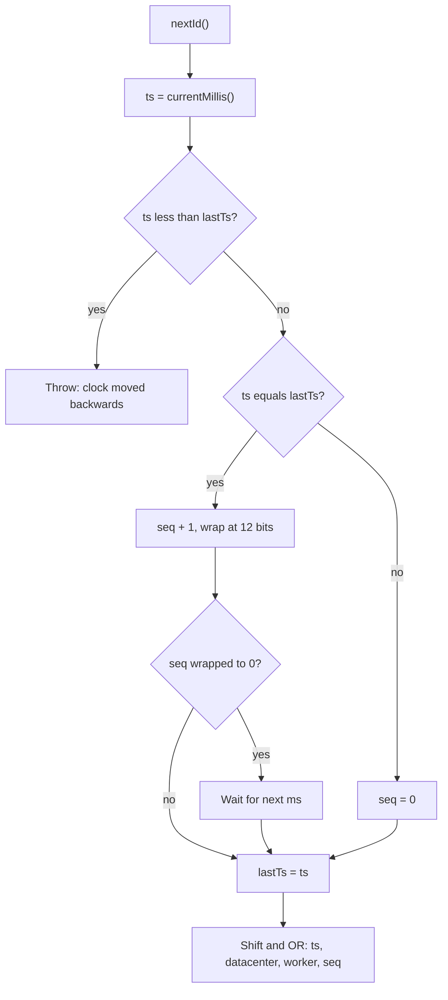
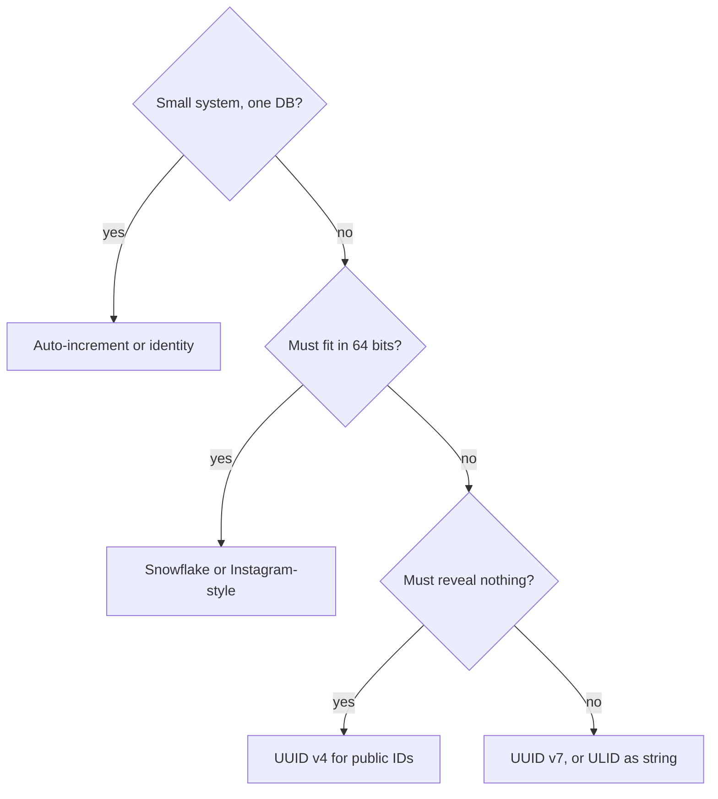

## Definition (interview-ready)

**Distributed ID generation** is the problem of handing out identifiers that are **unique across many machines**, usually **without a central coordinator on the hot path**. The main families are:

- **Central counters**: a database auto-increment or a dedicated "ticket server". Simple, small, perfectly ordered, but every ID needs a round trip to one place.
- **Random IDs**: UUID v4 (122 random bits). No coordination at all, but large and unordered, which hurts database indexes.
- **Time-ordered IDs**: Snowflake (64 bits = timestamp + worker ID + sequence), UUID v7, ULID, KSUID. Roughly sorted by creation time, generated locally, but they depend on the clock and, for Snowflake, on unique worker IDs.

The interview answer is always a trade-off between **size, sortability, coordination and privacy**.

**One-liner:** Distributed ID generation means creating unique IDs on many machines without asking one central counter each time; I'd pick UUID v7 for coordination-free, time-sorted 128-bit keys, or Snowflake when the ID must fit in 64 bits and I can assign unique worker IDs.

## Why it matters

A single database can number rows with `AUTO_INCREMENT`. The moment you shard, run in several regions, or want to create an ID **before** you touch the database (for idempotency keys, events, client-generated records), that stops working.

The choice of ID also leaks into everything else:

- **Index performance**: random 128-bit keys scatter inserts across a B-tree. Time-ordered keys append at the right edge.
- **Pagination and feeds**: "give me everything newer than ID X" only works if IDs sort by time.
- **Storage**: an 8-byte key versus a 16-byte key is repeated in every secondary index and every foreign key.
- **Security and privacy**: sequential IDs let anyone count your orders or guess other users' URLs.

It shows up in interviews directly ("design a unique ID generator") and inside almost every HLD problem: URL shortener codes, tweet IDs, chat message IDs, order IDs.

## Core concepts

### Requirements checklist

Ask these before choosing:

| Requirement | Question to ask | Who wins |
|---|---|---|
| **Uniqueness** | Globally unique, or unique per table / shard? | Everything, if configured correctly |
| **Sortability** | Must IDs sort by creation time? Strictly or roughly? | Snowflake, UUID v7, ULID, KSUID |
| **Size** | Must it fit in a 64-bit integer (`BIGINT`)? | Snowflake, Instagram-style, auto-increment |
| **Coordination** | Can generation call a central service or DB? | UUID v4/v7, ULID need none |
| **Throughput** | IDs per second per node? | Snowflake: 4,096 per ms per worker |
| **Privacy** | Is it OK if IDs reveal volume or creation time? | UUID v4 reveals nothing |
| **Readability** | Will humans type or read it? | Short integers or base62 strings |

**k-sorted** (or "roughly sorted") means IDs are ordered by time within some small window, but two IDs created a few milliseconds apart on different machines may come out of order. That is good enough for feeds and index locality. It is not a total order of events.

### Database auto-increment and its limits

```sql
CREATE TABLE orders (id BIGINT AUTO_INCREMENT PRIMARY KEY, ...);   -- MySQL
CREATE TABLE orders (id BIGINT GENERATED ALWAYS AS IDENTITY PRIMARY KEY, ...); -- Postgres
```

Great for one database: 8 bytes, strictly increasing, perfect index locality. The limits:

- **Single writer.** Every insert goes through the node that owns the counter. Fine for thousands of inserts per second, a bottleneck at large scale.
- **Doesn't survive sharding.** Two shards both produce `id = 42`. You need offsets (`auto_increment_increment` and `auto_increment_offset` in MySQL) or a separate allocator.
- **ID only after insert.** The app can't know the ID until the DB returns it, so you can't build an event, an idempotency key or a client-side record first.
- **Gaps are normal.** Postgres sequences are not rolled back when a transaction aborts, and InnoDB auto-increment can also skip values. Never treat IDs as a gap-free counter (for invoice numbers, use a separate, transactional counter).
- **Leaks business data.** `order/1000231` today and `order/1004231` tomorrow tells a competitor you take about 4,000 orders a day. It also lets attackers enumerate records if access checks are weak (an IDOR — insecure direct object reference — bug).

### Ticket servers (Flickr, 2010)

Flickr needed unique IDs across sharded MySQL. Their trick: a tiny dedicated MySQL database whose only job is to hand out numbers.

```sql
CREATE TABLE Tickets64 (
  id   BIGINT UNSIGNED NOT NULL AUTO_INCREMENT,
  stub CHAR(1) NOT NULL DEFAULT '',
  PRIMARY KEY (id),
  UNIQUE KEY stub (stub)
) ENGINE=InnoDB;

-- to get an ID:
REPLACE INTO Tickets64 (stub) VALUES ('a');
SELECT LAST_INSERT_ID();
```

The table only ever holds one row. `REPLACE INTO` deletes and re-inserts it, which bumps the auto-increment. To avoid a single point of failure they ran **two** ticket servers, one producing odd numbers and one producing even numbers:

```
TicketServer1: auto-increment-increment = 2, auto-increment-offset = 1
TicketServer2: auto-increment-increment = 2, auto-increment-offset = 2
```

Clients round-robin between them. The two sequences drift apart over time, which is fine because nobody needs strict global order. Flickr chose this over GUIDs because GUIDs are big and index poorly in MySQL.

**Upgrade: block (segment) allocation.** Instead of one round trip per ID, a service grabs a **range** ("give me the next 1,000") and hands them out from memory. One DB write per 1,000 IDs. If the service crashes, the unused part of the range is simply lost, which creates gaps but never duplicates. Hibernate's `pooled` sequence optimizer works the same way.

### UUID v4 vs UUID v7 (RFC 9562)

A **UUID** is a 128-bit value, written as 36 characters like `0190a6f2-7c3e-7b1a-9d2e-3f4a5b6c7d8e`. **RFC 9562** (May 2024) replaced the old RFC 4122 and added versions 6, 7 and 8.

**UUID v4** = 122 random bits + 6 fixed version/variant bits.

- No coordination, no clock, nothing to configure.
- Collisions are not a practical concern with a good random source: by the birthday bound you need on the order of 2^61 (about 2.7 × 10^18) IDs before a collision becomes even 50% likely.
- **Bad index locality.** Each new key lands at a random spot in the B-tree. On a large table, that means random page reads, page splits, and a working set that no longer fits in memory. In InnoDB, where the primary key **is** the clustered index (the table data is stored in primary-key order), this is especially painful.

**UUID v7** = time first, randomness after:

```
 0                   1                   2                   3
 0 1 2 3 4 5 6 7 8 9 0 1 2 3 4 5 6 7 8 9 0 1 2 3 4 5 6 7 8 9 0 1
+-+-+-+-+-+-+-+-+-+-+-+-+-+-+-+-+-+-+-+-+-+-+-+-+-+-+-+-+-+-+-+-+
|                    unix_ts_ms (48 bits)                       |
+-+-+-+-+-+-+-+-+-+-+-+-+-+-+-+-+-+-+-+-+-+-+-+-+-+-+-+-+-+-+-+-+
|  unix_ts_ms (cont.)           | ver=7 |   rand_a (12 bits)    |
+-+-+-+-+-+-+-+-+-+-+-+-+-+-+-+-+-+-+-+-+-+-+-+-+-+-+-+-+-+-+-+-+
|var|                  rand_b (62 bits)                         |
+-+-+-+-+-+-+-+-+-+-+-+-+-+-+-+-+-+-+-+-+-+-+-+-+-+-+-+-+-+-+-+-+
|                       rand_b (cont.)                          |
+-+-+-+-+-+-+-+-+-+-+-+-+-+-+-+-+-+-+-+-+-+-+-+-+-+-+-+-+-+-+-+-+
```

- The first 48 bits are a Unix timestamp in milliseconds, so v7 values sort by time when compared as raw bytes or as strings.
- New rows go to the right edge of the index, like auto-increment. RFC 9562 itself calls out the index-locality benefit.
- Still no coordination: any process can make one.
- Within one millisecond, the RFC allows generators to keep order by putting a **counter** in `rand_a` (its "Method 1") or **extra sub-millisecond clock bits** (its "Method 3") instead of pure randomness.
- Native support: PostgreSQL 18 added `uuidv7()` (and `uuidv4()` alongside the older `gen_random_uuid()`).

**Version cheat table**

| Version | Contents | Use today? |
|---|---|---|
| v1 | 60-bit timestamp (100 ns since 1582) + MAC/node | Legacy. Leaks MAC, poor sort order |
| v4 | Random | Yes, when you want zero information leakage |
| v6 | v1 fields reordered so it sorts | Only for v1 migrations; RFC says prefer v7 |
| v7 | Unix ms timestamp + random | **Yes — default for new DB keys** |
| v8 | Vendor-defined layout | Custom formats only; uniqueness is up to you |

**How to say it in an interview:** "I'd use UUID v7 for primary keys. It's coordination-free like v4, but time-ordered, so inserts append to the B-tree instead of scattering."

### Twitter Snowflake

In 2010 Twitter moved tweets from MySQL to Cassandra, which has no sequence generator. They built **Snowflake**, a small Thrift service in Scala. Its README lists the goals: at least 10k IDs per second per process, uncoordinated generation, **k-sorted** IDs ("we're promising 1s, but shooting for 10's of ms"), directly sortable, and **under 64 bits**.

```
 1 bit   41 bits                         10 bits        12 bits
┌─┬─────────────────────────────────┬──────────────┬────────────┐
│0│ ms since custom epoch           │ machine ID   │ sequence   │
└─┴─────────────────────────────────┴──────────────┴────────────┘
       ~69.7 years of range          1,024 workers   4,096 per ms
                                     (5 datacenter   per worker
                                      + 5 worker)
```

- **Sign bit** is always 0, so the ID is a positive signed 64-bit integer (Java `long`, SQL `BIGINT`).
- **Timestamp**: milliseconds since Twitter's custom epoch `1288834974657` (4 Nov 2010 UTC). A custom epoch means none of the 41 bits are wasted on 1970–2010. 2^41 ms is about 69.7 years, so Twitter's range runs out around 2080.
- **Machine ID**: 10 bits. In the original code this is split into a 5-bit datacenter ID and a 5-bit worker ID.
- **Sequence**: 12 bits, reset each millisecond. If a worker issues 4,096 IDs in one millisecond, it **spins until the next millisecond**.

Generation (simplified from the original `IdWorker`):

```java
synchronized long nextId() {
    long ts = currentMillis();
    if (ts < lastTs) {
        throw new IllegalStateException("clock moved backwards; refusing for "
            + (lastTs - ts) + " ms");
    }
    if (ts == lastTs) {
        seq = (seq + 1) & 0xFFF;        // 12-bit wrap
        if (seq == 0) ts = waitUntilAfter(lastTs);  // exhausted this ms
    } else {
        seq = 0;
    }
    lastTs = ts;
    return ((ts - EPOCH) << 22) | (datacenterId << 17) | (workerId << 12) | seq;
}
```

The same `nextId()` logic as a flow:



Why it's popular: **8 bytes**, sorts by time, ~4 million IDs per second per worker, no network call per ID. The costs: you must **assign unique worker IDs** and you **depend on the wall clock**.

You can decode any Snowflake: `timestamp_ms = (id >> 22) + EPOCH`. That is handy for debugging, but it also means anyone can see exactly when a record was created.

### Snowflake variants

**Sonyflake (Sony, Go).** Trades throughput for lifespan and more machines:

| Field | Bits | Notes |
|---|---|---|
| Time | 39 | in units of **10 ms**, about 174 years |
| Sequence | 8 | 256 IDs per 10 ms per instance (about 25,600 per second) |
| Machine ID | 16 | default: lower 16 bits of the private IP address |

Sonyflake v2 makes the sequence bits, machine bits and time unit configurable. Using the IP as machine ID removes a coordination step, but two hosts whose private IPs share the lower 16 bits would collide, so it only works when your network layout guarantees that.

**Instagram (inside PostgreSQL).** Instagram sharded Postgres into thousands of **logical shards** (schemas) spread over fewer physical servers. Each ID is generated **by the database itself** in a PL/pgSQL function used as the column default:

```
41 bits: ms since a custom epoch
13 bits: logical shard ID         (up to 8,192 shards)
10 bits: per-shard sequence % 1024 (1,024 IDs per ms per shard)
```

```sql
-- idea of the function (per shard schema)
our_epoch := <custom epoch ms>;
seq_id    := nextval('shard_5.table_id_seq') % 1024;
now_ms    := floor(extract(epoch from clock_timestamp()) * 1000);
result    := (now_ms - our_epoch) << 23;
result    := result | (shard_id << 10);
result    := result | seq_id;
```

The neat part: the **shard ID is inside the ID**. Given any ID, you know which logical shard holds the row, with no lookup. No extra service runs, because Postgres already exists. The trade-off: ID generation is tied to the database write.

**Others you may hear about:** Discord uses Snowflake-style IDs (ms timestamp in the high bits, 5-bit worker, 5-bit process, 12-bit increment) with an epoch at the first second of 2015. MongoDB's `ObjectId` is a 12-byte cousin: a 4-byte Unix timestamp in **seconds**, a 5-byte random value generated once per process, and a 3-byte counter that starts at a random value.

### ULID

**ULID** (Universally Unique Lexicographically Sortable Identifier) is a community spec:

```
 48 bits: Unix time in ms     80 bits: randomness
 ttttttttttrrrrrrrrrrrrrrrr   ← 26 chars, Crockford base32
 01ARZ3NDEKTSV4RRFFQ69G5FAV
```

- 128 bits, the same size as a UUID, so it fits a `UUID` column.
- **Crockford base32** leaves out I, L, O and U to avoid confusion. The string is case-insensitive and URL-safe, and it **sorts lexicographically by time**.
- **Monotonic mode**: inside the same millisecond, the generator increments the random part by 1 instead of drawing new randomness. That keeps per-process order, but if the random part would overflow, generation fails.
- Without monotonic mode, order inside one millisecond is not guaranteed.

ULID is basically "UUID v7 before UUID v7 existed, with a nicer string form". For new systems that store IDs in a native `uuid` column, v7 is the standards-based choice. ULID is still nice where the ID shows up as text (URLs, logs).

### KSUID

**KSUID** (K-Sortable Unique IDentifier, from Segment):

- **20 bytes**: a 32-bit timestamp in **seconds** since a custom epoch (13 May 2014) plus a **128-bit** random payload.
- String form: **27 characters of base62**.
- More random bits than UUID v4, so collisions are even less of a concern, but sort order is only per second, and it's bigger than a UUID.

### Clock skew and clocks that go backwards

Every time-based scheme trusts the wall clock. Wall clocks are adjusted by NTP, by operators, by VM migrations, and by leap-second handling. See [clocks](/learn/notes/clocks-vector-lamport-hlc/) for why physical time is unreliable.

What can go wrong:

- **Clock jumps backwards** on one node. If the generator simply uses the new time, it can reissue a timestamp + sequence it already used: **duplicate IDs**.
- **Clocks disagree between nodes** (skew). IDs are still unique (different worker IDs), but ordering across nodes is only as good as the skew. This is why Snowflake promises k-sorting, not total order.

Ways to handle a backwards clock:

| Strategy | How | Trade-off |
|---|---|---|
| **Refuse** (original Snowflake) | If `now` is less than `lastTs`, throw until time catches up | Correct; brief unavailability on that node |
| **Wait** | Small jumps (a few ms): sleep until `now` passes `lastTs` | Adds latency; set a cap, then refuse |
| **Keep the logical time** | Use `max(now, lastTs)` and keep incrementing the sequence, borrowing future ms | Never stalls, but timestamps drift ahead of real time until the clock catches up |
| **Prevent it** | Configure NTP to slew (adjust gradually) rather than step the clock | Fixes most cases at the source; Snowflake's README recommends this |
| **Persist last timestamp** | On restart, don't issue IDs below the last persisted time | Protects against a node rebooting with a wrong clock |

The original Snowflake README says it plainly: it "will refuse to generate ids" until the clock passes the last time it used, and it's better to run NTP in a mode that never moves the clock backwards.

UUID v7 and ULID are less fragile here: with 62–80 random bits per ID, a repeated millisecond almost never produces a duplicate. You only lose ordering.

### Worker ID assignment

Snowflake's uniqueness rests on one rule: **no two live generators share a worker ID**. Ways to get one:

| Method | How | Watch out for |
|---|---|---|
| **Static config** | Each host gets an ID in its config | Human error; breaks with autoscaling |
| **ZooKeeper / etcd** | On boot, create an ephemeral node `/snowflake/workers/17`; it disappears when the session dies | The original Snowflake did exactly this, plus a sanity check of peers' IDs and clocks |
| **Database lease table** | `worker_id` rows with an owner and an expiry; claim a free or expired row | Renew the lease; stop issuing IDs if renewal fails |
| **Kubernetes StatefulSet ordinal** | Pod `idgen-3` uses worker ID 3 | Stable only within one cluster; add a datacenter ID for multi-cluster |
| **Derived from IP** (Sonyflake) | Lower bits of the private IP | Only safe if your subnet plan guarantees uniqueness |

The dangerous case is a **zombie**: a node pauses (GC, VM freeze), loses its lease, another node takes the same worker ID, and then the first node wakes up and keeps generating. Defences: check that the lease is still valid before issuing, and have a new owner wait longer than the lease TTL before using a reclaimed ID.

### Embedded generator vs ID service

- **Library inside each app** (most common today): no network hop, but every app instance needs a worker ID.
- **Central ID service** (Twitter's original Snowflake): a few dedicated nodes, so worker IDs are easy to manage, but every ID costs an RPC and the service must be highly available.

With UUID v7 or ULID you don't need either. Every process can generate them alone.

## How it works

Choosing in an interview, step by step:

1. **Do IDs need to fit in 64 bits?** (Existing `BIGINT` columns, JavaScript-facing APIs, compact indexes.)
   - Yes → Snowflake-style (or Instagram-style if the DB generates them). Plan worker IDs and clock handling.
   - No → go to 2.
2. **Must IDs reveal nothing (creation time, volume)?** Yes → UUID v4 for public identifiers.
3. **Otherwise** → UUID v7 (or ULID if you want a short sortable string).
4. **Small system, one database?** Just use auto-increment or an identity column. Don't over-engineer.

The same choice as a decision tree:



A common hybrid: **UUID v7 or Snowflake as the internal primary key**, plus a **separate random public ID** (UUID v4 or a random base62 slug) that you expose in URLs. You get index locality inside and no enumeration outside.

**JavaScript gotcha:** JS `Number` is a 64-bit float that is only exact up to 2^53 − 1. A 64-bit Snowflake sent as a JSON number gets silently rounded in browsers. Send it as a **string** (Twitter's API added `id_str` for this reason; Discord's API sends snowflakes as strings).

### Trade-off table

| Scheme | Size | Sortable | Coordination | Throughput limit | Leaks |
|---|---|---|---|---|---|
| DB auto-increment | 8 B | Strict | Every insert hits one DB | DB write rate | Volume, order |
| Ticket server / segments | 8 B | Roughly | One DB call per ID or per block | DB write rate / block size | Volume |
| UUID v4 | 16 B | No | None | None | Nothing |
| UUID v7 | 16 B | By ms | None | None | Creation time |
| ULID | 16 B (26 chars) | By ms | None | None | Creation time |
| KSUID | 20 B (27 chars) | By second | None | None | Creation time |
| Snowflake | 8 B | k-sorted | Unique worker IDs | 4,096/ms per worker | Time, worker, rough volume |
| Sonyflake | 8 B | k-sorted | Unique machine IDs | 256 per 10 ms per instance | Time, machine |
| Instagram-style | 8 B | k-sorted | DB sequence per shard | 1,024/ms per shard | Time, shard |

## Real-world examples

- **Twitter** built Snowflake in 2010 when moving to Cassandra; IDs are 64-bit with a 41-bit ms timestamp, 10-bit machine ID and 12-bit sequence, and workers registered their IDs in ZooKeeper.
- **Flickr** described generating primary keys with two MySQL ticket servers (odd/even) in a 2010 engineering post.
- **Instagram** generated 64-bit IDs inside PostgreSQL with a PL/pgSQL function that embeds the logical shard ID.
- **Discord** uses Snowflake-format IDs with an epoch at the start of 2015 and sends them as strings in its API.
- **MongoDB** `ObjectId` combines a seconds timestamp, a per-process random value and a counter.
- **Segment** published KSUID; **Sony** published Sonyflake.

## Common pitfalls

- **UUID v4 as the clustered primary key** on a big InnoDB table, then wondering why inserts got slow and the buffer pool is thrashing.
- **Storing UUIDs as `VARCHAR(36)`** instead of `BINARY(16)` / native `uuid`. More than twice the bytes, in every index.
- **Two pods with the same Snowflake worker ID** after a copy-paste config or a scaling event. Duplicates appear silently.
- **Ignoring backwards clocks.** A generator that just uses `System.currentTimeMillis()` can repeat IDs after an NTP step.
- **Assuming IDs are a total order of events.** Snowflake and v7 are only roughly ordered across nodes; use a log offset or a sequence per entity for strict ordering.
- **Using sequential IDs as secrets** (password reset tokens, unguessable share links). IDs are identifiers, not capabilities. RFC 9562 says UUIDs must not be used as security capabilities; use a CSPRNG token.
- **Sending 64-bit IDs as JSON numbers** to browsers.
- **Expecting gap-free IDs** from sequences or auto-increment.
- **Forgetting the epoch runs out.** 41 bits of ms is ~69 years from your chosen epoch; pick a recent epoch.

## Practice questions

<Practice>

<QA q="Why can't we just use database auto-increment IDs in a sharded system?" level="easy">

Each shard has its own counter, so two shards both produce `id = 1, 2, 3...` and IDs collide. Fixes exist (per-shard offsets like `auto_increment_increment`/`auto_increment_offset`, or a central allocator), but they add coordination. Auto-increment also means you only learn the ID after the insert, it leaks volume, and the single counter is a write bottleneck. It's still the right choice for a single database.

</QA>

<QA q="What is the bit layout of a Twitter Snowflake ID?" level="easy">

64 bits: **1 unused sign bit** (always 0), **41 bits** of milliseconds since a custom epoch (about 69.7 years of range), **10 bits** of machine ID (5 datacenter + 5 worker in the original code, so 1,024 generators), and **12 bits** of sequence (4,096 IDs per millisecond per generator). Time is in the high bits, so IDs sort roughly by creation time.

</QA>

<QA q="What's the difference between UUID v4 and UUID v7?" level="easy">

v4 is 122 random bits: no information, no order. v7 (RFC 9562, 2024) puts a 48-bit Unix millisecond timestamp first and fills the rest with random bits (or a counter). Both are 128 bits and need no coordination. v7 sorts by time, so B-tree inserts append at the end instead of landing randomly, which keeps indexes compact and cache-friendly. v7 reveals the creation time; v4 reveals nothing.

</QA>

<QA q="Why do random UUIDs hurt database insert performance?" level="medium">

B-tree indexes keep keys sorted. A random key lands on a random leaf page, so on a large table each insert likely touches a page that isn't in memory: random I/O, frequent page splits, half-empty pages, and a working set equal to the whole index. In InnoDB the primary key is the clustered index, so the **table itself** gets scattered, and every secondary index stores the 16-byte PK too. Time-ordered keys (auto-increment, Snowflake, v7) always insert near the right edge, so the hot pages stay in memory.

</QA>

<QA q="How did Flickr's ticket servers work, and how did they avoid a single point of failure?" level="medium">

A dedicated MySQL DB with a one-row table (`id` auto-increment, `stub` unique). `REPLACE INTO Tickets64 (stub) VALUES ('a')` deletes and re-inserts the row, bumping the counter; `SELECT LAST_INSERT_ID()` returns it. Two such servers run with `auto-increment-increment = 2` and offsets 1 and 2, so one produces odd and the other even IDs. Clients round-robin, and if one dies the other keeps going. The cost is a DB round trip per ID and IDs that are only roughly ordered.

</QA>

<QA q="What happens in Snowflake when more than 4,096 IDs are requested in the same millisecond?" level="medium">

The 12-bit sequence wraps to 0. The generator then **busy-waits until the clock moves to the next millisecond** and continues with sequence 0. So throughput per worker is capped at about 4 million IDs per second, and a burst just adds sub-millisecond latency. If you need more, add workers or move bits from the timestamp/machine fields to the sequence.

</QA>

<QA q="How should a Snowflake generator handle the system clock moving backwards?" level="medium">

The original Snowflake **refuses** to generate IDs until the clock passes the last timestamp it used, and logs an error. Alternatives: wait out small jumps (with a cap), or keep using `lastTs` and the sequence (borrowing future time) so the node never stalls. Prevent it at the source by having NTP slew instead of step, and persist the last timestamp so a restart with a bad clock can't go backwards. Never just accept the earlier time: that's how duplicates happen.

</QA>

<QA q="How do you assign worker IDs to Snowflake generators in an autoscaling environment?" level="medium">

Use a coordinator so IDs are leased, not configured: an ephemeral node in ZooKeeper or etcd (what the original Snowflake did), a DB lease table with expiry, or a StatefulSet ordinal in Kubernetes. The generator must stop issuing IDs if it loses its lease, and a reclaimed worker ID should only be reused after the old lease's TTL has clearly passed, to protect against a paused "zombie" node that wakes up.

</QA>

<QA q="Compare ULID, KSUID and UUID v7." level="medium">

All three are time-first plus randomness. **ULID**: 48-bit ms + 80 random bits = 128 bits, 26-char Crockford base32, optional monotonic mode. **UUID v7**: 48-bit ms + 74 random/counter bits, standardised in RFC 9562, fits native `uuid` columns, supported natively by Postgres 18. **KSUID**: 32-bit seconds since a 2014 epoch + 128 random bits = 20 bytes, 27-char base62; only second-level ordering and doesn't fit a `uuid` column. For new systems, v7 is the default; ULID if you mainly need a nice sortable string.

</QA>

<QA q="How did Instagram generate IDs, and why put the shard ID in the ID?" level="hard">

A PL/pgSQL function in each logical shard (a Postgres schema) built a 64-bit ID from **41 bits** of milliseconds since a custom epoch, **13 bits** of logical shard ID and **10 bits** of `nextval(sequence) % 1024`. No extra service, because Postgres was already there. Embedding the shard ID means any ID tells you where the row lives: route reads straight to the right shard with no lookup table. Logical shards can move between physical servers without changing IDs.

</QA>

<QA q="Your public API returns order IDs like `/orders/100231`. Security says this is a problem. Why, and what do you change?" level="hard">

Sequential IDs let anyone estimate order volume and enumerate other customers' orders if authorisation has a bug (IDOR). Fix authorisation first: every lookup must check ownership. Then stop exposing the internal ID: keep a time-ordered internal key (bigint, Snowflake or v7) for index locality, and add a **separate random public ID** (UUID v4 or a random base62 token) with a unique index, used in URLs and APIs. Even v7 isn't ideal publicly because it reveals creation time.

</QA>

<QA q="Design a unique ID generator for 1 million IDs per second across 3 regions, 64-bit, roughly time-ordered." level="hard">

Snowflake-style library embedded in each service. Layout: 41 bits ms since a recent custom epoch, 2–3 bits region, 7–8 bits worker, 12 bits sequence. 4,096 per ms per worker is about 4M per second per worker, so capacity is fine; the constraint is unique worker IDs. Workers lease IDs from a per-region etcd/ZooKeeper (ephemeral node or TTL lease) and stop on lease loss. Clock: NTP slewing, refuse-and-alert on large backwards jumps, wait on small ones, persist last timestamp. Ordering across regions is only as good as clock skew, so call it k-sorted. Expose IDs as strings to JS clients.

</QA>

<QA q="After a Kubernetes rollout, you find duplicate order IDs in the database. Snowflake-style IDs are generated in the app. How do you investigate?" level="scenario">

Decode the duplicates: same timestamp, same worker ID, same sequence means two generators shared a worker ID (or one clock went backwards). Check how worker IDs are assigned: a hard-coded value in a ConfigMap, a Deployment (not StatefulSet) using a hostname hash, or a lease that the old pod kept during the rolling update (old and new pod overlap). Check node clock logs for NTP steps at that time. Immediate fix: unique constraint on the ID column so duplicates fail loudly, and pin worker IDs via leases. Long term: lease with TTL, refuse when lease is lost, and alert on any backwards clock.

</QA>

<QA q="A team switched primary keys from BIGINT auto-increment to UUID v4 and insert latency tripled as the table grew. What do you suggest?" level="scenario">

The random keys destroyed index locality: each insert hits a random page, causing page splits and buffer pool misses, and secondary indexes got bigger (16-byte PK copies). Switch new IDs to **UUID v7** (same 16-byte column type, time-ordered, so inserts append), store as `BINARY(16)` or native `uuid`, not `VARCHAR(36)`. If they only wanted UUIDs for unguessable public URLs, go back to a bigint PK and add a separate random public ID column.

</QA>

<QA q="A browser app shows the wrong item when users click a link built from a Snowflake ID. Server logs show the right ID. What's going on?" level="scenario">

JavaScript numbers are IEEE-754 doubles and are only exact up to 2^53 − 1. A 64-bit Snowflake sent as a JSON number gets rounded when parsed, so the link points to a nearby ID. Send IDs as strings in JSON (as Twitter's `id_str` and Discord's API do), or use a JSON parser that handles big integers.

</QA>

</Practice>

## Quiz

<Quiz>

<MCQ q="How many bits does the original Twitter Snowflake use for the per-worker sequence?" options={["12", "10", "16", "22"]} answer={0}>

12 bits, so 4,096 IDs per millisecond per worker. 10 bits is the machine ID; 22 is the shift for the timestamp (10 + 12).

</MCQ>

<MCQ q="Why is UUID v7 better than UUID v4 as a B-tree primary key?" options={["It is smaller", "It is guaranteed globally unique while v4 is not", "Its leading bits are a timestamp, so new keys land near the end of the index", "It is generated by the database"]} answer={2}>

Both are 128 bits and both are practically unique. v7's leading 48 bits are a Unix ms timestamp, so inserts are mostly in order and hit the right edge of the B-tree instead of random pages.

</MCQ>

<MCQ q="What does the original Snowflake do if the system clock moves backwards?" options={["Uses the earlier time and resets the sequence", "Switches to random IDs", "Increments the worker ID", "Refuses to generate IDs until the clock passes the last timestamp used"]} answer={3}>

It throws an error and refuses to issue IDs until the clock catches up. Using the earlier time could repeat timestamp + sequence pairs and create duplicates.

</MCQ>

<MCQ q="Flickr's two ticket servers avoid issuing the same ID by:" options={["Using a distributed lock", "Configuring one to issue odd numbers and the other even numbers", "Replicating the counter between them", "Hashing the client IP"]} answer={1}>

`auto-increment-increment = 2` with offsets 1 and 2. No replication or locking between the two is needed.

</MCQ>

<MCQ q="A ULID string is how long, and in which encoding?" options={["36 chars, hex with dashes", "27 chars, base62", "22 chars, base64url", "26 chars, Crockford base32"]} answer={3}>

26 chars of Crockford base32 (10 for the timestamp, 16 for the randomness). 36-char hex is a UUID; 27-char base62 is KSUID.

</MCQ>

<MCQ q="Which statement about Snowflake-style IDs across many machines is true?" options={["They are only roughly time-ordered because machine clocks differ", "They give a strict total order of all events", "They cannot collide even if two machines share a worker ID", "They need a network call per ID"]} answer={0}>

Ordering across machines is only as good as clock skew (k-sorted). Sharing a worker ID can produce duplicates. A library implementation needs no network call per ID.

</MCQ>

<MCQ q="Why did Instagram embed the logical shard ID in its 64-bit IDs?" options={["To make IDs unguessable", "Because Postgres requires it", "So any ID tells you which shard holds the row, with no lookup", "To increase the sequence space"]} answer={2}>

The 13 shard bits make routing a bit-shift, and logical shards can move between servers without changing IDs.

</MCQ>

<MCQ q="A 64-bit ID is returned as a JSON number to a web client and later doesn't match. Most likely cause?" options={["UTF-8 encoding", "JavaScript numbers are exact only up to 2 to the power 53, so the ID was rounded", "The server used little-endian", "Gzip compression"]} answer={1}>

JS numbers are doubles. Send 64-bit IDs as strings.

</MCQ>

<MCQ q="Which scheme reveals the least about your system to someone who sees many IDs?" options={["UUID v4", "Auto-increment", "Snowflake", "UUID v7"]} answer={0}>

v4 is pure randomness. Auto-increment leaks volume; Snowflake leaks time, worker and rough volume; v7 leaks creation time.

</MCQ>

</Quiz>

## TL;DR cheat sheet

- **Requirements first**: unique, sortable, 64-bit?, coordination-free?, private?
- **One DB** → auto-increment / identity. **Sharded, few writes** → ticket servers or block (segment) allocation.
- **UUID v4**: 122 random bits, zero info leak, terrible index locality.
- **UUID v7** (RFC 9562, 2024): 48-bit Unix ms + random; time-sorted, coordination-free. Default for new 128-bit keys. Postgres 18 has `uuidv7()`.
- **Snowflake**: 1 + 41 (ms since custom epoch) + 10 (machine) + 12 (sequence) = 64 bits; 4,096/ms/worker; ~69.7 years; needs unique worker IDs and a sane clock.
- **Sonyflake**: 39 bits of 10 ms units (~174 years) + 8 seq + 16 machine (IP-derived by default).
- **Instagram**: 41 ms + 13 shard + 10 seq, generated in PL/pgSQL; shard is encoded in the ID.
- **ULID**: 48 ms + 80 random, 26 chars Crockford base32. **KSUID**: 32-bit seconds + 128 random, 20 bytes, 27 chars base62.
- **Backwards clock**: refuse / wait / reuse last timestamp; configure NTP to slew; persist last timestamp.
- **Worker IDs**: lease from ZooKeeper/etcd/DB, stop when the lease is lost.
- Internal sortable key + **separate random public ID**. Send 64-bit IDs to JS as **strings**.

## Go deeper

- **RFC 9562**: [Universally Unique IDentifiers (UUIDs)](https://www.rfc-editor.org/rfc/rfc9562.html) — v7 layout, monotonicity methods, security notes.
- **Twitter Snowflake (archived repo)**: [twitter-archive/snowflake](https://github.com/twitter-archive/snowflake/tree/snowflake-2010) — README requirements and original Scala `IdWorker`.
- **Flickr**: [Ticket Servers: Distributed Unique Primary Keys on the Cheap](https://code.flickr.net/2010/02/08/ticket-servers-distributed-unique-primary-keys-on-the-cheap/).
- **Instagram**: [Sharding and IDs at Instagram — SFPUG talk slides (PDF)](https://media.postgresql.org/sfpug/instagram_sfpug.pdf); also the Instagram Engineering post "Sharding & IDs at Instagram".
- **Wikipedia**: [Snowflake ID](https://en.wikipedia.org/wiki/Snowflake_ID).
- **Sonyflake**: [sony/sonyflake](https://github.com/sony/sonyflake).
- **ULID spec**: [ulid/spec](https://github.com/ulid/spec). **KSUID**: [segmentio/ksuid](https://github.com/segmentio/ksuid).
- **PostgreSQL 18 docs**: [UUID functions](https://www.postgresql.org/docs/18/functions-uuid.html).
- **MongoDB docs**: [ObjectId](https://www.mongodb.com/docs/manual/reference/method/ObjectId/).
- Related notes: [clocks and HLC](/learn/notes/clocks-vector-lamport-hlc/), [sharding strategies](/learn/notes/sharding-strategies/), [keys and ER modelling](/learn/notes/keys-er-modeling/), [URL shortener](/learn/notes/hld-url-shortener/).
