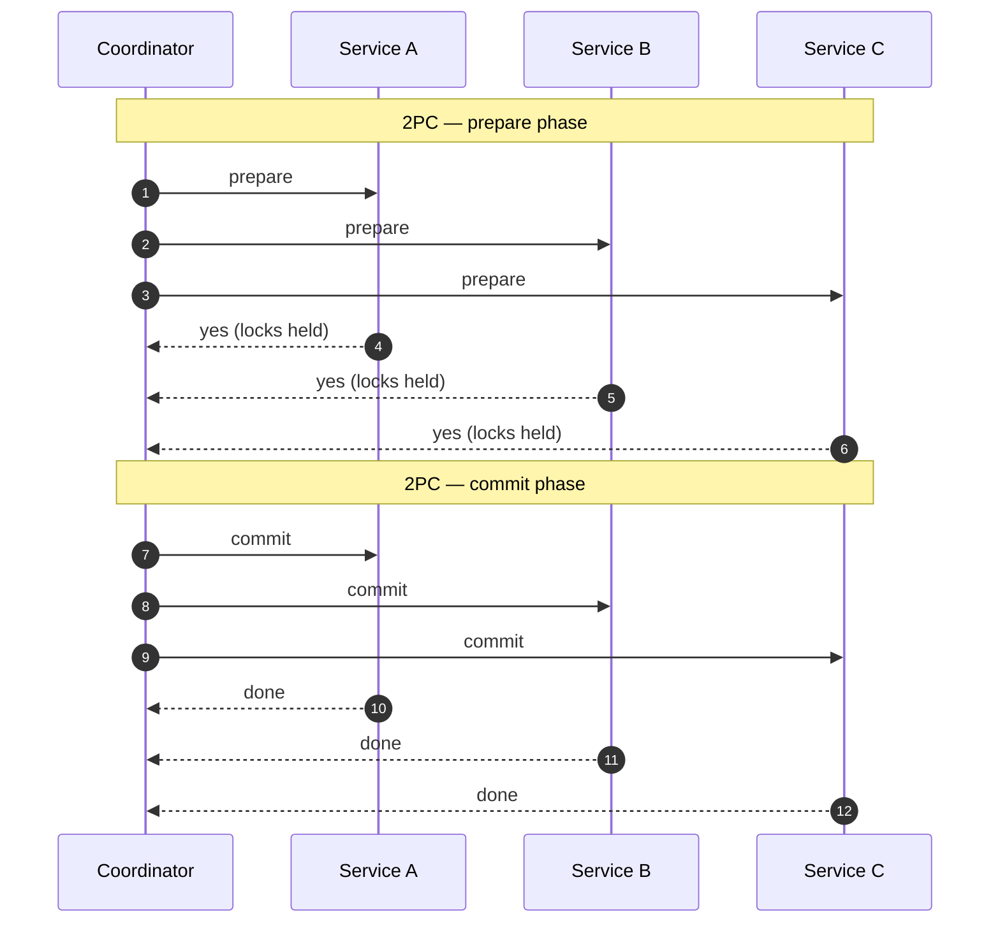

## Definition (interview-ready)

A **distributed transaction** is a unit of work spanning multiple services or data stores that must commit or roll back as a whole. **Two-phase commit (2PC)** is the classic protocol: a coordinator asks all participants to prepare, then to commit. **Sagas** decompose the transaction into local steps with **compensating actions** for failure. The **outbox pattern** atomically writes a business change + an event to the same DB so downstream sees what actually committed.

**One-liner:** A distributed transaction is work across several services or databases that must all succeed or all be undone; 2PC gives atomicity but blocks if the coordinator fails, so microservices usually use sagas (local commits plus compensations) and the outbox pattern to publish events reliably.

## Why it matters

In microservices, every meaningful operation tends to cross service boundaries. ACID across services is expensive or impossible. The choice between 2PC, sagas, and outbox shapes failure modes, latency, and observability of every cross-service flow.

<Anim id="saga" />



## Core concepts

### Why traditional ACID doesn't extend across services

- Different databases (Postgres + Redis + Kafka + external API) — no shared transaction manager.
- Two-phase commit requires every participant to support it (XA / JTA) — rarely true for modern stacks.
- Even if supported: blocking, fragile under coordinator failure.
- Network failures expand the window of "we don't know if it committed."

### Two-phase commit (2PC)

Coordinator + N participants.

**Phase 1 (Prepare)**:
- Coordinator: "can you commit?" → all participants.
- Each participant does its work (locks held), writes "prepared" to log, replies YES or NO.

**Phase 2 (Commit/Abort)**:
- If all YES: coordinator writes "commit" to log, tells all participants "commit."
- If any NO: coordinator tells all participants "abort."
- Participants commit/abort locally and release locks.

**Pros**: atomic across participants when it works.

**Cons**:
- **Blocking**: if the coordinator crashes after participants voted YES, they can't decide on their own and hold their locks until the coordinator recovers.
- **Slow**: at least 2 round-trips + fsyncs at each participant.
- **Coupling**: every participant must support 2PC; coordinator is a single point of pain.
- **Cross-system XA support is rare and rotted** in modern microservice stacks.

In practice: 2PC is used inside tightly coupled enterprise systems (e.g., across multiple relational DBs in the same trust boundary); it's not the answer for general microservice flows.

### Saga pattern

Break a transaction into a sequence of **local** transactions. Each step's success advances the saga; failure triggers **compensating actions** to undo earlier steps.

Example: place an order.
1. Reserve inventory (`reserve(items)`). Compensation: `release(items)`.
2. Charge payment (`charge(amount)`). Compensation: `refund(amount)`.
3. Create shipment (`createShipment(orderId)`). Compensation: `cancelShipment(orderId)`.

If step 3 fails, the saga runs compensations in reverse: refund the payment, release the inventory. End state is consistent.

**Two saga flavors**:

#### Choreography

Each service listens for events and decides what to do. No central coordinator.
- Pros: loosely coupled, simple to start.
- Cons: hard to trace and reason about; cycles and order easy to get wrong; "who runs the compensation" gets murky.

#### Orchestration

A central orchestrator (saga manager) drives the steps. It tracks state, issues commands, handles failures.
- Pros: clear control flow, easy to observe and debug.
- Cons: orchestrator becomes a focal point (but usually worth it).

Tools: AWS Step Functions, Temporal, Cadence, Camunda — all built for this.

### Compensating actions

Must be **idempotent** (safe to retry) and must not fail for business reasons, because nothing undoes a failed compensation; it should also cope with running after a retried or partially applied step. "Undo" is not always possible (you can't unsend an email) — design carefully:
- **Soft compensations**: send a "sorry" follow-up email rather than retract.
- **Reservation-based**: hold resources tentatively (3-step protocol — reserve, then commit or release).
- **Avoid where possible**: order steps so the irreversible step is **last**.

### Outbox pattern (for emitting events reliably)

The naive "dual write" antipattern:
```
db.update(...);
kafka.publish(...);
```
Either can fail → divergence.

**Outbox**:
```
BEGIN;
  db.update(business_table, ...);
  db.insert(outbox, event_payload);
COMMIT;
```
A separate **relay** process tails the `outbox` table (or via CDC) and publishes to Kafka. The DB commit is the atomic boundary. Events are emitted **iff** the business change committed.

### Inbox pattern (deduping consumed events)

The consumer's mirror: on receiving an event, atomically:
```
BEGIN;
  if exists(inbox, event_id): return; -- already processed
  insert into inbox(event_id);
  apply effect;
COMMIT;
```
Combined with at-least-once delivery, gives effectively-exactly-once processing per consumer.

### TCC (Try-Confirm-Cancel)

A pattern for distributed transactions with explicit reservation phases:
- **Try**: reserve resources tentatively (e.g., debit a balance to "pending").
- **Confirm**: finalize.
- **Cancel**: release reservation.

Common in financial systems. Like 2PC but with longer reservation windows and application-level state.

## How it works (a saga orchestration)

```
PlaceOrder saga:
  state: STARTED
  Step 1: reserve_inventory → state: INVENTORY_RESERVED
  Step 2: charge_payment    → state: PAYMENT_CHARGED
  Step 3: ship_order        → state: SHIPPED  (terminal)

On failure at Step 3:
  Compensate: refund_payment   → state: COMPENSATING_PAYMENT
  Compensate: release_inventory → state: FAILED
```

Saga state is persisted (Postgres / Cassandra / state machine in Temporal) so it survives restarts and resumes.

## Real-world examples

- **Uber**: built Cadence for durable, long-running workflow orchestration; Temporal is its fork by Cadence's creators.
- **Netflix**: built Conductor, an open-source workflow orchestrator (Netflix stopped maintaining it in Dec 2023; Orkes and the community carry it on).
- **AWS Step Functions**: managed orchestration; AWS documents a saga pattern with compensating steps on it.

## Common pitfalls

- **2PC across microservices**: rarely works, almost always wrong choice. Use sagas.
- **Dual writes**: write DB + emit Kafka separately. Use outbox.
- **Non-idempotent compensations**: refund fires twice → user gets double refund.
- **No compensation for irreversible steps** (emails, external API side effects): design ordering carefully; last step should be the irreversible one.
- **Naive choreography in complex flows**: 5 services + 8 events → unmanageable. Use orchestration.
- **No saga state persistence**: orchestrator restart loses progress. Persist every transition.
- **Forgetting timeouts**: a saga step that hangs forever blocks the saga. Have explicit timeouts + escalation.
- **Eventual consistency surprises**: user sees state mid-saga (order placed but not shipped). Decide what the API surface is during the saga window.

## Practice questions

<Practice>

<QA q="Why don't we use 2PC for microservice transactions?" level="easy">

It's **blocking** (a coordinator failure leaves participants holding locks), **slow** (round trips plus fsyncs at every participant), and requires every participant to support XA/2PC — rarely true for modern stacks (Redis, Kafka, external APIs). Sagas with compensation are the modern fit.

</QA>

<QA q="What's a saga?" level="easy">

A long-running transaction decomposed into a sequence of **local** transactions, each with a **compensating action**. If any step fails, the compensations for the completed steps run in reverse, leaving the system in a consistent state.

</QA>

<QA q="What is the dual-write problem?" level="easy">

Code that updates the DB and then publishes to Kafka (or calls another service) as two separate operations. Either can fail independently — the DB commits but the publish fails, or the event goes out for a change that rolled back — so the systems diverge. The outbox pattern fixes it.

</QA>

<QA q="Walk through the two phases of 2PC and where it blocks." level="medium">

**Prepare**: the coordinator asks every participant 'can you commit?'; each does its work, holds its locks, logs 'prepared', and votes yes or no. **Commit/abort**: if all voted yes, the coordinator logs 'commit' and tells everyone to commit; otherwise it tells everyone to abort; participants then release their locks. It blocks if the coordinator crashes after participants have prepared — they can't decide alone, so they hold locks until it recovers.

</QA>

<QA q="Choreography vs orchestration for sagas — when to pick which?" level="medium">

**Choreography** (services react to each other's events, no central coordinator) is simple to start and loosely coupled, but becomes opaque past 3–4 steps — hard to trace, and ownership of compensation gets murky. **Orchestration** (a central coordinator like Temporal or Step Functions) gives clear control flow and is easier to observe and debug — preferred for complex flows. Many systems start with choreography and migrate.

</QA>

<QA q="Explain the outbox pattern." level="medium">

In the **same DB transaction**, write the business change and insert an event row into an `outbox` table. A relay (polling or CDC) reads the outbox and publishes to the broker. Because both writes commit atomically, an event is emitted if and only if the business change committed — solving the dual-write problem. Delivery is at-least-once, so consumers should dedupe.

</QA>

<QA q="What is the inbox pattern?" level="medium">

The consumer-side mirror of the outbox. In one local transaction, check whether the event ID is already in an `inbox` table; if so, skip it; otherwise insert the ID and apply the effect. Combined with at-least-once delivery, it gives effectively-exactly-once processing per consumer.

</QA>

<QA q="How do you compensate for sending an email in a saga?" level="medium">

You can't unsend it. Options: (1) order the email **last** so it only fires on success; (2) send a follow-up 'please ignore the previous message' as a soft compensation; (3) defer the actual send until the saga completes — buffer it in your DB and send only on success.

</QA>

<QA q="Why must saga state be persisted, and why do steps need timeouts?" level="hard">

If the orchestrator restarts without persisted state, it loses track of which steps ran — it may re-run them (double effects) or abandon the saga half-done. Persist every transition (Postgres, Cassandra, or a workflow engine like Temporal). Timeouts matter because a step that hangs forever blocks the saga; on timeout, compensate or escalate.

</QA>

<QA q="Compare TCC with sagas." level="hard">

**TCC (Try-Confirm-Cancel)**: Try reserves resources tentatively without committing, Confirm finalizes, Cancel releases. Resources stay reserved between Try and Confirm/Cancel, so partial states aren't exposed, at the cost of holding reservations and more application state. **Sagas**: each step commits locally right away and compensations undo it later — simpler and non-blocking, but intermediate states are visible. TCC fits financial flows; sagas fit most user-facing flows.

</QA>

<QA q="During a saga, what should the API show the user, and why does it matter?" level="hard">

A saga is eventually consistent, so there's a window where some steps have committed and others haven't (order placed, payment pending, not shipped). Decide the API surface explicitly — e.g., expose an 'order pending' status until the saga completes, then push the final state by webhook or polling. Otherwise users see confusing partial states or act on them.

</QA>

<QA q="Design a place-order saga across Inventory, Payment, and Shipping services." level="scenario">

- An **orchestrator** (Temporal or similar) manages state.
- Steps:
  1. `Inventory.reserve(orderId, items)` — compensation: `Inventory.release(orderId)`.
  2. `Payment.charge(orderId, amount)` with `orderId` as the idempotency key — compensation: `Payment.refund(orderId)`.
  3. `Shipping.create(orderId)` — compensation: `Shipping.cancel(orderId)`.
- Every step is idempotent, keyed by `orderId`.
- Saga state persisted (e.g., Postgres); timeouts per step, compensating on timeout.
- The customer sees 'order pending' until the saga completes.

</QA>

<QA q="Your saga occasionally double-charges customers. Investigate." level="scenario">

- **Non-idempotent charge**: `Payment.charge` doesn't use a stable idempotency key. Pass the `orderId` (or saga ID) so the provider dedupes.
- **Retry on an ambiguous error**: a 504 may mean 'succeeded but slow' — retrying without idempotency charges twice.
- **Saga state lost on orchestrator restart**, so steps re-run. Persist state.
- **Compensation racing the original step**: track step state atomically; never roll forward while a compensation is in flight.

</QA>

</Practice>

## Quiz

<Quiz>

<MCQ q="In 2PC, what happens if the coordinator crashes after all participants vote yes but before sending the decision?" options={["Participants commit automatically after a timeout", "Participants abort automatically", "Participants stay blocked holding locks until the coordinator recovers", "The fastest participant becomes coordinator and commits"]} answer={2}>

Prepared participants can't safely decide alone, so they hold locks and wait. That blocking is 2PC's core weakness.

</MCQ>

<MCQ q="A service updates its DB and then publishes to Kafka in separate steps. What is the risk?" options={["Kafka rejects duplicate messages", "The DB and the event stream can diverge if one step fails", "Transactions become serializable", "The DB update is rolled back automatically"]} answer={1}>

This is the dual-write problem: either step can fail alone. The outbox pattern makes the event part of the DB transaction.

</MCQ>

<MCQ q="What makes the outbox pattern reliable?" options={["The event row is written in the same DB transaction as the business change", "Kafka supports XA transactions", "The relay deletes events before publishing", "Consumers never receive duplicates"]} answer={0}>

Atomic commit of business data plus outbox row means events exist exactly when the change committed. Relays can still redeliver, so consumers should be idempotent.

</MCQ>

<MCQ q="A saga reserves inventory, charges payment, then shipment creation fails. What runs next?" options={["Shipment creation retries forever", "Only the inventory release", "Nothing; the order stays as is", "Refund payment, then release inventory, in reverse order"]} answer={3}>

Compensations run in reverse for the completed steps. Retrying forever without a timeout blocks the saga.

</MCQ>

<MCQ q="A flow has 6 services and 10 event types, and nobody can tell who triggers compensation. What change helps most?" options={["Move from choreography to orchestration", "Switch to 2PC", "Remove compensations", "Add more event types"]} answer={0}>

Orchestration centralizes control flow and state, making complex sagas observable. 2PC brings blocking and needs XA support everywhere.

</MCQ>

<MCQ q="A saga step sends a welcome email that can't be undone. Where should it go?" options={["First, so users are informed early", "In parallel with all other steps", "Last, after all steps that might fail", "Inside the compensation path"]} answer={2}>

Putting irreversible steps last means they only run once everything that might fail has succeeded.

</MCQ>

<MCQ q="What does the inbox pattern give a consumer receiving at-least-once deliveries?" options={["Ordered delivery across partitions", "Atomic writes to the producer's DB", "Lower publish latency", "Effectively-exactly-once processing by deduping on event ID"]} answer={3}>

Recording processed event IDs in the same transaction as the effect lets duplicates be skipped. It doesn't affect ordering or producer-side behavior.

</MCQ>

<MCQ q="How does TCC differ from a saga?" options={["TCC commits each step immediately and compensates later", "TCC reserves resources in Try and finalizes in Confirm, so partial states are not exposed", "TCC needs no application-level state", "TCC is choreography-only"]} answer={1}>

TCC holds tentative reservations until Confirm or Cancel. Sagas commit immediately and expose intermediate states, which is what option A describes.

</MCQ>

<MCQ q="A payment call times out with a 504 and the saga retries without an idempotency key. What can happen?" options={["The customer may be charged twice", "The retry is guaranteed to fail", "The saga state is lost", "The payment provider rolls back the first charge"]} answer={0}>

A timeout is ambiguous: the first charge may have succeeded. Without an idempotency key the provider can't dedupe the retry.

</MCQ>

</Quiz>

## TL;DR cheat sheet

- **2PC**: atomic but blocking; impractical for microservices.
- **Saga**: sequence of local transactions + compensations. Choreography (event-driven) or orchestration (central).
- **Outbox**: write business change + event in same DB transaction; relay publishes. Eliminates dual-write problem.
- **Inbox**: dedup consumed events for idempotent processing.
- **TCC**: explicit reservation phase; used in finance.
- Compensations must be idempotent. Order irreversible steps last.
- Persist saga state. Set timeouts. Use orchestrators (Temporal/Step Functions) for complex flows.

## Go deeper

- **microservices.io**: ["Saga pattern"](https://microservices.io/patterns/data/saga.html), [Outbox](https://microservices.io/patterns/data/transactional-outbox.html), [Idempotent consumer (inbox)](https://microservices.io/patterns/communication-style/idempotent-consumer.html).
- **Chris Richardson** book: *Microservices Patterns* — best chapter on distributed transactions.
- **DDIA Chapters 7 and 9** — transactions/ACID (Ch 7); 2PC, XA and atomic commit (Ch 9).
- **Temporal docs**: [docs.temporal.io](https://docs.temporal.io/) — production saga orchestrator.
- **AWS Step Functions** — managed orchestration.
- **Caitie McCaffrey**: ["Distributed Sagas: A Protocol for Coordinating Microservices"](https://www.youtube.com/watch?v=0UTOLRTwOX0) (J On The Beach 2017 talk).
- **Bernd Rücker (Camunda)** — blog posts on saga vs orchestration tradeoffs.
