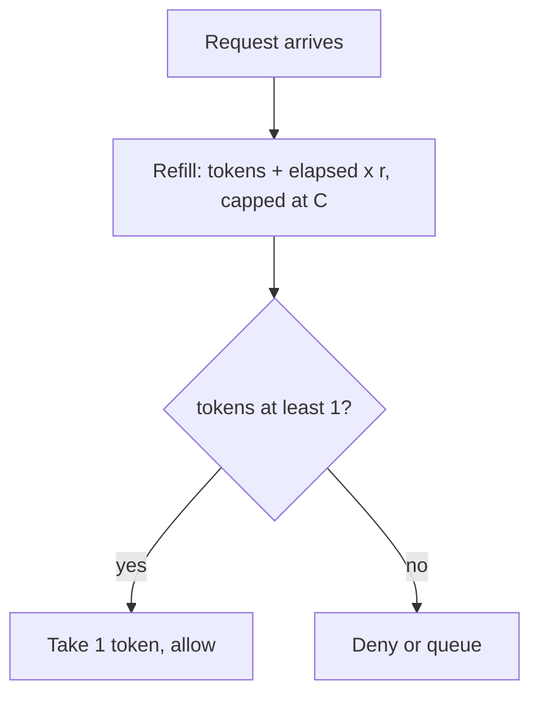
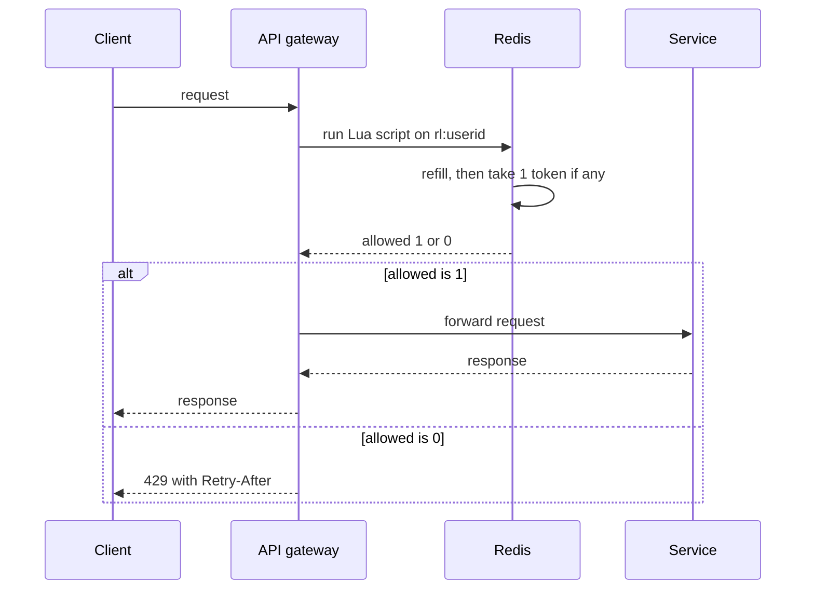

## Definition (interview-ready)

**Rate limiting** caps the number of operations a client (user, IP, key) can perform in a time window. **Token bucket** maintains a bucket of tokens refilled at a rate; each request consumes a token. **Leaky bucket** treats requests like water in a fixed-size bucket leaking at a constant rate. **Fixed window** counts in discrete buckets; **sliding window** counts over a rolling time interval to avoid boundary spikes.

**One-liner:** Rate limiting caps how many requests a client can make per unit of time; I'd usually use a token bucket per user or API key in Redis, which allows short bursts up to the bucket size while holding the long-run rate, and return 429 with Retry-After when the client is over.

## Why it matters

Rate limiting is the front line for: API abuse protection, DoS mitigation, fair resource sharing, cost control on expensive operations, defending downstream services. Done wrong, it punishes good users; done right, it's invisible.

<Anim id="bucket" />

<Anim id="rate-window" />

## Core concepts

### Token bucket

A bucket of capacity `C` refilled at `r` tokens/sec. Each request takes 1 token. If empty → reject (or queue).

```
state: tokens, last_refill
on request:
  now = current_time
  elapsed = now - last_refill
  tokens = min(C, tokens + elapsed * r)
  last_refill = now
  if tokens >= 1:
    tokens -= 1
    allow
  else:
    deny
```

The same logic as a flow, for one request:



Properties:
- **Allows bursts** up to bucket capacity.
- Smooth long-run rate.
- Simple to implement.

### Leaky bucket

Requests enter a queue (the bucket). They're processed at a constant rate (leak). Excess → drop or block.

- Implements **shaping** rather than just limiting — even output rate.
- No bursting beyond bucket size.
- Used in network QoS, less common at API layer.

### Fixed window counter

Count requests within each fixed clock interval (e.g., 1000/minute, reset at minute boundary).

```
key = "rl:" + user_id + ":" + minute_bucket
INCR key
EXPIRE key 60
if count > limit: deny
```

- Simple, cheap (one Redis op).
- **Boundary effect**: user can do 1000 requests at second :59 of one minute and 1000 at second :00 of the next = 2000 in 2 seconds.

### Sliding window log

Track timestamps of each request in a sorted set; count entries within the window.

```
-- run atomically (Lua script or MULTI/EXEC)
ZREMRANGEBYSCORE rl:user42 0 (now - window)
n = ZCARD rl:user42
if n >= limit: deny
else: ZADD rl:user42 <now> <unique_request_id>; allow
```

Use a unique member (such as a request ID), not the timestamp itself: two requests in the same millisecond would otherwise collapse into one entry.

- Exact, no boundary effect.
- Memory: O(requests in window) per user — expensive at scale.

### Sliding window counter (approximate)

Combine fixed windows with weighted overlap.

```
estimated = current_window_count
          + previous_window_count * (1 - elapsed_in_current_window / window)
```

In words: the full count of the current window, plus the share of the previous window that still overlaps the sliding window (this assumes the previous window's requests were spread evenly). Cheap (two counters) and avoids boundary spikes.

### Where to enforce

- **Per-edge** (CDN, gateway): cheap, distributed, drops attacks early.
- **Per-API** (gateway, service mesh): per-route, per-user.
- **Per-resource** (DB row, expensive call): protect specific resources.
- **Cascading**: per-IP + per-API-key + per-endpoint — common.

### Algorithms vs guarantees

Every algorithm enforces its own rule exactly. The question that separates them is whether they guarantee "at most N requests in **any** rolling window of length W":

| Algorithm | Bursty? | At most N in any rolling window? | Memory | Notes |
|---|---|---|---|---|
| Token bucket | Yes (up to C) | No: exact rate + burst, so up to C + r·W in a window | O(1) per key | Most common |
| Leaky bucket | No | Close: output drains at a fixed rate | O(1) per key + queue | Shaping |
| Fixed window | Yes (at boundary) | No: N per clock bucket, up to 2N across a boundary | O(1) per key | Boundary effect |
| Sliding log | No (strict per rolling window) | Yes, exactly | O(N) | Expensive |
| Sliding counter | Modest | Approximately (assumes even spread) | O(1) per key | Best general fit |

### Distributed rate limiting

A shared Redis (single node or cluster) is the most common backing store for counters.

Challenges at scale:
- **Lua scripts** for atomicity (compute + check + increment in one).
- **Latency budget**: Redis adds ~1ms — fine for most APIs; bad for high-frequency internal RPCs.
- **Cross-region**: per-DC limits accept some drift; for global limits, sync counters across DCs asynchronously or lease tokens from a global pool.

### Backoff and retry

Returning `429 Too Many Requests` with `Retry-After` header is standard. Clients should:
- Honor `Retry-After`.
- Use **exponential backoff** with jitter to avoid retry storms.
- Apply per-request budgets (don't retry forever).

### Quota vs rate limit

- **Rate limit**: short-term cap (per second/minute). Smoothing.
- **Quota**: long-term budget (per day/month). Accounting.

Often combined: 100 RPS short, 1M/day long.

## How it works (token bucket in Redis Lua)

```lua
-- KEYS: rl:userid
-- ARGV: now, refill_rate, capacity
local data = redis.call("HMGET", KEYS[1], "tokens", "ts")
local tokens = tonumber(data[1]) or tonumber(ARGV[3])
local ts = tonumber(data[2]) or tonumber(ARGV[1])
local elapsed = tonumber(ARGV[1]) - ts
tokens = math.min(tonumber(ARGV[3]), tokens + elapsed * tonumber(ARGV[2]))
local allowed = 0
if tokens >= 1 then
  tokens = tokens - 1
  allowed = 1
end
redis.call("HSET", KEYS[1], "tokens", tokens, "ts", ARGV[1])  -- HMSET is deprecated since Redis 4.0
redis.call("EXPIRE", KEYS[1], 600)
return allowed
```

Where this script sits in a request, with the limit enforced at the gateway:



The whole read, refill and decrement runs inside Redis as one atomic script, so two gateways can't both spend the last token.

## Real-world examples

- **Stripe**: token bucket per API key, with overflows (allowed to spike briefly).
- **GitHub API**: tiered by auth (60/hr unauth, 5000/hr authenticated) + secondary limits per endpoint.
- **Cloudflare**: edge rate limiting, configurable per route, with bot detection on top.
- **AWS API Gateway**: per-account, per-API-key throttling.
- **Twitter/X API**: per-user and per-app limits counted in 15-minute windows, per endpoint.

## Common pitfalls

- **Limiting only by IP**: NAT'd corporate networks share IPs; mobile carriers do too. Combine with auth or device fingerprint.
- **Forgetting the boundary effect** of fixed windows.
- **Returning 200 OK silently dropping** — never. Return 429 with `Retry-After`.
- **No headers for clients** to see remaining quota — bad DX. Include `X-RateLimit-Remaining`, `X-RateLimit-Reset`.
- **Rate limit on read-only health checks** — kicks out probes; service marked unhealthy.
- **Atomicity bug**: GET then INCR can race; use Lua / INCR-then-check.
- **Limit too aggressive**: false positives during legitimate spikes (deploys, retries).
- **Rate limiting after expensive work**: limit at the edge, not after you've already burned the resource.

## Practice questions

<Practice>

<QA q="Compare token bucket and leaky bucket." level="easy">

**Token bucket**: tokens refill at a rate and each request consumes one, so bursts up to the bucket capacity are allowed. **Leaky bucket**: requests queue and drain at a constant rate — smooth output, no bursting. Token bucket is more common for APIs (users like a little bursting); leaky bucket is for shaping.

</QA>

<QA q="Why is fixed-window rate limiting flawed?" level="easy">

The **boundary effect**: a user can use the full limit at the end of one window and again at the start of the next — e.g., 1000 at :59 and 1000 at :00 — effectively doubling the rate around the boundary. Sliding-window approaches fix this.

</QA>

<QA q="What's the difference between a rate limit and a quota?" level="easy">

A **rate limit** is a short-term cap (per second or minute) that smooths traffic. A **quota** is a long-term budget (per day or month) used for accounting and billing. They're often combined — e.g., 100 RPS short-term and 1M requests per day.

</QA>

<QA q="Sliding window log vs sliding window counter — what's the tradeoff?" level="medium">

The **log** stores a timestamp per request (e.g., a Redis sorted set), trims old entries, and counts — exact, with no boundary effect, but memory is O(requests in window) per user. The **counter** keeps just the current and previous fixed-window counts and weights the previous one by how much of it still overlaps the sliding window — O(1) per key, approximate, and avoids boundary spikes. It's the best general fit.

</QA>

<QA q="How would you implement rate limiting in Redis?" level="medium">

- **Token bucket**: a Lua script that reads tokens and the last-refill timestamp, refills by elapsed time, tries to take a token, and writes back.
- **Sliding window log**: sorted set with `ZREMRANGEBYSCORE` + `ZADD` + `ZCARD`.
- **Sliding window counter**: two counters plus weighted math.

Always use Lua (or a single atomic command) so check-and-update can't race.

</QA>

<QA q="Where should rate limits be enforced?" level="medium">

As early as possible, in layers: at the **edge** (CDN, gateway) — cheap, distributed, drops attacks before they cost anything; **per API** (gateway, service mesh) — per route and per user; **per resource** — protecting a specific DB row or expensive call. Common setups cascade per-IP, per-API-key, and per-endpoint limits. Limiting **after** doing expensive work defeats the purpose.

</QA>

<QA q="Why is limiting only by IP address a problem?" level="medium">

Many users share one IP behind corporate NAT or mobile-carrier NAT, so a per-IP limit punishes innocent users together, while an attacker with many IPs escapes it. Combine IP limits with limits keyed on authentication (user, API key) or a device fingerprint.

</QA>

<QA q="How would you do rate limiting in a multi-region setup?" level="medium">

- **Per-region limits** that add up to the global limit (with some buffer for drift) — simple, eventually consistent.
- **Local fast path + global slow path**: each region keeps a local counter and periodically syncs to a global truth.
- **Token leasing**: regions lease batches of tokens from a global pool.

Most companies accept some over-limit at the edges in exchange for simplicity.

</QA>

<QA q="What HTTP responses and headers should rate-limited APIs return?" level="medium">

- `429 Too Many Requests`.
- `Retry-After` — seconds (or an HTTP date) to wait.
- `X-RateLimit-Limit`, `X-RateLimit-Remaining`, `X-RateLimit-Reset` so clients can pace themselves.
- A clear error body explaining the limit and how to upgrade.

Never silently drop requests with a 200.

</QA>

<QA q="A limiter does GET count, compares it to the limit, then INCR. What's wrong?" level="hard">

It's a **check-then-act race**: concurrent requests all read the same count below the limit, all pass, and all increment — letting a burst exceed the limit. Fix by making it atomic: `INCR` first and check the returned value (with `EXPIRE` on the first increment), or do the whole check-and-update in a Lua script.

</QA>

<QA q="Design a rate limiter for a public API tiered by plan (free 100/min, pro 1000/min, enterprise 10000/min)." level="scenario">

- Token bucket per user, with capacity = plan limit and refill = limit / 60 per second.
- Stored in Redis under `rl:user_id` — single key, atomic Lua.
- Plan looked up from a config table, cached locally.
- Return 429 + `Retry-After` + remaining-count headers.
- Secondary limits per endpoint family (heavy endpoints get sub-limits).
- A per-user concurrency cap (semaphore in Redis) so long-running calls can't monopolize capacity.
- Log denials for observability and abuse detection.

</QA>

<QA q="A legitimate user gets rate-limited because they retry too aggressively after 429s. Solutions?" level="scenario">

- Document and require **exponential backoff with jitter** in clients.
- Make client SDKs honor `Retry-After`.
- Allow some **burst tolerance** above the steady limit before denying.
- Show users why they hit the limit (dashboard, logs).
- Offer a tier upgrade rather than only a hard cap.

</QA>

<QA q="Your rate limiter adds 5 ms to every request — too much. Why, and how do you fix it?" level="scenario">

- Network RTT to Redis is about 1 ms in the same DC, far more cross-DC — **co-locate** it.
- A slow Lua script (complex math, many commands) — profile with `SLOWLOG`.
- **Connection pool exhaustion** under load — enlarge the pool.
- Add a **local pre-check** with async sync to the global store, consulting Redis only when the local allowance runs out.
- Or use an in-memory limiter per gateway instance with periodic sync (an eventually consistent global limit).

</QA>

</Practice>

## Quiz

<Quiz>

<MCQ q="An API wants to allow short bursts but cap the long-run average rate. Which algorithm fits best?" options={["Leaky bucket", "Fixed window counter", "Token bucket", "Sliding window log"]} answer={2}>

Token bucket allows bursts up to its capacity while refilling at a steady rate. Leaky bucket smooths output and forbids bursts.

</MCQ>

<MCQ q="With a fixed window of 100 requests per minute, what is the most a client can send within about 2 seconds around a window boundary?" options={["100", "About 200", "50", "Unlimited"]} answer={1}>

The client can use 100 at the end of one window and 100 at the start of the next — the boundary effect.

</MCQ>

<MCQ q="Sliding window counter: the previous minute had 80 requests, the current minute has 30, and we are 25% into it. What is the estimated count?" options={["110", "50", "30", "90"]} answer={3}>

30 + 80 times 0.75 = 90. The previous window is weighted by the fraction still inside the sliding window.

</MCQ>

<MCQ q="What is the main drawback of the sliding window log?" options={["Memory grows with the number of requests in the window per key", "It has a boundary effect", "It cannot be implemented in Redis", "It never allows bursts"]} answer={0}>

It stores a timestamp per request, so memory is O(N) per key. It's exact and has no boundary effect.

</MCQ>

<MCQ q="Why should Redis-based rate limiting use a Lua script or a single atomic command?" options={["Lua runs faster than any single command", "Redis forbids multi-command access", "So check-and-update happens atomically and concurrent requests cannot all pass", "To encrypt the counters"]} answer={2}>

Separate GET and INCR calls race under concurrency. Atomic execution closes that window.

</MCQ>

<MCQ q="Which response should a rate-limited request receive?" options={["200 OK with an empty body", "429 Too Many Requests with a Retry-After header", "503 Service Unavailable with no headers", "401 Unauthorized"]} answer={1}>

429 with Retry-After tells the client exactly what happened and when to retry. Silent 200s and misleading codes hurt clients.

</MCQ>

<MCQ q="A company rate-limits only by IP. Who is most likely to be wrongly blocked?" options={["Users behind a shared corporate or carrier NAT", "Attackers rotating through many IPs", "Users with static IPv6 addresses", "Internal health checks on a private network"]} answer={0}>

Many legitimate users share one IP behind NAT and get limited together, while attackers with many IPs evade per-IP limits.

</MCQ>

<MCQ q="How do most multi-region setups handle a global rate limit?" options={["One global Redis consulted synchronously on every request", "Two-phase commit between regions per request", "No limits across regions", "Per-region limits or token leases, accepting some drift over the global limit"]} answer={3}>

Synchronous global checks add cross-region latency; most systems trade a little over-limit for simplicity with regional budgets or leased tokens.

</MCQ>

<MCQ q="What distinguishes a quota from a rate limit?" options={["Quotas are enforced only at the CDN", "A quota is a long-term budget such as per day or month; a rate limit caps short-term rate", "Quotas always use leaky buckets", "Rate limits apply only to unauthenticated users"]} answer={1}>

Rate limits smooth short-term traffic; quotas account for longer-term usage. They are often combined.

</MCQ>

</Quiz>

## TL;DR cheat sheet

- **Token bucket**: tokens refill at rate r, capacity C → allows bursts up to C. Most common.
- **Leaky bucket**: constant-rate processing of queued requests → smooths output.
- **Fixed window**: cheap, has boundary effect (2x spike at edges).
- **Sliding log**: exact, expensive memory (O(N) per user).
- **Sliding counter**: cheap + reasonably accurate. Sweet spot.
- Always **Lua** for atomic Redis-based check-and-increment.
- Return 429 + `Retry-After` + rate limit headers.
- Layer limits: per IP, per user, per endpoint. Apply at edge if possible.
- For distributed: accept drift or use lease-based / regional sums.

## Go deeper

- **Stripe blog**: ["Scaling your API with rate limiters"](https://stripe.com/blog/rate-limiters) — the canonical post.
- **ByteByteGo**: ["Rate Limiting Fundamentals"](https://blog.bytebytego.com/p/rate-limiting-fundamentals).
- **Cloudflare blog**: counting algorithms, sliding window counter.
- **Alex Xu**, *System Design Interview Vol 1*, Chapter 4 — rate limiter design.
- **GitHub Engineering**: blog posts on their secondary rate limits.
- **Redis docs**: examples in the [rate limiting recipes](https://redis.io/commands/incr/).
