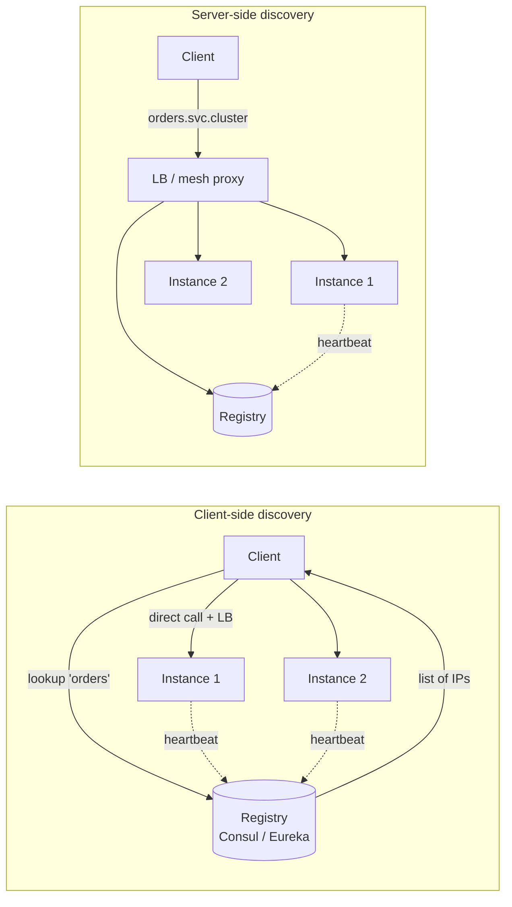

## Definition (interview-ready)

**Service discovery** is how services find the network addresses of others in a dynamic environment where instances come and go. **Client-side** discovery has clients query a registry directly; **server-side** discovery routes through a load balancer that does the lookup. **Health checks** track which instances are alive and ready to serve, so the registry/LB only routes to healthy ones.

## Why it matters

Static config + DNS works until your service auto-scales, deploys frequently, or runs containers — then instances change every few minutes. Service discovery + health checks are how Kubernetes, Consul, Eureka, and modern service meshes route correctly through that churn.



## Core concepts

### Why DNS alone isn't enough

- DNS TTLs cache aggressively (clients ignore changes for minutes).
- DNS doesn't track per-instance health (only what someone updated).
- DNS doesn't carry metadata (version, weight, zone).
- DNS is push-once, poll-when-cache-expires; not real-time.

You can patch some of this (low TTL, periodic re-resolve, health-checked DNS), but for fast-moving environments, dedicated service discovery is cleaner.

### Service registry

A database of "service X has these instances at these addresses, with these health states and metadata." Updated by:
- **Self-registration**: instance starts → POSTs to registry → de-registers on shutdown.
- **Third-party registration**: orchestrator (k8s, ECS) registers/deregisters based on container lifecycle.

Examples: Consul, etcd, Eureka, Zookeeper, kube-apiserver.

### Client-side discovery

Client queries the registry, picks an instance, calls it directly.

```
client → registry: "where is service X?"
registry → client: ["10.0.1.5:8080", "10.0.1.6:8080", "10.0.1.7:8080"]
client → 10.0.1.6:8080: actual request
```

Pros: no LB hop, client knows about all instances (can do smart load balancing — least-loaded, EWMA, locality-aware).
Cons: every client needs the registry client + LB logic. Polyglot environments duplicate code.

Used by: Eureka + Ribbon (classic Netflix), gRPC name resolvers.

### Server-side discovery

Client talks to a load balancer; LB queries the registry and routes.

```
client → LB at "service-x.internal" → picks 10.0.1.6:8080 → request
```

Pros: client logic is simple (DNS or fixed URL). LB centralizes policy.
Cons: extra hop; LB becomes single source of routing logic.

Used by: AWS ALB/NLB + target groups, Kubernetes Services (kube-proxy + DNS), Envoy sidecars.

### Service mesh (best of both worlds)

A **sidecar proxy** (Envoy, Linkerd-proxy) runs alongside every service. The mesh control plane (Istio, Linkerd) feeds the proxies routing rules and instance lists.

- Apps make requests as if to a local proxy (`localhost:9000`).
- Proxy handles discovery, load balancing, retries, mTLS, telemetry.
- Polyglot-friendly: app doesn't need a special library.
- Control plane = source of truth, data plane = proxies execute.

### Health checks

The registry needs to know which instances are healthy.

#### Types

- **Liveness**: is the process running? (Restart if not — k8s does this.)
- **Readiness**: is the process ready to serve? (Pull from LB if not. E.g., warming up cache.)
- **Startup**: separate to allow long initial boot before liveness kicks in.

#### Mechanisms

- **HTTP probe**: GET `/health` returns 200.
- **TCP probe**: can we open a connection on port X?
- **Exec probe**: run a script inside the container.
- **gRPC health check**: standard protocol.

#### Active vs passive

- **Active**: load balancer polls each instance every N seconds. Catches all failures; some baseline cost.
- **Passive (outlier detection)**: LB watches real traffic; ejects instances that error too much. Detects only what traffic reveals; cheap.

Combine: active health checks for binary up/down, passive outlier detection for "this one is misbehaving on real requests."

### Common patterns

- **Heartbeats**: instance posts "I'm alive" every N seconds. Registry removes after T seconds without heartbeat.
- **Gossip**: instances exchange membership state P2P (Cassandra; Consul uses gossip for membership/failure detection alongside its Raft-backed catalog). No single registry node to fail.
- **DNS service discovery**: registry exposes DNS records (`service-x.consul`). Clients use DNS as usual but with low TTL or DNS push.

### Avoiding flapping

A node that "barely" passes/fails health check oscillates → traffic redirects every poll → bad UX.
- **Failure threshold**: 3 consecutive failures before marking unhealthy.
- **Hysteresis**: different thresholds for unhealthy → healthy than healthy → unhealthy.

### Caution: deep health checks

A `/health` endpoint that depends on DB + Redis + downstream services will report unhealthy whenever any of them is unhealthy. Result: every blip cascades into "service down."

Prefer:
- **Shallow liveness**: process is alive, not deadlocked.
- **Readiness**: process can accept traffic (warm cache, dependencies *known* to be available — but not necessarily perfectly healthy).
- **Specific dependency checks** as separate signals, not as overall health.

## How it works (k8s service discovery)

```
Pod starts → EndpointSlice controller adds it to the Service's EndpointSlices (marked ready once its readiness probe passes).
kube-proxy on each node watches EndpointSlices, updates iptables/IPVS/nftables rules.
Pod B does "curl http://service-x" → DNS resolves to service ClusterIP.
ClusterIP routes via kube-proxy to a healthy pod.

Health: kubelet runs liveness/readiness probes; on readiness failure, the endpoint is marked not-ready and gets no Service traffic.
```

## Real-world examples

- **Kubernetes**: built-in service discovery via Services + kube-dns/CoreDNS.
- **Netflix Eureka + Ribbon**: classic client-side discovery for AWS deployments.
- **Consul**: discovery + KV + mesh; popular in non-k8s environments.
- **etcd**: powers k8s discovery (and many others as KV/coordination).
- **Istio + Envoy**: sidecar mesh; the modern best-practice for polyglot microservices.
- **AWS Cloud Map**: managed service discovery for ECS / EKS / EC2.

## Common pitfalls

- **DNS TTL too high**: failover delayed.
- **JVM DNS cache**: `networkaddress.cache.ttl` defaults to `-1` (cache forever) when a security manager is installed, and is implementation-specific otherwise (30s in OpenJDK). Set it explicitly (e.g., 30s or lower).
- **Deep health checks**: cascade failures across the fleet.
- **No graceful shutdown**: instance dies before deregistering → clients get connection refused for TTL window. Trap signals → deregister → drain → exit.
- **Heartbeat-only discovery without failure detection**: instance hangs without crashing → still heartbeats → traffic continues. Use active health checks.
- **Discovery as a single point of failure**: if the registry is down, can new instances be reached? Cache last-known-good locally.
- **Stale endpoints**: process restarted but k8s endpoint not yet updated → TCP RST for a few seconds. Use connection retries.

## Practice questions

<Practice>

<QA q="What's the difference between client-side and server-side service discovery?" level="easy">

**Client-side**: the client queries the registry directly, picks an instance, and calls it. **Server-side**: the client calls a load balancer (or service VIP); the LB does the lookup and routes. Server-side keeps clients simple; client-side enables richer load-balancing decisions (least-loaded, EWMA, locality-aware) at the cost of a registry client and LB logic in every language.

</QA>

<QA q="Why do we need both liveness and readiness probes?" level="easy">

Liveness = "is the process alive" (failure → restart). Readiness = "is the process ready to serve traffic" (failure → remove from the LB, but don't restart). A process can be alive but warming up, draining for shutdown, or riding out a transient downstream issue — readiness handles these without unnecessary restarts.

</QA>

<QA q="Why isn't plain DNS enough for service discovery in a dynamic environment?" level="easy">

- **TTL caching**: clients and resolvers cache records, so changes are ignored for minutes.
- **No per-instance health**: DNS only reflects what someone last updated.
- **No metadata**: no version, weight, or zone.
- **Not real-time**: it's push-once, poll-when-the-cache-expires.

You can patch some of this (low TTLs, periodic re-resolve, health-checked DNS), but when instances churn every few minutes a dedicated registry is cleaner.

</QA>

<QA q="What's the difference between self-registration and third-party registration?" level="easy">

- **Self-registration**: the instance POSTs itself to the registry on start and de-registers on shutdown (classic Eureka). Every service needs registry client code, and a crash can leave a stale entry until heartbeats expire.
- **Third-party registration**: the orchestrator (Kubernetes, ECS) registers and deregisters instances based on the container lifecycle. Apps stay unaware of the registry.

</QA>

<QA q="How does service discovery work in Kubernetes?" level="medium">

Registration is orchestrator-managed: pods are tracked by the apiserver. A Service groups pods by label selector and gets a stable virtual IP (ClusterIP). The EndpointSlice controller lists the Service's pods, marking each ready once its readiness probe passes. kube-proxy on each node watches EndpointSlices and updates iptables/IPVS/nftables rules so traffic to the ClusterIP is DNATed to a ready pod IP. CoreDNS resolves service names to ClusterIPs.

</QA>

<QA q="What's a service mesh and what does it solve?" level="medium">

A network of sidecar proxies (Envoy, Linkerd-proxy), one per pod, that handle service-to-service traffic — discovery, load balancing, retries, timeouts, mTLS, observability — plus a control plane (Istio, Linkerd) that pushes routing rules and instance lists to them. It solves the polyglot problem (no library per language), centralizes policy, gives mTLS everywhere, and makes observability uniform.

</QA>

<QA q="How do you design a `/health` endpoint?" level="medium">

Two endpoints:

- `/health` (liveness): a cheap process-alive check. Always 200 unless the process is wedged.
- `/ready` (readiness): ready to serve real traffic. Confirms required local state (cache warmed, connections established).

Be careful with deep dependency checks — don't turn a downstream outage into your own "unhealthy" status. Expose specific dependency checks as separate signals.

</QA>

<QA q="Compare active health checks with passive outlier detection." level="medium">

- **Active**: the LB polls each instance every N seconds. It catches failures even with no traffic, at some baseline cost.
- **Passive (outlier detection)**: the LB watches real traffic and ejects instances that error too much. It's cheap but only detects what traffic reveals.

Combine them: active checks for binary up/down, passive detection for "this instance is misbehaving on real requests."

</QA>

<QA q="What is health-check flapping and how do you prevent it?" level="medium">

A node that barely passes or fails its health check oscillates in and out of rotation, so traffic redirects on every poll. Prevent it with a **failure threshold** (e.g., 3 consecutive failures before marking unhealthy) and **hysteresis** — different thresholds for unhealthy → healthy than for healthy → unhealthy.

</QA>

<QA q="Your service discovery registry crashes. What happens?" level="hard">

- **With an in-memory cache of last-known-good**: clients keep routing to known instances. New instances aren't discoverable and dead ones aren't ejected — degraded but not catastrophic.
- **As a hard dependency**: every call fails. Bad design.
- Mitigation: an HA registry (Consul/etcd are typically odd-N Raft clusters), a local discovery cache, and fallback to DNS or static config. Service meshes cache aggressively in the data-plane proxies for exactly this reason.

</QA>

<QA q="How would you avoid cascading failures from health-check-driven service ejection?" level="hard">

- **Don't include downstream health** in your own readiness; circuit breakers handle downstream issues.
- **Cap ejection**: don't eject when too many instances are already unhealthy — Envoy's `max_ejection_percent` (default 10%) plus its panic threshold (below 50% healthy hosts it routes to all hosts anyway).
- **Threshold + hysteresis**: e.g., 3 consecutive failures to eject, 5 successes to re-add.
- **Synthetic traffic** to tell real failure apart from "pulled from rotation."
- **Bulkheads + circuit breakers** absorb slow downstreams without ejecting healthy local instances.

</QA>

<QA q="A service is deployed, registered, and immediately starts getting 5xx errors from clients. Why?" level="scenario">

- **Started but not warm**: JVM warming up, cache empty → slow. Gate on a readiness probe.
- **Race**: registered before it was bound to its port. Bind first, then register.
- **Health check passing too eagerly**: reports healthy before all dependencies are connected.
- **Stale DNS**: clients still hitting an old instance whose entry is being removed.
- **Graceful shutdown of the replaced pod**: the old one is still serving while the new one is registered.

</QA>

<QA q="During every deploy, clients see a burst of connection-refused errors for a few seconds. How do you fix it?" level="scenario">

Instances are dying before they leave rotation, so clients keep using endpoints until the registry or DNS catches up. Fix the shutdown sequence: **trap the termination signal → deregister (fail readiness) → drain in-flight requests → exit**. On the client side, add connection retries for the brief window of stale endpoints, keep DNS TTLs low, and set the JVM's `networkaddress.cache.ttl` explicitly so a Java client doesn't cache old addresses.

</QA>

<QA q="An instance is hung (deadlocked) but its heartbeats keep arriving, so traffic keeps flowing to it. What's wrong with the design?" level="scenario">

Heartbeat-only discovery proves the heartbeat thread is alive, not that the instance can serve requests. Add **active health checks** that exercise the request path (an HTTP probe on a real handler) and **passive outlier detection** that ejects instances failing real traffic. A liveness probe that detects the wedged state lets the orchestrator restart it.

</QA>

</Practice>

## Quiz

<Quiz>

<MCQ q="A pod's readiness probe starts failing while its liveness probe still passes. What does Kubernetes do?" options={["Restarts the container", "Stops sending it Service traffic but leaves it running", "Deletes the pod and schedules a new one", "Nothing until the liveness probe also fails"]} answer={1}>

Readiness failure marks the endpoint not-ready, so it gets no Service traffic, but the container isn't restarted. Restarting is what a liveness failure triggers; deleting and rescheduling isn't a probe action; and readiness acts on its own, not only together with liveness.

</MCQ>

<MCQ q="Which is the main advantage of client-side discovery over server-side discovery?" options={["Clients need no special library", "Routing policy lives in one central place", "Clients can make smarter load-balancing choices and skip an extra LB hop", "It works without any registry"]} answer={2}>

The client sees all instances, so it can do least-loaded, EWMA or locality-aware balancing and call instances directly. Needing no library and centralizing policy are server-side benefits; client-side discovery still needs a registry.

</MCQ>

<MCQ q="Why can a deep /health check that pings the DB, cache and downstream services be harmful?" options={["It makes every probe too slow to be useful", "A blip in any dependency marks the whole fleet unhealthy, cascading into an outage", "Kubernetes rejects probes that make network calls", "It prevents the service from registering"]} answer={1}>

If every instance shares the same dependency, one dependency blip ejects every instance at once and turns a partial problem into a full outage. Slowness is a secondary concern; Kubernetes allows probes to make network calls; registration isn't the issue.

</MCQ>

<MCQ q="In Kubernetes, which component updates node-level rules so traffic to a ClusterIP reaches a pod?" options={["kube-proxy", "CoreDNS", "kubelet", "The EndpointSlice controller"]} answer={0}>

kube-proxy watches EndpointSlices and programs iptables/IPVS/nftables rules on each node. CoreDNS only resolves names to ClusterIPs, kubelet runs the probes, and the EndpointSlice controller maintains the endpoint lists that kube-proxy consumes.

</MCQ>

<MCQ q="What does passive outlier detection catch that active polling may miss?" options={["Instances that are completely down with no traffic", "Instances that fail on real requests even though they answer the health probe", "Instances whose DNS TTL expired", "Instances that haven't registered yet"]} answer={1}>

Passive detection watches real traffic, so it catches an instance that answers /health but errors on real requests. A fully down instance with no traffic is what active polling catches; DNS TTLs and unregistered instances are unrelated.

</MCQ>

<MCQ q="An instance oscillates in and out of rotation on every health poll. What is the standard fix?" options={["Make the health check deeper", "Remove the readiness probe", "Poll more frequently", "Require several consecutive failures to eject and use different thresholds to re-add"]} answer={3}>

Failure thresholds plus hysteresis stop flapping. A deeper check adds more failure sources, removing readiness loses traffic gating, and polling more often makes flapping visible sooner without fixing it.

</MCQ>

<MCQ q="Envoy's panic threshold is reached because fewer than 50% of hosts are healthy. What does it do?" options={["Returns 503 for all requests", "Routes only to the single healthiest host", "Ignores health status and routes to all hosts", "Pauses and waits for hosts to recover"]} answer={2}>

Below the panic threshold Envoy assumes the health signal itself may be wrong and spreads load across all hosts, which avoids piling all traffic onto a few survivors. It doesn't fail every request, pick one host, or stall.

</MCQ>

<MCQ q="The registry cluster goes down. Which client design degrades most gracefully?" options={["Clients that look up the registry on every request", "Clients that cache the last-known-good instance list locally", "Clients that fail fast when the registry is unreachable", "Clients that pick a random IP from the subnet"]} answer={1}>

A cached last-known-good list keeps traffic flowing to known instances; only new instances and dead-instance ejection are affected. Per-request lookups and fail-fast both turn the registry outage into a full outage; random IPs are nonsense.

</MCQ>

<MCQ q="What is the right order for graceful shutdown of a registered instance?" options={["Exit, then deregister", "Drain requests, exit, then deregister", "Deregister and exit immediately", "Trap the signal, deregister, drain in-flight requests, then exit"]} answer={3}>

Deregistering first stops new traffic, draining finishes requests already in flight, then the process exits. Exiting before deregistering or draining causes connection-refused errors and dropped requests.

</MCQ>

</Quiz>

## TL;DR cheat sheet

- Service discovery = "where are my dependencies right now."
- **Client-side**: client queries registry. Smarter LB; more client logic.
- **Server-side**: client calls LB/VIP, LB routes. Simpler clients.
- **Service mesh**: sidecar proxies handle everything for the app.
- Registries: Consul, etcd, Eureka, kube-apiserver, ZK.
- Health checks: liveness (restart) + readiness (LB eligibility) + startup.
- Active probes + passive outlier detection both.
- Beware deep health checks → cascading failures.
- Failover thresholds + hysteresis to avoid flapping.

## Go deeper

- **Sam Newman**, *Building Microservices* (2nd ed.) — service discovery and service meshes.
- **Kubernetes docs**: [Services](https://kubernetes.io/docs/concepts/services-networking/service/), [Probes](https://kubernetes.io/docs/tasks/configure-pod-container/configure-liveness-readiness-startup-probes/).
- **Consul docs**: [developer.hashicorp.com/consul](https://developer.hashicorp.com/consul) — service discovery + mesh.
- **Istio / Linkerd** docs.
- **Envoy docs**: outlier detection, health checking.
- **Netflix tech blog** — historical Eureka + Ribbon writeups.
