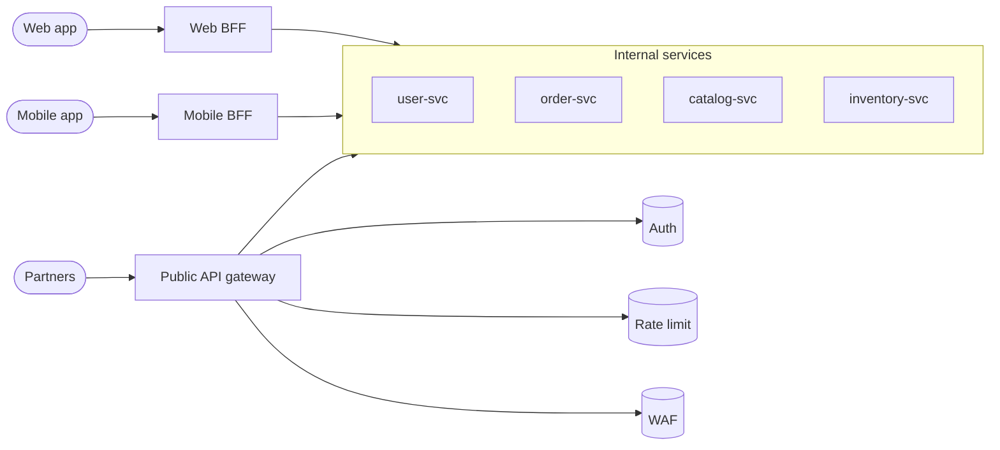

## Definition (interview-ready)

An **API gateway** is a single entry point in front of multiple backend services, handling cross-cutting concerns: routing, authentication, rate limiting, TLS termination, request/response transformation, and observability. The **BFF (Backend-for-Frontend)** pattern creates one purpose-built gateway per client type (web, mobile, partner API) so each is tailored to its consumer's needs rather than serving a generic "one API for all."

## Why it matters

Once you have more than 3 services, putting clients (web, mobile, third parties) directly in front of them is a mess: every client needs to know every service, authenticate to each, handle retries, parse different formats. A gateway centralizes this. The BFF pattern then takes it further: mobile and web have *different* needs (data shapes, payload sizes, auth flows) — one BFF each.



## Core concepts

### API gateway responsibilities

- **Routing**: `/orders/*` → Orders service, `/payments/*` → Payments.
- **AuthN/AuthZ**: verify JWT or session, look up permissions, attach `user_id` to downstream calls.
- **Rate limiting** and quota enforcement.
- **TLS termination** at the edge.
- **Request/response transformation**: protocol translation (REST ↔ gRPC), payload reshaping.
- **Aggregation/Composition**: optionally compose responses from multiple backends into one (careful: latency tax).
- **Logging, metrics, tracing**: a single point to capture all incoming traffic.
- **Caching**: short-TTL response cache for hot read endpoints.
- **CORS**: handle browser preflight requests.
- **API versioning**: route by version header or URL.

### What an API gateway should NOT do

- **Business logic** — keep that in services. The gateway should be policy + plumbing.
- **Stateful session management** — keep sessions in a real store (Redis); the gateway is stateless.
- **Long-running orchestration** — that's a workflow engine (Temporal) or a saga, not gateway logic.
- **Become a god-class** with all logic crammed in — that's reinventing the monolith at the front.

### Gateway placement

```
[ Clients ] → [ CDN/edge ] → [ API Gateway ] → [ Services ]
                                        ↓
                                  [ Auth/RBAC ]
                                  [ Rate limit ]
                                  [ Observability ]
```

Some teams put a CDN in front of the gateway (cacheable GETs), some have the gateway behind a global load balancer (multi-region).

### BFF (Backend for Frontend)

A separate gateway per client family:
- **Web BFF**: serves the web app — bigger payloads, browser-friendly auth (cookies).
- **Mobile BFF**: smaller payloads, more aggressive compression, mobile-specific auth.
- **Partner BFF / Public API**: strict versioning, stable contracts, API keys, quotas.
- **Internal BFF**: admin tools or internal portals.

Each BFF can:
- Compose responses tailored to its UI's needs.
- Strip fields the client doesn't need.
- Use efficient internal protocols (gRPC) while exposing what's right externally.
- Move at the pace of its team (web team owns web BFF, mobile owns mobile BFF).

### Tradeoffs of BFF

Pros:
- Tailored client experience; no over-fetching/under-fetching.
- Independent evolution.
- Better mobile performance (smaller payloads).
- Each team owns their BFF — clear responsibility.

Cons:
- More gateways to operate.
- Duplicated logic across BFFs (mitigated by shared libraries).
- Risk of business logic creeping into BFFs.

### API gateway products

- **Open source**: Kong, Envoy, Nginx, Tyk, Apache APISIX.
- **Managed**: AWS API Gateway, GCP API Gateway, Azure API Management.
- **Built-in to mesh / Kubernetes**: Istio ingress gateway; Kubernetes Gateway API implementations (Envoy Gateway, etc.). Linkerd ships no gateway of its own and pairs with any ingress.
- **Custom-built**: many large companies (Netflix Zuul, Uber's Edge Gateway).

### Gateway vs service mesh

- **API gateway**: north-south traffic (clients ↔ services), at the edge of your system.
- **Service mesh**: east-west traffic (service ↔ service) within your system.

They're complementary. Modern setups have both: gateway at the edge + mesh internally.

### Aggregation pattern

Gateway composes a response from multiple backends:
```
GET /home →
  parallel: profile from UserService, feed from FeedService, notifications from NotifService
  merge → return single payload
```

Tradeoff:
- Pro: client gets one round trip.
- Con: gateway latency = slowest backend; failures partial; complexity creeps into gateway.

Best: keep aggregation thin (BFF use case), don't put serious logic in there. For complex composition, build a real composition service or use GraphQL with a federation layer.

### GraphQL gateway / federation

Apollo Federation, Hasura — gateways that resolve a unified GraphQL schema by querying multiple backend services. Each service owns its part of the schema. Clients query one endpoint, get exactly the fields needed.

Trade-offs: powerful for diverse client needs, but adds complexity in the gateway tier. Caching is harder. Authorization needs field-level care.

## How it works (gateway request lifecycle)

```
1. Client → CDN → API Gateway.
2. Gateway:
   a. Terminate TLS.
   b. Parse JWT, validate signature, expiry.
   c. Look up rate limit budget for this user/API key.
   d. Apply request transformation (rename headers, strip internal-only fields).
   e. Route based on path/method.
3. Gateway → Service (over internal network, possibly gRPC).
4. Service response → Gateway response transformation (strip internal fields, add headers).
5. Gateway → Client.

Throughout: emit metrics, logs, traces.
```

## Real-world examples

- **Netflix Zuul** (Zuul 2 is the async, Netty-based rewrite, open-sourced in 2018): edge gateway for streaming services.
- **AWS API Gateway**: managed; handles billions of requests; integrates with Lambda.
- **Kong**: open-source gateway, plugin-rich.
- **Shopify**: GraphQL Storefront API for custom storefronts.
- **GitHub**: REST + GraphQL gateways.
- **Phil Calçado on BFF**: classic post about the SoundCloud BFF pattern (origin of the term).

## Common pitfalls

- **Business logic in the gateway**: gateway becomes the new monolith. Keep it thin.
- **Stateful gateway**: sessions, caches — these should live in dedicated stores.
- **Synchronous fan-out blowing latency**: composing 10 services in a single response = slowest-of-10 latency.
- **No rate limiting**: gateway absorbs DDoS but propagates it to services.
- **TLS only at the gateway**: backend-to-backend cleartext is a security gap. Use mTLS internally.
- **Single gateway as SPOF**: it's at the front of everything; HA, multi-region critical.
- **Versioning mess**: gateway routes by version → version logic spreads across all routes. Centralize.
- **Trying to be smart with caching**: caching responses with user-specific data is dangerous.
- **Auth split between gateway and services**: re-validate JWT at services to be safe — gateway is in your trust boundary, but a buggy gateway shouldn't authorize too much.

## Practice questions

<Practice>

<QA q="Why use an API gateway?" level="easy">

To centralize cross-cutting concerns: auth, rate limiting, TLS termination, routing, observability, request transformation. Without one, every client needs to know every service, and every service handles auth and rate limiting separately.

</QA>

<QA q="What is the BFF pattern?" level="easy">

Backend for Frontend — a separate API gateway per client type (web, mobile, partner). Each BFF is tailored to its consumer: payload size, response shapes, auth method, and team ownership.

</QA>

<QA q="When would you use one gateway vs multiple BFFs?" level="medium">

**One gateway**: small teams, similar clients, a single product. **Multiple BFFs**: distinct clients with very different needs (mobile vs web vs partner API), separate teams owning each, performance-sensitive mobile alongside feature-rich web.

</QA>

<QA q="Should the API gateway do business logic?" level="medium">

Generally no — keep the gateway thin and focused on cross-cutting concerns. Business logic in the gateway turns it into a chokepoint and a re-implemented monolith. BFFs can do light shaping and composition for their specific UI, but anything domain-specific belongs in a service. Sessions belong in a real store, and long-running orchestration belongs in a workflow engine or saga.

</QA>

<QA q="What's the difference between an API gateway and a service mesh?" level="medium">

API gateway = **north-south** traffic (clients ↔ services), at the system boundary. Service mesh = **east-west** traffic (service ↔ service), internal. Different concerns; modern setups use both — a gateway at the edge and a mesh inside.

</QA>

<QA q="What are the downsides of the BFF pattern, and how do you contain them?" level="medium">

- **More gateways to operate** — each needs HA, deploys, and monitoring.
- **Duplicated logic** across BFFs — mitigate with shared libraries (auth, rate-limit policy, clients).
- **Business logic creep** — BFFs should shape and compose for their UI, not own domain rules.

The upside is that each team (web, mobile) owns its BFF and evolves it at its own pace.

</QA>

<QA q="What's the trade-off of response aggregation in the gateway?" level="medium">

**Pro**: the client gets one round trip instead of several. **Con**: the gateway's latency equals the slowest backend, failures become partial, and complexity creeps into the gateway. Keep aggregation thin (a BFF concern); for complex composition, build a dedicated composition service or use GraphQL federation.

</QA>

<QA q="When would you choose a GraphQL federation gateway, and what does it cost?" level="medium">

Federation (e.g., Apollo Federation) resolves a unified schema by querying multiple services, each of which owns its part of the schema. Clients query one endpoint and get exactly the fields they need — great for diverse clients. Costs: more complexity in the gateway tier, harder caching than plain REST GETs, and authorization that needs field-level care.

</QA>

<QA q="Why is terminating TLS only at the gateway a problem, and why is response caching risky there?" level="hard">

- **TLS only at the edge** leaves backend-to-backend traffic in cleartext inside your network — a security gap. Use mTLS internally (often via the service mesh).
- **Gateway caching** is fine for short-TTL, non-personalized hot reads, but caching responses that contain user-specific data risks serving one user's data to another. Only cache what's safe to share, and keep the gateway itself stateless.

</QA>

<QA q="Your team is building a mobile app for a service that already has a web UI. Design the gateway strategy." level="scenario">

Two BFFs:

- **Web BFF**: browser auth (cookies, CSRF), large rich responses, fewer mobile-specific constraints.
- **Mobile BFF**: token auth, small JSON payloads, compression, offline-friendly responses, batched calls.

Both call the same internal services (typically via gRPC). Share the auth library and rate-limit policy; keep per-route shaping in each BFF.

</QA>

<QA q="A team built a 'smart' API gateway that aggregates responses from 10 services for each request. P99 spiked. Fix?" level="scenario">

The gateway waits for the slowest of 10 backends, so its p99 is **worse** than any single backend's p99: with 10 independent calls, about 10% of requests (1 − 0.99^10) hit at least one backend's p99 tail. That's tail-latency amplification.

Fixes:

- Find the slowest call and cut its p99 (cache, optimize the backend).
- Make non-critical calls optional — return a partial response if they fail.
- Move aggregation to the client where possible.
- Run backend calls in parallel, not sequentially; consider hedged requests for the slowest calls.
- Cache aggregated responses where safe.

</QA>

<QA q="A gateway centralizes auth. A bug causes it to accept invalid tokens. Mitigations?" level="scenario">

- **Defense in depth**: services re-validate the JWT signature and expiry, so a gateway bug doesn't escalate.
- **Audit-log every request** with user ID and action.
- **Fast rollback** to last-known-good gateway config.
- **WAF rules** at the edge to stop obviously bad requests.
- **Security review / bug bounty** for gateway code.
- Post-incident: fuzz testing and contract tests against valid and invalid token shapes.

</QA>

<QA q="The single API gateway in one region goes down and takes the whole product with it. How should it have been deployed?" level="scenario">

The gateway sits in front of everything, so it's a single point of failure by design. Run it stateless and horizontally scaled behind a load balancer across availability zones, and for critical products across regions behind a global load balancer or DNS failover. Keep its config versioned with fast rollback, and keep rate limiting on so it doesn't pass floods straight through to services.

</QA>

</Practice>

## Quiz

<Quiz>

<MCQ q="Which responsibility does NOT belong in an API gateway?" options={["TLS termination", "Rate limiting per API key", "Calculating order discounts and tax", "Routing /orders paths to the orders service"]} answer={2}>

Discount and tax calculation is business logic, which belongs in a service; putting it in the gateway rebuilds the monolith at the edge. TLS termination, rate limiting and routing are textbook gateway concerns.

</MCQ>

<MCQ q="A gateway fans out to 10 backends in parallel, each with an independent 1% chance of a p99-tail response. Roughly what fraction of gateway requests see at least one tail response?" options={["1%", "About 10%", "0.1%", "50%"]} answer={1}>

1 − 0.99^10 ≈ 9.6%, so about 10%. 1% would be true for one backend only; 0.1% and 50% don't match the math. This is tail-latency amplification.

</MCQ>

<MCQ q="What does a service mesh handle that an API gateway typically does not?" options={["North-south traffic from browsers", "TLS termination for public clients", "Partner API keys and quotas", "East-west traffic between internal services"]} answer={3}>

The mesh handles service-to-service (east-west) traffic. Browser traffic, public TLS and partner keys are edge (north-south) concerns handled by the gateway.

</MCQ>

<MCQ q="What is the main motivation for having separate web and mobile BFFs?" options={["Clients have different payload, auth and performance needs, and different teams own them", "Mobile apps can't call REST APIs", "It removes the need for internal services", "It eliminates duplicated code"]} answer={0}>

BFFs exist because clients differ (payload size, auth flow, performance) and each team can own its own. Mobile apps call REST fine, BFFs still sit in front of internal services, and BFFs tend to add duplicated logic rather than remove it.

</MCQ>

<MCQ q="The gateway validates JWTs. Why should backend services also re-validate them?" options={["Gateways can't parse JWTs", "So that a gateway bug that accepts bad tokens doesn't grant access", "JWTs expire faster at the backend", "It's required by the JWT spec"]} answer={1}>

Re-validation is defense in depth: if the gateway is buggy or bypassed, services still reject invalid tokens. Gateways can parse JWTs, expiry is the same everywhere, and the spec doesn't mandate this.

</MCQ>

<MCQ q="Which is a known cost of a GraphQL federation gateway?" options={["Clients must call each service separately", "Clients always over-fetch", "Caching is harder and authorization needs field-level care", "Each service must expose the whole schema"]} answer={2}>

Federation gives one endpoint with exactly the fields requested, but caching is harder and auth has to be checked per field. Clients don't call services separately, don't over-fetch, and each service owns only its part of the schema.

</MCQ>

<MCQ q="Where should user session state live in a gateway architecture?" options={["In the gateway's memory", "In a dedicated store like Redis, with a stateless gateway", "In the CDN", "In the client's DNS cache"]} answer={1}>

The gateway should be stateless so it can scale and fail over freely; sessions belong in a real store such as Redis. Gateway memory is lost on restart and breaks horizontal scaling; the CDN and DNS are not session stores.

</MCQ>

<MCQ q="An aggregating gateway call fails because one of five backends (recommendations) timed out. What is usually the best behavior?" options={["Return an error for the whole page", "Retry all five backends", "Block until recommendations recovers", "Return the other four results and degrade the optional part"]} answer={3}>

Non-critical calls should be optional, so the page returns a partial response. Failing the whole page, retrying everything, or blocking all turn one slow dependency into a full outage.

</MCQ>

<MCQ q="Which statement about caching at the gateway is correct?" options={["Short-TTL caching of non-personalized hot reads is fine; caching user-specific responses is dangerous", "Gateways should cache every GET for an hour", "Caching is never allowed at the gateway", "User-specific responses are the best candidates for caching"]} answer={0}>

Caching shared, hot, non-personalized reads with a short TTL is a legitimate gateway feature; caching user-specific data risks leaking it across users. Blanket hour-long caching serves stale data, and a ban is unnecessary.

</MCQ>

</Quiz>

## TL;DR cheat sheet

- API gateway = single entry point: routing, auth, rate limit, TLS, transformation, observability.
- Keep the gateway **thin**: cross-cutting only, not business logic.
- **BFF** = per-client gateway (web, mobile, partner). Tailored payloads and auth.
- Pair with **service mesh** for east-west (internal) traffic.
- Aggregation in gateway is OK for BFFs but introduces tail-latency risk.
- Always have HA + multi-region; gateway is a SPOF for everything behind it.
- Backend should re-validate auth even if gateway already did.

## Go deeper

- **Sam Newman**: ["Backend For Frontend pattern"](https://samnewman.io/patterns/architectural/bff/) — origin reference.
- **Phil Calçado**: ["The Back-end for Front-end Pattern (BFF)"](https://philcalcado.com/2015/09/18/the_back_end_for_front_end_pattern_bff.html) — SoundCloud experience.
- **Microservices.io**: [API gateway pattern](https://microservices.io/patterns/apigateway.html).
- **Kong docs**, **Envoy docs**, **AWS API Gateway docs**.
- **Apollo Federation** docs — for GraphQL gateways.
- **Building Microservices** (Sam Newman) — chapter on gateways and APIs.
