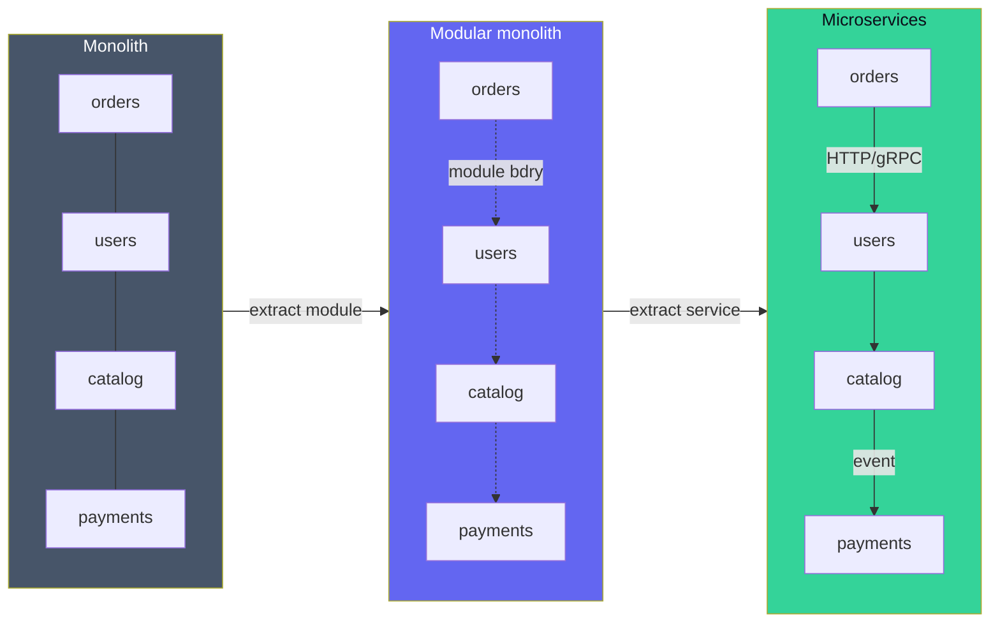

## Definition (interview-ready)

A **monolith** is a single deployable unit holding all functionality. **Microservices** split functionality across independently deployable services that communicate over the network. A **modular monolith** is a monolith with strict internal module boundaries — you get logical separation without the operational cost of distributed systems.

**One-liner:** A monolith ships everything as one deployable, microservices split it into independently deployable services that talk over the network, and a modular monolith keeps one deployable but enforces module boundaries; I'd start modular and extract a service only when I can name a concrete reason such as scaling, ownership or compliance.

## Why it matters

The microservices-first instinct of the 2010s burned many teams: distributed transactions, observability complexity, deployment overhead. The widely shared advice today (see Fowler's "MonolithFirst" and "Microservice Premium"): **start with a modular monolith; extract services when you have a real, measured reason.**



## Core concepts

### Monolith

One codebase, one process, one deploy. All features share the same DB connection pool, the same memory, the same release.

Pros:
- Simple to develop and deploy initially.
- Strong consistency by default (one DB, ACID).
- Easy to refactor across boundaries (one IDE, one compile).
- Cheap operations: one service to monitor.

Cons:
- Single deploy unit: one feature's bug can roll back everyone's work.
- Hard to scale parts independently.
- Tech stack lock-in.
- Big-bang releases over time as the team grows.

### Microservices

Many small services, each owned by a team, each independently deployable. Communicate over network (REST/gRPC/events).

Pros:
- Independent deploys: teams move at their own pace.
- Polyglot — best tool per job.
- Fault isolation — one service down ≠ all down.
- Scale-specific: scale the bottleneck, not everything.
- Smaller cognitive surface per team.

Cons:
- Distributed system complexity: every cross-service call is a network call (timeout, retries, idempotency).
- No more cross-service transactions — need sagas.
- Operations: service mesh, observability, deployment infra.
- Latency tax (serialization + network).
- Versioning and contracts.
- More to monitor, alert on, page about.

### Modular monolith

One deployable, but internally organized as **strictly enforced modules** with explicit interfaces and no cross-module DB access. Often the *right* answer for most teams.

Characteristics:
- Modules talk via in-process interfaces (or domain events on a bus).
- Each module owns its data; other modules only read via the module's API.
- Build can enforce: no cross-module imports of internal types.
- Single deploy, single DB (possibly with schema-per-module for isolation).

You get most of the microservices benefits (boundaries, ownership) without the network tax.

### When to extract a service

Extract when you have a **specific reason** that the monolith can't address:
- **Different scaling profile**: search needs 100× CPU but the monolith doesn't.
- **Different release cadence**: payment service can't deploy as often as marketing pages.
- **Different team ownership**: separate teams, different stacks.
- **Independent failure domains**: payments must not be impacted by mobile feed bugs.
- **Different stack**: ML scoring in Python while the rest is in Go.
- **Compliance boundary**: PCI/HIPAA-scoped code isolated.

If you can't name the reason, **don't extract.**

### Microservices anti-patterns

- **Distributed monolith**: services so coupled they can only deploy together. Worst of both worlds.
- **Shared database between services**: kills the "independent" claim.
- **Chatty inter-service calls**: a request fanning out to 20 services. Latency death.
- **Per-team service explosion**: 50 services for a 30-person company.
- **Services without ownership**: orphaned services nobody updates.
- **No observability**: distributed traces are required, not optional.

### Domain-driven design (DDD) for boundaries

The right service/module boundaries follow **bounded contexts** from DDD:
- A bounded context = a clear domain model with its own ubiquitous language.
- Different contexts may have the same noun (`Order` in checkout ≠ `Order` in fulfillment) with different shapes.
- Services often map 1:1 with bounded contexts, modules with sub-contexts.

### Operational requirements for microservices

Before going microservices, you need:
- **CI/CD per service** with safe deploys (canary, blue-green).
- **Service discovery + service mesh** or strong load-balancer hygiene.
- **Observability**: metrics, logs, distributed tracing.
- **Idempotency + retries** standard.
- **Schema registry / API contracts**.
- **Async + saga support** for cross-service flows.

Without these, microservices = chaos.

## How it works (refactoring journey)

```
Stage 1: Monolith
  - One repo, one DB, one deploy.

Stage 2: Modular monolith
  - Refactor into modules with explicit interfaces.
  - One repo, one deploy, but no internal cross-module DB access.
  - Optional: one DB schema per module.

Stage 3: Extract a service
  - Pick a module with a clear reason (scaling, ownership, stack).
  - Build the API contract; extract the DB schema.
  - Run side-by-side with the monolith calling it.
  - Gradually shift more functionality.
  - Decommission the module in the monolith.

Repeat as needed; don't over-extract.
```

## Real-world examples

- **Shopify**: famously a **modular monolith** in Rails, split into components whose boundaries are enforced by its Packwerk tool.
- **Amazon, Netflix, Uber**: full microservices at huge scale — but they have thousands of engineers, full DevOps platforms, observability infra.
- **Stack Overflow**: monolith on a few big servers; serves enormous traffic.
- **GitHub**: monolith in Rails, slowly extracting services.
- **Basecamp/37signals**: ardently monolith advocates (DHH coined "The Majestic Monolith").

## Common pitfalls

- **Microservices for a 10-person team**: ops overhead exceeds benefit.
- **Service per noun**: don't make a "UserService" + "OrderService" + "PaymentService" just because they're different nouns. Follow bounded contexts.
- **Shared DB between services**: tightly couples them at schema, deploys, scaling.
- **Network calls in hot loops**: 10 sequential RPCs in a request = death.
- **No async path**: every call synchronous, fan-out kills latency. Use events for non-essential side effects.
- **Missing idempotency**: retries duplicate state changes.
- **Migration without baseline metrics**: can't tell if the extraction helped.

## Practice questions

<Practice>

<QA q="What are the main tradeoffs of microservices?" level="easy">

**Gains**: independent deploys, polyglot stacks, fault isolation, scaling just the bottleneck. **Costs**: operational complexity (observability, deployments, service discovery), distributed-system overhead (timeouts, retries, idempotency, sagas instead of transactions), and the latency tax of network calls.

</QA>

<QA q="What's a modular monolith?" level="easy">

A monolith with strict internal module boundaries — modules own their data, expose APIs, and the build enforces no cross-module imports of internal types. You get logical separation and ownership without the network and ops tax of microservices. It's the best default for most teams.

</QA>

<QA q="What does a plain monolith do well, and where does it start to hurt?" level="easy">

**Well**: simple to develop and deploy, strong consistency by default (one DB, ACID), easy cross-boundary refactors, cheap operations. **Hurts**: one deploy unit (one feature's bug can roll back everyone's work), can't scale parts independently, tech-stack lock-in, and big-bang releases as the team grows.

</QA>

<QA q="When would you extract a microservice?" level="medium">

When you have a specific, measurable reason: a different scaling profile, release cadence, team ownership, stack, compliance boundary, or failure domain. If you can't name the reason, don't extract — the operational cost is real.

</QA>

<QA q="How do bounded contexts inform service boundaries?" level="medium">

A bounded context is a self-contained domain model with its own ubiquitous language. The `Order` in checkout has different attributes than the `Order` in shipping. Services that follow these contexts have high internal coherence and stable inter-service contracts. Splitting by noun ('UserService', 'OrderService') instead tends to produce chatty, coupled services.

</QA>

<QA q="What is a distributed monolith, and why is a shared database a common cause?" level="medium">

A distributed monolith is a set of services so coupled that they can only deploy together — you pay the network and ops costs of microservices without the independence. A **shared database** is a classic cause: a schema change ripples through every service that touches the tables, scaling is coupled, and nobody truly owns the data. Each service should own its data and expose it only through its API or events.

</QA>

<QA q="What platform capabilities should exist before you adopt microservices?" level="medium">

- CI/CD per service with safe deploys (canary, blue-green).
- Service discovery plus a service mesh, or strong load-balancer hygiene.
- Observability: metrics, logs, and **distributed tracing**.
- Idempotency and retries as a standard.
- Schema registry / API contracts.
- Async messaging and saga support for cross-service flows.

Without these, microservices turn into chaos.

</QA>

<QA q="How do you extract a service from a monolith safely?" level="hard">

1. First make it a clean module inside the monolith (explicit interface, no cross-module DB access).
2. Pick a module with a clear reason (scaling, ownership, stack).
3. Define the API contract and extract its DB schema.
4. Run the new service side by side, with the monolith calling it.
5. Gradually shift more functionality over, then decommission the module in the monolith.

Capture baseline metrics before you start so you can tell whether the extraction helped. Repeat only as needed.

</QA>

<QA q="When does the modular monolith stop being enough?" level="hard">

- **Team scaling**: independent teams' deploys start blocking each other.
- **Scaling divergence**: one feature needs 10× capacity and the rest don't.
- **Compliance**: PCI/HIPAA-scoped code must be isolated.
- **Stack divergence**: an ML team needs Python while the rest is Go.
- **Reliability**: a feature must not be impacted by others' bugs.
- **Codebase size**: build and test cycles become unbearable.

Even then, extract one service at a time, each with a real reason.

</QA>

<QA q="A team wants to split a monolith into 20 services. What questions do you ask?" level="scenario">

- How many engineers are there? Every service needs a clear owning team; far more services than teams is a warning sign.
- What's the deployment infra — CI/CD per service, service mesh, observability?
- What specific pain does each split solve?
- Is the DB schema split-ready (no cross-cutting joins)?
- Are bounded contexts clear, or are you chopping up nouns?
- What's the rollback story if a split causes incidents?

</QA>

<QA q="A microservices migration causes 10x more incidents. Diagnose." level="scenario">

- **Distributed transactions without sagas** → partial-state bugs.
- **No idempotency** → retries duplicate state.
- **No service mesh / discovery** → connection chaos.
- **No distributed tracing** → can't tell what failed.
- **Cascading failures** without circuit breakers or bulkheads.
- **Coupled deploys** → forced lockstep releases.
- **Database not split** → schema migrations affect everyone.
- **Team-service mismatch** → services without owners.

Fix: fold coherent pieces back into a modular monolith and invest in the platform (mesh, observability) before splitting further.

</QA>

<QA q="Design the service topology for an e-commerce site." level="scenario">

Start with bounded contexts:

- **Catalog** (products, inventory) — read-heavy, often cached.
- **Cart / Checkout** — session, transactional.
- **Order management** — workflow, sagas, state machine.
- **Payments** — compliance boundary, isolated.
- **Fulfillment / Shipping** — operations team.
- **User accounts / Auth** — separate, security-sensitive.
- **Search** — Elasticsearch fed by CDC.
- **Recommendations / Personalization** — ML.

Communication: sync gRPC/REST for read-required paths (checkout reading catalog), async events (Kafka) for downstream propagation (order placed → fulfillment, payments, analytics), and sagas for distributed flows like place-order across cart, payment and inventory.

</QA>

<QA q="A single API request now fans out through 10 sequential calls across services and latency has tripled. What do you change?" level="scenario">

This is the chatty-services anti-pattern. Options: run independent calls in parallel; move non-essential side effects to async events instead of synchronous calls; cache or denormalize the data that's read on every request; and revisit the boundaries — services that must always be called together probably belong to the same bounded context and should be merged.

</QA>

</Practice>

## Quiz

<Quiz>

<MCQ q="A 12-person startup with one product is choosing an architecture. What is the usual recommendation?" options={["Start with 15 microservices to be ready for scale", "Start with a modular monolith and extract services only with a measured reason", "Use one microservice per database table", "Use a monolith with no internal boundaries forever"]} answer={1}>

The current consensus is modular monolith first, extracting services when there's a real reason. Fifteen services for twelve people is pure ops overhead, per-table services are noun-chopping, and a boundary-less monolith gets hard to split later.

</MCQ>

<MCQ q="Which is the strongest signal that two services form a distributed monolith?" options={["They are written in different languages", "They communicate through Kafka", "They must always be deployed together", "They have separate on-call rotations"]} answer={2}>

Lockstep deploys mean the services aren't independent, which defeats the purpose of splitting them. Different languages, async messaging and separate on-call are normal for healthy microservices.

</MCQ>

<MCQ q="What replaces a cross-service ACID transaction in a microservices architecture?" options={["A saga of local transactions with compensating actions", "A shared database with foreign keys between services", "Synchronous retries until all services succeed", "Two-phase commit across every call by default"]} answer={0}>

Sagas coordinate local transactions and undo with compensations. A shared DB recreates coupling, blind retries don't give atomicity, and 2PC by default is fragile and rarely used across services.

</MCQ>

<MCQ q="In DDD, why might checkout and fulfillment each have their own Order model?" options={["To duplicate data for backups", "Because one of them is wrong", "Because ORMs require it", "Each bounded context has its own model and language for the same noun"]} answer={3}>

The same noun means different things in different bounded contexts, so each context models it for its own needs. It isn't a backup, a mistake, or an ORM requirement.

</MCQ>

<MCQ q="Which is NOT a good reason on its own to extract a service?" options={["The search feature needs 100x the CPU of everything else", "Payment code must be isolated for PCI compliance", "User and Order are different nouns", "The ML team needs Python while the rest is Go"]} answer={2}>

Being a different noun is not a reason to split; boundaries should follow bounded contexts and real needs. A different scaling profile, a compliance boundary and a different stack are all listed reasons to extract.

</MCQ>

<MCQ q="What does a modular monolith keep that microservices give up?" options={["In-process calls and a single deploy with ACID transactions available", "Independent per-module deploys", "Polyglot stacks per module", "Independent scaling of each module"]} answer={0}>

A modular monolith keeps in-process calls, one deploy and one database, so there's no network tax and transactions are easy. Independent deploys, polyglot stacks and per-module scaling are microservice benefits it does not provide.

</MCQ>

<MCQ q="A team migrated to microservices and now cannot tell which service caused a failed request. What capability is missing?" options={["A schema registry", "Distributed tracing", "Blue-green deploys", "A modular monolith"]} answer={1}>

Distributed tracing follows a request across services and shows where it failed. A schema registry handles contracts, blue-green handles deploys, and a modular monolith is an architecture choice, not a debugging tool.

</MCQ>

<MCQ q="What is the recommended first step before extracting a module into a service?" options={["Copy the whole monolith into a new repo", "Rewrite the module in a new language", "Give the new service read access to the monolith's tables", "Make it a clean module with an explicit interface and no cross-module DB access"]} answer={3}>

A clean module boundary inside the monolith makes the extraction mechanical. Copying the monolith or rewriting in a new language adds risk, and sharing tables recreates the distributed-monolith problem.

</MCQ>

<MCQ q="Why is it important to capture baseline metrics before a service extraction?" options={["So you can tell whether the extraction actually helped", "Metrics are required to create a new repo", "So the service mesh can route traffic", "To generate the API contract"]} answer={0}>

Without a baseline you can't measure whether latency, deploy frequency or incident rate improved. Metrics aren't needed to make a repo, route mesh traffic, or write a contract.

</MCQ>

</Quiz>

## TL;DR cheat sheet

- **Monolith**: simple, fast to ship, hard to scale parts.
- **Modular monolith**: one deploy, hard internal boundaries — best default.
- **Microservices**: independent deploys + polyglot, but ops cost is real.
- Extract only when you have a specific reason: scaling, ownership, stack, failure domain.
- Follow **bounded contexts** for boundaries.
- Without platform investment (mesh, observability, sagas, idempotency), microservices = pain.
- Shared DB across services = distributed monolith antipattern.
- Async events over sync calls when possible.

## Go deeper

- **Sam Newman**, *Building Microservices*, 2nd ed — the canonical reference.
- **Sam Newman**, *Monolith to Microservices* — how to migrate.
- **Vaughn Vernon**, *Implementing DDD* — bounded contexts.
- **Shopify engineering**: ["Deconstructing the Monolith"](https://shopify.engineering/deconstructing-monolith-designing-software-maximizes-developer-productivity) — modular monolith experience.
- **Fowler**: ["MicroservicePremium"](https://martinfowler.com/bliki/MicroservicePremium.html) and the ["Microservices guide"](https://martinfowler.com/microservices/).
- **Microservices.io** by Chris Richardson — comprehensive pattern catalog.
- **YouTube**: Sam Newman conference talks, Fowler talks on microservices.
