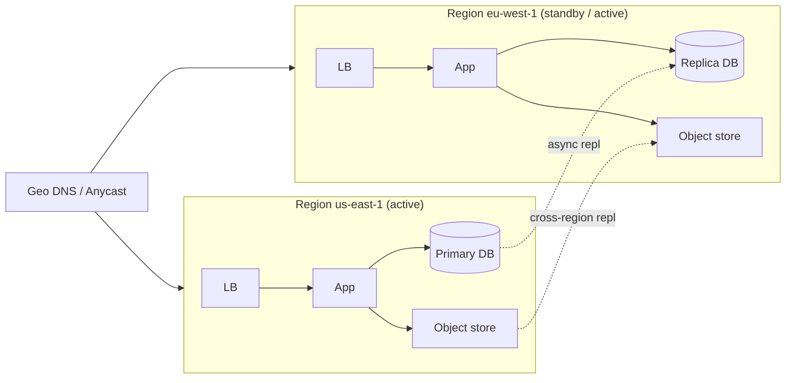

## Definition (interview-ready)

**Availability Zones (AZs)** are physically separate groups of one or more data centers within a single cloud region, each with its own power, cooling and networking. **Multi-AZ** = redundant within a region; **multi-region** = redundant across geographically separated regions. **RPO (Recovery Point Objective)** = how much data you can afford to lose (e.g., 5 minutes). **RTO (Recovery Time Objective)** = how long you can be down (e.g., 30 minutes).

**One-liner:** Multi-AZ protects against losing one data center and multi-region against losing a whole region; RPO is how much data I can afford to lose and RTO is how long I can afford to be down, and those two numbers decide between backups, warm or hot standby, and active-active.

## Why it matters

A region-wide cloud outage (AWS us-east-1 has had several) takes down anything single-region. Multi-AZ is table stakes for serious systems; multi-region is the next level — much more expensive and complex but essential for finance, healthcare, global apps. RPO/RTO are how you quantify what "available" actually means in dollars and minutes.



## Core concepts

### Region vs AZ vs edge

- **Region** = geographically distinct location (us-east-1 = N. Virginia, eu-west-1 = Ireland). Tens of ms RTT between nearby regions, 100+ms across continents.
- **AZ** = one or more physically separate DCs in a region (AWS keeps AZs within about 100 km of each other). Round trips between AZs are typically about 1–2 ms (AWS quotes single-digit milliseconds), low enough for synchronous replication.
- **Edge** (CDN PoP) = globally distributed cache, much smaller than a full region.

### Multi-AZ baseline

Standard production setup: spread services and data across 2 or 3 AZs in a region. Loss of one AZ ≠ outage.

- **Stateless services**: trivially multi-AZ (just run replicas in each AZ behind an LB).
- **Stateful services**: replicate synchronously across AZs (e.g., RDS Multi-AZ sync replica, Aurora's storage replicated 6 ways across 3 AZs).

Cost: ~2× compute for redundancy + cross-AZ data transfer.

### Multi-region architectures

Levels of complexity, lowest to highest:

#### 1. Active-passive (failover)

Primary region serves traffic; secondary region is a hot or warm standby.
- **Backup-only**: data replicated to S3 / snapshot to other region. Long RTO.
- **Pilot light**: minimal infra running in DR region; scale up on failover.
- **Warm standby**: scaled-down full stack in DR; takes traffic on failover.
- **Hot standby**: fully sized DR region, ready to take traffic instantly.

Pros: simpler than active-active. Cons: paying for idle capacity; failover is a tested-rarely operation that often fails.

#### 2. Active-active (read-anywhere, write-anywhere)

Both regions serve traffic concurrently.

**Read replication**: one region is the write leader; other reads from a replicated copy. Common (RDS read replica in another region).

**Multi-leader / writes in any region**: requires conflict resolution. CRDTs, vector clocks, or app-level merge. Used by DynamoDB global tables (last-writer-wins in their default, eventually consistent mode), Cosmos DB multi-region writes.

**Strong consistency multi-region**: extremely hard. Spanner does it with TrueTime. Generally trades latency (cross-region quorum for every write).

#### 3. Geo-partitioned

Each region "owns" certain data (by user location, tenant, customer ID). Other regions read replicas. Writes happen in home region.

Pros: lowest latency for users in their home region; no cross-region conflicts.
Cons: data movement when users travel; "global views" are scatter-gather.

### RPO and RTO

- **RPO** (Recovery Point Objective): how much data loss is acceptable? Driven by replication choices.
  - Sync replication → RPO = 0.
  - Async replication → RPO = replication lag (often 1–60s).
  - Backups only → RPO = backup frequency (hours to a day).
- **RTO** (Recovery Time Objective): how fast must you be back? Driven by deployment topology and runbook quality.
  - Hot standby → seconds-to-minutes RTO.
  - Warm standby → minutes-to-hours.
  - Cold backup restore → hours-to-days.

These are **business decisions** with engineering implications. A payments company may need RPO ≤ 1s, RTO ≤ 5 min — drives Spanner-class architecture. A blog can tolerate RPO 1 day, RTO 1 day.

### Failover mechanics

- **DNS-based**: update DNS to point at DR. TTL-bound (10s to 5min); browsers cache aggressively.
- **Anycast IP**: BGP-driven. Faster than DNS, expensive (cloud provider mostly).
- **Application-level**: client SDKs aware of multiple endpoints, fall over automatically.
- **Database failover**: promote replica; clients reconnect (driver-handled).

Issues:
- **Split-brain risk**: old primary keeps accepting writes after failover. Fence with quorum or external coordinator (etcd).
- **Replication lag on failover**: unreplicated writes are lost. RPO realism.
- **Failback** is often harder than failover.

### Cross-region challenges

- **Latency**: every cross-region write adds 50–200ms. Quorum across regions = expensive.
- **Bandwidth cost**: AWS charges per GB for inter-region transfer (about $0.02/GB between most US and EU regions, more from some regions) — at scale, this dominates.
- **Compliance**: data-protection laws can restrict where personal data goes — GDPR only allows transfers out of the EU under conditions (adequacy decisions, SCCs), and India's DPDP Act lets the government block transfers to specific countries. Check before replicating PII to another region.
- **Time skew**: NTP across regions has more drift; HLC/TrueTime increasingly relevant.
- **Distributed transactions**: cross-region 2PC is unusable. Use single-region scopes + sagas.

### Practical patterns

- **Read-local, write-leader**: writes go to home region; reads served locally with eventual consistency. Most common.
- **Sticky region per user**: each user has a home region; their data and writes always there. Travel = small latency hit, no migration.
- **Active-active via CRDT**: counters, sets, key-value with LWW + HLC. Specific data types only.
- **Replication via Kafka MirrorMaker** or DB-level (Postgres logical, Aurora Global, MongoDB cross-region replica sets).

## How it works (multi-AZ Postgres on AWS RDS)

```
Region: us-east-1
  AZ-A (primary):  RDS primary
  AZ-B (standby):  RDS standby (sync replication)
  
Client → endpoint → DNS resolves to current primary
Write commits to primary; sync replicated to standby (RPO=0).
AZ-A fails → AWS promotes standby in AZ-B → DNS updated.
RTO ~1-2 minutes.
```

## Real-world examples

- **AWS us-east-1 outages**: major incidents (the S3 outage of Feb 2017, Dec 2021, Oct 2025) each took down many widely used services that ran in that one region. They drive multi-region for serious infra.
- **Cloudflare**: multi-region active-active by design.
- **Netflix**: multi-region active-active across us-east, us-west, eu-west. Chaos Kong simulates losing a whole region (Chaos Monkey kills individual instances).
- **Spanner-backed services (Google Photos, Ad systems)**: global strong consistency.

## Common pitfalls

- **Single-region in cloud**: a regional outage takes you down with no recourse.
- **"We have backups" RTO**: restoring 10 TB from snapshot is hours; many businesses can't afford that.
- **Untested failover**: the first time you fail over is during a real outage; many surprises. Run game days.
- **Forgetting DNS TTL** in failover plans.
- **Cross-region data charges**: surprise on the bill at scale.
- **Compliance violations**: replicating EU PII to US for "DR" → GDPR violation.
- **Latency-tail in active-active**: every write waits for cross-region quorum.
- **Asymmetric DR region**: cheaper instances → can't actually handle prod load on failover.

## Practice questions

<Practice>

<QA q="What's the difference between multi-AZ and multi-region?" level="easy">

**Multi-AZ** = redundancy across physically separate data centers within one region (round trips of about 1–2 ms). **Multi-region** = redundancy across geographically separated regions (tens of ms between nearby regions, 100+ ms across continents; separate infrastructure). Multi-AZ is table stakes for production; multi-region is for true disaster recovery and global users.

</QA>

<QA q="Define RPO and RTO." level="easy">

**RPO** (Recovery Point Objective) = how much data you can afford to lose, measured in time. **RTO** (Recovery Time Objective) = how long you can afford to be down. They're business decisions that drive the architecture — replication choices set RPO, topology and runbook quality set RTO.

</QA>

<QA q="What are the active-passive DR tiers, and how do they trade cost against RTO?" level="easy">

From cheapest/slowest to most expensive/fastest:

- **Backup-only**: data copied to another region; long RTO (restore from scratch).
- **Pilot light**: minimal infra running in the DR region; scale up on failover.
- **Warm standby**: a scaled-down full stack that takes traffic on failover (minutes to hours).
- **Hot standby**: a fully sized DR region, ready instantly (seconds to minutes).

</QA>

<QA q="Compare active-passive and active-active multi-region setups." level="medium">

**Active-passive**: one region serves, the other stands by. Simpler, but you pay for idle capacity and failover is rarely tested. **Active-active**: both regions serve concurrently. Better utilization and faster failover, but writes in multiple regions need conflict resolution (LWW, CRDTs, app-level merge) and a more complex replication topology.

</QA>

<QA q="How do you choose between sync and async cross-region replication?" level="medium">

**Sync**: zero data loss (RPO = 0), but every write waits for a cross-region round trip — a 100–200 ms penalty. **Async**: low write latency, but RPO = replication lag (usually seconds, more under load). Choose by what the business tolerates: payments often replicate sync within a region and async across regions; analytics is async.

</QA>

<QA q="What's split brain and how do you prevent it?" level="medium">

Split brain = during a partition, two sides each believe they're the primary, both accept writes, and the data diverges. Prevent it with:

- **Quorum-based decisions** — a majority is needed to act as primary.
- **An external coordinator** (ZooKeeper/etcd) holding the leader lease.
- **STONITH** (Shoot The Other Node In The Head) — fence the suspected old primary at the network or hardware level.
- Never manually promote without fencing.

</QA>

<QA q="What are the options for shifting traffic during a regional failover, and their limits?" level="medium">

- **DNS-based**: point records at the DR region. Bound by TTLs (10 s to 5 min), and clients/browsers cache aggressively.
- **Anycast IP**: BGP-driven; faster than DNS, but expensive and mostly a cloud-provider capability.
- **Application-level**: client SDKs know multiple endpoints and fail over themselves.
- **Database failover**: promote a replica; drivers reconnect.

Failback is often harder than failover — plan and test both.

</QA>

<QA q="Besides latency, what makes cross-region architectures hard?" level="medium">

- **Bandwidth cost**: inter-region transfer is billed per GB and dominates at scale.
- **Compliance**: data-protection laws can restrict cross-border transfers (GDPR needs an adequacy decision or safeguards such as SCCs; India's DPDP Act allows transfers except to countries the government restricts) — replicating EU PII to the US for 'DR' without a valid transfer mechanism can be a violation.
- **Clock skew**: more drift across regions, so HLC/TrueTime matter.
- **Transactions**: cross-region 2PC is unusable; keep transactions within a region and use sagas across.

</QA>

<QA q="A team claims RPO=0 with async cross-region replication. Critique." level="hard">

Async means writes are acknowledged locally before they replicate. If the region fails, anything not yet replicated is lost — so RPO is greater than zero, roughly the peak replication lag, which can spike to minutes under load. They probably mean 'small', not zero. True RPO = 0 needs synchronous replication (or a quorum that spans regions).

</QA>

<QA q="How would you reduce the blast radius of a regional outage to fewer customers?" level="hard">

- **Cell-based architecture**: split the system into independent cells, each serving a subset of customers, so a failure affects only that cell.
- **Multi-region per cell**: each cell has its own redundancy, so a cell-level outage doesn't propagate.
- **Tenant pinning**: each tenant is assigned to a cell.

AWS documents this approach (cell-based architecture), and companies like Salesforce and Slack have written about it.

</QA>

<QA q="Design a multi-region setup for a global SaaS with low-latency reads everywhere and strong consistency for writes." level="scenario">

Two main approaches:

1. **Spanner-style**: a globally distributed DB with TrueTime and sync cross-region quorum writes. Writes pay cross-region RTT (tens to 100+ ms) for global strong consistency; reads can be served locally.
2. **Geo-partitioned with home regions**: each tenant has a home region where its writes happen (fast). Reads come from local replicas (eventually consistent) or from the home region (slower but consistent).

Practical hybrid: approach 2 with optional read-from-home when strong consistency is required. Keep tenant migrations rare.

</QA>

<QA q="Your first real regional failover took 3 hours instead of the planned 15 minutes. What likely went wrong, and how do you prevent it next time?" level="scenario">

Likely causes: the runbook was **never tested**; the DR region was **undersized** (cheaper instances that can't take prod load); **DNS TTLs** and client caches kept traffic on the dead region; replicas needed manual promotion and fencing; config or secrets had drifted in the DR region. Prevention: regular **game days** that actually fail over, a DR region sized for full load, low TTLs or anycast/app-level failover, and automated, fenced promotion.

</QA>

<QA q="The business asks for RPO under 1 second and RTO under 5 minutes for payments. What does that imply for the architecture?" level="scenario">

RPO under 1 s rules out backups and leaves little room for async lag — it needs synchronous replication (at least across AZs, and across regions or quorum-based for regional loss), the Spanner-class end of the spectrum. RTO under 5 min requires a **hot standby or active-active** setup with automated failover and fencing; warm standby or restoring from backups won't make it. Expect higher write latency and cost, and test failover regularly.

</QA>

</Practice>

## Quiz

<Quiz>

<MCQ q="A database replicates asynchronously to another region with typical lag of 2 s that spikes to 90 s under load. What is the realistic worst-case RPO?" options={["0 seconds", "2 seconds", "About 90 seconds", "Equal to the RTO"]} answer={2}>

With async replication, the data at risk is whatever hasn't replicated yet, so the worst case tracks peak lag, about 90 s. Zero needs sync replication, 2 s is only the typical case, and RPO and RTO are independent.

</MCQ>

<MCQ q="Which DR strategy gives the lowest RTO?" options={["Backup-only", "Pilot light", "Warm standby", "Hot standby"]} answer={3}>

A hot standby is fully sized and ready, so failover takes seconds to minutes. Warm standby needs scaling, pilot light needs most infra brought up, and backup-only means a full restore.

</MCQ>

<MCQ q="What does synchronous cross-region replication cost you?" options={["Higher write latency because each write waits for a cross-region round trip", "Possible data loss on failover", "It prevents reads in the secondary region", "Higher RTO"]} answer={0}>

Sync replication gives RPO 0 but adds the cross-region RTT to every write. Data loss is the async trade-off, reads in the replica region still work, and RTO is driven by topology and runbooks, not the replication mode.

</MCQ>

<MCQ q="During a partition, the old primary keeps accepting writes after a replica was promoted. What prevents this?" options={["Lowering DNS TTL", "Fencing the old primary, for example with a quorum lease or STONITH", "Adding more read replicas", "Switching to async replication"]} answer={1}>

Split brain is prevented by fencing: only the quorum lease holder may act as primary, or the old node is cut off. TTLs only affect traffic routing, extra replicas don't stop writes, and async replication makes divergence worse.

</MCQ>

<MCQ q="Why is DNS-based failover often slower than planned?" options={["DNS servers refuse updates during outages", "DNS can't point to another region", "TTLs and aggressive client caching keep traffic going to the old endpoint", "DNS failover requires BGP"]} answer={2}>

Resolvers and clients cache records for the TTL or longer, so some traffic keeps hitting the dead region. DNS updates work and can point anywhere; BGP is how anycast works, not DNS.

</MCQ>

<MCQ q="What is the main purpose of a cell-based architecture?" options={["To lower inter-region bandwidth costs", "To provide RPO 0 without sync replication", "To make every write globally consistent", "To limit how many customers a single failure affects"]} answer={3}>

Cells are independent slices of the system, each serving a subset of customers, so a failure is confined to one cell. They don't change bandwidth pricing, replication guarantees or global consistency.

</MCQ>

<MCQ q="In a geo-partitioned design, a European user's writes go to their home region in Europe. What is the main downside?" options={["Global views need scatter-gather and travelling users pay cross-region latency", "Writes from European users are slow", "There is constant write-write conflict between regions", "It requires TrueTime"]} answer={0}>

Home-region writes are fast and conflict-free; the costs are scatter-gather for global queries and latency when users are far from home. Local writes are fast, conflicts are avoided by design, and TrueTime isn't needed.

</MCQ>

<MCQ q="A team replicates EU customer PII to a US region purely for DR. What is the primary concern?" options={["Replication lag", "It may violate data residency rules such as GDPR", "Higher RTO", "Split brain"]} answer={1}>

Moving personal data across borders can breach residency and privacy laws regardless of the technical motive. Lag, RTO and split brain are engineering concerns that don't capture the legal risk.

</MCQ>

<MCQ q="In the RDS Multi-AZ setup, the primary's AZ fails. What happens?" options={["Data written in the last minute is lost because replication is async", "The application must be redeployed to the other AZ", "AWS promotes the synchronous standby and updates DNS, with RTO of about 1 to 2 minutes and RPO 0", "Nothing; both AZs were already accepting writes"]} answer={2}>

The standby is synchronously replicated, so RPO is 0, and AWS promotes it and repoints the endpoint's DNS in roughly 1 to 2 minutes. Replication is sync, not async; stateless apps don't need a redeploy; and Multi-AZ RDS is single-writer.

</MCQ>

</Quiz>

## TL;DR cheat sheet

- AZ = data center within a region. Region = geo-separate.
- Multi-AZ = baseline production. Multi-region = serious DR / global.
- **RPO** = data loss budget. **RTO** = downtime budget. Business decisions.
- Active-passive: simpler; idle DR. Active-active: better utilization, harder consistency.
- Sync replication = RPO 0, latency cost. Async = some RPO, faster writes.
- Split brain: prevent with quorum + fencing.
- Cross-region: latency tax, bandwidth cost, compliance constraints.
- Cell-based architecture limits blast radius.
- Test failover regularly (game days) — untested DR is no DR.

## Go deeper

- **AWS Builders Library**: ["Static stability using Availability Zones"](https://aws.amazon.com/builders-library/static-stability-using-availability-zones/) and other resilience articles.
- **AWS Well-Architected Reliability Pillar**: [docs](https://aws.amazon.com/architecture/well-architected/).
- **Google Cloud Architecture Center**: multi-region patterns.
- **Google SRE Book**, Chapter 14 on managing incidents; Chapter 26 on data integrity.
- **DDIA Chapter 5** — replication topologies.
- **Cell-based architecture**: AWS whitepaper ["Reducing the Scope of Impact with Cell-Based Architecture"](https://docs.aws.amazon.com/wellarchitected/latest/reducing-scope-of-impact-with-cell-based-architecture/reducing-scope-of-impact-with-cell-based-architecture.html).
- **Netflix tech blog**: regional failover, Chaos Engineering.
- **AWS Architecture Blog**: ["Disaster Recovery Strategies"](https://aws.amazon.com/blogs/architecture/disaster-recovery-dr-architecture-on-aws-part-i-strategies-for-recovery-in-the-cloud/).
