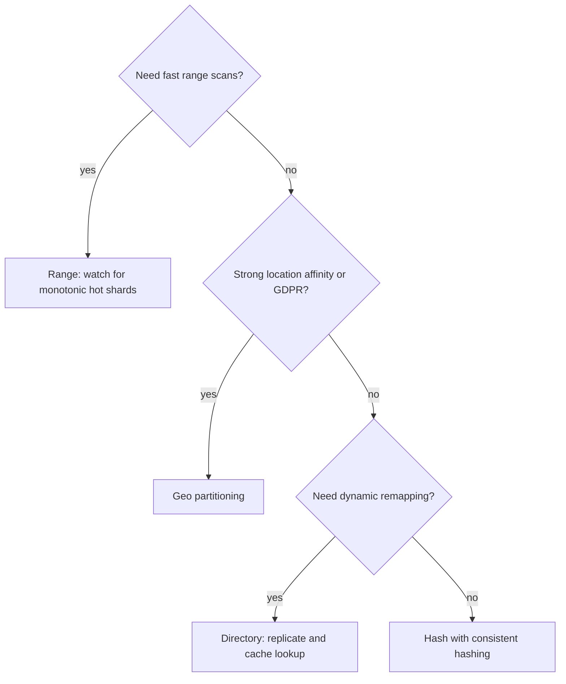
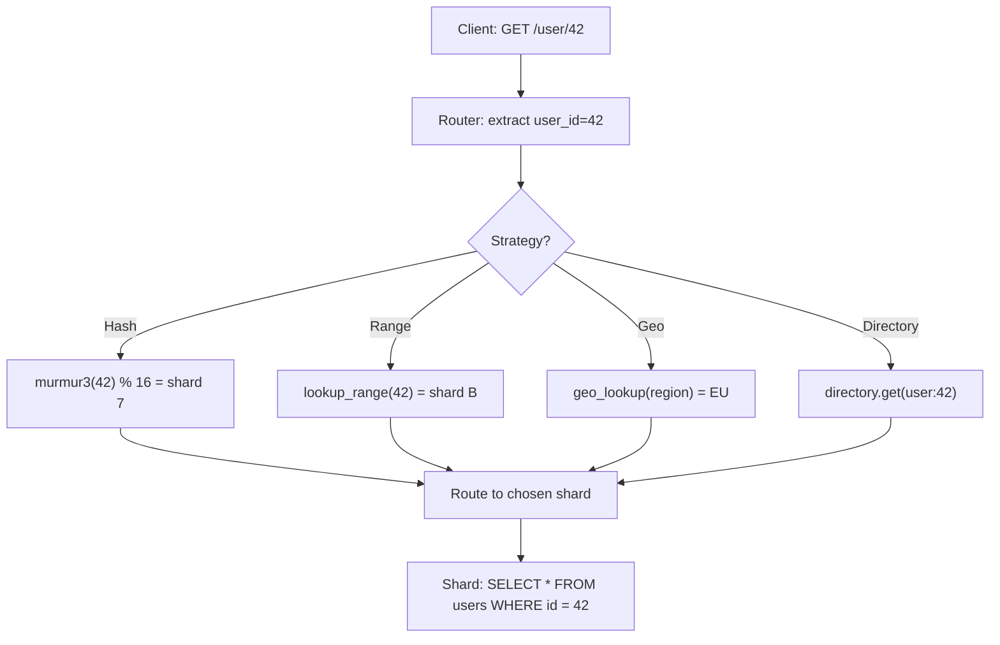

## Definition (interview-ready)

**Sharding** splits a dataset across N nodes so each holds a subset, enabling horizontal scaling of writes and storage. The **shard key** + **strategy** determines placement: **range** (keys in adjacent ranges live together), **hash** (hash(key) % N), **geo** (by user/data location), or **directory** (a lookup service maps key → shard).

**One-liner:** Sharding splits data across nodes by a shard key so writes and storage scale horizontally; range keeps neighbours together for scans but risks hot spots, hash spreads load evenly but loses range scans, and the shard key should be high-cardinality and present in most queries.

## Why it matters

The sharding decision is the single most consequential one in a distributed data system. It dictates which queries are fast (single-shard) and which are slow (scatter-gather), how rebalancing works, what kinds of transactions are possible, and how operational pain scales.

<Anim id="sharding" />

<Anim id="consistent-hash" />

## Core concepts

### Range partitioning

Keys assigned to ranges; each range to a shard.

```
Users with id 1–1M → shard A
Users with id 1M–2M → shard B
Users with id 2M–3M → shard C
```

Pros:
- **Range scans** are fast (locality).
- Predictable layout.
- Easy to reason about — visualize as a number line.

Cons:
- **Hot shards** when load is uneven by range. The classic killer: monotonic IDs → "latest" shard takes all writes.
- Split heuristics matter — bad split = unbalanced shards.

Used by: HBase, MongoDB (default ranged sharding), CockroachDB (per-range Raft), DynamoDB only inside one partition key (its items are stored sorted by sort key; the partition key itself is hashed).

### Hash partitioning

Hash the key to spread evenly.

```
shard = hash(key) % N
```

Pros:
- **Uniform distribution** — no hot ranges by default.
- Simple to compute.

Cons:
- **No range scans**: scattering by hash destroys locality. `WHERE created_at BETWEEN ...` becomes scatter-gather.
- Adding a shard with `% N` remaps almost every key (huge data movement). Use **consistent hashing** to mitigate.

Used by: Cassandra (Murmur3), DynamoDB (default), Riak.

### Consistent hashing

Special hash strategy that minimizes remapping on shard add/remove. Place both keys and nodes on a ring; key goes to next node clockwise. Adding a node only moves ~1/N keys.

Combined with **virtual nodes** (vnodes), gives even distribution. See [DNS & Load Balancing](/learn/notes/dns-load-balancing/).

### Geo partitioning

Shard by user location or data location.

```
European users → EU shard (in EU data center)
US users → US shard
APAC users → APAC shard
```

Pros:
- **Latency**: users hit local shard.
- **Compliance** (GDPR — keep EU data in EU).
- Natural for use-cases with strong location affinity (delivery apps, social with regional content).

Cons:
- Cross-region operations are expensive.
- Skew: if 80% of users are in one region, you haven't really sharded.
- Migration as users move (less common, but a real edge case).

Used by: Uber (S2, later its own H3 hexagon grid, for geographic indexing), Spanner (geo-partitioning / placement of rows in chosen regions).

### Directory-based partitioning

Lookup service maps key → shard.

```
key="user42" → lookup service says shard B
```

Pros:
- **Maximum flexibility** — any policy, dynamic remapping, asymmetric capacity.
- **Move shards around** without changing client logic.

Cons:
- **Lookup is a new SPOF** unless replicated.
- Latency hit on every operation (cache the directory).
- Cache invalidation on remap.

Used by: MongoDB config servers (store which chunk lives on which shard), Vitess lookup vindexes, HDFS NameNode (block → DataNode map), many custom tenant-routing layers.

### Composite / hybrid

Real systems often combine:
- **Hash within range**: hash user_id, then within each shard, range-partition by date.
- **Geo + hash**: route by region, then hash within region.
- **Directory + hash**: directory for "tenant → cluster," hash within cluster.

A quick way to pick a strategy from the pros and cons above:



### Choice of shard key

The shard key is a near-permanent decision. Good shard keys:
- **High cardinality**: millions of distinct values, not 5.
- **Balanced access**: no celebrity user generating 10% of traffic.
- **Present in most queries**: avoid scatter-gather.
- **Allows localized transactions**: keep multi-row updates within one shard.

Anti-patterns:
- **Time as shard key**: today's shard burns.
- **Low cardinality** (country, role): 5 buckets forever.
- **Auto-increment + range**: hot tail shard.

### Multi-tenant systems

Tenant ID (customer ID, organization ID) is often the natural shard key. All data for a tenant lives together → simple transactions, simple analytics per tenant.

Caveats:
- **Huge tenants** create skew. Cap tenant size or split big tenants into multiple shards.
- **Cross-tenant queries** (admin views) require scatter-gather.

### Rebalancing

Adding a shard:
- **Hash with `% N`**: catastrophic — almost every key moves.
- **Consistent hashing**: ~1/N keys move.
- **Range**: split a range; only that range moves.
- **Directory**: arbitrary; the lookup is rewired.

Online rebalancing tools: Vitess (MySQL), MongoDB balancer, Cassandra (new node bootstraps and streams its token ranges, then `nodetool cleanup` on the old owners).

### Cross-shard operations

- **Joins**: scatter-gather; slow. Often denormalize at write time or use a query layer (Trino, Presto).
- **Transactions**: 2PC or saga. Sagas usually preferred.
- **Aggregations**: each shard computes locally, coordinator merges (this is what Trino/Presto do).
- **Global secondary indexes**: indexes that span shards (DynamoDB GSIs, Vitess vindexes).

## How it works (a sharded lookup)

The router extracts the shard key, applies whichever strategy is configured, and routes to one shard:



## Real-world examples

- **Discord**: messages sharded by channel ID over Cassandra/Scylla. Range-by-time within channel.
- **Uber**: trip data lived in Schemaless, which hashes each row key (a UUID) into a fixed number of shards. Geo indexing (S2, later H3 cells) is used for dispatch.
- **Shopify**: tenants sharded across MySQL pods; each merchant has a home shard.
- **Slack**: originally sharded by workspace; moved to Vitess, re-sharding big tables (e.g., messages by channel ID) to fix hot workspaces.
- **YouTube → Vitess**: Vitess was built at YouTube to shard MySQL with transparent query routing.

## Common pitfalls

- **Picking shard key without studying access patterns**: 90% of queries scatter-gather.
- **Time as shard key**: writes pile on today's shard.
- **Huge tenant skew**: one customer = 30% of data on one shard.
- **Cross-shard joins frequent**: rethink schema; denormalize.
- **`% N` hash with growth**: ouch on the rebalance.
- **Re-sharding underestimated**: re-sharding 10 TB is typically a multi-week project, not a weekend.
- **No global secondary index**: queries that don't include the shard key are slow.
- **Cross-shard transactions**: not just slow — fragile. Avoid via design.

## Practice questions

<Practice>

<QA q="Why choose hash partitioning over range partitioning?" level="easy">

Hash spreads keys evenly regardless of how they're distributed — no hot ranges. Range partitioning's locality is great for scans but creates hot shards under monotonic or time-based writes. Hash trades scan locality for write balance.

</QA>

<QA q="What's a good shard key?" level="easy">

High cardinality (millions of distinct values, not 5), balanced access (no celebrity dominating traffic), present in most queries (to avoid scatter-gather), and enables localized transactions (related data colocated on one shard).

</QA>

<QA q="Why is tenant ID often the natural shard key in a multi-tenant system, and what are the caveats?" level="easy">

All of a tenant's data lives together, so transactions and per-tenant analytics stay on one shard. Caveats: **huge tenants** create skew (cap tenant size or split big tenants across shards), and **cross-tenant queries** like admin views become scatter-gather.

</QA>

<QA q="How does consistent hashing minimize data movement?" level="medium">

Nodes and keys are placed on a hash ring; each key goes to the next node clockwise. Adding a node takes over only the keys between it and its predecessor — about 1/N of the total. With virtual nodes (Cassandra defaulted to 256 per node; 4.0+ defaults to 16 with a smarter token allocator), distribution stays even and rebalancing is incremental.

</QA>

<QA q="Why is plain `hash(key) % N` painful when the cluster grows?" level="medium">

Changing N changes the result of the modulo for almost every key, so adding a shard remaps nearly the whole dataset — a huge data movement. Consistent hashing moves only about 1/N of keys; range partitioning moves only the split range; a directory just rewires the lookup.

</QA>

<QA q="Why is sharding by time (e.g., `created_at`) usually bad?" level="medium">

All writes land on today's shard, creating a write hotspot, and recent-data reads also hit that one shard — the rest of the cluster sits mostly idle. Time works as a **secondary** partition (range by time within a tenant or user), but rarely as the primary key.

</QA>

<QA q="Compare range, hash, geo, and directory partitioning." level="medium">

| | Range | Hash | Geo | Directory |
|---|---|---|---|---|
| Locality (scans) | great | none | regional | flexible |
| Even distribution | risky | great | depends | flexible |
| Rebalancing | range splits | with consistent hashing | tricky | trivial (rewire) |
| Cross-shard query | OK | scatter | mostly local | depends |
| Use case | OLAP, time-series | KV, transactional | latency, compliance | dynamic placement |

</QA>

<QA q="What are the trade-offs of directory-based partitioning?" level="medium">

**Pros**: maximum flexibility — any placement policy, dynamic remapping, asymmetric capacity, and moving shards without changing client logic. **Cons**: the lookup service is a new SPOF unless replicated, every operation pays a lookup (so clients cache the directory), and caches must be invalidated on remap.

</QA>

<QA q="How do you handle joins, transactions and aggregations that span shards?" level="hard">

- **Joins**: scatter-gather is slow — denormalize at write time, or use a query layer (Trino/Presto).
- **Transactions**: 2PC or sagas; sagas are usually preferred, and the best answer is a design that keeps them on one shard.
- **Aggregations**: each shard computes locally and a coordinator merges.
- **Queries without the shard key**: global secondary indexes (DynamoDB GSIs, Vitess vindexes).

</QA>

<QA q="How do you re-shard a live system from 8 to 16 shards with zero downtime?" level="hard">

1. **Dual writes** to both the old (8) and new (16) layouts.
2. **Backfill** historical data into the new shards and verify consistency.
3. **Cut over reads** gradually (a small percentage first).
4. **Verify** with shadow comparisons and error budgets.
5. **Stop dual writes** once confident; write only to the new layout.
6. **Decommission** the old shards.

Tooling: Vitess Reshard, application-layer routing behind a feature flag, CDC. Budget for it — re-sharding 10 TB is a multi-week project, not a weekend.

</QA>

<QA q="Design sharding for a chat app with billions of messages." level="scenario">

- **Partition key**: channel ID (hashed), so a channel's messages are colocated and reads stay local.
- **Clustering**: timestamp, sorted within the channel, for tail reads.
- **Bucketing**: channel ID + day to bound partition size and avoid mega-partitions for huge channels.
- **Per-user search across channels**: denormalize into a secondary table keyed by user ID.
- **Analytics**: CDC into a warehouse (Trino over Parquet).
- **Hot channels**: split via sub-channels or a dedicated shard.

</QA>

<QA q="You have a multi-tenant SaaS with 10K customers; one customer is 5x larger than the others. Sharding strategy?" level="scenario">

- Default: shard by tenant ID — tenants colocated, transactions cheap.
- Give the giant a **dedicated shard**; directory partitioning lets you carve out big tenants without disturbing others.
- Small tenants share shards.
- Plan per-shard capacity with headroom for tenant growth, and monitor it.
- Cross-tenant analytics: CDC into a warehouse.

</QA>

<QA q="After launch, 90% of queries on your sharded DB are scatter-gather and p99 is terrible. What happened and what do you do?" level="scenario">

The shard key was chosen without studying access patterns, so most queries don't include it. Options: add **global secondary indexes** or a denormalized lookup table keyed by the commonly queried attribute; denormalize so hot queries become single-shard; route analytical queries to a separate query layer or warehouse. If the dominant access pattern truly differs from the key, plan a re-shard onto a better key — expensive, which is why the key is a near-permanent decision.

</QA>

</Practice>

## Quiz

<Quiz>

<MCQ q="A users table is range-partitioned on an auto-increment ID. What problem appears as the system grows?" options={["Range scans become impossible", "All new writes hit the last shard, creating a hot tail", "Every query becomes scatter-gather", "Keys are spread too evenly"]} answer={1}>

Monotonic IDs mean every new row falls in the newest range, so one shard takes all writes. Range scans are actually range partitioning's strength, single-key lookups still route to one shard, and even spread is the opposite of the problem.

</MCQ>

<MCQ q="What is the main thing you give up with hash partitioning?" options={["Even distribution", "Single-key lookups", "Range-scan locality", "The ability to add shards"]} answer={2}>

Hashing scatters adjacent keys, so range queries become scatter-gather. Even distribution is hash's strength, point lookups remain single-shard, and shards can still be added (ideally with consistent hashing).

</MCQ>

<MCQ q="With consistent hashing and N nodes, roughly how many keys move when one node is added?" options={["About 1/N of the keys", "About half of the keys", "Almost all keys", "None"]} answer={0}>

The new node takes over only the keys between it and its predecessor on the ring, about 1/N. Almost all keys moving is what happens with hash mod N; none is impossible since the new node must take some keys.

</MCQ>

<MCQ q="Which is the worst shard key for a large orders table?" options={["customer_id", "order_id hashed", "tenant_id in a B2B SaaS", "country, with 5 possible values"]} answer={3}>

Five values means at most five useful shards forever, and likely skew too. Customer ID, a hashed order ID and tenant ID all have high cardinality and can work depending on access patterns.

</MCQ>

<MCQ q="What new risk does directory-based partitioning introduce?" options={["Range scans become impossible", "The lookup service becomes a SPOF and adds a hop unless replicated and cached", "Keys can never be moved", "It forces hash mod N"]} answer={1}>

The directory gives full placement flexibility but every request depends on it, so it must be replicated and cached. It doesn't prevent range scans, it makes moving keys easy, and it isn't tied to modulo hashing.

</MCQ>

<MCQ q="A chat app partitions messages by channel ID. One public channel is huge and its partition keeps growing. What is the common fix?" options={["Shard by message timestamp only", "Move all channels to one shard", "Bucket the partition key by channel ID plus a time bucket such as day", "Disable writes to that channel"]} answer={2}>

Adding a time bucket bounds partition size while keeping a channel's recent messages together. Timestamp-only sharding creates a hot today shard, one shard for everything defeats sharding, and blocking writes isn't a design.

</MCQ>

<MCQ q="Which approach is usually preferred for a business operation that spans two shards?" options={["A saga, or better, a design that keeps the operation on one shard", "A distributed lock held across all shards", "A cross-shard join inside a transaction", "Writing to whichever shard responds first"]} answer={0}>

Sagas are generally preferred over 2PC, and the best fix is choosing a key that colocates related data. Global locks are slow and fragile, cross-shard transactional joins are what you're trying to avoid, and racing writes loses data.

</MCQ>

<MCQ q="During a live re-shard, which step comes right after starting dual writes?" options={["Drop the old shards", "Stop writing to the old shards", "Switch all reads to the new shards at once", "Backfill historical data into the new shards and verify it"]} answer={3}>

New shards only have new writes until historical data is copied and checked. Dropping or stopping writes to old shards that early loses data, and an all-at-once read cutover skips the gradual, verified shift.

</MCQ>

<MCQ q="Why does geo partitioning not always solve scaling?" options={["It cannot meet GDPR", "If most users are in one region, that region's shard still carries most of the load", "It forbids local reads", "It requires hash mod N"]} answer={1}>

Geo partitioning follows the user distribution, so 80% of users in one region means one shard does 80% of the work. It helps with compliance, enables local reads, and has nothing to do with modulo hashing.

</MCQ>

</Quiz>

## TL;DR cheat sheet

- **Range**: locality for scans; hot-shard risk for monotonic data.
- **Hash**: even distribution; scatter-gather for range queries.
- **Consistent hashing**: minimizes data movement on shard add/remove.
- **Geo**: latency + compliance; depends on user distribution.
- **Directory**: maximum flexibility; lookup overhead.
- **Composite**: combine — common in practice.
- Shard key requirements: high cardinality, balanced, present in most queries, enables locality.
- Time as primary shard key is a famous antipattern.
- Re-sharding is expensive — choose carefully upfront.
- Cross-shard transactions/joins = pain. Design to avoid.

## Go deeper

- **DDIA Chapter 6** — the canonical chapter.
- **System Design Primer**: [sharding section](https://github.com/donnemartin/system-design-primer#sharding).
- **Vitess docs**: [vitess.io/docs/concepts/shard](https://vitess.io/docs/concepts/shard/) — sharded MySQL in practice.
- **MongoDB sharding docs**.
- **Discord engineering**: storing billions of messages.
- **Uber engineering**: H3 / S2 cells for geo partitioning.
- **AWS DynamoDB docs**: best practices for partition key design.
