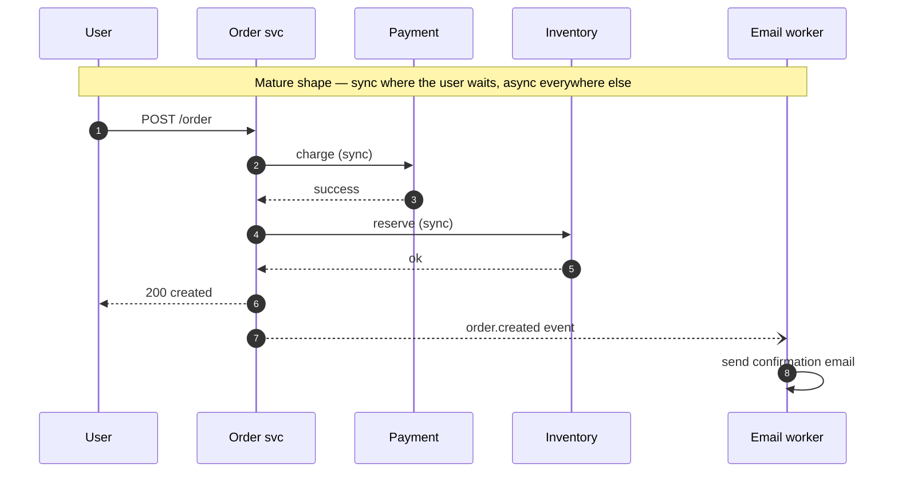

## Definition (interview-ready)

**Synchronous** communication means the caller waits for the callee's response before it continues (a REST or gRPC request-response call). **Asynchronous** communication means the sender hands off a message and moves on without waiting; in system design this usually means a queue, log or event bus (Kafka, SQS, RabbitMQ) sits between sender and receiver, so they don't have to be up, fast or even known to each other at the same time. **Event-driven architecture** uses asynchronous events as the primary communication style: services publish events about state changes ("OrderPlaced"), and any interested service reacts.

**One-liner:** Sync is request-response where the caller waits for an answer; async puts a queue or log between services so the sender doesn't wait; event-driven architecture builds a system out of services that publish facts about what happened and react to each other's events.

## Why it matters

Choosing sync vs async for each interaction is one of the most consequential decisions in a distributed design. Sync everywhere → fragile, slow, hard to scale, cascading failures. Async everywhere → eventual consistency surprises, debugging hell. The mature answer is **sync where you need an answer right now, async everywhere else.**



## Core concepts

### Sync (request-response)

- HTTP/REST, gRPC, GraphQL queries.
- Caller blocks; gets answer.
- Backpressure is implicit (caller has to wait).
- Failure modes: timeout, error, partial.
- Latency = sum of all hops on the critical path.

### Async (fire-and-forget or fire-and-callback)

- Message queue, event log, pub/sub.
- Caller publishes, doesn't wait for consumers.
- Consumers process independently, possibly later, possibly multiple times.
- Backpressure handled by queue depth.
- Failure modes: messages can pile up; retries; DLQ.

### When sync wins

- Read paths where the user needs the answer **now** (load my profile).
- Strong-consistency requirements (charge this card before I show "success").
- Simple operations with low latency.
- Debugging — stack traces tell a clear story.

### When async wins

- **Side effects** the user doesn't need to wait for: send email, update analytics, propagate to downstream services.
- **Long-running work**: image processing, report generation.
- **Decoupling**: producer doesn't know all consumers.
- **Variable load**: queue absorbs bursts.
- **Multiple consumers** of the same event (fan-out).
- **Cross-service propagation** of state changes.

### Event-driven architecture (EDA)

A style where services communicate primarily through **events** (immutable facts about something that happened). Variants:

#### Event notification

Producer emits a lightweight event: "OrderPlaced(orderId=42)". Consumers fetch details via the producer's API as needed.

Pros: small events; consistency via the producer.
Cons: consumers tightly coupled to the producer's API.

#### Event-carried state transfer

Producer emits an event with all relevant state: "OrderPlaced(orderId=42, items=[...], total=...)". Consumers don't need to call back.

Pros: looser coupling, consumers fully self-sufficient.
Cons: bigger events, more data duplicated across systems.

#### Event sourcing

Store **events as the source of truth** and derive current state by replaying them. It is a heavier pattern with real implications: full history and easy audit, but replaying long histories gets slow (so you add snapshots), events need versioning, and read models (projections) are complex.

#### CQRS (Command Query Responsibility Segregation)

Separate models for writes (commands) and reads (queries). Often paired with event sourcing: commands → events → various read models. Justified when read and write needs diverge dramatically.

### Choreography vs orchestration

Same dichotomy as in sagas ([Distributed Transactions](/learn/notes/distributed-transactions/)):
- **Choreography**: services react to each other's events. Loose, but emergent flow.
- **Orchestration**: a central process drives the flow. Clear, observable.

For complex multi-step flows, orchestrate. For simple fan-outs, choreograph.

### Hybrid in practice

Real systems mix:
- **Edge → service**: sync (user wants the page).
- **Service → service for read** the response needs: sync.
- **Service → service for downstream propagation**: async.
- **Service → analytics/logging**: async.
- **Cross-service workflows**: orchestrated via Temporal/Step Functions + events.

### Backpressure

Sync: caller waits. If callee is slow, callers stack up → resource exhaustion.

Async: queue fills. Eventually:
- Queue caps (drop, return 429 to producer).
- Slow consumer falls behind — surface lag as a metric.
- Multiple consumer instances to scale out.

Async + visible backpressure = the safer mode.

### Eventual consistency surprises

The big async gotcha: state appears in different places at different times.

- User places order → UI shows success → fulfillment service hasn't seen it yet → user refreshes → "order not found."
- Mitigations: optimistic UI, retry on the client, dual-store strategy (write through sync to a read store), polling with eventual convergence.

### Idempotency, ordering, deduplication

Async makes these mandatory:
- Messages may be redelivered → idempotent consumers.
- Order matters within a key → key-aware partitioning.
- Duplicates happen → dedup with idempotency keys.

(See [Delivery Semantics](/learn/notes/delivery-semantics/).)

## How it works (event-driven order placement)

```
1. POST /orders (sync): API gateway → Order Service.
2. Order Service writes Order in its DB; writes "OrderPlaced" to outbox (same txn).
3. Returns to the client right away (sync), with the order in a pending state.
4. Outbox CDC → Kafka topic "orders".
5. Saga orchestrator consumes "OrderPlaced" and drives the dependent steps in order:
   - Inventory: reserve items.
   - Payments: charge card (order ID as idempotency key).
   - Fulfillment: queue shipment only after payment succeeds.
   If payment fails, it emits "OrderFailed" and inventory un-reserves (compensation).
6. Independent subscribers react in parallel: Notifications (confirmation email), Analytics (dashboard).
7. Every consumer processes idempotently; messages that keep failing go to a DLQ.
```

## Real-world examples

- **Uber**: trip events flow as Kafka events; many consumers (pricing, ETA, driver matching, accounting).
- **Netflix**: Keystone, its real-time event pipeline (Kafka + Flink), carries events to many consumers.
- **Shopify**: order events → fulfillment, ML, marketing.
- **Slack**: messages → many consumers (notifications, search index, mobile push).

## Common pitfalls

- **Sync chain of 10 services**: latency tax + cascading failures.
- **Async for read-after-write**: user complains "where's my order?" — design for some sync confirmation.
- **No event schema versioning**: producer adds a field → consumers break.
- **Mixing events and commands**: a "DoX" event vs a "XHappened" event have different semantics. Be explicit.
- **No dedup / idempotency**: async retries cause double-charges.
- **Forgetting backpressure**: queue fills, OOM.
- **Hidden coupling via shared event shape**: "lightweight" events that secretly require all consumers to upgrade together.

## Practice questions

<Practice>

<QA q="When would you use async over sync?" level="easy">

For side effects the user doesn't need immediately (emails, analytics, downstream propagation), long-running work (image processing, reports), decoupling a producer from many consumers (event fan-out), and absorbing bursty load in a queue. Use sync when the user needs an answer right now or when strong consistency is required (charge the card before showing 'success').

</QA>

<QA q="What's the difference between event notification and event-carried state transfer?" level="easy">

**Event notification** = a small 'X happened' event; consumers call back to the producer for details. **Event-carried state transfer** = the event carries all the data consumers need, so no callback. Notification keeps events small but couples consumers to the producer's API; state transfer decouples them at the cost of larger events and data duplicated across systems.

</QA>

<QA q="What's the difference between an event and a command?" level="easy">

An **event** is an immutable fact about something that already happened ('OrderPlaced'); the producer doesn't know or care who reacts. A **command** asks a specific receiver to do something ('ReserveInventory') and can be rejected. Mixing them — 'DoX' messages dressed up as events — blurs ownership and semantics, so be explicit about which one you're sending.

</QA>

<QA q="What is CQRS and when does it help?" level="medium">

Command Query Responsibility Segregation — separate models (and often stores) for writes (commands) and reads (queries). It helps when read and write requirements diverge a lot: many read shapes, complex aggregations, real-time vs OLAP. It's often paired with event sourcing. It justifies its complexity only when the read and write models really diverge; for simple CRUD it's overkill.

</QA>

<QA q="Compare event sourcing with traditional state storage." level="medium">

**Traditional**: store current state; mutations overwrite it. **Event sourcing**: store events as the source of truth and derive state by replaying them. Benefits: full audit history, time-travel queries, easier debugging. Costs: event versioning, snapshot machinery, complex projections, and eventually consistent queries.

</QA>

<QA q="How would you guarantee the order of events for a single user?" level="medium">

Use a messaging system with per-key ordering (Kafka, Pulsar's Key_Shared). Partition the topic by user ID so the same user always lands on the same partition, where order is preserved. There's no global order across partitions — but per-user order is what most apps actually need.

</QA>

<QA q="Choreography or orchestration — how do you choose?" level="medium">

- **Choreography**: services react to each other's events. Loosely coupled, but the overall flow is emergent and hard to see.
- **Orchestration**: a central process (Temporal, Step Functions) drives the steps. Clear and observable.

Orchestrate complex multi-step flows with compensations; choreograph simple fan-outs.

</QA>

<QA q="How does backpressure differ between sync and async communication?" level="medium">

**Sync**: backpressure is implicit — callers wait. If a callee is slow, callers pile up and exhaust threads and connections, which cascades. **Async**: the queue absorbs the burst, then fills; you cap it (drop or return 429 to producers), expose consumer lag as a metric, and scale consumers out. Async with visible backpressure is the safer mode.

</QA>

<QA q="How do you version events without breaking consumers?" level="hard">

- Evolve additively: new fields are fine; never reuse field IDs (Protobuf rules).
- Forward compatibility (old consumers, new events): consumers ignore unknown fields, and producers don't drop fields old consumers rely on without a deprecation period.
- Backward compatibility (new consumers, old events): new fields get defaults so upgraded consumers can still read old events.
- Enforce compatibility on publish with a **schema registry** (Confluent, Apicurio).
- Breaking changes: a new event type or topic, dual-published during migration.
- Document an event contract per topic.

</QA>

<QA q="Why does the order flow write the OrderPlaced event to an outbox in the same transaction as the order?" level="hard">

Writing the order to the DB and publishing to Kafka separately is a dual write: a crash between them leaves an order with no event, or an event with no order. Writing the event to an **outbox table in the same DB transaction** makes both commit or neither; CDC then streams the outbox to Kafka. Consumers must still be idempotent, because the relay can deliver an event more than once.

</QA>

<QA q="Design event flow for a 'place order' use case across cart, payment, inventory, fulfillment." level="scenario">

- **Order Service**: receives the request (sync), creates a pending order plus an outbox event in one transaction.
- **Saga orchestrator** (Temporal) consumes 'OrderPlaced' and runs:
  1. `Inventory.reserve(items)`.
  2. `Payment.charge(amount)` with the order ID as the idempotency key.
  3. `Fulfillment.create(order)`.
- **On failure**: compensations (refund payment, release inventory).
- **Side consumers** (Notifications, Analytics) listen independently.
- The API returns 'pending' immediately; the client polls or gets a webhook on completion.

</QA>

<QA q="A team made everything async and now users see stale data 5+ seconds after writes. Fix?" level="scenario">

- Identify which writes need **read-after-write** — usually the user's own immediate views.
- For those, update the read store synchronously (write-through), or sticky-read from the primary for a short TTL.
- Use **optimistic UI**: show the change immediately and reconcile if the backend disagrees.
- Add a 'last updated' timestamp and let the client retry until it catches up.
- Don't make everything sync — only the user-visible critical path.

</QA>

<QA q="Customers were charged twice after a consumer crashed and restarted. What went wrong and how do you fix it?" level="scenario">

Async delivery is at-least-once: the consumer charged the card but crashed before committing its offset, so the message was redelivered and processed again. Fix with **idempotent consumers**: pass an idempotency key (the order ID) to the payment provider, and/or record processed message IDs and skip duplicates, ideally in the same transaction as the side effect. Send messages that keep failing to a DLQ instead of retrying forever.

</QA>

</Practice>

## Quiz

<Quiz>

<MCQ q="A user clicks Place order. Which step should usually stay synchronous?" options={["Sending the confirmation email", "Updating the analytics dashboard", "Recording the order and returning a result the user is waiting for", "Notifying the recommendations service"]} answer={2}>

The user is waiting for the order to be accepted, so that response belongs on the sync path. Email, analytics and recommendations are side effects that should run asynchronously.

</MCQ>

<MCQ q="An event contains only orderId, and consumers call the Order API for the details. Which pattern is this?" options={["Event-carried state transfer", "Event notification", "Event sourcing", "CQRS"]} answer={1}>

A thin event plus a callback for details is event notification. Event-carried state transfer would include the details, event sourcing stores events as the source of truth, and CQRS splits read and write models.

</MCQ>

<MCQ q="Why must async consumers be idempotent?" options={["Messages can be redelivered, so processing the same message twice must not repeat side effects", "Brokers reject non-idempotent consumers", "It guarantees global ordering", "It removes the need for retries"]} answer={0}>

At-least-once delivery means duplicates happen, so consumers must handle a repeat safely. Brokers don't check idempotency, it doesn't create ordering, and retries are still needed.

</MCQ>

<MCQ q="You need all events for one user processed in order. What do you do in Kafka?" options={["Increase the partition count and let the producer round-robin", "Use random partition assignment", "Add more consumer groups", "Use the user ID as the message key so the user maps to one partition"]} answer={3}>

Keying by user ID sends a user's events to one partition, where order is preserved, while other users spread across partitions. Round-robin or random assignment scatters one user's events across partitions and breaks their order, and more consumer groups don't affect ordering.

</MCQ>

<MCQ q="A multi-step workflow with compensations keeps failing in ways nobody can trace across five services that react to each other's events. What is the usual recommendation?" options={["Add more event types", "Move to orchestration with a central workflow engine", "Make every call synchronous", "Remove the compensations"]} answer={1}>

Complex multi-step flows are easier to see and control with an orchestrator such as Temporal. More events add to the emergent mess, making everything sync brings back fragility, and dropping compensations leaves inconsistent state.

</MCQ>

<MCQ q="What problem does the transactional outbox solve?" options={["It guarantees consumers receive each event exactly once", "It makes Kafka writes faster", "It ensures the DB change and the event are committed together, avoiding a dual-write gap", "It removes the need for a schema registry"]} answer={2}>

The outbox commits the event in the same DB transaction as the state change, and CDC publishes it, so you never get one without the other. It doesn't give exactly-once delivery, doesn't speed up Kafka, and doesn't replace schema management.

</MCQ>

<MCQ q="A slow downstream service causes callers' thread pools to fill up and fail. Which communication style is this a symptom of?" options={["Synchronous calls with implicit backpressure", "Asynchronous messaging with a full queue", "Event sourcing snapshots", "CQRS read models"]} answer={0}>

In sync calls the caller waits, so a slow callee makes callers stack up and exhaust resources. With async the queue would grow instead and consumer lag would show it; snapshots and read models are unrelated.

</MCQ>

<MCQ q="When is CQRS most clearly justified?" options={["For any new CRUD app", "When read and write requirements diverge strongly, such as many read shapes and heavy aggregations", "When there is only one consumer", "To avoid using a database"]} answer={1}>

CQRS pays off when reads and writes need very different models. For simple CRUD it's overkill, the number of consumers isn't the trigger, and it still uses databases, often more than one.

</MCQ>

<MCQ q="A producer must make a breaking change to an event's structure. What is the safe approach?" options={["Change the existing event in place and redeploy consumers later", "Reuse an old field ID for the new data", "Remove the old fields immediately", "Introduce a new event type or topic and dual-publish during migration"]} answer={3}>

A new event type or topic, published alongside the old one until consumers move, avoids breaking anyone. In-place changes, reused field IDs and immediate removals all break existing consumers.

</MCQ>

</Quiz>

## TL;DR cheat sheet

- Sync = request-response. Async = decoupled via queue/log.
- Sync when user needs the answer now; async for side effects, downstream propagation, bursts.
- **Event-driven**: services emit events about state changes; others react.
- Event notification (small, callback) vs event-carried state transfer (large, self-sufficient).
- **Event sourcing**: events are source of truth; current state derived. Powerful but complex.
- **CQRS**: split read and write models; pairs well with event sourcing.
- **Choreography** (event-driven) vs **orchestration** (central driver).
- Async needs: idempotency, ordering, dedup, backpressure visibility, schema versioning.

## Go deeper

- **Confluent**: ["What is Event-Driven Architecture?"](https://www.confluent.io/learn/event-driven-architecture/).
- **Martin Fowler**: ["What do you mean by 'Event-Driven'?"](https://martinfowler.com/articles/201701-event-driven.html).
- **Sam Newman**, *Building Microservices*, Chapter 4.
- **Greg Young's talks** on event sourcing and CQRS (YouTube).
- **DDIA Chapter 11** — stream processing.
- **Microservices.io**: [event-driven patterns](https://microservices.io/patterns/).
- **Vaughn Vernon**, *Reactive Messaging Patterns with the Actor Model*.
