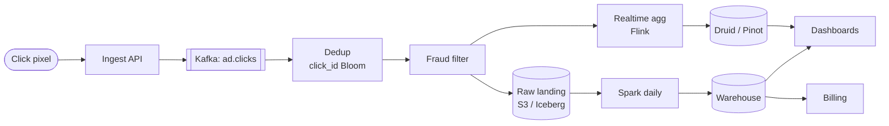

## Problem statement

Design a system that ingests billions of ad-click events per day, deduplicates, attributes, aggregates in real time and offline, and provides dashboards + APIs for advertisers and internal systems.



## Requirements

### Functional
- Ingest click + impression events.
- Deduplicate (same click reported twice).
- Aggregate by ad/campaign/time bucket.
- Real-time dashboard (sub-minute).
- Long-term storage for billing & audit.

### Non-functional
- 100B events/day = ~1M/sec average, multi-million peak.
- Sub-second latency for ingest.
- Sub-minute for real-time metrics.
- Cost-efficient (events are huge).

## Scale estimation

- 100B events/day, ~300 bytes each → **30 TB/day raw**, ~10 TB compressed.
- 1M events/sec average; 5M peak.
- Storage: 5 years ≈ 10 TB × 1,825 days ≈ ~18 PB compressed (~55 PB if the raw store keeps RF=3).

## High-level architecture

```
                  ┌────────────┐
   Browser/SDK ──►│ Ingest API │ ──► Kafka (raw clicks)
                  └────────────┘
                        │
              ┌─────────┴─────────────┐
              ▼                       ▼
       ┌───────────────┐       ┌────────────────┐
       │ Real-time     │       │ Batch          │
       │ aggregation   │       │ pipeline       │
       │  (Flink /     │       │ (Spark on S3)  │
       │   Spark Str.) │       │ Parquet)       │
       └──────┬────────┘       └────────────────┘
              ▼
     ┌────────────────┐
     │ ClickHouse /   │ ── sub-minute queries
     │ Druid / Pinot  │
     └────────────────┘
              │
              ▼
     ┌────────────────┐
     │ Dashboards/API │
     └────────────────┘
```

## Detailed design

### Ingest API

- Edge endpoint receives click pixels (1x1 image GET) or POST JSON.
- Minimal processing: enrich (ip → country, ua → device).
- Append to Kafka topic `clicks.raw`.
- Return quickly (302 redirect to the landing page for click URLs; 1x1 GIF / 204 for pixels).

### Deduplication

Same click reported multiple times (browser retries, network blips):
- Each click has an idempotency token (UUID generated by client, or signed timestamp+nonce).
- Stream processor (Flink) keeps a window-keyed dedupe set.
- Within the window, duplicates dropped.

### Real-time aggregation

Stream job (Flink, Spark Structured Streaming, or KStreams):
- Tumbling windows (1-minute, 5-minute).
- Group by (campaign, ad, country, device).
- Sink to OLAP (ClickHouse / Druid / Pinot).

### OLAP store (real-time queries)

- **ClickHouse**: columnar, fast scans, MergeTree engine, perfect for analytics.
- **Druid / Pinot**: similar; built for high-concurrency, sub-second queries (user-facing dashboards) on huge data.
- Schema: dimensions (campaign, country, device, time) + metrics (clicks, ctr).
- Pre-aggregated rollups for common queries.

### Batch pipeline (durable + cheap)

- Parquet files in S3, partitioned by date + campaign.
- Spark / Trino jobs for nightly aggregation, billing.
- Re-process easily for backfills or bug fixes.

### Lambda architecture

Classic dual-pipeline:
- Real-time: lossy/quick → ClickHouse for dashboards.
- Batch: source of truth → Parquet + warehouse for billing.

Modern variant: **kappa** — only stream, treat batch as a different consumer of the same stream. Avoid double-pipeline.

### Attribution

Linking clicks to conversions (purchases):
- Each click gets a unique ID stored in cookie/postback.
- Conversion event includes the click ID.
- Attribution joins clicks with conversions.

### Billing reconciliation

- Daily aggregate from batch pipeline = source of truth.
- Real-time numbers approximate.
- End-of-month billing uses batch numbers.

## Bottlenecks & optimizations

- **Kafka throughput**: scale partitions; producer batching.
- **Dedup window memory**: if window is too long, state explodes. Tune carefully.
- **OLAP write rate**: batch inserts, not per-event.
- **Spike absorption**: Kafka soaks bursts; downstream catches up.

## Trade-offs

- **Real-time vs accurate**: real-time is approximate; batch is exact. Most ad systems use real-time for product, batch for billing.
- **Per-event vs aggregated storage**: raw events for flexibility; rollups for query speed. Keep both.
- **Dedup precision**: exact dedup needs all-time state (expensive); windowed is approximate. For ad billing, accept exact at batch, approximate at real-time.

## Practice questions

<Practice>

<QA q="Estimate the scale: 100B click events per day at about 300 bytes each." level="easy">

- 100B / 86,400 s ≈ **1.2M events/sec** on average, with peaks around 5M/sec.
- 100B × 300 B ≈ **30 TB/day raw**, roughly 10 TB/day compressed.
- Five years of compressed data ≈ 10 TB × 1,825 days ≈ **18 PB** (about 55 PB if the raw store keeps three replicas).

That scale is why the design separates raw storage, rollups and a cheap archive.

</QA>

<QA q="Why ClickHouse for real-time analytics?" level="easy">

Columnar storage means queries read only the columns they need, which makes scans over huge data fast. The MergeTree engine merges sorted parts in the background, it speaks native SQL, and it's built for append-only event data. Cloudflare and many ad companies run it at scale. Druid and Pinot are similar alternatives built for high-concurrency, sub-second user-facing dashboards.

</QA>

<QA q="Why does the ingest API do so little work before writing to Kafka?" level="easy">

Ingest must be sub-second at millions of events per second, so it only does cheap enrichment (IP → country, user agent → device), appends to the `clicks.raw` topic, and returns immediately — a 302 redirect to the landing page for click URLs, or a 1x1 GIF / 204 for pixels. Everything heavy (dedup, fraud filtering, aggregation) happens downstream, and Kafka absorbs traffic spikes while those stages catch up.

</QA>

<QA q="How do you deduplicate clicks across Kafka and the OLAP store?" level="medium">

Give each click an idempotency token (a client-generated UUID, or a signed timestamp + nonce). A stream processor (Flink) keeps keyed dedup state over a time window (about an hour) and drops duplicates inside it. At-least-once Kafka delivery plus dedup gives effectively-exactly-once visible counts.

</QA>

<QA q="How would you handle attribution?" level="medium">

Each click gets a unique click ID, stored in a cookie or passed as a URL parameter. The conversion event carries that click ID, so clicks and conversions can be joined on it — in the stream or as a nightly batch join. Multi-touch models (last-click, linear, time-decay) are computed in batch.

</QA>

<QA q="What's the storage strategy for 5 years of clicks?" level="medium">

Hot recent data (about 30 days) in the OLAP store (ClickHouse). A cold archive in Parquet on S3, partitioned by date + campaign, queried ad hoc with Trino. Lifecycle rules move data to Glacier after about a year. Keep both raw events (flexibility, reprocessing) and rollups (query speed).

</QA>

<QA q="Lambda vs kappa architecture for this system?" level="medium">

**Lambda** runs two pipelines: a fast, approximate stream pipeline feeding dashboards, and a batch pipeline over Parquet that's the source of truth for billing. **Kappa** runs only the stream, treating batch-style work as another consumer of the same log (replaying it for reprocessing). Kappa avoids maintaining two codebases that compute the same metrics; lambda keeps a simple, exact batch path for money.

</QA>

<QA q="How do you prevent click fraud?" level="hard">

- **Server-side validation**: a signature on the click URL.
- **IP reputation**: blocklists.
- **Behavioral signals**: clicks per IP, anomalous click-to-conversion ratios.
- **Bot detection** at the edge (Cloudflare, custom ML).
- **Post-hoc reconciliation**: invalid clicks are subtracted from billing.

</QA>

<QA q="Why not keep exact, all-time dedup state in the stream processor?" level="hard">

Exact dedup needs to remember every click ID ever seen — state that grows without bound at ~1M events/sec and explodes memory and checkpoint size. A windowed dedup set bounds state but can miss duplicates that arrive outside the window. So the design accepts approximate dedup in real time and does exact dedup in the batch pipeline, which feeds billing.

</QA>

<QA q="The OLAP store falls over under write load. What do you change?" level="hard">

Stop inserting per event. Pre-aggregate in the stream job (tumbling 1- or 5-minute windows grouped by campaign, ad, country, device) and write **batched inserts**, so the OLAP store ingests rollups rather than raw clicks. Keep the raw firehose in Kafka and Parquet instead, and add pre-aggregated rollup tables for the common dashboard queries.

</QA>

<QA q="Design ingestion for 1M events/sec." level="scenario">

An edge API behind an HTTPS load balancer appends to Kafka. Use `acks=1` for speed, or `acks=all` if these raw events feed billing — `acks=1` can lose writes on leader failover. Producers batch to cut per-request overhead. Each broker handles roughly 100K–500K events/sec, so a cluster of about 10 brokers comfortably handles 1M; scale partitions with load.

</QA>

<QA q="A campaign manager sees wildly different click numbers between real-time and batch reports. Why?" level="scenario">

Real-time is approximate (windowed dedup, sometimes sampling or lossy paths); batch reconciles everything, including fraud subtraction. Differences are expected. Billing must always use batch. Communicate it in the UI — label numbers 'real-time (preliminary)' vs 'billed (final)'.

</QA>

<QA q="Design multi-region ad tracking." level="scenario">

- Regional ingest endpoints close to users.
- Regional Kafka clusters, asynchronously replicated to a central cluster for the batch pipeline.
- Per-region OLAP for dashboards, plus a central OLAP for the global view.
- Respect data-residency rules when deciding what leaves a region.

</QA>

</Practice>

## Quiz

<Quiz>

<MCQ q="Which numbers should an advertiser's end-of-month invoice be based on?" options={["The real-time OLAP dashboard", "The daily aggregates from the batch pipeline", "Raw Kafka message counts", "Whichever is lower"]} answer={1}>

The batch pipeline is the exact source of truth, with full dedup and fraud subtraction, so billing uses it. Real-time numbers are approximate, raw Kafka counts include duplicates and fraud, and picking the lower number isn't a reconciliation method.

</MCQ>

<MCQ q="Why does the stream job use a time-windowed dedup set instead of remembering every click ID forever?" options={["Flink cannot store strings", "Duplicates never arrive more than a second apart", "Unbounded state would grow without limit at this event rate; exact dedup is left to batch", "Kafka already removes duplicates"]} answer={2}>

A window bounds memory, at the cost of missing late duplicates, which batch catches. Flink stores strings fine, retries can arrive much later than a second, and at-least-once Kafka delivery can itself create duplicates.

</MCQ>

<MCQ q="How are clicks linked to later purchases for attribution?" options={["By matching IP addresses", "By timestamp proximity alone", "By the advertiser uploading a spreadsheet", "A unique click ID travels with the user and is included in the conversion event"]} answer={3}>

The click ID is stored in a cookie or URL parameter and returned with the conversion, so the two can be joined exactly. IPs are shared and change, timestamps alone are ambiguous, and manual uploads don't scale.

</MCQ>

<MCQ q="What is the key difference between kappa and lambda architecture?" options={["Kappa uses only a streaming pipeline, replaying the log for reprocessing, while lambda runs separate stream and batch pipelines", "Kappa has no Kafka", "Lambda has no real-time path", "Kappa cannot reprocess data"]} answer={0}>

Kappa keeps one stream pipeline and reprocesses by replaying the log; lambda maintains two. Kappa is built on a log like Kafka, lambda does have a real-time path, and replay is exactly how kappa reprocesses.

</MCQ>

<MCQ q="Why is a columnar OLAP store a good fit for click dashboards?" options={["It supports row-level locking for updates", "Queries read only the columns they need, so scans over billions of rows are fast", "It stores each event as a separate JSON file", "It requires no schema"]} answer={1}>

Dashboard queries touch a few columns across many rows, which is exactly what columnar storage speeds up. Row locking is an OLTP concern, per-event JSON files would be slow, and these stores do have schemas.

</MCQ>

<MCQ q="If raw click events feed billing, what producer setting should ingest use?" options={["acks=0", "acks=1", "acks=all", "No acknowledgements, with retries disabled"]} answer={2}>

acks=all waits for the in-sync replicas, so a leader failover doesn't lose acknowledged writes. acks=1 can lose writes on failover, and acks=0 or no acks with no retries can drop events silently.

</MCQ>

<MCQ q="The OLAP store is overwhelmed by inserts. What is the best first fix?" options={["Pre-aggregate in the stream job and write batched inserts", "Insert each event as soon as it arrives", "Remove the Kafka layer", "Increase the dedup window to a week"]} answer={0}>

Writing windowed rollups in batches cuts insert volume dramatically. Per-event inserts are the cause, removing Kafka loses buffering, and a week-long dedup window explodes state without fixing writes.

</MCQ>

<MCQ q="Real-time and batch click counts for a campaign differ by 3%. What is the right interpretation?" options={["The batch pipeline is broken", "Kafka lost data", "The OLAP store double-counted", "Expected: real-time is approximate while batch reconciles dedup and fraud"]} answer={3}>

Real-time numbers are preliminary by design; batch applies exact dedup and fraud subtraction. A small gap doesn't point to a bug in either pipeline; it's a labeling and communication issue.

</MCQ>

<MCQ q="Roughly how many events per second is 100B events per day?" options={["About 100K per second", "About 1.2M per second", "About 12M per second", "About 100M per second"]} answer={1}>

100B divided by 86,400 seconds is about 1.16M per second on average. The other options are off by one or more orders of magnitude.

</MCQ>

</Quiz>

## TL;DR cheat sheet

- Edge ingest → Kafka raw → stream + batch pipelines.
- Dedup with idempotency token + windowed state.
- Real-time aggregation → OLAP (ClickHouse / Druid / Pinot) for dashboards.
- Batch pipeline → Parquet S3 for source of truth / billing.
- Attribution via click ID.
- Bill from batch (exact); dashboard from real-time (approx).
- Lambda or Kappa pattern.

## Go deeper

- **ClickHouse docs**: [clickhouse.com/docs](https://clickhouse.com/docs).
- **Apache Druid**, **Apache Pinot** — alternative OLAP engines.
- **Apache Flink**: real-time aggregation reference.
- **High Scalability**: Cloudflare's ClickHouse + analytics architecture.
- **Alex Xu Vol 2**: ad-click event aggregation chapter.
- **ByteByteGo**: ad-click pipeline videos.
- **Snowflake / BigQuery** patterns for ad analytics.
