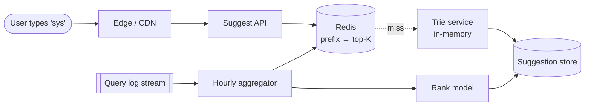

## Definition (interview-ready)

**Search autocomplete (typeahead)** suggests the top few completions for whatever prefix the user has typed so far, on every keystroke, ranked mostly by how popular each query is.

The design in one breath: an offline job aggregates the **query logs** into (term, score) pairs and builds a **trie** (prefix tree) where every node stores its **precomputed top K** completions, so serving is just "walk the prefix, return the list" in O(prefix length). The trie lives **in memory**, sharded and replicated across serving nodes, and is rebuilt every few minutes to hours and **swapped in atomically**. Short, popular prefixes are cached at the **CDN edge** and in a cache like Redis, because every keystroke is a request. A small streaming layer boosts trending terms, and personalization is a light per-user overlay merged at query time.

The main trade-off is **freshness vs simplicity and speed**: precomputing top K makes reads trivial but means rankings lag behind real traffic until the next rebuild.

**One-liner:** Aggregate query logs offline into a trie that stores the top K suggestions at every prefix node, serve it from memory with an atomic swap on each rebuild, and put edge caches in front because every keystroke is a request.

## Problem statement

Design a typeahead service that suggests the most likely completions for a user's prefix in real time, ranked by popularity and relevance.



## Requirements

### Functional
- For prefix `p`, return top K (e.g., 10) suggestions.
- Update suggestion popularity from real query traffic.
- Personalization (optional): biased by user history.

### Non-functional
- p99 < 100 ms (sub-keystroke).
- High QPS: every keystroke is a query.
- Eventual consistency on popularity updates is fine.
- Handle billions of queries/day.

## Scale estimation

- 1B queries/day = ~12K QPS average, ~50K peak.
- Each user typing produces ~5 keystrokes/query → **60K typeahead QPS average, ~250K peak**.
- ~10M unique terms in popularity dataset.

## Core API

```
GET /api/autocomplete?q=red+wi
→ { "suggestions": [
     {"text": "red wine", "score": 0.92},
     {"text": "red winter", "score": 0.41},
     ...
] }
```

## Data structure: trie + Top-K per node

A **trie** (prefix tree) of characters; at each node, store the top K suggestions for the prefix ending at that node.

```
root
├─ r
│  └─ e
│     └─ d
│        └─ ' '
│           └─ w
│              ├─ i
│              │  ├─ top10: ["red wine 0.92", "red winter 0.41", ...]
│              │  └─ n
│              │     └─ e
│              │        └─ top10: ["red wine 0.92", ...]
│              └─ a
│                 └─ ...
```

Lookup: walk the trie by characters of the prefix; at the final node, return its precomputed top K. O(prefix length) lookup.

**Tradeoff**: trie is memory-heavy if stored naïvely. Compress (radix tree / "Patricia trie") or shard by first 1–2 chars.

## High-level architecture

```
                      ┌────────────┐
   Client (typing) ──►│ Edge / CDN │ ──► local PoP cache for common prefixes
                      └─────┬──────┘
                            ▼
                      ┌────────────┐
                      │ TypeAhead  │ ──► Trie service (in-memory)
                      │  Service   │
                      └─────┬──────┘
                            ▼
                      ┌────────────┐
                      │   Stats    │ ──► aggregation pipeline
                      │ Aggregator │
                      └────────────┘

User queries (clicks) ──► Kafka ──► batch jobs (Spark/Flink) ──► updated trie
```

## Detailed design

### Trie service

- In-memory trie sharded by first 1–2 characters across nodes.
- Each node holds top K suggestions with scores.
- Updated periodically (every few minutes to a few hours) from analytics pipeline.

### Building the trie

Offline batch (Spark or Flink):

1. Query log → aggregate (term, count) over time window.
2. Compute score per term (recency × frequency, optionally per-user / per-region).
3. For each prefix of each term, attach the term to the prefix's top K (using a min-heap of K).
4. Serialize trie and load into trie service (atomically swap).

Realtime increments via streaming for trending terms (Flink keeps top K per prefix in a windowed aggregation).

### Caching

- Most queried prefixes are short (1–3 chars) and repeat heavily.
- Cache at CDN edge with very short TTL (1–10 minutes).
- Edge cache key = prefix; short prefixes are so repetitive that hit ratios are high.

### Ranking signal

- Base: query frequency over last N days.
- Boost: trending (last hour vs week average).
- Penalty: stale, blocked, or low-quality terms.
- Personalization (optional): blend in user history.
- A/B test ranking functions behind flags.

### Multi-language / locale

- One trie per locale (en-US, en-GB, ja-JP).
- Tokenization differs (CJK has no spaces).
- Diacritics normalized (`café` → `cafe`).
- Routing by `Accept-Language` or user pref.

### Personalization

- Lightweight: store user's recent searches; merge into ranked results.
- Heavyweight: per-user trie (expensive in memory).
- Common: hybrid — global trie + small per-user boost layer.

## Bottlenecks & optimizations

- **Trie memory**: 10M terms × avg path = lots of nodes. Use radix tree compression (collapse single-child chains).
- **Trie update**: atomic swap (rebuild offline, hot-swap pointer) avoids inconsistency.
- **Hot prefixes**: 1-char prefixes are tiny and hot — CDN caches them.
- **Latency spikes during update**: pre-warm caches on the new trie before swap.

## Trade-offs

- **Real-time vs batch updates**: real-time is more responsive but more complex. A common choice is a batch rebuild every few minutes to hours, plus a small real-time layer for trending terms.
- **In-memory vs distributed**: a single trie in RAM is simplest; sharded trie scales but adds routing.
- **Spell-correction at the edge**: typeahead can suggest spell-corrections on-the-fly (Did you mean...) — useful UX but extra cost.

## Practice questions

<Practice>

<QA q="Why use a trie?" level="easy">

Lookup is O(prefix length): walk the characters of the prefix and return the top K precomputed at that node. A database `LIKE 'p%'` query can use a B-tree index to find matching rows, but it would still have to fetch every match and sort it by popularity on every keystroke; short prefixes match millions of rows. Precomputing the answer per prefix turns that into a constant-size read and fits the sub-100 ms p99 budget.

</QA>

<QA q="Why is typeahead QPS so much higher than search QPS?" level="easy">

Every keystroke is a query. With 1B searches/day (~12K QPS average, ~50K peak) and ~5 keystrokes per search, the suggestion service sees about **60K QPS on average and ~250K at peak**. That's why caching and an in-memory index are mandatory.

</QA>

<QA q="Why cache short prefixes at the CDN edge?" level="easy">

The most-queried prefixes are short (1–3 characters) and repeat heavily, so with the prefix as the cache key, hit ratios are very high. A short TTL (1–10 minutes) keeps them reasonably fresh while taking most traffic off the backend.

</QA>

<QA q="How do you precompute the top K per prefix?" level="medium">

Walk all terms. For each term `t` and each prefix `p` of `t`, push (score, t) into a size-K min-heap stored at the trie node for `p`. Each push costs O(log K), so the whole build is O(total prefix count × log K). Then serialize the trie and load it into the trie service.

</QA>

<QA q="How do you ship a new trie without serving inconsistent results?" level="medium">

Rebuild offline from the aggregated query log, load the new trie alongside the old one, and **atomically swap** the pointer. Readers see either the whole old trie or the whole new one, never a half-updated mix. Pre-warm caches on the new trie before the swap to avoid latency spikes.

</QA>

<QA q="What signals go into ranking suggestions?" level="medium">

- **Base**: query frequency over the last N days.
- **Boost**: trending terms (last hour vs weekly average).
- **Penalty**: stale, blocked or low-quality terms.
- **Personalization** (optional): the user's history.

A/B test ranking functions behind flags.

</QA>

<QA q="How would you update suggestions for trending events?" level="medium">

A real-time stream job (Flink) keeps a windowed top K per prefix from recent queries. Merge it with the baseline trie at query time, or rebuild more often for popular prefixes. A common choice is batch rebuilds plus this small real-time layer; full real-time is more responsive but more complex.

</QA>

<QA q="How do you handle non-Latin scripts (Chinese, Japanese)?" level="medium">

- One trie per locale, routed by `Accept-Language` or user preference.
- Locale-specific tokenization — CJK has no spaces.
- For CJK, build the trie over characters and over romanizations (pinyin/romaji) where applicable, and match on multiple representations.
- Normalize full-width vs half-width, traditional vs simplified, and accents (`café` → `cafe`).

</QA>

<QA q="How do you do personalized typeahead?" level="medium">

Keep a global trie for everyone, and layer on per-user recent searches (say the last 100), joined at query time to boost the user's own terms. Per-user tries would be far too expensive in memory; storing 100 recent searches × 10M users is still large, so keep them in Redis with a TTL.

</QA>

<QA q="What privacy considerations apply to autocomplete?" level="medium">

- Don't log raw user queries for training without consent.
- Anonymize and aggregate before retention.
- Honor GDPR/CCPA deletion (scrub user history).
- Suppress sensitive completions (medical, legal — depending on policy).

</QA>

<QA q="How big is the trie?" level="hard">

10M terms × ~12 characters average → up to ~120M nodes in a naive trie. A radix tree over n keys has at most ~2n nodes, so ≤ ~20M nodes. With a top-10 list of term IDs + scores per node at ~100–200 bytes/node, that's ~2–4 GB — it fits in memory on one box. Shard (e.g., by first 1–2 characters) for HA and scale, not because it doesn't fit.

</QA>

<QA q="A new feature launches and certain terms must always appear (sponsor). How?" level="scenario">

- An **editorial overrides** table: prefix → fixed top result.
- Merged at query time, before normal ranking.
- Clearly marked in the UI as paid placement.
- Time-bound, expiring automatically.

</QA>

<QA q="Every time a new trie is loaded, p99 latency spikes for a few minutes. Why, and how do you fix it?" level="scenario">

After the swap, caches keyed on the old data are cold or invalidated, and the new structure may not be paged in yet, so early requests are slow. Fix: **pre-warm** caches against the new trie (replay the hottest prefixes) before swapping, do the load in the background and swap the pointer atomically, and roll the swap across replicas gradually instead of all at once.

</QA>

</Practice>

## Quiz

<Quiz>

<MCQ q="What is the lookup cost for a prefix in a trie that stores the top K at each node?" options={["O(number of terms)", "O(prefix length)", "O(K log N)", "O(N times prefix length)"]} answer={1}>

You walk one node per prefix character and read the precomputed list, so it's O(prefix length). O(number of terms) and O(N times prefix length) describe scanning, and K log N isn't the lookup cost.

</MCQ>

<MCQ q="While building the trie, which structure keeps the best K suggestions at each prefix node?" options={["A max-heap of all terms", "A sorted linked list of all terms", "A min-heap of size K", "A hash set"]} answer={2}>

A size-K min-heap keeps the current top K and evicts the smallest in O(log K). A heap or list of all terms wastes memory, and a hash set has no ordering.

</MCQ>

<MCQ q="Why does the design swap in a new trie atomically?" options={["So readers never see a half-updated trie", "Because tries cannot be modified", "To reduce memory usage", "To support personalization"]} answer={0}>

An atomic pointer swap means each request sees a complete old or new trie. Tries can be modified, but in-place updates under load risk inconsistency; the swap doesn't save memory or relate to personalization.

</MCQ>

<MCQ q="With 1B searches a day and about 5 keystrokes per search, roughly what is the average typeahead QPS?" options={["About 12K", "About 250K", "About 1M", "About 60K"]} answer={3}>

1B per day is about 12K QPS of searches, times 5 keystrokes gives about 60K. 12K is the search rate, 250K is the peak typeahead estimate, and 1M is far too high.

</MCQ>

<MCQ q="Why does radix-tree compression shrink the trie so much?" options={["It collapses chains of single-child nodes, bounding nodes to about 2n for n keys", "It removes rarely used terms", "It stores the trie on disk", "It hashes every prefix"]} answer={0}>

Collapsing single-child chains means a radix tree over n keys has at most about 2n nodes, versus one node per character in a naive trie. It doesn't drop terms, move data to disk, or hash prefixes.

</MCQ>

<MCQ q="Which prefixes benefit most from a CDN edge cache?" options={["Long, rare prefixes", "Prefixes containing digits", "Short, heavily repeated prefixes of 1 to 3 characters", "Personalized prefixes"]} answer={2}>

Short prefixes repeat across huge numbers of users, so edge hit ratios are high. Long rare prefixes rarely hit, digits are irrelevant, and personalized results can't be shared from a cache.

</MCQ>

<MCQ q="What is the most practical way to personalize suggestions?" options={["Build a separate full trie per user", "A global trie plus a small per-user overlay of recent searches merged at query time", "Disable caching for all users", "Rank only by the user's own history"]} answer={1}>

A global trie with a lightweight per-user boost layer is the common hybrid. Per-user tries are too expensive, disabling caching hurts everyone, and ranking only by personal history loses popular suggestions.

</MCQ>

<MCQ q="How should a sponsored suggestion be guaranteed to appear for certain prefixes?" options={["Inflate its query count in the logs", "Hard-code it into the trie build forever", "Add it to every user's history", "An editorial overrides table merged at query time, labeled and time-bound"]} answer={3}>

Overrides keep sponsored results explicit, labeled and expiring. Faking query counts corrupts ranking, permanent hard-coding never expires, and polluting user histories misrepresents personalization.

</MCQ>

<MCQ q="Why do Chinese and Japanese need different handling than English?" options={["They don't use spaces, so tokenization differs and multiple representations such as romanizations may need matching", "Tries can't store non-ASCII characters", "They need a SQL LIKE query instead", "CDNs can't cache them"]} answer={0}>

CJK text lacks spaces and users may type romanized input, so tokenization and matching differ per locale. Tries handle any characters, LIKE would be slow anywhere, and CDNs cache UTF-8 keys fine.

</MCQ>

</Quiz>

## TL;DR cheat sheet

- Trie (radix-compressed) with top K precomputed per node.
- Offline batch builds trie; atomic swap on load.
- Real-time stream layer for trending.
- Edge cache for hot prefixes.
- Per-locale tries; personalization as lightweight overlay.
- Editorial overrides for sponsored / blocked terms.

## Go deeper

- **Alex Xu Vol 1**: Chapter 13 (Search autocomplete).
- **Gaurav Sen**: ["Designing Typeahead"](https://www.youtube.com/results?search_query=gaurav+sen+typeahead).
- **Elasticsearch**: [suggesters](https://www.elastic.co/guide/en/elasticsearch/reference/current/search-suggesters.html) (completion suggester), edge n-gram tokenizer.
- **Solr**: AnalyzingInfixSuggester.
- **System Design Primer**: search section.
