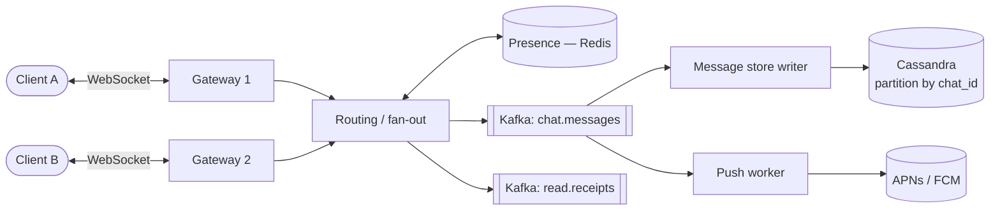

## Definition (interview-ready)

A **chat system** delivers messages between users in real time, 1:1 and in groups, stores history, and shows delivery and read receipts and online presence, even when the recipient is offline or on several devices.

The design in one breath: each client keeps a **persistent WebSocket** to a stateful **chat server**, and a **directory** (user to server, in Redis) tells the sender's server where to forward a message. Every message gets a **unique, time-ordered message ID** and is **persisted first** in a wide-column store (Cassandra/Scylla) partitioned by **(channel, day bucket)**, then pushed to online recipients or sent as a **mobile push** (APNs/FCM) if they're offline. Delivery is **at-least-once** with client-side dedup by message ID; reconnecting clients sync everything after their last-seen message ID. Presence is a TTL'd heartbeat, and media goes straight to object storage via pre-signed URLs.

The main trade-offs are **stateful connections** (harder to scale and fail over, but needed for real-time push) and **end-to-end encryption vs server-side features** like search.

**One-liner:** Clients hold WebSockets to chat servers, a Redis directory routes each message to the recipient's server, messages are stored first in Cassandra partitioned by channel and day and then pushed live or via APNs/FCM, with at-least-once delivery deduped by message ID.

## Problem statement

Design a real-time messaging system supporting 1-to-1 and group chats, with delivery, read receipts, presence, and message history.



## Requirements

### Functional
- Send/receive messages 1:1 and in groups.
- Delivery and read receipts.
- Online/offline presence.
- Push notifications when user is offline.
- Message history (months or years).
- Media (images, video, files).

### Non-functional
- Real-time (< 100 ms message delivery).
- Reliable — no lost messages.
- Scale: 1B users, 100B messages/day.
- High availability.
- End-to-end encryption (for WhatsApp-style).

## Scale estimation

- 1B users, 100B messages/day = ~1.2M msgs/sec average, ~5M peak.
- ~200 bytes per text message → 100B × 200 = **20 TB/day** raw, ~7 PB/year, ×3 RF = 21 PB.
- Concurrent connections: ~10% online → 100M concurrent.

## High-level architecture

```
                ┌──────────────┐
   Clients ────►│ Edge Servers │ (WebSocket / QUIC)
                └──────┬───────┘
                       ▼ (route to user's chat server)
                ┌──────────────┐
                │ Chat Servers │ (stateful, holds user connections)
                └──┬──────┬────┘
                   ▼      ▼
           ┌──────────┐  ┌──────────────┐
           │ Presence │  │ Message Bus  │ (Kafka / NATS)
           │ Service  │  └──────┬───────┘
           └──────────┘         ▼
                         ┌──────────────┐
                         │ Storage      │ (Cassandra/Scylla)
                         └──────┬───────┘
                                ▼
                         ┌──────────────┐
                         │ Push Notif   │ (APNs/FCM)
                         └──────────────┘
```

## Connection management

- **WebSocket** (or persistent HTTPS/QUIC) from client to a chat server.
- Either route by **consistent hash** of user ID (the user always lands on the same server), or let any healthy server accept the connection and record user → server in a **directory** (Redis). The directory approach is what the rest of this design uses for routing.
- Edge load balancer with TCP-aware routing or app-level routing after auth.
- Long-lived connections: hundreds of thousands per server with epoll/kqueue. WhatsApp (Erlang on FreeBSD) famously hit 2M concurrent connections per server in 2012.

## Data model

```cql
CREATE TABLE messages_by_channel (
  channel_id   uuid,
  bucket       text,       -- e.g., '2026-05-29' for partition bounding
  message_id   timeuuid,
  sender_id    uuid,
  content      blob,        -- encrypted if E2E
  type         text,
  created      timestamp,
  PRIMARY KEY ((channel_id, bucket), message_id)
) WITH CLUSTERING ORDER BY (message_id DESC);

CREATE TABLE channels_by_user (
  user_id      uuid,
  channel_id   uuid,
  last_read_id timeuuid,
  joined_at    timestamp,
  PRIMARY KEY ((user_id), channel_id)
);
```

Channel = 1:1 chat ID or group ID. Bucketed by day to avoid mega-partitions.

## Detailed design

### Sending a message (1:1)

1. Client A sends to its chat server (WebSocket).
2. Chat server:
   - Persist to Cassandra (single quorum write).
   - Look up recipient's connection (which chat server holds it).
   - If recipient online: forward via internal RPC/Kafka to their chat server → push to client.
   - If offline: queue push notification via APNs/FCM.
3. Recipient's client acks delivery → chat server emits delivery receipt to sender.
4. Recipient reads → chat server emits read receipt.

### Group messages

- Channel has many members.
- Server iterates members, forwards to each member's chat server.
- For huge channels (Slack workspace with 100K), fan-out is heavier — use Kafka.

### Presence

- Soft signal — clients heartbeat every N seconds.
- Presence Service tracks (with TTL) which users are online.
- High volume, eventual consistency. Use Redis.

### Read receipts

- Store last-read message ID per (user, channel).
- Compute unread count from this.

### Encryption (E2E for WhatsApp/Signal-style)

- **Signal Protocol**: Double Ratchet for forward secrecy, X3DH for key agreement (Signal moved to post-quantum PQXDH in 2023).
- Server stores only ciphertext.
- Server can't read messages — but can see metadata (sender, recipient, timing).
- Group chat E2E is harder (key distribution).

### Offline & sync

- When a device reconnects, the server sends messages newer than that device's **sync cursor** (the last message ID it received). Using `last_read_id` as the cursor also works but is more conservative: it re-sends delivered-but-unread messages, which client dedup drops.
- Cassandra range query: `WHERE channel_id = ? AND bucket = ? AND message_id > cursor`, walking day buckets forward.
- Mobile: paginate efficiently to avoid bulk transfer.

### Media

- Don't put media in messages — upload to object store (S3), reference URL.
- Pre-signed upload URLs for direct client → S3.
- CDN for distribution.

## Bottlenecks & optimizations

- **Mega-partitions** for hot channels: bucket by time.
- **Tail latency** during fan-out: parallel push, partial-result-OK semantics.
- **Mobile networks**: keep messages small; use compression; batched delivery for offline catch-up.
- **Read receipts at scale**: send aggregated, not per-message (one update for "read up to msg X").
- **Storage**: hot recent data (3 months) in Cassandra; cold archive to S3 Parquet for queryable history.

## Trade-offs

- **WebSocket vs SSE**: WebSocket = bidirectional, well-supported. SSE = simpler but server → client only.
- **Push notifications**: Apple APNs and Google FCM are effectively the only mobile delivery paths when app is killed (plus OEM push services on Android devices without Google services).
- **E2E vs server-readable**: business needs (search, compliance) vs privacy.
- **At-most-once vs at-least-once delivery**: client-side dedup by message ID lets you use at-least-once safely.

## Practice questions

<Practice>

<QA q="Why WebSockets rather than SSE for chat?" level="easy">

Chat is bidirectional: clients send messages, receipts and typing signals as well as receive them. WebSockets give one long-lived, full-duplex connection and are well supported. SSE is simpler but only pushes server → client, so client sends would need separate HTTP requests.

</QA>

<QA q="How is presence (online/offline) tracked?" level="easy">

Presence is a soft signal: clients heartbeat every N seconds, and the presence service records each user as online with a TTL in Redis. If heartbeats stop, the key expires and the user shows offline. It's high-volume and only needs eventual consistency.

</QA>

<QA q="How should images and videos be sent?" level="easy">

Never inline media in messages. The client uploads directly to object storage (S3) using a **pre-signed upload URL**, then sends a normal message containing the object reference. Recipients download through a CDN. This keeps chat servers and the message store small and fast.

</QA>

<QA q="How do you handle a user being on multiple devices?" level="medium">

Each device has its own connection and device ID; the user maps to several devices. The server pushes each message to all of them, and per-user state such as last-read position is synced across devices.

</QA>

<QA q="How does the server know which chat server a recipient is on?" level="medium">

A directory maps user_id → chat_server, updated on connect and disconnect and stored in a fast KV store (Redis). The sender's chat server looks up the recipient and forwards the message there; if there's no entry, the recipient is offline and gets a push notification instead.

</QA>

<QA q="How do read receipts and unread counts work at scale?" level="medium">

Store a single **last-read message ID** per (user, channel) — the `last_read_id` column in `channels_by_user`. Unread count = messages newer than it. Send receipts in aggregate ('read up to message X') rather than one update per message, which collapses a flood of tiny writes into one.

</QA>

<QA q="How does a client catch up after being offline?" level="medium">

On reconnect, the server sends everything after the device's sync cursor (the last message ID it received; the last-read ID is a simpler, more conservative cursor): a Cassandra range query `WHERE channel_id = ? AND bucket = ? AND message_id > cursor`, walking day buckets forward. On mobile, paginate and batch the catch-up so a long absence doesn't mean one huge transfer.

</QA>

<QA q="How do you get reliable delivery without showing duplicate messages?" level="medium">

Use **at-least-once** delivery: the server keeps retrying until the recipient acks, so nothing is lost. Each message has a unique message ID, and the client deduplicates by it, so retries never show twice. That combination is safer than at-most-once, which can silently drop messages.

</QA>

<QA q="Push notifications: how do you avoid hammering APNs/FCM?" level="medium">

- Batch sends where possible.
- Use one token per device; retry transient failures with backoff.
- Respect APNs/FCM quotas — they enforce them.
- Coalesce multiple messages into one notification ('5 new messages').
- Honor per-user mute/DND — don't push at all when it's on.

</QA>

<QA q="How would you keep millions of WebSocket connections per server?" level="hard">

Efficient event-driven I/O (epoll/kqueue), a non-blocking architecture (Erlang processes, Go goroutines), modest memory per connection, and OS tuning (file-descriptor limits, TCP buffers). WhatsApp famously reached 2M connections per FreeBSD/Erlang box; modern servers commonly handle 100K–1M.

</QA>

<QA q="How does end-to-end encryption work?" level="hard">

The Signal Protocol: X3DH key agreement sets up a session (Signal moved to post-quantum PQXDH in 2023), and the Double Ratchet keeps rotating keys for forward secrecy. The server stores only ciphertext and can't decrypt — though it still sees metadata (sender, recipient, timing). Group E2E is harder: it uses sender keys plus per-recipient key distribution.

</QA>

<QA q="Design message history storage for 100B messages/day." level="scenario">

Cassandra/Scylla, partitioned by `(channel_id, day_bucket)` so hot channels don't create mega-partitions, clustered by `message_id DESC` for newest-first reads. At ~200 bytes/message that's ~20 TB/day raw. Tier it: hot recent data (about 3 months) on SSD in Cassandra, older history archived to S3 Parquet for queryable access.

</QA>

<QA q="A chat server crashes with users connected. What happens?" level="scenario">

- Clients detect the disconnect and reconnect.
- They land on a new chat server (consistent-hashed by user ID, or any healthy server), and the user → server directory is updated.
- Messages were persisted before delivery, so the client syncs anything missed since its sync cursor (last received message ID).
- No data loss; just a brief reconnection delay (typically under a second).

</QA>

<QA q="How do you scale group chat to 100K members in a workspace?" level="scenario">

- Never write 100K rows per message — store **one message per channel**, and each reader queries its own view.
- Fan out delivery notifications through Kafka instead of looping inside one chat server.
- Compute unread counts asynchronously.
- Use parallel push with partial-result-OK semantics to control tail latency.
- For huge groups, consider hierarchical groups or read-mostly broadcast lists.

</QA>

</Practice>

## Quiz

<Quiz>

<MCQ q="Why is the messages table partitioned by channel ID plus a day bucket instead of channel ID alone?" options={["To bound partition size so very active channels don't create mega-partitions", "To sort messages alphabetically", "Because Cassandra requires a date in every key", "To spread one message across many nodes"]} answer={0}>

Without a bucket, a busy channel's partition grows forever and becomes a hotspot. Messages are sorted by message ID, not alphabetically; Cassandra has no date-key requirement; and one message isn't split across nodes.

</MCQ>

<MCQ q="The recipient is offline. What does the chat server do with a new message?" options={["Drop it and tell the sender to retry", "Keep it only in memory until the user reconnects", "Persist it and send a push notification through APNs or FCM", "Send it by email"]} answer={2}>

The message is already persisted, and an offline user is reached by mobile push; they sync on reconnect. Dropping or memory-only storage loses messages, and email isn't part of the design.

</MCQ>

<MCQ q="How does the sender's chat server find the recipient's chat server?" options={["It broadcasts to every chat server", "It looks up a user-to-server directory in a fast store like Redis", "It asks the client", "It reads the recipient's IP from the message"]} answer={1}>

A directory keyed by user ID, updated on connect and disconnect, gives a direct lookup. Broadcasting doesn't scale, and the client or message doesn't know the recipient's server.

</MCQ>

<MCQ q="How is an unread count computed cheaply?" options={["Store a boolean per message per user", "Count every message in the channel on each request", "Ask each sender", "Compare messages against a stored last-read message ID per user and channel"]} answer={3}>

One last-read pointer per user and channel makes unread count the number of messages after it. Per-message flags multiply writes, counting everything is wasteful, and senders don't know read state.

</MCQ>

<MCQ q="What lets a chat system use at-least-once delivery without users seeing duplicates?" options={["Client-side dedup by unique message ID", "Switching to at-most-once", "Sending each message only once over UDP", "Encrypting messages"]} answer={0}>

Retries may deliver a message twice, and the client drops repeats by message ID. At-most-once can lose messages, UDP gives no guarantee, and encryption doesn't affect duplicates.

</MCQ>

<MCQ q="With end-to-end encryption, what can the server still see?" options={["Message plaintext", "Nothing at all", "Metadata such as sender, recipient and timing", "Each user's private keys"]} answer={2}>

The server stores only ciphertext but still routes messages, so it sees who talks to whom and when. It can't read plaintext or hold users' private keys, and it isn't blind to metadata.

</MCQ>

<MCQ q="A workspace channel has 100K members. What is the right way to store a new message?" options={["Write one copy per member", "Store it once per channel and let readers query the channel", "Store it only on the sender's device", "Write it to a separate table per member"]} answer={1}>

One row per channel, plus asynchronous fan-out of notifications, avoids 100K writes per message. Per-member copies or tables multiply writes, and sender-only storage breaks history.

</MCQ>

<MCQ q="How should a 50 MB video be sent in a chat?" options={["Inline in the WebSocket message", "Split into chat messages of 200 bytes each", "Stored in the Cassandra messages table", "Uploaded directly to object storage with a pre-signed URL, with only a reference in the message"]} answer={3}>

Direct upload to object storage plus a reference keeps media off the chat path, and a CDN serves downloads. Inline or chunked messages and storing blobs in Cassandra overload the real-time path and the database.

</MCQ>

<MCQ q="A user gets 20 messages in a minute while their phone is locked. What is the best push behavior?" options={["Coalesce them into one notification such as 20 new messages", "Send 20 separate pushes", "Send nothing until the app opens", "Retry each push until it is read"]} answer={0}>

Coalescing respects APNs and FCM quotas and the user's attention. Twenty pushes hammer the services, sending nothing hides messages, and retrying until read isn't how push works.

</MCQ>

</Quiz>

## TL;DR cheat sheet

- WebSocket connections to chat servers (consistent-hashed by user).
- Cassandra/Scylla for messages, partitioned by channel + day bucket.
- Presence in Redis with TTLs.
- APNs/FCM for offline push.
- Group messages: server fan-out, possibly via Kafka.
- E2E: Signal Protocol (Double Ratchet + X3DH).
- Media uploads direct to S3 via pre-signed URLs.
- Hot/cold storage tiering for history.

## Go deeper

- **WhatsApp engineering**: famous Erlang scale stories (2M connections per box).
- **Discord engineering**: [How Discord Handles Two and Half Million Concurrent Voice Users using WebRTC](https://discord.com/blog/how-discord-handles-two-and-half-million-concurrent-voice-users-using-webrtc), [How Discord Stores Trillions of Messages](https://discord.com/blog/how-discord-stores-trillions-of-messages).
- **Signal docs**: [Double Ratchet](https://signal.org/docs/specifications/doubleratchet/), [X3DH](https://signal.org/docs/specifications/x3dh/).
- **High Scalability**: [WhatsApp architecture](http://highscalability.com/blog/2014/2/26/the-whatsapp-architecture-facebook-bought-for-19-billion.html).
- **ByteByteGo**: Design WhatsApp series.
- **Alex Xu Vol 1**: Chapter 12 (Chat system).
