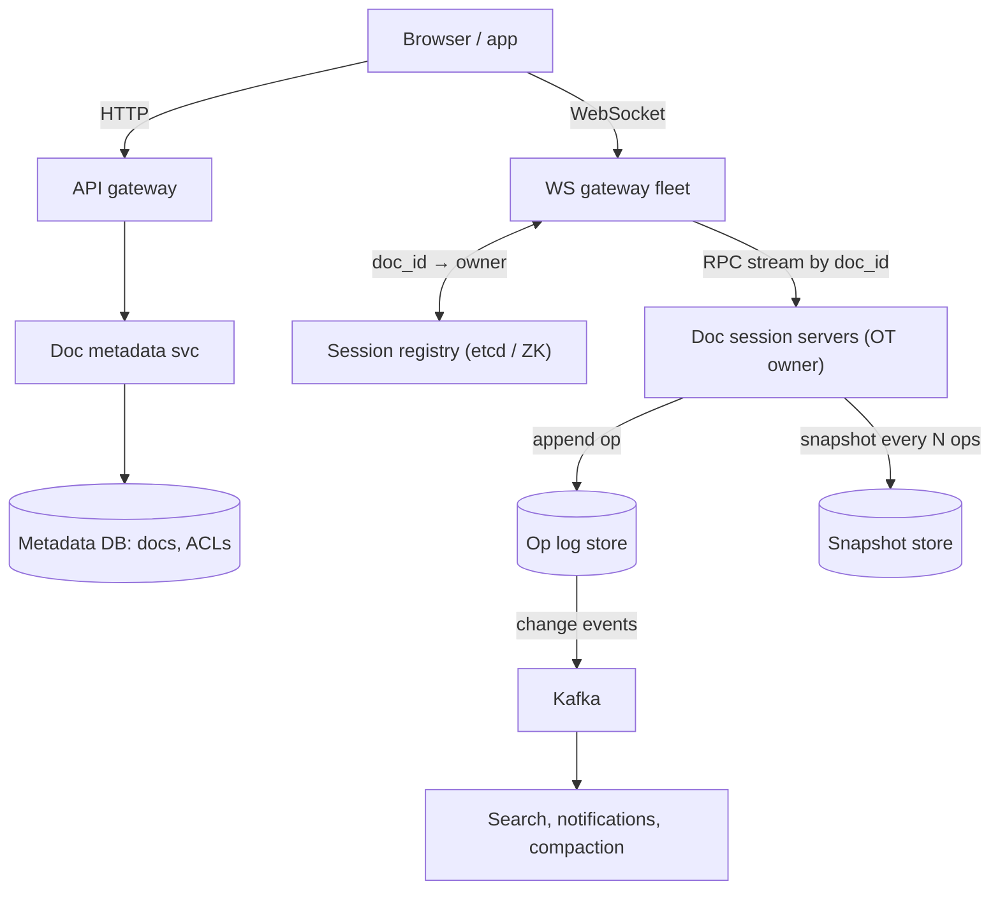
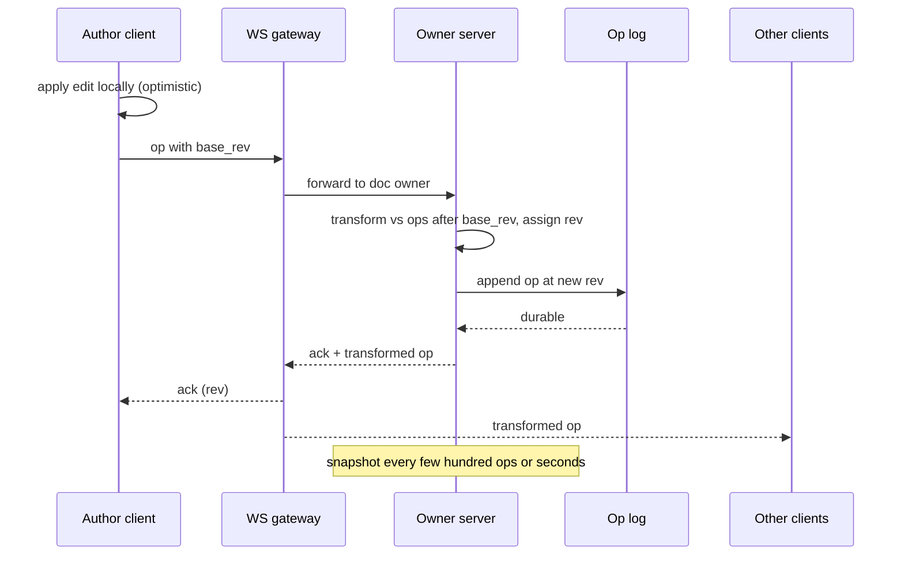
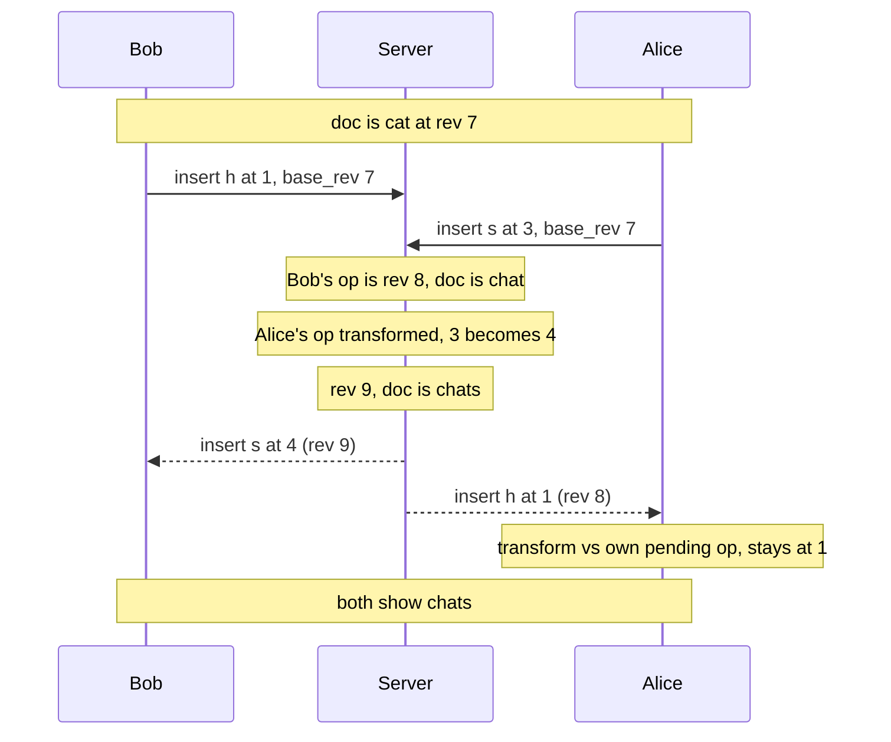

## Definition (interview-ready)

A **collaborative document editor** lets many people edit the same document at the same time and see each other's typing and cursors within a fraction of a second, while every copy ends up identical.

The design in one breath: each client applies its own edits instantly and sends them as small **operations** ("insert 'h' at position 1") over a **WebSocket**. All sessions for one document are routed to a **single owner server** for that document. That server gives each operation the next **revision number**, uses **operational transformation (OT)** to adjust operations that were made against an older revision, appends them to a durable **operation log**, and broadcasts them to the other editors. Periodic **snapshots** keep loading fast and power version history. Cursors and presence travel on the same socket but are never stored.

The main trade-off: a central owner per document makes ordering and OT simple, but it makes that server a hot spot and a failover concern.

**One-liner:** Route every document to one owner server that orders operations, transforms them with OT, appends them to a per-document op log with periodic snapshots, and fans them out over WebSockets, with presence kept as separate, ephemeral state.

## Problem statement

"Design a collaborative document editor like Google Docs. Several users can open the same document and edit it at the same time. Each user should see the others' changes and cursor positions in near real time, and everyone must end up with the same document. Users can see who else is in the document, browse and restore older versions, keep editing briefly while offline, and share a document as viewer, commenter or editor.

Assume 50 million daily active users and a few billion stored documents. Most documents have one or two people in them at a time, but some company-wide documents are opened by thousands of people at once. Edits should appear on other screens in well under a second."

## Requirements

### Functional (in scope)

- Create, open and edit a rich-text document.
- Real-time co-editing: concurrent edits merge automatically, and all copies converge.
- Presence: who is viewing, with live cursors and selections.
- Version history: list past versions, view one, restore one.
- Offline editing for a while, with a merge on reconnect.
- Sharing and permissions: owner, editor, commenter, viewer.

### Out of scope (say so out loud)

- Comments and suggestions mode in detail (mention they are just more operation types).
- Spreadsheets and slides, search across documents, spell check, export to PDF or Word.

### Non-functional

- **Latency:** local typing is instant (optimistic); remote edits show up within about 100–500 ms.
- **Convergence:** every replica reaches the same text once all operations are delivered. This is the correctness bar.
- **Durability:** an acknowledged edit is never lost.
- **Availability:** a server crash should cost a reconnect, not data.
- **Scale:** millions of open WebSocket connections; a few very hot documents.

### Clarifying questions to ask

- Rich text or plain text? (Rich text adds formatting operations but the same ideas apply.)
- How many simultaneous editors per document must we support? Is it fine to make extra users read-only viewers?
- How long can a user stay offline and still merge? Minutes, or days?
- Do we need peer-to-peer or end-to-end encryption? (That pushes towards CRDTs.)
- How fine-grained is version history: every keystroke, or named versions plus periodic checkpoints?

## Scale estimation

**Concurrent connections**

- 50M DAU, each with about 30 minutes of a document open per day.
- Average concurrent sessions = 50M × 30 min ÷ 1,440 min per day ≈ **1.04M**, call it 1M.
- Peak at about 3× average ≈ **3M open WebSockets**.
- At about 50K connections per gateway server, that is 3M ÷ 50K = **60 servers**, so plan roughly 100 for headroom and failover.

**Operation rate**

- Clients batch keystrokes and send a batch about every few hundred milliseconds while typing. Many open documents are idle, so assume an average of **0.5 op batches per second per session**.
- 1M sessions × 0.5 = **500K ops/s average**, about **1.5M ops/s at peak**.
- Fan-out: most documents have one or two people, but busy shared documents generate a large share of ops, so assume each op goes to about 2 other clients on average. Outbound ≈ 1.5M × 2 = **3M messages/s at peak**.

**Bandwidth**

- About 200 bytes per op message with its envelope.
- Inbound peak ≈ 1.5M × 200 B = **300 MB/s**; outbound ≈ 3M × 200 B = **600 MB/s**. Spread over 100 servers that is only a few MB/s each.

**Storage**

- Op log: 500K ops/s × 86,400 s/day ≈ **43.2B ops/day**. At about 100 bytes each that is about **4.3 TB/day** raw, about 1.6 PB/year. This is why old ops are compacted into snapshots and only coarse history is kept long term.
- Snapshots: 5B documents × about 50 KB each = **250 TB**, about 750 TB with 3 replicas. Images live in object storage, not in the document.

**Decisions from the numbers:** connections must be spread over many gateway servers; each document's ops are tiny and low-rate, so one owner server can easily handle a normal document; the op log is the biggest storage cost, so we need snapshots plus compaction.

## Core API

Plain HTTP for everything that is not real time:

```
POST   /v1/docs                              { title }            → { doc_id }
GET    /v1/docs/{doc_id}                                          → { snapshot, rev, permissions }
GET    /v1/docs/{doc_id}/versions?cursor=...                      → { versions[], next_cursor }
GET    /v1/docs/{doc_id}/versions/{rev}                           → { snapshot at rev }
POST   /v1/docs/{doc_id}/restore             { rev }              → { new_rev }
PUT    /v1/docs/{doc_id}/acl                 { user_id, role }    → 204
```

The live session is one WebSocket per open document tab:

```
WS /v1/docs/{doc_id}/session?rev=1042     (auth token checked on connect)

client → server
  { type: "op",       client_id, client_seq, base_rev: 1042, ops: [...] }
  { type: "presence", cursor: 57, selection: [57, 63] }

server → client
  { type: "ack",      client_seq, rev: 1043 }
  { type: "op",       rev: 1044, author, ops: [...] }        // someone else's edit
  { type: "presence", user, cursor, selection }
  { type: "resync",   snapshot, rev }                         // too far behind
```

`base_rev` is the revision the client's edit was made against. It is the single most important field: it tells the server which concurrent ops the edit has not seen yet. `client_id` plus `client_seq` make retries idempotent.

## High-level architecture

```
                         ┌───────────────┐
 Browser / app  ──HTTP──▶│  API gateway  │──▶ Doc metadata svc ──▶ Metadata DB (docs, ACLs)
   │                     └───────────────┘
   │ WebSocket
   ▼
┌──────────────────┐   lookup doc_id → owner   ┌────────────────────┐
│ WS gateway fleet │──────────────────────────▶│ Session registry   │
│ (holds sockets,  │                           │ (etcd / ZooKeeper  │
│  auth, presence  │◀── ops, acks, presence ──▶│  leases)           │
│  relay)          │                           └────────────────────┘
└────────┬─────────┘
         │ internal RPC stream, keyed by doc_id
         ▼
┌─────────────────────────────┐
│ Document session servers     │  one OWNER per open doc:
│  - in-memory doc + rev       │  order → transform → append → broadcast
│  - OT engine                 │
└──────┬───────────────┬──────┘
       │ append op     │ snapshot every N ops / T seconds
       ▼               ▼
┌──────────────┐  ┌──────────────────┐        ┌────────────────────┐
│ Op log store │  │ Snapshot store   │        │ Object storage     │
│ (wide-column │  │ (object storage) │        │ (images, exports)  │
│  by doc_id)  │  └──────────────────┘        └────────────────────┘
└──────┬───────┘
       │ change events
       ▼
  Kafka ──▶ search indexing, notifications, history compaction
```

The same components as a diagram, with HTTP on one side and the live WebSocket path on the other:



### Open a document (read path)

1. Client calls `GET /v1/docs/{id}`. The metadata service checks the ACL, then returns the latest snapshot plus the ops after it, or asks the owner server for its current in-memory state, with the current `rev`.
2. Client opens `WS .../session?rev=R`. The gateway authenticates the token, checks the role again, and looks up the owner server for this `doc_id` in the session registry. If no owner exists, one is chosen and it loads the document.
3. If ops arrived between the HTTP load and the socket connect, the owner sends everything after `R` so the client catches up.

### Type a character (write path)

1. The client applies the edit to its own copy immediately (optimistic UI), then sends `{ op, base_rev }`.
2. The gateway forwards it to the document's owner.
3. The owner transforms the op against any ops committed after `base_rev`, assigns the next `rev`, and appends it to the op log.
4. Once the append is durable, the owner sends `ack` to the author and broadcasts the transformed op to every other session on that document.
5. Every few hundred ops, or every few seconds of activity, the owner writes a snapshot.

The write path, step by step:



## Data model

**Documents and permissions (relational, e.g. MySQL or Postgres)** — small, transactional, queried by user:

```sql
documents (doc_id PK, owner_id, title, created_at, latest_snapshot_rev, deleted_at)
doc_acl   (doc_id, principal_id, role, PRIMARY KEY (doc_id, principal_id))
          -- index (principal_id, doc_id) for "documents shared with me"
link_shares (doc_id PK, link_role, enabled)
```

**Operation log (wide-column store such as Cassandra/Scylla, or sharded SQL):**

```
op_log
  partition key:  doc_id
  clustering key: rev ASC
  columns:        author_id, client_id, client_seq, ops (binary), created_at
  uniqueness:     (doc_id, rev) is written with a conditional insert
  fencing:        each append carries the owner's epoch; appends with an older epoch are rejected
```

- **Partition by `doc_id`** because every read and write is "ops for this document after rev N". One partition read returns them in order. Documents are spread evenly by hash, and a single document's op rate is low. See [sharding strategies](/learn/notes/sharding-strategies/).
- **Conditional insert on (doc_id, rev)** means only one writer can ever own revision N. This is the safety net if two servers both think they own the document (more in Failure handling).
- Very long-lived documents can grow huge partitions, so bucket by time or rev range (`doc_id, bucket`) and delete ops older than the retained history after compaction.

**Snapshots (object storage, with a pointer row):**

```
snapshots (doc_id, rev, storage_key, size, created_at, is_named_version, name)
           PRIMARY KEY (doc_id, rev DESC)
```

**Presence:** not stored durably at all. It lives in the owner server's memory (or a short-TTL cache) and disappears when the socket closes.

## Detailed design

### 1. Why concurrent edits conflict, and how OT fixes them

Positions are the problem. An edit says "insert at index 3", but index 3 means something different once someone else has inserted text before it.

**Worked example.** The document is `cat` at revision 7. Two people type at the same moment, both against revision 7:

- Bob inserts `h` at position 1 → his screen shows `chat`.
- Alice inserts `s` at position 3 → her screen shows `cats`.

Bob's op reaches the server first and becomes revision 8. The document is now `chat`.

Alice's op arrives saying `insert(3, "s")` with `base_rev = 7`. If the server applied it as-is to `chat`, position 3 is between `a` and `t`, giving `chast`. Alice wanted the `s` after `t`.

OT fixes this by **transforming** Alice's op against every op she had not seen (here, only revision 8). Bob inserted one character at position 1, which is before Alice's position 3, so Alice's position shifts right by one: `insert(4, "s")`. Applied to `chat`, that gives `chats`. It becomes revision 9 and is broadcast.

Meanwhile Bob receives Alice's transformed op `insert(4, "s")` and gets `chats`. Alice receives Bob's op. She has a pending op Bob had not seen, so her client transforms Bob's `insert(1, "h")` against her own `insert(3, "s")`. Bob's position 1 is before 3, so it is unchanged, and she also ends up with `chats`. Everyone converges.

The same example as messages over time:



The core transform for two inserts is small:

```ts
// Shift op a so it still makes sense after op b has been applied.
function transformInsert(a: Insert, b: Insert): Insert {
  if (b.pos < a.pos) return { ...a, pos: a.pos + b.text.length };
  if (b.pos > a.pos) return a;
  // Same position: break the tie the same way on every replica,
  // for example by comparing client ids.
  return b.clientId < a.clientId ? { ...a, pos: a.pos + b.text.length } : a;
}
```

Real editors also need insert-vs-delete, delete-vs-delete (overlapping ranges), and formatting ops. Each pair needs its own rule, and getting every combination right is where OT is notoriously hard.

**How to say it in an interview:** "Each op carries the revision it was based on. The server transforms it against everything committed since then, so its position still means what the author meant."

### 2. The server's role in OT, and OT vs CRDT

**The server is the single source of order.** Classic peer-to-peer OT needs every pair of replicas to transform correctly in any order, which requires extra correctness properties that are notoriously hard to prove for every pair of operations. Client-server OT, from the Jupiter system that Google Wave built on, removes that problem: the server keeps one linear history and decides the order. A client only transforms against the server's history, never against arbitrary peers.

Wave's protocol adds one more simplification: a client has **at most one batch of ops in flight**. It waits for the `ack` before sending the next batch, and buffers new keystrokes locally meanwhile. So the server only has to transform one incoming batch against the ops since its `base_rev`, and the client only has to transform incoming server ops against its in-flight batch and its local buffer. Google's own 2010 posts describe the same rule for Docs: a client never sends more than one pending change at a time.

Google described the new Google Docs (2010) the same way: the document is stored as a series of chronological changes such as "insert 'T' at position 10", each change carries the revision it was made against, and OT merges concurrent changes.

**CRDT (conflict-free replicated data type)**, explained simply: instead of positions, every character gets a **unique, permanent ID**, for example `(clientId, counter)`, and inserts say "put `s` right after the character with ID X". Because IDs never shift, concurrent ops can be applied in any order on any replica and still converge, with no transform step and no central server required. The `cat` example becomes "insert `h` after `c`" and "insert `s` after `t`", and they simply do not interfere. Deleted characters are kept as hidden **tombstones** so later ops can still refer to them.

| | OT (central server) | CRDT |
|---|---|---|
| Core idea | Rewrite positions against concurrent ops | Stable IDs per element; merge is order-independent |
| Needs a central orderer? | Yes, in practice | No; works peer-to-peer and offline |
| Metadata cost | Small ops, plain text | Per-character IDs and tombstones; more memory |
| Long offline periods | Hard: must transform against a long history | Natural: merge whenever you reconnect |
| Hard part | Correct transform for every op pair | Memory, garbage-collecting tombstones, odd interleavings |
| Examples | Google Docs (OT, per Google), ShareDB library | Yjs, Automerge libraries |

Figma is a useful middle ground: its blog says OT was unnecessarily complex for its problem space, so it uses a CRDT-inspired design with a central server that is "the ultimate authority", so it does not need true CRDTs.

**What to pick here:** for a Google Docs clone with an always-online server, **server-ordered OT** is the classic answer and keeps data small. Say you would pick a CRDT library (such as Yjs or Automerge) if offline-first or peer-to-peer editing were a core requirement. Both answers are fine if you state the trade-off.

### 3. WebSocket sessions and routing a document to one server

OT needs one place that orders ops for each document. So every session for doc X must reach the **same owner server**.

Use two tiers:

- **WS gateways** hold the long-lived client sockets, do auth, and are stateless about documents. Any client can connect to any gateway behind a normal load balancer. See [WebSockets and SSE](/learn/notes/realtime-push-websockets-sse/).
- **Document session servers** own documents. Each open document lives in exactly one of them.

**Finding the owner:**

1. The gateway asks the **session registry** (etcd or ZooKeeper) "who owns doc X?".
2. If nobody does, a server is picked (consistent hashing of `doc_id` over live servers, or least-loaded) and it takes a **lease** on the key `doc/X` with a short TTL. It renews the lease while the document is open.
3. The lease carries an **epoch number** that increases on every new owner. The owner writes it with each op-log append, so a stale owner's writes can be rejected.
4. Gateways cache the mapping and hold one multiplexed stream to each owner, so 1,000 users of one doc do not create 1,000 internal connections.

When the last user leaves, the owner writes a final snapshot, unloads the document and releases the lease.

Why not a sticky load balancer straight to the owner? Because then a single document's many users would all need to land on one socket server, and moving a document (rebalance or failure) would drop every socket. Separating "holds sockets" from "owns documents" lets each scale and fail independently.

### 4. Operation log, snapshots and version history

**Op log = source of truth.** Every committed op is appended with its revision. The document at revision N is "latest snapshot at or before N" plus "replay ops after it up to N".

**Snapshots** bound the replay cost. The owner writes one every few hundred ops or every few seconds of activity, and on unload. Loading a doc is then one snapshot read plus a short tail of ops.

Figma's engineering blog describes the same pattern for its multiplayer servers: they checkpoint each open file to S3 every 30 to 60 seconds, and added a journal of incremental changes with sequence numbers (in DynamoDB) so a crash loses under a second of work. Recovery is "load latest checkpoint, replay newer journal entries".

**Version history** falls out of this:

- "Show the document at 3 pm yesterday" = nearest snapshot + replay.
- The history list groups ops into sessions ("Alice and Bob, 2:10–2:40 pm") so users are not shown every keystroke.
- **Named versions** are snapshots flagged `is_named_version` and kept forever.
- **Compaction:** after some period (say 30 days), keep snapshots at coarser intervals (hourly, then daily) and delete the raw ops between them. Fine-grained history is the expensive part, so make the retention policy explicit.
- **Restore** never rewrites history. It computes the diff from the current text to the old version, and commits that as one new op at a new revision. Everyone connected just receives a normal op, and the restore itself can be undone.

### 5. Presence and cursors

- Presence messages (join, leave, cursor position, selection) go over the same WebSocket but are **not** written to the op log. Losing one is harmless because the next update replaces it.
- **Throttle** them, for example at most 10–20 per second per user, and send only the latest value.
- Cursor positions are indexes too, so they shift when others edit. Clients transform remote cursors through incoming ops exactly like ops, or send cursors as "after character ID X" in a CRDT.
- Join and leave come from socket connect and disconnect, plus a heartbeat timeout for sockets that die silently.
- Yjs, for example, keeps this "awareness" state in a separate in-memory structure outside the shared document, and marks a user offline after 30 seconds without an update.

### 6. Offline edits

- The client keeps the document and a queue of unsent ops in local storage, all based on the last `rev` it saw.
- On reconnect it sends `base_rev` and the queued ops as one batch. The server transforms them against everything committed since, exactly as for a slow network.
- If the gap is too large (for example the history it needs was compacted, or there are thousands of ops), the server replies `resync`. The client then loads the new snapshot and re-applies its own pending ops on top, which works because they are still expressed as ops. Figma describes the same approach: on reconnect, download a fresh copy and reapply offline edits on top.
- Offline time is limited by the retention of fine-grained ops. If long offline editing is a hard requirement, that is the strongest argument for a CRDT.

### 7. Permissions

- Roles: owner, editor, commenter, viewer, plus link sharing.
- Check the role **on WebSocket connect** and cache it in the session. The owner server **rejects op messages from viewer or commenter sessions**, so a modified client cannot edit.
- When a role is downgraded, the metadata service publishes an ACL-changed event. The owner server updates or closes the affected sessions immediately instead of waiting for a reconnect.
- Store ACLs in the relational DB with an index by user for the "shared with me" list. Cache them with short TTLs plus invalidation on change. See [auth basics](/learn/notes/authn-authz-oauth-oidc-jwt/).

## Bottlenecks & optimizations

- **Hot documents (thousands of viewers).** One owner orders all ops, which is fine because even 100 typists produce only a few hundred ops per second. The real load is **fan-out**. Fix it with a tree: the owner sends each op once to each gateway that has viewers, and the gateway fans it out to its local sockets. Past a chosen limit of active editors, new users join as **read-only viewers** who receive coalesced updates (for example every 500 ms) and lighter presence (a viewer count instead of 5,000 cursors).
- **Op batching.** Clients batch keystrokes typed while an op is in flight (one in-flight batch rule), and the server can merge adjacent inserts before appending. This cuts messages and log writes.
- **Op log write volume.** Batch appends per document (group commit every few milliseconds) and compact old ops into snapshots.
- **Load time for huge documents.** Snapshot often, and for very large docs lazy-load sections (chunks) on scroll.
- **Gateway count.** Use async I/O servers that hold tens of thousands of idle sockets each, and send heartbeats only every 20–30 seconds.
- **Owner balancing.** Track active documents and op rates per owner. Move busy documents when a server is overloaded by snapshotting, handing over the lease and having gateways reconnect.

## Failure handling

| Failure | What happens | Mitigation |
|---|---|---|
| **Client network blip** | Socket drops; local edits keep queueing | Reconnect with backoff, send `base_rev` + queued ops; server dedupes by `(client_id, client_seq)` |
| **WS gateway crashes** | Its clients lose sockets | Clients reconnect to any other gateway; no document state was on it |
| **Owner server crashes** | In-memory doc lost; ops in flight not acked | Lease expires (seconds); a new owner loads snapshot + op log tail. Only acked ops were durable, and unacked ones are resent by clients |
| **Split brain (two owners)** | Old owner paused (GC, partition) and still thinks it owns the doc | Epoch fencing plus conditional insert on `(doc_id, rev)`: the stale owner's append fails, it steps down |
| **Op log store slow or down** | Owner cannot make ops durable | Stop acking (clients keep editing locally and buffer); never ack before durable append |
| **Snapshot write fails** | Longer replay on next load | Retry; correctness unaffected because the op log is the truth |
| **Registry (etcd) unavailable** | New documents cannot get an owner | Existing sessions keep working on cached mappings; new opens fail fast with retry |
| **Bad op from a buggy client** | Could corrupt the document | Validate ops on the server (positions in range, size limits, role allowed) before applying |
| **Region outage** | Docs owned there are unavailable | Replicate op log and snapshots cross-region; re-home documents to the other region (see [multi-region](/learn/notes/multi-region-rpo-rto/)) |

## Trade-offs

| Decision | Chosen | Alternative | Why |
|---|---|---|---|
| Conflict resolution | Server-ordered OT | CRDT (Yjs, Automerge) | Always-online server, small ops, mature for text. Switch to CRDT for offline-first or peer-to-peer |
| Ordering | One owner per document | Multi-leader per doc | A single ordering point makes OT simple; per-doc load is low anyway |
| Transport | WebSocket | Long polling, SSE plus POST | Two-way, low overhead for frequent small messages |
| Storage | Op log + periodic snapshots | Save full document on every change | Small writes, full history and cheap recovery; full saves waste bandwidth and lose intent |
| History | Fine-grained for N days, then coarse | Keep every op forever | Op log is the largest storage cost |
| Presence | Ephemeral, throttled, not persisted | Store in DB | Losing a cursor update is harmless; storing it is pure cost |
| Hot docs | Editor cap + read-only viewers with coalesced updates | Unlimited editors | Keeps fan-out and cursor noise bounded |
| Locking | No locks, optimistic merge | Paragraph locks | Locks hurt collaboration and still need conflict handling when two users grab one at once |

## Practice questions

<Practice>

<QA q="Why can't the server just apply edits in the order they arrive?" level="easy">

Because each edit uses positions from the copy its author saw. If someone else's insert landed earlier in the text first, that position now points to the wrong place. In the `cat` example, Alice's `insert(3, 's')` applied after Bob's `h` gives `chast` instead of `chats`. The server must transform the op, or use position-independent IDs as a CRDT does.

</QA>

<QA q="Explain OT in two sentences." level="easy">

Every edit carries the revision it was based on. Before applying it, the server rewrites it against all edits committed since that revision, for example shifting an insert position right by the length of an earlier concurrent insert, so the author's intent is kept and all copies converge.

</QA>

<QA q="Explain a CRDT for text in simple terms." level="easy">

Give every character a unique, permanent ID and describe inserts as 'put this after character X' instead of 'at index 3'. Because IDs never move, replicas can apply concurrent edits in any order and still end up identical. Deleted characters stay as hidden tombstones so later edits that refer to them still work.

</QA>

<QA q="Why does the client typing feel instant even with 200 ms to the server?" level="easy">

The client applies its own op locally first (optimistic UI) and only later receives an `ack`. Remote ops are transformed against the client's pending ops before being applied, so the local view never has to roll back.

</QA>

<QA q="What does the server do in a client-server OT system?" level="medium">

It is the single orderer for the document. It receives an op with a `base_rev`, transforms it against every op committed after that revision, assigns the next revision, appends it durably to the op log, acks the author and broadcasts the transformed op to everyone else. Because there is one linear history, clients only transform against the server's ops and never against each other. Google Wave's protocol, based on the Jupiter system, also has each client wait for an ack before sending the next batch, which keeps the transform logic simple.

</QA>

<QA q="How do you make sure all users of one document hit the same server?" level="medium">

Separate WebSocket gateways from document owners. Gateways look up the owner of `doc_id` in a registry such as etcd or ZooKeeper. If none exists, a server takes a lease on the key and loads the document. Gateways cache the mapping and keep one multiplexed stream per owner. The lease has an epoch so a stale owner can be fenced off.

</QA>

<QA q="Why store an op log instead of saving the whole document on each change?" level="medium">

Ops are tiny, so writes are cheap. The log keeps intent and authorship, which gives version history and replay for free, and recovery is just snapshot plus the ops after it. Saving the whole document each time wastes bandwidth and storage and loses what each person actually changed.

</QA>

<QA q="How does version history work, and how is restore implemented?" level="medium">

The document at any revision is the nearest earlier snapshot plus a replay of ops up to that revision. Named versions are kept forever, and older fine-grained ops are compacted into coarser snapshots. Restore does not rewind the log: it computes the diff from the current text to the old version and commits it as a new op, so connected users just see a normal edit and the restore can itself be undone.

</QA>

<QA q="How are presence and cursors handled differently from edits?" level="medium">

They go over the same socket but are ephemeral: not stored, throttled (for example to at most 10 to 20 updates per second per user), and only the latest value matters. Cursor positions are shifted through incoming ops like any index. Join and leave come from socket events and heartbeat timeouts. For big documents, show a viewer count rather than every cursor.

</QA>

<QA q="When would you pick a CRDT over OT?" level="hard">

When long offline editing, peer-to-peer sync or end-to-end encryption, where the server cannot read ops to transform them, is a core requirement. CRDTs merge in any order without a central orderer. The cost is more metadata per character, tombstones to garbage-collect, and some odd interleavings of concurrent inserts. For an always-online, server-centred editor, OT keeps data smaller.

</QA>

<QA q="Two servers both believe they own a document after a network partition. What prevents corruption?" level="hard">

Each ownership lease has an increasing epoch. Every op-log append carries that epoch and is a conditional insert on `(doc_id, rev)`, so the store rejects appends from an older epoch and only one writer can ever commit revision N. The stale owner's append fails, it learns a newer epoch exists, drops the document, and its clients reconnect to the real owner. Ops are only acked after a durable append, so no acked edit is lost.

</QA>

<QA q="How big is the op log and how do you keep it under control?" level="hard">

At 500K ops/s average and about 100 bytes each, it is about 43B ops and 4.3 TB per day. Keep fine-grained ops for a fixed window, snapshot frequently, then thin out to hourly or daily snapshots and delete the ops between them. Bucket each document's partition by revision range so long-lived documents don't create huge partitions.

</QA>

<QA q="A company all-hands doc is opened by 8,000 people at once. What breaks and how do you fix it?" level="scenario">

The ordering load is fine, since few people type at once. What breaks is fan-out and presence: every op and every cursor move goes to 8,000 sockets. Fix it by fanning out per gateway, not per socket. Cap active editors and make the rest read-only viewers who get coalesced updates every few hundred milliseconds. Replace thousands of cursors with a viewer count or show only nearby cursors. Serve the initial load from a snapshot so 8,000 opens don't replay the log.

</QA>

<QA q="A user edits on a plane for three hours, then reconnects. Walk through what happens." level="scenario">

The client sends its queued ops with the old `base_rev`. If the server still has fine-grained ops since then, it transforms the batch against them, commits and broadcasts the result. If that history was compacted or the gap is huge, it replies `resync`: the client loads the latest snapshot and re-applies its pending ops on top. Edits that overlap someone else's deleted paragraph may land oddly, so show the user a 'your offline changes were merged' notice. If this is a core use case, that is the argument for a CRDT.

</QA>

<QA q="The owner server of a busy document crashes mid-edit. What do users see?" level="scenario">

Their sockets stay up to the gateways, but ops stop being acked. Within the lease TTL, a few seconds, a new owner takes the lease with a higher epoch, loads the latest snapshot plus the op-log tail, and tells clients its current revision. Clients resend unacked ops, which are deduped by `client_id` and `client_seq`, and transform any ops they missed. Users see a brief 'reconnecting' state but lose no acknowledged work.

</QA>

<QA q="An editor is downgraded to viewer while their tab is open. How do you enforce it?" level="scenario">

Permissions are checked on connect, but that is not enough. The ACL change publishes an event; the owner server updates the role cached in that session and rejects any further op messages from it, then tells the client to switch to read-only. Any op that client had in flight is rejected, not applied. Never trust the client UI to enforce roles.

</QA>

</Practice>

## Quiz

<Quiz>

<MCQ q="The text is cat at revision 7. Bob's insert(1, h) commits as revision 8. Alice's insert(3, s), based on revision 7, arrives next. What does OT turn Alice's op into?" options={["insert(3, s)", "insert(4, s)", "insert(2, s)", "Reject it and ask Alice to retry"]} answer={1}>

Bob inserted one character before Alice's position, so her position shifts right by one: `insert(4, s)` on `chat` gives `chats`. Applying `insert(3, s)` unchanged gives `chast`. There is no reason to shift left or reject; transforming is the whole point.

</MCQ>

<MCQ q="Why does a typical OT-based editor route all sessions of a document to one owner server?" options={["WebSockets cannot cross servers", "To give the document one linear order of operations to transform against", "To save memory on the gateways", "Because CRDTs require it"]} answer={1}>

Client-server OT relies on a single orderer that assigns revisions and transforms against one history. Sockets can be relayed between servers, memory is a side issue, and CRDTs specifically do not need a central orderer.

</MCQ>

<MCQ q="What makes a text CRDT converge without transforming positions?" options={["A global lock on the document", "Last-writer-wins on the whole document", "Each character has a unique permanent ID, and inserts reference neighbouring IDs", "The server sorts ops by wall-clock time"]} answer={2}>

Stable IDs never shift, so concurrent ops can be applied in any order. Locks and whole-document LWW would lose or block edits, and wall-clock ordering does not preserve intent and suffers from clock skew.

</MCQ>

<MCQ q="Which data should not be written to the operation log?" options={["Cursor and presence updates", "Insert operations", "Delete operations", "Formatting operations"]} answer={0}>

Presence is ephemeral: only the latest value matters and losing one is harmless, so it is relayed but never persisted. Inserts, deletes and formatting changes are the document's content history and must be durable.

</MCQ>

<MCQ q="How should restoring an old version be implemented?" options={["Delete all ops after the old revision", "Replace the snapshot file and restart the owner", "Ask every client to reload from scratch and drop pending edits", "Commit a new op that turns the current text into the old version"]} answer={3}>

Restore as a forward op keeps history intact, reaches connected users as a normal edit, and can itself be undone. Deleting ops destroys history, and replacing files or forcing reloads breaks live sessions and loses pending edits.

</MCQ>

<MCQ q="Two servers both think they own a document. What stops both from committing revision 51?" options={["The WebSocket gateway picks one at random", "A conditional insert on doc_id and rev, plus an epoch on the ownership lease", "Clients vote on the winner", "Snapshots overwrite the loser's ops"]} answer={1}>

A uniqueness constraint on `(doc_id, rev)` lets only one append win, and the epoch tells the stale owner to step down. Gateways and clients do not arbitrate ordering, and snapshots are derived from the log, not a fencing mechanism.

</MCQ>

<MCQ q="A document is opened by 5,000 people. Which part is most likely to become the bottleneck first?" options={["Ordering and transforming ops on the owner", "Writing snapshots", "Fanning out ops and cursor updates to thousands of sockets", "The ACL database"]} answer={2}>

Few people type at once, so ordering load stays small, but every op and cursor move must reach 5,000 sockets. Snapshots and ACL lookups are occasional, not per keystroke.

</MCQ>

<MCQ q="Why do snapshots exist if the op log is the source of truth?" options={["To bound replay time when loading a document or a past version", "Because the op log is not durable", "To store presence", "To replace the op log entirely after each edit"]} answer={0}>

Without snapshots, opening a document would replay its entire history. The op log is durable, presence is never persisted, and snapshots complement the log rather than replacing it on every edit.

</MCQ>

<MCQ q="A key requirement is editing for days offline and syncing peer-to-peer. Which choice fits best?" options={["Server-ordered OT", "Paragraph locking", "Saving full document copies and diffing on reconnect", "A CRDT such as Yjs or Automerge"]} answer={3}>

CRDTs merge in any order without a central server, which suits long offline periods and peer-to-peer sync. OT needs a central orderer and a long transform history, locks block offline users, and diffing whole versions loses edit intent.

</MCQ>

</Quiz>

## TL;DR cheat sheet

- **Ops, not documents:** clients send small ops with a `base_rev` and apply their own edits instantly.
- **OT:** the server transforms each op against everything committed since `base_rev` (shift positions), assigns the next revision, and broadcasts it. Example: `cat` + Bob `insert(1,h)` + Alice `insert(3,s)` becomes `chats`.
- **One in-flight batch per client** plus one server order keeps OT simple (Jupiter, Wave).
- **CRDT:** stable per-character IDs, so merge works in any order; best for offline-first or peer-to-peer; costs metadata and tombstones.
- **Routing:** WS gateways (stateless) plus one **owner server per open doc**, found through an etcd or ZooKeeper lease with an **epoch**.
- **Storage:** op log partitioned by `doc_id`, clustered by `rev`, conditional insert on `(doc_id, rev)`; snapshots in object storage every N ops or T seconds.
- **History:** snapshot plus replay; restore = new forward op; compact old ops into coarser snapshots.
- **Presence:** ephemeral, throttled, never persisted; cursors shift through ops.
- **Offline:** queue ops locally; on reconnect transform, or `resync` and re-apply.
- **Permissions:** check on connect, enforce on every op at the owner, push ACL changes live.
- **Hot docs:** per-gateway fan-out, editor cap, read-only viewers with coalesced updates, viewer count instead of cursors.

## Go deeper

- Google Drive Blog, ["What's different about the new Google Docs: Working together, even apart"](https://drive.googleblog.com/2010/09/whats-different-about-new-google-docs_21.html) (2010): why diffing versions fails and why Docs stores a series of changes.
- Google Drive Blog, ["What's different about the new Google Docs: Conflict resolution"](https://drive.googleblog.com/2010/09/whats-different-about-new-google-docs_22.html) (2010): operational transformation in Docs.
- Google Drive Blog, ["What's different about the new Google Docs: Making collaboration fast"](https://drive.googleblog.com/2010/09/whats-different-about-new-google-docs.html) (2010): the client-server protocol, revision numbers and the one-pending-change rule.
- Apache Wave, ["Google Wave Operational Transformation" whitepaper](https://svn.apache.org/repos/asf/incubator/wave/whitepapers/operational-transform/operational-transform.html): client-server OT based on Jupiter, with the wait-for-ack rule.
- Figma Engineering, ["How Figma's multiplayer technology works"](https://www.figma.com/blog/how-figmas-multiplayer-technology-works/): why Figma skipped OT, one process per document, offline reconnect.
- Figma Engineering, ["Making multiplayer more reliable"](https://www.figma.com/blog/making-multiplayer-more-reliable/): checkpoints plus a journal of changes for durability.
- Martin Kleppmann, ["CRDTs: The Hard Parts"](https://martin.kleppmann.com/2020/07/06/crdt-hard-parts-hydra.html): interleaving anomalies, moves and metadata overhead.
- [crdt.tech](https://crdt.tech/), [Yjs docs](https://docs.yjs.dev/) and [Automerge docs](https://automerge.org/docs/hello/): CRDT resources and libraries.
- [ShareDB](https://share.github.io/sharedb/): an open-source OT server with presence and document history.
- Related notes: [WebSockets and SSE](/learn/notes/realtime-push-websockets-sse/), [chat system](/learn/notes/hld-chat-system/), [clocks and vector clocks](/learn/notes/clocks-vector-lamport-hlc/), [consensus](/learn/notes/consensus-raft-paxos/).
