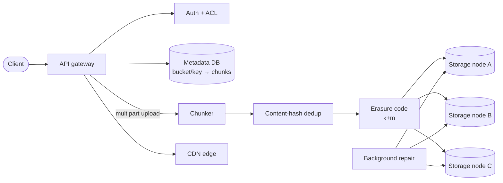

## Problem statement

Design an object storage system: users can upload, download, and delete files of any size, with durability, availability, and a global namespace.



## Requirements

### Functional
- Upload / download files (range reads for partials).
- Multi-part upload for large files.
- Versioning (optional).
- Permissions / ACLs.
- Metadata (filename, mime type, custom metadata).

### Non-functional
- Durability: 99.999999999% (11 nines, S3 standard).
- Availability: 99.9% read.
- Storage: petabytes to exabytes.
- Throughput: gigabytes/sec aggregate.

## Scale estimation

- 100M users, 100 files each, average 1 MB = **10 PB** total.
- 50M uploads/day → ~600 writes/sec.
- 500M downloads/day → ~6K reads/sec.

## Core API

```
PUT  /buckets/{bucket}/keys/{key}      → upload
GET  /buckets/{bucket}/keys/{key}      → download
GET  /buckets/{bucket}/keys/{key}?versionId=... → versioned download
DELETE /buckets/{bucket}/keys/{key}
HEAD /buckets/{bucket}/keys/{key}      → metadata only
POST /buckets/{bucket}/keys/{key}?uploads → multipart upload init
PUT  /buckets/{bucket}/keys/{key}?uploadId=...&partNumber=... → upload part
POST /buckets/{bucket}/keys/{key}?uploadId=... → complete upload
```

## High-level architecture

```
                  ┌─────────────┐
   Client ──HTTPS►│ API Gateway │ ──► Auth + Bucket policy
                  └──────┬──────┘
                         ▼
                  ┌─────────────┐
                  │  Metadata   │ (sharded SQL or KV)
                  │  Service    │
                  └──────┬──────┘
                         ▼
                  ┌──────────────────────┐
                  │ Object Placement      │
                  │ (chunking + erasure)  │
                  └──────────────────────┘
                         ▼
                ┌──────┬────────┬──────┐
                │ DN-1 │ DN-2   │ DN-N │ ── data nodes
                └──────┴────────┴──────┘
```

## Detailed design

### Object chunking

- Files split into **chunks** (4–64 MB each).
- Each chunk has a content-addressable hash (`sha256(chunk)`).
- Allows: parallel upload/download, dedup by hash, repair of single bad chunk.

### Storage scheme: replication vs erasure coding

- **Replication (3 copies)**: simple, fast reads, 3× storage cost.
- **Erasure coding (e.g., 10+4)**: data + parity. Survives any 4 failures with 1.4× overhead instead of 3×. Reconstruction must read k fragments (network/disk-heavy) plus decode CPU.

S3 uses erasure coding internally. HDFS started with 3 replicas, now supports EC. Dropbox's Magic Pocket uses both (new blocks replicated, later aggregated and erasure-coded).

### Metadata service

- Mapping: `(bucket, key, version) → list of chunks → list of placements`.
- Sharded by `(bucket, key)` hash for write distribution.
- Hot reads cached.
- Postgres / Cassandra / proprietary (S3 uses custom KV).

### Placement & data nodes

- **Data nodes**: storage servers with many disks.
- **Placement algorithm**: pick N nodes in different fault domains (racks, AZs) for replication / EC.
- **Health checks**: periodic; failed nodes' data is re-replicated/re-encoded automatically.

### Upload flow (multipart)

```
1. Client: POST .../uploads → uploadId from metadata service.
2. Client: PUT part 1, 2, ..., N (each part 5MB-5GB) in parallel.
   Each part: gateway hashes, picks placement, writes to N data nodes, returns etag.
3. Client: POST .../complete with list of (part, etag).
4. Metadata service finalizes the key → list-of-chunks mapping.
5. Returns success only after durable storage of all parts.
```

### Download flow

1. Lookup metadata → list of chunks + their locations.
2. For each chunk, GET from a healthy replica/EC group.
3. Stream to client.
4. Range requests: skip to chunk containing the start offset.

### Consistency model

- S3 became strongly consistent for read-after-write in 2020 (used to be eventual for overwrites). Big engineering effort: write succeeds only when metadata is updated atomically with placement durability.
- Most homegrown systems are read-after-write consistent for new keys, eventually consistent for overwrites unless explicit care.

### Versioning

- Each PUT to an existing key creates a new version.
- Metadata stores `(key, version, chunks)`.
- DELETE adds a delete marker; doesn't physically remove until lifecycle policy.

### Lifecycle / tiered storage

- **Hot**: SSD, recent files, fast access.
- **Warm**: HDD, moderate access.
- **Cold (S3 Glacier classes / GCS Coldline-Archive)**: cheapest per GB; retrieval from milliseconds (Glacier Instant Retrieval, GCS Coldline/Archive) to hours (Glacier Flexible Retrieval / Deep Archive), with retrieval fees.
- Lifecycle rules: move objects between tiers based on age.

### Garbage collection

- Deleted objects' chunks are not physically deleted immediately.
- GC scans for orphan chunks (no live key references them) → delete in background.
- Special care for versioning + retention policies.

### Replication across regions

- S3 Cross-Region Replication: async, configurable on bucket.
- Each region holds independent durable copy.
- Failover by changing bucket endpoint or DNS.

## Bottlenecks & optimizations

- **Small files** dominate metadata service traffic — combine into containers if you have many tiny files (HDFS HAR, Facebook Haystack).
- **Hot objects**: CDN cache in front.
- **Repair traffic**: re-replicating after node failure can saturate network — throttle.
- **Metadata service hot spots**: shard by (bucket, key prefix) hash, not by bucket alone.

## Trade-offs

- **Replication vs EC**: replication is fast and simple; EC is space-efficient but CPU-heavy.
- **Strong vs eventual consistency on overwrites**: strong is hard at scale; eventual is the historical default.
- **Hot/cold tiering** vs uniform: tiering is cost-effective for large datasets with skewed access.

## Practice questions

<Practice>

<QA q="Why chunk files?" level="easy">

Parallel upload/download (each chunk over a separate connection). Repair of one bad chunk doesn't require re-sending the whole file. Dedup possible by chunk hash. Fits memory/network buffers.

</QA>

<QA q="What does the metadata service store, and how is it sharded?" level="easy">

The mapping `(bucket, key, version) → list of chunks → list of placements`, plus object metadata (size, mime type, custom metadata). It is sharded by a hash of `(bucket, key)` so writes spread evenly, with hot reads cached in front.

</QA>

<QA q="How does a range read (partial download) work?" level="easy">

Look up the object's chunk list in the metadata service, skip to the chunk that contains the start offset, and stream only the chunks covering the requested range from healthy replicas or EC groups. No need to read the whole object.

</QA>

<QA q="How does S3 achieve 11 nines of durability?" level="medium">

Erasure coding (or replication) across multiple AZs in a region. Continuous integrity checks (checksum on every chunk). Automatic repair on detected corruption or node failure. Data is spread over independent hardware in independent power/network domains.

</QA>

<QA q="Compare replication and erasure coding." level="medium">

Replication: N copies, simple, fast reads, N× storage cost. EC: data split into k pieces + m parity; survives m failures with (k+m)/k overhead — much lower than N×. Repair is expensive: read k fragments over the network, then Reed-Solomon decode. Replication for hot, EC for cold.

</QA>

<QA q="What consistency does an object store give for reads after a write?" level="medium">

S3 has been strongly read-after-write consistent since 2020; before that, overwrites and deletes were eventually consistent. Doing this at scale means a write succeeds only once metadata is updated atomically with durable placement. Most homegrown systems are read-after-write consistent for new keys but eventually consistent for overwrites unless they take explicit care.

</QA>

<QA q="How do lifecycle rules and tiered storage cut cost?" level="medium">

Access is skewed: recent objects are hot, old ones are rarely read. Lifecycle rules move objects by age from hot (SSD) to warm (HDD) to cold archive classes, which are cheapest per GB but add retrieval fees and, for the deepest tiers, hours of retrieval latency. Rules can also expire old versions.

</QA>

<QA q="Design metadata storage for 100B keys." level="hard">

Sharded KV (or Postgres with hash sharding) by hash of (bucket, key). With about 100 shards, each handles about 1B keys, manageable per node. Frequently accessed metadata cached in front (Redis). Versioning: each version is a row. Shard by key hash, not by bucket alone, or one big bucket becomes a hot spot.

</QA>

<QA q="How does Dropbox sync clients efficiently?" level="hard">

- Content-addressable chunks: client sends only chunks that changed (rsync-style).
- Server-side hash dedup: identical chunks (same file shared by 1M users) stored once.
- Block-level delta sync.
- Push events to clients (long-poll or WebSocket) on change.

</QA>

<QA q="Why are billions of tiny files a problem, and how do you handle them?" level="hard">

Each object costs a metadata entry and per-file overhead regardless of size, so small files dominate metadata traffic and waste disk seeks. Pack many small files into larger container files and keep an index of offsets (HDFS HAR, Facebook Haystack), so the metadata service tracks containers instead of every file.

</QA>

<QA q="How do you handle a 100 GB file upload?" level="scenario">

- Multipart upload: client splits into about 100 parts of 1 GB each.
- Parts uploaded in parallel.
- Each part durably stored as it lands.
- Final completion call assembles into the key.
- Resumable: failed parts retried without re-uploading the rest.

</QA>

<QA q="How would you handle deletion safely with versioning?" level="scenario">

- DELETE doesn't remove; creates a delete-marker version.
- Old versions retained per lifecycle policy.
- Compliance lock options (S3 Object Lock) prevent deletion for a retention period.
- Physical chunk GC happens later, only when no live version or marker references them.

</QA>

<QA q="A rack of data nodes dies. What happens, and what can go wrong?" level="scenario">

Because placement put each chunk's replicas or EC fragments in different fault domains, every chunk is still readable. Health checks mark the nodes failed and background repair re-replicates or re-encodes the affected chunks onto healthy nodes. The risk is repair traffic saturating the network and hurting user traffic, so repair is throttled and prioritized by how few redundant copies a chunk has left.

</QA>

<QA q="How to scale reads for a viral file getting 1M req/sec?" level="scenario">

- CDN in front: caches at edge.
- Multiple replicas of the chunks across more data nodes (auto-replicate hot keys).
- Origin shield to reduce CDN-to-storage traffic.

</QA>

</Practice>

## Quiz

<Quiz>

<MCQ q="With 10+4 erasure coding, how many fragment losses can a stripe survive, and what is the storage overhead?" options={["Any 4 losses, 1.4x overhead", "Any 10 losses, 1.4x overhead", "Any 4 losses, 3x overhead", "Any 1 loss, 1.1x overhead"]} answer={0}>

k=10 data plus m=4 parity survives any m=4 losses with (10+4)/10 = 1.4x storage. 3x is three-way replication; 10 losses would leave too few fragments to rebuild.

</MCQ>

<MCQ q="What is the main downside of erasure coding compared with replication?" options={["It cannot survive more than one failure", "It uses more storage", "Repair must read k fragments over the network and decode, which is costly", "It cannot be spread across availability zones"]} answer={2}>

Rebuilding a lost fragment needs k other fragments plus Reed-Solomon decoding, so repair is network- and CPU-heavy. EC actually survives m failures with less storage than replication and can span AZs.

</MCQ>

<MCQ q="Why does each chunk get a content hash such as sha256(chunk)?" options={["To encrypt the chunk at rest", "To enable dedup and to detect corruption of individual chunks", "To decide which CDN edge serves it", "To pick the erasure-coding parameters"]} answer={1}>

A content address lets identical chunks be stored once and lets integrity checks spot a bad chunk to repair. Hashing isn't encryption and doesn't drive CDN routing or EC settings.

</MCQ>

<MCQ q="A user deletes an object in a versioned bucket. What happens immediately?" options={["All versions and chunks are erased", "The latest version's chunks are erased right away", "The bucket is locked until GC runs", "A delete marker is added and the data stays until lifecycle rules and GC remove it"]} answer={3}>

Versioned deletes add a delete marker; old versions remain per the lifecycle policy and chunks are garbage-collected later once nothing references them. Nothing is erased immediately and the bucket isn't locked.

</MCQ>

<MCQ q="Why shard the metadata service by a hash of (bucket, key) rather than by bucket alone?" options={["So one very large or busy bucket doesn't overload a single shard", "So all keys of a bucket are on one shard for fast listing", "Because buckets cannot be hashed", "To make erasure coding cheaper"]} answer={0}>

Sharding by bucket alone turns a huge bucket into a hot spot. Hashing the key spreads it. Keeping a bucket on one shard is the hot-spot design, and the choice doesn't affect EC.

</MCQ>

<MCQ q="A 100 GB multipart upload fails at part 63 of 100. What should the client do?" options={["Restart the whole upload", "Switch to a single PUT", "Retry only part 63, then call complete with all part etags", "Call complete and let the server fill in part 63"]} answer={2}>

Multipart is resumable: parts are stored independently, so only the failed part is retried before the complete call. Restarting wastes work, and the server can't invent missing data.

</MCQ>

<MCQ q="Which workload is the best fit for three-way replication instead of erasure coding?" options={["Cold archive data read once a year", "Hot data with frequent reads where fast access and cheap repair matter", "Data where storage cost matters most", "Backups that are never read"]} answer={1}>

Replication costs 3x storage but gives fast reads and simple repair, which suits hot data. Cold, rarely read or cost-sensitive data is what EC is for.

</MCQ>

<MCQ q="Billions of 2 KB files are overwhelming the metadata service. What is the standard fix?" options={["Switch from erasure coding to replication", "Put a CDN in front of the metadata service", "Make chunks larger, such as 256 MB", "Pack small files into large container files with an offset index"]} answer={3}>

The cost is per-file metadata, so packing files into containers (Haystack, HDFS HAR) cuts the entry count. The storage scheme, a CDN or a bigger chunk size don't reduce the number of metadata entries.

</MCQ>

</Quiz>

## TL;DR cheat sheet

- Files chunked (4–64 MB), each addressed by content hash.
- Metadata service maps key → list of chunks.
- Replication (hot) and erasure coding (cold).
- Multipart upload for large files (resumable, parallel).
- Versioning + lifecycle policies for retention/tier.
- Durability via multi-AZ + integrity checks + auto-repair.
- CDN for hot objects.

## Go deeper

- **Google File System paper** (2003): [research.google/pubs/gfs](https://research.google/pubs/the-google-file-system/) — foundational.
- **Colossus** (Google's GFS successor) — talks and papers.
- **HDFS architecture docs**.
- **Facebook Haystack** paper: small file storage.
- **AWS S3 deep dive**: re:Invent talks (look for "S3 internals").
- **Dropbox engineering blog**: ["Magic Pocket"](https://dropbox.tech/infrastructure/inside-the-magic-pocket).
- **Alex Xu Vol 2**: object storage chapter.
