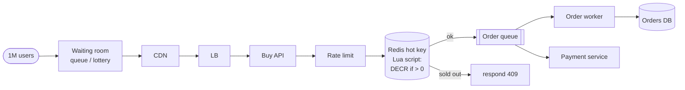

## Definition (interview-ready)

A **flash sale system** sells a small, fixed stock (say 10K units) to a huge crowd that arrives at the same second (say 1M buyers), without ever selling more units than exist and without letting the spike take the site down.

The design in one breath: keep the spike away from the database. A **CDN-cached pre-sale page**, a **waiting room** or rate limiter and **bot protection** shrink the crowd. The buy API then does an **atomic conditional decrement**, usually on a Redis counter (`DECR`, or a Lua script that decrements only if stock is positive), and rejects everyone instantly once stock hits zero. Winners are written to **Kafka**, and an order service creates orders and runs payment as a **saga** with a reservation TTL that returns stock if payment fails or times out. A **database constraint** (conditional update or unique key) stays the final guarantee in case Redis fails over. Seat booking adds per-seat holds with TTLs and a unique (show, seat) key.

The main trade-off is **throughput vs strict fairness and simplicity**: a Redis counter is fast but needs a durable path behind it, while a single ordered queue is perfectly fair but serial.

**One-liner:** Filter the crowd at the edge, do an atomic decrement-if-positive on a Redis counter so sold-out buyers are rejected instantly, queue the winners through Kafka into a payment saga with a reservation TTL, and keep a database constraint as the final guard against overselling.

## Problem statement

Design a system that sells limited-quantity items (a "flash sale") at high concurrency without overselling. Example: 10K units released; in the first second, 1M users try to buy.



## Requirements

### Functional
- Decrement inventory atomically.
- Reject excess buyers gracefully.
- Order creation linked to successful decrement.
- Optional: waitlist for excess.

### Non-functional
- Spike traffic (10× to 100× baseline) absorbed.
- Correctness: never sell more than inventory.
- Latency: < 1 s p99 for buy attempt.
- Fairness (mostly FIFO).

## Scale estimation

- 1M concurrent buyers in first second; 10K available units.
- Buy rate during sale: 1M attempts/sec for the first ~10 seconds.
- After sale ends: normal traffic.

## The over-sell problem

Naive flow:
```
1. SELECT inventory WHERE product_id = ?
2. if inventory > 0:  -- decision based on read
3.   UPDATE inventory SET qty = qty - 1
4.   INSERT order
```

Race condition: 100K concurrent threads all read `qty=10`, all decide it's available, all decrement → -99,990 inventory.

## Core API

```
POST /api/flash-sale/{id}/buy
  body: { user_id, qty }
  → 200 with order_id, or 409 sold-out
```

## Patterns to prevent over-sell

### 1. Atomic decrement in DB

```sql
UPDATE inventory
SET available = available - 1
WHERE product_id = ? AND available > 0
RETURNING available;   -- PostgreSQL syntax; in MySQL, check rows affected
```

If `available` was 0 before, the row update doesn't happen → 0 rows affected → reject.

Pros: simple, correct.
Cons: hot row contention; lock per attempt; DB CPU saturated at high QPS.

### 2. Redis-based pre-decrement

```
DECR sale:product:42:remaining
if result < 0:
   INCR sale:product:42:remaining   -- compensate
   return SOLD_OUT
else:
   enqueue order to Kafka
   return SUCCESS
```

Redis executes commands one at a time, so each `DECR` is atomic and exactly the first 10K callers get a result of 0 or more. A single node handles on the order of 100K simple ops/sec (more with pipelining). Use a Lua script if you need decrement-if-enough-stock as one step (for example, buying 3 units at once).

Pros: high throughput.
Cons: requires a durable path (Kafka) for the order. Redis replication is asynchronous, so a failover can lose the latest decrements and let a few extra buyers through; keep a database-side check (conditional update or unique constraint) when orders are written.

### 3. Pre-allocated tokens / queue

- Pre-generate 10K "purchase tokens" before sale starts.
- Buyers compete to pop a token from a Redis list.
- Token holder gets to place an order; no token → rejected.

```
LPOP sale:product:42:tokens
```

Redis runs each `LPOP` atomically, so only the first 10K pops get a token.

### 4. Stream-based: ordered consumption

- All buy attempts enter a Kafka topic (one partition for ordering).
- A single consumer processes in order, decrements (in memory or in DB).
- First 10K succeed; rest rejected.

Pros: clear ordering, perfect fairness.
Cons: serialized → limited throughput per product (a single partition).

### 5. Sharded inventory

Split inventory into N "buckets" across shards. Each bucket has 10000/N units. Spread buyers across shards by user-hash or random. Adds buyer-side hash + bucket selection; reduces contention.

Useful when inventory is large enough to split without coarse pre-allocations breaking fairness (1M units → 100 buckets of 10K).

### 6. Variant: ticket booking with seat selection

A movie or concert booking system is the flash-sale problem with one twist: the units are **not interchangeable**. Seat A12 is not the same as seat A13, and users pick specific seats. So instead of decrementing one counter, you must make sure each individual seat is sold **at most once**, and you must hold seats while the user pays.

**Seat states**

```
AVAILABLE --select--> HELD (user, expires_at) --payment ok--> BOOKED
                          |
                          +-- payment failed / timeout / user left --> AVAILABLE
```

#### Seat hold with a TTL

When a user picks seats, you **hold** them for a few minutes (say 10). Others see them as unavailable. If the user doesn't pay in time, the hold expires on its own. Two common ways:

**Option A — Redis `SET NX EX` per seat**

```
SET hold:show:991:seat:A12 <user_id>:<hold_id> NX EX 600
```

- `NX` = only set if the key doesn't exist, so only one user can win the seat. `EX 600` = auto-expire in 600 seconds, so abandoned holds free themselves.
- For several seats, grab them all in one **Lua script** (all-or-nothing): if any seat is taken, release the ones you got and fail. Otherwise a user can end up holding half a row.
- To release early, delete the key **only if it still holds your value** (check-and-delete in Lua), so you never delete another user's newer hold.
- Redis is fast but it's a cache: the final booking must still be written to the DB with a constraint (below).

**Option B — DB row with an expiry**

```sql
-- Atomically hold seats if they're free or their old hold expired
UPDATE show_seats
SET status = 'HELD', held_by = :user, hold_expires_at = now() + interval '10 minutes'
WHERE show_id = :show
  AND seat_id IN ('A12', 'A13')
  AND (status = 'AVAILABLE' OR (status = 'HELD' AND hold_expires_at < now()));
-- If rows affected != 2, roll back: someone else got a seat.
```

- No separate expiry job is needed for correctness: an expired hold simply counts as free in the `WHERE` clause. A background sweeper can still reset expired rows to `AVAILABLE` so seat maps look clean.
- Simpler to reason about, and durable; fine for most venues since writes per show are modest.

#### Optimistic vs pessimistic seat locking

| | Pessimistic | Optimistic |
|---|---|---|
| Idea | Lock the rows first, then decide | Don't lock; detect conflicts at write time |
| SQL | `SELECT ... FROM show_seats WHERE ... FOR UPDATE` then update | `UPDATE ... SET status='HELD', version = version + 1 WHERE seat_id = ? AND version = ?` and check rows affected |
| On conflict | Second transaction **waits** for the lock (or fails fast with `NOWAIT`) | Second update affects 0 rows, so tell the user the seat was just taken |
| Best when | Contention is high and retries are expensive | Contention is low (most seats aren't fought over) |
| Risk | Lock waits, deadlocks if seats are locked in different orders (always lock in sorted seat order) | Many failed retries on very hot seats |

- `FOR UPDATE SKIP LOCKED` (PostgreSQL 9.5+, MySQL 8.0+) is handy for "give me any 2 free seats in this section": it skips rows other transactions have locked instead of waiting.
- The conditional `UPDATE ... WHERE status = 'AVAILABLE'` from Option B is effectively optimistic: one atomic statement, check the row count.

#### Preventing double booking with a unique constraint

Locks and holds reduce conflicts, but the **last line of defense** should be the database itself:

```sql
CREATE TABLE booked_seats (
  show_id    BIGINT NOT NULL,
  seat_id    TEXT   NOT NULL,
  booking_id BIGINT NOT NULL,
  PRIMARY KEY (show_id, seat_id)     -- one row per seat per show, ever
);
```

Even if a bug, a Redis failover, or a race lets two requests through, the second `INSERT` fails with a unique-violation error. The app catches it, refunds or cancels that payment, and shows "seat no longer available". Interviewers love hearing that correctness doesn't depend only on the cache.

#### Payment timeout and release

- The hold TTL must be **longer than the payment window** you show the user (for example 10-minute hold, 8-minute visible timer), so a user who pays at the last second doesn't lose the seat mid-payment.
- Create a pending booking with an **idempotency key** before redirecting to the payment gateway, so retries and duplicate callbacks don't double-charge or double-book.
- On payment success: in one DB transaction, check the hold is still yours, insert into `booked_seats`, and mark the booking confirmed.
- On failure, cancel, or timeout: release the hold (delete the Redis key or set the row back to `AVAILABLE`).
- **Late payment edge case:** the gateway confirms after the hold expired and someone else took the seat. The unique constraint blocks the second booking, so you **auto-refund** that payment. Because this can happen, never confirm a booking just because a payment succeeded; confirm only if the seat insert succeeds.
- Use a delayed job or a scheduled sweeper to expire holds and pending bookings whose callbacks never arrived, and reconcile with the gateway's status API.

#### Waiting room / virtual queue

For a big on-sale (a popular concert), even the seat-map page can melt. A **waiting room** puts users in a queue in front of the booking system:

1. Users arrive at a lightweight page (served from CDN/edge) and get a **queue position**, often randomized for everyone who arrived before the sale opened, then first-come-first-served after.
2. A controller admits users at a fixed rate the backend can handle (for example 2,000 per minute), based on live backend health.
3. Admitted users receive a **signed, short-lived access token** (bound to user/session). The booking APIs reject requests without a valid token, so people can't skip the queue by calling the API directly.
4. Each admitted user gets a time-boxed shopping session; if it ends, they go back to the queue.

Benefits: protects the DB and seat-lock layer, turns a spike into a steady stream, and gives a fairer experience than "whoever retries fastest wins".

**How to say it in an interview:** "I hold seats with a TTL, Redis `SET NX EX` or a DB row with `hold_expires_at`, confirm with a conditional update or `SELECT FOR UPDATE`, and back everything with a unique key on (show, seat). The hold outlives the payment window, late payments get refunded, and a waiting room with signed admission tokens meters traffic into the system."

## High-level architecture (typical)

```
              ┌─────────────┐
   Client ──► │ CDN / Edge  │ ── pre-sale page cached aggressively
              └──────┬──────┘
                     ▼
              ┌─────────────┐
              │ API GW + WAF│ ── rate limit; bot detection
              └──────┬──────┘
                     ▼
              ┌──────────────┐
              │ Buy Service  │ ── atomic decrement in Redis
              └──────┬───────┘
                     ▼ on success
              ┌────────────┐
              │   Kafka    │ ── order events
              └────┬───────┘
                   ▼
            ┌────────────┐
            │ Order      │ ── creates DB order, captures payment
            │ Service    │
            └────────────┘
```

## Detailed design

### Pre-sale page

- Heavy CDN caching.
- Static page with countdown.
- Don't query backend until sale starts.

### Sale starts

- Buy button enabled (client-side timer + server-validated).
- POST to `/buy` → atomic decrement.
- Success: order placed; async payment in saga.

### Bot mitigation

- WAF / Cloudflare Bot Management.
- Captcha for suspicious traffic.
- Rate limit per IP / fingerprint.
- Account-level limits (1 per user; reject if user_id already has order in this sale).

### Order finalization (saga)

- Inventory reserved (decrement succeeded).
- Payment authorization: charge card via provider.
- On payment failure: compensate (re-increment inventory). Common because customers abandon at payment.

### Reservation TTL

If buyer doesn't complete payment in N minutes → release reservation back to inventory.

Implementation: schedule with TTL; on TTL expire, re-INCR Redis counter + cancel order.

### After-sale

- Once 10K sold: subsequent buys instantly rejected (counter = 0).
- Optionally enqueue to waitlist for restocks.

## Bottlenecks & optimizations

- **Hot key in Redis**: single counter per product. For >100K QPS, shard the counter:
  - N counter shards per product: `sale:42:0`, `sale:42:1`, ..., `sale:42:N-1`.
  - Buyer hashes user_id → shard.
  - Each shard has `total / N` units.
- **DB write storm** on order insert: buffer through Kafka, write at controlled rate.
- **Payment downstream**: don't synchronously call provider in the buy path; pre-auth pattern.
- **Client retries**: clients retry aggressively when they see failure. Return clear error codes; debounce on client.

## Trade-offs

- **Atomic DB decrement vs Redis**: DB is correct + simple; Redis is fast but requires durability layer.
- **Strict fairness (FIFO) vs throughput**: fully serialized order is fair but slow; bucketed is fast but slightly unfair across buckets.
- **Reservation TTL**: shorter = more cycles available to others; longer = more time for customer.

## Practice questions

<Practice>

<QA q="Why does the naive read-then-update flow oversell?" level="easy">

Many requests read the same value at once, all see stock available, and all decrement. Each update is atomic, but the decision was made on a stale read. You need a conditional atomic operation: decrement only if still positive.

</QA>

<QA q="Why is a seat booking harder than a flash sale counter?" level="easy">

Seats aren't interchangeable: users pick specific seats, so you can't just decrement a count. You must guarantee each seat is sold at most once, hold specific seats during payment, and handle multi-seat selections atomically.

</QA>

<QA q="Compare Redis DECR vs DB UPDATE WHERE available greater than 0." level="medium">

DB `UPDATE ... WHERE available > 0`: correct and simple, but a single hot row saturates DB CPU and locks at high concurrency. Redis `DECR`: in-memory and single-threaded for command execution, so no race and far higher throughput, but you need a durable path (e.g. Kafka) for the orders.

</QA>

<QA q="A user's payment fails after inventory was reserved. What happens?" level="medium">

Saga compensation: re-increment the Redis counter (or release the hold) and mark the order cancelled. A reservation TTL also covers users who simply abandon checkout.

</QA>

<QA q="How do you hold a seat for 10 minutes while the user pays?" level="medium">

Either Redis `SET hold:show:seat user NX EX 600` (only one winner, auto-expires) with a Lua script to grab multiple seats all-or-nothing, or a DB row with `status = HELD` and `hold_expires_at`, taken with a conditional update that treats expired holds as free. Release early with a check-and-delete so you never remove someone else's hold.

</QA>

<QA q="Optimistic vs pessimistic locking for seats: which and when?" level="medium">

Pessimistic: `SELECT ... FOR UPDATE` locks the seat rows so competitors wait (or fail fast with `NOWAIT`); good under heavy contention, but lock seats in a fixed order to avoid deadlocks. Optimistic: update with a version check or `WHERE status = 'AVAILABLE'` and look at rows affected; no waiting, best when most seats aren't contested. Many systems use the single conditional update because it's both simple and atomic.

</QA>

<QA q="How do you enforce one purchase per user in a flash sale?" level="medium">

Use `SET user:42:bought NX EX 3600` in Redis (or a Lua script that checks the user flag and decrements stock together), so a second attempt is rejected. Back it with a unique constraint on (sale, user) in the orders table.

</QA>

<QA q="How do you guarantee no double booking even if Redis fails over and loses a hold?" level="hard">

Put a unique constraint (primary key) on (show_id, seat_id) in the booked-seats table and confirm a booking only when that insert succeeds. If a second request slips through, its insert fails with a unique violation, so you cancel and refund it. The cache reduces contention; the DB constraint guarantees correctness.

</QA>

<QA q="The payment gateway confirms a payment after the seat hold expired and someone else booked it. What now?" level="hard">

The confirm step tries to insert the seat and hits the unique constraint, so the booking fails and you auto-refund using the idempotency key of that payment. To make this rare, keep the hold TTL longer than the visible payment timer, and reconcile pending bookings with the gateway's status API.

</QA>

<QA q="How do you handle 1M QPS for 10K units?" level="hard">

- Edge rate limiting and bot mitigation shrink what reaches the backend.
- An atomic Redis counter (sharded if needed) does the decrement.
- Once it hits 0, reject instantly without touching the DB.
- Winners go into Kafka and the order service processes them at a sustainable rate.

</QA>

<QA q="How do you maintain fairness across users?" level="hard">

Strict FIFO needs serialization (one consumer or partition), which caps throughput. Most systems accept approximately FIFO with bucketed counters or randomized queue positions. A waiting room that randomizes users who arrived before opening, then admits at a fixed rate, is a practical fairness tool.

</QA>

<QA q="How do you handle bots scraping or hoarding inventory?" level="scenario">

WAF and bot management at the edge, CAPTCHA for suspicious patterns, verified accounts (phone, email), behavioural signals (request timing), per-IP and per-account rate limits, TLS fingerprinting, and per-user purchase limits. For seat booking, limit concurrent holds per user so bots can't lock up a venue.

</QA>

<QA q="Design the on-sale for a stadium concert where 2M fans arrive at 10:00 for 60K seats." level="scenario">

- **Waiting room** on CDN/edge: everyone who arrives before 10:00 gets a random position; admit users at a rate the backend handles, issuing signed short-lived access tokens checked by the booking APIs.
- **Seat map** served from cache, refreshed frequently; availability is a hint, not a promise.
- **Hold** with Redis `SET NX EX` or a DB conditional update, all-or-nothing for multi-seat picks, limited seats per user.
- **Payment** with idempotency keys; hold TTL longer than the payment timer.
- **Confirm** by inserting into a table with a unique (show, seat) key; refund on conflict.
- **Expiry** sweeper and gateway reconciliation for abandoned or late payments.

</QA>

<QA q="Design for a sale of 1M units instead of 10K. What changes?" level="scenario">

Less contention per unit. Use a sharded counter (e.g. 100 buckets of 10K), scale the order service horizontally, batch DB writes. Bot and abuse protection still matter, but the opening-second thundering herd is less extreme relative to stock.

</QA>

</Practice>

## Quiz

<Quiz>

<MCQ q="Which SQL statement safely decrements stock without overselling?" options={["SELECT qty then UPDATE qty = qty - 1", "UPDATE inventory SET available = available - 1 WHERE id = ? AND available > 0", "UPDATE inventory SET available = 0", "INSERT a new row per sale"]} answer={1}>

The condition and the decrement happen in one atomic statement; zero rows affected means sold out.

</MCQ>

<MCQ q="What do NX and EX do in SET hold:seat:A12 user NX EX 600?" options={["Encrypt and expire", "Set only if absent, expire after 600 seconds", "Notify and extend", "Set even if present, persist forever"]} answer={1}>

`NX` makes only the first writer win; `EX` gives the hold a TTL so abandoned holds free themselves.

</MCQ>

<MCQ q="What is the final guarantee against double booking a seat?" options={["A Redis lock", "A client-side timer", "A unique constraint on show and seat", "A CDN cache"]} answer={2}>

Caches and locks can fail; a database unique key rejects the second booking no matter what.

</MCQ>

<MCQ q="Which locking style makes a competing transaction wait for the seat row?" options={["Optimistic with version column", "Pessimistic SELECT FOR UPDATE", "Negative caching", "Eventual consistency"]} answer={1}>

`FOR UPDATE` locks the rows; other transactions wait (or fail with NOWAIT).

</MCQ>

<MCQ q="Why should the seat hold TTL be longer than the visible payment timer?" options={["To save memory", "So a user paying at the last second does not lose the seat mid-payment", "Redis requires it", "To increase conversion fees"]} answer={1}>

A buffer covers gateway latency so the hold doesn't expire while payment is in flight.

</MCQ>

<MCQ q="What does FOR UPDATE SKIP LOCKED do?" options={["Waits for all locks", "Skips rows locked by other transactions instead of waiting", "Deletes locked rows", "Locks the whole table"]} answer={1}>

Useful for picking any free seats without blocking on seats others are holding.

</MCQ>

<MCQ q="What stops users from skipping a waiting room by calling the booking API directly?" options={["Hiding the URL", "Signed, short-lived admission tokens checked by the API", "A longer queue", "Disabling HTTPS"]} answer={1}>

The booking APIs only accept requests carrying a valid token issued at admission.

</MCQ>

<MCQ q="A payment succeeds after the hold expired and the seat was resold. Correct action?" options={["Book both users", "Overwrite the other booking", "Fail the seat insert and auto-refund", "Ignore the payment"]} answer={2}>

Confirm only if the seat insert succeeds; otherwise refund via the payment's idempotency key.

</MCQ>

<MCQ q="Why is Redis DECR safe against races on a single counter?" options={["It uses SQL transactions", "Redis executes commands one at a time, and DECR is atomic", "It retries automatically", "It locks the key for 10 seconds"]} answer={1}>

Each command runs atomically, so two DECRs never interleave.

</MCQ>

</Quiz>

## TL;DR cheat sheet

- Atomic conditional decrement is non-negotiable: `DECR + compensate if negative` or `UPDATE WHERE qty > 0`.
- Redis counter handles high throughput; Kafka durably records orders.
- Sharded counters when one shard isn't enough.
- Token pool (`LPOP`) caps winners exactly; a single-partition stream gives strict ordering.
- Saga for payment with reservation TTL for compensation.
- Bot mitigation at the edge.
- One-purchase-per-user via additional Redis check.
- CDN-cache the pre-sale page heavily.
- **Seat booking:** hold seats with TTL (Redis `SET NX EX` or DB `hold_expires_at`), lock pessimistically (`FOR UPDATE`) or optimistically (conditional update / version), and back it with a unique key on (show, seat).
- Hold TTL longer than the payment timer; idempotent payments; auto-refund late payments that lose the seat.
- Waiting room: queue at the edge, admit at a fixed rate, signed short-lived admission tokens.

## Go deeper

- **Shopify**: BFCM (Black Friday Cyber Monday) architecture posts.
- **ByteByteGo**: flash sale and inventory videos.
- [Rate Limiting](/learn/notes/rate-limiting/) and [Distributed Transactions (sagas)](/learn/notes/distributed-transactions/) in this collection.
