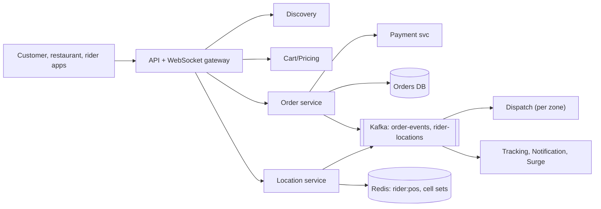
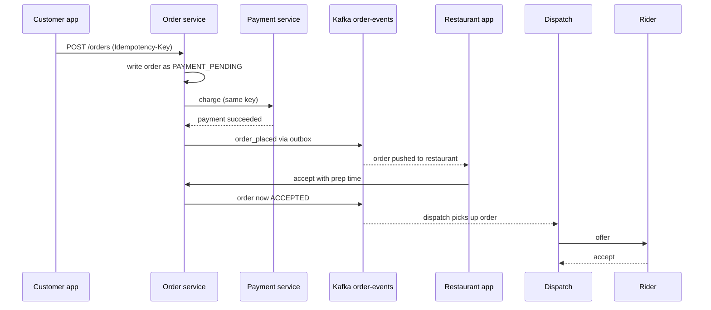
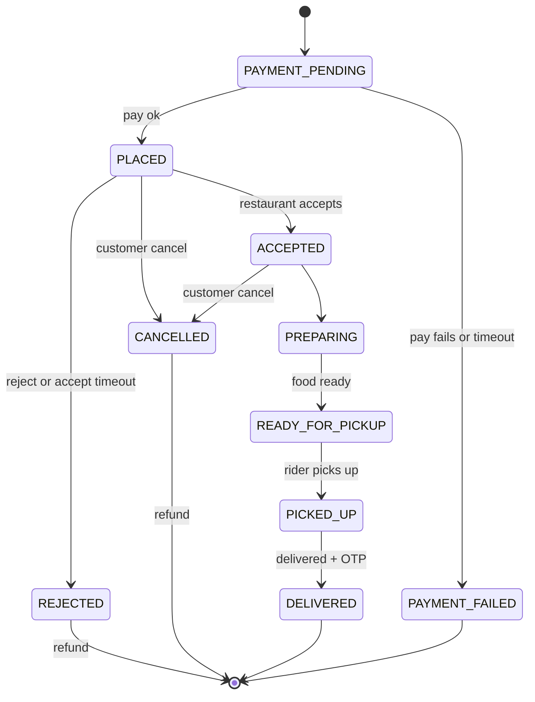

## Definition (interview-ready)

A **food delivery platform** lets customers find nearby restaurants, order, pay, and watch a delivery partner (rider) bring the food. It is a three-sided marketplace: customers, restaurants and riders.

**Discovery and menus** are read-heavy, so they come from a search index plus a cache keyed by delivery-area cell. **Orders** live in sharded SQL and move through a persisted **state machine**, with idempotent payment. Rider GPS streams into a **location service** that keeps the latest position in memory, indexed by geo cell. A per-zone **dispatch** engine runs several times a minute, scores rider-order pairs (and two-order batches) using predicted food-ready and travel times, and sends offers. Tracking is pushed over a WebSocket.

The key trade-off is **dispatch timing**: assign too early and riders wait; too late and food goes cold. Batching saves riders but delays one customer slightly.

**One-liner:** Cache discovery by area cell, keep each order in a persisted state machine with idempotent payment, stream rider GPS into an in-memory geo index, run batched per-zone dispatch that scores riders by predicted ready time and travel time, and push tracking to the customer over WebSockets.

## Problem statement

"Design a food delivery app like Swiggy, Zomato or DoorDash. Customers browse restaurants near them, view menus, add items to a cart, pay and place an order. The restaurant accepts and prepares the order. We assign a delivery partner who picks it up and delivers it, and the customer tracks the order live on a map with an ETA."

Scale the interviewer gives:

- 50M daily active users browsing; 5M orders per day.
- 300K restaurants, each with around 100 menu items.
- 500K delivery partners online at the dinner peak; their apps send a GPS location every 5 seconds.
- Most orders land in two meal peaks (lunch and dinner).
- One country to start, many cities.

## Requirements

### Functional (in scope)

1. **Discovery**: list restaurants that deliver to my address, with search and filters; show each restaurant's menu, prices and which items are available.
2. **Cart and checkout**: a cart from one restaurant, server-side pricing (items, taxes, delivery fee, surge fee, coupons), payment.
3. **Order lifecycle**: the restaurant accepts or rejects, marks food ready; a partner is assigned, picks up, delivers; the customer can cancel within rules.
4. **Delivery partner flow**: go online/offline, receive offers, accept or decline, share location.
5. **Live tracking and ETA**: rider position on a map plus an ETA, updated live; status notifications.
6. **Surge**: extra fees and partner incentives when demand outstrips riders in an area.

### Out of scope (say it out loud)

Ratings and reviews, restaurant onboarding, ads, grocery and quick commerce, partner payouts, customer support tooling, recommendation models in depth.

### Non-functional

| Requirement | Target | Why it matters |
|---|---|---|
| Discovery latency | p99 under 200 ms | Browsing is most of the traffic |
| Order placement | Never lose or duplicate an order or a charge | Money and food are involved |
| Order state | Strongly consistent per order | Restaurant, rider and customer must agree |
| Location freshness | Rider position on the customer's map within a few seconds | Tracking feels live |
| Dispatch | Partner assigned before the food is ready | Cold food and idle riders both cost money |
| Availability | Ordering path 99.95%+ | Peak-hour outages are very visible |
| Partitioning | Per city or zone | Demand is local; isolates failures |

### Clarifying questions to ask

- Do we own the riders, or do restaurants deliver themselves too? (Assume we own them.)
- Payment methods: cards, UPI, wallets, cash on delivery? (Assume online plus cash.)
- One restaurant per order? (Yes; multi-restaurant carts complicate pickup.)
- Can a rider carry more than one order at a time? (Yes, up to 2; this is batching.)
- How fresh must the rider's location be on the customer's map? (A few seconds.)
- Scheduled orders for later? (Out of scope for now.)

## Scale estimation

Rounding a day to 100,000 seconds.

**Orders**

- 5M orders/day ÷ 100,000 s = **50 orders/s average**.
- Meal peaks: say 30% of orders arrive in a 2-hour dinner window: 1.5M ÷ 7,200 s ≈ **210 orders/s**. Design for ~1,000 orders/s to survive sale days.
- Each order causes ~10 state changes and events, so ~2K order events/s at peak. A sharded SQL store handles this easily.

**Discovery reads**

- 50M DAU × 20 discovery/menu calls = 1B calls/day ÷ 100,000 = **10K reads/s average**, ~30K/s at peak (3×).
- Read-to-order ratio is about 200:1 (1B reads vs 5M orders). Discovery must be cached.

**Rider location**

- 500K online riders ÷ 5 s = **100K location writes/s** at peak.
- About 100 bytes per ping → 100K × 100 B = **10 MB/s** inbound.
- Averaged over the day, say 40% of peak: 40K/s × 86,400 s ≈ 3.5B pings/day × 100 B ≈ **350 GB/day** of location history. Keep 30 days hot ≈ 10 TB.

**Live tracking**

- Active orders at peak = arrival rate × time in system = 210/s × ~35 min (2,100 s) ≈ **440K active orders**.
- If every customer watches and gets an update every 5 s: 440K ÷ 5 ≈ **88K pushes/s** and up to ~440K open connections. A few dozen WebSocket gateway nodes handle that.

**Storage**

- Orders: 5M × ~2 KB (order, items, events) = 10 GB/day ≈ 3.65 TB/year, ~11 TB/year with 3 replicas.
- Menus: 300K restaurants × 100 items × ~1 KB = **30 GB**. The whole menu catalog fits in a Redis cluster.

**What the numbers decide**: discovery is a cache problem; location writes need an in-memory store, not a database row update per ping; orders are a correctness problem, not a throughput problem.

## Core API

```
# Discovery (customer app)
GET  /v1/restaurants?lat=..&lng=..&cuisine=..&cursor=..   → { restaurants[], next_cursor }
GET  /v1/restaurants/{id}/menu                            → { menu_version, sections[], items[] }

# Cart and order
PUT  /v1/cart                    { restaurant_id, items[] }    → { cart_id, priced_cart, delivery_fee, surge_fee, eta }
POST /v1/orders                  Idempotency-Key: <uuid>
                                 { cart_id, address_id, payment_method }
                                 → 201 { order_id, status: "PAYMENT_PENDING", payment_action }
GET  /v1/orders/{id}                                           → { status, items, eta, rider }
POST /v1/orders/{id}/cancel                                    → { status, refund }
WS   /v1/orders/{id}/track       server pushes { status, rider_lat, rider_lng, eta_minutes }

# Restaurant app
POST /v1/restaurant/orders/{id}/accept   { prep_minutes }
POST /v1/restaurant/orders/{id}/reject   { reason }
POST /v1/restaurant/orders/{id}/ready
PUT  /v1/restaurant/items/{item_id}/availability   { in_stock }

# Delivery partner app
POST /v1/partner/status                  { online: true }
POST /v1/partner/locations               { points: [ { lat, lng, ts, speed, heading } ] }
POST /v1/partner/offers/{offer_id}/accept
POST /v1/partner/offers/{offer_id}/decline
POST /v1/partner/orders/{id}/picked_up | /delivered   { otp }
```

Points worth saying:

- `POST /orders` takes an **idempotency key**, so a retry after a network blip never creates two orders or two charges.
- The cart is **priced on the server**. The client never sends prices.
- Rider location is sent in small **batches** (several points per call) to save battery and requests when the network is patchy.
- Customer, restaurant and partner IDs come from the auth token, not the body.

## High-level architecture

```
 Customer app        Restaurant app          Partner (rider) app
     │                    │   ▲                    │  GPS every 5 s
     ▼                    ▼   │ push               ▼
┌──────────────────────────────────────────────────────────┐
│ API gateway (auth, rate limits)   WebSocket gateway      │
└──┬──────────┬───────────────┬──────────────┬─────────────┘
   │          │               │              │
   ▼          ▼               ▼              ▼
Discovery   Cart/Pricing   Order service   Location service ──► Redis
(search +   (menu cache,   (state machine) (latest position,     (rider:pos,
 cell cache) surge fee)        │    │       geo cell index)       cell sets)
   │                           │    │              │
   ▼                           │    ▼              ▼
Elasticsearch          Payment svc  Orders DB    Kafka: rider-locations
Menu DB + Redis        (idempotent) (sharded)          │
                               │                       ▼
                               ▼            ┌──────────────────────┐
                    Kafka: order-events ──► │ Dispatch (per zone)  │◄── ETA / prep-time
                         │    │    │        │ batch, score, offer  │     models
                         │    │    │        └──────────────────────┘
                         ▼    ▼    ▼
               Notification  Tracking   Surge (stream job:
               service       service    demand vs riders per zone)
```

The main boxes and streams, simplified (discovery's stores and the ETA models are left out):



**Write path: placing an order**

1. The customer's app calls `PUT /cart`; pricing reads the menu from cache, applies coupons and the current zone surge fee, and returns a quote with an ETA.
2. `POST /orders` with an idempotency key. The order service writes the order as `PAYMENT_PENDING` and calls the payment service (same key).
3. When payment succeeds (synchronously, or via the provider's webhook), the order moves to `PLACED` and an `order_placed` event goes to Kafka through an outbox, so the DB write and the event can't drift apart.
4. The restaurant app gets the order pushed to it. The restaurant accepts with a prep time, and the order moves to `ACCEPTED`.
5. Dispatch picks up the order in its zone, scores candidate riders and sends an offer. The rider accepts; the order gets a rider.
6. The rider's pickup and delivery (confirmed with a customer OTP) are state transitions too, each an event.

The same write path as a sequence:



**Read path: discovery**

1. The address's lat/lng is mapped to a **geo cell** (geohash or H3).
2. Discovery reads the cached list "restaurants that deliver to this cell" (refreshed every minute or so), joins open/closed status and ETA estimates, ranks and returns a page.
3. Opening a restaurant loads its menu from the menu cache by `restaurant_id` and `menu_version`; a small availability overlay marks items out of stock.

**Read path: tracking**

Rider app → location service (Redis + Kafka) → tracking service finds the active order for that rider → pushes to the WebSocket gateway node holding the customer's connection.

## Data model

**Orders**: relational (MySQL or Postgres), sharded. You need transactions for "update state + write outbox event" and per-order consistency.

```sql
orders (
  order_id        BIGINT PRIMARY KEY,     -- Snowflake-style ID
  customer_id     BIGINT NOT NULL,
  restaurant_id   BIGINT NOT NULL,
  city_id         INT NOT NULL,
  status          VARCHAR(32) NOT NULL,   -- state machine value
  version         INT NOT NULL,           -- optimistic lock for transitions
  rider_id        BIGINT NULL,
  subtotal_paise  BIGINT, delivery_fee_paise BIGINT, surge_fee_paise BIGINT,
  payment_id      BIGINT, idempotency_key VARCHAR(64) UNIQUE,
  promised_eta_at TIMESTAMP, created_at TIMESTAMP, updated_at TIMESTAMP
)
order_items  (order_id, line_no, item_id, qty, price_paise, PRIMARY KEY (order_id, line_no))
order_events (order_id, seq, from_status, to_status, actor, ts, PRIMARY KEY (order_id, seq))
outbox       (id, aggregate_id, event_type, payload, created_at)
```

- **Partition key: `order_id`**. Writes spread evenly and every transition touches one shard. If the ID embeds a shard number (a Snowflake-style ID with shard bits, as Instagram does), you route without a lookup.
- **Idempotency across shards.** The `UNIQUE` on `idempotency_key` only holds inside one shard, and a retry would get a fresh `order_id` that may land on another shard. So the order service first checks a small idempotency table partitioned by `(customer_id, idempotency_key)` that maps the key to its `order_id`, and only creates a new order when the key is new.
- "My past orders" is served from a separate index keyed by `customer_id` (a small table or Cassandra), fed from order events.
- "Active orders for restaurant X" is a hot, small set: keep it in Redis keyed by `restaurant_id`, rebuilt from events.

**Menus**: source of truth in a relational DB (`restaurants`, `menu_items`, `item_availability`). Elasticsearch indexes restaurants and dishes for search. A Redis cache holds the rendered menu JSON keyed by `menu:{restaurant_id}:{version}`.

**Rider location**

```
Redis (per city cluster)
  rider:pos:{rider_id}   → { lat, lng, ts, status, active_order_ids }   TTL 60 s
  cell:{h3_cell}:idle    → set of rider_ids available in that cell
  cell:{h3_cell}:busy    → set of rider_ids finishing an order in that cell

Cassandra (history, for ETA training and disputes)
  rider_locations ( (rider_id, day) PARTITION KEY, ts CLUSTERING KEY, lat, lng, speed )
```

The TTL is a few missed pings long, so a rider whose app dies simply disappears from dispatch: dispatch ignores any cell-set member whose `rider:pos` key has expired, and a cleanup job removes them from the sets. History is partitioned by `(rider_id, day)` so one partition never grows without bound.

## Detailed design

### 1. Discovery and menus: cache by area, keep stock separate

Who delivers to me depends on two things: distance or a delivery polygon per restaurant, and whether the restaurant is open and not overloaded. Computing that per request from 300K restaurants is wasteful.

- **Precompute serviceability per cell.** Split the city into cells (H3 or geohash, a few hundred metres across). For each cell, store the list of restaurant IDs that deliver there. Recompute when a restaurant changes its delivery area, and refresh in a background job.
- **Cache the listing page per cell** for 30–60 seconds. Thousands of users in the same cell share one cache entry. Personal ranking happens on top of the cached candidate list.
- **Menus are versioned.** A menu edit bumps `menu_version`, so the new cache key is simply a miss; no invalidation race. See [cache patterns](/learn/notes/cache-patterns/).
- **Item availability is a separate, tiny overlay** (a Redis hash per restaurant: `item_id → in_stock`). Restaurants toggle stock dozens of times a night; re-rendering the full menu each time would thrash the cache.
- **Price is checked again at checkout.** The cached menu is for display; the pricing service reads the current version when it quotes, so a stale cache can never undercharge.

How to say it: "Discovery is a read-heavy, location-keyed problem, so I cache per geo cell and keep fast-changing stock outside the big menu blob."

### 2. The order lifecycle as a state machine

An order is touched by four actors (customer, restaurant, rider, system timers). If each one updates `status` freely, you get impossible states like "delivered but never picked up". So every change goes through one **transition function** with an allowed-transitions table.

The allowed transitions:



A customer can cancel without a fee only before `PREPARING`. There is deliberately no cancel from `PAYMENT_PENDING`: the restaurant hasn't seen the order yet and the charge may still succeed, so the order first settles to `PLACED` or `PAYMENT_FAILED` (by webhook or the reconciliation job). If the customer asked to cancel meanwhile, the order is cancelled from `PLACED` with a full refund.

Rider assignment is a **parallel sub-state** on the order (`UNASSIGNED → OFFERED → ASSIGNED → AT_RESTAURANT`), because dispatch can happen while the food is cooking. Keeping it separate means a rider cancelling doesn't roll the food state backwards.

How a transition is applied:

```sql
BEGIN;
UPDATE orders SET status = 'ACCEPTED', version = version + 1, updated_at = now()
 WHERE order_id = 42 AND status = 'PLACED' AND version = 7;   -- 0 rows → someone else moved it
INSERT INTO order_events (...) VALUES (...);
INSERT INTO outbox (...) VALUES ('order_accepted', ...);
COMMIT;
```

- The `WHERE status = ... AND version = ...` check is **optimistic locking**: if the restaurant's accept and the accept-timeout job race, only one wins.
- The **outbox** row is published to Kafka by a relay, so downstream services (dispatch, notifications, tracking, analytics) see every transition in order for each order (key the Kafka message by `order_id`). The relay is at-least-once, so a consumer can see an event twice and must skip duplicates using `(order_id, seq)`. See [distributed transactions](/learn/notes/distributed-transactions/) and [delivery semantics](/learn/notes/delivery-semantics/).
- **Timers** (accept timeout, "food ready but no rider" escalation) are durable scheduled jobs, not in-memory sleeps.

**Payment.** Online payment happens before the restaurant sees the order. The order service calls the payment service with the same idempotency key; the payment service talks to the gateway and confirms by webhook. If the restaurant rejects or the order is cancelled, a **compensating refund** runs (a saga). With card authorization you can hold first and capture at acceptance; with methods that debit immediately, such as most UPI and wallet payments, you charge and refund. Cash orders skip this step and settle with the rider. Details live in the [payment system note](/learn/notes/hld-payment-system/).

### 3. Rider location at scale

100K pings/s is too many for a database row update each. The pipeline:

1. The rider app sends a batch of GPS points every few seconds over HTTPS or a persistent connection.
2. The **location service** (stateless, many nodes) validates the points (drops impossible jumps), then:
   - writes the latest point to `rider:pos:{rider_id}` in Redis,
   - if the rider changed cell, moves the ID between `cell:*` sets,
   - appends the point to the Kafka topic `rider-locations`, keyed by `rider_id`.
3. Consumers of that topic: the tracking service (customer map), ETA updates, the history writer (Cassandra), fraud checks.

Sizing: 10 MB/s inbound is modest for Kafka. Redis handles 100K small writes/s on a few shards, split per city. Lowering the ping rate when a rider is idle (say every 15–30 s) and raising it on an active trip cuts load and battery.

This is the same pattern as the [ride-sharing note](/learn/notes/hld-ride-sharing/) and the [proximity service](/learn/notes/hld-proximity-service/): latest position in memory, indexed by geo cell, with a stream for everything else.

### 4. Dispatch: batching and a simple scoring function

**Why not just "nearest free rider"?** Because food has a cooking time. A rider who arrives 12 minutes before the food is ready is wasted; a rider who arrives 10 minutes late leaves the food to go cold. And two orders from the same restaurant going the same way should often share one rider.

**Run per zone, in rounds.** Several times a minute (say every 10–30 s), a dispatch worker for each zone collects:

- unassigned orders, with their predicted food-ready time,
- idle riders and riders about to finish a delivery nearby.

DoorDash describes this shape on its engineering blog: its optimizer runs on instances split by regional boundaries, multiple times a minute.

**Step 1: generate candidates.** For each order, look up riders in its cell and neighbour cells. Also form **batch candidates**: pairs of unassigned orders that share a restaurant or nearby restaurants, have drop locations close together, and have ready times within a few minutes of each other.

**Step 2: score each (rider, route) pair.** A simple, explainable score (lower is better):

```
arrival      = now + travel_time(rider → restaurant)
ready        = predicted_ready_time(order)
rider_wait   = max(0, ready - arrival)                    # rider idle at restaurant
food_wait    = max(0, arrival - ready)                    # food waiting for rider
delivered_at = max(arrival, ready) + pickup_time + travel_time(restaurant → customer)
lateness     = max(0, delivered_at - promised_eta)

score = 1.0 * travel_to_restaurant
      + 0.5 * rider_wait
      + 2.0 * food_wait
      + 3.0 * lateness
      + batch_penalty        # extra minutes the first customer waits because of the second drop
```

The weights encode the business: food going cold and late deliveries cost more than a rider waiting. A batch is allowed only if the extra delay for the first customer stays under a cap (say 8–10 minutes) and both orders still meet their promise.

**Step 3: assign.** Treat it as a matching problem: each order (or batch) gets at most one rider, each rider at most one route.

- **Greedy**: sort all pairs by score, take the best, remove both, repeat. Fast and usually good enough to start.
- **Optimal matching**: the Hungarian algorithm handles one order per rider. DoorDash wrote that its older dispatcher did exactly this, as bipartite matching, and moved to a mixed-integer program solved by a commercial solver (Gurobi), which it found up to 10 times faster and which also supports routes with two or more deliveries.

**Step 4: offer, then wait.** Send the offer to the rider's app with a short accept window. On decline or timeout, the order goes back into the next round with a priority bump. Don't wait for every rider to answer before running the next round.

**Wait or assign now?** If the food is 20 minutes away, assigning now locks a rider who could do a short delivery first. A common rule: only dispatch an order when `ready - travel_time` is within the next round or two. DoorDash notes that it is sometimes better to wait before offering a delivery, and that the MIP lets it build that trade-off into the model.

DoorDash's dispatch system, DeepRed, is described in three layers: generate candidate offers (including batches at the same store or block), predict with ML models (order ready time, travel time, chance the Dasher accepts), and then a mixed-integer optimization picks the final offers for the whole marketplace. That is a good structure to describe in an interview.

### 5. ETA prediction (high level)

The ETA is a sum of legs, each with its own model:

```
ETA = restaurant_accept + food_prep + rider_to_restaurant + pickup_handling
    + restaurant_to_customer + parking_and_handoff
```

- **Prep time** is the hardest leg. You often don't observe it: if the rider arrived after the food was ready, you only know it was ready "some time before". DoorDash calls this censored data and wrote about adjusting the training data so standard gradient-boosted models could handle it.
- **Travel time** comes from a routing engine plus learned corrections by time of day, weather and area.
- **Show a percentile, not a mean.** A late order hurts trust more than an early one. Swiggy's engineering blog describes moving from a single point estimate with static city-level buffers to a model that predicts the full distribution of delivery time per order (a lognormal fitted best), so each city can pick the percentile that hits its on-time target.
- **Update live.** After pickup, recompute from the rider's actual position every few seconds, and smooth the number shown so it doesn't jump around.

### 6. Live tracking pushed to the customer

1. The customer app opens a WebSocket (or SSE) to a tracking gateway node and subscribes to `order:{order_id}`. See [WebSockets and SSE](/learn/notes/realtime-push-websockets-sse/).
2. The gateway registers "order 42 is on node G7" in a small registry (Redis), or subscribes to a pub/sub channel for that order.
3. The tracking service consumes `rider-locations` and `order-events`. For a location ping, it maps rider → active order(s), throttles to one update per few seconds per order, and publishes to that order's channel.
4. The app animates the marker between points, so 5-second updates look smooth.
5. If the socket drops, the app falls back to polling `GET /orders/{id}` and reconnects with backoff. Status changes (picked up, arriving) also go out as push notifications through the [notification system](/learn/notes/hld-notification-system/), because the app may be in the background.

### 7. Surge

A streaming job (see [stream processing](/learn/notes/stream-processing-flink-kstreams/)) computes per zone, every minute:

```
pressure = (new orders in last 10 min + unassigned orders) / (idle riders + riders finishing soon)
```

When pressure crosses thresholds, the platform can:

- add a **surge fee** for customers in that zone (shown in the cart quote, and locked into the order at checkout so it can't change after payment),
- raise **rider incentives** to pull riders in,
- **widen ETAs** and shrink the delivery radius so far-away orders aren't accepted,
- allow more **batching**,
- in extreme cases, pause ordering in the zone.

Smooth the signal (moving average plus hysteresis) so fees don't flap between quotes.

## Bottlenecks & optimizations

- **Meal peaks.** Dinner load is several times the daily average (about 4× in our estimate), and festival and sale days spike further. Autoscale ahead of the clock (it's predictable), and pre-warm caches before the peak.
- **Hot restaurants.** A popular restaurant gets flooded and its kitchen falls behind. Feed its live queue length into the prep-time model and throttle it ("busy") from discovery when it's overloaded. That protects the restaurant and the ETA.
- **Hot cells.** One dense area dominates a Redis shard. Shard location data per city, and split the busiest cells into finer cells.
- **Dispatch round time.** As a zone grows, matching slows down. Split into smaller zones (accepting some edge effects at zone borders), limit candidates per order to the nearest N riders, and use a time budget: if the solver doesn't finish, fall back to greedy.
- **Location write amplification.** Only update cell sets when the cell changes; send adaptive ping rates; batch points.
- **Tracking fan-out.** Throttle per order and drop stale updates instead of queueing them; the customer only needs the latest point.
- **Search.** Pre-filter by serviceable cell before ranking; keep Elasticsearch queries bounded.

## Failure handling

| Failure | What happens / what we do |
|---|---|
| **Rider cancels after accepting** | Order's rider sub-state goes back to `UNASSIGNED` with a high priority; next dispatch round reassigns it. The food state is untouched. Track per-rider cancel rates. |
| **Rider goes silent** (app killed, no network) | `rider:pos` TTL expires, so dispatch stops offering to them. If they hold an order, an alert fires after N minutes of silence; ops calls them or reassigns. |
| **Restaurant rejects or doesn't respond** | Reject or accept-timeout moves the order to `REJECTED`; the saga triggers a refund (or voids the hold) and notifies the customer, maybe suggesting similar restaurants. |
| **Food much later than predicted** | The ready-time update reaches dispatch; if a rider is already waiting, they may be released and the order re-dispatched later. ETA shown to the customer is updated. |
| **Payment gateway timeout** | Order stays `PAYMENT_PENDING`; never assume failure. Retry with the same idempotency key or wait for the webhook; a reconciliation job resolves stuck ones. |
| **Order service DB primary fails** | Promote a replica; ordering in affected shards pauses for seconds to a minute. Idempotency keys make client retries safe. |
| **Kafka lag** | Tracking and notifications fall behind, but the order state in the DB stays correct. Dispatch can rebuild its zone's list of unassigned orders by querying the order shards (indexed on zone and status), so it keeps working, just more slowly. |
| **Location Redis shard down** | Riders in that city vanish from dispatch until failover. Rebuild positions from the next pings within seconds; the TTL design makes recovery self-healing. |
| **Dispatch worker crash** | Workers are stateless per round; another worker takes the zone (lease or partition ownership) and the next round re-reads state. Offers are idempotent per (order, rider, round). |
| **WebSocket gateway node dies** | Clients reconnect to another node and resubscribe; polling covers the gap. |
| **Whole city stack issue** | Per-city isolation keeps other cities working. |

Use [circuit breakers and retries](/learn/notes/circuit-breakers-retries/) on calls to payment gateways and map/routing providers, and degrade gracefully (for example, a straight-line ETA when the routing engine is down).

## Trade-offs

| Decision | Option A | Option B | What I'd choose |
|---|---|---|---|
| Dispatch algorithm | Greedy per order (instant, simple) | Batched optimization per zone several times a minute (better global result, small delay) | Batched rounds; greedy as fallback when the solver runs out of time |
| When to dispatch | As soon as the order is placed | Just in time for food-ready | Just in time, using predicted prep time |
| Batching | Never (fastest per customer) | Aggressive (fewer riders needed) | Allow pairs when the extra delay is under a cap; more batching in surge |
| Order store | Sharded SQL (transactions, constraints) | NoSQL (easier scaling) | SQL: the volume is modest and transitions need atomicity |
| Rider location | DB row per rider | In-memory Redis + Kafka stream | Redis + Kafka; history to Cassandra |
| Tracking delivery | Client polling | WebSocket/SSE push | Push, with polling fallback |
| ETA output | Mean prediction | Percentile from a predicted distribution | Percentile, tuned per city |
| Payment timing | Charge at order | Hold at order, capture at acceptance | Depends on payment method; always refund or void on reject |
| Partitioning | Global services | Per-city cells/stacks | Per-city for location, dispatch and surge; global for accounts and menus |

## Practice questions

<Practice>

<QA q="Why model the order as an explicit state machine instead of a status column anyone can update?" level="easy">

Four actors change the order: the customer, the restaurant, the rider and system timers. If they all write `status` directly, races produce impossible states (cancelled and picked up, delivered without pickup). A state machine lists the allowed transitions, and each update checks the current state and a version number in the same SQL statement, so exactly one of two racing updates wins. Every transition is also written as an event, which gives an audit trail and drives notifications, tracking and analytics.

</QA>

<QA q="How do you make `POST /orders` safe to retry?" level="easy">

The client generates an idempotency key per checkout attempt and sends it in a header. The order service records the key (for example in an idempotency table keyed by customer and key, so the check works even though orders are sharded); a retry with the same key returns the existing order instead of creating a new one. The same key is passed to the payment service and on to the gateway, so the customer is charged at most once even if the response was lost.

</QA>

<QA q="Why cache restaurant listings per geo cell instead of per user?" level="easy">

Everyone in the same few hundred metres sees the same set of restaurants that deliver to them. Caching per cell lets thousands of users share one cache entry, so the hit rate is high. Personal ranking is then applied on top of that cached candidate list. Caching per user would give a much lower hit rate and blow up memory.

</QA>

<QA q="Why keep item availability separate from the cached menu?" level="medium">

Menus change rarely, but stock flips often during service (an item runs out, comes back). If availability lived inside the menu blob, every toggle would rebuild and invalidate the whole menu cache entry. A small per-restaurant hash of `item_id → in_stock` is cheap to update and is merged with the menu at read time. Checkout re-checks availability anyway.

</QA>

<QA q="How do you handle 100K rider location updates per second?" level="medium">

Don't update a database row per ping. A stateless location service writes the latest position to Redis (with a short TTL) and updates the rider's geo cell set only when the cell changes. It appends every point to a Kafka topic keyed by rider ID; consumers feed tracking, ETA and a history store (Cassandra, partitioned by rider and day). Shard Redis by city, batch points in the app, and lower the ping rate for idle riders.

</QA>

<QA q="Walk me through how dispatch picks a rider for an order." level="medium">

Several times a minute per zone: collect unassigned orders and nearby idle or almost-free riders. For each order, find riders in its cell and neighbours, and form batch candidates with nearby orders. Score each pair with predicted travel time to the restaurant, rider waiting time, food waiting time and lateness against the promised ETA. Solve the matching (greedy, or an optimizer) so each order gets one rider and each rider one route. Send offers with a short accept window; declined or timed-out orders go back into the next round with higher priority.

</QA>

<QA q="When should two orders be batched onto one rider?" level="medium">

When the pickups are at the same or nearby restaurants, the drops are close and roughly in the same direction, the food-ready times are within a few minutes, and the extra delay for the first customer stays under a cap while both orders still meet their promised ETA. Batching saves rider time and helps a lot during undersupply, so you allow more of it during surge.

</QA>

<QA q="Why not assign a rider the moment an order is placed?" level="medium">

Food takes time to cook. An early assignment parks a rider at the restaurant doing nothing, when they could have done another short delivery. Instead, dispatch uses the predicted ready time and travel time and assigns the rider so they arrive about when the food is ready. The risk is a wrong prep-time prediction, so the system re-checks as the restaurant updates status.

</QA>

<QA q="Why is food prep time hard to predict, and what do you do about it?" level="hard">

You often don't see the true ready time. If the rider arrived after the food was ready, you only know it was ready at some point before they arrived; the data is censored. Dropping those orders biases the model, because the orders where food was ready early are thrown away. Use the cases where riders waited as clean labels, treat the others as bounds, and include live signals such as the restaurant's current queue length and time of day. DoorDash has written about handling this censoring with a data adjustment before training gradient-boosted models.

</QA>

<QA q="Should the customer see the mean ETA? Why or why not?" level="hard">

Usually not. Delivery time is skewed: most orders are close to typical, but some are very late. Being late hurts trust more than being early, so you show a higher percentile. A model that predicts the whole distribution per order lets each city choose the percentile that meets its on-time target without retraining. Swiggy described moving from point estimates with static city buffers to this kind of probabilistic model.

</QA>

<QA q="How does the customer see the rider move on the map in near real time?" level="hard">

The app holds a WebSocket (or SSE) to a tracking gateway and subscribes to its order. The tracking service consumes the rider location stream, maps the rider to their active order, throttles to one update every few seconds, and publishes to that order's channel; the gateway node holding the connection pushes it. The app animates between points. If the socket drops, the app polls and reconnects with backoff. Important status changes also go out as push notifications.

</QA>

<QA q="A rider accepts an order, then cancels 5 minutes later. What happens?" level="scenario">

The rider sub-state goes from `ASSIGNED` back to `UNASSIGNED`. The food state is unchanged, so the restaurant keeps cooking. The order re-enters the next dispatch round with a priority boost, and the score now has a tighter lateness budget, so the nearest rider who can arrive soon wins. The customer's ETA updates. The cancellation is logged against the rider for quality metrics.

</QA>

<QA q="The restaurant doesn't respond to a new order for 3 minutes. What do you do?" level="scenario">

A durable timer fires the accept-timeout transition. First you can escalate (an automated call or alert to the restaurant). If there's still no response, the order moves to `REJECTED`. The payment saga refunds the charge or voids the hold, the customer is notified and offered alternatives, and any rider already offered is released. Repeated timeouts mark the restaurant as temporarily unavailable in discovery.

</QA>

<QA q="It's raining in one city and orders double while many riders go offline. How does the system respond?" level="scenario">

The surge job sees the order-to-rider ratio jump in those zones. The platform adds a surge fee in the cart quote, raises rider incentives, widens shown ETAs, shrinks delivery radius, allows more batching, and marks overloaded restaurants busy. If it gets extreme, it pauses ordering in the worst zones instead of accepting orders it can't deliver. Because services are partitioned per city, other cities are unaffected.

</QA>

<QA q="The payment gateway times out during checkout. The customer retries. What happens?" level="scenario">

The first order stays `PAYMENT_PENDING`; you never assume failure, because the charge may have happened. The retry uses the same idempotency key, so it returns the same order. The payment service queries the gateway or waits for the webhook. If the charge succeeded, the order moves to `PLACED`; if not, it moves to `PAYMENT_FAILED` and the customer can try another method. A reconciliation job resolves anything stuck.

</QA>

</Practice>

## Quiz

<Quiz>

<MCQ q="Roughly how many location writes per second do 500K online riders produce if each pings every 5 seconds?" options={["2.5M per second", "500K per second", "100K per second", "10K per second"]} answer={2}>

500,000 ÷ 5 = 100,000 writes per second. The other options multiply instead of dividing, ignore the interval, or are off by ten.

</MCQ>

<MCQ q="Why is item stock kept as a small overlay instead of inside the cached menu?" options={["Stock flips often, and rebuilding the whole menu cache entry on each toggle would thrash the cache", "Stock data is personal to each customer", "Elasticsearch cannot store booleans", "The menu must never be cached"]} answer={0}>

Availability changes many times during service while the menu rarely changes, so separating them keeps the big menu cache stable. Stock is per restaurant, not per customer; Elasticsearch handles booleans; menus are very cacheable.

</MCQ>

<MCQ q="The restaurant's accept call and the accept-timeout job hit the same order at once. What stops both from applying?" options={["A global lock on the orders table", "Kafka ordering", "The client retries", "A conditional update that checks the current status and version"]} answer={3}>

The UPDATE only succeeds where the status and version still match, so exactly one transition wins and the other sees zero rows updated. A global table lock would kill throughput, Kafka ordering doesn't protect the DB row, and client retries don't resolve races.

</MCQ>

<MCQ q="Why does dispatch use the predicted food-ready time?" options={["To compute the delivery fee", "So the rider arrives about when the food is ready, minimizing both rider waiting and food waiting", "To decide which restaurant to show first", "Because riders refuse orders without it"]} answer={1}>

Timing the rider's arrival to the ready time saves rider time and keeps food fresh. Fees, discovery ranking and acceptance are not why dispatch needs it.

</MCQ>

<MCQ q="What is the main cost of batching two orders onto one rider?" options={["The first customer's delivery can take a few minutes longer", "It needs twice as many riders", "The restaurant must cook both orders together", "Payment must be captured twice"]} answer={0}>

The rider makes an extra drop, so one customer waits a bit longer; that's why batches have a delay cap. Batching needs fewer riders, not more, and doesn't change cooking or payment.

</MCQ>

<MCQ q="A rider's app is killed and stops sending pings. How does the design keep dispatch from offering them orders?" options={["The rider must log out manually", "Dispatch pings every rider before each round", "The latest-position key has a short TTL, so the rider drops out of the index", "The order service deletes the rider's account"]} answer={2}>

A short TTL on the rider's position makes silent riders disappear on their own. Manual logout fails exactly when the app dies, pinging everyone each round doesn't scale, and deleting accounts is absurd.

</MCQ>

<MCQ q="Why show a high-percentile ETA instead of the mean?" options={["Percentiles are cheaper to compute", "The mean cannot be updated live", "Customers prefer longer numbers", "Delivery time is skewed and lateness hurts trust more than earliness"]} answer={3}>

A percentile guards against the long tail of late orders. Cost and live updates aren't the reason, and nobody wants a needlessly long ETA, which is why the percentile is tuned per city.

</MCQ>

<MCQ q="The restaurant rejects an order that was already paid online. What is the correct next step?" options={["Keep the money as credit without telling the customer", "A compensating refund (or void of the hold) as part of the order saga, then notify the customer", "Retry the restaurant until it accepts", "Mark the order delivered"]} answer={1}>

A rejection ends the order, so the saga compensates the payment and informs the customer. Keeping money silently, forcing the restaurant, or faking delivery are all wrong.

</MCQ>

<MCQ q="Why partition location, dispatch and surge per city or zone?" options={["Demand and supply are local, so work stays local and a failure in one city doesn't spread", "It removes the need for a geo index", "It makes payments faster", "Riders can only work in one country"]} answer={0}>

Matching only happens between nearby riders and orders, so per-city partitions keep data and computation local and limit blast radius. You still need a geo index inside a city, and it has nothing to do with payments.

</MCQ>

</Quiz>

## TL;DR cheat sheet

- **Three sides**: customer, restaurant, rider. Demand is local and peaks at mealtimes.
- **Discovery**: precompute "who delivers to this cell", cache listings per cell, version menus, keep stock as a small overlay, re-price at checkout.
- **Orders**: sharded SQL by `order_id`; explicit state machine; conditional updates with a version; events via outbox to Kafka keyed by `order_id`.
- **Payment**: idempotency key end to end; refund or void as compensation when the restaurant rejects or the order is cancelled.
- **Rider location**: ~100K writes/s; latest position in Redis with TTL plus geo cell sets; Kafka for tracking, ETA and history.
- **Dispatch**: per zone, several times a minute; candidates from nearby cells; score = travel + rider wait + food wait + lateness (+ batch penalty); greedy or optimizer; offer with timeout.
- **Dispatch timing**: just in time for food-ready, not at order placement.
- **ETA**: sum of legs; prep time is hardest (censored data); show a percentile; update live after pickup.
- **Tracking**: WebSocket/SSE push, throttled per order, polling fallback, push notifications for status.
- **Surge**: per-zone demand/supply ratio, smoothed; fees, rider incentives, wider ETAs, more batching.
- **Failures**: rider cancel → re-dispatch with priority; restaurant reject or timeout → refund; payment timeout → pending plus reconcile; per-city isolation.

## Go deeper

- **DoorDash Engineering**: ["Next-Generation Optimization for Dasher Dispatch at DoorDash"](https://careersatdoordash.com/blog/next-generation-optimization-for-dasher-dispatch-at-doordash/), on moving from Hungarian matching to a MIP solver with multi-delivery routes.
- **DoorDash Engineering**: ["Using ML and Optimization to Solve DoorDash's Dispatch Problem"](https://careersatdoordash.com/blog/using-ml-and-optimization-to-solve-doordashs-dispatch-problem/), on the DeepRed layers: candidate offers, ML predictions and optimization.
- **DoorDash Engineering**: ["Solving for Unobserved Data in a Regression Model Using a Simple Data Adjustment"](https://careersatdoordash.com/blog/solving-for-unobserved-data-in-a-regression-model/), on prep-time prediction with censored data.
- **Swiggy Bytes**: ["Solving Regional Consistency of Delivery ETA with a Deep Probabilistic Framework"](https://medium.com/swiggy-bytes/solving-regional-consistency-of-delivery-eta-with-a-deep-probabilistic-framework-8d82d6abdf41), on predicting a delivery-time distribution instead of a point.
- Related notes: [ride-sharing](/learn/notes/hld-ride-sharing/), [payment system](/learn/notes/hld-payment-system/), [notification system](/learn/notes/hld-notification-system/), [proximity service](/learn/notes/hld-proximity-service/), [real-time push](/learn/notes/realtime-push-websockets-sse/), [distributed transactions](/learn/notes/distributed-transactions/).
