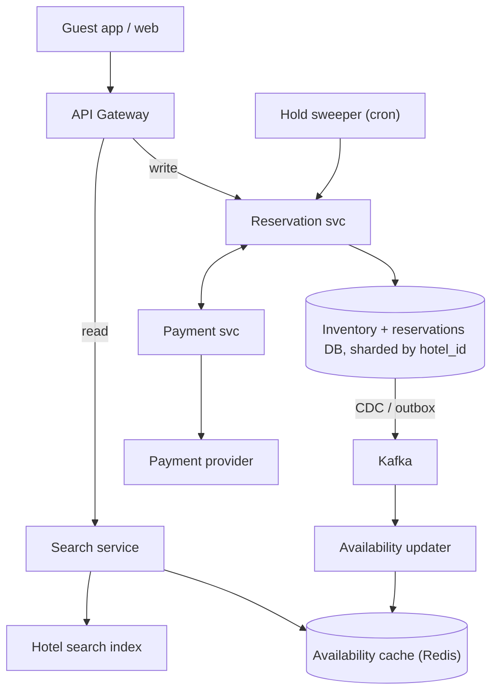
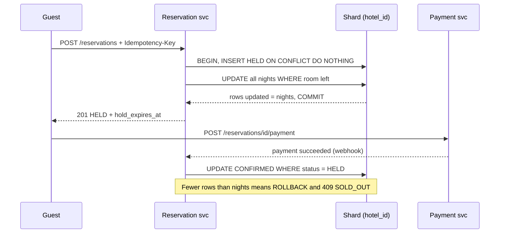
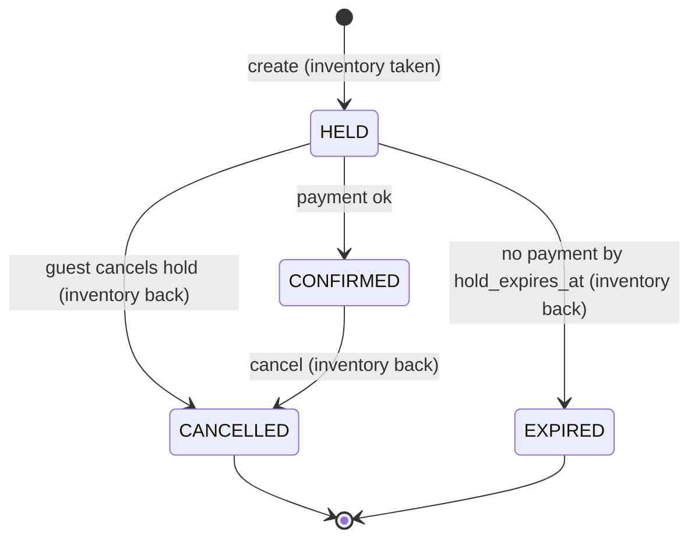

## Definition (interview-ready)

A **hotel reservation system** lets guests search hotels for a date range, pick a room type, pay, and get a confirmed booking, while hotels manage how many rooms of each type they sell per night.

The design in one breath: **inventory is one row per (hotel, room type, night)** holding total rooms, an overbooking allowance and a reserved count. A booking runs one **conditional UPDATE** across all nights of the stay and succeeds only if every night still had room; a **CHECK constraint** on the row is the final guard. The booking starts as a **HELD** reservation with an expiry, an **idempotency key** stops retries from creating a second booking, a payment saga charges the card, and a sweeper frees expired holds. **Search reads a cache** that may be seconds stale; only booking touches the database, which is **sharded by hotel_id** so each booking is a single-shard transaction.

The main trade-off: **fast, slightly stale search vs a slow, exact booking path**.

**One-liner:** Count rooms per hotel, room type and night; book with one all-nights conditional update behind a CHECK constraint and an idempotency key; hold, pay, confirm or expire; serve search from a cache; shard everything by hotel.

## Problem statement

"Design a hotel reservation system like Booking.com or Expedia. Guests search for hotels in a city for given dates, see which room types are available and at what price, and book one or more rooms. Hotels can have cancellations and may want to sell slightly more rooms than they have. Two guests must never end up with the same last room.

Assume 500,000 hotels, about 5 room types per hotel, bookings open up to one year ahead, 1 million reservations per day and 200 million searches per day. Peaks are around 10x average for bookings and 3x for searches."

## Requirements

### Functional (in scope)
- Search hotels by city or area, dates, guests; show available room types and prices.
- View a hotel's availability for a date range.
- Reserve rooms: hold, pay, confirm. Get a reservation ID.
- Cancel or modify a reservation (inventory goes back).
- Hotel admin: set room counts per room type and the overbooking allowance.

### Non-functional
- **No double booking**: never sell more than total rooms plus the allowed overbooking, for any night.
- **Idempotent booking**: a retried request (timeout, double click) never creates two reservations or two charges.
- Search p99 under ~300 ms; booking p99 under ~1 s (excluding the payment page).
- High availability for search; for booking, correctness beats availability (fail the request rather than oversell).
- Durable reservations with an audit trail.

### Out of scope
- Dynamic pricing and revenue models (we just read a price), reviews, loyalty programs, the payment provider's internals, and syncing inventory with outside channels (channel managers). Mention them, then park them.

### Clarifying questions to ask
- Is availability per **room type** or per **physical room**? (Almost always room type; the hotel assigns room 412 at check-in.)
- Pay now, or pay at the hotel with a card guarantee? Refundable rates?
- Do we allow overbooking, and who sets the limit?
- How long can a guest hold a room while paying?
- Read/write ratio and peak events (holidays, big conferences)?
- Single region or global?

## Scale estimation

**Inventory rows**
- 500,000 hotels × 5 room types × 365 nights = **912.5 million rows**, call it ~0.9 B.
- At ~60 bytes per row (a few integers plus row overhead) that is ~55 GB; with the primary-key index roughly double, **~110 GB**. Split over 16 shards that is ~7 GB each. Small.

**Bookings (writes)**
- 1,000,000 per day ÷ 86,400 s = **~12 bookings/s** average, **~120/s** at a 10x peak.
- Average stay of 3 nights → 3 inventory rows per booking → **~360 row updates/s** at peak. Any single relational shard handles this; the hard part is correctness, not throughput.

**Searches (reads)**
- 200,000,000 per day ÷ 86,400 s = **~2,300 searches/s** average, **~7,000/s** at a 3x peak.
- Each search checks availability for, say, 50 candidate hotels → 7,000 × 50 = **350,000 hotel availability lookups/s** at peak. That is why search must not hit the booking database.

**Storage for reservations**
- 1 M/day × ~1 KB = **1 GB/day**, ~365 GB/year, ~1.1 TB/year with 3 replicas.

**Bandwidth**
- Search responses of ~20 KB (20 hotels with photos as URLs) × 7,000/s = **~140 MB/s** egress at peak. Images come from a CDN.

**Takeaway:** reads outnumber writes by ~200 to 1 (200 M vs 1 M per day). Cache the read side hard; keep the write side small, exact and transactional.

## Core API

```
GET  /v1/search?city=goa&check_in=2026-12-24&check_out=2026-12-27&guests=2&page=1
     → [{ hotel_id, name, min_price, room_types_available: [...] }]   (may be a few seconds stale)

GET  /v1/hotels/{hotel_id}/availability?check_in=...&check_out=...
     → [{ room_type_id, rooms_left, price_per_night }]

POST /v1/reservations
     Headers: Idempotency-Key: 8f1c...   (UUID made by the client per checkout attempt)
     Body:    { hotel_id, room_type_id, check_in, check_out, rooms, guest_id }
     → 201 { reservation_id, status: "HELD", hold_expires_at, amount }
     → 409 SOLD_OUT                     (a night in the range is full)
     → 200 same body as before          (retry with the same key)

POST /v1/reservations/{id}/payment      → starts payment (redirect or client SDK)
POST /v1/payments/webhook               ← provider callback; confirms the reservation
POST /v1/reservations/{id}/cancel       → CANCELLED, inventory returned
GET  /v1/reservations/{id}
```

Dates are half-open: `check_in` is the first night, `check_out` is the morning you leave, so a stay of 24 to 27 December uses the nights of the 24th, 25th and 26th.

## High-level architecture

```
                         ┌──────────────┐
  Guest app / web ─────► │ CDN (images) │
         │               └──────────────┘
         ▼
  ┌──────────────┐   rate limit, auth
  │ API Gateway  │
  └──┬────────┬──┘
     │ read   │ write
     ▼        ▼
┌──────────┐ ┌──────────────────┐       ┌─────────────────┐
│ Search   │ │ Reservation svc  │──────►│ Payment svc     │──► provider
│ service  │ │ (hold / confirm  │◄──────│ (saga, webhooks)│
└──┬────┬──┘ │  / cancel)       │       └─────────────────┘
   │    │    └────────┬─────────┘
   │    │             ▼
   │    │    ┌──────────────────────────────┐
   │    │    │ Inventory + reservations DB  │  Postgres/MySQL,
   │    │    │ sharded by hotel_id          │  primary + sync replica
   │    │    └────────────┬─────────────────┘
   │    │                 │ CDC (change data capture) / outbox
   │    │                 ▼
   │    │            ┌─────────┐
   │    │            │ Kafka   │──► availability updater ──┐
   │    │            └─────────┘──► email / analytics       │
   │    ▼                                                  ▼
   │  ┌───────────────────────┐                ┌──────────────────────┐
   │  │ Availability cache    │◄───────────────│ writes rooms_left per │
   │  │ (Redis, per hotel/    │                │ hotel, type, night    │
   │  │  type/night)          │                └──────────────────────┘
   ▼  └───────────────────────┘
┌───────────────────────┐
│ Hotel search index    │  geo + filters (Elasticsearch)
└───────────────────────┘

  Hold sweeper (cron, every minute) ──► reservation svc: expire stale HELD rows
```

The same architecture with the read side on the left and the write side on the right (CDN and email/analytics left out):



**Read path (search).** The search service asks the search index for hotels near the place that match filters (stars, amenities), getting a few dozen candidates (50 in the estimate above). It then reads `rooms_left` for those hotels and nights from the availability cache in a few batched calls, drops hotels with no room for some night, ranks, and returns a page. No database call. The data can lag the truth by seconds.

**Write path (book).** The reservation service routes by `hotel_id` to one shard and, in **one transaction**, records the idempotency key and inserts a `HELD` reservation, then runs a conditional update over all nights. If every night fits, it commits and returns `HELD` with an expiry. The guest pays; the payment webhook flips the reservation to `CONFIRMED`. If nobody pays, the sweeper marks it `EXPIRED` and gives the rooms back. Every committed change flows through CDC to Kafka, which updates the availability cache and sends emails.

The booking write path, from hold to confirmation:



## Data model

```sql
-- One row per hotel, room type and night. Tested on PostgreSQL 14.
CREATE TABLE room_inventory (
  hotel_id       BIGINT NOT NULL,
  room_type_id   BIGINT NOT NULL,
  stay_date      DATE   NOT NULL,           -- the night
  total_rooms    INT    NOT NULL,           -- physical rooms of this type
  overbook_limit INT    NOT NULL DEFAULT 0, -- extra rooms we may sell
  reserved       INT    NOT NULL DEFAULT 0, -- held + confirmed
  version        BIGINT NOT NULL DEFAULT 0, -- for optimistic checks
  PRIMARY KEY (hotel_id, room_type_id, stay_date),
  CONSTRAINT no_oversell
    CHECK (reserved >= 0 AND reserved <= total_rooms + overbook_limit)
);

CREATE TABLE reservations (
  reservation_id  UUID   PRIMARY KEY,
  hotel_id        BIGINT NOT NULL,
  room_type_id    BIGINT NOT NULL,
  guest_id        BIGINT NOT NULL,
  check_in        DATE   NOT NULL,
  check_out       DATE   NOT NULL,          -- exclusive
  rooms           INT    NOT NULL,
  status          TEXT   NOT NULL,          -- HELD, CONFIRMED, CANCELLED, EXPIRED
  hold_expires_at TIMESTAMPTZ,
  amount_minor    BIGINT NOT NULL,          -- price in paise/cents
  idempotency_key TEXT   NOT NULL,
  UNIQUE (guest_id, idempotency_key)
);
CREATE INDEX ON reservations (status, hold_expires_at);   -- for the sweeper
```

Other tables: `hotels` and `room_types` (static content, also indexed into the search index), `rates` (price per hotel, room type, night), and a `guest_reservations (guest_id, reservation_id, hotel_id)` lookup for "my trips".

**Why count rooms instead of storing one row per physical room?** Guests book a room *type*, not room 412. A counter per night keeps the booking to N small updates (one per night) and lets the hotel assign the actual room at check-in. Per-room rows are only needed when the user picks a specific unit (seats in a theatre; see the seat-hold part of [flash sale](/learn/notes/hld-flash-sale-inventory/)).

**Partition key: `hotel_id`.** All inventory rows and reservations of one hotel sit on the same shard, so the "check every night and insert the reservation" step is a single local ACID transaction, with no two-phase commit. Hotels are many and small, so hashing `hotel_id` spreads load evenly. The `reservation_id` can embed the shard number (or we keep a `reservation_id → hotel_id` lookup) so a "get reservation" request routes directly. "My trips" by guest needs the secondary `guest_reservations` table, sharded by `guest_id` and filled asynchronously from the CDC stream. See [sharding strategies](/learn/notes/sharding-strategies/).

## Detailed design

### 1. Preventing double booking

The bug to avoid is check-then-act: two requests both read "1 room left", both decide it is free, both write. Three fixes, all tested on PostgreSQL 14.

**a) Conditional update (the default).** Put the check inside the write:

```sql
BEGIN;
INSERT INTO reservations (..., status, hold_expires_at, idempotency_key)
VALUES (..., 'HELD', now() + interval '15 minutes', :key)
ON CONFLICT (guest_id, idempotency_key) DO NOTHING
RETURNING reservation_id;          -- no row back = duplicate request:
                                   -- skip the UPDATE, ROLLBACK, return the stored reservation

UPDATE room_inventory
   SET reserved = reserved + :rooms, version = version + 1
 WHERE hotel_id = :hotel AND room_type_id = :type
   AND stay_date >= :check_in AND stay_date < :check_out
   AND reserved + :rooms <= total_rooms + overbook_limit;
-- app: if rows updated != number of nights → ROLLBACK, answer 409 SOLD_OUT
COMMIT;
```

Why it is safe under concurrency: in PostgreSQL's default READ COMMITTED level, if an `UPDATE` finds a row another transaction is changing, it waits for that transaction to finish and then **re-checks the WHERE clause against the new version of the row**. So the second buyer of the last room re-reads `reserved = total`, the condition fails, and that night does not match. In MySQL/InnoDB the same `UPDATE` takes an exclusive row lock and reads the latest committed value; check the affected-rows count the same way.

The **"all nights or nothing"** rule matters: a 3-night stay must update exactly 3 rows. If only 2 match, one night is full, and the rollback undoes the other two.

Test result: 30 concurrent clients each booking 1 room for 3 nights against 5 rooms → exactly **5 HELD, 25 SOLD_OUT**, every night ended at `reserved = 5`. A second run with 80 clients on random overlapping ranges and 1 to 3 rooms each ended with `reserved` matching the sum of live reservations on every night.

**b) Optimistic version check.** Read first (for example, to show a price), then write only if nothing changed:

```sql
SELECT reserved, total_rooms + overbook_limit AS cap, version
  FROM room_inventory WHERE hotel_id = 7 AND room_type_id = 1 AND stay_date = '2026-12-28';
-- app checks reserved + 1 <= cap, remembers version = 0
UPDATE room_inventory SET reserved = reserved + 1, version = version + 1
 WHERE hotel_id = 7 AND room_type_id = 1 AND stay_date = '2026-12-28' AND version = 0;
-- 1 row = success; 0 rows = someone changed it → re-read and retry
```

Tested: the first writer gets `UPDATE 1`, a second writer holding the same old version gets `UPDATE 0`. It works, but on a popular night every concurrent booking bumps the version, so most attempts retry even when rooms are left. The conditional update in (a) only fails when the room is truly gone, so prefer it for counters.

**c) Database constraint (the backstop).** The `CHECK (reserved <= total_rooms + overbook_limit)` rejects any write that would oversell, even from a buggy code path that forgot the WHERE guard. Tested: a plain `SET reserved = reserved + 1` on a full night fails with `violates check constraint "no_oversell"`. MySQL enforces CHECK constraints only from 8.0.16; older versions parse and ignore them, so on those use the conditional update alone.

**Pessimistic locking** (`SELECT ... FOR UPDATE` on all nights, then update) also works and is useful when the logic between read and write is complex. Lock the nights **in date order** (`ORDER BY stay_date`) so two overlapping stays can't lock in opposite orders and deadlock.

Isolation levels are covered in [transactions and isolation](/learn/notes/transactions-isolation/) and locking in [concurrency control](/learn/notes/concurrency-control-locking/).

**How to say it in an interview:** "Inventory is a counter per hotel, room type and night. I book with one UPDATE across all nights with the capacity check in the WHERE clause, require the row count to equal the number of nights, and keep a CHECK constraint as the last line of defense."

### 2. Holds, payment and expiry

A reservation moves through a small state machine:



**Why hold before paying?** The guest may spend minutes on the payment page. If we only took inventory after payment, two guests could pay for the last room and one would need a refund. Holding first means the guest who reaches the payment page has a room.

**The flow.**
1. `POST /reservations` → `HELD`, inventory taken, `hold_expires_at = now + 15 min`. Show the guest a 10-minute timer; the hold is a little longer so a last-second payment still lands inside it.
2. The payment service creates a payment with the provider, passing `reservation_id` as the provider's **idempotency key**, so retries can't charge twice. See [payment system](/learn/notes/hld-payment-system/).
3. The provider's webhook (deduplicated by event ID) tells the reservation service the payment succeeded. It confirms with a guarded update:

```sql
UPDATE reservations SET status = 'CONFIRMED', hold_expires_at = NULL
 WHERE reservation_id = :id AND status = 'HELD';
```

4. The **sweeper** runs every minute and, in one statement, expires stale holds and returns their nights (tested):

```sql
WITH expired AS (
  UPDATE reservations SET status = 'EXPIRED'
   WHERE status = 'HELD' AND hold_expires_at < now()
  RETURNING hotel_id, room_type_id, check_in, check_out, rooms
)
UPDATE room_inventory i
   SET reserved = i.reserved - x.rooms, version = i.version + 1
  FROM (SELECT e.hotel_id, e.room_type_id, d::date AS stay_date, sum(e.rooms) AS rooms
          FROM expired e,
               generate_series(e.check_in, e.check_out - 1, interval '1 day') d
         GROUP BY 1, 2, 3) x
 WHERE i.hotel_id = x.hotel_id AND i.room_type_id = x.room_type_id
   AND i.stay_date = x.stay_date;
```

Both the confirm and the sweeper only act `WHERE status = 'HELD'`. The row lock plus the WHERE re-check means exactly one of them wins; they can never both happen.

**Cancel.** `POST /reservations/{id}/cancel` works on a `HELD` reservation as well as a `CONFIRMED` one: the guest abandons checkout and the rooms go back straight away instead of waiting for the sweeper. It is the same guarded pattern (`WHERE status IN ('HELD', 'CONFIRMED')`) in the same transaction as giving the nights back, so a cancel racing a confirm or the sweeper still has exactly one winner. Cancelling a `CONFIRMED` booking also triggers a refund under the rate's cancellation policy. If a payment webhook lands after the hold was cancelled, treat it like a late payment.

**Late payment.** If the webhook arrives after the sweeper expired the hold, the confirm updates 0 rows. Don't give up yet: try to take the inventory again with the same conditional update. If it still fits, confirm. If not, **void or refund** the payment and tell the guest. Never confirm just because money arrived.

**Pay now vs pay at hotel.** Many hotel rates authorize the card and capture later (at check-out or the cancellation deadline). Stripe's docs use exactly this hotel example and note that an online card authorization is usually valid for only about 7 days, so for a stay months away you either charge now or save the card and authorize closer to the date.

**Payment and booking are separate systems**, so this is a saga, not one transaction: each step is idempotent and each failure has a compensation (expire the hold, void the authorization, refund). Write events through an **outbox** table in the same transaction as the state change so Kafka never misses one. See [distributed transactions](/learn/notes/distributed-transactions/).

### 3. Idempotent reservation requests

A guest taps "Book" and the network drops. Did it work? The client retries, and without protection that creates a second reservation and takes a second room.

- The client generates an **Idempotency-Key** (a random UUID) once per checkout attempt and resends the same key on every retry.
- The server stores it in `reservations` with `UNIQUE (guest_id, idempotency_key)`, inside the same transaction that takes inventory. `INSERT ... ON CONFLICT DO NOTHING RETURNING` tells us whether this is new.
- On a duplicate, skip the inventory update, read the stored reservation by `(guest_id, idempotency_key)` and return it (same ID, same status) with 200. `RETURNING` gives nothing back for the conflicting row, so this needs that separate read. If two copies of the request arrive at once, the second `INSERT` waits on the first one's unique-index entry and then sees the conflict. Tested: a retry with the same key returned `DUPLICATE` and created nothing.
- If the original attempt hit SOLD_OUT, its transaction rolled back, so the key was never stored and a retry simply tries again. That is correct: nothing was booked.
- If a key comes back with **different** parameters (other dates), reject it with an error, as Stripe does, rather than silently returning the old booking.
- How long to keep keys: Stripe's v1 API keeps them for at least 24 hours before pruning. Here they can simply live forever, since they sit on the reservation row.

Because the key, the reservation and the inventory change commit together on one shard, there is no window where one exists without the others. Airbnb's engineering blog describes the same principle in its payments idempotency library, Orpheus: the idempotency writes are committed in the same database transaction as the service's own writes, and idempotency records are always read from the primary (master) database, never from a replica, because replica lag could let a retry run twice.

### 4. Overbooking policy

Some guests cancel late or never show up. An empty room on the night is lost revenue, so hotels often sell a few more rooms than they have, betting on no-shows.

- **Modelled as data**: `overbook_limit` per (hotel, room type, night). The booking check is `reserved + rooms <= total_rooms + overbook_limit`, and the CHECK constraint uses the same formula, so overbooking is a controlled, explicit allowance, not a race-condition accident.
- **Who sets it**: the hotel or a revenue-management job, from the property's own history of cancellations and no-shows for that kind of date. It is often kept at zero for scarce room types such as suites, and revised as the night approaches and the real cancellation picture becomes clearer.
- **The trade-off**: an unsold room costs one night's revenue; an overbooked guest who turns up must be "walked" (moved to a similar hotel, usually at the hotel's cost, plus goodwill). The limit balances those two costs.
- **On the night**: if everyone shows up, the front desk upgrades guests to a free higher room type if possible, otherwise walks someone. The system should surface overbooked nights early so staff can act.
- **What we never do**: overbook by accident. Search must still show "sold out" once `reserved` reaches the cap.

Tested: after raising `overbook_limit` to 1 on full nights, exactly one more 3-night hold succeeded and the next got SOLD_OUT.

### 5. Search and availability caching vs the booking path

Search is ~7,000 requests/s and ~350,000 hotel lookups/s at peak; booking is ~120/s. Treat them as two different systems.

| | Search path | Booking path |
|---|---|---|
| Store | Search index + Redis availability cache | Sharded relational DB primary |
| Freshness | Seconds behind (eventual) | Exact (strongly consistent) |
| Load | Very high, read-only | Low, writes |
| On error | Show slightly wrong availability | Reject; never oversell |

**How the cache stays fresh.** Every committed inventory change is captured by CDC (for example Debezium reading the database log) or an outbox, published to Kafka keyed by `hotel_id`, and an updater writes `rooms_left = total + overbook_limit - reserved` per (hotel, room type, night) into Redis, for example a hash per hotel and month. Keying by hotel keeps updates for one hotel in order. See [change data capture](/learn/notes/change-data-capture/) and [cache patterns](/learn/notes/cache-patterns/).

**What staleness costs.** A guest may see a room that sold a second ago. The booking path rechecks with the conditional update and answers "just sold out, here are alternatives". That is acceptable; showing "sold out" for a free room for a few seconds is also acceptable. Overselling is not, and the cache can't cause it because it is never used to decide a booking.

**The hotel detail page** (one hotel, one date range) can read the availability cache too, or the shard's read replica. Never use a replica for the booking decision itself.

**Price** is cached the same way. Show the cached price in search, and lock the actual price into the reservation (`amount_minor`) at hold time so the guest pays what they saw at checkout.

## Bottlenecks & optimizations

- **Hot nights at one hotel** (a festival weekend, a conference hotel). Contention is limited to that hotel's rows, and each booking's transaction is milliseconds long. If a single property gets a true flash-sale spike (a 1-rupee promo), put a waiting room and a Redis pre-check in front, exactly as in [flash sale](/learn/notes/hld-flash-sale-inventory/), and keep the DB update as the authority.
- **Long stays** touch many rows (a 30-night stay updates 30). Still one shard and one transaction; fine. Cap the maximum stay length.
- **Pre-creating inventory rows**: a nightly job adds the night one year out for every hotel and room type (~2.5 M inserts per night, about 30/s spread over a day). Alternatively create rows lazily on first booking with `INSERT ... ON CONFLICT DO NOTHING` before the update.
- **Search fan-out**: batch availability reads (one Redis pipeline for all candidate hotels), and precompute "has any room in the next 30 nights" flags for filtering.
- **Shard growth**: hash `hotel_id` into many logical shards (say 1,024) mapped to fewer physical databases, so you move logical shards instead of re-hashing. A huge chain is still many hotels, so no single shard gets too hot.
- **Sweeper load**: the `(status, hold_expires_at)` index keeps it a range scan; run it per shard.

## Failure handling

| Component fails | What happens | Mitigation |
|---|---|---|
| Shard primary | Bookings for hotels on that shard fail for a short time; search keeps working from cache | Synchronous replica + automatic failover so no committed booking is lost; clients retry with the same idempotency key |
| Redis availability cache | Search can't filter by availability | Fall back to showing hotels without "rooms left" and let the booking path decide; rebuild cache from the DB or by replaying Kafka |
| CDC / Kafka lag | Cache is stale for longer; more "just sold out" at booking | Alert on lag; correctness unaffected |
| Payment provider timeout | We don't know if the card was charged | Hold stays; query the provider's status with the same idempotency key; webhooks and a reconciliation job settle it |
| Duplicate webhook | Confirm runs twice | Guarded `WHERE status = 'HELD'` makes the second one a no-op; dedupe by event ID too |
| Sweeper down | Expired holds keep rooms blocked; availability looks lower than reality | Undersells, never oversells; alert if the oldest expired HELD row is older than a few minutes |
| Reservation service crashes mid-request | Transaction never committed, so nothing changed | Client retry with the same key starts clean |
| Whole region | Search can be served from another region's replica; booking for that region's shards pauses | Cross-region async replicas; see [multi-region RPO/RTO](/learn/notes/multi-region-rpo-rto/) |

## Trade-offs

| Decision | Chosen | Alternative | Why |
|---|---|---|---|
| Inventory granularity | Counter per hotel, room type, night | Row per physical room per night | Guests book types; counters mean fewer rows and simple updates |
| Concurrency control | Conditional UPDATE + CHECK | Optimistic version; `SELECT FOR UPDATE` | One statement, fails only when truly full; version checks retry too much on hot nights |
| When inventory is taken | At hold, before payment | After payment | Avoids paying-then-refunding races; costs blocked rooms while guests pay |
| Hold expiry | Sweeper + `hold_expires_at` | Redis key TTL | DB keeps hold and inventory in one transaction; TTL in Redis needs a second store to stay in sync |
| Search availability | Cache fed by CDC (eventual) | Query the DB per search | 350K lookups/s would crush the booking DB; staleness is safe because booking rechecks |
| Partitioning | Hash by hotel_id | By date, by city | A booking stays on one shard; date or city sharding creates hot shards and cross-shard stays |
| Database | Relational (Postgres/MySQL) | Cassandra / DynamoDB | Need multi-row atomic transactions and constraints; volume is modest. DynamoDB conditional writes and transactions can do it with more care |
| Overbooking | Explicit per-night allowance | None | Recovers no-show revenue; costs walk risk; set from history |

## Practice questions

<Practice>

<QA q="Why model inventory per hotel, room type and night instead of per hotel and date range?" level="easy">

A stay overlaps other stays in arbitrary ways. With one row per night, a booking simply touches each night it covers, and capacity is checked per night. Ranges would need overlap queries and still have to count per night underneath. Per-night rows also let price and overbooking limits vary by night.

</QA>

<QA q="What does the conditional UPDATE check, and how do you know the booking succeeded?" level="easy">

It adds the rooms only where `reserved + rooms <= total_rooms + overbook_limit` for the hotel, room type and the nights in `[check_in, check_out)`. The app compares the number of rows updated with the number of nights. Equal means success; fewer means at least one night is full, so roll back the whole transaction.

</QA>

<QA q="Why is check_out exclusive?" level="easy">

The guest sleeps on the nights from check-in up to the night before check-out. Using `stay_date >= check_in AND stay_date < check_out` counts exactly those nights, and back-to-back stays (one leaves on the 27th, the next arrives on the 27th) don't collide.

</QA>

<QA q="Why keep a CHECK constraint if the UPDATE already has the guard?" level="medium">

Defense in depth. Admin tools, migrations, a cancellation bug or a new code path may update `reserved` without the guard. The constraint makes overselling impossible at the storage layer whatever the app does. It costs almost nothing. Note MySQL only enforces CHECK from 8.0.16.

</QA>

<QA q="Optimistic version check vs conditional update: which and why?" level="medium">

Both are safe. The version check fails whenever anyone changed the row, even if rooms are still free, so on busy nights most attempts retry. The conditional update fails only when capacity is actually exhausted. For a simple counter, the conditional update wins. Use versions when the decision needs data the SQL can't express, such as a complex pricing rule read before writing.

</QA>

<QA q="How do you make POST /reservations idempotent?" level="medium">

The client sends a UUID Idempotency-Key per checkout attempt and reuses it on retries. The server inserts it with a unique constraint (guest_id, key) in the same transaction as the reservation and inventory update. On conflict it skips the inventory update and returns the stored reservation. If the first attempt rolled back, the key wasn't stored, so the retry tries fresh. Reject a reused key with different parameters.

</QA>

<QA q="Why hold inventory before payment, and how long?" level="medium">

If you take inventory only after payment, two guests can pay for the last room and one needs a refund. Holding first guarantees the paying guest a room. Keep the hold a bit longer than the payment timer shown to the user (say 15 minutes vs a 10-minute timer) so a last-second payment lands within the hold.

</QA>

<QA q="Payment succeeded but the hold already expired. What do you do?" level="hard">

The confirm update (`WHERE status = 'HELD'`) changes 0 rows. Try to re-take the inventory with the same conditional update. If it fits, confirm the reservation. If not, void the authorization or refund, and tell the guest with alternatives. Never confirm just because a payment arrived.

</QA>

<QA q="Could two transactions deadlock while booking overlapping stays?" level="hard">

Yes if they lock the same nights in different orders. A single UPDATE scanning the primary key usually walks nights in ascending order, so in practice both lock in date order. If you use explicit `SELECT ... FOR UPDATE`, add `ORDER BY stay_date` to guarantee it. The database detects deadlocks anyway and aborts one transaction, which the client retries with the same idempotency key.

</QA>

<QA q="How does search stay fast without overselling?" level="hard">

Search never decides a booking. It reads a Redis availability cache updated from the database via CDC and Kafka, a few seconds stale. Bookings go to the shard primary and recheck with the conditional update. Staleness only causes an occasional "just sold out" message or a briefly hidden room, never an oversell.

</QA>

<QA q="Why shard by hotel_id and not by date or city?" level="hard">

A booking touches several nights of one hotel plus a reservation row. Sharding by hotel keeps that on one shard, so it's a local ACID transaction. By date, a 3-night stay could cross shards and need two-phase commit, and popular dates become hot shards. By city, big cities become hot shards. Guest-centric reads (my trips) use a separate table keyed by guest, filled asynchronously.

</QA>

<QA q="A hotel wants to overbook by 5% on Saturdays. How does the system support it?" level="scenario">

Set `overbook_limit` on those night rows (say 2 rooms for 40). The booking guard and the CHECK constraint both use `total_rooms + overbook_limit`, so up to 42 can be sold and never 43. Search shows rooms_left from the same formula. Keep it at zero for scarce room types, revise it as the night approaches, and report overbooked nights to the front desk so they can plan upgrades or walks.

</QA>

<QA q="During a big New Year sale, the shard holding a few popular resorts has high lock waits. What do you do?" level="scenario">

First measure: lock waits mean many concurrent updates on the same night rows. Keep transactions short (no network calls inside them, especially not payment). Put a waiting room or per-hotel rate limit in front, and optionally a Redis pre-check that rejects obvious sold-out requests early, as in the flash-sale design. The DB update stays the authority. If several hot hotels share one shard, move their logical shards to separate machines.

</QA>

<QA q="Support reports a guest charged twice for one booking. How would you investigate and prevent it?" level="scenario">

Check if there are two reservations (missing idempotency key from the client, or the key regenerated per retry) or one reservation with two payments (payment not using reservation_id as the provider idempotency key, or a second payment intent created on retry). Fix the client to reuse one key per checkout, pass reservation_id to the provider, dedupe webhooks by event ID, and run daily reconciliation against provider reports to catch and refund any leftover duplicates.

</QA>

<QA q="The sweeper was down for an hour. What was the impact and how do you recover?" level="scenario">

Expired holds stayed HELD, so their rooms stayed blocked and search showed less availability: lost sales, but no overselling. Late payments in that hour could still confirm because the hold looked live; that's acceptable since the room was never resold. On restart, the sweeper expires everything with `hold_expires_at < now()` in batches. Alert on the age of the oldest expired HELD row.

</QA>

</Practice>

## Quiz

<Quiz>

<MCQ q="A guest books 24 to 27 December. How many inventory rows must the conditional UPDATE change for success?" options={["4", "3", "1", "It depends on the number of rooms"]} answer={1}>

Nights are the 24th, 25th and 26th; check-out is exclusive. The number of rooms changes how much each row increases, not how many rows match. 4 counts the check-out day, and 1 treats the stay as a single row.

</MCQ>

<MCQ q="In PostgreSQL READ COMMITTED, two transactions run the guarded UPDATE on the last room at once. What happens to the second?" options={["It overwrites the first and oversells", "It fails with a serialization error", "It waits, then re-checks the WHERE clause on the new row version and matches 0 rows", "It reads the old value and succeeds"]} answer={2}>

PostgreSQL waits for the first updater, then re-evaluates the WHERE condition against the updated row. The capacity check now fails, so no row is updated. Serialization errors come from REPEATABLE READ or SERIALIZABLE, not from READ COMMITTED.

</MCQ>

<MCQ q="Why is the conditional update usually preferred to an optimistic version check for room counters?" options={["It fails only when capacity is really gone, while version checks fail on any concurrent change", "It doesn't need a transaction", "Version checks are not atomic", "It works without an index"]} answer={0}>

A version check rejects a write if anything changed, causing retries on busy nights even with rooms free. Both are atomic, both should run in a transaction here, and both need the primary key index.

</MCQ>

<MCQ q="What does the CHECK constraint on room_inventory protect against?" options={["Slow searches", "Duplicate client retries", "Expired holds", "Any write, from any code path, that would push reserved past total plus overbooking"]} answer={3}>

It's a storage-level backstop against overselling. Idempotency keys handle retries, the sweeper handles expired holds, and search speed is a caching concern.

</MCQ>

<MCQ q="A client retries POST /reservations after a timeout, reusing the Idempotency-Key. The first attempt had committed. What should the server return?" options={["A new reservation", "The same reservation as before, without taking more inventory", "409 Conflict always", "An error asking the user to start over"]} answer={1}>

The unique (guest_id, key) constraint detects the duplicate and the server replays the stored result. A new reservation would double-book. A 409 makes sense at most while the original is still running (Stripe does this), not after it committed. Asking the user to start over throws away a booking that succeeded.

</MCQ>

<MCQ q="Why is it safe for search to use a cache that can be seconds stale?" options={["Redis is strongly consistent", "Kafka guarantees exactly-once delivery to the cache", "The booking path rechecks capacity in the database, so the cache never decides a booking", "Stale data is deleted by TTL"]} answer={2}>

Correctness lives in the conditional update on the primary. Staleness only produces a 'just sold out' or briefly hidden room. The other options don't make a stale cache safe.

</MCQ>

<MCQ q="The payment webhook arrives after the sweeper expired the hold. What is correct?" options={["Try to re-take the inventory; if it fails, void or refund the payment", "Confirm the reservation anyway since money was received", "Ignore the webhook", "Increase total_rooms by one"]} answer={0}>

Confirming without inventory could oversell, ignoring it keeps the guest's money with no booking, and editing total_rooms invents a room. Re-acquire or refund.

</MCQ>

<MCQ q="Why shard by hotel_id?" options={["It makes search queries by city faster", "Hotel IDs are sequential", "It removes the need for indexes", "A booking's nights and reservation row live on one shard, so it is a single local transaction"]} answer={3}>

The key benefit is single-shard ACID for the booking. City search is served by the search index, sequential IDs are irrelevant with hashing, and indexes are still needed.

</MCQ>

<MCQ q="With 200 M searches per day and a 3x peak, roughly what search QPS should you plan for?" options={["About 700", "About 2,300", "About 7,000", "About 70,000"]} answer={2}>

200 M ÷ 86,400 is about 2,300 per second on average; times 3 is about 7,000. 2,300 forgets the peak, and the others are off by 10x.

</MCQ>

</Quiz>

## TL;DR cheat sheet

- **Inventory**: one row per (hotel, room type, night): `total_rooms`, `overbook_limit`, `reserved`, `version`. Stay is `[check_in, check_out)`.
- **Book**: one transaction on the hotel's shard: insert HELD reservation with idempotency key (`ON CONFLICT DO NOTHING`), then `UPDATE ... SET reserved = reserved + n WHERE ... AND reserved + n <= total_rooms + overbook_limit`; rows updated must equal nights, else roll back.
- **Backstop**: `CHECK (reserved <= total_rooms + overbook_limit)`.
- **Optimistic** `WHERE version = :v` works but retries too much on hot nights; `FOR UPDATE` locks in date order.
- **Lifecycle**: HELD (15 min) → CONFIRMED by payment webhook; sweeper → EXPIRED and returns nights; both guarded by `status = 'HELD'`. Cancel works from HELD or CONFIRMED and returns the nights.
- **Late payment**: re-take inventory or refund. Never confirm on payment alone.
- **Idempotency**: client UUID per checkout; stored with the reservation; reservation_id as the provider's key.
- **Overbooking**: explicit per-night allowance from no-show history; walk cost vs empty-room cost.
- **Search**: index + Redis availability cache fed by CDC/Kafka; seconds stale is fine because booking rechecks.
- **Shard by hotel_id**; guest lookups via a separate table keyed by guest.

## Go deeper

- [PostgreSQL docs: Transaction Isolation](https://www.postgresql.org/docs/current/transaction-iso.html): how UPDATE re-checks the WHERE clause under READ COMMITTED.
- [PostgreSQL docs: Constraints](https://www.postgresql.org/docs/current/ddl-constraints.html) and [INSERT ... ON CONFLICT](https://www.postgresql.org/docs/current/sql-insert.html).
- [PostgreSQL docs: Explicit Locking](https://www.postgresql.org/docs/current/explicit-locking.html): row locks and deadlocks.
- [Stripe docs: Idempotent requests](https://docs.stripe.com/api/idempotent_requests) and [Place a hold on a payment method](https://docs.stripe.com/payments/place-a-hold-on-a-payment-method) (the hotel authorize-then-capture example and authorization windows).
- [Airbnb Engineering: Avoiding Double Payments in a Distributed Payments System](https://medium.com/airbnb-engineering/avoiding-double-payments-in-a-distributed-payments-system-2981f6b070bb).
- Martin Kleppmann, [Designing Data-Intensive Applications](https://dataintensive.net/), chapter 7: lost updates, atomic writes and compare-and-set.
- On this site: [Flash sale + inventory](/learn/notes/hld-flash-sale-inventory/), [Payment system](/learn/notes/hld-payment-system/), [Sharding strategies](/learn/notes/sharding-strategies/), [Change data capture](/learn/notes/change-data-capture/).
