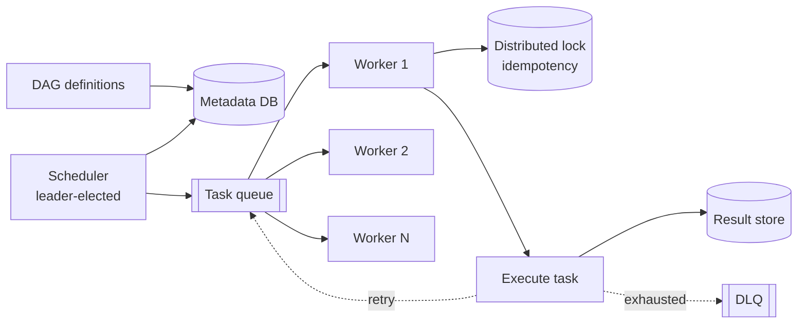

## Definition (interview-ready)

A **distributed job scheduler** runs jobs at the right time (cron schedules) and in the right order (DAGs, directed acyclic graphs of dependent tasks), across a pool of machines, with retries, alerting and a history of every run. Airflow is the classic example.

The design in one breath: a **metadata database** (Postgres) holds DAG definitions and the state of every run and task instance. A **scheduler** loop creates runs when schedules fire, finds task instances whose upstream tasks are done, and puts them on a **task queue**. **Workers pull** tasks from the queue, run them, write status back and ship logs to object storage. Failed tasks go through **retries with backoff**, and tasks must be **idempotent** (keyed by the run's logical date or run ID) because retries, catchup and backfills re-run them. Pools and quotas stop one team from starving others, and **deferrable sensors** stop waiting tasks from holding worker slots.

The main trade-off is **a central state database (simple, easy to reason about) vs throughput**: every state change is a DB write, so the DB and scheduler loop become the bottleneck at scale.

**One-liner:** A scheduler loop reads DAG and task state from a central database, enqueues tasks whose dependencies are met, and pull-based workers run them with retries, idempotent task design and pools for multi-tenant fairness.

## Problem statement

Design a distributed scheduler that runs millions of jobs on time (cron-like) and dependency-driven (DAGs), with retries, failure handling, and observability.



## Requirements

### Functional
- Schedule jobs by time (cron) or trigger.
- Run DAGs (directed acyclic graphs of tasks with dependencies).
- Retries with backoff.
- Idempotency.
- Status: running, success, failed, retried, skipped.

### Non-functional
- Reliable: a missed job is a P1.
- Scale: 1M jobs/day, 100K concurrent.
- Multi-tenant.
- Observable: timeline, logs, alerts.

## Scale estimation

- 1M jobs/day = ~12/sec average; ~100/sec peak.
- 100K concurrent (think long-running ETL).
- DAG complexity: 100s of tasks each.

## High-level architecture

```
            ┌──────────┐
   UI/API ─►│ Scheduler│ ── parses DAGs, computes ready set
            └────┬─────┘
                 ▼
            ┌──────────┐
            │ Job DB   │ ── DAG state, task state, schedules
            │ (Postgres)
            └────┬─────┘
                 ▼
            ┌──────────┐
            │ Queue    │ ── tasks ready to run (Redis / Kafka)
            └────┬─────┘
                 ▼
            ┌──────────┐
            │ Workers  │ ── execute task; report status
            └────┬─────┘
                 ▼
       ┌──────────────────┐
       │  Object storage  │ ── logs (S3)
       └──────────────────┘
```

## Detailed design

### Job model

- **DAG**: a workflow definition (`Python file` in Airflow, declarative YAML elsewhere).
- **Task**: a unit of work (run bash, call API, run Spark job).
- **Run / Execution**: a specific instantiation of a DAG for a given input or date, its **logical date** (e.g., DAG `daily_sales` for 2026-05-29).
- **Task instance**: a specific task within a run.

### Scheduler

- Periodically scans DAGs.
- For each DAG, determines if a new run should be created (cron, manual trigger, sensor passes).
- For each active run, examines task dependencies and marks ready tasks.
- Enqueues ready task instances to the queue.

### Queue

- Tasks → worker queue (Celery, Redis-backed, Kafka, or SQS).
- Workers poll and consume.
- Multiple queues for different priorities, resource needs.

### Workers

- Long-running processes that consume from queue.
- For each task: load code, execute, report status (running, success, failed) back to the DB.
- Push logs to object storage.
- On failure: status set; scheduler decides whether to retry.

### Retries

- Configurable per task: max retries, retry delay (exponential backoff).
- Scheduler picks up failed task, re-enqueues with increasing delay.
- After max retries: terminal failure; mark DAG run failed (per failure policy).

### Dependencies

- A task is ready when its upstream tasks satisfy its **trigger rule**. Airflow's default, `all_success`, waits for every upstream task to succeed; other rules such as `all_done` or `none_failed` allow failed or skipped upstreams.
- Computed by scheduler on every scan cycle.
- Stored in DB for visualization.

### State machine (task instance)

```
NONE → SCHEDULED → QUEUED → RUNNING → SUCCESS
                               ↓
                  (retries left) UP_FOR_RETRY → SCHEDULED ...
                               ↓
                  (exhausted)  FAILED

Set without running: UPSTREAM_FAILED (an upstream failed), SKIPPED (branch / short-circuit)
```

### Idempotency

- Tasks should be idempotent.
- Pass the run's logical date / `run_id` to task code (Airflow 3 removed the old `execution_date` name in favour of `logical_date`); idempotent operations use it as the key.
- Critical for retries.

### Cron + sensors

- Cron triggers: standard cron expressions.
- Sensors: poll ("poke") for an external condition (file in S3, DB row exists). Push-based via event triggers (modern Airflow deferrable operators) is better than polling.

### Multi-tenancy

- Per-team DAG quotas.
- Resource pools (e.g., "spark_cluster" pool with max parallelism).
- Tagging for cost allocation.

### Catchup & backfill

- If the scheduler is down for a day, on restart it can "catch up" missed runs, if catchup is enabled for that DAG.
- Backfill: manually rerun historical DAGs (e.g., reprocess data after bug fix).
- Controls: `catchup=False` to skip historical runs. Airflow 3.0 made this the default (`catchup_by_default = False`); Airflow 2 defaulted to catching up.

## Bottlenecks & optimizations

- **Scheduler scan time**: bigger DAGs take longer to evaluate. Parallelize scheduler scans. Use incremental scan ('only changed DAGs').
- **DB contention**: every task state change writes a row. Tune Postgres; consider sharded DB.
- **Worker scaling**: autoscale workers based on queue depth.
- **Deferrable operators (Airflow 2.2+)**: sensors that yield instead of blocking a worker — huge concurrency win.

## Trade-offs

- **Push vs pull workers**: pull (worker polls queue) is simpler, naturally backpressured. Push has lower latency.
- **Centralized DB vs distributed state**: centralized is simpler; distributed scales further but adds consensus complexity.
- **Polling sensors vs event-driven**: polling is simple but burns worker slots. Event-driven is efficient but requires plumbing.

## Practice questions

<Practice>

<QA q="What is the difference between a DAG, a run, a task and a task instance?" level="easy">

- **DAG**: the workflow definition (tasks plus dependencies).
- **Task**: one unit of work in it (run bash, call an API, run a Spark job).
- **Run**: one instantiation of the DAG for a given input or date, such as `daily_sales` for 2026-05-29.
- **Task instance**: one task within one run. State, retries and logs are tracked at this level.

</QA>

<QA q="How does the scheduler decide what to run?" level="easy">

On each scan: for each active DAG run, find tasks whose dependencies are all in success state and which haven't been queued. Enqueue them. For DAGs with a cron schedule, create a new run when the schedule fires.

</QA>

<QA q="When does a task end up UPSTREAM_FAILED or SKIPPED instead of running?" level="easy">

These states are set without running the task. UPSTREAM_FAILED means a task it depends on failed, so its dependencies can never be met. SKIPPED comes from branching or short-circuit logic that chose a different path.

</QA>

<QA q="How do you handle a task failure?" level="medium">

Mark the task as failed. Increment the retry count. If retries remain, schedule a retry after a backoff delay (UP_FOR_RETRY). If max retries are exhausted, mark terminal failure. Then apply the DAG run's failure policy: fail the whole run, continue with independent tasks, and so on.

</QA>

<QA q="Why do tasks need to be idempotent?" level="medium">

Retries (failure, then re-run), backfills (re-run historical periods), partial failures (a task started but its state wasn't recorded) — all mean the same task may run more than once. Idempotency ensures no duplicate side effects. Pass the run's logical date / `run_id` into the task and use it as the key, for example overwrite the partition for that date instead of appending.

</QA>

<QA q="Compare push and pull worker models." level="medium">

Pull (worker polls queue, popular in Celery/Airflow): simple, natural backpressure (workers process at their own speed), easy to scale workers up and down. Push (scheduler dispatches): lower latency, but coordination is more complex (scheduler needs a worker registry).

</QA>

<QA q="How does catchup vs backfill differ?" level="medium">

Catchup = scheduler creates runs for missed historical schedules when it starts (or when a DAG is unpaused), if catchup is enabled. Backfill = manually trigger a rerun of a historical period (typically after a bug fix or change). Catchup is automatic; backfill is operator-initiated. `catchup=False` skips the historical runs.

</QA>

<QA q="Why are polling sensors a scaling problem, and what replaces them?" level="medium">

A classic sensor holds a worker slot while it repeatedly pokes for an external condition (file in S3, DB row exists), so thousands of waiting sensors can starve real work. Deferrable operators (Airflow 2.2+) hand the wait to an async trigger and free the worker until the condition is met. Event-driven triggers are more efficient still but need more plumbing.

</QA>

<QA q="How do you keep one team from starving others in a multi-tenant scheduler?" level="hard">

Per-team DAG quotas, resource pools with a max parallelism (for example a `spark_cluster` pool), separate queues by priority or resource needs, and tags for cost attribution. Pools cap how much of a shared resource any set of tasks can grab at once.

</QA>

<QA q="Design retry policy." level="hard">

- Configurable per task: max retries, base delay, exponential factor.
- Sensible default: 3 retries, exponential backoff (for example 1m, 2m, 4m, capped). Airflow's own defaults are `retries=0`, `retry_delay=5m`.
- Permanent failures (parse error, missing data): no retry.
- Transient failures (5xx, timeout): retry.
- Custom hooks to decide based on exception type.

</QA>

<QA q="How would you scale to 100K concurrent tasks?" level="scenario">

- Multiple scheduler instances: shard DAGs by hash, or run several active schedulers that claim work with row locks (`SELECT ... FOR UPDATE SKIP LOCKED`), which is how Airflow 2+ runs schedulers in HA.
- Many worker pools across machines.
- Autoscaling based on queue depth.
- Deferrable / async sensors instead of polling.
- Sharded task DB (or specialized state store).
- Queue tier (Kafka or Redis cluster) handles the fan-out.

</QA>

<QA q="The scheduler was down for a day. What happens when it comes back, and what could go wrong?" level="scenario">

With catchup on (opt-in per DAG since Airflow 3.0), it creates runs for every missed schedule, which can flood the queue and workers with a day of runs at once. Control it with `catchup=False` for DAGs where only the latest run matters, concurrency limits per DAG and pools, and idempotent tasks so any overlapping or repeated runs are safe.

</QA>

<QA q="How to monitor 1M jobs/day?" level="scenario">

- Per-task metrics: duration, success rate, retry count.
- Per-DAG metrics: end-to-end SLO, lateness.
- Alerts: SLO breach, repeat failures, scheduler health.
- Visualization: Gantt of run, dependency graph.
- Lineage: which downstream broke because of which upstream.
- Cost attribution per team.

</QA>

</Practice>

## Quiz

<Quiz>

<MCQ q="When is a task instance ready to be queued?" options={["As soon as its DAG run is created", "When its upstream tasks satisfy its trigger rule, by default when all of them have succeeded", "When a worker becomes idle", "When its retry delay expires, regardless of upstream state"]} answer={1}>

The scheduler marks a task ready only once its upstream dependencies are satisfied. Run creation, idle workers or a retry timer alone don't satisfy dependencies.

</MCQ>

<MCQ q="A task that appends rows to a table is retried after a timeout and the table now has duplicates. What is the best fix?" options={["Set retries to 0", "Add more workers", "Make the task overwrite the partition keyed by its run date", "Switch from pull to push workers"]} answer={2}>

Keying the write on the logical date or run_id makes reruns idempotent. Disabling retries loses reliability, and worker count or dispatch model don't stop duplicate side effects.

</MCQ>

<MCQ q="A DAG was paused for two weeks. When unpaused, you only want today's run. What do you set?" options={["catchup=False", "A backfill for the two weeks", "retries=0", "A higher pool slot count"]} answer={0}>

catchup=False skips missed historical schedules. A backfill would deliberately run them, and retries or pool size don't control which schedules are created.

</MCQ>

<MCQ q="Thousands of sensors waiting on S3 files have exhausted the worker slots. What fixes it?" options={["Increase the poke interval to once a day", "Use deferrable operators so waiting doesn't hold a worker slot", "Mark the sensors as SKIPPED", "Move sensors to a separate DAG"]} answer={1}>

Deferrable operators release the worker while an async trigger waits for the condition. Slower poking delays work, skipping breaks the pipeline, and moving sensors to another DAG still occupies the same workers.

</MCQ>

<MCQ q="What is the main advantage of pull-based workers?" options={["Lowest possible dispatch latency", "The scheduler always knows every worker's state", "Natural backpressure, since workers take work at their own pace", "No queue is needed"]} answer={2}>

Workers polling a queue only take what they can handle, which gives backpressure and easy scaling. Lower latency is push's advantage, push needs a worker registry, and pull depends on the queue.

</MCQ>

<MCQ q="Task B depends on task A, and A fails with no retries left. What state does B get?" options={["FAILED", "UP_FOR_RETRY", "SKIPPED", "UPSTREAM_FAILED"]} answer={3}>

B never runs because its upstream failed, so it is marked UPSTREAM_FAILED. FAILED is for a task that ran and failed, UP_FOR_RETRY for one with retries left, and SKIPPED for branching.

</MCQ>

<MCQ q="Which failure should NOT be retried by default?" options={["A parse error in the task's code", "An HTTP 503 from a downstream API", "A network timeout", "A temporarily locked database row"]} answer={0}>

A parse error will fail the same way every time, so retrying wastes slots. 503s, timeouts and lock contention are transient and usually succeed on a later attempt.

</MCQ>

<MCQ q="Every task state change writes a row, and the scheduler DB is now the bottleneck. Which step helps?" options={["Remove all retries", "Disable logging to object storage", "Merge all DAGs into one", "Tune Postgres and shard the task state store"]} answer={3}>

The load comes from state writes, so tuning the DB and sharding state addresses it. Dropping retries or logs loses reliability and observability, and a single giant DAG makes scheduler scans slower.

</MCQ>

</Quiz>

## TL;DR cheat sheet

- Scheduler scans DAGs → identifies ready tasks → enqueues.
- Workers pull from queue → run task → report status.
- Centralized DB tracks state.
- Tasks must be idempotent (retries, backfills).
- Cron + sensors trigger runs.
- Resource pools for concurrency control.
- Deferrable / async sensors for scale.
- Multi-tenant via DAG quotas + cost attribution.

## Go deeper

- **Apache Airflow docs**: [airflow.apache.org/docs](https://airflow.apache.org/docs/apache-airflow/stable/).
- **Astronomer Academy**: free Airflow courses.
- **Temporal docs**: [docs.temporal.io](https://docs.temporal.io/) — workflow + retry primitives at scale.
- **Cadence (Uber; Temporal's predecessor)** — same family.
- **Argo Workflows**: Kubernetes-native.
- **Prefect, Dagster**: modern alternatives.
- **Airbnb Engineering**: Airflow's origin (created at Airbnb in 2014, open-sourced 2015).
