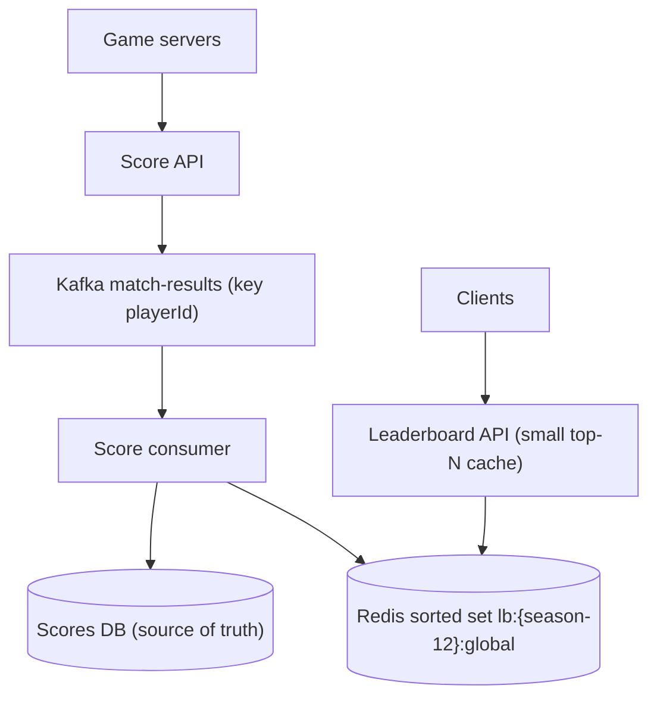
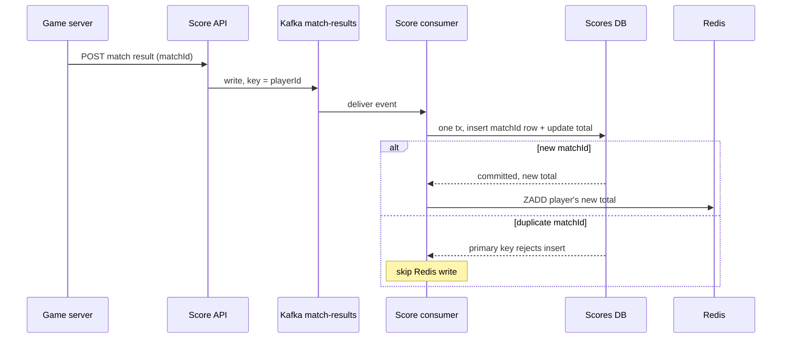
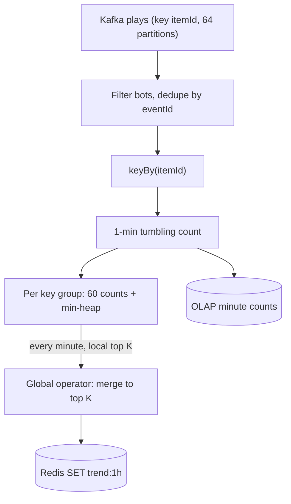

## Definition (interview-ready)

This note covers two systems that come up together in interviews.

A **real-time leaderboard** ranks players by score and answers three questions fast: who is in the top N, what is my rank, and who is just above and below me. Score events go into a durable store, which is the source of truth, and into a **Redis sorted set**, which keeps members ordered by score. Updates (`ZADD`, `ZINCRBY`) and rank lookups (`ZREVRANK`) cost O(log N), and a page of the board (`ZREVRANGE`) costs O(log N + M).

A **top-K trending** service finds the K most frequent items (hashtags, videos, products) in a sliding window such as "last hour". Events flow through **Kafka** into **Flink**, which counts per item in small time buckets, keeps a top-K per window, and writes the result to Redis for reads. Hourly and daily rollups are built by summing the small buckets.

The main decisions are how to break **ties** and how to **shard** a board too big for one key, and for trending, **exact counting vs a Count-Min Sketch plus a heap**. The core trade-off is exactness vs memory and latency.

**One-liner:** Keep the leaderboard in a Redis sorted set backed by a durable score store, and compute trending as a windowed top-K in Flink over Kafka, exact when memory allows and Count-Min Sketch plus a heap when it doesn't.

## Problem statement

"Design two things for a large online game platform.

1. A **leaderboard** for a competitive game. Players finish matches and earn points. Show the global top 100, let any player see their own rank and score, and show the 5 players just above and 5 just below them. Updates should show up within a couple of seconds.
2. A **trending** panel that shows the top 50 most-played game modes, maps or hashtags in the last hour, plus the top items for each hour and each day.

Scale: 200 million registered players, 20 million daily active players, each playing about 10 matches a day. The platform sees about 1 billion play or mention events a day."

## Requirements

### Functional

**Leaderboard**
- Record a score change when a match ends.
- Get the top N players (for example top 100), with scores.
- Get my rank and score.
- Get my neighbours: K players above and K below me.
- Separate boards per season, and optionally per region or game mode.

**Trending**
- Count events per item.
- Return the top K items over the last 60 minutes, refreshed about every minute.
- Return the top K for any past hour and any past day.

### Non-functional
- Leaderboard read latency: p99 under about 50 ms.
- Freshness: a new score shows on the board within about 1–2 seconds; trending can lag a minute.
- Correctness: a match must never be counted twice. Leaderboard ranks should be exact. Trending can be approximate if documented.
- High availability: reads keep working if one cache node fails.

### In scope vs out of scope
- In scope: score ingestion, ranking, ties, sharding, trending pipeline, rollups.
- Out of scope: matchmaking, anti-cheat logic (we just accept a validated match result), friends-only boards (mentioned briefly).

### Clarifying questions to ask
- Is the score **cumulative** (sum of points) or **best single result** (high score)? This changes `ZINCRBY` vs `ZADD ... GT`.
- How are **ties** broken: same rank for equal scores, or whoever got there first?
- Do we need ranks for **every** player, or only the top N exactly and a percentile ("top 3%") for everyone else?
- Is the board **all-time** or **per season**? Seasonal boards reset and stay smaller.
- For trending: what is the **window** (last hour, sliding by one minute)? Is approximate counting acceptable?
- Is trending **global** or per country? Per-country multiplies the number of top-K lists.

## Scale estimation

**Leaderboard writes**
- 20M DAU × 10 matches = **200M score updates/day**.
- 200M ÷ 86,400 s ≈ **2,315 writes/s** on average. With a 5× peak: about **11,600 writes/s**.

**Leaderboard reads**
- Assume each active player opens the board 10 times a day: 20M × 10 = 200M views/day ≈ **2,315 views/s**, peak about 11,600/s.
- Each view does about 2 Redis calls (top N, then my rank plus neighbours): peak about **23,000 read ops/s**.

**Leaderboard memory**
- Assume about 100 bytes per sorted-set entry once you count the member ID, the 8-byte score and Redis's internal skip-list and hash-table overhead (an assumption; measure with `MEMORY USAGE`).
- All-time board with all 200M players: 200M × 100 B = **20 GB in one key**.
- A seasonal board with only players active this season (say 50M) is 5 GB.

The op rate is modest for Redis. The problem is **20 GB in a single key**: one key lives on one node, so it can't be spread across a Redis Cluster, and a node that big is slow to fail over and resync.

**Trending ingest**
- 1B events/day ÷ 86,400 ≈ **11,574 events/s** average; with a 3× peak, about **35,000 events/s**.
- At about 200 bytes per event: 200 GB/day in Kafka, 600 GB/day with replication factor 3, and about 4.2 TB for 7 days of retention.

**Trending state**
- Events per hour: 1B ÷ 24 ≈ 41.7M.
- Assume up to 20M distinct items in an hour. An exact hash map at about 100 bytes per entry is 20M × 100 B = **2 GB** per hour of state, split across Flink tasks. That is workable.
- A Count-Min Sketch with error ε = 0.0001 and failure chance δ = 0.001 has width ⌈e ÷ 0.0001⌉ = 27,183 and depth ⌈ln 1000⌉ = ⌈6.91⌉ = 7. That is 190,281 counters × 4 bytes ≈ **0.76 MB**. Sixty one-minute sketches are about 46 MB.
- For any one item, the over-count over an hour stays within ε × N = 0.0001 × 41.7M ≈ **4,170** with probability at least 1 − δ (99.9%). That is small next to the counts of truly trending items.

## Core API

```
# Leaderboard
POST /v1/matches/{matchId}/result      { playerId, points, finishedAt }   (internal, from game servers)
GET  /v1/leaderboards/{boardId}/top?n=100
     → [ { rank, playerId, score } ]
GET  /v1/leaderboards/{boardId}/players/{playerId}?neighbours=5
     → { rank, score, above: [...], below: [...] }

# Trending
GET  /v1/trending?window=1h&k=50              → current sliding window
GET  /v1/trending/hourly?hour=2026-10-22T14&k=50
GET  /v1/trending/daily?date=2026-10-22&k=50
```

`boardId` encodes scope, for example `season-12:global` or `season-12:IN`. The match result call carries `matchId` so retries can be deduplicated.

## High-level architecture

```
                         LEADERBOARD
 Game servers ──► Score API ──► Kafka "match-results" (key = playerId)
                                     │
                                     ▼
                           Score consumer
                    ┌────────────────┴──────────────────┐
                    ▼                                   ▼
          Scores DB (source of truth)        Redis sorted set(s)
          match_results, player_scores       lb:{season-12}:global
                                                        ▲
 Clients ──► Leaderboard API ───────────────────────────┘
             (top N, my rank, neighbours; small top-N cache)

                          TRENDING
 App events ──► Kafka "plays" (key = itemId) ──► Flink job
                                                  │ keyBy(itemId)
                                                  │ 1-min tumbling counts
                                                  │ per-key-group top-K
                                                  │ global merge → top-K
                                                  ▼
                        Redis: trend:1h (current), trend:h:<hour>
                        OLAP store: minute counts → hourly, daily rollups
 Clients ──► Trending API ──► Redis (current) / OLAP or Redis (history)
```

The leaderboard half on its own. Writes go through Kafka, reads go straight to Redis:



**Leaderboard write path.** A game server posts a match result. The Score API writes it to Kafka, keyed by `playerId` so one player's updates stay in order. For each event, a consumer runs one DB transaction that inserts the `matchId` row (the primary key rejects a repeat) and updates the player's total, then writes the change to Redis. If it crashes after the DB commit but before the Redis write, the retry is rejected as a duplicate and Redis misses that match. So either write the player's new DB total with `ZADD` on every attempt (safe to repeat), or let the reconcile job (see Failure handling) catch it. If Redis is lost, it is rebuilt from the DB.

The write path for one match result, including the duplicate case:



**Leaderboard read path.** The top 100 is read with one range call and cached for a second or two, because every client asks for the same thing. "My rank plus neighbours" is one rank lookup and one small range, both O(log N).

**Trending path.** Events land in Kafka. Flink groups them by item, counts per one-minute bucket, and every minute emits the top K over the last 60 buckets. The result is written to Redis as one small list. Minute counts also go to an OLAP store, where hourly and daily top K are computed by summing.

## Data model

### Scores DB (source of truth)

```sql
CREATE TABLE match_results (
  match_id     BIGINT      NOT NULL,
  player_id    BIGINT      NOT NULL,
  season_id    INT         NOT NULL,
  points       INT         NOT NULL,
  finished_at  TIMESTAMP   NOT NULL,
  PRIMARY KEY (match_id, player_id)          -- dedupe: a retry can't insert twice
);

CREATE TABLE player_scores (
  season_id    INT     NOT NULL,
  player_id    BIGINT  NOT NULL,
  total_points BIGINT  NOT NULL,
  reached_at   TIMESTAMP NOT NULL,           -- when the current total was reached (tie-break)
  PRIMARY KEY (season_id, player_id)
);
```

Partition key: `player_id` (hash). Every write and the "my score" lookup touch one player, so this spreads load evenly. Ranking is **not** done here; that is Redis's job.

### Redis leaderboard

```
ZSET  lb:{season-12}:global     member = playerId   score = encoded score (see ties)
HASH  player:{playerId}         name, avatar, country   (for rendering the board)
```

The `{...}` part is a Redis Cluster **hash tag**: only that part is hashed to pick the slot, so keys that share it land together when you need multi-key commands.

### Trending

```
Kafka topic  plays          key = itemId, value = { itemId, userId, ts }
Flink state  per itemId:    ring of 60 one-minute counts (exact) or 60 sketches
Redis        trend:1h       ZSET or JSON list of top K, rewritten each minute
Redis        trend:h:2026102214   ZSET top items for that hour (trimmed)
OLAP table   item_minute_counts(minute, item_id, count)   partitioned by day
```

## Detailed design

### 1. Sorted-set basics: the four commands and what they cost

A Redis sorted set holds unique members, each with a floating-point score, kept in score order. Internally it uses a skip list together with a hash table, so it can find a member by name and also walk members in order.

| Need | Command | Time complexity (redis.io) |
|---|---|---|
| Set a score | `ZADD lb 1500 p42` | O(log N) per member added |
| Add points | `ZINCRBY lb 25 p42` | O(log N) |
| My rank (0 = highest) | `ZREVRANK lb p42` | O(log N) |
| Top 10 | `ZREVRANGE lb 0 9 WITHSCORES` | O(log N + M), M = rows returned |
| My score | `ZSCORE lb p42` | O(1) |
| How many above a score | `ZCOUNT lb (1500 +inf` | O(log N) |

Details worth saying out loud:
- `ZINCRBY` on a member that doesn't exist adds it with the increment as its score.
- `ZREVRANK` is **0-based**: the top player has rank 0, so show `rank + 1`. Since Redis 7.2 it accepts `WITHSCORE` and returns rank and score together.
- `ZREVRANGE` is deprecated since Redis 6.2 in favour of `ZRANGE key 0 9 REV WITHSCORES`. Both still work; mention either.
- For a "best score" game use `ZADD lb GT 1500 p42` (Redis 6.2+): it only updates if the new score is higher.
- Scores are 64-bit doubles. Integers are exact only up to 2^53, which matters for the tie-break trick below.

**How to say it:** "Every write and rank lookup is O(log N), and reading a page is O(log N) plus the page size, so even with tens of millions of players each call is a few dozen skip-list steps."

### 2. Ties

When two members have the same score, Redis orders them **lexicographically by member name** (byte by byte). In a descending read (`ZREVRANGE`, `ZRANGE ... REV`), equal scores come out in **reverse** lexicographic order. That is deterministic but meaningless to players: `p9` beats `p10` only because of its name.

Pick a rule with the product team, then implement it:

**Rule A: equal scores share a rank (standard competition ranking, "1, 2, 2, 4").** Keep the raw score and compute rank as "how many players have a strictly higher score, plus 1":

```
ZSCORE lb p42                  → 1500
ZCOUNT lb (1500 +inf           → 37      (the "(" makes 1500 exclusive)
rank shown = 37 + 1 = 38
```

`ZSCORE` is O(1) and `ZCOUNT` is O(log N).

**Rule B: whoever reached the score first ranks higher.** Pack a tie-breaker into the low part of the score:

```
score = points × 2^32 + (2^32 − 1 − secondsSinceSeasonStart)
```

Higher points always win. For equal points, the earlier time leaves a larger remainder, so it ranks higher. To stay exact, the result must stay below 2^53, so points must stay below 2^21 (about 2.1 million). If you need bigger scores, use fewer bits for time (minutes instead of seconds) or a coarser point unit.

Catch: with Rule B you can't just `ZINCRBY points × 2^32`, because that keeps the **old** timestamp bits. Do the read-compute-write in a small Lua script so it stays atomic:

```lua
-- KEYS[1] = board, ARGV[1] = player, ARGV[2] = points to add, ARGV[3] = time part
local cur = tonumber(redis.call('ZSCORE', KEYS[1], ARGV[1]) or '0')
local pts = math.floor(cur / 4294967296) + tonumber(ARGV[2])
return redis.call('ZADD', KEYS[1], pts * 4294967296 + tonumber(ARGV[3]), ARGV[1])
```

### 3. "My rank plus neighbours"

```
r = ZREVRANK lb p42                         → 37        (0-based)
ZRANGE lb max(0, r-5) r+5 REV WITHSCORES    → 11 rows: 5 above, me, 5 below
```

Cost is O(log N) + O(log N + 11). Near the top the window is shorter: for the number-one player it returns 6 rows. Then fetch display names with one pipelined batch of `HGETALL player:{id}` calls (or keep names in a local cache).

Two details interviewers like:
- The two calls aren't atomic. If my score changes in between, the window may be off by one row. Wrap both in a Lua script if that matters; usually it doesn't.
- For a player who isn't on the board, `ZREVRANK` returns nil. Show "unranked" rather than an error.

### 4. Sharding a leaderboard too big for one key

One sorted set lives on one Redis node. At 20 GB, one key means one node's memory, one CPU core doing every write to it, and a long resync on failover. Options, from best to worst default:

**a. Make the board smaller first.** Most real boards are per season, per region, per mode or per league. A seasonal board only holds players who played this season. This is the cheapest fix and often enough.

**b. Exact top N plus approximate rank for everyone else.** Players care about exact rank near the top and near themselves. Keep an exact sorted set of, say, the top 1 million, and for everyone below, show a percentile computed from a **score histogram** (a count of players per score bucket, refreshed every minute). "You are in the top 12%" is what most games show anyway.

**c. Shard by score range.** Shard 0 holds scores 0–999, shard 1 holds 1,000–4,999, and so on. My rank = (sum of sizes of all higher shards, via `ZCARD`) + my rank inside my shard. The top N reads only the top shard. Downsides: a player who crosses a boundary must be moved (remove from one shard, add to the next), and shards are uneven because scores usually aren't uniform. Pick boundaries from the histogram and rebalance between seasons.

**d. Shard by player ID hash.** Writes spread evenly and players never move. But reads become scatter-gather:
- Top N: ask every shard for its top N, merge, keep N. With S shards that is S calls of O(log n + N).
- My rank: ask every shard `ZCOUNT (myScore +inf` and add the answers. S calls of O(log n).

That's fine for 8–16 shards behind a cached top N, and painful for 1,000.

| Approach | Writes | Top N | My rank | Main cost |
|---|---|---|---|---|
| One key | O(log N) on one node | 1 call | 1 call | memory and one hot node |
| Score-range shards | moves across shards | 1 call (top shard) | 1 call + `ZCARD` of higher shards | boundary moves, skew |
| Hash shards | spread evenly | scatter-gather + merge | scatter-gather `ZCOUNT` | fan-out on every read |
| Exact top + histogram | small exact set | 1 call | exact near top, percentile below | not exact for the tail |

**How to say it:** "I'd shrink the board first with seasons and regions, keep an exact sorted set for the top players, and give everyone else a percentile from a histogram. If they insist on exact global ranks for all 200 million players, I'd hash-shard and scatter-gather `ZCOUNT`, and cache the top N."

### 5. Top-K trending over a sliding window

**The problem.** Count events per item and return the K highest counts over the last 60 minutes, updated every minute. A naive approach keeps every raw event and re-counts every minute. Instead, use **buckets**: count per item per minute, keep the last 60 minute-buckets, and the window total is the sum of those 60. When a minute passes, drop the oldest bucket and add the newest. This is a sliding window with a 60-minute size and a 1-minute slide.

**Option 1: exact counting.** Each Flink task owns a set of items (because of `keyBy(itemId)`), keeps a map from item to 60 minute counts, and keeps a **min-heap** of its local top K. Since each item lives on exactly one task, the global top K is exactly the merge of the per-task top Ks. Memory is about 2 GB per hour for 20M distinct items (from the estimate), spread over the cluster. Exact, simple and the right default at this scale.

**Option 2: Count-Min Sketch plus a heap.** When distinct items explode (every URL, every search phrase, every IP), exact maps get too big. A **Count-Min Sketch (CMS)** is a small grid of counters, `d` rows by `w` columns, with one hash function per row:

- **Add item x:** in each row, hash x to a column and add 1.
- **Estimate x:** read the d counters for x and take the **minimum**.

Collisions only ever add to a counter, so the estimate is **never below** the true count. With width ⌈e/ε⌉ and depth ⌈ln(1/δ)⌉, the over-count is at most ε × N (N = total events) with probability at least 1 − δ. The sketch only gives counts; it can't list items. So pair it with a **min-heap of size K**:

```
on event x:
    cms.add(x)
    est = cms.estimate(x)
    if x in heap:            heap.update(x, est)
    elif heap.size < K:      heap.push(x, est)
    elif est > heap.min():   heap.replace_min(x, est)
```

For a sliding window, keep **one sketch per minute**. Sketches with the same width, depth and hash functions can be **merged by adding cell by cell**, so the 60-minute sketch is the sum of 60 minute sketches. Each minute, drop the oldest, add the newest, and re-score the candidate items (the union of each minute's heavy hitters) against the merged sketch to rebuild the heap.

Things to mention:
- CMS is bad for **small** counts: the error ε × N is noise for rare items. That's fine for trending, where only big counts matter.
- Redis ships both pieces: `CMS.INITBYPROB` / `CMS.INCRBY` / `CMS.QUERY` / `CMS.MERGE`, and a `TOPK` structure based on the HeavyKeeper algorithm (a hash table of counts plus a min-heap of the top K). Redis's CMS uses slightly different constants from the paper: the redis.io example with error 0.001 and probability 0.002 gives a 2000 × 9 sketch.
- Details of CMS, HyperLogLog and Bloom filters are in [Probabilistic data structures](/learn/notes/probabilistic-data-structures/).

**"Trending" is not just "most frequent".** The most-played mode is popular every hour. Trending usually means **growing faster than normal**: score = count in the last hour ÷ (average hourly count over the last week + a smoothing constant). Compute both counts in the same pipeline.

### 6. The stream pipeline: Kafka plus Flink

```
Kafka "plays" (key = itemId, 64 partitions)
   │
Flink:
   source (offsets in checkpoints)
   → filter bots / dedupe by eventId (short-TTL keyed state)
   → keyBy(itemId)
   → 1-minute tumbling window, AggregateFunction (count)    ← incremental, no buffering
   → per-key-group: keep 60 minute counts, min-heap top K
   → every minute: local top K → global operator → merge → final top K
   → sinks: Redis SET trend:1h (whole list), OLAP (minute counts)
```

The same pipeline as a diagram, top to bottom:



Key points:
- **Incremental aggregation.** Use a `ReduceFunction` or `AggregateFunction` so Flink keeps one running count per key and window. A plain `ProcessWindowFunction` buffers every event in the window before computing.
- **Event time and watermarks.** Count by when the event happened, not when it arrived. A watermark tells Flink "events older than this are done", so it can close a minute. Allowed lateness defaults to 0; late events are dropped unless you set it or route them to a side output. See [stream processing](/learn/notes/stream-processing-flink-kstreams/).
- **Hot keys.** One viral item sends all its events to one Flink task. Fix with **two-phase aggregation**: first group by `(itemId, random salt 0–15)` and pre-count, then group by `itemId` and sum the 16 partial counts.
- **Exactly-once results.** Flink checkpoints its state and Kafka offsets together, so after a crash it replays from the last checkpoint. The Redis sink is not transactional, so make the write **idempotent**: overwrite the whole top-K list for window `T` (`SET trend:1h <list>`), never increment. Replaying the same window rewrites the same value.

### 7. Hourly and daily rollups

Never re-read raw events for history. Roll up from small buckets:

- **Minute**: Flink writes `(minute, itemId, count)` for every item with a non-trivial count to an OLAP store (ClickHouse, Druid, Pinot or a warehouse table).
- **Hour**: `SUM(count) GROUP BY itemId` over 60 minutes, top K by `ORDER BY ... LIMIT K`. Run it when the hour closes and store the result.
- **Day**: sum 24 hourly tables, not 1,440 minute rows.

A Redis-only alternative for fast reads: keep one sorted set per hour, `trend:{h}:2026102214`, filled by `ZINCRBY` of the per-minute counts (Flink already pre-aggregated, so Redis sees one write per item per minute, not one per event). Build "last 24 hours" with:

```
ZUNIONSTORE trend:{h}:last24 24 trend:{h}:2026102115 ... trend:{h}:2026102214
ZRANGE trend:{h}:last24 0 49 REV WITHSCORES
```

`ZUNIONSTORE` sums scores by default and is O(N) + O(M log M), so trim each hourly set to its top 10,000 with `ZREMRANGEBYRANK` first. Trimming makes the daily answer approximate: an item at rank 10,001 every hour vanishes. The shared hash tag `{h}` keeps all these keys in one cluster slot, which multi-key commands need. `WEIGHTS` lets you decay older hours (for example 1.0 for the latest hour down to 0.3 for the oldest).

Also run a **daily batch job** (Spark over the raw event lake) that computes exact daily counts and overwrites the day's result. Real-time numbers are fast and approximate; the batch is late and exact.

## Bottlenecks & optimizations

- **Hot top-N reads.** Everyone reads the same top 100. Cache it in the API for 1–2 seconds; Redis then sees one call per second per API pod instead of thousands.
- **One huge sorted set.** Shrink with seasons and regions, use score-range or hash shards, or exact top plus histogram for the tail.
- **Write bursts at season end.** Kafka absorbs the burst; consumers batch `ZINCRBY` calls with pipelining.
- **Reads on replicas.** Serve rank and range reads from Redis replicas if a second of staleness is fine.
- **Hot items in trending.** Two-phase (salted) aggregation in Flink.
- **Too many distinct items.** Count-Min Sketch plus heap instead of exact maps; drop items below a minimum count before writing minute rows to OLAP.
- **Rollup cost.** Hours from minutes, days from hours; trimmed hourly sorted sets for Redis reads.

## Failure handling

| Component fails | What happens | Recovery |
|---|---|---|
| Redis primary (leaderboard) | Writes pause; a replica is promoted in seconds. Asynchronous replication can lose the last few updates. | Consumers keep going against the new primary. A reconcile job compares `player_scores` in the DB with Redis and fixes drift. |
| Whole Redis lost | Board is empty. | Rebuild from `player_scores` with batched `ZADD` (millions of rows per minute with pipelining), while the API serves a stale cached top N. |
| Score consumer crashes | Kafka keeps events; lag grows. | Restart from committed offsets. The `matchId` dedupe check makes reprocessing safe, because `ZINCRBY` itself is not idempotent. |
| Duplicate match result | Could double-count points. | `match_results` primary key on `(match_id, player_id)` rejects the second insert; only apply to Redis if the insert succeeded. A crash between the DB commit and the Redis write is covered by writing the DB total with `ZADD` or by the reconcile job. |
| Scores DB down | Can't record new results. | Events wait in Kafka; leaderboard reads still work from Redis. |
| Flink task or job crash | Trending stops updating. | Restart from the last checkpoint and replay Kafka. The last good top-K stays in Redis, marked with its window time. |
| Late or out-of-order events | Could land in the wrong minute. | Event-time windows with watermarks; small allowed lateness; daily batch corrects the rest. |
| OLAP store down | Hourly and daily history unavailable. | Current trending still works from Redis; minute rows buffer in Kafka and are loaded later. |

## Trade-offs

| Decision | Option A | Option B | Pick when |
|---|---|---|---|
| Ranking store | Redis sorted set | SQL `ORDER BY score` with an index | Redis for live ranks; SQL rank of one user needs counting rows above, which gets slow at scale |
| Tie rule | Shared rank via `ZCOUNT` | Earlier-wins packed score | Shared rank is simpler; packed score needs Lua and a 2^53 budget |
| Big board | Score-range shards | Hash shards | Range for cheap top N; hash for even writes and no moves |
| Tail ranks | Exact for all | Percentile from histogram | Percentile unless the product truly needs exact rank 87,654,321 |
| Trending counts | Exact map per item | Count-Min Sketch + heap | Exact while state fits; CMS when distinct items explode |
| Window | Bucketed sliding (60 × 1 min) | Exact per-event sliding | Buckets: tiny state and good enough freshness |
| History | OLAP rollups | Hourly Redis sorted sets | OLAP for any query; Redis for fast fixed views |
| Accuracy | Streaming only | Streaming + daily batch correction | Add batch when published numbers must be exact |

## Practice questions

<Practice>

<QA q="Why is a Redis sorted set a good fit for a leaderboard?" level="easy">

It keeps members ordered by score at all times, so you never sort on read. Updates (`ZADD`, `ZINCRBY`) and rank lookups (`ZREVRANK`) are O(log N), a page of results (`ZREVRANGE` or `ZRANGE ... REV`) is O(log N + M), and `ZSCORE` is O(1). Internally it combines a skip list (for order) with a hash table (for finding a member by name).

</QA>

<QA q="ZREVRANK returns 0 for the top player. Why, and what do you show the user?" level="easy">

Ranks in Redis are 0-based indexes into the ordered set, with the highest score at index 0 for `ZREVRANK`. Show `rank + 1`. If the member isn't in the set, the command returns nil, so show 'unranked'.

</QA>

<QA q="When do you use ZINCRBY and when ZADD with GT?" level="easy">

`ZINCRBY` when the score is cumulative (add match points to a season total). `ZADD key GT score member` (Redis 6.2+) when the board shows each player's best single result: it only updates if the new score is higher, so you don't need to read first.

</QA>

<QA q="How do you return a player's rank plus the 5 players above and below?" level="medium">

`r = ZREVRANK lb me`, then `ZRANGE lb max(0, r-5) r+5 REV WITHSCORES`. The rank lookup is O(log N) and the range is O(log N + 11); it returns up to 11 rows (fewer near the top). The two calls aren't atomic, so wrap them in Lua if you need a perfectly consistent view; for a game board a one-row shift is acceptable.

</QA>

<QA q="Two players have the same score. How does Redis order them, and how would you implement 'same score, same rank'?" level="medium">

Redis orders equal scores by member name, byte by byte, and reverses that in descending reads. That's arbitrary for players. For shared ranks, compute rank as the count of strictly higher scores plus one: `ZCOUNT lb (myScore +inf` then add 1. `ZSCORE` is O(1) and `ZCOUNT` is O(log N).

</QA>

<QA q="How would you make the player who reached a score first rank higher?" level="medium">

Pack a time tie-breaker into the score: `points × 2^32 + (2^32 − 1 − secondsSinceSeasonStart)`, so earlier times give a bigger remainder. Keep the total under 2^53 because scores are doubles, which caps points at about 2.1 million. Update with a Lua script that reads the current points, adds, and writes the new packed score, because a plain `ZINCRBY` would keep the old time bits.

</QA>

<QA q="Your global board has 200 million players and 20 GB in one key. What are your options?" level="hard">

First shrink it: seasonal, regional or league boards. Then either keep an exact sorted set for the top players and show a percentile from a score histogram for everyone else, or shard. Score-range shards make top N one call and rank = sizes of higher shards plus local rank, but players move across boundaries and shards skew. Hash shards spread writes evenly but every top-N and rank read becomes scatter-gather (`ZCOUNT` on every shard, sum).

</QA>

<QA q="Why can't Redis Cluster just spread one big sorted set across nodes?" level="medium">

Redis Cluster shards by key: each key hashes to one of 16,384 slots, and a slot lives on one node. A single sorted set is one key, so it always sits on one node no matter how many nodes you add. Splitting it has to be done in your application by using several keys.

</QA>

<QA q="Explain how a Count-Min Sketch estimates a count and which way it errs." level="medium">

It is a grid of d rows and w counters, with one hash per row. Adding x increments one counter per row; estimating x takes the minimum of its d counters. Collisions only add, so it never under-counts; it can over-count by more than ε × N only with probability at most δ when w = ⌈e/ε⌉ and d = ⌈ln(1/δ)⌉. It is accurate for big counts and noisy for small ones, which suits trending.

</QA>

<QA q="A Count-Min Sketch gives counts but not a list of items. How do you get the top K?" level="hard">

Pair it with a min-heap of size K. On each event, update the sketch, read the item's estimate, and if the item is already in the heap update it; if the heap isn't full insert it; otherwise replace the heap's minimum when the estimate beats it. For a sliding window keep one sketch per minute, merge by adding cells, and rebuild the heap from candidate items each minute.

</QA>

<QA q="In Flink, items are partitioned with keyBy. Why is merging per-task top-K lists exact here?" level="hard">

With `keyBy(itemId)` each item's full count lives on exactly one task. So if an item is in the global top K, it must also be in its own task's top K. Merging the local top-K lists and taking the K largest gives the exact answer. If events were spread randomly instead, one item's count would be split across tasks and local top-K lists could miss it.

</QA>

<QA q="How do you build hourly and daily trending without re-reading raw events?" level="medium">

Roll up from small buckets. Flink writes per-minute counts; an hourly job sums 60 minutes and takes top K; a daily job sums 24 hours. For fast reads, keep one Redis sorted set per hour and use `ZUNIONSTORE` over 24 hourly keys (optionally with `WEIGHTS` for decay), trimming each hour to its top items first. A nightly batch over raw data corrects any drift.

</QA>

<QA q="A replayed Kafka partition double-counted some matches on the leaderboard. How do you fix and prevent it?" level="scenario">

`ZINCRBY` isn't idempotent, so replays add points twice. Prevent it by deduping on `matchId`: insert into `match_results` with a primary key on `(match_id, player_id)` and only touch Redis when the insert succeeds, or record the match ID in Redis with `SET NX` inside the same Lua script as the increment. To fix existing damage, rebuild the affected players' Redis scores from `player_scores` in the DB, which is the source of truth.

</QA>

<QA q="A single viral video makes one Flink task fall behind and the trending panel goes stale. What do you do?" level="scenario">

It is a hot key: all its events go to one task. Use two-phase aggregation: group by `(videoId, salt)` with a small random salt range, count partial sums per minute, then group by `videoId` and add the partials. Also check that you use incremental aggregation (`AggregateFunction`) so the window keeps one counter per key instead of buffering events.

</QA>

<QA q="The Redis node holding the leaderboard dies and the replica is promoted. Players complain their last match is missing. Why, and what is the plan?" level="scenario">

Redis replication is asynchronous, so the last few writes acknowledged by the old primary may not have reached the replica. The scores DB still has them. Run a reconcile job that compares recent `player_scores` rows with Redis and re-applies missing totals (using `ZADD` with the DB total, which is idempotent). For a full loss, rebuild the whole set from the DB with pipelined `ZADD` while serving a cached top N.

</QA>

<QA q="Product says the 'most played' list never changes and isn't interesting. How do you make it 'trending'?" level="scenario">

Rank by growth, not raw volume. For each item compare the last hour's count with its normal level, for example `count_last_hour ÷ (average hourly count over the past week + smoothing constant)`, and require a minimum count so tiny items don't spike. Compute both in the same Flink job and keep the top K by this ratio.

</QA>

</Practice>

## Quiz

<Quiz>

<MCQ q="What is the time complexity of ZREVRANGE lb 0 9 on a sorted set with N members?" options={["O(1)", "O(log N + 10)", "O(N)", "O(N log N)"]} answer={1}>

redis.io lists range reads as O(log N + M), where M is the number of returned elements: find the start in the skip list, then walk M nodes. It isn't constant, and it doesn't scan or sort the whole set.

</MCQ>

<MCQ q="Two members have the same score. In what order does ZRANGE with REV return them?" options={["Insertion order", "Random order", "Reverse lexicographic order of member names", "Order of last update"]} answer={2}>

Equal scores are ordered lexicographically by member bytes, and the REV option reverses that. Redis does not track insertion or update time, and the order is deterministic.

</MCQ>

<MCQ q="You need 'equal scores share a rank'. Which call gives the number of players strictly above score 1500?" options={["ZCOUNT lb (1500 +inf", "ZREVRANK lb 1500", "ZCARD lb", "ZCOUNT lb 1500 +inf"]} answer={0}>

The '(' prefix makes 1500 exclusive, so it counts strictly higher scores; add 1 for the shared rank. ZREVRANK takes a member, not a score. ZCARD counts everyone. Without '(' the count includes the tied players too.

</MCQ>

<MCQ q="Why must a packed tie-break score stay below 2^53?" options={["Redis rejects scores above 2^53", "Skip lists support at most 2^53 levels", "ZINCRBY overflows at 2^53", "Scores are 64-bit doubles, which store integers exactly only up to 2^53"]} answer={3}>

Sorted-set scores are double-precision floats. Above 2^53 neighbouring integers can't all be represented, so the low tie-break bits get lost. Redis accepts larger values; it just stores them approximately.

</MCQ>

<MCQ q="A leaderboard is hash-sharded by player ID across S shards. What does 'get my rank' cost?" options={["One ZREVRANK on my shard", "A ZCOUNT of higher scores on every shard, then sum", "A ZUNIONSTORE of all shards", "It can't be computed"]} answer={1}>

Players with higher scores can be on any shard, so you ask each shard how many members beat your score and add the counts. Your own shard's rank is only local. Merging all shards into one set would defeat sharding.

</MCQ>

<MCQ q="Which statement about a Count-Min Sketch is true?" options={["It can under-count an item", "It can list the most frequent items by itself", "It never under-counts; collisions can only add", "Its error shrinks as more events arrive"]} answer={2}>

Every counter an item touches holds at least that item's count, and taking the minimum can only be too high. It stores no item names, so it needs a heap to list top items. The error bound is ε × N, which grows with total events N.

</MCQ>

<MCQ q="With ε = 0.0001 and δ = 0.001, roughly how big is a Count-Min Sketch using w = ⌈e/ε⌉ and d = ⌈ln(1/δ)⌉ and 4-byte counters?" options={["About 0.76 MB", "About 76 KB", "About 7.6 MB", "About 76 MB"]} answer={0}>

w = 27,183 and d = 7, so 190,281 counters × 4 bytes ≈ 761 KB. The other options are off by factors of 10 or 100.

</MCQ>

<MCQ q="In the Flink job, why use an AggregateFunction for the one-minute count rather than only a ProcessWindowFunction?" options={["ProcessWindowFunction can't use event time", "AggregateFunction is required for keyBy", "AggregateFunction updates a running count, while ProcessWindowFunction buffers every element until the window fires", "ProcessWindowFunction doesn't support tumbling windows"]} answer={2}>

Flink's docs say reduce and aggregate functions aggregate incrementally, while a ProcessWindowFunction has to buffer all elements of the window first. The other claims are false: both work with event time, keyBy and tumbling windows.

</MCQ>

<MCQ q="Why does the Flink sink overwrite the whole top-K list in Redis instead of incrementing counters?" options={["SET is faster than ZINCRBY", "Redis can't store lists", "Flink can't call ZINCRBY", "Overwriting is idempotent, so replay after a crash gives the same result"]} answer={3}>

After a failure Flink replays from its last checkpoint, so the sink may write the same window twice. Overwriting with the same value is safe; incrementing would double-count. Speed and API limits aren't the reason.

</MCQ>

</Quiz>

## TL;DR cheat sheet

- **Leaderboard = Redis sorted set** backed by a durable scores DB. `ZADD`/`ZINCRBY`/`ZREVRANK` O(log N); `ZREVRANGE` (or `ZRANGE ... REV`) O(log N + M); `ZSCORE` O(1).
- Ranks are **0-based**; show rank + 1. `WITHSCORE` on rank commands since 7.2; `ZADD GT` since 6.2.
- **Ties**: Redis orders equal scores by member name. Shared rank = `ZCOUNT (score +inf` + 1. Earlier-wins = pack time into the low bits, stay under 2^53, update with Lua.
- **Neighbours**: `ZREVRANK`, then `ZRANGE r-5 r+5 REV WITHSCORES`.
- **Big boards**: one key = one node. Shrink by season or region; exact top plus histogram percentile; or score-range or hash shards (hash means scatter-gather `ZCOUNT`).
- **Dedupe** by `matchId` before `ZINCRBY`; rebuild Redis from the DB.
- **Trending**: Kafka → Flink `keyBy(item)` → 1-minute counts → 60-bucket sliding window → local top K → global merge → overwrite in Redis.
- **Exact vs CMS**: exact while state fits; CMS (w = ⌈e/ε⌉, d = ⌈ln 1/δ⌉, over-counts by at most εN) plus a min-heap when distinct items explode. Per-minute sketches merge by adding.
- **Hot keys**: salt then sum. **Rollups**: minute → hour → day; `ZUNIONSTORE` with `WEIGHTS` for decayed views; nightly batch for exact numbers.

## Go deeper

- Redis docs: [ZADD](https://redis.io/docs/latest/commands/zadd/) (options, ties, 2^53 precision), [ZINCRBY](https://redis.io/docs/latest/commands/zincrby/), [ZREVRANK](https://redis.io/docs/latest/commands/zrevrank/), [ZRANGE](https://redis.io/docs/latest/commands/zrange/) (REV, tie order), [ZUNIONSTORE](https://redis.io/docs/latest/commands/zunionstore/).
- Redis docs: [Sorted sets](https://redis.io/docs/latest/develop/data-types/sorted-sets/), including the leaderboard pattern and the skip list plus hash table design.
- Redis docs: [Redis Cluster specification](https://redis.io/docs/latest/operate/oss_and_stack/reference/cluster-spec/) for hash slots and hash tags.
- Redis docs: [Count-Min Sketch](https://redis.io/docs/latest/develop/data-types/probabilistic/count-min-sketch/) and [Top-K](https://redis.io/docs/latest/develop/data-types/probabilistic/top-k/).
- Paper: Cormode and Muthukrishnan, [An Improved Data Stream Summary: The Count-Min Sketch and its Applications](https://web.archive.org/web/20230525144650/http://dimacs.rutgers.edu/~graham/pubs/papers/cm-full.pdf) (archived copy).
- Paper: Gong et al., [HeavyKeeper: An Accurate Algorithm for Finding Top-k Elephant Flows](https://www.usenix.org/conference/atc18/presentation/gong) (USENIX ATC 2018).
- Apache Flink docs: [Windows](https://nightlies.apache.org/flink/flink-docs-stable/docs/dev/datastream/operators/windows/) (sliding windows, incremental aggregation, allowed lateness).
- Related notes: [Probabilistic data structures](/learn/notes/probabilistic-data-structures/), [Redis data structures](/learn/notes/redis-data-structures/), [Stream processing with Flink and Kafka Streams](/learn/notes/stream-processing-flink-kstreams/), [Sharding strategies](/learn/notes/sharding-strategies/), [HLD: Ad-click tracking](/learn/notes/hld-ad-click-tracking/).
