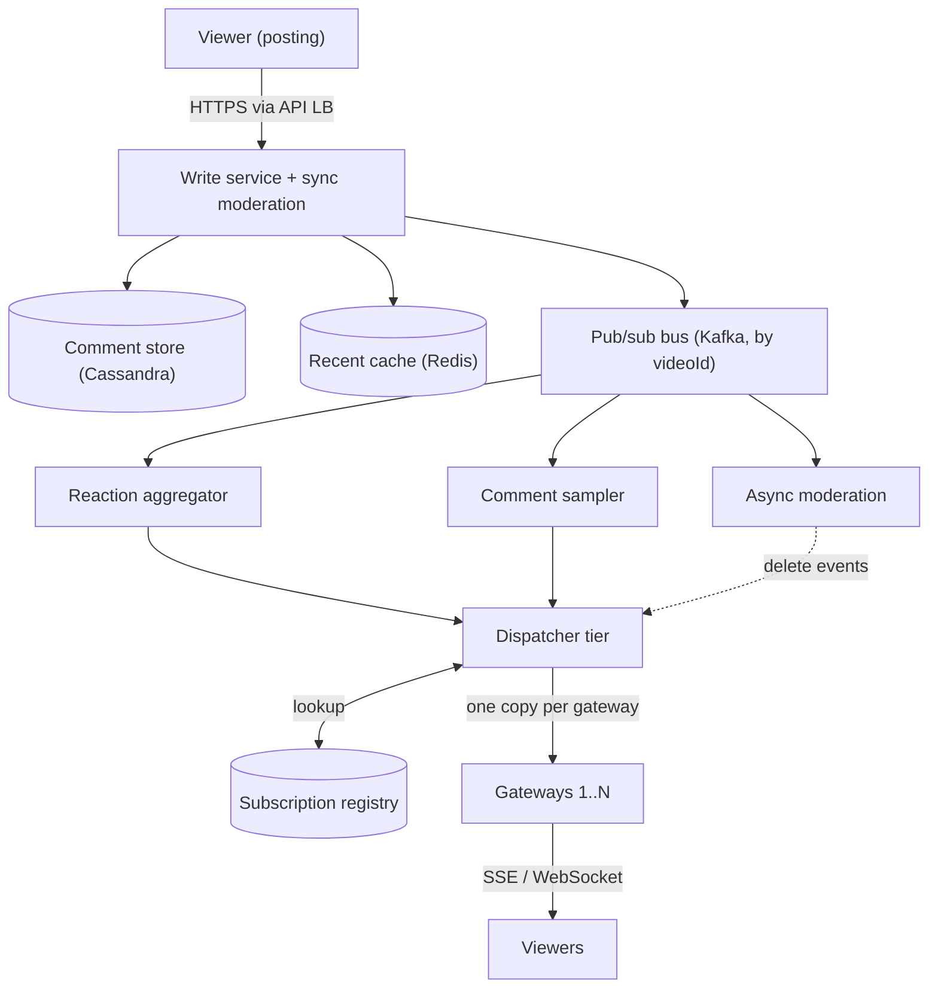
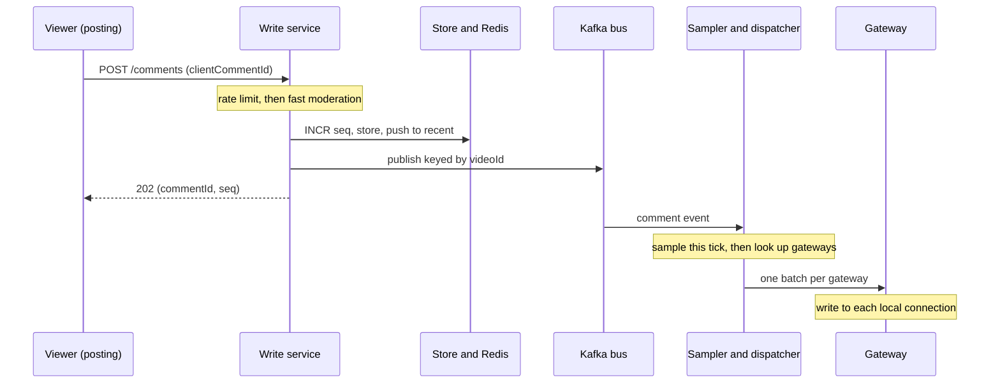
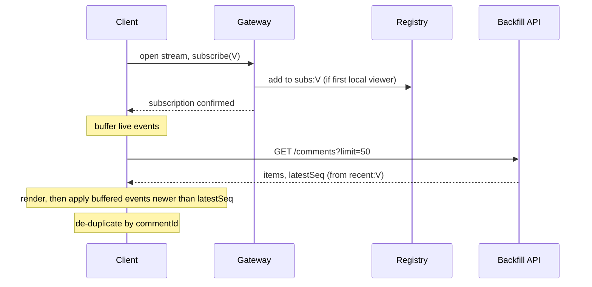

## Definition (interview-ready)

A **live comments and reactions** system lets viewers of a live video post comments and tap reactions (like, heart, laugh), and shows everyone else watching the same video those comments and reaction bursts within about a second.

The design: every viewer keeps one **persistent connection** (WebSocket or Server-Sent Events) to a **gateway server**. Each gateway keeps an in-memory map of which of its connections watch which video, and registers in a shared **subscription registry** that maps a video to the set of gateways that have viewers of it. Comments go to a **write service** that moderates, stores and publishes them. A **dispatcher** tier looks up the gateways for that video and sends **one copy per gateway**, not one per viewer; the gateway then writes it to its local connections. Reactions are **aggregated into counts** before fan-out, and comments on huge videos are **sampled**.

The main trade-off: speed and scale over delivery guarantees. A viewer may miss a comment, and that is acceptable.

**One-liner:** Viewers hold WebSocket/SSE connections to gateways; a registry maps video to gateways; writes are moderated, stored and published once per gateway; reactions are counted, comments sampled, and joiners backfill from a recent-comments cache.

## Problem statement

"Design the live comments and reactions feature for a live-video product, like Facebook Live or LinkedIn Live. While a broadcast is running, viewers can post short text comments and send reactions. Everyone watching the same broadcast should see new comments and a stream of reactions in near real time. A popular broadcast can have 10 million concurrent viewers. Across the platform there are up to 50 million concurrent viewers spread over about 100,000 live broadcasts at peak. Viewers join and leave at any time and should see recent comments when they join. Comments must be moderated."

## Requirements

### Functional (in scope)

- Post a comment on a live video (short text, up to about 500 characters).
- Send a reaction (a small fixed set of types).
- Receive new comments and reaction activity for the video you are watching, in near real time.
- On join (or reconnect), see the most recent comments.
- Moderation: block spam, banned users and abusive text; let the broadcaster or moderators delete a comment, and remove it from everyone's screen.

### Out of scope (say it out loud)

- The video pipeline itself (ingest, transcoding, CDN). See the video streaming design.
- Replies, threads, comment search, ranking of replays after the broadcast ends (mention briefly).
- Private one-to-one messaging (that is the chat system).

### Non-functional

| Requirement | Target | Why it matters |
|---|---|---|
| Latency | Comment visible to other viewers in about 1 s (p99 2 s) | It must feel live, close to the video |
| Scale | 10M viewers on one video, 50M platform-wide | Fan-out, not storage, is the hard part |
| Availability | High; degrade instead of failing | A broken comment box is bad, a broken video is worse, so keep them independent |
| Delivery | Best effort for the live stream; durable storage of accepted comments | Missing one of 5,000 comments a second is invisible; losing a posted comment from history is not |
| Ordering | Per video, roughly in time order; no global order | Viewers can't notice tiny reorders |
| Abuse | Moderation before broadcast for cheap checks | A slur shown to 10M people for even a second is a real incident |

### Clarifying questions to ask

1. How many viewers on the biggest video? (Drives the fan-out math.)
2. Must every viewer see every comment? (Usually no. This unlocks sampling.)
3. Do reactions need exact per-user display, or just a sense of volume? (Usually volume, so we aggregate.)
4. Web only, or mobile too? (Mobile networks drop connections often, so reconnect and backfill matter.)
5. Do comments need to replay in sync when someone watches the recording later?
6. What moderation is mandatory before a comment is shown?

## Scale estimation

Assumptions: 50M concurrent viewers platform-wide, the hottest video has 10M. Each gateway holds about 100,000 connections (LinkedIn reported about 100K persistent connections per node in production for its real-time platform).

**Connections and gateways**

- Platform: 50M ÷ 100K = **500 gateways** (plus headroom, say 700).
- Hot video alone: 10M ÷ 100K = at least **100 gateways** have its viewers. In practice it is more: if viewers land on gateways evenly, 10M of 50M is 20% of every gateway, so nearly all 500 gateways have some.

**Incoming writes on the hot video**

- Say 1 in 1,000 viewers comments in a given minute at peak: 10M ÷ 1,000 = 10,000 comments a minute. Spikes (a goal, a big announcement) can be 30x that: about **5,000 comments/s**.
- Reactions are much cheaper to send, so say 2% of viewers tap once a second during a spike: 10M × 0.02 = **200,000 reactions/s**.

**Naive fan-out (why it breaks)**

- Every comment to every viewer: 5,000 comments/s × 10M viewers = **5 × 10^10 deliveries per second**. Impossible, and pointless: nobody can read 5,000 comments a second.
- So we cap what each viewer receives. A person can read maybe 5 comments a second at most. 10M viewers × 5 comments/s = **50M comment deliveries/s** for the hot video, spread over about 100 gateways, which is 500K per gateway per second.

**Bandwidth per gateway**

- Batch every 500 ms: each frame holds about 2–3 comments (about 250 bytes each) plus reaction counts, call it 700 bytes.
- Per gateway: 100K connections × 2 frames/s = 200K frames/s. 200K × 700 B = **140 MB/s ≈ 1.1 Gbps** outbound. That fits on a 10 or 25 Gbps NIC, but it is the real per-box limit, together with memory for TLS and buffers.

**Dispatcher fan-out**

- After sampling, the hot video publishes at most about 10 comment messages and 2 reaction-count updates (one per 500 ms) per second, each sent once per gateway: 12 × 100 gateways = **1,200 internal messages/s** (about 6,000/s if all 500 gateways have viewers). Tiny. This is the payoff of fanning out per gateway, not per viewer.

**Storage**

- Platform-wide average of 10,000 comments/s × 86,400 s = 864M comments/day.
- At about 300 bytes each (text, IDs, timestamps): 864M × 300 B ≈ **260 GB/day**, about 95 TB/year raw, about 285 TB/year with 3 replicas.
- Reactions are not stored one by one for display; we store per-second counts per video, which is tiny (100K videos × a few counters per second).

## Core API

```
# Writes (plain HTTPS to the write service)
POST /v1/videos/{videoId}/comments
     body: { text, clientCommentId }          # clientCommentId = idempotency key
     → 202 { commentId, seq, status: "visible" | "pending_review" }

POST /v1/videos/{videoId}/reactions
     body: { type: "like" | "heart" | "laugh" | ... }
     → 202

# Backfill (cacheable for 1-2 s)
GET  /v1/videos/{videoId}/comments?limit=50
     → { comments: [...], latestSeq }

# Real-time stream (gateway)
GET  /v1/stream?videoId={videoId}            # SSE: Accept: text/event-stream
  or WSS /v1/ws  then  {"op":"subscribe","videoId":...,"afterSeq":...}

# Server → client events
event: comments   data: { videoId, items:[{commentId, seq, author, text, ts}] }
event: reactions  data: { videoId, window: "500ms", counts: { like: 812, heart: 95 } }
event: delete     data: { videoId, commentId }
event: viewers    data: { videoId, approxCount }

# Moderation
DELETE /v1/videos/{videoId}/comments/{commentId}    # broadcaster or moderator
```

Notes:

- Writes go over normal HTTPS, not the push connection. That keeps gateways simple (they only push), lets the write path use ordinary load balancing and rate limiting, and lets you use SSE, which is one-way. LinkedIn's live-likes design takes the same split: a like is published to the dispatchers with an ordinary HTTP request, and viewers receive likes over an SSE stream.
- `clientCommentId` makes retries safe: a double tap or a retry after timeout does not post twice.

## High-level architecture

```
                         ┌──────────────────────────── write path ────────────────────────────┐
 Viewer (posting) ──HTTPS──► API LB ──► Write service ──► Moderation (sync, fast checks)
                                            │                    │ reject / shadow / allow
                                            │                    ▼
                                            │            Comment store (Cassandra)
                                            │            Recent cache (Redis list per video)
                                            ▼
                                     Pub/sub bus (Kafka, keyed by videoId)
                                            │
                     ┌──────────────────────┼──────────────────────┐
                     ▼                      ▼                      ▼
              Reaction aggregator    Comment sampler        Async moderation (ML, humans)
              (counts per 500 ms)    (per-video caps)       → emits "delete" events
                     └──────────┬───────────┘
                                ▼
                         Dispatcher tier ──lookup──► Subscription registry
                                │                    videoId → {gateway ids}
                     one copy per gateway
                ┌───────────────┼───────────────┐
                ▼               ▼               ▼
            Gateway 1       Gateway 2   ...  Gateway N        (each ~100K connections,
         local map:        local map:                          in-memory videoId → conns)
         videoId→conns     videoId→conns
                │               │
                ▼               ▼
             Viewers         Viewers   (SSE / WebSocket, batched every ~500 ms)
```

The same architecture as a flow, from a posted comment to every viewer's screen:



**Write path (a comment):**

1. Client sends `POST /comments` to the write service (any instance, behind a normal load balancer).
2. Rate limit per user and per video; run fast moderation (banned user, blocklist, spam score). Reject, shadow (only the author sees it), or allow.
3. Assign a per-video sequence number, write to the comment store, push onto the recent-comments cache, and publish to the bus keyed by `videoId`.
4. The comment sampler for that video picks which comments go out this tick; the dispatcher looks up the gateways in the registry and sends one batch to each.
5. Each gateway writes the batch to every local connection subscribed to that video.

The same write path as a sequence:



**Reaction path:** write service increments a local counter for (video, type) and flushes counts every 100–500 ms to the aggregator, which sums them and publishes one count update per tick.

**Join path (a viewer):**

1. Client opens the stream connection to a gateway and subscribes to `videoId`.
2. Gateway adds the connection to its local map; if this is its first viewer of that video, it adds itself to the registry entry for the video.
3. Client calls `GET /comments?limit=50` for backfill, then merges with live events by `seq`, dropping duplicates.

## Data model

**Comments (Cassandra or another wide-column store)**

```cql
CREATE TABLE comments_by_video (
  video_id    bigint,
  bucket      int,          -- minute since stream start
  seq         bigint,       -- per-video sequence number
  comment_id  timeuuid,
  author_id   bigint,
  text        text,
  video_ts_ms bigint,       -- position in the video, for replay sync
  status      tinyint,      -- visible, shadowed, deleted
  PRIMARY KEY ((video_id, bucket), seq)
) WITH CLUSTERING ORDER BY (seq DESC);
```

- **Partition key `(video_id, bucket)`**: all reads are "comments for this video around this time", so they must hit one partition. Bucketing by minute stops one hot video from creating a single giant partition: at 5,000 comments/s, one hour would be 18M rows in one partition; one minute is 300K rows (about 90 MB at 300 bytes each). For the very hottest videos, a shorter bucket keeps partitions smaller.
- Clustering by `seq DESC` makes "latest N" a single sequential read.

**Recent-comments cache (Redis)**

```
LIST  recent:{videoId}      newest 200 comment JSON blobs (LPUSH + LTRIM)
STRING seq:{videoId}        INCR gives the next sequence number
```

Backfill reads this, not the database. It is tiny and very hot, so replicate it and cache the backfill response for 1–2 seconds at the edge.

**Reaction counts**

```
HASH reactions:{videoId}:{epochSecond}   field = type, value = count
```

Rolled up into a time series for replays and analytics. Individual reactions go to the analytics pipeline (Kafka → warehouse), not to the serving path.

**Subscription registry (Redis or another fast key-value store)**

```
SET  subs:{videoId}         members = gatewayId     (who has viewers of this video)
KEY  gw:{gatewayId}:alive   TTL 30 s, refreshed by heartbeat
```

On each gateway, in memory only:

```
videoId → set of connection handles
connectionId → { userId, videoId, lastSeqSent }
```

Why two levels: the global registry changes only when a gateway gets its first viewer of a video or loses its last one, so it sees thousands of updates a second, not the millions of individual joins and leaves. The per-connection detail never leaves the gateway, because a connection dies with its gateway anyway. LinkedIn's live-likes talk describes the same split: an in-memory subscription table on each frontend node, and a shared key-value store that tells dispatchers which frontend nodes care about which video.

## Detailed design

### 1. Connections and gateways

**SSE or WebSocket?**

| | SSE | WebSocket |
|---|---|---|
| Direction | Server to client only | Both ways |
| Transport | Plain HTTP response that never ends | HTTP upgrade to a separate protocol (RFC 6455) |
| Reconnect | Built into the browser `EventSource`, sends `Last-Event-ID` | You write it yourself |
| Proxies, firewalls | Usually fine, it is just HTTP | Some corporate proxies break it |
| Fits here? | Yes, writes go over normal HTTPS anyway | Yes, and lets you send subscribe/unsubscribe on the same socket |

Both work. Since viewers mostly receive, SSE is a strong default. LinkedIn chose SSE for its real-time platform, citing that it is plain HTTP and works across more networks, and noted WebSockets as a later option. See [real-time push: WebSockets, SSE, long-polling](/learn/notes/realtime-push-websockets-sse/) for the protocol details.

**Gateway internals**

- Event-driven server (Netty, Go, Node, Akka): one thread per connection would not reach 100K connections.
- Per connection: an outbound queue with a small bound. If a slow client's queue fills, drop the oldest comment batches for that client (they are stale anyway) rather than block the gateway. Comments are fire-and-forget at this hop.
- Heartbeat every 20–30 s so dead mobile connections are noticed and their memory freed.
- Tune the OS: file descriptor limits, listen backlog, heap. LinkedIn's write-up on reaching about 100K connections per node lists exactly these limits (`somaxconn` backlog, file descriptors, JVM heap of roughly 20 KB per TLS connection).

**How to say it in an interview:** "Gateways are dumb pipes. They hold connections, know which local connection watches which video, and write whatever the dispatcher hands them. All logic lives upstream."

### 2. Subscription registry and fan-out

The key idea is **fan-out per gateway, then per connection**.

```
dispatcher receives batch for video V
  gateways = registry.SMEMBERS("subs:V")          # e.g. 100 gateway ids
  for g in gateways: send(g, batch)               # 100 network sends
gateway g receives batch
  for conn in local[V]: conn.enqueue(batch)       # ~100K local writes, all in memory
```

So a comment seen by 10M viewers costs one network message per gateway (about 100 here, a few hundred at most) inside the data center, and the rest is local memory writes.

**Keeping the registry correct**

- Gateway adds itself to `subs:V` on its first local viewer of V and removes itself when the last one leaves (with a short delay, so a flapping viewer doesn't cause churn).
- If a gateway dies without cleaning up, the dispatcher's send fails or the gateway's `alive` key expires; dispatchers skip dead gateways, and a sweeper removes them from all sets.
- Sending to a gateway that no longer has viewers of V is harmless: the gateway just drops it. So the registry can be slightly stale in the "too many gateways" direction. It must not be stale in the "missing gateway" direction for long, so the add happens before the gateway confirms the subscription to the client.

**Alternatives for the bus**

| Option | How it works | Good | Watch out |
|---|---|---|---|
| Registry + dispatcher (above) | Dispatcher looks up gateways, sends directly | Only gateways with viewers get traffic; scales with video count | You build and run the dispatcher |
| Redis Pub/Sub channel per video | Gateways `SUBSCRIBE video:V`; writers `PUBLISH` | Very simple; Redis is the registry | At-most-once; one Redis node per channel becomes the limit for a giant video |
| Kafka topic, every gateway reads all | Each gateway consumes everything and filters | Durable, replayable | Every gateway reads every video's traffic: wasteful at 100K videos |

**Multi-region:** keep subscriptions local to each region and have the dispatcher forward each publish to peer dispatchers in other regions, which fan out locally. LinkedIn's talk argues for exactly this: publishing across data centers is better than replicating subscriptions across them. Facebook's 2011 live-commenting post (for comments on News Feed content, not Live video) made a similar choice it called "write locally, read globally": viewership is recorded only in the local data center, and a new comment gathers viewers from all data centers, to avoid replicating a flood of viewing writes across regions.

### 3. Reactions: aggregate, don't forward

200,000 reactions a second on one video cannot be forwarded one by one to 10M viewers. Nobody needs that. The screen only needs "lots of hearts right now".

```
write service (many instances)
  local[V][heart] += 1                       # in memory, no network
  every 200 ms: send { V, heart: 3120, like: 880 } to aggregator(V)

aggregator for V (partitioned by videoId)
  sums partial counts from all write servers
  every 500 ms: publish { V, window: 500ms, counts } to dispatcher
gateway → client: one small event per 500 ms
client: animates N floating hearts, where N grows with the count (capped)
```

- Bus load for reactions on the hot video: number of write servers × 5 flushes/s, not 200K/s.
- Optionally include a few **sampled individual reactions** from the viewer's friends, so they see "Priya reacted", which counts alone can't show.
- The viewer's own reaction is drawn locally at once (optimistic UI), so it feels instant no matter what the pipeline does.
- Totals for the broadcast are a separate counter (Redis `HINCRBY`) flushed to durable storage; they may lag a little.

### 4. Comments: sampling, ordering, moderation

**Sampling on hot videos.** When a video gets more comments than a person can read, choose which ones to broadcast:

- A per-video budget, say 5–10 comments/s on the broadcast stream.
- Fill it by priority: broadcaster and pinned comments, then comments from people the viewer knows (this part is per viewer, so the gateway or client adds it), then the best-scoring rest (quality model, author reputation), then random.
- Everything accepted is still stored, so it appears in replay and in "see all comments".
- Under the budget (most videos), every comment is broadcast and nothing is dropped.

**Ordering.**

- Each accepted comment gets a **per-video sequence number** (Redis `INCR seq:V`, or the Kafka offset if one partition holds the video). There is no global order across videos, and none is needed.
- Kafka partitioned by `videoId` keeps one video's comments in order through the bus.
- Clients sort by `seq`, de-duplicate by `commentId`, and render. A gap in `seq` is normal when sampling, so clients don't treat gaps as errors; reconnect uses the last seen `seq`, not gap detection.
- A comment's position in the video (`video_ts_ms`) is stored too, because viewers are a few seconds behind the live edge at different amounts. On replay, comments are shown when the playhead reaches them.

**Moderation in the path.** Two stages, because you can't run a slow model in front of a 1-second budget:

1. **Synchronous, fast (single-digit ms):** banned or muted user, broadcaster's block list and word filter, per-user rate limit ("slow mode"), a light spam classifier. Results: reject, allow, or **shadow** (the author sees it, nobody else does, so spammers don't learn they were caught).
2. **Asynchronous, slow:** heavier ML for hate speech, links, images; user reports; human moderators. If it flags a comment already broadcast, it emits a `delete` event through the same fan-out, and clients remove it from screen; storage marks it deleted.

**How to say it in an interview:** "Cheap checks block before anyone sees it, expensive checks retract after. The retraction rides the same pipe as the comment."

### 5. Backfill on join and reconnect

A viewer joining at minute 40 should see the last few dozen comments, not an empty box.

```
1. open stream, subscribe(V)            # live events start buffering on the client
2. GET /comments?limit=50 → items, latestSeq   # from Redis recent:V, edge-cached 1-2 s
3. render items; then apply buffered live events with seq greater than latestSeq
4. de-duplicate by commentId
```

Subscribing **before** fetching history closes the race where a comment posted between the fetch and the subscribe would be lost.

The join, step by step:



**Reconnect:** with SSE, the gateway sets each event's `id:` to the batch's last `seq`, and the browser automatically sends `Last-Event-ID` when it reconnects. The new gateway reads `recent:V` and sends anything newer, then continues live. If the gap is large (phone was offline for minutes), skip the replay and just show the latest 50: nobody wants to scroll through 10 minutes of stale chat.

**Join storm:** when a famous broadcast starts, millions join in a minute. The backfill GET is identical for everyone watching V, so cache it at the CDN or edge for 1–2 s; millions of requests become a handful per second at the origin.

## Bottlenecks & optimizations

- **Per-viewer fan-out cost.** Fixed by per-gateway fan-out, batching every 500 ms, and capping comments per second. Batching also cuts per-message overhead (syscalls, TLS records) on gateways.
- **Hot video on one bus partition.** One Kafka partition easily carries 5,000 comments/s, and reactions arrive pre-aggregated, so the hot partition is fine. If it isn't, the sampler and aggregator for that video become the bottleneck: shard them by `(videoId, shard)` and merge.
- **Dispatcher limits for giant videos.** With 1,000 gateways for one video, a single dispatcher sends 1,000 copies per batch. Use a **fan-out tree**: dispatcher → regional relays → gateways. Each level multiplies reach.
- **Gateway memory and NIC.** About 1 Gbps per gateway at the hot-video rate. Spread viewers of one hot video across many gateways (don't pin a video to a gateway), use compression (permessage-deflate for WebSocket, gzip for SSE) carefully since it costs CPU per connection.
- **Join and leave churn.** Only first-viewer/last-viewer changes touch the registry; the rest is local to the gateway.
- **Write spikes.** Per-user rate limits, per-video slow mode, and a global cap per video protect the write service and the store. Reactions never touch the database on the hot path. See [rate limiting](/learn/notes/rate-limiting/).
- **Viewer count.** Exact unique count is expensive; each gateway reports its local count per video every few seconds, and the dispatcher sums them. Approximate is fine.

## Failure handling

| Component fails | What happens | Mitigation |
|---|---|---|
| A gateway dies | Its ~100K viewers lose the stream | Clients reconnect with exponential backoff plus jitter to another gateway, resume with `Last-Event-ID`; registry entry expires via TTL |
| Gateway deploy | Same as above but planned | Drain slowly: stop accepting, close connections over minutes, not all at once |
| Dispatcher dies | Batches it was sending are lost | Stateless; writers/consumers pick another dispatcher; subscriptions live in the shared registry, not in dispatcher memory |
| Registry (Redis) unavailable | Dispatchers can't look up gateways | Dispatchers keep a recent in-memory copy and use it; worst case broadcast to all gateways for a few seconds; Redis replicas with failover |
| Bus (Kafka) lag | Comments arrive late | Live comments older than a few seconds are dropped from the live stream (still stored); alert on lag |
| Comment store slow or down | Writes can't be persisted | Accept into Kafka first (durable), persist from Kafka asynchronously; or fail the write with a retry message, but never block the video |
| Moderation service slow | Synchronous checks time out | Fail closed for unknown or new accounts (shadow the comment), fail open for trusted ones; async checks still run later |
| Whole comment system down | No comments | Video keeps playing: comments are a separate service and a separate connection |

## Trade-offs

| Decision | Chosen | Alternative | Why |
|---|---|---|---|
| Client transport | SSE (or WebSocket) on gateways | Client polling every few seconds | Polling at under 5 s is still laggy and costs a request per viewer per poll; Facebook's 2011 post rejected polling for this reason |
| Fan-out unit | Per gateway, then local | Per viewer from a central service | 100 sends instead of 10M |
| Registry | Two levels: in-memory per gateway + shared video → gateways map | One global map of every connection | Global map would take a write on every single join and leave (tens of thousands a second in a join storm) |
| Bus | Registry + dispatcher | Redis Pub/Sub per video, or Kafka read by all gateways | Only gateways with viewers get traffic; but Redis Pub/Sub is simpler for small scale |
| Delivery guarantee | Best effort on live stream, durable in storage | Exactly-once per viewer | Guarantees per connection are very expensive and invisible to users |
| Reactions | Aggregated counts per 500 ms | Forward every reaction | 200K/s per video can't be forwarded; counts look the same on screen |
| Hot-video comments | Sample to a per-video budget | Show everything | Humans can't read 5,000/s, and bandwidth would explode |
| Moderation | Fast sync checks + async retraction | Full ML before display | Full checks blow the latency budget |
| Ordering | Per-video sequence | Global order or none | Per video is all viewers can notice |

## Practice questions

<Practice>

<QA q="Why can't the write service just send each new comment to every viewer?" level="easy">

The numbers don't work. 5,000 comments/s on a video with 10M viewers is 5 × 10^10 deliveries a second. Two fixes stack: fan out **per gateway** (about 100 sends, each gateway then writes to its local connections from memory), and **cap** what each viewer receives (around 5–10 comments a second, sampled), because nobody can read faster than that anyway.

</QA>

<QA q="SSE or WebSocket for viewers, and why?" level="easy">

Either works. Viewers mostly receive, and comments and reactions are posted over plain HTTPS, so one-way **SSE** is enough: it is just a long HTTP response, passes through proxies easily, and the browser's `EventSource` reconnects on its own and sends `Last-Event-ID`. WebSocket is better if you want to send subscribe/unsubscribe and posts on the same connection. LinkedIn used SSE for its real-time platform for the network-compatibility reason.

</QA>

<QA q="What is the subscription registry and why does it have two levels?" level="medium">

It answers "who needs this video's events?". Level one lives in each gateway's memory: video → its local connections. Level two is shared (Redis or similar): video → set of gateway IDs. A gateway touches level two only when it gets its first viewer of a video or loses its last one. That turns millions of joins and leaves into a few thousand registry updates, and the per-connection detail never needs to be shared because a connection dies with its gateway.

</QA>

<QA q="How do you show 200,000 reactions a second to 10 million viewers?" level="medium">

You don't forward them. Each write server counts reactions per video and type in memory and flushes partial counts every couple hundred ms to an aggregator partitioned by video. The aggregator sums them and publishes one small 'counts in the last 500 ms' event, which goes through normal fan-out. The client animates a number of floating icons based on the count, draws the viewer's own reaction instantly, and may highlight sampled reactions from friends.

</QA>

<QA q="How does a viewer who joins late see recent comments without missing any?" level="medium">

Subscribe first, then fetch. The client opens the stream and subscribes, buffering live events; then it calls `GET /comments?limit=50` which returns recent comments and `latestSeq` from a Redis list per video. It renders history, then applies buffered events with a higher `seq`, de-duplicating by `commentId`. Fetching first would lose anything posted between the fetch and the subscribe.

</QA>

<QA q="How do you order comments?" level="medium">

Only within a video. Each accepted comment gets a per-video sequence number (a Redis `INCR` per video, or the Kafka offset with the video on one partition). Kafka keyed by `videoId` keeps that order through the bus. Clients sort by `seq` and de-dupe by ID. No global order is needed. Gaps are normal because of sampling, so they are not treated as errors.

</QA>

<QA q="Where does moderation sit, given a 1 second latency budget?" level="medium">

Split it. Fast synchronous checks run before publish: banned user, word filters, rate limits, a light spam model. Outcomes are reject, allow, or shadow (only the author sees it). Slow checks (heavy ML, user reports, human review) run asynchronously; if they flag an already-broadcast comment, a `delete` event goes through the same fan-out and clients remove it.

</QA>

<QA q="What is shadowing a comment and why use it?" level="medium">

The author sees their comment as posted, but it is not broadcast to anyone else. Spammers and trolls don't get a signal that they were caught, so they don't immediately switch accounts or rephrase to evade the filter. It is cheap to implement: the write service stores the comment as shadowed, returns success and skips the publish; backfill shows shadowed comments only to their author.

</QA>

<QA q="How does this work across multiple regions?" level="hard">

Keep subscriptions local to each region. When a comment is published, the local dispatcher fans out to its gateways and forwards the event once to a peer dispatcher in each other region, which fans out locally. LinkedIn's live-likes talk argues cross-region publish beats cross-region subscription. Facebook's 2011 live-commenting post made a similar 'write locally, read globally' choice to avoid replicating heavy viewing writes between data centers.

</QA>

<QA q="Why use a dispatcher tier instead of Redis Pub/Sub with a channel per video?" level="hard">

Redis Pub/Sub is a fine start: gateways `SUBSCRIBE video:V` and writers `PUBLISH`. Its limits: at-most-once delivery, every message for a channel goes through one Redis node, and with 100K channels and many gateways it gets hard to shard and observe. A stateless dispatcher plus a shared registry scales horizontally, keeps subscriptions safe when a dispatcher dies, and can grow into a fan-out tree for giant videos.

</QA>

<QA q="What limits one gateway, and how many do you need?" level="hard">

Memory per connection (TLS and buffers), file descriptors, the listen backlog, and outbound bandwidth. LinkedIn reported about 100K connections per node after raising those limits. At 100K per gateway, 50M viewers need about 500 gateways plus headroom. At 2 batched frames a second of about 700 bytes, each gateway sends about 140 MB/s, roughly 1.1 Gbps, so the NIC is also a real limit.

</QA>

<QA q="A world-famous broadcast starts and 5 million people join in one minute. What breaks?" level="scenario">

Join storm. The backfill GET is the same for everyone on that video, so cache it at the edge for 1–2 s. Connection setup (TLS handshakes) spikes on gateways, so keep extra gateways warm and spread one video's viewers across many of them. The registry sees only first-viewer updates per gateway, so it is fine. Comments explode, so slow mode and sampling switch on automatically when the per-video rate passes a threshold.

</QA>

<QA q="A gateway with 100K viewers crashes. Walk through recovery." level="scenario">

Clients see the connection drop and reconnect with exponential backoff and jitter so they don't all hit at once. The load balancer sends them to healthy gateways. Each re-subscribes, and SSE sends `Last-Event-ID`; the new gateway replays newer comments from the recent-comments cache, or just the latest 50 if the gap is large. The dead gateway's heartbeat key expires and a sweeper removes it from the registry; until then, dispatcher sends to it simply fail and are skipped.

</QA>

<QA q="An abusive comment was broadcast before the async model caught it. What happens next?" level="scenario">

The async moderator marks it deleted in storage and the recent cache, and publishes a `delete` event for that `commentId` through the normal pipeline. Every gateway with viewers of the video pushes it, and clients remove the comment. Joiners never see it because backfill reads the updated cache. Then penalize the author (mute, ban) so the sync filter catches their next one, and consider tightening sync checks (for example, shadowing new accounts) for this broadcast.

</QA>

<QA q="Comments seem to arrive 10 seconds late for everyone on one video. How do you debug it?" level="scenario">

Follow one comment's timestamps through each hop: write accepted, published to bus, picked by sampler, sent by dispatcher, written by gateway. Common causes: consumer lag on the partition that holds this hot video (the sampler is too slow), a dispatcher overloaded by too many gateways for one video (add a fan-out tree), or gateway outbound queues backed up (check CPU and NIC). Meanwhile, drop live comments older than a few seconds from the stream; they are still stored.

</QA>

</Practice>

## Quiz

<Quiz>

<MCQ q="A comment must reach 10M viewers spread over 100 gateways. In the per-gateway fan-out design, how many internal network sends does the dispatcher make for it?" options={["10M", "About 100", "1", "About 100K"]} answer={1}>

The dispatcher sends one copy to each gateway that has viewers of the video, so about 100. Each gateway then writes to its own connections from memory. 10M is per-viewer fan-out, 1 would mean a single gateway, and 100K is the connection count of one gateway.

</MCQ>

<MCQ q="Why does the shared registry map video to gateways instead of video to every connection?" options={["Redis can't store sets", "Connections don't have IDs", "It turns millions of joins and leaves into a few updates, and connection detail is only useful on the gateway that owns it", "Gateways can't keep state in memory"]} answer={2}>

Only first-viewer and last-viewer events per gateway touch the shared registry. Per-connection data stays in gateway memory because a connection lives and dies with its gateway. The other options are false.

</MCQ>

<MCQ q="What is the best way to deliver 200K reactions a second on one video?" options={["Aggregate counts per short window and fan out one small count event", "Forward each reaction to every viewer", "Store each reaction in the database and let clients poll", "Drop all reactions during spikes"]} answer={0}>

Counting at write servers and an aggregator turns 200K events a second into a few count updates. Forwarding each is impossible at scale, polling a database is slow and heavy, and dropping everything throws away the feature.

</MCQ>

<MCQ q="A viewer joins mid-stream. Which order avoids missing comments?" options={["Fetch recent comments, then subscribe", "Subscribe only; history isn't needed", "Fetch the full history from the database", "Subscribe and buffer, then fetch recent comments, then merge by seq and de-duplicate"]} answer={3}>

Subscribing first means anything posted during the fetch is buffered. Fetch-then-subscribe leaves a gap, skipping history shows an empty box, and the full history is far too much.

</MCQ>

<MCQ q="Why is it fine for clients to see gaps in comment sequence numbers?" options={["Sequence numbers are random", "On hot videos only a sample of comments is broadcast, so gaps are expected", "Kafka reorders messages", "Clients never use seq"]} answer={1}>

Sampling deliberately skips comments on the live stream; they are still stored. Sequence numbers aren't random, Kafka keeps order within a partition, and clients do use seq to sort and resume.

</MCQ>

<MCQ q="Which moderation step belongs in the synchronous path?" options={["Human review", "A large multimodal model scoring every comment", "Banned-user and word-filter checks plus per-user rate limits", "Weekly abuse reports"]} answer={2}>

Only checks that finish in a few milliseconds fit before publish. Human review and big models run asynchronously and retract with a delete event. Weekly reports are far too slow.

</MCQ>

<MCQ q="Which SSE feature helps resume after a dropped connection?" options={["The browser sends the Last-Event-ID header on reconnect", "SSE guarantees exactly-once delivery", "SSE frames are acknowledged by the client", "SSE uses UDP"]} answer={0}>

`EventSource` reconnects automatically and sends the last event ID it saw, so the server can resume from there. SSE gives no exactly-once guarantee, has no per-frame acks, and runs over HTTP on TCP.

</MCQ>

<MCQ q="What did Facebook's 2011 live-commenting post describe as its approach to viewership data across data centers?" options={["Replicate every viewing record to all data centers", "Write locally, read globally", "Store all viewership in one central data center", "Poll every 5 seconds instead of tracking viewers"]} answer={1}>

Viewership was written only in the local data center, and each new comment gathered viewers from all data centers. That avoided replicating a huge volume of viewing writes. They considered and rejected polling, and didn't centralize or fully replicate.

</MCQ>

<MCQ q="One gateway holds 100K connections and sends 2 frames a second of about 700 bytes to each. Roughly what outbound bandwidth is that?" options={["About 14 MB/s", "About 1.4 GB/s", "About 140 MB/s", "About 1.4 MB/s"]} answer={2}>

100K × 2 = 200K frames a second; × 700 bytes = 140 MB/s, about 1.1 Gbps. The other options are off by factors of 10 or 100.

</MCQ>

</Quiz>

## TL;DR cheat sheet

- **Connections:** viewers hold SSE or WebSocket connections to gateways, about 100K per box. Writes go over plain HTTPS.
- **Registry, two levels:** in-memory video → connections on each gateway; shared video → gateway IDs in Redis, updated only on first/last viewer.
- **Fan-out:** dispatcher sends one copy per gateway; gateway writes locally. 10M viewers ≈ 100 sends.
- **Reactions:** count in memory at write servers, aggregate per video, push counts every 500 ms. Draw own reaction instantly.
- **Comments:** per-video budget of a few per second on hot videos; prioritize broadcaster, friends, quality. Store everything.
- **Ordering:** per-video seq; Kafka keyed by videoId; client sorts and de-dupes; gaps are normal.
- **Moderation:** fast sync checks (ban, filter, rate limit, shadow) + async heavy checks that retract via a delete event.
- **Join:** subscribe, then fetch last 50 from Redis (edge-cached 1–2 s), merge by seq. Reconnect with `Last-Event-ID`.
- **Hot video:** batching, sampling, slow mode, spread across gateways, fan-out tree for giant videos.
- **Failures:** best effort live, durable in storage; comments never take down the video.
- Related: [real-time push](/learn/notes/realtime-push-websockets-sse/), [chat system](/learn/notes/hld-chat-system/), [Kafka deep dive](/learn/notes/kafka-deep/), [rate limiting](/learn/notes/rate-limiting/).

## Go deeper

- **LinkedIn (QCon London 2020):** Akhilesh Gupta, ["Streaming a Million Likes/Second: Real-Time Interactions on Live Video"](https://www.infoq.com/presentations/linkedin-play-akka-distributed-systems/). SSE connections, in-memory subscriptions on frontends, dispatchers with a shared key-value store, cross-data-center publish.
- **LinkedIn Engineering:** ["Instant Messaging at LinkedIn: Scaling to Hundreds of Thousands of Persistent Connections on One Machine"](https://www.linkedin.com/blog/engineering/archive/instant-messaging-at-linkedin-scaling-to-hundreds-of-thousands-). SSE vs WebSocket choice and the OS/JVM limits for about 100K connections per node.
- **LinkedIn Engineering:** ["Now You See Me, Now You Don't: LinkedIn's Real-Time Presence Platform"](https://engineering.linkedin.com/blog/2018/01/now-you-see-me--now-you-dont--linkedins-real-time-presence-platf). Built on the same pub/sub real-time delivery platform.
- **Meta Engineering (2011):** ["Live Commenting: Behind the Scenes"](https://engineering.fb.com/2011/02/07/core-data/live-commenting-behind-the-scenes/). Why polling was rejected, and "write locally, read globally".
- **WHATWG HTML spec:** [Server-sent events](https://html.spec.whatwg.org/multipage/server-sent-events.html), including `Last-Event-ID` reconnection; and MDN's [Using server-sent events](https://developer.mozilla.org/en-US/docs/Web/API/Server-sent_events/Using_server-sent_events).
- **RFC 6455:** [The WebSocket Protocol](https://www.rfc-editor.org/rfc/rfc6455).
- On this site: [real-time push](/learn/notes/realtime-push-websockets-sse/), [chat system design](/learn/notes/hld-chat-system/), [Kafka deep dive](/learn/notes/kafka-deep/).
