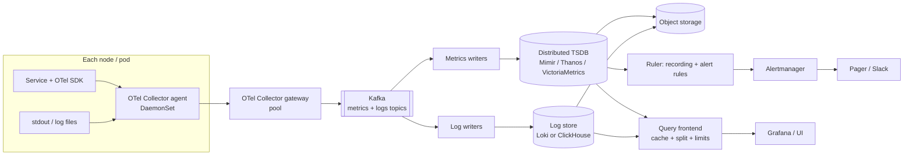

## Definition (interview-ready)

A **metrics and logging pipeline** collects telemetry from every host and service, moves it reliably to storage, and makes it queryable for dashboards, debugging and alerts.

It has five stages:

1. **Collect**: an SDK or agent on each node gathers metrics and log lines.
2. **Buffer**: a durable queue (usually Kafka) absorbs bursts and protects the backends.
3. **Process**: enrich, drop, sample and route data.
4. **Store**: a time-series database (TSDB) for metrics, and a log store for logs.
5. **Serve**: query APIs, dashboards and an alerting engine.

The interesting decisions are about **cost**. Metrics are cheap per data point but explode with **cardinality** (the number of distinct label combinations). Logs are cheap to write but expensive to **index**. A good design keeps those two costs under control without losing the signals you need during an incident.

In an interview, describe the design like this: agents send to OTel collectors, collectors write to Kafka, and separate consumer fleets write metrics to a horizontally scaled Prometheus-compatible TSDB and logs to object storage with a small index. Alerting reads the TSDB. Everything is tenant-aware, with limits on series, ingest rate and query cost.

**One-liner:** Agents and OpenTelemetry collectors ship telemetry into Kafka, writers load metrics into a horizontally scaled Prometheus-compatible TSDB and logs into cheap label- or column-indexed object storage, and the whole thing is tenant-aware with hard limits on cardinality, ingest rate and query cost.

## Why it matters

- **It's a classic HLD question.** "Design Datadog", "design a logging system" and "design a monitoring system" are all this problem.
- **It tests real trade-offs, not boxes.** Pull vs push, index vs scan, retention vs cost, and what happens when the monitoring system itself is overloaded during an outage.
- **It is a write-heavy system with a skewed read pattern.** Almost everything is written; very little is read; but the reads happen in emergencies and must be fast.
- **The observability bill is often one of the largest infrastructure costs.** Engineers who can size it and cut it are valued.

This note is the system design. For what metrics, logs and traces *are*, read [Metrics, Logs, Traces](/learn/notes/metrics-logs-traces/). For TSDB internals (compression, head block, cardinality), read [Time-Series Databases](/learn/notes/time-series-databases/). For a general interview framework, see [HLD Framework](/learn/notes/hld-framework/).

## Core concepts

### Requirements

Start every HLD answer by pinning down requirements. Here is a reasonable set for a large company.

**Functional**

- Ingest metrics (counters, gauges, histograms) and logs from all services, hosts and Kubernetes pods.
- Query metrics with a PromQL-style language; search logs by service, time range, level and text.
- Dashboards over metrics and logs.
- Alert rules on metrics (and some on logs), routed to on-call with grouping and silencing.
- Multi-tenant: each team sees its own data and has its own quotas.

**Non-functional**

| Requirement | Target (example) | Why |
|---|---|---|
| Ingest availability | Accept writes even when storage is degraded | Telemetry is most needed during incidents |
| Data freshness | Metrics queryable within about 30 s; logs within about 1 minute | Alerts and live debugging |
| Query latency | Dashboard panels p99 under 2 s for the last 24 h; log search over 1 h in a few seconds | On-call experience |
| Retention | Metrics: raw 15 days, aggregated 13 months. Logs: 30 days hot, 1 year archive | Capacity planning and audits |
| Durability | Losing a few seconds of telemetry is tolerable; losing hours is not | Observability is not a ledger |
| Isolation | One noisy team cannot break others | Shared platform |

Note the durability point. This is an **at-least-once, loss-tolerant** system. That lets you make cheaper choices than a payments system would.

### Back-of-envelope sizing

State assumptions out loud, then compute. (Method: [Back-of-Envelope Math](/learn/notes/back-of-envelope-math/).)

**Metrics**

```
Assumptions: 10,000,000 active series, scraped every 15 s,
             about 1.5 bytes per sample on disk after compression

Samples/s  = 10,000,000 / 15             ≈ 666,667 samples/s
Disk/s     = 666,667 × 1.5 B             ≈ 1.0 MB/s
Disk/day   = 1.0 MB/s × 86,400 s         ≈ 86.4 GB/day
Raw, 15 d  = 86.4 GB × 15                ≈ 1.3 TB
Raw, 13 mo = 86.4 GB × 395               ≈ 34 TB   (if you kept raw that long)
```

The 1–2 bytes per sample figure and the formula `disk = retention_seconds × samples_per_second × bytes_per_sample` come from the Prometheus storage docs. Memory in the ingesting tier scales with **active series**, not retention, which is why cardinality is the number to watch.

**Logs**

```
Assumptions: 200,000 log lines/s average, 3× peak, 500 bytes per line,
             10× compression in storage (assumption; measure your own data)

Average ingest  = 200,000 × 500 B           = 100 MB/s  (= 0.8 Gbit/s)
Peak ingest     = 600,000 × 500 B           = 300 MB/s  (= 2.4 Gbit/s)
Raw per day     = 100 MB/s × 86,400 s       = 8.64 TB/day
Stored per day  = 8.64 TB / 10              = 864 GB/day
30 days hot     = 864 GB × 30               ≈ 26 TB
1 year archive  = 864 GB × 365              ≈ 315 TB
```

Logs are about **100× bigger than metrics** in this example (8.64 TB vs 86.4 GB per day). That is typical, and it is why log cost dominates.

**Traces (why sampling is mandatory)**

```
50,000 requests/s × 20 spans each × 1 KB per span
  = 1,000,000 spans/s = 1 GB/s ≈ 86.4 TB/day
Keep 10%  → 8.64 TB/day
```

**Kafka buffer for logs**

```
Keep 24 h in Kafka. Assume producer compression gives 4× (assumption).
Compressed per day = 8.64 TB / 4   ≈ 2.16 TB
× replication factor 3             ≈ 6.5 TB of broker disk (plus headroom)
```

That is a modest Kafka cluster. Partition count is driven by **consumer parallelism** (one consumer per partition per group), so choose enough partitions for the number of indexer or writer instances you want at peak, with room to grow.

### API

Two kinds of API: ingest (machine-facing, high volume) and query (human-facing, low volume, latency-sensitive).

```
# Ingest (all carry a tenant ID, e.g. header X-Scope-OrgID)
POST /otlp/v1/metrics        OTLP protobuf (OpenTelemetry protocol)
POST /otlp/v1/logs           OTLP protobuf
POST /api/v1/push            Prometheus remote write (snappy-compressed protobuf)

# Query
GET  /api/v1/query?query=...&time=...              PromQL instant query
GET  /api/v1/query_range?query=...&start=&end=&step=
GET  /logs/query_range?query={app="checkout"} |= "timeout"&start=&end=&limit=
GET  /api/v1/series?match[]=...                    series discovery
POST /api/v1/rules                                 manage alert and recording rules
```

Grafana Mimir and Loki both use the `X-Scope-OrgID` header to carry the tenant ID. The design point: **tenancy is part of every request**, not bolted on later.

### Data model

**Metric sample**

```
series identity = metric name + sorted labels
  http_requests_total{service="checkout", route="/pay", status="5xx", region="ap-south-1"}
sample          = (timestamp_ms, float64 value)
```

The TSDB stores each series as compressed chunks and keeps an **inverted index** from each `label=value` pair to the series IDs that have it. Details: [Time-Series Databases](/learn/notes/time-series-databases/).

**Log record**

```json
{
  "ts": "2026-10-21T10:15:02.123Z",
  "tenant": "payments",
  "resource": {"service": "checkout", "env": "prod", "region": "ap-south-1", "pod": "checkout-7f9c"},
  "level": "ERROR",
  "trace_id": "4bf92f3577b34da6a3ce929d0e0e4736",
  "message": "payment gateway timeout after 3000ms",
  "attrs": {"gateway": "pg-2", "order_id": "o_123"}
}
```

Split fields into three groups. This split decides your storage cost:

- **Index labels** (low cardinality, bounded): tenant, service, env, region, level.
- **Metadata** (high cardinality, filterable but not indexed for lookup): pod, trace_id, order_id.
- **Body**: the free-text message.

### High-level architecture



The same picture in words:

1. **Agents** on every node collect metrics and tail logs, add resource labels (service, pod, region) and forward to a gateway tier.
2. **Gateways** batch, filter, sample, enforce tenant limits and write to Kafka.
3. **Kafka** decouples ingest from storage. If storage is slow or down, data waits in Kafka instead of being dropped at the edge.
4. **Writers** consume Kafka and write to the TSDB and the log store.
5. **Long-term data lives in object storage** (S3/GCS). Compute tiers are mostly stateless or hold only recent data.
6. **The query frontend** splits big queries by time, caches results and applies per-tenant query limits.
7. **The ruler** evaluates recording and alerting rules and sends firing alerts to Alertmanager.

### Collection: agents and the OpenTelemetry Collector

The **OpenTelemetry (OTel) Collector** is a vendor-neutral process that receives, processes and exports telemetry. Its config is a set of **pipelines**, each built from:

- **Receivers**: how data gets in (OTLP, Prometheus scrape, file log tailing, host metrics).
- **Processors**: what happens in the middle (batching, memory limiting, attribute changes, filtering, sampling).
- **Exporters**: where data goes (OTLP, Kafka, Prometheus remote write, Loki).

The OTel docs describe two deployment patterns you should name in an interview:

- **Agent**: a collector on every host (a Kubernetes DaemonSet) or as a sidecar. Close to the source, adds host metadata, absorbs short network blips.
- **Gateway**: a pool of collectors behind a load balancer that all agents send to. Central place for policy: auth, tenant routing, sampling, rate limits, and exporting to Kafka.

```yaml
# Gateway collector (sketch)
receivers:
  otlp:
    protocols: { grpc: {}, http: {} }
processors:
  memory_limiter: { check_interval: 1s, limit_percentage: 80 }
  batch: {}
  attributes/drop_pii:
    actions:
      - { key: user.email, action: delete }
exporters:
  kafka/logs:
    brokers: ["kafka-1:9092", "kafka-2:9092", "kafka-3:9092"]
    logs: { topic: otlp_logs }   # per-signal topic (replaces the old top-level `topic` setting)
service:
  pipelines:
    logs:
      receivers: [otlp]
      processors: [memory_limiter, attributes/drop_pii, batch]
      exporters: [kafka/logs]
```

Put `memory_limiter` first so an overloaded collector refuses data (and the sender retries) instead of running out of memory. Redact PII here, before it is stored anywhere (see [PII Handling](/learn/notes/pii-handling/)).

**Pull vs push for metrics.** Prometheus **pulls**: it scrapes each target's `/metrics` endpoint. Pull gives you free health checks (a failed scrape means the target is down) and the server controls the load. Push (OTLP, remote write) suits short-lived jobs and crosses network boundaries more easily. Big platforms usually do both: agents scrape locally and then **push** to the central system with remote write or OTLP.

### Kafka as the buffer

Why put Kafka between collectors and storage?

- **Burst absorption.** During an incident, error logs can spike many times over. Kafka soaks that up; writers catch up later.
- **Backend maintenance.** You can upgrade or restart the TSDB or log store without losing data.
- **Fan-out.** The same log stream can feed the log store, a security pipeline (SIEM) and a data lake, each as its own consumer group.
- **Replay.** If a writer bug corrupted a day of data, re-consume from Kafka (within its retention).

Design choices:

- **Separate topics** for metrics and logs (and per large tenant if needed), because their volumes and consumers differ.
- **Partition key**: for metrics, hash of the series identity, so all samples of a series go to one partition in order (TSDBs prefer in-order samples per series). For logs, the stream identity (tenant + labels) keeps a stream's lines together and in order.
- **Producer settings**: compression (`zstd` or `lz4`) and batching (`linger.ms` of a few ms). `acks=all` is affordable here. See [Kafka Producer](/learn/notes/kafka-producer/).
- **Consumer lag is your health signal.** Alert on lag growth for the writers.

Some systems skip Kafka and rely on the storage tier's own write-ahead log and replication (in Loki, and in Mimir's classic architecture, a write is acknowledged once a quorum of ingesters has it). That is simpler but couples ingest to storage health. Notably, Grafana Mimir 3.0 made an **ingest storage architecture** with Kafka in the write path its preferred design: a write is acknowledged once Kafka has it, and ingesters consume from Kafka partitions, so reads and writes scale independently. In an interview, say that you are choosing Kafka for **isolation and replay**, and name the cost: one more stateful system to run.

### Metrics path: TSDB, downsampling, cardinality limits

**Storage tier.** Single Prometheus servers are not clustered or replicated (the Prometheus docs say so directly). For a company-wide system, use a horizontally scalable, Prometheus-compatible backend such as **Grafana Mimir**, **Cortex**, **Thanos** or **VictoriaMetrics**. The common shape:

```
distributor ──hash(series)──▶ ingesters (replicated, recent data in memory + WAL)
                                   │ cut blocks every 2 h
                                   ▼
                             object storage (immutable blocks)
                                   │
                         compactor (merge, dedupe, downsample, retention)
                                   │
querier ◀── store-gateway (reads old blocks) + ingesters (reads recent data)
```

- **Distributors** validate, apply tenant limits and shard series across **ingesters** by hashing the series labels (consistent hashing on a ring).
- **Ingesters** keep the last couple of hours in memory, write a WAL for crash recovery, and periodically flush immutable blocks to object storage.
- **Compactor** merges small blocks into big ones, removes duplicate samples from replicas, applies retention, and (in Thanos) downsamples.
- **Queriers** merge recent data from ingesters with older data from object storage.

**Downsampling.** For a 1-year graph you don't need 15-second points. Thanos's compactor creates **5-minute** resolution blocks from raw blocks older than 40 hours and **1-hour** blocks from 5-minute blocks older than 10 days. Each downsampled chunk keeps several aggregates (count, sum, min, max, counter), so `rate()`, `avg` and `max` still work.

A trap worth knowing: the Thanos docs say downsampling **doesn't save space by itself**. It adds two more copies at lower resolution, and its purpose is fast long-range queries. You save storage only if you set a **shorter retention for raw data** than for 5m and 1h data (Thanos has separate retention flags per resolution).

**Recording rules.** Pre-compute expensive queries on a schedule and store the result as a new, small series:

```yaml
groups:
  - name: checkout_slo
    interval: 30s
    rules:
      - record: service:http_requests:rate5m
        expr: sum by (service, status) (rate(http_requests_total[5m]))
```

Dashboards and alerts then read a few series instead of thousands.

**Cardinality limits.** Cardinality is the product of label value counts, and memory scales with active series. Defend the system at several layers:

1. **Guidance**: no unbounded values (user IDs, request IDs, raw URLs) in labels. Those belong in logs or traces.
2. **Relabel at the edge**: drop or rewrite bad labels in the agent (`metric_relabel_configs` in Prometheus, transform/filter processors in OTel).
3. **Per-scrape caps**: Prometheus `sample_limit` fails a scrape that returns too many samples.
4. **Per-tenant limits**: Mimir has settings such as `max_global_series_per_user` (series per tenant) and `ingestion_rate` (samples per second). Over-limit writes are rejected with an error, so one team's bad deploy can't take down shared ingesters.
5. **Visibility**: expose a per-tenant "top series by metric" page so teams can find their own explosions.

### Logs path: three storage designs

This is the core trade-off of the whole problem. There are three ways to store logs.

**1. Full-text index (Elasticsearch / OpenSearch)**

Every word of every log line goes into an **inverted index** (term → list of documents). See [Elasticsearch](/learn/notes/elasticsearch/).

- Fast arbitrary text search ("find this error string anywhere").
- Rich aggregations on parsed fields.
- Expensive: indexing costs CPU on ingest and adds a lot of storage on top of the raw data; the cluster needs fast disks and careful shard sizing.

**2. Label-only index (Grafana Loki)**

Loki's docs are explicit: it **indexes only labels**, not log content. Lines with the same full label set form a **stream**. Each stream's lines are packed into compressed **chunks** in object storage, and a small index maps label sets to chunks.

A query like `{service="checkout", env="prod"} |= "timeout"`:

1. Use the index to find the chunks for matching streams in the time range.
2. Download and decompress those chunks.
3. **Brute-force grep** them in parallel across many queriers.

- Very cheap ingest and storage: object storage plus a tiny index.
- Fast when label selectors and time range are narrow; slow for "needle in a haystack across all services for 30 days".
- **Label cardinality matters a lot.** Every unique label combination is a new stream with its own small chunks. Loki defaults to a limit of 15 index labels per stream and recommends keeping labels bounded and long-lived (namespace, app, cluster, environment). High-cardinality fields such as pod names on ephemeral machines or trace IDs go into **structured metadata** (Loki 3.x) instead of labels.

**3. Columnar store (ClickHouse)**

Store logs as rows in a `MergeTree` table: sorted on disk by a key you choose, split into columns, compressed per column.

```sql
CREATE TABLE logs
(
    ts        DateTime64(3) CODEC(Delta, ZSTD),
    tenant    LowCardinality(String),
    service   LowCardinality(String),
    level     LowCardinality(String),
    trace_id  String,
    message   String CODEC(ZSTD),
    attrs     Map(LowCardinality(String), String),
    INDEX idx_trace trace_id TYPE bloom_filter(0.01) GRANULARITY 4
)
ENGINE = MergeTree
PARTITION BY toDate(ts)
ORDER BY (tenant, service, level, ts)
TTL toDateTime(ts) + INTERVAL 30 DAY;
```

- The **sparse primary index** has one entry per granule (8,192 rows by default), so filtering on `(tenant, service, level, time)` skips most of the data.
- **Data-skipping indexes** (bloom filters, and in recent versions a `text` inverted index) let ClickHouse skip granules that can't contain a trace ID or token. The older `tokenbf_v1` and `ngrambf_v1` index types are marked deprecated in current docs.
- Excellent for **aggregations** over logs ("count errors by service per minute") and for high-cardinality fields, because columns don't create per-series index entries.
- Write in **batches**. Every synchronous insert creates a new part, and many tiny inserts lead to "too many parts" errors. Either batch in the writer (consume from Kafka in large chunks) or use ClickHouse **async inserts** with `wait_for_async_insert=1` so failures are reported.

**Comparison**

| | Full-text index (Elasticsearch) | Label-only (Loki) | Columnar (ClickHouse) |
|---|---|---|---|
| What is indexed | Every term | Only stream labels | Sort key + optional skip indexes |
| Ingest cost | High | Very low | Low to medium (batching required) |
| Storage cost | Highest | Lowest (object storage) | Low (column compression) |
| Arbitrary text search | Fastest | Scan-based; fine for narrow selectors | Skip indexes help; otherwise scan |
| Aggregations / analytics | Good | Basic (LogQL metrics queries) | Best |
| High-cardinality fields | Fine (mapping explosion is the risk) | Must not be labels | Fine |
| Operational burden | Shard/heap tuning | Low | Medium (merges, schema) |

**How to say it in an interview:** "Most log queries start with 'service X, last hour', so I don't need to pay to index every word. I'd use Loki-style label-only indexing for cheap bulk storage, or ClickHouse if we need analytics and high-cardinality filters. I'd keep a full-text index only for the small subset that needs it, like security or audit logs."

### Traces (briefly)

Traces follow the same path: SDK → collector → Kafka → trace store (Tempo, Jaeger, or ClickHouse). The only special part is **sampling** (next sections). Logs carry `trace_id`, and metrics can carry **exemplars** (a sample linked to a trace ID), which let you jump from a latency spike to an example slow trace.

### Alerting

```
ruler (every 30–60 s)
  evaluates: rate(http_requests_total{status="5xx"}[5m]) / rate(...[5m]) > 0.02
  for: 5m                      ← must stay true for 5 minutes before firing
      │ firing alerts
      ▼
Alertmanager cluster
  route by labels (team, severity) → receivers (pager, Slack, email)
  group      : many similar alerts → one notification
  inhibit    : "cluster down" mutes per-service alerts in that cluster
  silence    : mute matching alerts during planned maintenance
```

Design points:

- **Evaluate alerts close to the data**, in the TSDB's ruler, not in a dashboard tool.
- **The `for` clause** prevents flapping on short blips.
- **Run Alertmanager as a cluster** for HA. Prometheus docs recommend pointing each Prometheus (or ruler) at the full list of Alertmanagers rather than a load balancer; the cluster deduplicates notifications.
- **Prefer symptom and SLO burn-rate alerts** over cause-based ones. See [Alerting Design](/learn/notes/alerting-design/) and [SLIs, SLOs and Error Budgets](/learn/notes/sli-slo-sla-error-budgets/).
- **Monitor the monitoring.** A separate, small "meta" monitoring stack (or an external heartbeat) should page if the main pipeline stops ingesting. A dead-man's-switch alert (an alert that always fires; silence of it means trouble) is a common trick.

### Multi-tenancy

A tenant is usually a team or business unit. Requirements:

- **Identity on every request** (the `X-Scope-OrgID` header in Mimir and Loki), set by the gateway from authenticated credentials, never trusted from the client directly.
- **Isolation of data**: series and chunks are stored per tenant; queries can only read the caller's tenants.
- **Isolation of resources**: per-tenant ingest rate limits, series limits, query concurrency limits, maximum query time range, and maximum bytes scanned per query.
- **Shuffle sharding**: give each tenant a small, pseudo-random subset of ingesters and queriers. A tenant that overloads its subset hurts only the few tenants that share most of that subset, not everyone.
- **Chargeback**: meter bytes ingested, active series and bytes scanned per tenant. Showing teams their bill is the strongest cost control there is.

### Sampling

| Signal | Sample? | How |
|---|---|---|
| Metrics | No | They are already aggregates. Reduce by dropping labels or metrics instead. |
| Traces | Yes, always at scale | Head sampling (decide at the start, by trace ID) and/or tail sampling (decide after the trace completes) |
| Logs | Sometimes | Keep all WARN/ERROR; sample or rate-limit DEBUG/INFO from chatty services; dedupe identical lines |

**Head sampling** is cheap and can happen anywhere, but it can't guarantee keeping every trace that contains an error. **Tail sampling** looks at the whole trace, so you can keep 100% of errors and slow traces and 1% of the rest. The catch: all spans of a trace must reach the **same** collector instance. The OTel gateway docs describe a two-tier setup: a first tier with the **load-balancing exporter** routes spans by trace ID to a second tier running the tail-sampling processor. The OTel sampling docs suggest that very high-volume systems combine both: head sampling first to protect the pipeline, then tail sampling for smarter decisions.

### Cost controls

Ordered roughly by impact:

1. **Don't collect what nobody uses.** Find metrics never queried in 30 days and drop them at the agent.
2. **Cardinality limits** per tenant (above).
3. **Log levels and rate limits**: DEBUG off in production by default; per-service log rate limits at the agent.
4. **Tiered retention**: short raw retention, longer downsampled metrics; 7–30 days of hot logs, then cheaper object storage tiers, then delete.
5. **Object storage instead of SSDs** for anything older than hours.
6. **Index less**: label-only or columnar log storage instead of full-text indexing everything.
7. **Turn logs into metrics**: if you only ever count a log line, emit a counter instead.
8. **Chargeback dashboards** per team.

## How it works

### A request's telemetry, end to end

```
t=0     checkout pod handles POST /pay, it fails with a gateway timeout
        SDK: increments http_requests_total{route="/pay",status="5xx"}
             records latency in a histogram bucket
             writes an ERROR log with trace_id
t≈0     agent (DaemonSet) tails the log line, adds pod/namespace/region,
        scrapes the pod's /metrics every 15 s
t≈1s    agent batches → gateway: auth, tenant=payments, PII redaction,
        limit checks → Kafka (topics: metrics, logs), acks=all
t≈2s    metrics writer consumes → distributor hashes the series → 3 ingesters
        log writer consumes → batches lines per stream → log store
t≈30s   ruler evaluates the 5xx-ratio rule → condition true (pending)
t≈5m30s still true for 5 min → firing → Alertmanager groups by service
        → pages payments on-call with a runbook link
t≈6m    on-call opens the dashboard (query frontend, cached ranges),
        clicks an exemplar → trace → logs filtered by trace_id
t≈2h    ingester cuts a block → object storage
t≈40h+  compactor merges blocks, creates 5m downsampled blocks
day 15  raw blocks deleted; downsampled blocks kept per their retention
```

### What happens when storage is down for 30 minutes

1. Writers fail to write and **stop committing Kafka offsets**.
2. Kafka keeps accepting data from gateways. Consumer lag grows.
3. Alert: "telemetry writer lag growing" goes to the platform team via the meta-monitoring stack.
4. Storage recovers. Writers resume from their last committed offsets and catch up faster than real time.
5. Writes are at-least-once, so the TSDB must tolerate duplicate samples (same series, same timestamp, same value) and the log store must tolerate or dedupe repeated batches.

Without Kafka, collectors would buffer in memory and then drop data, exactly when you need it most.

## Real-world examples

- **Prometheus** is single-node by design; its docs say local storage is not clustered or replicated and point to remote-write integrations for scale and durability. Thanos, Cortex, Grafana Mimir and VictoriaMetrics exist to fill that gap.
- **Grafana Mimir 3.0** made Kafka-based ingest storage the preferred architecture: distributors write to Kafka partitions and ingesters consume from them, separating the write path from the query path. It is the same 'buffer between ingest and storage' idea as this design.
- **Grafana Loki** is built on the "index only labels" idea. Its docs describe streams, compressed chunks in object storage and a TSDB-format index, and warn that high label cardinality creates a huge index and many tiny chunks.
- **Uber** described in a 2021 engineering blog post ("Fast and Reliable Schema-Agnostic Log Analytics Platform") how it moved its logging platform, which began on ELK in 2014, to a ClickHouse-based storage layer with a schema-agnostic data model on top, while keeping Kibana-style querying for users.
- **Facebook's Gorilla** paper (VLDB 2015) introduced the delta-of-delta and XOR float compression that most modern TSDBs, including Prometheus, adopted. Details in [Time-Series Databases](/learn/notes/time-series-databases/).

## Common pitfalls

- **Unbounded labels.** `user_id` or a raw URL as a metric label, or `pod` as a Loki label on a fleet with heavy churn. Symptoms: ingester memory climbs, queries time out.
- **No buffer between ingest and storage.** A storage incident becomes a telemetry blackout during the very incident you're debugging.
- **Monitoring the monitoring system with itself.** If the pipeline dies, its own alerts die with it. Use an independent meta-monitor or an external heartbeat.
- **Full-text indexing everything by default.** It's the most expensive option and most queries don't need it.
- **Tiny writes to columnar stores.** One insert per log line into ClickHouse creates a part per insert and ends in "too many parts" errors. Batch.
- **Assuming downsampling saves disk.** In Thanos it doesn't unless raw retention is shorter.
- **Summaries instead of histograms.** Percentiles computed per pod can't be aggregated across pods. Use histograms. See [Metrics, Logs, Traces](/learn/notes/metrics-logs-traces/).
- **Tail sampling behind a plain load balancer.** Spans from one trace land on different collectors, and no collector sees the whole trace.
- **Logging PII and secrets.** Once in the log store, it's copied to backups and archives. Redact at the agent or gateway.
- **No per-tenant limits.** One team's bad deploy degrades observability for every team.

## Practice questions

<Practice>

<QA q="What are the main stages of a metrics and logging pipeline?" level="easy">

Collect (SDKs and node agents), buffer (Kafka), process (enrich, filter, sample, route, enforce limits), store (a TSDB for metrics, a log store for logs, object storage for the long tail), and serve (query API, dashboards, alerting). Each stage can fail or slow down independently, so the buffer between collection and storage is what keeps telemetry flowing during incidents.

</QA>

<QA q="Why put Kafka between collectors and the storage backends?" level="easy">

- **Burst absorption**: incident traffic spikes don't overwhelm storage.
- **Decoupling**: storage can be upgraded or can fail without data loss; data waits in Kafka.
- **Fan-out**: the same stream feeds the log store, a SIEM and a data lake as separate consumer groups.
- **Replay**: re-consume after a writer bug.

The cost is one more stateful system to operate. Some stacks rely on the storage tier's own replicated WAL instead.

</QA>

<QA q="What is cardinality and why does it matter for a metrics backend?" level="easy">

Cardinality is the number of distinct series, which is the product of the number of values each label can take. TSDBs index and keep in memory per series, so memory and index size grow with active series, not with the number of samples. One unbounded label such as `user_id` can multiply series by millions and take down the ingesters. Keep labels bounded and move per-entity detail to logs or traces.

</QA>

<QA q="Size the metrics storage for 10M active series scraped every 15 s with 15 days retention." level="medium">

- Samples per second = 10,000,000 / 15 ≈ 666,667.
- At about 1.5 bytes per sample (Prometheus docs say 1–2 bytes): ≈ 1 MB/s.
- Per day: 1 MB/s × 86,400 ≈ 86.4 GB.
- 15 days: ≈ 1.3 TB.

Memory in the ingest tier is driven by the 10M active series, not by the 15 days. Add replication (ingesters typically keep 3 copies of recent data) and headroom.

</QA>

<QA q="Compare Elasticsearch, Loki and ClickHouse for storing logs." level="medium">

- **Elasticsearch** indexes every term: fastest arbitrary text search and good aggregations, but the highest ingest CPU and storage cost.
- **Loki** indexes only stream labels and stores compressed chunks in object storage, then scans chunks at query time: cheapest to run, fast for narrow label selectors, slower for broad needle-in-haystack searches. Labels must stay low-cardinality.
- **ClickHouse** stores logs in sorted, compressed columns with a sparse primary index and optional skip indexes: very good for analytics and high-cardinality fields, cheap storage, but needs batched inserts and schema thought.

Pick by query pattern: most log queries are 'this service, this hour', which doesn't need a full-text index.

</QA>

<QA q="How does Loki answer a query like service=checkout containing 'timeout' in the last hour?" level="medium">

1. Use the label index to find streams whose labels match `service="checkout"` and the chunk references for the last hour.
2. Fetch those compressed chunks from object storage (or cache).
3. Decompress and filter lines containing `timeout`, in parallel across many queriers.

Speed depends on how much data the label selector and time range leave to scan. That is why good labels (service, env, cluster) matter, and why high-cardinality fields go into structured metadata rather than labels.

</QA>

<QA q="What is downsampling and does it save storage?" level="medium">

Downsampling stores lower-resolution versions of old data (Thanos: 5-minute and 1-hour) with several aggregates per point (count, sum, min, max, counter) so long-range queries read far fewer points. The Thanos docs say it doesn't save space by itself, because it adds new blocks alongside raw ones. Storage drops only if you set shorter retention for raw data than for the downsampled resolutions.

</QA>

<QA q="Head sampling vs tail sampling for traces: what's the difference and how do you implement tail sampling?" level="medium">

- **Head**: decide at the start (usually by hashing the trace ID against a percentage). Cheap and stateless, but can't guarantee you keep traces that later turn out to contain errors.
- **Tail**: decide after seeing the whole trace, for example keep all errors and slow traces and 1% of the rest. Needs state and memory.

Implementation: all spans of a trace must reach the same collector. Use a first tier of collectors with the load-balancing exporter that routes by trace ID to a second tier running the tail-sampling processor. Very large systems often head-sample first to protect the pipeline, then tail-sample.

</QA>

<QA q="How do you make the platform multi-tenant so one team can't hurt others?" level="hard">

- Tenant ID on every request (for example `X-Scope-OrgID`), set by the authenticated gateway.
- Per-tenant storage separation and query authorization.
- Per-tenant limits: ingest rate, active series, labels per series, query concurrency, query time range and bytes scanned.
- Shuffle sharding of ingesters and queriers so a misbehaving tenant only affects a small subset of shared capacity.
- Per-tenant usage metering and chargeback so teams own their costs.

</QA>

<QA q="Where should alert rules be evaluated and how do you avoid noisy alerts?" level="hard">

Evaluate rules in the TSDB's ruler (close to the data, independent of dashboards). Use recording rules for expensive expressions. Use a `for` duration so short blips don't fire. Route through an Alertmanager cluster that groups related alerts, inhibits symptom alerts when a bigger cause alert is firing, and supports silences. Prefer SLO burn-rate and symptom alerts over many cause alerts. Also run meta-monitoring with a dead-man's-switch so a dead pipeline still pages someone.

</QA>

<QA q="Your log ingest is 100 MB/s average. Estimate daily storage and 30-day hot storage." level="medium">

- Raw per day: 100 MB/s × 86,400 s = 8.64 TB.
- Assuming 10× compression (measure your own data): 864 GB/day.
- 30 days hot: 864 GB × 30 ≈ 26 TB.
- One year in archive at the same ratio: 864 GB × 365 ≈ 315 TB.

Peak at 3× average is 300 MB/s, about 2.4 Gbit/s of ingest network, which sizes the gateway tier and Kafka.

</QA>

<QA q="Why is writing one row per log line into ClickHouse a bad idea, and what do you do instead?" level="hard">

Each synchronous insert creates a new data part. Thousands of tiny inserts per second create thousands of parts, background merges can't keep up, and ClickHouse eventually rejects inserts with a too-many-parts error. Batch in the writer (consume large batches from Kafka and insert thousands of rows at a time) or enable async inserts with `wait_for_async_insert=1`, which buffers server-side and still reports errors to the client.

</QA>

<QA q="During a big outage, the observability backend became slow exactly when everyone opened dashboards. How would you design against that?" level="scenario">

- **Separate write and read paths** so heavy queries don't slow ingestion (distinct ingester and querier pools).
- **Query frontend**: split long ranges into smaller time pieces, cache results, and cap concurrency and bytes scanned per tenant.
- **Recording rules** for the standard incident dashboards, so they read small pre-aggregated series.
- **Kafka buffer** so ingest survives backend slowness.
- **Meta-monitoring** on an independent stack so the platform team sees its own trouble.
- Load-test the 'everyone opens dashboards' scenario before it happens.

</QA>

<QA q="A team's deploy added a request_id label to a metric and ingester memory doubled within minutes. What do you do now and what prevents it next time?" level="scenario">

**Now**: identify the metric and tenant from per-tenant series stats, add a relabel or drop rule at the agent or gateway for that label, and if needed lower the tenant's series limit so writes are rejected rather than accepted. Restart or scale ingesters only if they are near memory limits.

**Next time**: per-tenant `max_global_series_per_user`-style limits, per-scrape `sample_limit`, lint metrics in CI for label names known to be unbounded, a cardinality dashboard per team, and guidance that request and user IDs go into logs, traces or exemplars instead.

</QA>

<QA q="Leadership wants to cut the observability bill by 40% without losing incident-debugging ability. Plan?" level="scenario">

1. **Measure** cost by tenant and by signal (logs are usually the largest).
2. **Logs**: switch bulk logs to label-only or columnar storage on object storage, shorten hot retention, rate-limit DEBUG/INFO, dedupe repeated lines, convert count-only logs to metrics.
3. **Metrics**: drop metrics nobody queried in 30 days, remove high-cardinality labels, shorten raw retention and keep downsampled data longer.
4. **Traces**: tail sampling that keeps all errors and slow traces and a small percentage of the rest.
5. **Chargeback** dashboards so teams see and own their spend.

Validate with a few past incidents: could they still have been debugged with the reduced data?

</QA>

</Practice>

## Quiz

<Quiz>

<MCQ q="What does Grafana Loki index?" options={["Every word in every log line", "Only the stream labels, not the log content", "Nothing; it scans all data for every query", "Only the timestamp"]} answer={1}>

Loki indexes the label set of each stream and stores the log lines as compressed chunks, which it filters at query time. Full-text indexing of every word is the Elasticsearch approach. It is not index-free, because labels narrow down which chunks to scan.

</MCQ>

<MCQ q="10,000,000 active series scraped every 15 seconds produce roughly how many samples per second?" options={["150 million", "1.5 million", "66,667", "About 667,000"]} answer={3}>

10,000,000 divided by 15 is about 666,667 samples per second. 150 million multiplies instead of dividing, and the other two are off by a factor of about 2 or 10.

</MCQ>

<MCQ q="According to the Thanos docs, what is the main purpose of downsampling?" options={["Faster queries over long time ranges", "Reducing storage by 20 times", "Removing duplicate samples from HA replicas", "Enforcing tenant limits"]} answer={0}>

Thanos says downsampling does not save space by itself; it exists so long-range queries read fewer points. Deduplication and limits are separate features. Storage drops only if raw retention is set shorter than downsampled retention.

</MCQ>

<MCQ q="Why must tail sampling route all spans of a trace to the same collector instance?" options={["Collectors can only export to one backend", "OTLP requires it", "The sampling decision needs to see the whole trace, such as whether any span had an error", "To keep metrics and logs aligned"]} answer={2}>

Tail sampling decides after inspecting the full trace. If spans are spread across collectors, none of them sees the error or total latency. The load-balancing exporter routes spans by trace ID to fix this.

</MCQ>

<MCQ q="What happens if you insert each log line into a ClickHouse MergeTree table as a separate synchronous insert at high rate?" options={["Nothing; ClickHouse is built for single-row inserts", "Each insert creates a new part, merges fall behind, and inserts fail with too many parts", "Rows are silently dropped", "The primary key rejects duplicates"]} answer={1}>

Every synchronous insert creates a part. Batch inserts or use async inserts. ClickHouse does not enforce primary key uniqueness, and it does not silently drop rows.

</MCQ>

<MCQ q="Which label is the worst choice for a Prometheus metric?" options={["status code class such as 2xx or 5xx", "region", "HTTP method", "request_id"]} answer={3}>

A request ID is unbounded, so each request would create a new series. The other three have a small, fixed set of values.

</MCQ>

<MCQ q="The log store is down for 30 minutes. With Kafka in front of it, what is the expected behavior?" options={["Collectors drop all logs for 30 minutes", "Kafka accepts data, consumer lag grows, and writers catch up after recovery", "Kafka also stops accepting writes", "Logs are written directly to the TSDB instead"]} answer={1}>

Writers stop committing offsets, data stays in Kafka within its retention, and writers resume from the last committed offsets. That isolation is the main reason for the buffer.

</MCQ>

<MCQ q="Which header do Grafana Mimir and Loki use to identify the tenant?" options={["X-Tenant", "Authorization", "X-Scope-OrgID", "X-Request-ID"]} answer={2}>

Both use X-Scope-OrgID. In Loki with multi-tenancy enabled, a request without it is rejected. Authorization carries credentials, which the gateway should verify before setting the tenant header.

</MCQ>

<MCQ q="In Alertmanager, what does inhibition do?" options={["Mutes alerts that match a rule while another, broader alert is firing", "Delays an alert until its condition has been true for a duration", "Combines similar alerts into one notification", "Mutes alerts for a scheduled maintenance window"]} answer={0}>

Inhibition suppresses dependent alerts, for example per-service alerts while 'cluster down' is firing. The for clause delays firing, grouping merges notifications, and silences handle maintenance windows.

</MCQ>

</Quiz>

## TL;DR cheat sheet

- **Pipeline**: SDK/agent → OTel gateway → Kafka → writers → TSDB + log store → object storage; query frontend + ruler + Alertmanager on top.
- **Sizing**: series ÷ scrape interval = samples/s; × 1–2 B/sample × retention = disk. Logs: lines/s × bytes/line × 86,400 = raw/day, then divide by compression.
- **Logs are usually about 100× metrics in bytes**; they drive cost.
- **Metrics**: horizontally scaled Prometheus-compatible TSDB (Mimir/Thanos/Cortex/VictoriaMetrics), recording rules, downsampling for long-range speed (not by itself for space).
- **Cardinality**: bounded labels, relabel at the edge, `sample_limit`, per-tenant series and rate limits.
- **Logs**: full-text index (Elasticsearch, expensive) vs label-only (Loki, cheapest) vs columnar (ClickHouse, best analytics). Batch inserts into ClickHouse.
- **Sampling**: never metrics; traces head and/or tail (route by trace ID); logs by level and rate limit.
- **Multi-tenancy**: tenant header from the gateway, per-tenant limits, shuffle sharding, chargeback.
- **Alerting**: ruler near the data, `for` clause, grouping/inhibition/silences, meta-monitoring with a dead-man's switch.

## Go deeper

- **Prometheus docs**: [Storage](https://prometheus.io/docs/prometheus/latest/storage/) and [Alertmanager](https://prometheus.io/docs/alerting/latest/alertmanager/).
- **OpenTelemetry docs**: [Collector gateway deployment](https://opentelemetry.io/docs/collector/deploy/gateway/) and [Sampling](https://opentelemetry.io/docs/concepts/sampling/).
- **Grafana Loki docs**: [Labels](https://grafana.com/docs/loki/latest/get-started/labels/), [Architecture](https://grafana.com/docs/loki/latest/get-started/architecture/), [Multi-tenancy](https://grafana.com/docs/loki/latest/operations/multi-tenancy/).
- **Thanos docs**: [Compactor and downsampling](https://thanos.io/tip/components/compact.md/).
- **ClickHouse docs**: [Sparse primary indexes](https://clickhouse.com/docs/guides/best-practices/sparse-primary-indexes), [Skipping indexes](https://clickhouse.com/docs/optimize/skipping-indexes), [Asynchronous inserts](https://clickhouse.com/docs/optimize/asynchronous-inserts).
- **Uber Engineering**: [Fast and Reliable Schema-Agnostic Log Analytics Platform](https://www.uber.com/blog/logging/).
- **Book**: *Designing Data-Intensive Applications* (Kleppmann), chapter 11 on stream processing and logs as a buffer.
- Related notes: [Time-Series Databases](/learn/notes/time-series-databases/), [Metrics, Logs, Traces](/learn/notes/metrics-logs-traces/), [Kafka Deep Dive](/learn/notes/kafka-deep/), [HLD: Ad-Click Tracking](/learn/notes/hld-ad-click-tracking/).
