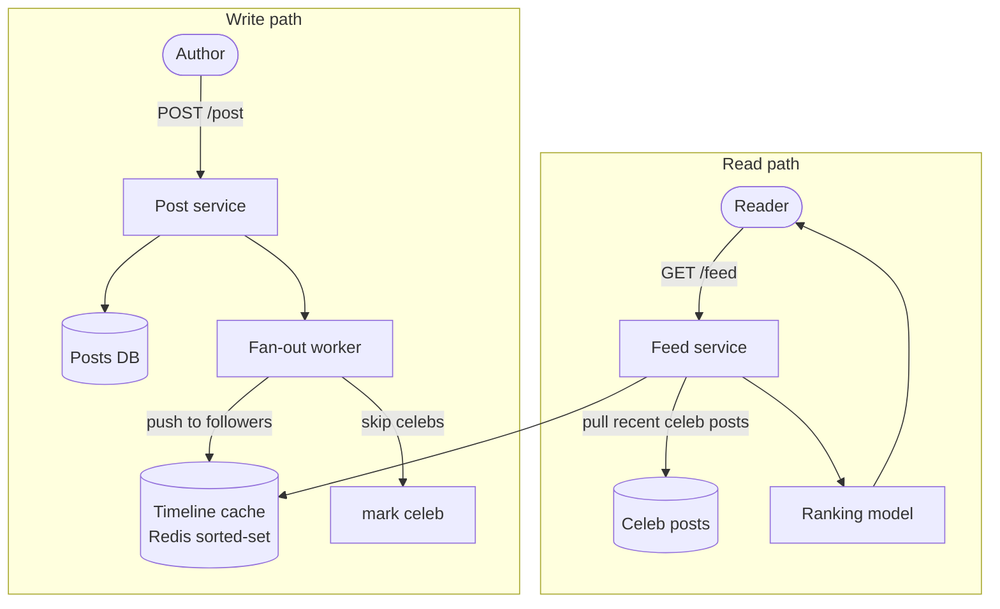

## Definition (interview-ready)

A **news feed** shows each user a ranked or chronological list of recent posts from the accounts they follow. The design splits into a **write path** and a **read path**. On the write path, the post service stores the post in a store partitioned by author (for example Cassandra) and emits an event to Kafka. Fan-out workers then push the post ID into each follower's precomputed timeline, a Redis sorted set trimmed to a few hundred entries. On the read path, the feed service reads that timeline, merges in recent posts pulled from any celebrities the user follows, hydrates the IDs from a post cache and ranks them.

The key decision is **hybrid fan-out**. Push (fan-out on write) makes reads a single cache lookup but is ruinous for accounts with millions of followers, so those accounts are pulled at read time (fan-out on read). The trade-off is eventual consistency: followers may see a new post a few seconds late.

**One-liner:** Store posts by author, fan out post IDs on write into per-user Redis timelines for normal accounts, pull celebrity posts at read time, then merge, hydrate from cache and rank.

## Problem statement

Design a social news feed: users post (tweets/status), follow each other, and see a personalized timeline of their followees' recent activity, ranked or chronological.



## Requirements

### Functional
- POST `/post` — author writes a post.
- GET `/feed` — fetch ranked timeline.
- Follow/unfollow.
- Like/comment/repost.

### Non-functional
- Reads dominate (here about 50:1; 100:1 or more is common).
- p99 feed latency < 200 ms.
- Eventual consistency on visibility (slight delays acceptable).
- Handle "celebrities" with 100M followers.
- Tolerate eventual consistency for likes/counters.

## Scale estimation

- 300M DAU, 2 posts/user/day → **600M posts/day** = ~7K writes/sec average, 21K peak.
- Each user reads ~100 posts/day → 30B reads/day = ~350K reads/sec average, ~1M peak.
- Storage: 600M × 1 KB/post = **600 GB/day** raw, ~220 TB/year. With RF=3 → ~650 TB/year.
- Reads are ~50× writes (30B vs 600M per day) → cache + materialization.

## Core API

```
POST /api/posts            { content, media_urls }
GET  /api/feed?limit=20    → recent posts from followees
POST /api/follow/{user}
DELETE /api/follow/{user}
POST /api/like/{post_id}
GET  /api/user/{id}/posts  → user's own timeline
```

## Feed generation strategies

### Pull (fan-out on read)

When user opens feed:
1. Query followees list.
2. For each followee, fetch recent posts.
3. Merge, rank, return.

Pros: cheap on write; works for celebrities.
Cons: expensive on read (N fetches → scatter-gather), high latency for users with many followees.

### Push (fan-out on write)

When user posts:
1. Look up their followers list.
2. Insert the post ID into each follower's timeline (often a per-user sorted set in Redis).

Pros: feed fetch is one read.
Cons: catastrophic for celebrities (write fans out to 100M timelines).

### Hybrid (recommended)

- **Push** for normal users (few followers).
- **Pull** for celebrities (many followers).
- On feed fetch: merge user's precomputed timeline + on-demand celebrity posts.

A tunable follower-count threshold (e.g., tens of thousands and up) determines who's "celebrity."

## High-level architecture

```
              ┌─────────────┐
Client ──► CDN│ API Gateway │
              └──────┬──────┘
                     ▼
            ┌────────┴──────────┐
            │   Feed Service    │ ──► ranking model
            └──┬─────────┬──────┘
               ▼         ▼
        ┌──────────┐  ┌────────────┐
        │ Timeline │  │ Post Service│
        │ (Redis)  │  │             │
        └──────────┘  └──────┬──────┘
                             ▼
                       ┌───────────┐
                       │ Post DB   │  (Cassandra / sharded SQL)
                       └───────────┘
                             │
                             ▼ event
                       ┌─────────────┐
                       │ Kafka       │
                       └─────┬───────┘
                             ▼
                     ┌──────────────────┐
                     │ Fan-out worker   │
                     └────────┬─────────┘
                              ▼
                   per-user timeline (Redis)
```

## Data model

### Posts (Cassandra example)

```cql
CREATE TABLE posts_by_user (
  user_id   uuid,
  post_id   timeuuid,
  content   text,
  media     list<text>,
  created   timestamp,
  PRIMARY KEY ((user_id), post_id)
) WITH CLUSTERING ORDER BY (post_id DESC);
```

### Per-user timeline (Redis sorted set)

```
ZSET feed:user:<user_id>  score=post_ts  member=post_id
```

Trim to last ~500 posts.

### Social graph

Either a graph DB (Neo4j) or sharded Postgres with a `follows` table:
```
follows(follower_id, followee_id, created_at)
```
Indexed in both directions (by follower for "who do I follow", by followee for fan-out). At scale, keep two copies sharded differently, one by `follower_id` and one by `followee_id`, so each lookup hits a single shard.

For huge followers (celebrities), specifically: a separate `celebrity_followers` table or service.

## Detailed design

### Post creation

```
POST /api/posts
1. Validate, sanitize.
2. Write to posts_by_user.
3. Emit "PostCreated" event to Kafka.
4. Return immediately to client.
5. Fan-out worker (separate, async):
   - Lookup followers.
   - If author is non-celeb (<10K followers): for each follower, ZADD feed:user:<f> post_ts post_id.
   - If celeb: skip; pull-on-read for celebrities.
```

### Feed fetch

```
GET /api/feed
1. Load user's precomputed timeline: ZREVRANGE feed:user:<id> 0 19 (or ZRANGE ... REV on Redis 6.2+).
2. Get list of celebrities the user follows.
3. For each celebrity: fetch recent posts from posts_by_user.
4. Merge, rank (by score model), return.
```

Ranking ML model can run inline (cached features) or as a separate service.

### Ranking

Chronological is simplest. Ranked feeds:
- Features: recency, engagement (likes/comments), affinity (follower-followee interactions), content type.
- Model: gradient boosted trees (XGBoost) or deep learning, served via TensorFlow Serving / TorchServe.
- Inference per feed fetch is expensive — precompute candidate set, rank top K.

### Likes and counters

- Don't update post row's like_count on every like (lock contention).
- Use a separate counter (Redis HINCRBY or Cassandra counter).
- Periodic flush to durable storage for analytics.

### Trending/global timeline

- Stream of all public posts → in-memory ranking (e.g., score = engagement / age) → trending list, refreshed every minute.

## Bottlenecks & optimizations

- **Celebrity fan-out**: hybrid push/pull (already covered).
- **Hot post (viral)**: cache the post object; CDN for media.
- **Ranking latency**: precompute candidate set; serve from cache.
- **Timeline storage**: 500M users × 500 posts × ~16 bytes (8-byte ID + 8-byte score) = ~4 TB before Redis sorted-set overhead, which can multiply that several times. Shard across Redis cluster, and only materialize timelines for recently active users.
- **Following list cache**: hot lookups (every post needs follower list). Cache in Redis per user; invalidate on follow/unfollow.

## Trade-offs

- **Chronological vs ranked**: chronological is predictable and cheaper; ranked is engagement-optimized but opaque.
- **Push vs pull**: push optimizes read; pull optimizes write. Hybrid covers both.
- **Strong vs eventual consistency**: feed is eventually consistent (you post → fan-out may take seconds). UX: show your own posts immediately on your client.
- **Caching aggressively**: stale data trade-off; usually fine for non-critical signals (counts, suggestions).

## Practice questions

<Practice>

<QA q="Push vs pull — when each?" level="easy">

Push (fan-out on write): cheaper reads, expensive for celebrities. Pull (fan-out on read): cheaper writes, expensive reads for users with many followees. Real systems do hybrid: push for normal authors, pull for celebs at read time.

</QA>

<QA q="How is a per-user timeline stored, and why only post IDs?" level="easy">

As a Redis sorted set `feed:user:<id>` with score = post timestamp and member = post ID, trimmed to the last ~500 entries. Storing IDs keeps each entry tiny (about 16 bytes before overhead), and the post body is fetched from a shared cache, so one viral post is stored once instead of copied into millions of timelines.

</QA>

<QA q="How does the feed handle a celebrity with 100M followers?" level="medium">

Don't push to 100M timelines on every post — too expensive and slow. Mark accounts above a follower threshold as celebrity; on feed fetch, merge the user's pushed timeline with celebrity posts pulled directly. Adds a few reads per feed fetch — acceptable.

</QA>

<QA q="How to handle a viral post?" level="medium">

Cache the post object aggressively (Redis + CDN for media). The timeline only stores the post ID, so the fan-out cost is the same — but every fetch resolves to a single cached post.

</QA>

<QA q="Storage estimation for posts at 600M/day, kept 5 years." level="medium">

- 600M × 1 KB = 600 GB/day.
- 5 years = ~1,100 TB raw.
- With RF=3 = ~3.3 PB.
- Hot recent data in main store (Cassandra/sharded SQL).
- Cold archive to S3 Parquet for analytics.

</QA>

<QA q="Why not increment a like_count column on the post row for every like?" level="medium">

A viral post gets many concurrent likes, and updating one row for each causes lock contention on that row. Keep counts in a separate counter (Redis `HINCRBY` or a Cassandra counter) and flush periodically to durable storage. Counts can be slightly stale, which is fine.

</QA>

<QA q="Why is post creation asynchronous, and what does that cost?" level="medium">

The post service writes the post, emits a `PostCreated` event to Kafka and returns immediately; a fan-out worker inserts it into follower timelines later. That keeps write latency low and isolates expensive fan-out. The cost is eventual consistency: followers may see the post a few seconds late.

</QA>

<QA q="Design the ranking system." level="hard">

- Candidate set: from precomputed timeline + celeb pulls.
- Features: post recency, author affinity (interactions, follows), content type, engagement velocity.
- Model: train offline on engagement data; serve via TF Serving or TorchServe.
- Cache user features and post features for fast inference; rank only the top K candidates.
- A/B test new models behind feature flags.

</QA>

<QA q="How do you scale the social graph?" level="hard">

Shard by user ID (hash). For each user, store followers and followees in separate tables/sets, indexed both directions. Hot reads (follower list for fan-out) cached in Redis and invalidated on follow/unfollow. For celebs, separate storage (millions of followers per user). Use a graph DB (Neo4j, Dgraph) if traversal queries dominate; otherwise simple sharded KV works.

</QA>

<QA q="Timelines for 500M users would take many TB of Redis. How do you cut that?" level="hard">

500M × 500 entries × ~16 bytes is ~4 TB before sorted-set overhead, which multiplies it several times. Shard across a Redis cluster, trim each timeline, and only materialize timelines for recently active users. For inactive users, skip fan-out and build the feed on demand when they return.

</QA>

<QA q="A user just posted but doesn't see it in their own feed. Why?" level="scenario">

The fan-out worker hasn't processed it yet. Mitigations: the client immediately shows the post (optimistic UI); the server includes the user's own latest posts directly in the feed fetch (not relying solely on fan-out).

</QA>

<QA q="How would you reduce p99 latency from 500 ms to 100 ms?" level="scenario">

- Profile end-to-end: where's the time spent?
- Cache the follow lists (avoid DB hits).
- Precompute timeline (push) so feed fetch is one ZREVRANGE.
- Cache ranked candidate set.
- Use HTTP/2 multiplexing or gRPC to backends.
- Tail-tolerant fan-out (use the first N responses, ignore stragglers).
- Pre-warm caches on user login.

</QA>

<QA q="A user who hasn't opened the app in six months logs in. How do you serve their feed?" level="scenario">

Their timeline wasn't materialized (fan-out skips inactive users), so fall back to pull: fetch followees, read their recent posts from `posts_by_user`, merge and rank. Then write the result into their timeline cache and resume pushing to them now that they're active. The first load is slower; later loads are a single cache read.

</QA>

</Practice>

## Quiz

<Quiz>

<MCQ q="Why is pure fan-out on write a problem for celebrity accounts?" options={["Celebrities post too rarely to justify caching", "Each post must be written into every follower's timeline, which can be 100M writes", "Followers of celebrities can't use sorted sets", "It makes reads slower for the celebrity"]} answer={1}>

Push copies the post ID into each follower's timeline, so a 100M-follower account creates 100M writes per post. Post frequency, data structures and the celebrity's own read speed aren't the issue.

</MCQ>

<MCQ q="In the hybrid model, what happens when a user opens their feed?" options={["Read the precomputed timeline and merge in recent posts pulled from followed celebrities", "Pull posts from every followee", "Read only the precomputed timeline", "Recompute the timeline from the social graph each time"]} answer={0}>

Normal authors are pushed into the timeline; celebrity posts are pulled at read time and merged. Pulling from everyone is pure pull, reading only the timeline misses celebrities, and recomputing every time defeats precomputation.

</MCQ>

<MCQ q="A post goes viral. Why doesn't that multiply fan-out cost?" options={["Viral posts skip fan-out", "Kafka deduplicates viral posts", "Timelines store only the post ID, and the post body is fetched from one cached copy", "The CDN stores every timeline"]} answer={2}>

Fan-out cost depends on the author's follower count, not on views. Each read resolves the ID to one cached post. Viral posts aren't special-cased in fan-out, and Kafka and the CDN don't do this.

</MCQ>

<MCQ q="What is the main reason to keep like counts outside the post row?" options={["Counts must be strongly consistent", "Post rows are immutable in Cassandra", "Likes must be stored in a graph DB", "Concurrent updates to one hot row cause lock contention"]} answer={3}>

Many likes on one popular post means heavy contention on that row, so counters live in Redis or Cassandra counters and are flushed periodically. Counts can be eventually consistent, and the other options aren't the reason.

</MCQ>

<MCQ q="A user's own new post is missing from their feed right after posting. What is the most likely cause?" options={["The post write failed", "The async fan-out worker hasn't inserted it into their timeline yet", "Redis evicted the timeline", "The ranking model filtered it out"]} answer={1}>

Fan-out is asynchronous, so there's a short delay. The fix is to show it optimistically or merge the author's own recent posts at read time. A failed write, eviction or ranking would not explain the usual seconds-long gap.

</MCQ>

<MCQ q="Posts are 600M per day at about 1 KB each with RF=3. Roughly how much storage does one year need?" options={["About 22 TB", "About 220 TB", "About 650 TB", "About 6.5 PB"]} answer={2}>

600 GB/day × 365 is about 220 TB raw, and RF=3 makes it about 650 TB. 220 TB forgets replication, 22 TB is 10x too small even before replication, and 6.5 PB is 10x too large.

</MCQ>

<MCQ q="Why does the posts_by_user table cluster by post_id DESC?" options={["So one partition read returns a user's newest posts first", "To spread one user's posts across nodes", "To avoid storing timestamps", "To enable cross-user joins"]} answer={0}>

Partitioning by user_id and clustering by timeuuid descending makes fetching a user's recent posts one sequential read. It keeps a user's posts together rather than spreading them, the timeuuid still encodes time, and Cassandra doesn't do joins.

</MCQ>

<MCQ q="Which step most directly cuts feed p99 when follower-list DB lookups dominate?" options={["Switch from ranked to chronological", "Increase timeline trim length", "Add more Kafka partitions", "Cache follow lists in Redis and invalidate on follow or unfollow"]} answer={3}>

If the time is spent on follow-list lookups, caching them removes the DB hit. Ranking changes, longer timelines or more Kafka partitions don't touch that path.

</MCQ>

</Quiz>

## TL;DR cheat sheet

- **Hybrid push + pull**: push for normal users, pull for celebs.
- Per-user timeline in Redis sorted set, trimmed to ~500 posts.
- Post storage in Cassandra/sharded SQL by author_id.
- Async fan-out via Kafka workers.
- Ranking: precompute candidates → rank top K with ML model.
- Counters: separate (Redis), not in the post row.
- Cache aggressively (follower list, post object, candidate set).
- CDN for media.

## Go deeper

- **ByteByteGo** YouTube and Alex Xu's *System Design Interview Vol 1* — Chapter 11 (News feed).
- **High Scalability**: [highscalability.com](http://highscalability.com/) has write-ups on Twitter and Facebook feed architectures.
- **Twitter**: Raffi Krikorian, ["Timelines at Scale"](https://www.infoq.com/presentations/Twitter-Timeline-Scalability/) (QCon 2012), the classic fan-out-on-write talk.
- **Pinterest Engineering**: ["Pinnability: Machine learning in the home feed"](https://medium.com/pinterest-engineering/pinnability-machine-learning-in-the-home-feed-64be2074bf60) (Smart Feed ranking).
- **System Design Primer**: feed sections.
