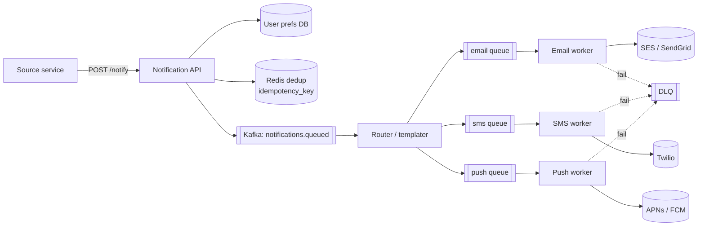

## Problem statement

Design a system that delivers notifications (email, SMS, push, in-app) to users at scale, respecting preferences, deduplication, rate limits, and delivery retries.



## Requirements

### Functional
- Multiple channels: email, SMS, mobile push (APNs/FCM), web push, in-app.
- Templating (subject + body, localization).
- User preferences (opt-out per channel/category).
- Scheduling and time-zone awareness.
- Delivery status tracking.

### Non-functional
- High throughput: millions of notifications/hour.
- Reliable delivery (retries, DLQ).
- Low latency for transactional (OTP < 5 s).
- Idempotency (no duplicate sends).
- Cost-aware (SMS is expensive).

## Scale estimation

- 100M users, average 10 notifications/day → 1B/day = ~12K/sec average, ~40K peak.
- Email: 50%, push: 40%, SMS: 10%.
- Storage: notification logs at ~500 bytes × 1B = 500 GB/day raw.

## Core API

```
POST /api/notify
{
  "user_id": "...",
  "category": "order_shipped",
  "channels": ["push", "email"],
  "template_id": "tpl_order_shipped",
  "data": { "order_id": "...", "tracking": "..." },
  "idempotency_key": "..."
}
```

## High-level architecture

```
            ┌──────────────┐
Producers ─►│  Notify API  │ ─► writes to Kafka
            └──────────────┘
                   │
                   ▼
            ┌──────────────┐
            │ Kafka topic  │  (per-channel or sharded)
            └──────────────┘
                   │
       ┌───────────┼───────────┐
       ▼           ▼           ▼
   Email Worker  SMS Worker  Push Worker  In-App Worker
       │           │           │              │
       ▼           ▼           ▼              ▼
    SendGrid   Twilio    APNs/FCM         WebSocket / DB
   (provider) (provider) (provider)
       │           │           │
       └───────────┴───────────┘
                   ▼
            ┌──────────────┐
            │ Status Topic │ ── delivered, bounced, opened
            └──────────────┘
                   ▼
            ┌──────────────┐
            │   Analytics  │
            └──────────────┘
```

## Detailed design

### Notify API (sync)

1. Validate request, idempotency key.
2. Check user prefs (subscribed to this category/channel?).
3. Resolve template (subject, body, with vars rendered).
4. Publish to channel-specific Kafka topic.
5. Return 202 Accepted with notification ID.

### Channel workers

Each channel has its own worker pool consuming from its Kafka topic. Workers:
- Apply rate limiting (per provider, per category).
- Call external provider (SendGrid, Twilio, APNs, FCM).
- On success: emit status event.
- On failure: retry with backoff; after N retries → DLQ.

### User preferences

```sql
CREATE TABLE notification_prefs (
  user_id     uuid,
  category    text,
  channel     text,
  enabled     boolean,
  PRIMARY KEY (user_id, category, channel)
);
```

Cached in Redis for fast lookup.

### Templating

- Templates in a versioned store (DB or Git).
- Template engine: Mustache, Handlebars, or simple Jinja-style.
- Localization: template per language.
- Subject + body rendered with data passed in API call.

### Idempotency

- API requires `idempotency_key` for retries.
- Dedupe table: `(idempotency_key) UNIQUE`. If exists → return previous result.
- Window: hours to days; long enough to survive retries.

### Delivery tracking

- Provider webhooks (SendGrid event webhook, Twilio status callbacks) consumed via Kafka; APNs/FCM report dead tokens in the send response itself (APNs `410 Unregistered`, FCM `UNREGISTERED`).
- Update notification status: queued → sent → delivered → opened/bounced.
- Surface to product (delivery rates) and users (read receipts on in-app).

### Scheduling

- For future notifications, persist with `scheduled_at`.
- A scheduler service polls for due notifications and enqueues them.
- Time-zone aware: convert scheduled_at to user's local time per template rule.

### Rate limiting

- Per-user: don't spam the same user.
- Per-category: marketing capped daily; transactional uncapped.
- Per-provider: respect SendGrid/Twilio limits.

### Cost control

- SMS is $0.01–0.10 per message — control spend.
- Fall through to email/push first; SMS only when needed (auth codes).
- Budget per category, per day.

## Bottlenecks & optimizations

- **Bursty senders** (a marketing campaign): smooth via worker pool size + rate limit at consumer.
- **Provider rate limits**: throttle send rate; backoff on 429s from provider.
- **Webhook ingestion**: provider webhooks can spike — buffer in Kafka, async process.
- **Stale prefs cache**: invalidate via CDC when user updates prefs.

## Trade-offs

- **In-band vs async**: transactional (OTP, password reset) needs low latency → consider sync HTTP to provider for these, async for everything else.
- **Single Kafka topic vs per-channel**: per-channel = different scaling, different consumer logic, clearer ownership.
- **Provider mix**: multi-vendor (SendGrid + AWS SES) for failover and price. Complexity vs reliability.
- **Personalization**: cache user data so worker doesn't query 10 services per notification.

## Practice questions

<Practice>

<QA q="Why does the Notify API return 202 Accepted instead of waiting for delivery?" level="easy">

The API only validates, checks the idempotency key and prefs, renders the template and publishes to Kafka. Delivery to SendGrid, Twilio or APNs/FCM happens later in channel workers, with retries. 202 means accepted for processing, and the returned notification ID lets callers track status. This keeps the API fast and absorbs bursts.

</QA>

<QA q="How do you respect user preferences?" level="easy">

Preferences table keyed by `(user_id, category, channel)`, cached in Redis. The API checks before publishing to Kafka. Channel-specific (user may opt out of SMS but keep push). Category-specific (marketing off but transactional on).

</QA>

<QA q="Why use a separate Kafka topic and worker pool per channel?" level="easy">

Channels differ in volume, latency needs, provider limits and failure modes. Separate topics let each scale independently, have their own consumer logic and rate limits, and stop a slow provider (say SMS) from backing up email or push. It also gives clearer ownership.

</QA>

<QA q="How do you guarantee no duplicate notifications?" level="medium">

Idempotency key from the caller; dedupe table (`idempotency_key UNIQUE`) at the API boundary, kept for hours to days. Workers also dedupe by notification ID before calling the provider. At-least-once delivery + idempotent send = effectively exactly-once visible behavior.

</QA>

<QA q="How do you handle bouncing emails / disabled push tokens?" level="medium">

- Provider webhooks tell us about bounces; APNs/FCM send responses tell us about token failures (APNs `410 Unregistered`, FCM `UNREGISTERED`).
- Update the user_devices table (mark the token invalid).
- After N consecutive bounces, mark the email as suppressed.
- Hard bounces (mailbox doesn't exist) → suppress permanently; soft bounces (mailbox full) → retry later.

</QA>

<QA q="How do you schedule a notification for 9 AM in each user's local time?" level="medium">

Persist it with `scheduled_at` instead of enqueuing it now. Convert the template's local-time rule to each user's time zone, so users get different UTC send times. A scheduler service polls for due notifications and enqueues them into the normal pipeline.

</QA>

<QA q="How do you keep SMS costs under control?" level="medium">

SMS costs roughly $0.01–0.10 per message. Prefer push or email and fall through to SMS only when it's really needed (such as auth codes). Set per-category daily budgets and per-user rate limits, so a bug or campaign can't run up the bill.

</QA>

<QA q="How do you ensure transactional OTPs are delivered in seconds?" level="hard">

- Separate priority topic with dedicated consumers and a higher rate-limit budget.
- Or: skip Kafka and call the provider synchronously from the API (with idempotency + retry).
- Multi-provider failover (Twilio + AWS SNS) to handle provider outages.
- Track p99 explicitly with alerts.

</QA>

<QA q="Design analytics on notification delivery." level="hard">

- Status events (sent, delivered, opened, bounced) to Kafka → ClickHouse/BigQuery.
- Dashboards: delivery rate, open rate, conversion, by channel/category/provider.
- A/B test framework: serve different templates/subjects, measure.
- Alerting on delivery rate drops by provider.

</QA>

<QA q="A campaign sends 10M notifications in 5 minutes. Design." level="scenario">

- Producer writes 10M to the Kafka topic (fast — Kafka absorbs the burst).
- Channel workers consume at the provider-allowed rate (your plan's contracted throughput).
- Spread over hours so we don't violate provider limits.
- Rate-limit per category to prevent the campaign from starving transactional traffic.

</QA>

<QA q="A user reports they unsubscribed but still get emails. Investigate." level="scenario">

- Check pref cache freshness (CDC invalidating Redis on prefs update).
- Check if the campaign queue snapshot was taken before the unsubscribe.
- Race: notification was already in Kafka when the unsubscribe happened — the worker should re-check prefs at consume time, not trust the published payload.
- GDPR: also check that the compliance unsubscribe list is honored.

</QA>

<QA q="The email provider starts returning 429s and then has an outage. What should the system do?" level="scenario">

On 429s, back off and throttle the send rate; messages wait in Kafka rather than being dropped. For an outage, fail over to a second vendor (for example SendGrid plus AWS SES). Messages that keep failing after N retries go to the DLQ for replay. Idempotency keys stop retries and failover from sending duplicates.

</QA>

<QA q="Multi-region notification delivery — design." level="scenario">

- Route notifications by region (the user's region decides worker location).
- Reduce cross-region traffic (provider POPs are global anyway).
- Failover: if a region's workers are down, redirect topics to another region.
- Compliance: respect data residency (EU users' email content stays in EU workers).

</QA>

</Practice>

## Quiz

<Quiz>

<MCQ q="A user unsubscribed from marketing after a campaign was already queued in Kafka. Where must the preference be checked to stop the send?" options={["Only at the Notify API", "Again in the channel worker at consume time", "Only in the analytics pipeline", "In the provider's dashboard"]} answer={1}>

The message was already published, so the API check passed before the unsubscribe. Workers must re-check prefs before sending. Analytics and the provider dashboard can't stop a send you already made.

</MCQ>

<MCQ q="What is the role of the idempotency_key in POST /notify?" options={["It lets a retried request return the earlier result instead of sending again", "It encrypts the payload", "It picks the channel", "It sets the message priority"]} answer={0}>

A unique key per logical notification lets the API dedupe caller retries. It doesn't encrypt, route or prioritize.

</MCQ>

<MCQ q="A marketing blast is delaying OTP codes. What is the best fix?" options={["Add more partitions to the shared topic", "Send OTPs by email instead", "Give transactional traffic its own priority topic or sync path with its own rate budget", "Lower the OTP retry count"]} answer={2}>

Isolating transactional traffic stops bulk sends from queueing ahead of it. More partitions on a shared topic still mix the two, email is slower for OTPs, and fewer retries make delivery less reliable.

</MCQ>

<MCQ q="An email hard-bounces because the mailbox doesn't exist. What should happen?" options={["Retry with backoff for 24 hours", "Switch the user to SMS automatically", "Ignore it", "Suppress that address permanently"]} answer={3}>

Hard bounces are permanent, so the address is suppressed to protect sender reputation. Retrying is for soft bounces, switching channels silently ignores preferences, and ignoring keeps hurting deliverability.

</MCQ>

<MCQ q="How do you learn that an APNs or FCM push token is dead?" options={["From the send response, such as APNs 410 Unregistered or FCM UNREGISTERED", "From a nightly email webhook", "Only when the user complains", "By pinging the device over WebSocket"]} answer={0}>

APNs and FCM report dead tokens in the send response itself, and you then mark the token invalid. Email webhooks are for email, and the other options are unreliable.

</MCQ>

<MCQ q="A campaign pushes 10M messages into Kafka in 5 minutes, but the SMS provider allows far less. What happens in a well-designed system?" options={["Workers send everything at once and accept provider errors", "The API rejects the campaign", "Workers drain the topic at the provider-allowed rate, spreading sends over time", "Kafka drops the excess"]} answer={2}>

Kafka buffers the burst and workers rate-limit to the provider's contracted throughput. Ignoring limits gets you throttled, rejecting is unnecessary, and Kafka retains messages rather than dropping them.

</MCQ>

<MCQ q="Why is SMS usually the last channel tried?" options={["It has the lowest delivery rate", "It can't carry links", "It needs user consent and email does not", "It costs real money per message"]} answer={3}>

SMS costs roughly $0.01–0.10 per message, so systems prefer push or email and keep SMS for cases like auth codes. The other claims aren't the reason.

</MCQ>

<MCQ q="What does at-least-once delivery plus an idempotent send by notification ID give you?" options={["Lower provider costs", "Effectively exactly-once behavior as the user sees it", "Strict global ordering", "No need for retries"]} answer={1}>

Retries may redeliver, but deduping by ID before calling the provider means the user gets one message. It doesn't order messages, cut costs or remove the need for retries.

</MCQ>

</Quiz>

## TL;DR cheat sheet

- API → Kafka per channel → worker pools → providers.
- Idempotency keys + dedup table.
- User prefs cached in Redis with CDC invalidation.
- Templating with versioning + localization.
- Worker rate-limits matched to provider quotas.
- Webhooks update delivery status.
- Transactional priority queue separate from marketing.
- Multi-provider failover for critical channels.

## Go deeper

- **Alex Xu Vol 1**: Chapter 10 (Notification system).
- **ByteByteGo**: notification system video.
- **Twilio + SendGrid docs** for production realities.
- **AWS SNS / SES architectures**.
- **PostgreSQL pg_partman**: time-partitioned notification logs.
- **OneSignal / Mixpanel** engineering blogs.
