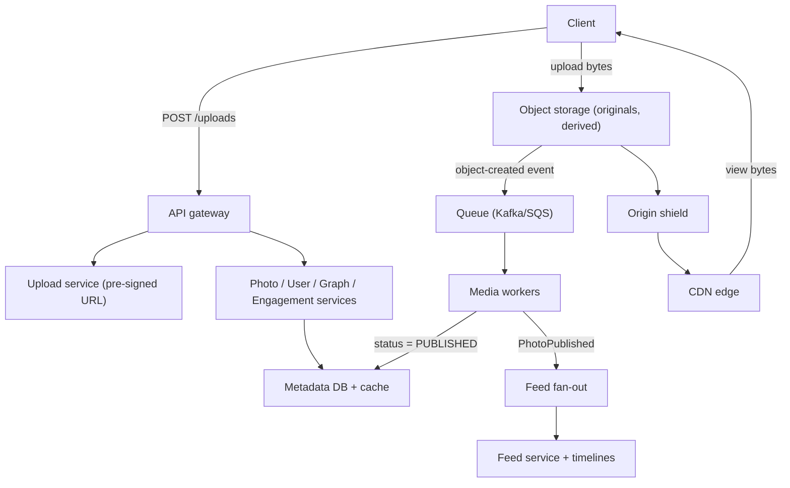
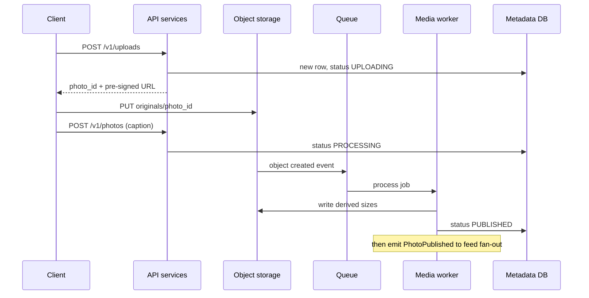
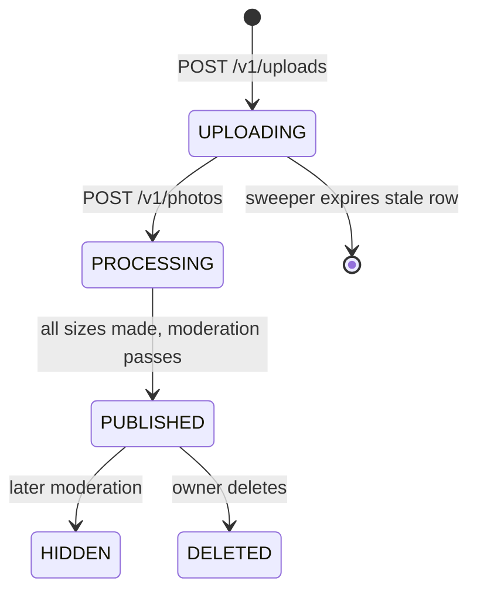

## Definition (interview-ready)

A **photo sharing service** lets people upload photos, follow each other, like and comment, and scroll a feed of photos from people they follow. The design has three parts. **Bytes:** the client uploads the original straight to object storage (S3 or similar) using a short-lived **pre-signed URL**, so app servers never carry image bytes. An async pipeline then validates the image, strips location data, makes a few fixed sizes, runs moderation checks and only then marks the photo as published. **Delivery:** every size gets its own immutable URL, and a **CDN** serves those URLs, so almost all image traffic never reaches the origin. **Metadata:** photos, users, the follow graph and counters live in a database **sharded by user ID**, with photo IDs that encode their shard. The main trade-off is freshness for scale: a new photo, a like count or a delete becomes visible everywhere within seconds, not instantly.

**One-liner:** Upload originals straight to object storage with pre-signed URLs, resize and moderate them asynchronously into immutable per-size CDN URLs, keep metadata sharded by user ID with shard-aware photo IDs, and reuse the news-feed fan-out for the home feed.

## Problem statement

"Design Instagram. Users can upload photos with a caption, follow other users, like and comment on photos, and see a home feed of recent photos from the people they follow. They can also open any user's profile and see that user's photo grid. Users can delete their photos and can make their account private.

Assume 500 million daily active users, 100 million new photos per day, and that each active user views about 100 photos per day. Some accounts have hundreds of millions of followers. Photos should load fast anywhere in the world."

## Requirements

### Functional (in scope)
- Upload a photo with a caption; it appears on the user's profile and in followers' feeds.
- View a photo at a size that suits the device (thumbnail in a grid, larger in the feed).
- Follow and unfollow; private accounts need approval before someone can see their photos.
- Like, unlike and comment; show like and comment counts.
- Home feed of photos from followed accounts.
- Delete a photo; switch an account between public and private.

### Non-functional
- **Reads far outnumber writes.** Tens of billions of photo views a day against 100 million uploads.
- **Fast image loads:** most images served from a nearby CDN edge.
- **Durable:** an uploaded photo must never be lost. Object storage gives this.
- **Highly available reads;** eventual consistency is fine for feeds and counts.
- **Privacy is not eventually-maybe:** after a delete or a switch to private, the photo must stop being served by our APIs within seconds, and copies must be removed everywhere within a bounded time.

### Out of scope (say so out loud)
- Video, Stories, Reels, direct messages, search and Explore ranking.
- The ranking model for the feed (covered in [News Feed](/learn/notes/hld-news-feed/)).
- Ads and billing.

### Clarifying questions to ask
- What is the maximum upload size, and which formats? (Say 20 MB, JPEG/HEIC/PNG.)
- Is the feed chronological or ranked? (Assume ranked, and reuse the feed design.)
- How quickly must a new post appear in followers' feeds? (A few seconds is fine.)
- How fast must a delete take effect? (API-level: seconds. Full purge from caches and storage: hours to days, within a stated policy.)
- Do we need moderation before a photo becomes visible? (Yes, at least fast automated checks.)
- Multiple regions? (Yes for reads; we will keep it simple and mention it.)

## Scale estimation

Assumptions: 500M DAU, 100M uploads/day, 100 photo views per user per day, 10 likes per user per day, 10 feed opens per user per day. Peak is about 3x average.

**Uploads**
- 100M / 86,400 s ≈ **1,160 uploads/s** average, about **3.5K/s** at peak.
- Original after client-side compression: about 2 MB → 100M × 2 MB = **200 TB/day** of ingest.
- Ingest bandwidth: 200 TB / 86,400 s ≈ 2.3 GB/s ≈ **18.5 Gbps** average.

**Storage**
- Derived sizes (say thumbnail 15 KB, 320 px 40 KB, 640 px 100 KB, 1080 px 250 KB) ≈ 400 KB per photo.
- Per photo about 2.4 MB → 100M × 2.4 MB = **240 TB/day** → about **88 PB/year**. Object storage handles replication, but the bill is real, so older originals move to a colder storage class.
- Metadata: about 500 bytes per photo row → 100M × 500 B = 50 GB/day → about **18 TB/year**, before indexes and replicas. That fits a sharded relational database.

**Reads**
- 500M × 100 = **50B photo views/day** → about **580K images/s** average, about **1.7M/s** at peak.
- Average served image about 100 KB (mostly the feed size) → 50B × 100 KB = 5 PB/day → about 58 GB/s ≈ **460 Gbps** average egress. Only a CDN can serve this; the origin should see a small fraction.
- Feed opens: 500M × 10 = 5B/day → about **58K feed requests/s** average.

**Likes**
- 500M × 10 = 5B likes/day → about **58K likes/s** average, about **175K/s** at peak, heavily skewed toward a few hot posts.

**How to say it in an interview:** "Bytes dominate bandwidth and storage, so they go to object storage and a CDN. Metadata is small but very read-heavy, so it goes to a sharded database with heavy caching."

## Core API

```
POST   /v1/uploads                       -> { upload_id, photo_id, upload_url, expires_at }
       body: { content_type, size_bytes }
PUT    <upload_url>                      (client -> object storage directly)
POST   /v1/photos                        -> { photo_id, status: "processing" }
       body: { upload_id, caption, idempotency_key }
GET    /v1/photos/{photo_id}             -> metadata + per-size URLs
DELETE /v1/photos/{photo_id}
GET    /v1/users/{user_id}/photos?cursor=...      (profile grid)
GET    /v1/feed?cursor=...                         (home feed)
POST   /v1/users/{user_id}/follow        DELETE /v1/users/{user_id}/follow
POST   /v1/photos/{photo_id}/like        DELETE /v1/photos/{photo_id}/like
POST   /v1/photos/{photo_id}/comments    GET /v1/photos/{photo_id}/comments?cursor=...
PATCH  /v1/me/settings                   body: { is_private }
```

Notes:
- Lists use **cursor pagination** (the last seen ID), not offsets, because offsets get slow and shift when new items arrive.
- `POST /v1/photos` takes an **idempotency key**, so a retry on a flaky mobile network does not create two posts.
- The metadata response contains the image URLs. The client never builds image URLs itself, which lets the server change URL formats or sign them later.

## High-level architecture

The components as a flow: uploads go straight to object storage, media workers publish the photo (they set the status in the Metadata DB and emit `PhotoPublished` for the feed fan-out), and views come back through the CDN:



### Write path (posting a photo)
1. Client calls `POST /v1/uploads`. The upload service checks auth, rate limits and declared size, creates a `photo_id`, writes a row with `status = UPLOADING`, and returns a pre-signed URL for the object key `originals/<photo_id>`.
2. Client uploads the bytes directly to object storage.
3. Client calls `POST /v1/photos` with the caption. The row moves to `PROCESSING`.
4. Object storage emits an "object created" event to a queue. Media workers validate the file, strip EXIF, make the fixed sizes, write them under `derived/<photo_id>/...`, and call moderation.
5. When all sizes exist and moderation passes, the worker sets `status = PUBLISHED` and emits `PhotoPublished`.
6. The feed fan-out consumes that event and updates followers' timelines.

Steps 1 to 5 as a sequence:



### Read path (viewing the feed)
1. Client calls `GET /v1/feed`. The feed service reads the user's timeline (a list of photo IDs) and merges celebrity posts, as in the [News Feed](/learn/notes/hld-news-feed/) design.
2. It **hydrates** each photo ID: metadata from cache (falling back to the shard), counts from the counter cache, and a privacy check. Deleted or now-hidden photos are dropped here.
3. It returns metadata with per-size image URLs.
4. The client fetches images from the CDN. Most requests are edge hits; misses go to an origin shield (a mid-tier cache) and only then to object storage.

## Data model

Metadata lives in a sharded relational database (for example PostgreSQL), because the data is relational, small per row and needs secondary indexes. Instagram described exactly this choice: sharding across PostgreSQL rather than moving to a NoSQL store.

```sql
-- On the shard that owns user_id
users (
  user_id      BIGINT PRIMARY KEY,
  username     TEXT UNIQUE,      -- uniqueness via a separate global lookup in practice
  is_private   BOOLEAN,
  created_at   TIMESTAMPTZ
);

photos (
  photo_id     BIGINT PRIMARY KEY,   -- time + shard + sequence, see below
  owner_id     BIGINT NOT NULL,
  caption      TEXT,
  status       SMALLINT,             -- UPLOADING, PROCESSING, PUBLISHED, HIDDEN, DELETED
  media_version INT,                 -- bumped on re-processing, part of the URL
  width        INT, height INT,
  created_at   TIMESTAMPTZ,
  deleted_at   TIMESTAMPTZ NULL
);
CREATE INDEX ON photos (owner_id, photo_id DESC);  -- profile grid, newest first

likes (photo_id BIGINT, user_id BIGINT, created_at TIMESTAMPTZ,
       PRIMARY KEY (photo_id, user_id));           -- on the photo owner's shard

comments (photo_id BIGINT, comment_id BIGINT, author_id BIGINT, body TEXT,
          created_at TIMESTAMPTZ, PRIMARY KEY (photo_id, comment_id));

photo_counters (photo_id BIGINT PRIMARY KEY, like_count BIGINT, comment_count BIGINT);
```

Follow graph, stored twice, each copy sharded by its first column:

```sql
following (follower_id, followee_id, created_at, PRIMARY KEY (follower_id, followee_id))
followers (followee_id, follower_id, created_at, PRIMARY KEY (followee_id, follower_id))
```

`following` answers "who do I follow" and "may I see this private account" in one shard. `followers` answers "who should get this post" for fan-out in one shard. A follow writes both rows, one through an async job with retries, so the copies can briefly disagree.

**Partition key: `user_id` (the owner).** A profile grid is one range scan on one shard. Likes and comments go on the photo owner's shard, next to the photo. The cost: a celebrity's shard is busier than average, which we handle with caching and counters (see below).

**Photo IDs that carry their shard.** Instagram's published scheme packs 64 bits as 41 bits of milliseconds since a custom epoch, 13 bits of logical shard ID and 10 bits of a per-shard sequence (so 1,024 IDs per shard per millisecond), generated inside PostgreSQL by a PL/pgSQL function. Two wins: IDs sort by time, and given only a photo ID you can compute which shard holds it, with no lookup table. See [Distributed ID Generation](/learn/notes/distributed-id-generation/).

**Logical shards.** Instagram used several thousand logical shards (PostgreSQL schemas) mapped to far fewer physical servers. Moving a whole logical shard to a new server is much easier than re-splitting data. See [Sharding Strategies](/learn/notes/sharding-strategies/).

**Object storage keys:**
```
originals/<photo_id>                       (private, never served directly)
derived/<photo_id>/v<media_version>/<size>.jpg
   size in: thumb_150, w320, w640, w1080
```

## Detailed design

### 1. Upload: pre-signed URLs straight to object storage

**Intuition:** a hotel gives you a keycard that opens one room for one night. A pre-signed URL is a keycard for one object key, one operation and a short time window.

**Why not upload through our API servers?** At about 18.5 Gbps of average ingest, routing bytes through app servers burns their network and memory, and a slow mobile upload pins a server connection for many seconds. Object storage is built for this traffic.

**How it works:**
- The upload service signs a URL that allows `PUT` (or a form `POST`) to exactly `originals/<photo_id>`, with a short expiry (say 15 minutes). A pre-signed URL carries only the permissions of whoever signed it, so the signing role should be allowed to write only under `originals/`. With the AWS CLI or SDKs the expiry can be as long as 7 days; keep it short.
- **Limit what can be uploaded.** A pre-signed `PUT` can pin the content type. To enforce a size limit at the storage layer, use a pre-signed **POST policy** with a `content-length-range` condition. Either way, the worker checks the real size and format again; never trust the client.
- **Large files and bad networks:** for big files, use multipart upload, where each part has its own signed URL and a failed part is retried alone. On S3 every part except the last must be at least 5 MiB, so this only helps files above 5 MiB (near our 20 MB limit). A typical 2 MB photo goes in one `PUT`, and the client simply retries the whole `PUT` with the same URL if it fails.
- **Orphans:** clients that get a URL but never finish leave `UPLOADING` rows and maybe unfinished multipart uploads. A storage lifecycle rule can only match on prefix, tags and age, not on database state, so use two tools: a lifecycle rule that aborts incomplete multipart uploads after a day, and a sweeper job that finds `UPLOADING` rows older than, say, an hour, deletes their objects and expires the rows.

**Upload done signal:** two signals, use both. The storage "object created" event is the reliable trigger for processing; the client's `POST /v1/photos` carries the caption. Processing starts on whichever arrives first and the photo publishes only when both exist. If the worker finishes before the caption arrives, the row is still `UPLOADING`, so the conditional publish below changes nothing; the job that `POST /v1/photos` enqueues then finds the sizes already written and publishes.

### 2. Async processing: resize, thumbnails, moderation

S3 event notifications are delivered **at least once** and usually within seconds, but sometimes a minute or more. So workers must be **idempotent**:
- Output keys are deterministic (`derived/<photo_id>/v<n>/w640.jpg`). Re-running a job overwrites the same objects with the same bytes.
- Status changes are conditional: `UPDATE photos SET status = PUBLISHED WHERE photo_id = ? AND status = PROCESSING`. A duplicate job finds nothing to update and stops.

The `status` column's life cycle, as described across this design:



Steps in the worker:
1. **Validate:** check magic bytes, decode the image fully (catches malformed or malicious files), enforce limits on pixel dimensions so a tiny file cannot expand into a huge bitmap.
2. **Normalize:** apply the EXIF orientation, then **strip EXIF**, especially GPS location, which is a privacy leak if served.
3. **Resize** to a small fixed set of widths. A fixed set keeps CDN hit rates high; arbitrary sizes would create endless cache variants.
4. **Encode** each size, possibly in more than one format (for example JPEG plus a modern format for clients that support it).
5. **Moderation hook:** call a moderation service. Fast checks (hash match against known-bad image lists, a quick classifier) run before publishing. Slower or human review can run after publishing and flip the photo to `HIDDEN`, which uses the same takedown path as a delete.
6. **Publish:** set status, emit `PhotoPublished`.

**Eager vs lazy resizing:** eager (all sizes at upload) means every view is a static file and costs a few hundred KB extra storage per photo. Lazy (resize on first request at the edge or origin) saves storage for photos nobody views but puts CPU on the read path and adds first-view latency. For a feed product where nearly every new photo is viewed soon after posting, eager for the main sizes is the usual answer; lazy suits rare sizes.

**Scaling the workers:** the workers form one consumer pool on the queue, autoscaled on queue lag. If workers fall behind, uploads still succeed (bytes are safe in storage) and posts just publish later. That is the point of making this async.

### 3. CDN and cache keys per size

**Rule: one immutable URL per (photo, version, size).**

```
https://img.example.com/<photo_id>/v3/w640.jpg
```

- The **cache key is the path.** Do not include cookies, auth headers or unrelated query strings in the cache key, or one image becomes thousands of cache entries.
- Because the URL never changes meaning, serve it with a very long TTL (`Cache-Control: public, max-age=31536000, immutable`).
- **Changing an image (re-crop, filter, re-encode)** bumps `media_version`, which makes a new URL. AWS's CloudFront docs recommend versioned file names over invalidation for files that change, because invalidation does not reach copies held in browser or corporate proxy caches.
- **The client picks the size** from the URLs in the metadata response, based on its screen width and pixel density. A grid asks for `thumb_150`, the feed for `w640` or `w1080`.
- **Origin shield:** a regional mid-tier cache in front of object storage collapses misses from many edges into one origin fetch.
- **Private content:** for private accounts, URLs can be **signed with a short expiry** at the CDN (CloudFront, for example, supports signed URLs). The metadata API, which already checks permissions, mints them. Configure the cache key to leave out the signature parameters so the CDN still stores one copy per size.

### 4. Metadata, sharding and the follow graph

- **Routing:** a request for user X goes to shard `hash(X) mod N_logical`, then a config map from logical shard to physical server. A request for photo P reads the shard bits from P's ID.
- **Replication:** each shard has a primary and replicas. Reads go to replicas or cache; writes go to the primary. Instagram's 2015 multi-datacenter post describes this pattern: PostgreSQL primaries in one region, read replicas in each region, so writes cross regions but reads stay local.
- **Caching:** photo and user rows are cached in memcached or Redis by ID. Invalidate on write. With replicas in several regions, the invalidation must follow replication: Instagram wrote invalidation events into the same database (using PgQ) so each region invalidates its local cache only after the change has replicated there.
- **Follow graph:** the two-copy design above. Hot follower lists are cached for fan-out. For accounts with huge follower counts, fan-out pages through the `followers` table in chunks and the feed falls back to pull for those authors (see [News Feed](/learn/notes/hld-news-feed/)).
- **Uniqueness of usernames:** usernames are looked up by name, not by user ID, so keep a small global `username -> user_id` table (or a separate shard keyed by username) to enforce uniqueness.

### 5. Likes and comment counters at scale

**Never compute counts with `COUNT(*)` on read.** Instagram noted that a `select count(*)` for a count could take hundreds of milliseconds. Three designs, from simplest to most scalable:

1. **Denormalized counter in the same transaction.** Insert the `likes` row and increment `photo_counters.like_count` in one transaction on the owner's shard. Counts stay exactly right and reading is a single-row select. Instagram moved to this when cache invalidation across regions made `count(*)` reads expensive. Weakness: every like on a viral photo locks the same counter row.
2. **Sharded (split) counters.** Keep K sub-rows per hot photo (`photo_id, slot`), increment a random slot, sum K rows on read (or cache the sum). Contention drops by K. Use it only for photos above a like-rate threshold.
3. **Buffered increments.** Write the like row (needed for "did I like this?" and to stop double likes), publish a `LikeAdded` event, and let a consumer aggregate per photo every second or so, then apply one `+n` update. Counts lag a little; contention disappears.

The like row itself is the source of truth: `PRIMARY KEY (photo_id, user_id)` makes like idempotent, and unlike deletes the row and decrements. Counters can be rebuilt from like rows if they drift.

**"Did I like this?"** For each photo in a feed page, the client needs to know whether the viewer liked it. Check the `likes` primary key in a batch, or keep a per-user recent-likes set in cache.

**Comments:** stored per photo with time-ordered IDs and paginated by cursor. The comment count uses the same counter approach. A celebrity photo with millions of comments is fine because nobody reads them all; you only ever read the latest page or the top-ranked few.

### 6. Hot celebrity posts

When an account with 300M followers posts, three things get hot at once:

- **Image bytes:** solved by the CDN. Everyone requests the same few URLs, which is the best case for a cache. Pre-warm the edges for very large accounts if needed.
- **Metadata reads:** millions of hydrations of one photo ID. Put it in cache, and protect the backend when that cache entry is missing or just invalidated. Instagram described two protections: **memcache leases** (on a miss, only one caller gets permission to refill within a window, others wait or get a slightly stale value) and caching **promises** instead of values in their C++ services, so concurrent misses share one backend call. Also keep a small in-process cache on each app server for the hottest few IDs, refreshed every second or two. See [Cache Stampede & TTL](/learn/notes/cache-stampede-ttl/).
- **Writes:** a burst of likes and comments on one shard. Switch the photo to split or buffered counters once its like rate crosses a threshold, and rate limit per user.
- **Fan-out:** do not push the post into 300M timelines. Followers' feeds pull it at read time (hybrid fan-out from the [News Feed](/learn/notes/hld-news-feed/) note).

### 7. Deletion and privacy propagation

The key idea: **block on read immediately, then clean up copies asynchronously.** Copies of a photo live in many places: metadata rows and caches, follower timelines, the CDN, object storage, search and recommendation indexes, analytics and backups. You cannot delete them all atomically, so make the source of truth win first.

**Delete a photo:**
1. Synchronously: set `status = DELETED`, `deleted_at = now()` on the owner's shard, invalidate the photo's cache entry, and emit `PhotoDeleted`. From now on every API hydration drops it, so it vanishes from feeds, profiles and permalinks in seconds, even though timelines still contain the ID.
2. Asynchronously (consumers of `PhotoDeleted`): remove the ID from timelines lazily or in a job, remove it from search and recommendation indexes, delete likes and comments, issue a CDN invalidation for all its URLs, and delete `originals/` and `derived/` objects.
3. Backups and logs expire on their own schedule, within a documented retention policy.

**Why invalidate the CDN if the API already hides it?** Someone who saved the image URL could still fetch it from the edge until the TTL ends, and our TTL is a year. Invalidation clears the edges, and deleting the objects stops the origin from refilling them. Copies already sitting in browser caches are outside our control, which is a reason to use signed URLs for anything sensitive.

**Switch an account to private:**
- Flip `is_private` and invalidate the user cache. The hydration step checks "is the owner private, and does the viewer follow them?" on every read, so non-followers stop seeing the photos at once.
- Image URLs for private accounts move to **signed, short-lived** URLs. Changing the URL alone is not enough, because the old public URL still works from the CDN (cached for a year) and from origin. A background job must also invalidate the old URLs at the CDN and stop the origin serving them without a signature, for example by copying the images to a new `media_version` under a signed-only path and deleting the old objects.

**Block a user:** same pattern, checked at hydration time using a cached block list.

**Interview line:** "Visibility is enforced at read time against the source of truth, so a delete is effective in seconds. Purging copies from caches, CDN and storage is an async, idempotent cleanup with a bounded deadline."

## Bottlenecks & optimizations

- **Egress cost:** the CDN carries hundreds of Gbps. Use modern image formats where the client supports them, serve the smallest size that fits the screen, and use an origin shield to cut origin fetches.
- **Storage cost:** move originals to a colder, cheaper storage class after a few weeks; derived sizes stay hot. Optionally drop rarely used sizes and regenerate them lazily.
- **Feed hydration:** batch all metadata lookups for a page into one multi-get per shard instead of one call per photo.
- **Hot shard:** a celebrity's shard gets heavy reads. Caching absorbs reads; a very hot logical shard can be moved to its own physical server.
- **Mapping lookups:** a lookup table (for example legacy photo ID to user ID) can be packed tightly in Redis. Instagram stored about 300 million media-to-user mappings in Redis hashes bucketed by ID/1000, using under 5 GB instead of an estimated 21 GB with plain keys.
- **Processing backlog:** autoscale workers on queue lag; prioritize the default feed sizes first so the post can publish, and make rare sizes later.

## Failure handling

| Component fails | What happens | Mitigation |
|---|---|---|
| Upload service down | New uploads cannot start; viewing still works | Stateless, many replicas behind a load balancer |
| Client loses network mid-upload | Partial or missing object | Client retries the `PUT` with the same `upload_id` (multipart with per-part retry for files over 5 MiB); a sweeper cleans orphans and a lifecycle rule aborts unfinished multipart uploads |
| Object storage event lost or delayed | Photo stuck in `PROCESSING` | Client's `POST /v1/photos` also enqueues the job; a sweeper re-enqueues rows stuck too long |
| Media worker crashes mid-job | Some sizes written, status not updated | Idempotent jobs with deterministic keys; queue redelivers; retry is safe |
| Moderation service down | Cannot clear new photos | Queue the job and keep photos in `PROCESSING`, or publish under fast checks only, then re-check when it recovers (a policy choice) |
| CDN edge or region outage | Image loads slow or fail in that area | CDN reroutes to other edges; a second CDN for very large services |
| Metadata shard primary fails | Writes for users on that shard fail | Promote a replica; reads continue from replicas and cache; a few seconds of write errors |
| Cache cluster fails | Load spikes onto the database | Leases or request coalescing on refill; warm the cache gradually; shed low-value reads |
| Counter consumer lags | Like counts look stale | Acceptable; like rows are the source of truth, counters catch up or are rebuilt |
| Delete cleanup job fails | Objects or CDN copies remain past the deadline | API already hides the photo; cleanup is retried from the `PhotoDeleted` log; alert when past the deadline |

## Trade-offs

| Decision | Option chosen | Alternative | Why |
|---|---|---|---|
| Upload path | Pre-signed URL straight to object storage | Upload through API servers | Keeps bytes off app servers; storage scales on its own |
| Resizing | Eager, fixed set of sizes | Lazy resize on request | Most new photos are viewed soon; static files are cheapest to serve |
| Image URLs | Immutable, versioned per size | One URL plus invalidation on change | No invalidation needed; works with browser caches |
| Metadata store | Sharded relational DB by user ID | Wide-column NoSQL store | Relational queries and indexes; profile grid on one shard |
| Photo ID | Time + shard + sequence | Random UUID | Sorts by time; routes to shard without a lookup |
| Follow graph | Two copies, sharded by each side | One table with two indexes | Each lookup stays on one shard |
| Like counts | Denormalized counter, split or buffered when hot | `COUNT(*)` on read | Reads are one row; hot photos avoid lock contention |
| Moderation | Fast checks before publish, deep checks after | All checks before publish | Low posting latency vs a short window of exposure |
| Delete | Hide on read now, purge copies async | Synchronous purge everywhere | Cannot delete from CDN, indexes and storage atomically |

## Practice questions

<Practice>

<QA q="Why upload photos directly to object storage instead of through the API servers?" level="easy">

Image bytes are the heavy part: about 200 TB/day of ingest in our numbers. Sending them through API servers wastes their bandwidth and memory, and slow mobile uploads hold connections open for a long time. Object storage is built to take this load. The API server only issues a short-lived pre-signed URL for one object key, then gets a callback or event when the upload is done.

</QA>

<QA q="What is a pre-signed URL and what can it restrict?" level="easy">

It is a URL signed with the server's credentials that lets the holder perform one operation (for example `PUT`) on one object key until it expires. It only carries the permissions of whoever signed it. You can pin the key, the expiry and the content type. To limit size at the storage layer, use a pre-signed POST policy with a `content-length-range` condition. The worker still re-validates size and format.

</QA>

<QA q="Why generate a fixed set of sizes instead of resizing to any size the client asks for?" level="easy">

Every distinct size is a separate CDN cache entry. Arbitrary sizes create many variants, lower the hit rate and push more requests to the origin. A small fixed set (thumbnail, 320, 640, 1080) covers real devices; the client picks the closest one.

</QA>

<QA q="How should the CDN cache key and URL for an image be designed?" level="medium">

One immutable URL per photo, version and size, for example `/photo_id/v3/w640.jpg`. The path is the cache key; exclude cookies, auth headers and unrelated query parameters. Serve with a very long TTL. When the image changes, bump the version so the URL changes, rather than relying on invalidation, which does not reach browser or proxy caches.

</QA>

<QA q="The storage event that triggers processing can arrive twice. How do you keep processing correct?" level="medium">

Make the job idempotent. Output keys are deterministic, so a second run overwrites the same files. The publish step is a conditional update (`status = PUBLISHED where status = PROCESSING`), so the duplicate finds nothing to change and does not emit a second `PhotoPublished` event. S3 documents its event notifications as at-least-once, so this is required, not optional.

</QA>

<QA q="Why shard metadata by user ID, and how do you find a photo by its ID alone?" level="medium">

The most common queries are per user: the profile grid, the user's settings, likes and comments on that user's photos. With user ID as the key they hit one shard. Photo IDs embed the logical shard number (Instagram's scheme: 41 bits time, 13 bits shard, 10 bits sequence), so given a photo ID you extract the shard bits and route directly, with no lookup table.

</QA>

<QA q="Why store the follow graph twice?" level="medium">

The two main queries go in opposite directions. 'Who do I follow' (for privacy checks and pull-based feeds) wants the data keyed by follower. 'Who follows me' (for fan-out) wants it keyed by followee. Sharding one table by one column makes the other query scatter across all shards. Two copies, each sharded by its first column, keep both queries on a single shard. The copies are synced asynchronously with retries.

</QA>

<QA q="How do you show like counts without COUNT(*) and without hot-row contention?" level="hard">

Keep the like row as the source of truth (primary key `photo_id, user_id`, which also makes liking idempotent). Keep a denormalized counter: increment it in the same transaction for normal photos. For a hot photo, switch to split counters (K sub-rows, increment one at random, sum on read) or buffered increments (a consumer aggregates likes per photo every second and applies one `+n`). Cache the displayed count. Counters can be rebuilt from like rows if they drift.

</QA>

<QA q="Eager vs lazy image resizing: when would you pick each?" level="hard">

Eager produces all sizes at upload: views are always static files, but you pay storage for sizes that may never be viewed, and processing delays publishing. Lazy resizes on first request: less storage, but CPU on the read path and a slow first view, plus a thundering herd risk if many clients ask for the same new size at once. For a feed product, most new photos are viewed quickly, so eager for the main sizes and lazy for rare ones is a good mix.

</QA>

<QA q="How does home feed generation work here, and what changes compared to a text news feed?" level="hard">

The timeline logic is the same as the [News Feed](/learn/notes/hld-news-feed/): `PhotoPublished` triggers fan-out of photo IDs into followers' timelines for normal accounts, and celebrity posts are pulled at read time. The differences: fan-out starts only after processing and moderation publish the photo, not at upload time; hydration must also return per-size image URLs and check privacy and deletion; and the response size is tiny compared to the images, which the client fetches from the CDN in parallel.

</QA>

<QA q="What should be checked synchronously before a photo becomes visible, and what can wait?" level="hard">

Before publishing: file validation, EXIF stripping (location data), and fast moderation such as hash matching against known-bad image lists and a quick classifier. After publishing: slower models, report-driven review and human review. If a later check fails, the photo moves to `HIDDEN`, which uses the same read-time filter and cleanup path as a delete. This keeps posting fast while bounding exposure.

</QA>

<QA q="A celebrity with 300M followers posts. Walk through what gets hot and how each part copes." level="scenario">

Image bytes: the same few URLs for everyone, which is ideal for the CDN; pre-warm edges if needed. Metadata: one photo ID hydrated millions of times; serve from cache, plus a small per-server in-process cache, and protect cache refills with leases or shared promises so a miss causes one backend call, not thousands. Likes and comments: switch that photo to split or buffered counters and rate limit per user. Fan-out: skip push for this author; followers pull the post at read time.

</QA>

<QA q="A user deletes a photo, but a friend can still open the image link they saved. What went wrong and how do you fix it?" level="scenario">

The API hides the photo, but the CDN still holds the image under a long TTL, and the link points straight at the CDN. The delete pipeline must also invalidate every size's URL at the CDN and delete the objects from storage, so the edge cannot refill from origin. Images already in the friend's browser cache can't be recalled, which is why sensitive or private images should use short-lived signed URLs.

</QA>

<QA q="A user switches their account to private. What must happen, and how fast?" level="scenario">

Immediately: set `is_private` on their shard and invalidate their cached user record. Every hydration checks 'owner private and viewer not an approved follower', so non-followers stop getting the photos from the API within seconds. In the background: switch image delivery for that account to signed short-lived URLs, invalidate the old public URLs at the CDN and delete or move the old objects so the origin cannot refill them (a new URL alone does not kill the old one), and remove the photos from public search and recommendation indexes.

</QA>

<QA q="The media workers fall behind by 30 minutes during a spike. What does the user see and what do you do?" level="scenario">

Uploads still succeed because bytes land in object storage, but posts sit in `PROCESSING`, so they show as pending to the author and do not reach followers. Autoscale workers on queue lag, process the default feed sizes first so posts can publish sooner, and defer rare sizes. Show the author a local preview so the app feels responsive. Alert on the age of the oldest message, not only on queue length.

</QA>

</Practice>

## Quiz

<Quiz>

<MCQ q="Why do uploads go to object storage via pre-signed URLs?" options={["Pre-signed URLs compress images automatically", "It keeps heavy image bytes off the API servers while still controlling which key can be written and for how long", "Object storage does moderation on upload", "It removes the need for any metadata database"]} answer={1}>

The point is moving bytes off app servers while keeping control: the URL allows one operation on one key for a short time. Pre-signed URLs do not compress or moderate anything, and metadata still needs a database.

</MCQ>

<MCQ q="Object storage event notifications are delivered at least once. What does the processing worker need?" options={["Exactly-once delivery from the queue", "A global lock on every photo", "Idempotent steps: deterministic output keys and a conditional status update", "To skip any event it has seen before by keeping all events forever"]} answer={2}>

With deterministic keys a retry overwrites the same files, and a conditional update means only one run publishes. Exactly-once delivery is not offered, global locks hurt throughput, and keeping all events forever is unnecessary.

</MCQ>

<MCQ q="An image is re-cropped after posting. What is the cleanest way to make clients see the new version?" options={["Bump the media version so the image gets a new URL", "Invalidate the old URL at the CDN and keep the URL unchanged", "Set a 60 second TTL on all images", "Ask clients to clear their cache"]} answer={0}>

A new URL is guaranteed to miss every cache, including browser and proxy caches that a CDN invalidation cannot reach. Short TTLs on all images would destroy the hit rate.

</MCQ>

<MCQ q="In Instagram's published ID scheme, what do the 64 bits contain?" options={["32 bits user ID and 32 bits random", "41 bits time, 13 bits logical shard ID, 10 bits sequence", "48 bits time and 16 bits machine ID", "A 64-bit hash of the photo bytes"]} answer={1}>

41 bits of milliseconds since a custom epoch, 13 bits of logical shard and a 10-bit per-shard sequence. This makes IDs time-sortable and lets you route to the right shard from the ID alone.

</MCQ>

<MCQ q="Why are both a following table and a followers table kept, each sharded by its first column?" options={["To get strong consistency between them", "Because relational databases cannot index two columns", "So both 'who do I follow' and 'who follows me' are single-shard lookups", "To save storage"]} answer={2}>

One sharding key can serve only one direction cheaply. Two copies double storage and are only eventually consistent with each other, but both lookups stay on one shard.

</MCQ>

<MCQ q="A viral photo receives tens of thousands of likes per second. Which change most directly removes lock contention on its count?" options={["Recount with COUNT(*) on every read", "Store the count in the photo's caption field", "Increase the CDN TTL", "Split the counter into K sub-rows or apply buffered increments"]} answer={3}>

Split or buffered counters spread or batch the writes so no single row takes every increment. COUNT(*) is slow on read and does nothing for writes; the CDN serves images, not counts.

</MCQ>

<MCQ q="A user deletes a photo. What makes it disappear from feeds within seconds?" options={["Deleting the photo ID from every follower's timeline synchronously", "Marking the row DELETED, invalidating its cache entry and filtering at hydration time", "Waiting for the CDN TTL to expire", "Deleting the original from object storage"]} answer={1}>

Every feed and profile read hydrates metadata from the source of truth, so a DELETED status hides the photo everywhere at once. Timeline cleanup, CDN invalidation and object deletion happen afterwards. Synchronous removal from millions of timelines would be slow, and the CDN TTL could be a year.

</MCQ>

<MCQ q="Instagram described caching promises instead of values. What problem does this solve?" options={["Many concurrent cache misses for the same key each hitting the backend", "Cache entries using too much memory", "Images loading slowly on mobile", "Cross-region write latency"]} answer={0}>

When the cache is empty, concurrent requests for the same key would all go to the backend (a thundering herd). Caching the promise lets them all wait on one backend call. It is not about memory, image loading or write latency.

</MCQ>

<MCQ q="With 50B photo views per day at about 100 KB each, what is the average egress?" options={["About 46 Gbps", "About 4.6 Tbps", "About 460 Gbps", "About 4.6 Gbps"]} answer={2}>

50B × 100 KB = 5 PB/day. 5 PB / 86,400 s ≈ 58 GB/s, times 8 ≈ 460 Gbps. The other options are off by a factor of 10 or 100.

</MCQ>

</Quiz>

## TL;DR cheat sheet

- **Upload:** `POST /uploads` returns `photo_id` and a short-lived pre-signed URL; client sends bytes straight to object storage; idempotent `POST /photos` adds the caption.
- **Processing:** storage event, then queue, then idempotent workers: validate, strip EXIF, resize to a fixed set, moderation hook, conditional publish, `PhotoPublished`.
- **CDN:** one immutable URL per photo, version and size; path is the cache key; long TTL; bump the version instead of invalidating; signed URLs for private content.
- **Metadata:** sharded relational DB by user ID, many logical shards on fewer servers; photo IDs = time + shard + sequence.
- **Graph:** `following` and `followers` copies, each sharded by its first column.
- **Counts:** never `COUNT(*)`; denormalized counter, split or buffered for hot photos; like rows are the truth.
- **Feed:** reuse [News Feed](/learn/notes/hld-news-feed/): hybrid fan-out triggered by publish, hydrate with privacy and delete checks.
- **Hot posts:** CDN for bytes, cache plus leases or shared promises for metadata, split counters for likes, pull instead of push for fan-out.
- **Delete and privacy:** hide on read immediately; async purge from timelines, indexes, CDN and storage within a stated deadline.

## Go deeper

- **Instagram Engineering:** ["Sharding & IDs at Instagram"](https://medium.com/instagram-engineering/sharding-ids-at-instagram-1cf5a71e5a5c), the 41/13/10 ID scheme and logical shards on PostgreSQL.
- **Instagram Engineering:** ["What Powers Instagram: Hundreds of Instances, Dozens of Technologies"](https://medium.com/instagram-engineering/what-powers-instagram-hundreds-of-instances-dozens-of-technologies-adf2e22da2ad) (2011): S3 for photos, CloudFront as CDN, sharded PostgreSQL, Redis for the feed, async fan-out.
- **Instagram Engineering:** ["Instagration Pt. 2: Scaling our infrastructure to multiple data centers"](https://medium.com/instagram-engineering/instagration-pt-2-scaling-our-infrastructure-to-multiple-data-centers-5745cbad7834) (2015): cross-region replicas, cache invalidation via the database, denormalized like counters, memcache leases.
- **Instagram Engineering:** ["Thundering Herds & Promises"](https://medium.com/instagram-engineering/thundering-herds-promises-82191c8af57d): caching promises so concurrent misses share one backend call.
- **Instagram Engineering:** ["Storing hundreds of millions of simple key-value pairs in Redis"](https://medium.com/instagram-engineering/storing-hundreds-of-millions-of-simple-key-value-pairs-in-redis-1091ae80f74c).
- **AWS docs:** [Uploading objects with presigned URLs](https://docs.aws.amazon.com/AmazonS3/latest/userguide/PresignedUrlUploadObject.html), [S3 Event Notifications](https://docs.aws.amazon.com/AmazonS3/latest/userguide/EventNotifications.html) and [CloudFront: invalidating files vs versioned names](https://docs.aws.amazon.com/AmazonCloudFront/latest/DeveloperGuide/Invalidation.html).
- **Related notes:** [News Feed](/learn/notes/hld-news-feed/), [Sharding Strategies](/learn/notes/sharding-strategies/), [CDN Basics](/learn/notes/cdn-basics/), [Cache Stampede & TTL](/learn/notes/cache-stampede-ttl/), [Distributed ID Generation](/learn/notes/distributed-id-generation/).
